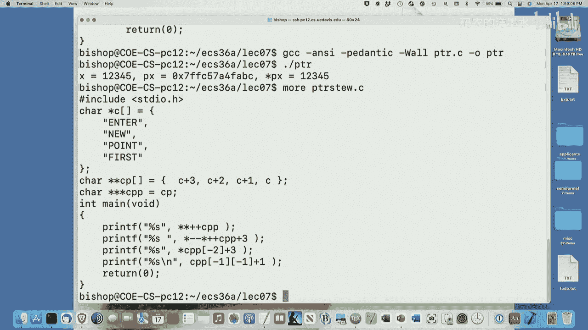

# C语言底层编程：07：指针与间接引用


在本节课中，我们将学习C语言中一个核心且强大的概念——指针。指针允许我们直接操作内存地址，从而突破函数无法直接修改外部变量值的限制。理解指针是掌握C语言底层编程的关键一步。

## 课程概述与准备

上一节我们讨论了函数参数传递的局限性。本节中，我们来看看如何使用指针来解决这个问题。

在深入之前，请注意一些编程实践细节。以下是关于代码编写和环境配置的几个要点：

*   在代码块或函数顶部定义变量，例如 `int x;`，然后赋值 `x = 0;`。在语句中直接声明并初始化（如 `int x = 0;`）在某些C标准中可能不被支持，编译器可能会报错。
*   单行注释应使用 `/* ... */` 格式。`//` 双斜杠注释在我们当前使用的C版本中可能不被识别。
*   将文件传输到CSIF服务器时，请先确保VPN连接激活，然后使用 `scp` 命令。例如：`scp 文件名 pc12.cs.ucdavis.edu:` 可将文件上传至你的CSIF主目录。
*   从CSIF服务器下载文件到本地，可使用命令：`scp pc12.cs.ucdavis.edu:文件名 .`。
*   关于程序兼容性，不应假设在一种Linux系统上运行成功的程序必然能在GradeScope（运行Ubuntu 22.04）上正常工作。最佳实践是在目标环境或类似环境中进行测试。

## 指针的基本概念

现在，让我们进入正题。你是否记得，我们之前提到函数无法以让外部调用者感知的方式改变其参数的值？这确实限制了函数的功能。然而，在C语言中，有一种被广泛使用的方法可以绕过这个限制，它依赖于一种我们尚未讨论的结构——指针。

指针本质上也是一种变量，就像整数或浮点数一样。但关键区别在于，指针变量存储的不是普通数据，而是**其他数据在内存中的地址**。

### 指针的声明与操作

理解指针需要掌握两个核心运算符：取地址运算符 `&` 和间接引用（解引用）运算符 `*`。

*   `&` 运算符用于获取一个变量的内存地址。
*   `*` 运算符用于访问指针所指向地址处存储的值。

让我们通过一个例子来理解：

```c
int x = 0;        // 声明一个整型变量x，并赋值为0
int *px;          // 声明一个指向整型的指针变量px
px = &x;          // 将变量x的地址赋值给指针px
```

如何阅读声明 `int *px;` 呢？一个简单的方法是**从右向左读**：`px` 是一个变量，`*` 表示它是一个指针，`int` 表示这个指针指向一个整数类型。所以，`px` 是一个指向整数的指针。

### 指针的使用示例

通过指针，我们可以间接地操作它所指向的变量。

```c
printf("x is %d\n", x);      // 直接打印变量x的值，输出：x is 0
printf("*px is %d\n", *px);  // 通过指针px打印它指向的值，输出：*px is 0

*px = 5;                     // 通过指针px修改它指向的内存位置的值
printf("Now x is %d\n", x);  // 再次打印x，输出：Now x is 5
```

在这个例子中，`*px = 5;` 这条语句意味着“前往 `px` 所存储的地址，并将该地址处的值设置为5”。由于 `px` 存储的是 `x` 的地址，因此这实际上修改了变量 `x` 的值。这就实现了在函数内部修改外部变量的效果。

## 总结




本节课我们一起学习了C语言中指针的基础知识。我们了解到指针是一种存储内存地址的特殊变量，通过取地址运算符 `&` 可以获取变量的地址，通过间接引用运算符 `*` 可以访问或修改指针所指向的值。掌握指针是进行C语言底层编程、动态内存管理以及构建复杂数据结构的基石。在接下来的课程中，我们将继续探索指针的更多应用，例如在函数参数传递中的使用。