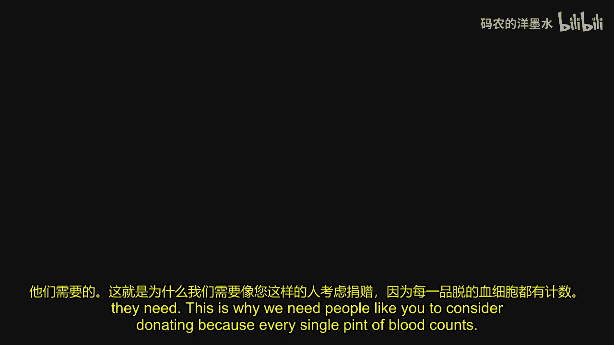
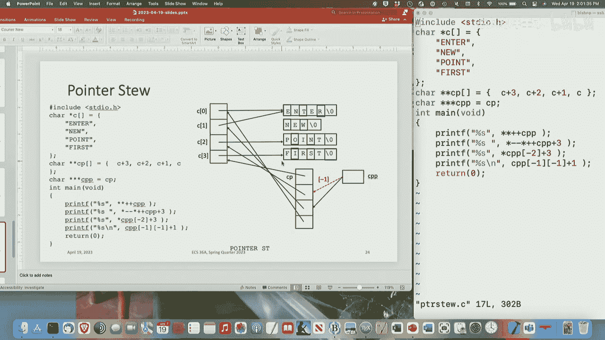

# 【全集】加州大学戴维斯分校 C语言底层编程 中英字幕 完整课程 p08 Lecture 8 - 数组与字符串 -BV15C6FBsE3L_p8-

Hi everyone， my name is Tishsha Ayer and I'm here on behalf of Primat AmA and my T。😊。

I just thought I would start the announcement already because professor is not here yet and I'm sure I don't want to waste your time So UC Davis is having a blood drive on Wednesday April 26 Thursday April 27 and Friday April 28 and this will be taking place on the US quad to give you some brief context on the situation we do have a national brush shortage right now and this was declared last year。

 This means that many patients including leukemia patients and trauma patients will not be able to get the blood that they need。

 This is why we need people like you to consider donating because every single pint of blood counts。

 So I'm going to be passing on flyers that have the QR codes on them please do raise your hand if you would like a flyer and there's also a phone number on here and eligibility requirements is also Thank you everybody for your time and support。

😊。

Okay， good thing all the batteries is fixed。I ended up bringing my own just in case。

I'll continue to do so。Okay， great question。Does anyone here receive a call from Comcast saying， hi。

 we've got this great deal， we're partnering with Target and so on。Anybody's seen that？Okay。

 because there's a scam going around， it sounds very good until they ask you to。

We don't want your bank account， we don't want your credit card numbers。

 what you're to do is go to the nearest store that is not target and it sells target cards。

Buy one and then put three months worth of your bill on that card。

 Don't tell them what you're doing because they'll try to charge you more and then call us back and give us the number and you're on。

The moment anyone says， don't use your credit card， buy us this card， and do something else。

It's almost certainly a scam。Anyway。Makes life interesting， occasionally。Okay， are there any？

Are there any questions about what we've been doing。

 I'm going to go over the point or do the things again。So except for that， are there any questions？

In particular， are people able to download things to CSIF and upload them to upload them to your regular computer and then to great scopepe。

Okay， because I've gotten a couple of questions about how to do that。

So just in case I'm going to keep the instructions at the front of the slides for a couple of days。

 for a couple of lectures。Okay， quick review pointers。It contains the address of another variable。

 and there are some examples。Again。Percent P is how you print out a pointer。

 but you must cast it to a void pointer type。啊。It'll print anyway if you don't do that。

 but you'll get a message。And Ampersand means get me the address of a variable。 And the star。

 which is called de referenceence， means get me what is in the address that that variable contains。

 So it's in direction。And in pictures， this is exactly what's going on。You have V as a variable。

And at the address。0 x means headecimal。 So it's an address。hexadeadecials is zip 7， F F， F 3，4，2，9。

3。 Does everyone here know about hexadecial， by the way。Is base 16。

And the numbers from 10 to 15 are ABC， D， E， F。I'll go into that in more detail in a day or so if people are interested。

And then if you look at PV， which is the pointer to V。It contains the address of V。

So to get the contents of V， you can either say V or you can say star PV。

And it'll both return the same thing。You'll see why I showed you about passing arguments。

 pointers as arguments thats。One of the main uses of them。

 there are a couple of others that we'll get to in a bit。A re see， this is an array of integers。

The brackets。Here， you contain the index。And C the rate you always start with index0。And you can。

Treat them as essentially what to call pointer constants。 That is their pointers。

 but you can't assign new addresses to them。So x array array 0 and star x array array refer to exactly the same thing。

Because the way you figure that out is you take what's in between the brackets。

 which is zero and add it to the point of constant x array and then dereence it。

 so x array 12 says add 12 to whatever x array is and then dereference it。Now。

 the one issue is if addresses。啊。If you're not dealing with single characters or bytes。

When you add 12， you would get the wrong entry。So what the compiler does for you。

 you don't have to worry about this is it says okay， x array is an array of integers。

So when I go to the 12th element。That means I have to multiply 12 by the size of an integer。

 which on most systems is 4 or 8。So it automatically scales depending on the type。

That becomes very important later on。Okay， now on to some new stuff。

Here's how you initialize an array。You can put this either locally or globally。

And this says IARR is five elements and the elements are one， two， three， four， and five。

If you put in too many elements， the system will complain。If you put in too few。

Some will some compilers complain。 others will just put zeros where you to pan out the array。啊。

A better way to do it is let the compiler do the count。You don't put anything in there。If you are。

Not initializing。 This is treated just as a point of constant， pointing somewhere。

But if you leave that off and then put in the numbers。

 it'll count to five because there are five entries there and allocate space for an array of five element integers。

Now， initializing a pointer is a little bit different。You have to initialize it to point somewhere。

 so here's an in variable。And here's a declaration of a pointer to an integer。

I'm assigning that the address of IVAR of that variable。So this is how you do an initialization。

If you put a number there instead of this， one of two things will happen。

The compiler should reject it immediately。There are ways to override that。

 but compilers should reject it。In the worst case， what it will do is it will actually put that number in the pointer as an address。

So for example， if I put three in here。This pointer is pointing to the integer at address 3。

Which may or may not be legal。And there is one special address is always that is never used。Zero。

It's almost never written as0。 It's written as no capital N， U L L。 Let me see if I can。Okay， I。

 I'll show to you in a moment， then。It's written as NL。You can assign that to a pointer。

But if you try to dereference it， you'll get an error。

And it's commonly used exactly for that purpose。If a pointer if you want to make sure， for example。

 that you never go through a pointer。Certain now。What happens then is when you try to go through it。

 it says， wait a minute， address zero is illegal and stops。You just put a zero。

 put a zero or null in there。 and that's it。It's typically used when you have changed the things that are linked together by pointers。

 The last one you set to null。So that if you try to go too far， you， your program will crash。

And it's always better to have your program crash and do something you don't understand。

Because if it crashes， you know， you'll find the air very quickly。If it doesn't crash。

 you'll have to trace back through the program。And when we talk about memory allocation。

You'll see a few examples of that。Okay， now the reason arrays are important。Is because of strings。

A string is simply a sequence of characters。And the string is terminated by the zero byte。

 that is the byte， which is set to zero。 It's called the null byte。

Not to be confused with the no pointer。The null pointer came from the people who developed Uniuchs。

 if I remember correctly， the null byte N U L comes from a standard。So， for example。CA here。

 I'm putting into letters H， E， L，L O。😡，And then， the snowbi ended。Not sure why that Ly repeated。

But you couldn't leave off the six in this case。The way it's more normally done is something like this。

CSTR is a pointer to a character。And and that points to hello， which just stored somewhere in memory。

When it sees double quotes， the C compiler will automatically put a no bitete at the end。

 So you don't have to do this。Now。One thing that often happens with strings like that。

 when you do that。Is theyre put into read only memory？So you can't alter them。

This is a lot like the way Python handles strings。If you want to alter it。

 you have to make a copy of it， and then you can alter the copy。That doesn't always happen。

 not all compilers do this。Yes。Technically， I'm not。Technically， I'm taking this。

 The compiler will take this string and put it somewhere in memory。

And then it will assign the starting address。That pointer。Right， so， for example。

 if this string were stored beginning to address 10000。

This variable point of error would contain 10000。So it points to the string。

 It doesn't put the whole string in there， like Python does。You can't。嗯。

If you tried to do like x equals hello with x being an integer， the system。

 the compiler will tell you that can't be done。It has to be a pointer。Now， if you put into here。

 I'm not sure what would happen。 The compiler would certainly complain。

 but I'm not sure whether it would be a warning or an error。We can try it later on today。

But this is stored somewhere else and the place where it is stored is put in there。Okay。

 now a couple of warnings。If you want to duplicate a string， O， we've defined a string up here。

 CSGR is hello。If we want to make a copy of that string， do not do this。

I'm assuming C duop S TR is a pointer， by the way。So what I'm doing here is I'm trying to assign what this points to to what that points to。

That's not how it works in C。This is a point or an address， 10，000。

 they said earlier us hello is stored 10，000。So when you do this assignment。

 this becomes the same pointer， 10，000。It's not a duplicate copy。 It is the same copy。

Did theyFor those of you've read Python， did they talk about asing？Okay， if they did。

 this is exactly what's going on。 If they didn't， don't worry about it。嗯。

If you want to actually copy a string。There is this very nice handy function called ST CPY。

And I've declared to C do best jars as an array。So that there's actually some。

 this is associated with some space and memory。What this will do is copy what this points to。

To what that points to。So this will create a second copy of the string hello in the array。

And the way it works is this it continues copying until it sees that null byte the end of string。

And then it stops。Now， this function can be a little bit dangerous。

Suppose I said Cdu SGR to be an array of four。What would happen？Anybody care to， take shot at that？

Well， it would very happily copy five。Characters into what Cdu SR points to。

So that means it would overwrite。Various things beyond the end of C， S， C duop S TR。

 This is known as a buffer overflow。 And I'll give you a very graphic example of that。

And by probably about three slides。This one is much better to use。😡，This is just like string copy。

 stroke copy。Except it says only copy at most 99 characters。😡。

You always make a one list in the size of the array。 So if it's five characters。

 it'll copy all five just like stir copy and then continue on。But let's say we' say 300。

What this function does is it only copies the first 99 characters。

And then you have to add and no bite at the end。It will not do so if you， if。

What you're copying is too big。So this is the function that's safest to use for copying。

 This is this one less than the size of。What that points to。Normally。

 you'll never have a problem and this line is unnecessary。However， in some cases。

 may you may have the problem that CSGR is too long。In which case you need to put that in。Yes。

The actual string stir copy copies the actual string。You can send it to whatever you want。

I just used 100 here as an example。Yes， you could set it to six。Then both of these would work fine。

 except I changed that to 6。Right。So， yes， here I allocated 100 characters。 and the questioning was。

 why 100， And the answer is， it could be anything you want。 It had to be longer than 6。

Because there had to be it had to be longer than sorry。

 It had to be no less than 6 because the H L L O and No byte string is six characters long。

So if I wanted it to fit all the way in， that had to be at least 6。But it could have been anything。

Rather than six。Other questions？Okay， now。When we've been doing input， we've been using scananF。

Sometimes that can be a real pain to use。 like in the example I showed you where。It reads。

 I was trying to get it to read three， followed by three aes。The first one read the three。

The second one tried to read the exs as an integer and it basically failed。

So there are other ways to read numbers or to read input。

The the one that's most widely used is F get S。And the STD IN just think of that now as a magic constant。

 What it really means is standard input but。You give it the location where you want things stored。

 which is invariably in array。And then the number of characters。

 maximum number of characters of input you'll take。Now， unlike stirir and Copy。

 EGS always puts the null bitete at the end。Always。So here's an example。

 I wanted to read 100 characters from standard input， which is what you type most of the time。

 or could be a file if you do redirection。And it's going to be stored in the array buff。

And it will actually read at most 99 characters。 Anybody tell me why I won't read the full 100。

 Itll only read 99。Yep， bingo。ThereIt's going to add a nu character at the end。

FKS reads up to 100 up to 99 characters， really。However， if it then count as a new line。

 in other words， you hit return。It will immediately read what you typed and then return。

 It won't wait for 99 characters。So in other words， the formula is。

This reads until it sees a new line or a an end of file or 99 characters。And if it reads。

An end of file， will return null。This is the null pointer， by the way， the zero。

And there's an error in reading it。If it's read， no characters， it returns， no。

 if it's read some characters， it returns those characters。Now。There's another one。Get us。

The problem with gets is how many characters will it read。Well it'll read to the next new line。

Suppose Buff is 100 characters long， array of 100 characters。 And I type 1000。It simply keeps on。So。

 get us。Don is one you should not use In point of fact。

 one of the earliest worms that went around the internet。

 which would break into systems and do various well， didn't do various things。

 but it was still very nasty。Worked because the programmer used was able to get in through a server because the programmer used GetS。

Had they used Efgdness that particular attack wouldn't have worked？All right。

 let me give you an example of this。So let's stop the slides for a minute and see if I'm still connected to the CSOF。

You see him。Okay。I'll enlarge in this in a second。Can everyone see it？And way in the back。Bigger。

 right？How's that？All right。Now here is a toy program。

But I want to show you exactly what D us can do。Notice we have buff defined in the middle。

 it's an array of 10 characters。Before it， I is 4 and after it， I J is 5。Okay。Now。

 what do you do is I run get， I call read the inputs and get us。

And then I print out what the buffer is， whatever red， which is percent。

 you print that with percent S。 And then the two integers。 there's Buff and there's I there's J。

So let's go ahead and compile this。Now， the nice thing about GCC is it warns you， it says， hey。

 wait a minute。You've got getts here。 It says gets is deprecated， which basically means don't use it。

But we're going to go ahead and use it in two ways。 First， we'll start off by being good， good users。

C。Worked。Buffffer was hello， Is4 and J is 5， and that's unchanged。Now let's be bad users。

Now remember that Buff， the input buffer is 10 characters long。 Watch what happens to INJ。Oops。

 sorry， hang in there。When you overflow a buffer， that's called。

 the technical term for that is smashing the stack。And。

The Ganu compiler automatically puts in protections against that。So let me go ahead and recompile it。

 but without the。That disables the stack protection。I just want to say stack protect。让我。Right there。

 again， I get the warnings。But let's try that again with bad。It read the entire buffer。

And put a new line there。But really， the buffer ends here。So these get stored in memory somewhere。

Where？Right around where Buff is。So that's why I is no longer3 and sorry，4。

 and J is no longer5 because the variables get overwritten。By that string。

So this is why you don't want to use getS。 Now， F GS is a lot safer。So when he ran。Good。

 which uses Afghanness instead of S。Notice it truncated the input， it just stopped there。

And there are9 characters。 The10th is the backslash 0。And then I and J are completely unchanged。 Now。

 here's the program。Instead of saying get S buff， I said F get S。 and there's there's the array 10。

 I put in the size of the array， which is 10。And then I put S TD I N。

 which again means read from the terminal in this case。It read。

Nine characters added no bitete and then kept on going。And so when printed out the results。

There were no changes to I andJ。This is why it's so important to keep track of indices。

And sizes of arrays。If you make them too small。Strange things can happen like the variables I N J changing without any assignment being made。

This is part of defensive programming。Questions on this？Okay。

 now why don't we do pointers st except do it again a little bit more slowly？First of all。

This is C is an array of pointers。Each pointer points to a string。

The first0 points to enter and notice the nobody bite at the end。See 1 points to new。

 And then you see two points to point and see three points to first。So that's the。

 that's the one up there。 Then this one， the first element points to first。

 the second element to point the third element to new。 and then the last one to enter。

 So it looks like this。Notice these do not point to strings。😡，They point to pointers to strings。

That's why you'll have the two stars there in front of C P。

Because that's an array of pointers to pointers， to characters。And a string， as I said。

 is just really an array of characters。Okay， and now this one。

Is a pointer to a pointer to a pointer to characters。Which is Cp。So， this is the picture。

The layout of what pointer stool looks like at the beginning。Now。

 let's go ahead and execute that program。The first thing we do。Oh。That's what's going on。Okay。

 first thing we do is change CPP。 It was initially pointing here。But we have this plus plus。

 which means increment， go to the next element of the array， which is here。

This stays in black because it's permanently changed。

 the ones that are not permanently changed will be in dashed red。Okay。

 the next one is the first star。 So we're dereencing this。

And it now points to that one because originally， that point there as well。

And then we dereference it again。And that takes us over to point。So we print out。

 it will print out point。Questions on this？I warn you。

 it's very helpful to go through these things slowly and drawing pictures。Okay。

 you can do it without drawing pictures， but at least I've always found it to be really a pain。Okay。

Let's go to the next one。Again， we start here。 We're going to go this way。 And when we're done then。

 we'll add three to whatever， wherever we are。So we started with CPP。

 which pointed there after the first statement。 And we add again enough so that it goes on to the next element。

 which is there， and it's changed。Then。The first star D references it。 So that takes us up to C 1。

Questions。Okay， by the way， do you find this helpful or is this something I should not work， Okay。

 good。Thought it would be because pointss confused the heck out of me when I was wondering to see。

Okay。Now， the minus minus， that applies to this thing。Star plus plus CPP。 So it takes C 1。

And moves it to point at the same place the previous element did。Yes。Enlarge in it。

Let me fully you a thought of that。That。Is that better？Thank you， please let me know if I do that。

 okay。My wife tells me I need to check my brain before I leave the house。Okay。

 so there's the minus minus， which puts us there。So now we've done all of this。😡。

So now we have to add the three。And to do that。I use the red dashed arrow because I'm not。

 this is not a permanent change to anything。 It's just 0。 add add 3 to that。 You go E and T。

 And then you have E R。Okay， so we use this print F and it prints ER with the blank space after it。

Questions on this。Yes。Yes。0，1，2， and then 3， which is E。I'm sorry。 Yes， fourth character。

 because it's zero based。The first element of any array in C is zero。This can be confusing as heck。

Particularly when you're counting。Okay。Now let's go on to the next statement。we have here。Star CPP。

 -2。So。K， can you hear me？Good， we glad I had some backup。Okay。

 so in the in the in the pre in in this one， you have a pointer to there。 So when you do the。

The star。It takes you to hear。Now， what we do is dereence and subtract 2。

So what happens there is this。We subtract to。And that one takes us right over there。

So subtract2 first and then dereference it。Just like when we were adding things through to array constant to point of constants。

So this CPP is pointing here。Now， we're treating this as an array now。嗯。Like this。

And so we subtract to 1，2。 Again， it's not。Actually，2， It's two of the elements of the array。So。

 he moved to here。And then we dereence it because of the square brackets。So we're up there now。

And then the next one is plus 3。So。SinceThis were up here， this is the value of the pointer。

 and we add three to it。So it goes along here，0，1，2， and S T。Is what it points to。Questions on this？

And so that percent S prints ST。Okay， almost done。Yes。From now on， yes。Correct。Yeah。

 in the beginning， it pointed here。 but then we did plus plus in the first line and plus plus in the second line。

 which now we wound up there。Yes， this changed CPP's position down one。

Or up one depending on how youre looking at it。 This one did it again。

This did not change its position to subtracts two。And the references。Okay。Other questions， yes。

I'm sorry， could you？It we did reference from C。Why did we do reference from this to that。Okay。

 because we're here， so this has the value of this pointer。😡，And so when we add3。

 the pointer is over here。 There's no dereence in this。The dereence comes here。

Because this is a pointer to S T， nuitete。And when you say percent S， that means。

Do you reference the pointer and print what's there as a string？Other questions？Yes。

The minus minus in the second line subtracts one or moves you1 out to the previous elements of the array。

And it's done before the value is used， yes。😡，啊。These are the arrays。 This one is an array， as well。

Array of pointers， yes。And this is an array of pointers to pointers。

If you're thinking in terms of C+ plus or Python， yes。

But see programmers normally don't think of them as different classes。

 They're just different types of point。 There are ways containing different types。Yes。

That's exactly right。Okay， so now let's do this last one。First， we do this -1。So again。

 we subtract one and we're here。Then we do the next  -1。So。This one。 oh， sorry， I'm here。 This one。

Points up to there。And then。We do the reference going across。Because this。

 this refers to that the point where it C 1。And then we're going to add one。

Which gives us a pointer to EW。And so that prints out E W and the new line because of the backs。

I'd recommend you play around with this because quite frankly。

 if you understand exactly how this works， you've got a very good grasp of pointers。

Are there questions on this？Yes。这个觉。Yes。This is just a program。Okay， yes certainly。

This is a variable containing something It's a pointer in this case。

So then you do a plus plus that says， take this pointer。And add one to it。

 move it to the next element， to the next thing it's pointing to。Then the star says。

 figure out what the next thing you're that's pointing to is。And then the second star says。

 follow the first star and figure out what you're pointing to。啊。I don't know the default。

 It was assigned。Right。ABecause the computer looks at this。

And understands It's pointing to a pointer to a pointer to a character。

And since it's assigned the CP。This is an array of pointers to pointers to characters。

 So it knows that when you add one to this， what you're really trying to do is get to the next element of that。

The formal correct， the formally correct and proper answer would be， this is simply a demonstration。

The informal answer， at least when I first saw this one， was to mess with students minds。

Other questions。Yes。Adding the asterisk before。Okay， if we didn't add the asterisk。

 then C would be an array of characters， which in this case， by the way， is illegal。

 If you put the star in there， it's it's a set of pointers， array of pointers。 And when the computer。

 for example， goes through enter。It'll stick that somewhere in memory and put the address of that string in the zeroth element。

 and so forth。Because C。Points to seams。So you added another asterisk because it's appointed to a point you。

And then down here， this points to CP， so you add another asterisk because it's pointing to CP。

 which is pointing to C， which is pointing to those。Who else。Other questions， yes。あして。すばだです。あ。

Because of the because of the give me a second。Let me go back for a minute。

AndGo back to the beginning。Okay。For the last one， we had。See。We had this situation。

So CPV is pointed here， and C is pointed here。Now。When youtract， that's subtracting one。

 So when you subtract one here。It takes you up to C1。Give me one second， please。Okay。

 stretch when you were there。And you totract one and go there。Oh， okay。嗯。I think there's a typo here。

Let me， let me check something。Thank you， by the way， it's a good question。Okay。

 let's see if I made a mistake。嗯。And second。WithThis other way。Okay， so initially we have this。

Adding， when CPP takes me down to here。And another one to CPP takes me down to here。

And the there that goes。To there。And then the minus minus would change this one to go back one to eat there。

Then if I do minus2， I'm here。And then I do dereference and dereference。 and I get S G。Okay。

 CPP of minus1 goes here。And I， I subtract one from CBP and do reference。Then again， here。

 I subtract。啊。One， from that in dereence。I'm not sure let me I have to work it through， you got me。

Yes。Yeah。That's a zeroth element that points to C plus 3， which is。That one。Yes。Yes。

 this program was handwritten， not by me， thank Evans。

 and it's specifically used with pointers and they need to see， I need to double check that last one。

Because I'm not quite sure what happened there is yeah， let me go ahead and double check that one。

 I'll post the correct slides as soon as I've got them and I guess that's pretty much all I had planned what we're going to do on Friday。

Is go through command line arguments which also of pointers to pointers， yes。

Go through the notes in the book。Also， be sure you understand how the programs work。

 the ones that I've posted。And then the other thing is try writing some C programs。

The ZY book is good because it lets you build up slowly。

But there are a lot of Cbook out there that you can find。

