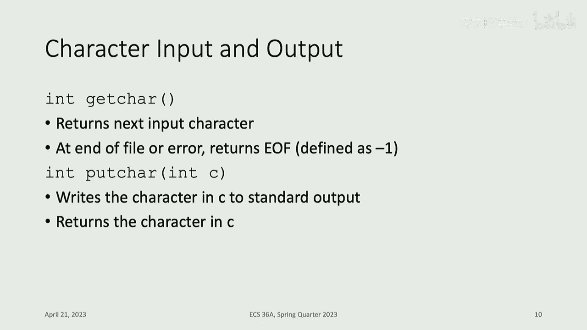

# 【全集】加州大学戴维斯分校 C语言底层编程 中英字幕 完整课程 p09 Lecture 9 - 字符串处理进阶 -BV15C6FBsE3L_p9-

Nike says it's working， can folks hear me？Hoping it doesn't run out of battery power。

How's the homework going。Oh。Question。Yes。I'm sorry。Yes。Yes。Yeah， by the way。

 if you turn in your homework and then decide you want to change something， that's fine。

It will let you update it any number of times。If you update it after it's due， though。

 that's going to count as the late submission。If anyone has trouble resubmitting because it says you've reached your limit。

 please let me know。I've。Talk to Canvas about the feedback loop you get when you click on one of the source code things。

And it turns out the problem is that the machine it's being linked to is not using SSL。So， you just。

What you need to do according to the Can folks。Is copy the link and paste it and you can go to it directly。

I'll try to get that fixed when I can， but don't hold your breath on that one。

And I'll get all the notes and set up。Okay， let's go ahead and start。First off。

 are there any questions from what we've been doing。Okay。

 couple of announcements then first on the extra credit， we found a bug in the driver。

 That's the program you download and paste your code into。It's only on the extra credit。

 it is not homework on the problem too。So if you were getting some unexplained errors and the errors will probably be along the form of bad return code。

Or a compile time error that refers to F per def being called incorrectly。

 If you get anything like that。Go ahead and download the version that's up there Now。 It's the right。

 It's the working。 It's the right version。And things should work。I think someone out。

 pointed out that there was a problem and when we were doing the debugging， we found this。

Slides and such for the past couple of lectures。We'll be up on canvas today。

 I'm also going to put up。In addition to a revised pointer stew。

 which shows more clearly how everything works。I there is， I put together a description。

 a textual description。And I put that。 I'll put that and the link to。

 and it links to the various slides so you can follow it both textually and visually。

The problem I had earlier last time was that I applied。

 I didn't apply something in the correct order。And so that's why I showed up it appeared to be wrong。

 It was not the problem。 It was me。 I， for some reason， I put the square brackets before the star。

Anyway， the one that's up there now for yesterday is correct。The one that's up there for this。

Exposition is also correct。And also， this mid this weekend。

 I'll start putting information up about the midterm and it give show you a sample midterm so you can see what it's like。

Sample will be much shorter than the regular midterm， which I'm going to time at around 50。

 hopefully 50 minutes。And it's in class， no， no notes， no books， you know， whatever。

 And on pen and paper， we will pass out the exam papers and write them。We'll take them in。

 running through grade scope， and then go ahead and grade them。Questions on any of this， yes。

What are the topics that will be on the midterm， basically everything up to the end of next next week？

So pointers will be on there。 I'm sorry， let me put it this way。 Pointiners are fair game。

Programs are fairly aim。One thing you don't have， one thing I should warn you。

 I may ask you to write five or 10 lines of C。I will not ask you to write a full program。

I'm not even sure I could write a full program in 50 minutes。

But I could certainly write a very simple function。

 And that's the sort of thing that I would ask you。Also。

 there will be multiple choice and probably match the letter to the answer， that sort of thing。

 as well as one or two longer ones。Yes。At the end， the final grades will be curved。 The test itself。

 I don't plan to curve it。Other question， oh， and if I curve， it won't be linear， that is， well。

98 is the highest solid at  two points to everyone's score。That's not how I curve。Other questions？

Yes。On the midterm， yeah， is there partial credit on the midterm， absolutely。So if you。啊。

Think you have part of an answer。But don't know the full answer。 Go ahead and put down the part。

That main number one trigger something in you that will give you the full answer。

Or at least you get partial credit。For the matching letters to matching things up。嗯。

You will definitely get partial credit， if you miss some。So if theres say 10。

10 things and then 10 long，10 short things， and then 10script longer descriptions。

 and you've got to match the short thing to the appropriate description。

If you get if there are 10 of them and you get eight of them。

That's that would be 80% of however many points that problem is worth。Other questions。Okay， again。

 I'll go over this in more detail as we get closer to the midterm。But。That's the gist of it。

Questions。Okay， to continue the pointers。How many of you tried to run loopy by hand that is on the CS S IF for in visualual studio or visual whatever。

Nobody， Okay， if you did。 What you had to do was give it two arguments。

 You had to give it a starting point and an ending point。I want to show you exactly how we use that。

Now， the command is loopy 5，9。If you look into the looppi or looppiier files。

 source files towards the bottom， you'll see this int main， in Arc C， Care RV。Now。

 this is simply an integer and it counts the number of arguments on the command line。

That includes the name of the program。So there will， this will always be one or greater。

Let me put this way。 if it's not one or greater， don't worry about your program correctness。

 your system is problems。嗯。This。Is an array of pointers to character strings。

And each character string is a separate argument。So in this case， loopy would be first。

 the zeroth argument， five， the first and9， the second。Now， this is sometimes written this way。

The two were absolutely equivalent in this context。嗯。for whatever it's worth。

 the rule of thumb I use is， if I'm using， if I'm doing this。

 then I'm typically treating it like an array。 If I'm doing this。

 then I'm doing something fancy with pointers。So don't worry about using either。

 So let me give you an example from that loopy。Here's visually what's going on。It has four arguments。

 zero to three。The R V in the parameter line for Maine。Points to this array。

This is an array of pointers to characters， character strengths。

A V 0 points to the character string loopy， which ends in the null byte Back there0。 remember。

 is the byte of all zeros。Rrg V1 maps to 5。Now， notice this is not an integer。This is a character。

So if you try to use this directly， I believe5 is something like 36 in integer format。

 so you get something really weird。So we would have to convert that to an integer。Same with9。

That's the second argument or the third argument， depending on how you count。And again。

 it's a string ending with a nullbte。Now， R V3 is present， but it's 0。

 It's what's called a null pointer。It's sometimes written this way。

 Sometimes it's written with a slash across。But in either case。

 the reason it's there is if you do go down the argument list。You don't need to worry about aV。

As you go down the argument list， check each argument to see if it's null， the null pointer。If it is。

 you're done with the list。And the problem。This is an example of why why pointers are important。

 because you have a pointer to a pointer。Pot you to an array of pointers to arrays。

Does everyone see how this works， yes？Oh， I'm sorry。 these were just put in for。

Expositionition purposes。And the real program may be different numbers。

Because they have the address of each of these strings。RV， you can name it whatever you like。No。

The what the compiler does is it looks at the second argument to Maine。

And then whenever you refer to that， it knows you're referring to the argument list。

So in other words， back here。I could have called this something like Lo Arc or something like that。

And then when it was over here。When I referenced5 and9。

 it would have to use loop Arc instead of ArgV。So what's really going on here is mean is just a function。

Like any other function。And so you can call it parameters， things in the parentheses。

 whatever you like。h， Arg C would be three。The integer 3。Because there are three arguments。Thank you。

 I forgotten about that。 I meant to put that in， actually。嗯。And again， Axy could just be N。

But then you couldn't use N anywhere else in the main routine， so。So main is just a function。

And what's load when your program compiles。And it generates an executable。

There's a little library called the C Start Library。That's prepened to your program。😡。

You don't have to worry about it。 But what it actually does is it sets up the argument。

 the count argument count， the R V C and the R V。And it will set up a an environment if you ask it to。

And then it calls me。So mainine is called as an ordinary C function。

And you treat it exactly that way， that's why you can ever return instead of exit。

Because you're just returning to the caller， which in this case， is the C startup library。

And as soon as it returns to there， it says， okay， take the value returned。

 stuff it into this exit status code and quit。Again。

 you don't have to know anything about the C Start library。 It's assemblysembling language。

 and it's hideously messy。Because it's intended for speed。Not human comprehension。

You can figure it out， it just takes a little while。Other questions。Okay。

 you'll see this over and over in the class using arguments。

Now there were a couple of other things that I wanted to talk about with strings。

Passing them as arguments。The prototype or the function the forward declaration would be this with the semi colonlon。

 and it's telling Stfunk that its sounded the compile that the function Stfunk has two arguments。

 both of which are pointers to characters。So if X and Y are character strings。By the way。

 I should mention a character pointer and a string。Are you typically used as synonyms。

But there is no string type and C。There isn't C++， but it doesn't exist in C。In C。

 a string is basically a care pointer and it points to an array of characters， which is your string。

Anyway， X and Y are care pointers。So you just call them， call SGR fun with these two。

When the compiler sees this， it checks to be sure that x is a care star and y is a care star。Now。

 when you go to actually define the function and say what it's going to do。

It's exactly the same as the prototype， except you name the parameters this time， first and second。

For whatever it's worth， if you did put first and second in the prototype， that's fine。

 The compiler will not object。And sometimes that makes life easier because you write out the function and then just。

Cut out this first line， copy this first line。 paste it up at the top of the file and put a semi on。

Okay， questions on that， yes。A pointer is a variable。Okay， and， and C it。啊。

It basically identifies where in memory something is。 A directory is a collection of files。

And so the directory is fundamentally different in that it's not part of a program。

Part of something called the file system。You can forget what I'm going to tell you now if it confuses you。

 but actually a directory or a file folder。Is not is a set of pointers。Two objects on the disk。

 which are the files or other directories。But that's very different than a C pointer。

We may get to that very near the end of the term， but we may not。 I don't know。 if not。

 you'll certainly see it in 32， No，36 B。Good question， others。

Especially is anything confusing people。Other than the whole of sea。Yes。So are you。Pointers。

I'm passing a character pointer into the function。So does it like？No。

 it brings in nothing but the address。Correct， it's important it brings in the address。

And then the function has to go out to that address and access the array of characters that way。

Like access。这边之我们。问题。If you tell it to。By， by default， it won't。

's's the string is off somewhere in memory。And you're simply telling the function， hey。

The string you use for your first argument is in that location。 That's all you're telling it。

Be very careful about that too， because with some languages， if you just say care。

 it will copy the whole string down。Not in sea。In fact。

 if you say care and give it a character pointer and C， I don't know。 Let me go it this way。

 Whatever you get， it'll be messy。Basically what it will either well the pilotr hopefully will give you an  error。

 but if not what it will do is it'll take the first eight bits of that pointer and treat that as a character。

 which is not what you want。Okay， now。Strings in sea。 There are all sorts of。

They're very widely used， and so some idioms have occurred around them。

 and I'll show you a program with some of them in a minute， but let me show you some of the idioms。

The first one is in a function parameter list， these two are equivalent。

Notice there's nothing in the brackets。That's important。Because the compiler sees that and says， oh。

 that's just a character pointer。And treat it as a pointer。

The first form is probably more widely used in C because you can go down the string， very。

 go down the character array very quickly。But either it fine。Okay。

 now here's where the really twisty stuff comes in。 And I want to spend a little time on this。

 because。You've all heard the phrase me you live in interesting times。Here's some interesting see。

We have a string called Ho and a pointer to it。And what we want to do is print that string。

We're going to do it character by character。Percent C， remember， is one way to print a character。

Okay， here's what happens。 Notice C P is star C P is initialized to Ampersand C。

 So now C P has the address of C。It's a pointer to that。

 And so what we're going to do is walk down the array  one character at a time。

 printing that character each time。Okay， so first thing， we're going to do it through CP。

 So first thing we do is we check what CP points to。If it's the null bitete， we're done。

Because every string has to end in an nubte。In fact。

 that's probably a good way to distinguish a string from a character， simple character or ring。

All right， so what we do now is this thing。First， ignore that plus， plus。Star Cp is H。

 Everyone see that。Okay， so we will print H。Then it adds one to the character pointer。

Meaning advance to the next character。Now， in pointer stew， we had a plus plus as well。

 but we did it first。Does anybody remember why？We did it before the reference， rather than after。Yep。

 what's basically happening here？😡，Is plus， plus after something means take the value of this and then add one to it。

Or。Next character。If it's in front， it means add one to the value。And then， use it。

So plus plus in front means do that first， plus plus and back means do that after。Minus minus。

 by the way， is the same。The reason they're there is because it's so。

 you'd so often add one or one character or one element of an array that it's just easier to write that than plus one。

 yes。This one is in the loop。Don attached to。Oh， right。 It's only attached to this point。

 Just So what that says is add after you print the value。Add one to the pointer。

 Then when you come up to here the value of Cp now is the original Cp plus one。

So now that C plus1 is a letter E。Which is not the null bitete。So you can go ahead and print it。

And then advanced the next character。That's L， which is not the nullbyte。

Print it advanced to the next character。It's another L。Print it， advance to the next character。

Then you have an O。Which is O is not the nullbite。 O is a character。

And you print it and then advance to the next character。Now， the next character is right after the O。

 And remember， when you use double quotes， C automatically appends a old bitete at the end。

So now this is false because star Cp does is the no byte C points to the indicator of the end of the string。

 So you drop out and print it into the line。See how it works？Any questions on this？

You'll see the plus plus and minus minus used quite a bit。So， and here。

 here's a slightly more realistic example。 Let's say I want to copy a string。

I want to copy C into the OACD。So first I get the addresses， the address of C is storing CP。

 and the address of C I'll store in CPD。Now， here's what happens。嗯。First。

 I get the address of CD and figure out where it points， which is array element0。Then I get C。

 then I get the value of what C points to， which is H。Add one to it so C is advanced。

I then store H in。Element 0， and advanced C， D。Now， this whole thing was H。 it's not zero。

So I go into the loop， which in this case is empty。 and I come back up here。

And they continue repeating that。The trick here is to remember， this is not a test for equality。

 This is assignment。If I had two equal signs here。It would fail it would immediately fail because I'm testing what C。

 D points to with what C points to。And I'm not sure what C would point to。

 It would be the zeroth element。And in this context， it would probably be zero or some junk。Yes。

Exactly。Comment was， is that H is assigned to index 0。 and then E。

 because your increment is assigned to one element 1 and so forth。 And that's exactly right。

One other thing I should warn you about pointers and things like this。

 Don't be afraid to draw pictures。Like I said， I've been using C for a couple of decades now when I still draw pictures。

So whatever is helpful。Go ahead and use it， Any questions on this particular idiom。Okay。

 let me show you now a small C program。That just copies strings。Where are you。And yes。

 I'll blow this up in a minute。Can everyone see that， especially in the back。Okay。Okay， first of all。

 here are the forward declarations。I'm defining four functions。 St one copy，2 copy，3 copy and4 copy。

All of them are defined after main。So when the compiler is compiling stuff。When it hits this line。

It's able to tell that these need to be character pointers or character arrays。

If I didn't have that declaration up there， it would think both would be integers。Which is fine。

 And then when it hits the actual function， it will say， wait a minute。You， you pass me an integer。

 You're passing in integer， but it really wants a character pointer， and it'll give you an error。

Okay。So I define max line。As 1000， if I remember correctly， Yeah， right up there。

 So what happens is when the compiler sees this max line， it simply replaces it with 1000。Same here。

1000， same there，1000。Wherever it sees Max just a straight text substitution。Just like。S or。

Command R or whatever， whatever using your favorite text editor to replace a string。Okay。

Questions on this part。Yes。Yes。Okay， here， I believe under the standard， it's supposed to be zeros。

All zeros。 I wouldn't depend on it because some some plate， some forms of C don't use that。啊。

If you yeah， so， but you're right， this is simply an array of characters。And in fact。

 this is a prompt telling the user to type away。And here I'm reading what they type。

So whatever the type goes into B。And it record all characters up to the 999th。

If it's shorter than that， that's fine。 If it's longer than that， you get 999， and then the no byte。

And STDIN means basically read from the terminal。Stands for standard input。

Which is typically terminal or a file if you redirect input。Alright， so now we've got what Buff is。

I've got some text in there。So with St one copy， I'm going copy the contents of Buff into new。

And then print out the line。And I'm going to do this for all four of them。So let me keep on going。嗯。

You can see2 is the same， except for the number。3 is the same， except for the number， and so forth。

Okay， now here come the functions。Oh yes， and then I say goodbye by doing a return。Okay。

 here's the first function。 This is Stir copy 1。And it's。Very clear。

 very simple in a standard way of doing things。I'm passing in new and old。By the way。

 this new has nothing to do with the array I allocated in the main function。This is a parameter。

So I started in De zero。Check to see if what I'm copying is the null bitete。If it's not。

 I copy it into new。Add one to I。And I continue doing that。This is the clearest way， probably。😡。

Because it tells you index the contents of index 0 of old。Are being copied into index 0 of new。

 Then one of old will be copied into one of new and so forth。And at the end。

 when this equals the null byte， I drop out。So I don't copy it。

 but I need to make sure it ends in a nullbyte。 So I add it at the end。Questions on this？Yes。

You mean， you mean the older。Here。Because old copied everything from old into new。

And then old hit the nullbite， the end。So new needs to say， okay， this is the end of my string too。

And so that's when you do the assignment。 The reason you don't have to say plus one or anything is because of this。

 What happens is I plus， plus becomes。The index of the null byte in old。

And so then the index of the nullbiide and nu should be the same。Other questions？Yes。

The index is an integer that typically starts at zero。

And then you add one to it and you treat it exactly like an integer。A pointer is an address。

And when do you do the plus plus， for example， or add one to it。

 If you're pointing to a character string or a character array。

 it will just advance to the next character。So the difference is that an index is an integer。

That you have to add to the basis of the array in order to figure out where in memory it is。

With a pointer， you don't have to do that addition because the pointer is the address itself。Yes。

 we're assuming the string already exists。If it doesn't exist， so if， for example。

 you say Carestar C P， semicolon， one of two things will happen。 It'll either be empty the。

 the null pointer。Or it will point somewhere randomly。It depends on which implementation of C you。

 which version of C you're using。So in any case， it's not a good idea to use a pointer。

Until you've initialized it。And the new compiler， by the way， will tell you。Okay。

 so now we're going to start getting off into the weird。The null byte is a zero。Since this is true。

 since the expression in4 is either true or false。And if it's non zero， it's true。 If it's 0。

 it's false， we can omit the equals nullbte。Because when this hits the null bitete。

 it's going to be 0。 So this condition will be seen to be false。That that's very common， by the way。

What it's saying is when old divide， when the character index I of old is 0。

 which is the end of the string。Then。You've copied the string。

 And so add on a nullb to the new string to show that that's the end。In the parameter passing。

This would be mapped into old。Because all the。Function has new and old in its parameter list。

So this is the call。 So Buff gets is the second argument。 So it， it would get matched withhold。

New is the first argument， so it gets matched with the new。Other questions？Okay， first function。

See this？Second one。I the magician would say， now you see it。 now you don't。把这个。You're checking。

 that's the trick。This is a v expression。And if it's zero， then it's false。It's treated as faults。

So when while the nu bitete is unequal to 0。I as unable to the nullbte， whoops。

 Let me get that back up。Over here， it's true。 This is true until old of I becomes 0， the nullbite。

Then this is false and you drop out。But if you leave this off。

In the old I will not be 0 because it's the letter H。 the number corresponding to H。

 and then E and then L and then L and then O or whatever。 And finally。

 it will reach the end of the string where there is a zero character。So this。

 this expression would be 0， and you drop out。没。So you can， that's like I say， fairly common idiom。

Now， actually， that was not weird。Od。Okay， now we're getting to the little bit really odd。Same thing。

 And we're doing a character by character。So we started to index a zero。

We get the zeroth character of old， which is H。Copy it into new zeroth character of new。

 which is age。Enter the for loop， and it's an empty loop。 So we go here and add one。

Then we take the old character in index old with index 1。

Copy it into new and see whether or not it's 0。 It's the nubte。If it is the no bike。

 then we drop out。 But in this case， which is we're talking about hello， what would be an E。

Add one and so forth。So this takes advantage of number one。

 the that any E C assignment statement also has a value， which is namely the value assigned。

And number two， expression here can be treated as a condition in the sense that if you copy zero from there to there。

 the value of this will be zero and you'll drop out of the loop。

If you copy anything other than0 from there to there， it will be non0。

 So you'll continue on through the loop。Yes。Because it's false。Everything besides zero is true。

Zero is false。Right， but that's the index。 That's not the contents of what's at that index。

ALittle piece of very， very arcane folklore。 One of the earliest computers this was done。

 C was developed on what's called a PD P 11。And it turned out on that machine for some really weird reason。

Anything positive was true， and anything0 or below was false。

I know of no sea implementation for which that's true anymore。 thank heavens。So just remember。

 zero is false， nonze is true。That's the mantra。Questions on this one。Okay。

 now notice here we're incrementing I。Each time through。Well， these are arrays。

If we make them pointers， then we can simply agreementement the pointers themselves。

And that leads to this one。We started the beginning of old， which is going to be an H。

 The reference it's an H。 And then we add one to old and use that next time。

We dereference new and stick age at the beginning。And then we add one to that value。 And it goes on。

 It points to the next square。 So now both of them are pointing to the element with index 1。

Same thing。Then then they point to 2， then 3， and then 4。 And when they get to 5。Star old is， is 0。

 the nobte。 So that gets copied into new。 then the location in new。

And then the value of this expression is 0。One thing you should be aware of is that new when you drop out of that loop。

 new and old point to beyond the end of the string。And the only way you can。

 you can't use them after that。Unless you， you can use them in a subtraction to see how long。

 how long the thing is。 but that's it。If you try to store another character with new points。

 if you're lucky， the program will crash。If you're not。

 it'll overwrite something and keep on going merrily。And you won't find out until。

 won't find out until later， hopefully before you demonstrate the program。Questions on this。Yes。Ws。

To the address。Right。Yes。The pointers would change。Mifies。Okay， let me split that into two parts。

Some competitorsrs， when you write out a string like hello like you do with hellello。

 will store that into a chunk of memory that you can't change。Read only。However， when you copy it。

 you're copying it into it read and write area so you can both read and write that area。So in a way。

 it's like Python。 when you define the string， that's immutable。But if you do the copy correctly。

 you know， the open bracket， Co and close bracket， what you get is a mutable copy。Right。

What you can do is。Since these are pointers。They point up to the string to the strings。

 This is an array。And this is something you read。So neither of these is going to be in read only memory。

 Both of them will be in write and read write memory。 But the important thing is。

 you're not changing the contents of old at all。You're changing the contents of new。

But you're doing it not by going out to new directly， but by using the pointer。Yes。Yeah， yes， here。

 let me show you。I can get there。Yes。Notice it says care Buff max line。Buff is a point of constant。

So when they load something in to it like this。It's going into that array。 But you can。

 but it's referred to by the address of the array， which is Buff。

Which is a pointer because it's the address of the array。In this context。

You have to define the index so the compiler knows how much space to allocate。In the functions。

 you don't， because you're passing in whatever is there。But if you left， if， for example。

 you said buff， open bracket， closed bracket。The compiler should reject it。

Because then it is no idea， what do I sign？Other questions？Okay， now。

 now that I've shown you all this， let me show you how it's done correctly。Right right。

 not correctly， but the best way to do it。 Where's my slides that we aren。

Best way to do it is to use stir copy or stir M copy library functions。

The reason for this is that in some cases， library functions can be implemented in a way that's much faster than programming them in C。

So， for example， some， some architectures have string moving functions。

 You can move a string with a single instruction。And that's not something you would do and see。

But you could use that to program strand copy， for example， a stir copy。

And the other advantage to using those is when you look at them。

 it's very clear what's going on when you do the loops and such， it's somewhat clear。

 but it might take you a second or two longer。Or more than five seconds or 10 or whatever。是。

