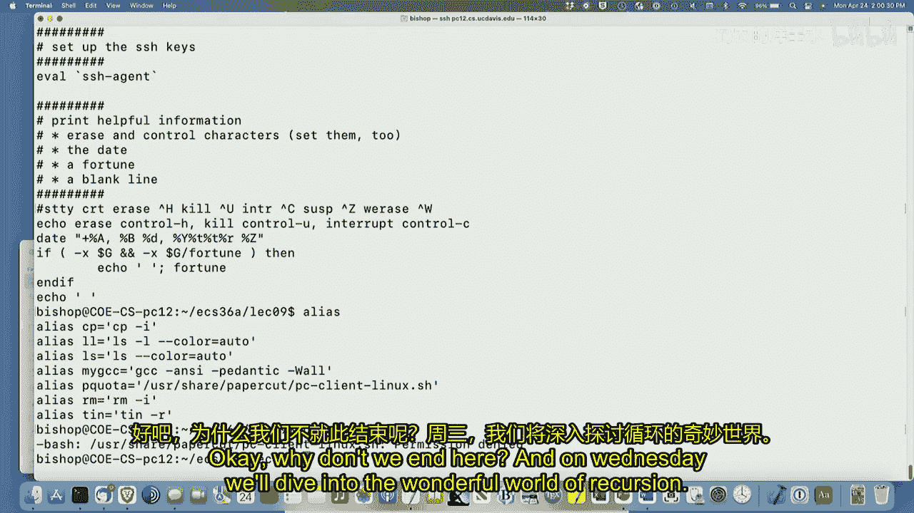

# 【全集】加州大学戴维斯分校 C语言底层编程 中英字幕 完整课程 p10 Lecture 10 - 运算符 -BV15C6FBsE3L_p10-

Okay， folks， can you all hear me， okay？All right， hopefully Mike's not going to run out of battery power。

Don't think I'm that loud， but we'll find out。Are there any questions about what we've been doing because I want to go over a couple of points rather。

In a little bit of depth。Then we'll move on to a new topic。Okay。

 a couple of announcements to start things off。 They are not yet on canvas。

 They will be as soon as they get to my office hour because they're all prepared。

 I just have to load them on。There's a sample midterm and a study guide。

The Singapore midterm is fairly short， and it shows the type of questions I'm likely to ask。

no guarantee those will be on the test。 no guarantee they won't be。

And the study guide lists basically topics on Friday I'll upload to Canvas the answers to the sample midterm。

So you can catch yourselves。Second one is， I got a lot of questions about problem  two on the homework and a lot more about the extra credit。

All of the questions were basically the same， which is people were getting this message。

 It would be a show run run test dot P Y and then something like line 13 or line 15。

And then an error。And the， and then it would say that the file was not in JSO in format。

For those of you who are desperate to know。Gs the autograer produces。codeode in answers。

 takes answers and puts them into a particular format called JSO N。And the problem here is。

 it's saying there's no such file。Well， what's going on is there's no such file because your program is still running and had to be terminated。

 That's what the killed 15 means， or killed 13。And you'll see this message。

 the autogrator failed to execute correctly。 Please ensure that your mission is valid。

 Contact your core staff for help in debugging this issue。 And then there's a little more after that。

Invariably， what's going on is an infinite loop。That is a loop， which starts， but never stops。

And once you fix that， that message goes away。I should say the message should go away。

 All of the ones I saw did go away。Now， with the extra credit。

 one of the problems that I saw crop up very often。Was when you used the negative。Increment。

 So when D was minus。So， for example。If this happens to you。Put your pro run your program。

 But run when you run it， run it like this with 55 and -10 is the three arguments。

What usually happens in the cases that I've seen is it goes 50，60，70，80， because people are。

 since this is bigger than that， people subtract。 What happens when you subtract the negative number。

it's the same as adding that， adding the absolute value of that number。

And so you go into an infinite loop。The four statement， by the way。

 the do4 is usually where I've seen it， but if you do see that， if you do find that it。

 that's the problem， check the other two as well。All right， any questions on this？Yes。

Will I be posting more homeworks， Yes， homework 2 will come out tonight or tomorrow morning。Yes。

There'll be an extra credit associated with each homework。Okay。

 and there may be other extra credits as， as things go along。Any other questions？Okay， plus。

 plus and minus minus。 There were a couple of questions about that。 And I wanted to go through it。

The main thing is plus plus is going to add and minus minus is going to subtract。Now， noally。

 they subtract one。However， if you， your structure is bigger than a bite， for example。

 of an injure with four。If you're using a pointer to that in to that an integer array。

 when you say plus， plus， it goes to the next element。So if it's not a pointer。

 it typically means add one。If it is a point your means typically advanced to the next element。Minus。

 minus is just the opposite。If it is a number， variable is a number， then it means subtract one。

Otherwise， if it's like a pointer or something like that， it means go to the previous element。

Now a word of caution。Whether it does this before you use the value in the variable or after。

Depends on where you put it。If you put the plus plus or minus minus in front。

It will do the increment or decrement and then use the value。If you put it in the back。

It use the value and then incremental to decorate the value。So， for example， if5， if a is 5。

You increment first and then use the value， which is 6。And a is 6，2。

 If it's after you use the value first， which is 5， and then you increment it， which is 6。 So x is 5。

But A is A is incremented so it becomes 6。Similarly。Minus minus。If a is 5。

 this means subtract 1 from a， which is 4 and assign to x， so x and a are both four。

But if it comes after you take the value of a first。 So x becomes 5， and then you subtract one。

 which changes the value of a to 4， and you get that。That makes sense？Okay。

 this can be a little bit tricky because。Because of the positions of the operators。

It's usually either one way or it's usually one way and invalid the other。 for example。

 if you're multiplying you just say three star5， that works if you say three5 star unless you're doing a what's called a reverse Polish or post fix calculation。

 that's an error。Here， putting it in front or and back doesn't matter。But， it changes the meaning。

Questions on this。Okay， there's one other thing that I wanted to make clear。

 Then I'll run to program and show you this。Evaluation of arguments to functions。

The order in which arguments are is not defined。So in other words。

 if you have a variable or an expression。Actually， two expressions。

 It's not clear which one goes first。 Usually it's done left to right or right to left。 It varies。

 The compiler at the C SIF did it left to right， did it right to left。

But when you see something like this without knowing the specific compiler and how it works。

This can either be6 x is 5， so this。Xx here plus plus x would be 6。Plus plus x would be 7。

 so it could be six and7， or it could be5 plus plus makes at6。Plus， plus， makes it 7。

 or it could be 7 and 6。Now， technically， it could also be a lot weirder。For example。

 there's nothing in the standard that I'm aware of that prevents you if you have a function of four arguments。

 starting with one of the middle ones。And then， going。Buncing around。

 I know of no compiler which that does that。 And someone who wrote a compiler like that probably has a lot of other problems。

 too。So it's almost always left to right to right to left。 Now， let me give you an example of this。

Yes， I will margin this。Can everyone see that， especially you folks in the back。Okay。

Here is a very simple program。The main routine。Has x set to 5。

 And then it prints out the value in each case of x plus plus and x minus minus both front and back。

It then calls a sets X to 5 again and calls the function with these two arguments。

So is so the question and it prints them in the order they were received。So this could be 5。

 and that could be 6。Or this could be 5， and that could be 6。

 depending on the order in which you evaluated it。So let's go ahead and run this。Okay， yeah。

 the first two are pretty clear。Since the plus plus and minus minus come after。

 each of those should print 5， and in fact they do。With this one。

 the third one since plus plus comes first。It should be。 It should be evaluated as 6。

Because you take the value after the increment。And so it does indeed print6。

Same thing with minus minus。 It's 5。 subtract1 and comes 4 and should print 4。

Now for the order of the argument， since x is 5， it's either going to be 5， 6 or 6，5。

 I can't think of any other ways to put it。What this does is it calls the function F。

 which simply prints out its arguments in order。Now， if it goes left to right。This will be 5。

 and that will be 6。 So it would print 5，6。If it goes right to left。That would be 5。

 and that would be 6。 So it prints。 it would print 6，5。And， in fact， that is， in fact， what it does。

So the arguments go left， right to left。Questions on this？By the way。

 anyone who writes code like that is needs to sharpen up their clear， their clear practices because。

Two parameters that are the same。With plus， plus in both of them。Pretty clearly isn't going to work。

 The right way to do this， by the way， if you want to do it is set a variable Y to x plus plus。

And then you can put x plus plus in either place in the Y in another place。 and that forces。

And since y is this a variable。You get that value。Doesn't matter where it is in the argumental list。

And with x plus plus， you'll add1 to x， but it'll print what's in Y and then what's in x。

But this would still work。No。有。The problem with this is， all right， actually。

 let me phrase my answer。On any machine， you will get a well defined answer。Okay， well either be 5。

6 or 6，5。However， if you'll plan to move your programs to any other machines。

This is very bad style because you don't know whether that other machine will use the same order。

Same。The same order of evaluation of the arguments to the function。

 You don't know whether or not it will do this one first。 and then that one or this one first。

 and then that one。So in other words， be careful when you're doing arguments， yes。

Everyone hear the question。 It's when we were talking about lazy evaluation。

 didn't we say everything is evaluated left to right？ And as soon as it comes to a conclusion。

 it stops， Yes， but that's for logical operators ands os and knots。You don't。

So the right way to do this would be something like this。I don't know。

 I haven't looked at that Python standard for a little bit。Python may well be left to write。

 it's a very sane language。是这类。Lazy evaluation only applies to logical arguments or to logical operators。

What you can do also is this。And now I want to reverse the order of foie。 So I printed 6，5。

 I wanted to print 5，6。I want to type it correctly。嗯。I forgot to reset x to 5。

But notice here it's going that way。 But here it's going that way。And here's why。

If you look at the first one， you don't know in which order they're going to be evaluated。

If you look at the second one。Y equals x plus plus。 So Y is evaluated before the function is called。

And then I'm passing in why？So it doesn't matter whether it evaluates them this way or that way。

 the change in X will not affect Y at all。Yes， it always does things sequentially unless changed by a loop or a jump。

That'd be an interesting programming language。Random execution of statements。

 Rand order of execution。WeWouldn't want to program in it， but it would be an interesting language。

Any questions on this， yes。What's the difference between putting the plus， plus before and the plus。

 plus after。Okay， if it's plus， plus before。You add one to the value。And then， use that。

So here this after this statement。X is going to be 6， and you're going to use the value 6。After。

 though， you use the value of the variable first。 So you， you would print 5。And then plus， plus。

Means then you would add one to add one to x， which means x is now 6。You're storing the6。

 You're not doing anything else。Other questions？Okay。HowHow in general is the homework coming。Okay。

I will take it to that， yes。I'm so glad you asked that。Because here it is。Actually。

 let me find it first。What happened there？Okay， yes。

 we'll have to write the program real quickly though，Let's say we want to do the following。

We want to count the number of principal characters。And the number of blanks。

Spaces or you'll see in books it's also called white Space。

The reason is because the terminal screen is typically white。

And so when you put spaces or tabs or whatever it shows up is white。In the early days， teletypes。

 which is what people use for terminals， also had white paper in it， hence the name white space。

 Okay， so let's go ahead and do hisprint。Or do count， it's called count。And we'll go ahead and。

Read in the read in the line。Okay， now I'm using Buff。And I haven't defined buff size。

 So let's go ahead and define the array。And we'll just pick a large number for buff size。

And we'll fix up our call the mean。Okay， so what we want to do now is count the number of blanks and the number of printable characters。

 so let's define two variables。Okay， so now we've read it a line。

So what we're going to do is go down the line， character by character。

And checking each to see if it's a blank。Or a principal character。So。

And we're defining a pointer to a character， so let's go ahead and put that in there。

You can type it right。And now what we do is we have just a giant statement。Okay。

 does everyone see how we did that？I mentally broke the program down into steps。

 First step is read a line of input and continue reading input until you reach an end file。

Second step is once you've got a line of input， figure out where the blanks are and figure out where the printable characters are。

So the first line， the well， will get the line from input。

 and it will continue doing that until it reaches into file。Whoop， I'm sorry。

This is why it helps to review your program。There should be the no pointer。 F G S returns Buff。

If they' red anything and if not， it will return null， the null pointer。Okay。

 then to go down the line。I simply use a force statement。 I started the beginning， buff。Here。

And I keep going until I reach the null bitete， which ends the line。And for each character。

 which is star P， because P points to a character in buff。I check to see if it's printing。 And if so。

 I add one to the print count。Otherwise， if it's not printing， it may be a space。

 So I'll add one to the to the count of blanks。Yes。Because it will do that automatically。

You mean if we just？嗯m。If you just put the name in， it's going be a single character。

YouYou have to tell the compiler it's an array。And the compiler automatically assumes it's going to start at zero。

And there will be buff size entries。 So if buff size is 1000， it'll go from 0 to 9，9，9。Yes。I'm sorry。

 to replace。With null， because E OF is a constant negative one。

That is used when you're dealing with characters。No is the zero pointer。

And you use it when you're dealing with pointers。And FGS returns the address Buff。Which is a pointer。

Assing everything goes well。 If anything goes wrong， it returns to nu pointer。

So it was simply that FGS uses null to indicate end def file or error。So this。And like the one。你来。

Inur of。Yep， Etht ask when it returns， returns its first argument。

So actually is returning a pointer too。What's red？It assigns it to an array and then gives you the address of that array。

Since I already know what Buff is。I don't need to save the return value。Yes。😊，Oh， okay。In C。

 there are you， you read and write files， and we'll get to this later this week。

Using what called there's a function called F open。

That returns a pointer to a structure that encapsulates information about the file。Now。

 there are three that are defined always。S TD I N， which is standard input。

 That means like from the terminal。 Or if you remember， you could do a redirect。

 So you read from the file。If you do that， the program doesn't know whether it's coming from a file or from a terminal。

There are ways to tell， but the programs I show you won't do it。

So SDDO UT basically means terminal screen。Standard output。 And again。

 you can redirect it into a file。STDERR is another output。File pointer。

But this one is arranged so that unless you specifically redirect it。

 it will always go to the terminal。Yes。嗯。I would， wouldn't come from the input then。Right。

 FGS reads input。That， by the way， the first argument is where to put the input。

 The second is the maximum amount of input it you can handle。And then the third S D， E。

 I N says is from the standard input or from the terminal。Yes。

It would hold 100 characters plus on no bite at the end。Other questions， yes。No。

 Buff size is constant。 It's pointing to buff。To that array。It starts at the beginning of the array。

Checks to see whether or not that's the Nobite， whether or not it's the end。If it is not。

 then it executes these two things。Comes back up and adds one to the pointer。 Now。

 it's pointing to the first or second， depending on how you count character。

If that one's then nu'll bitete。It drops out。 If that was not the nullbte， it continues and so forth。

By the way， would this have been any different if I had put plus plus P there？Yes。嗯。Very good shot。

But no， the reason is that this P plus plus。The value of that is where P is pointing to。

 and then you'll increment it。 But look what happens， It just discards the value。

So purpose of this is to add one to P。 So it doesn't matter whether you do it in the front or the back because the value is not used。

The value is only used after that statement。So in other words， this is a very common aiom you'll see。

 by the way， the the P plus plus， or some people would do it plus plus P。

It doesn't matter because what happens is。If you do P plus plus。

It takes the value of P as the value of the statement。

Then adds one to the value of P and stores that。 And then it says， what do I do with this value。

 You didn't tell me to assign it anywhere。 Okay， I'll ignore it。 and keeps going。

Same thing if you do plus plus P。It will add one to the value of P and store that and then give you that value of P。

And you look at it and go， look at it and say， I don't know what to do with this。

 No assignment or anything and throw it away。In either case， P will be incremented by one。

Which is what you're after。As another let me run this once and then we'll do it another way。

Which were really， yes。Yes。My apologies that I'm working with another language， not Python， where。

It's sometimes where you use print。 So thank you for catching that。Other questions。Print death。

It should be。哦。No， is， if is printer is correct。Because it's saying this this。Point。

 does the P point to a printable character。So should we go ahead and try to compile this？

Oh we're going to get。 We're going to get near， and I'll show you why。Here's the problem。

 I never told her what print F was。So when you're doing something like this。

 what you actually need to do is the following。All of is print is space， is alum， is digit。

 and all that are defined in that file on C type。S。No。Print， I'm sorry。 Print F is is print is not。

Okay， let's go ahead and run this。Okay，18 principal characters。And two spaces。

This is a control character， and it's neither a principal or a space， so it's ignored。Now。

 here's the other way to do that。This is exactly the same meaning。As the plus plus。

It just takes more characters to type。 so it's not used as much。One of the rules of programming。

 which I suspect you all learned in Python is be lazy。If someone else did it。

Give them credit and borrow the code。 If the library does it， use the library。

If there's a really convoluted way of doing something and then a very easy， quick way。

 pick the easy way。Not only will that be simpler program。

Itll be simpler to read and understand later。Okay。Does that help with is print？Okay。

The next thing that I wanted to show you one second， please。Yes。啊。

What happens is it continues evaluating them until I call it to stop。The way you stop it。

 what he did was they held down the control key and typed the D。 Control D means end the file。

So when I get control D， the operating system told this particular program nothing more is coming。

And to file。And that program then said， okay， I've get us return null。

I've been told on some systems end to file is control Z。

I was told this was true on some Windows systems。 So bear that in mind。嗯。Okay。

One more very simple program。For copying input to output。Here's the EOF。 That's what it should be。

 What it does is it reads a character。And then。Printnce the character。

 and it continues doing this until it reaches end file。 The reason I wanted to show you this was。

 look at the declaration for C。It's an integer。It's not a character。And the reason for that is。

 if it were a character， how would you represent into file？

The only way you could do it was by having having some position in the character table have two meanings。

 Number one， the the character itself or number two， the end of file。That's really confusing。

So instead， what they did was they made the get care read an integer。And if it's a regular character。

 it'll just store it in the low part of the integer。 and you can treat it as a character。

If it's n to file， then that integer is -1。Which is not a legal character。And that's why E F is -1。

 yes。No。When this reads a character。It automatically changes it into an integer。

 So this returns an integer。Believe it or not， you give an integer to put care。No。

 it'll print that as a character。So really in more detail。

 what's going on is saying an integer is 4 bytes long。Get care returns four bys。

 but if it's a legitimate character not into file， only the low byte。We'll have that character。

 The rest will be zeros。And with put care， it takes the integer and just prints the bottom 8 bys as a character。

 bottom 8 bits as a character。Okay。Now， give me one second here。Bce back to this for a minute。Now。

 if you recall， at the end of the last lecture。I mentioned that printing characters could be converted to an integer。

By subtracting things。So， if。ChH were a digit。Like the character 9。

 And you wanted to get the integer value corresponding to that character。You would subtract0 from it。

Like this。 notice the。 notice the quotes。Because zero is a character itself。

And I believe it's number 40 in the table。 I'm not。 that may be off on that。

And 9 would be the character 9 would be 49。So when you subtract 0， you're basically converting C。

 H into into a one digit integer。And if you want to turn a one digit integer back into a character。

 just add zero。And then here， this tells you what letter of the alphabet C is beginning at zero。

 So if C is D。D minus a will be3。A is 0， B is 1， C is 2， D is 3。

And if you want to convert that three back into a letter。Just do the inverse， just stand it。

This is used quite a bit when you're doing work with manipulating letters。 And in fact。

 I'll give you an example of that right now。Great。Okay， this is the Caesar cipher。

 which I mentioned earlier。 It's sometimes called a shift cipher。With Caesar。

 he shifted letters  three3。 So A would be D， B would be E， C would be F and so forth。

 And then X would be A。 Y would be B， and Z would be C。 So it's circled。 It's circular。

 It's like the whole alphabet shifted left， three letters。

And the excess ones were put at the beginning。Okay。So here's how you do this。

First thing is you got to figure out how much you want to shift the alphabet by。And I said three。

I could have said character D minus character A， which probably would have been a little bit better since that's much clearer。

But in any case， we're shifting things three characters。And when we have a letter to。And cipher。

The letter is going to be represented as an integer。And so we add three to it。

So A would be represented， say a 60。B would be 61。 C would be 62， and D would be 63。So。

This would print out。Actually， I take a back。Let's go on， and then we'll go back to that。

 It'll make it a little easy， a little clearer。Okay， now here's where the cipher comes in。

I read the character and see if it's a letter。 uppercase letter is upper C。

 H is true if C H is an uppercase letter， false if it's not。If it's not an uppercase letter。

 I take a look and see if it's a lowercase letter。If it's false， then it's not a letter。

 so I'm not going to encipher it。If it's true。Then I subtract capital A from it to get its position in the alphabet。

And if lower case is true， I subtract the lower case A to get its position in the alphabet。Now。

 in both cases， I call this。Andcipher。So， for example， if it were D， this would be three。

That's pick E， which is 4。And then you add key to it， which would be7 or ABC。FG。Or G。And so， then。

 down here。Assuming it's lower case。This function would return 7。

And then I would add that to the character， A and get G。Now， here's where the fun comes in。

Let's say we have to and for Z。Z is character 25。 What happens if we add 3 to 27。 What letter is。25。

 and had3 is one letter is 28。It exists in Russian and in many other languages。 But in English。

 there are only 26 letters to the alphabet。So remember， I said the cipher wraps the。

 wraps the alphabet around。 So we have to do the same thing。

So what we can do is divide 28 by 26 and take the remainder。

 and that'll give us the new position in the alphabet。Which in this case， would be。Two or B。No， see。

 sorry。And that's exactly what we have to do here。 If this number is greater than 26。

 we fell off the end of the end of the alphabet。 And what we need to do is jump back to the beginning。

So。Take the remainder， modular 26。So as an example。Hello world in the Caesar cipher is。Khor Zg。

Because everything is shifted forward Three characters。The W goes to a Z。 and let's do one more。

And X， Y， Z starts over at the beginning。Do you see how I do the character translations。

 that's what I want to get across。Yes。No。EOF is used when you're dealing with characters。

Knll is used when you're dealing with pointers。So Aghanist returns a pointer， which is Buff or null。

U。In more practical terms， null is 0， and E O F is -1。So they don't work together at all。

It always returns in Indonesia。Forget care。No。Get care implicitly reads from the standard input。

It's actually built on top of another function called Get C， H， which actually uses the STDI N。

But that's a pain to type if you're only reading from the standard input。 So everyone uses getcare。

Oh， it doesn't prompt。That's a bad a design decision on the part of the author who should have known better。

And probably does。Other questions？Okay。Now， to decipher。Loops。See I'm an escape。

 It's just an escape character。So let's stop this one。So to decipher。Oops。We simply use。The same。

Except we subtract。And if you look at this one。This one's a little weird。

Let's say we're inciphering D， which is four， or which is three。So 3 minus3 is0。Plus，26 is。26。

 and the remainder of 26， when divided by 26 is 0。 So this returns is 0。And so up here。

This returns to 0。And so you get an A。So it's exactly what was done before， but inverse。

 the thing that I wanted to show you that's kind of interesting is this， the this thing。See。

 the problem here is suppose I incipher a， which would be X。When you subtract free from it。

I get 0 minus-3 or negative3。If I didn't of that， negative 3， mod 26。

Could have one of two possible values。 One of them is the right，1， One of them is the wrong one。

But if I add 26。Since it's -3 plus 26 okay。Then that becomes 23。Divide by 26 and take the remainder。

 So it's character 23， which is x。This is known as a hack， by the way。For。The old time type of hack。

There are two different ways hack is used。 The first one is for something that follows the rules。

 but is ingenious or very well thought of and very well done。 The other is to break in。Old timers。

Don't like the word hack when you say a hacker broke into a computer。But anyway。Questions on this。

Okay。It's。Okay， it is now 1，57。 What we're going to do for the next couple of days is look at something called recursion。

Essentially， recursion is when function calls itself。

 How many here are familiar with mathematical induction。Okay， recursion is basically the inverse。

You say when to stop。That's called the base case。And then you。

And then you put in the recursion so that the function calls itself。

 but it calls itself always getting closer to the base case。And I'll show you examples of this。

 We go into much more detail about recursion， yes。My。No。Caesar ANC， Caesar ANC， Oh， my Gcc， a。

In your it's not， not that profile， it's slogin， I think。Okay， in your Shell startup file。

You can define things。嗯。These were automatically defined。This is my definition。

 I got tired of typing this whole thing。So I just created an an that's called my GCC。

 And whenever it sees， my GCC is a single word。At least as the first， as the commander should say。

It'll go ahead and replace it with that。The rest of these also are supplied by CSIF。

10 is a news reader。 news groups are pretty much defunct now。 RM， you know， LS， you know。

 the color equals automate simply means if something is inexecutable， it's one color。

 if it's a regular file， it's another， if it's a directory， it's a third， and so forth。

 and they don't remember offhand， which is which。Then LL is LS DL， the same thing。

 and CP is copy is copy interactively to make sure you know what you're copying。嗯。This， I'm not sure。

 It looks like it's something about seeing what your quota is。 Let's find out。Peak order。

I guess it's something the administrators use。Because I can't execute it。Okay， why don't we end here？

 And on Wednesday， we'll dive into the wonderful world of recursion。😊。

Oh。Oh， by the way， is Jamie。That coy， the cooy here。She left her on UC Davis Ahar here。

