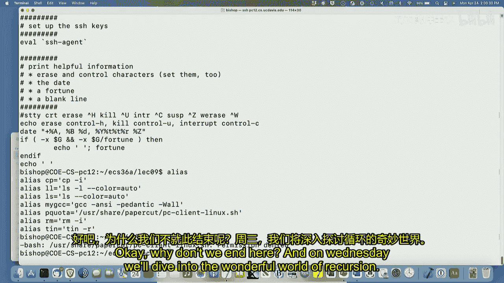

# C语言底层编程：第10讲：运算符详解 🧮


在本节课中，我们将深入学习C语言中的运算符，特别是自增（++）和自减（--）运算符的用法、函数参数求值顺序，以及字符处理的实际应用。课程最后会简要介绍递归的概念。

## 课程公告与作业答疑 📢

首先，有几项课程公告。期中考试的样题和学习指南已准备就绪，将在近期上传至Canvas。关于作业，特别是问题二和附加题，许多同学遇到了类似错误。错误信息通常表明程序仍在运行但被终止，这往往是由于程序中存在无限循环导致的。例如，在使用负增量时，如果循环条件设置不当，就可能进入无限循环。

## 自增与自减运算符 🔄

上一节我们介绍了基本运算符，本节中我们来看看自增（++）和自减（--）运算符。它们用于对变量进行加一或减一操作。

*   **基本功能**：`++` 用于加一，`--` 用于减一。
*   **指针运算**：当操作对象是指针时，`++` 意味着移动到下一个元素，`--` 意味着移动到上一个元素。
*   **前缀与后缀**：运算符的位置决定了操作的顺序。
    *   **前缀形式（如 `++a`）**：先对变量进行自增/自减，然后使用新值。
    *   **后缀形式（如 `a++`）**：先使用变量的当前值，然后再进行自增/自减。

以下是具体示例：
```c
int a = 5;
int x;

x = ++a; // a先加1变为6，然后赋值给x，所以 x=6, a=6
x = a++; // 先将a的值5赋给x，然后a加1变为6，所以 x=5, a=6
```

## 函数参数的求值顺序 ⚠️

关于函数调用，有一个重要但容易被忽视的细节：**函数参数的求值顺序在C语言标准中并未定义**。这意味着，编译器可以自由选择从左到右或从右到左的顺序对参数表达式进行求值。

考虑以下代码：
```c
int x = 5;
printf("%d %d\n", x++, x++);
```
这段代码的输出是不确定的，可能是“5 6”，也可能是“6 5”，这取决于编译器采用的求值顺序。编写依赖于特定求值顺序的代码是糟糕的风格，因为它会损害程序的可移植性。安全的做法是避免在同一个函数调用中，对同一个变量使用多个带有副作用的运算符。

## 字符计数程序示例 📝

为了巩固概念，我们来看一个实际应用：统计输入行中可打印字符和空白字符（如空格、制表符）的数量。

以下是程序的核心逻辑步骤：
1.  使用 `fgets` 从标准输入读取一行文本。
2.  遍历该行中的每个字符。
3.  使用 `isprint()` 函数判断是否为可打印字符，若是则计数。
4.  否则，判断是否为空白字符（如空格），若是则计数。

在遍历字符数组时，我们常使用指针。`p++` 或 `++p` 在这里的效果是相同的，因为我们的目的仅仅是移动指针，而不使用其表达式本身的值。

## 字符与整数的转换及凯撒密码 🔐

C语言中，字符本质上是小整数。我们可以利用这个特性进行字符和数字之间的转换。

*   **数字字符转整数**：`int digit = ch - '0';`
*   **整数转数字字符**：`char ch = digit + '0';`
*   **字母索引计算**：`int index = ch - 'a';` （小写字母）或 `ch - 'A';` （大写字母）

基于此，我们可以实现一个简单的凯撒密码（移位密码）。其核心思想是将字母在字母表中移动固定的位置（如3位）进行加密，解密时反向移动。

加密过程的关键步骤是处理移位后超出字母表范围的情况，这可以通过取模运算（`% 26`）来实现循环移位。例如，加密‘z’（索引25）移动3位：`(25 + 3) % 26 = 2`，对应字母‘c’。

## 文件结尾与递归概念简介 🚪➡️🧠

最后，我们区分两个重要的常量：
*   **`EOF`**：用于表示字符输入结束，通常定义为 `-1`。这也是为什么 `getchar()` 返回 `int` 而非 `char` 类型，以便能容纳 `-1` 这个非字符值。
*   **`NULL`**：空指针常量，用于表示指针不指向任何有效对象。

本节课的最后，我们预告了下一个重要主题：**递归**。递归是指函数直接或间接调用自身的一种编程技巧。它与数学归纳法思想类似，需要定义**基准情形**（何时停止）和**递归步骤**（如何向基准情形推进）。我们将在下节课深入探讨。




---
**本节课总结**：我们一起深入探讨了C语言中自增/自减运算符的前后缀区别、函数参数求值顺序的不确定性、如何编写字符统计程序、利用字符的整数特性进行转换和实现凯撒密码，并区分了`EOF`和`NULL`，最后引出了递归的概念。理解这些细节对于编写正确、可移植的C程序至关重要。