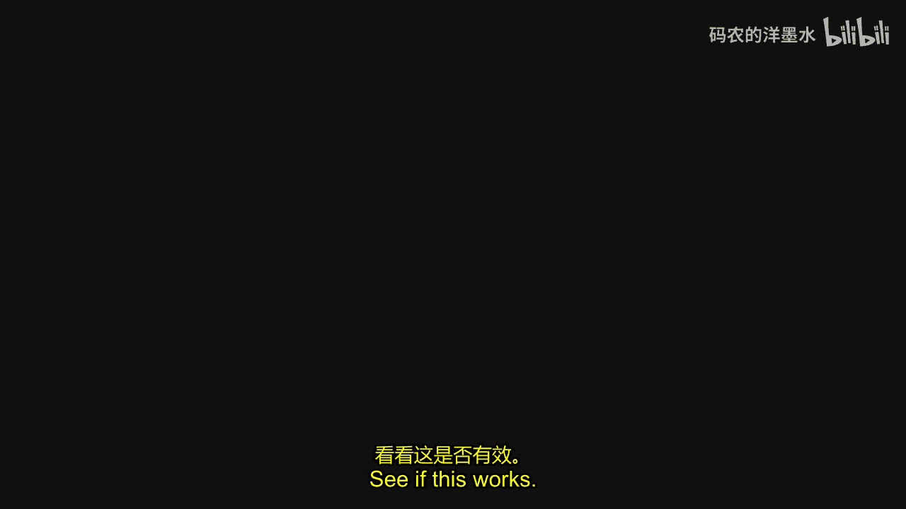
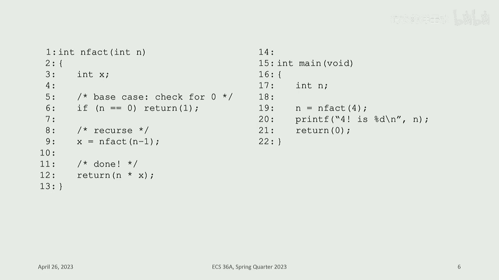
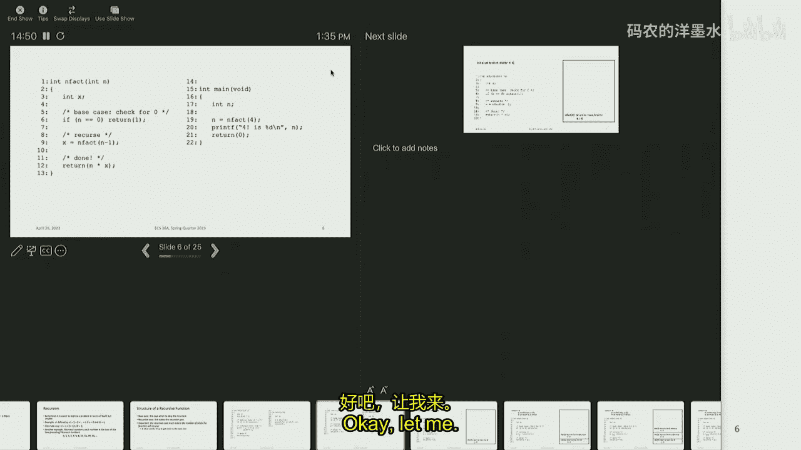
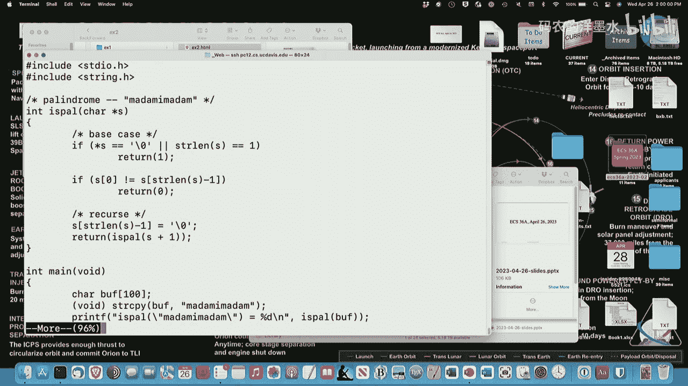

# 【全集】加州大学戴维斯分校 C语言底层编程 中英字幕 完整课程 p11 Lecture 11 - 递归 -BV15C6FBsE3L_p11-

Any questions from what we've been covering？平安。Homework2 is out on the website and same as before upload your programs to Grcope。

 have a great scopepe I haven't put those in yet， I'll put them in tonight or tomorrow morning。

But the homework has example outputs。So that should help。Would it help， by the way。

 if I put minorries on the CSIF so you could compare your output to mine and great scopes。

 would that help？Yes。The comment was basically that gradecope only gave you one line of output error。

And if you saw more， that might be more helpful， okay。

 I'll go ahead and compile those and put them out， I'll post the directory to which I put them。

In announcements， other questions。Okay， a couple of announcements。 first of all， the TA is moving。

 Chris is moving his office hours on Friday。To 12 to one from 11 to 12。

 same room just different times， he's doing this because apparently a lot of people can't make his or my office hour and this will help。

Second thing is that the CS tutoring club is open for business。

 they will do tutoring for 36A and basically a lot of other computer science classes。

And if you look in the announcement， there's a link to both some information about them and their calendar so you can make an appointment for some help。

So I encourage you to use them。 They're quite good。And they been。

 and they went through what you're going through。Okay。Ats sea， and oh yes， in only two。

 there's one problem that asks you to raise things to certain powers。For that。

 you have to use a library function called P OW or Pow。

 And there are directions in the homework on how to make that available。 Basically。

 you have to include a header file， math dot H。 This is all in the homework。

 So you' have to write it down。And you also， when you compile at the end of the GCC line。

 you have to say dash LM to include the math library。Okay， then let's go ahead and start。

What I wanted to talk about today， excuse me。ItWas a programming technique that's very widely used。

And basically， it can often cut the time taken to write a program。Down very， very low。

And I'll give you a couple of examples of this， but it's called recursion。And basically。

 what you do is you express the problem in terms of a simpler or smaller form of itself， yes。Oh。

Thank you。Let's see if I get this thing working here Dr。 B has been selected。H on moment。

Projector1 on project。This is why I dislike using slides intensely。try that。Oh's doing something。

It's the right switch。I mean， have we the。System here。

Ill me try one more thing and now I'll just restart everything。

I'm going to have to reboot this system， so I'll hang on for a few minutes。Anyway。

 the idea behind recursion is that you express a problem in terms similarr than itself。

You're all familiar with factorial， right。Im like。factorial is。Can be written either。

 It can be written iteratively。 It simply means take the product of all integers。

Equal to or less than。The one you're taking the factorial of。And you stop at one。By the way。

 does anyone here know what zero factorial is？1， how about a -1 factorial。Not defined find。

Anything negative or fractional factorial isn't defined。 if you really are perverse。

There is something called the see。 It's called the gamma function， and。

Factials are a special case of it， but anyway， for our purposes， zero factorial is one。

 one factorial is one， and then you go on it that way。This works。Now。

 the other way to think of factorial instead of is repeated just multiplying all the numbers together。

Is let's say we want five factorial。That's the same as five times4 factorial， correct。

That's the definition of factorial。And。See if how can get this going？We'll try a little more。

This is the right wire， isn't that？Oh。If this works。

They have two HMI cordords up here， and I had to search to find the second one。 All right。

 let's get back to the slides in case you missed the first part， though， the first one。

I mentioned there is tutoring and the T's hours are there。And the tutoring club is very good。Okay。

 so we were talking about recursion。This is a standard way and factorial is defined。

But you can also define it like this。 This is called a recurrence relation， by the way。

And it defines factorial in terms of itself。But its the word used is simpler。

 but it's actually smaller in this case。And you keep going down until you get to n is1。

 and then that's one times， well， that's n times zero factorial， which is defined one。

So in a in a recurrence relation， you need some place to start or stop。

And then you need to express the problem in terms of itself。Here's another one。 Fibonacci numbers。

 Fibonacci numbers。Are a sequence that was noted by a mathematician named naturallyina Fibonacci。

And each term beginning with the third。Is the sum of the two preceiving terms。So like 3 and 5 is 8。

 21，34， 55 and so forth。You can do that one iteratively too， but it's a lot faster to do it。

 It's a lot easier to do it recursively。Now。Remember I said that a recurrence relation is at a starting or stopping point。

The same is exactly true with recursion。You have basically one key case called the base case。

That part。Does not call recursion and recursive， by the way， function calls itself。In the base case。

 that doesn't happen， the base case basically says one stop。

And then you have the recursive case if it doesn't match the base case。

Then you go ahead and do the recursive case， which will actually do the recursion。Now。

 the important thing about a recursive case is it's got to reduce whatever you're looking for。

So that eventually you' reach the base case。So for example， if you were pro， it would be n factorial。

And in your statement， in your function， you said that to return the result。

 n times n plus n times n fact。N plus one。It would never reach the base case， which is， of course。

 zero。So one way to think of this is every time you do a recursion。

 you have to get closer to the base case。Okay， I me give you a couple of examples of this using n factorial。

 at least initially。Can everyone read that？Waiting them back there。Okay， I'm getting some thumbs up。

This one's iterative。If you get to， if you， if n is 0， then you return one。Otherwise。

 you just start at one。Go up to an including end and multiply them to get prod product。

And then you return it。And when you call it with four， for example， you'll get four factorial is 24。

So is called this is the iterative case。The one you've seen with four while and do well。

Here it is recursively， same function。Again， we have the base case。Then we do the recursion。

X is an intermediate variable that holds the result of n factorial of。And  -1。

And then we return n times n factorial -1。A couple of things to notice about this。

If I put the number 100 in pass in the number 100。 So I want the 100 factorial。When you get here。

 you'll be calling the same function， but with 99。Then 98 and so forth， until you finally read 0。

When you read 0， you return one。And so this is one here。 So 100 times one would be1。 sorry。

 this is here， so。And there was one。 So one times one is one。

 So that's in factorial of one and so forth。Show that in detail in a minute。But to the outside world。

 it doesn't know whether or not， in fact， is recursive or iterative。

And you very much want to build that into your programs。Because it shouldn't matter to the user。

What it is。Okay， let me show you an example now of what's houses going on。

 Remember the program stack I told you about。When you're。

 when you're trying to dealing with recursion。It's best to draw pictures of that。

 and here's an example。This is the function that I had before。And from the program。

 I might first call it with four。So。Int。X。Is put on the stack。4 is not zero。

 so you go down and you're going to do the recursion。This also says where you return to。

 which is line 19 in the main program。Yeah，119。All right， now since n is4。

 we're going to have to call this again at line 9 with n equals 3。And so we do that。When we're done。

We return this value of line 9 and assign it to x in the other， in the previous one。

So drew a purple arrow where you return to。 And now in is three。So you go through it again。

 And now the x in this one。Is different than the X in this one。Even though it's the same function。

 it's a different occurrence of that function。And so X is private to that function。

So condition is false in line 6。 So you skip it。 and then you call whoops and factorial 3 of3 there。

Now you get up to here。And now you're calling n factorial 3， that's not zero。So it's 3-1 or 2。

 And when this returns， you're going to return to this location do the assignment。And then。

You caught one it's called with two。Down here， you invoke it with one。

 and you go to where the blue one is。 I think， you have the blue arrow。And that worth， in fact。

 of zero。This hits the base case。And so it's going to return to one。If we don't get the base case。

 we keep on going until the computer runs out of stack memory。

And you'll often see something like memory overflow or something like that， yes。No。No。

 it's calling itself as a different function。Okay， that's important。Because。When you loop。

You don't build up the stack this way。When you call the function itself again with a different value。

That's a completely different invocation。This one， for example， has no idea what x is here。

It just doesn't know。Other questions。 It's good question。 Thank you， others。ok。Now it returns one。

So it pops the stack and gets rid of that， and in in fact of one， this is one。So， x becomes one。

And since we passed in a1， this is going to be one times 1 or one。And it， too， will return。One。

Wait to think he had something wrong。Yeah， there's the stack being popped。

This pops the sack and returns goes to two。So， 2-1 is1。And it's true。 So it's going to return1。

1 times 2 or2。Pop's the stack， meaning it gets rid of all this。And then。We're at in fact of three。

 So that was。2， n is2 n。 X would be sorry， X would be 2， and n would be 3。So， that's 6。

And then it gets。See。Ppped once more。And here now， x becomes six。😡。

So the end within this routine is 4 so that you return  four times 6 or 24。This， by the way。

 is why it's so good to sometimes draw out the stack and write your variables in the places various places。

Because if you don't， you often get totallylessly confused about what's the right value of x or what's the right value of n。

So basically you have to be， if you're debugging or writing something like this and testing it out。

 you need to be careful。The computer， on the other hand。Can do this very quickly。

And it automatically does all the bookkeeping。In your program。

 you don't have to worry about saving things and so forth。Because when you recurse。

Everything in the function that does the call is saved。And so we get there any questions on this。

This is kind of a weird concept and takes a little bit of， and takes a little time to get used to。

And yes。Yes。Exactly， that's why you have to make sure it stops because otherwise it'll call itself and keep on going。

Yes。They're allocate。There are two types of variables。 There's global， and then there's local。

 Local is around only during the lifetime of the function that uses it。

So what happens is the space is allocated for the local ones on the stack。When you call it again。

It sees that there's an integer X。 And so when it builds。

It's part of the stack that we'll put an X in there。And so on and so forth。So in other words。

 the system doesn't keep track of things really by name。

But what it does is when it sees declaration like that， it creates some space on the stack。

Where I can sort things。You need to find it。That's what this does。

But it's not a library function as far as I know。There may be a library somewhere， which has it。

I don't know if one。Questions on this。Yes。Yes。Yep， in this case。

The only time this gets executed is when that returns。 In other words， when the ocursion。

 at least for this function completes。嗯。By the way。

 what do you think would happen if you put the base case after this。I'm sorry。嗯。

I wouldn't say I'm def， but you have the right idea。What's going to happen is。It'll do this。

Come back and then do that again since this is down here。 So this will go on forever。

And I shouldn't say that this will go on until the computer runs out of stack memory。

And then it will give you a message of saying so and see it's probably very fairly cryptic。

 we can actually try it out。In Python you'll see something like you recursed 80，000 times。

And when that happens， if you've got a four in there， you know something's wrong。Okay。

 other questions。Yes。Is the x value changing every time the function is called？

It's a different value。But there are multiple occurrences of X，1 for each call to the routine。

So in other words， once sex is assigned a value within a within a call， it doesn't change。

But the next time， through。A block of space is allocated and a new X is defined there。

It is no relation to the previous X。And that gets a new value。And so on until the recursion ends。

 and then it goes back down。Fleaing up the routine。Did it make that clear？Other questions， yes。No。

You can take this and get rid of X and put it in here。No problems。I just did it that way for clarity。

In fact， yes。Oh。Line 19 ish calls it。Not every time the second time it's called。

 it is no idea who called the first one。 All of noses was called from this address。So when I return。

 I go to the next address。And the last one knows that it's to return to line 19。

Because that's where it was called from。

Other questions？Okay。

Get over to the CSIF。If I can。Good work。I have no idea what's wrong with my typing today。Okay。

 then let's go ahead and write the inial program。Okay， when you write this。

 first thing you do is try to figure out what the base gate， yes。Oh， I'm sorry。Better。

Can you folks in the back seat， okay？First thing you do is figure out what the base case is。

 In other words， when do you stop。And for n factorial， you can stop either it zero or one。

But I'll choose zero because I want zero factorial this to work out correctly。嗯。Alright。

 so this is the base case。 What I'm saying is if you hit n factorial n factorial， sorry，0 factorial。

 just return to one and you're done。Okay， now we have to do a recursive case。

And so we have to call that the same function。But with a different value。

 because if we call it with the same value， it's going to be calling itself until runs out of Rome。

So。So that's how we would call it。 But now it's returning a value。So we have to deal with it。

 And there are two ways to do it。 We did it。 I showed you with the X。

 where I'd store it and then do the multiplication。But if someone asked， you can also do it this way。

Okay， so what happens here is when it hits the return statement， it will first evaluate the function。

 in fact， -1。Which is what we did before， except we stored the e x Here， we don't store in X。

 We just multiply it by aninimate returns。So， lets do it。Okay。

 and now what I've done is I've just written the call to it。 Notice that when I call it。

I don't say anything about recursion。That's because recursion is internal to the function。

 It's not a property of the， of the call。So let's go ahead and compile this and see if I。Yes。

 question。Cool。And now're anywhere in it， it says。And factorial is that。Now。

 the sta G flag that I gave to the compiler basically throws in debugging information。

 and I did that because I wanted to show you how the stack worked。SoOh whoops， sorry。

This sets up what's called a break point。 Breakpoint means the program stops and you can examine things。

Okay， so。You then type run， and you would give it any arguments you would。

 And this one doesn't have any arguments。 So we won't worry about it。

It starts the program and it stops。Okay， so and it is 10。I can then step through single step。

By doing in， which takes me to the next statement。And now if I type n， it's going to do in fact9。

 so I type S。Which takes me into the to that function。 So S a single step。

Which means it'll do whatever's in the line。And if there's a function in the line that's called。

 it'll drop into that function。And so we can just continue this。Notice how N is going down。

Give me one second here。啊，That's it。Okay， I take the BT， which means back trace。notice how， in fact。

 then how the number is。Dropping as you go up。This is the address of the function， in fact。

 and memory。Notice it's calling the same thing over and over。

 The only thing that differs is the argument。And now if I continue， second。Okay。

 so now let's see deal。So now let's continue。And now coming back。It executes this。

Finishes executing this and does the print。Notice that the return here。When， when it returns。

 in fact， in fact， it immediately returned， sorry， when this function or this occurrence of the function gets its value。

The one that called it immediately returns。And it goes on until you're done。It knows when to stop。

 because。The one with 10 calls the one with 9， then with8 and so forth。 And coming back。

 it'll stop as soon as it reaches the 10 because， and then it'll return to Ma。So z grows up。

And then it goes down。This， by the way， is true whenever you call。Okay， this occurs。

 The use of the stack occurs whenever you call any function。So if your main cause of function。

 that gets is allocated space on stack for variables and such。If that calls another function。

 then above that is allocated space for that new call and so forth。And when a function returns。

 you speak of popping the stack， which means you conceptually get rid of everything associated with that function that's on the stack。

In practice， that doesn't happen。 but explaining how it's managed basically is something I I wouldn't want is something that requires knowledge of assembly language。

So just take it for granted that。Each time something is put onto the stack。

 when the function to put it on returns， it goes away。Actually， I hate saying。As let me real quick。

 What happens is when a function is called， it's given them area of the stack called the frame。

 and the frame is associated with that function。When it returns， the frame is removed。

And the system goes to the previous frame。Which is that of the function that called it。

You don't have to know that just I don't like saying I'm wh you。Okay。Let's make one change。

Now if I do this， whoops。Notice the plus。So let's go ahead and recompile it。And branded。

What this means is something went wrong with memory。

And let me just see if GDP will show that immediately。How far up did we get？

It got up to 262100 and then ran out of room。The commands I issued were this。 Remember。

 I said about frames。When the program stops， crashes like this， there's a function。

 There's a function， which was called。Causing the crash。And that's put in the top frame。For Gnu。

 for the GDP debugger， you type up and that takes you to the frame below it。

The reason it's up is you can view the stack as going up and coming down or going down and coming up。

 And when GDPB was written， most computers did down and then up。

 so up takes you to the previous frame。And then P stands for print。

 P space then simply means print variable N。And so that's。That's what it was。 And when he see that。

 how the heck did it get that？Let me check the program。

And I'll see immediately that there was a b there。Questions。Okay。

 let's try to write a recursive program。 Oh， yes， I'm sorry。Multiple cases。

You can have multiple base cases。As an example。嗯。Let's say you're looking for palindromes。

Things that are spt the same forward and backward。If the number is even。

Then what you do is you check， if you're doing it recursively。

 you check and see if nothing was passed。 No bitete was passed in。 if it was you're done。However。

 you also have to check because if it's not nu， then you have to check that it's only one character。

So that's two cases。So， yes， the base case actually can be hideously complex。

But it's still the base case。 It does not call the function itself。Okay。

Why don't we try a palindrome one？Now， just as a matter of style。Or programming style。

 you can take this with a grain of salt。I've always found it easier when I'm writing something recursively to start off with a function rather than the thing that calls it。

So what we're doing now is we're looking for we want something that will do a palindrome。

It said this is the oldest palindrome。 Adam introducing himself to Eve。Madam， I madam。

 and if you'll notice it spelled backwards and forwards the same way。Now。

If you want to do this iteratively。What you would have to do essentially is split it into and then reverse one end。

 and then compare。Which is painful。And usually， or you could reverse the entire string and then just do a character by character comparison。

 either works。Recursively， though， what you can do is compare the first and the last character。

If they're the same， then recur， but give it ataimata。In other words。

 drop beginning the beginning in the last1。And if that's。And those two are equal， the A and the A。

 Then you go on and do it again。And the first time two characters don't agree。It's not a palindrome。

If you reach the end where there's only a no bitete or one character， that's battledme。All right。

 so let's go ahead and write this。Let me get rid of that spur backlashsh。Why do I make this an int？

Well， the reason is， I'm asking is this I want the function to represent the answer to。

 is it a palindrome？So I'm calling it is pal， and it will return true or false， zero or one。

All right， so first thing we do is the base case。And that would be。If if there's nothing there。

 that means the string number of characters in the string is even。And we check them also。

 it's a ball room。If there's one character there， the number of characters in the string is odd。And。

So it's a palindro because single characters itself spell backwards。So to speak。So， now we return。

Oh one， saying yes， it's palinro。Okay， so now we do a test。 And again， this is part of the base case。

Well we check the first and the last character。And see if they're equal。So。Now why did I do this。

 first of all， S0 refers to the first character of the string。Remember。

 I can use array notation when I'm using pointers and vice versa。Now let's say S is the string ABC。

So S of 0 is a。 S of 1 is B， and S of 2 is C。But there are three characters。

 so Sterlin returns three。But I want to look at the last one。

 The third one is the null by ending the string。So I have to subtract one to get to the sea。

So if these two are not equal。Then they return zero。Because they know it's not a palindme。

The two things at the end need to be the same。And now comes the recursive case。

What I have to do is skip past the first character and eliminate the last character。

So I do something like this。I cled the last character。 I make the null bite the end of the string。

And then I return。And then what I do is I advance to the next character。Which is this plus one。

 and called Ismailel。And that will repeat this process until finally， it becomes。

sOne character or an nu bitete。First thing I do， though mentally is I verify that。

If the string is say， madam I madam。Well， the first one is false one to come through。

The second one is also false because S of 0 is M and。This other one， S of Ster and S-1 is also M。

So I clllabboed the final M here。And then I would call Ispal again with。The character after the Iam。

 which is A。Okay let's write a real quick program to test this out， see if it works。Rather。

 see see if it compiles， I should say。跟て。All right， let's see what's going on here。嗯。Okay。

 this first part is telling me， hey， look， you used SR LEN。

 but it's it's I don I'm not sure what type that is， does it return a string of character or what。

 So it's telling me I have to include the header file string dot H。So let's going near that。

And then the next problem was down here。Oh。Double quotes and double quotes。Can't do that。Yeah。

 that should work。Yep。Okay。See what happened。Oh， I know what happened， hang on a moment。

Something rather subtle。What happened is when you use a string in see like that。

 it's in read only space。And so I tried to write into it。All right， so let's try this。And it worked。

So the important thing to remember Well there are actually two things。 The first one is。

First time you do a demo， it's going to fail。So don't do it in front of the class。By the way。

 I'll be ignoring that rule for the rest of the quarter。 But that's the number one rule。

 The second rule is that strings。When you define a string。

 as I did with the double quotes and so forth， that's put into read only memory。

 So any attempt to alter it will cause a crash and it will cause the program to crash。And in fact。

Right here， that's exactly what I'm trying to do。I'm trying to change a character in it。

 So it basically is an area where I can't write。 So it says， I'm telling it， O， overwrite that。

 And it says， can't write there and stops。When I copy it into this。This is something I created。

 and it's， it's a variable space。 It's an array of variable。So you can override it。

 read and write it。And so I copy this in and then this buff is no longer read only。

So I can call is palow with Buff in the networks。We'll go into that in a little more detail on today's Wednesday。

 right， I think we'll go into a little more detail on that on Friday， but。Yes。Yes。

I copied the string into buff。So I could alter it。That is nothing to do with recursion。

 That's just strings。

