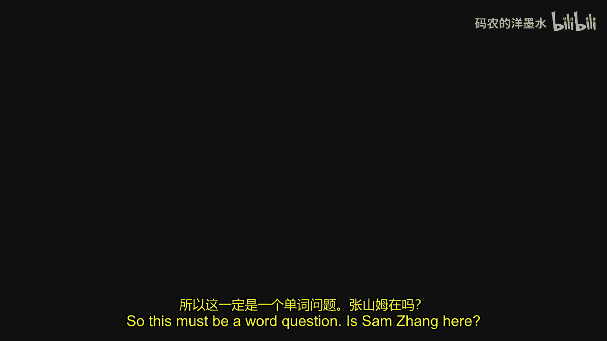
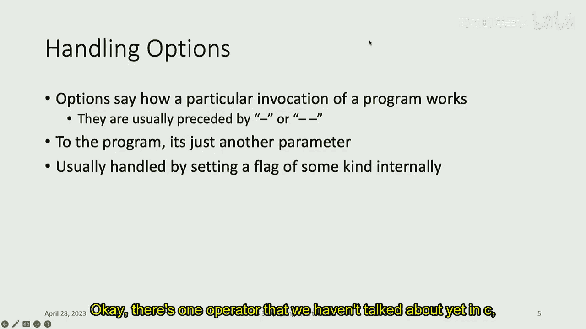
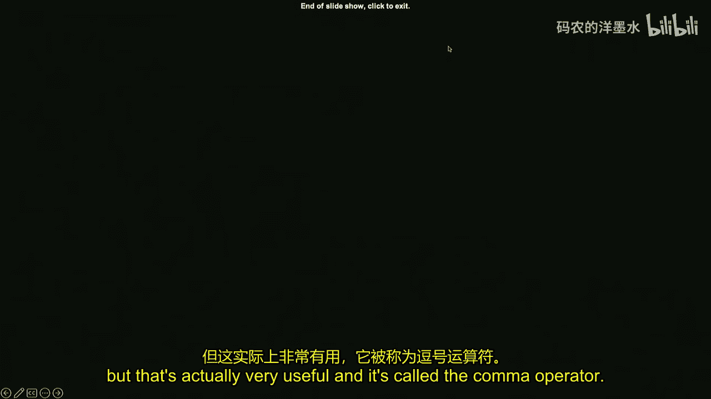
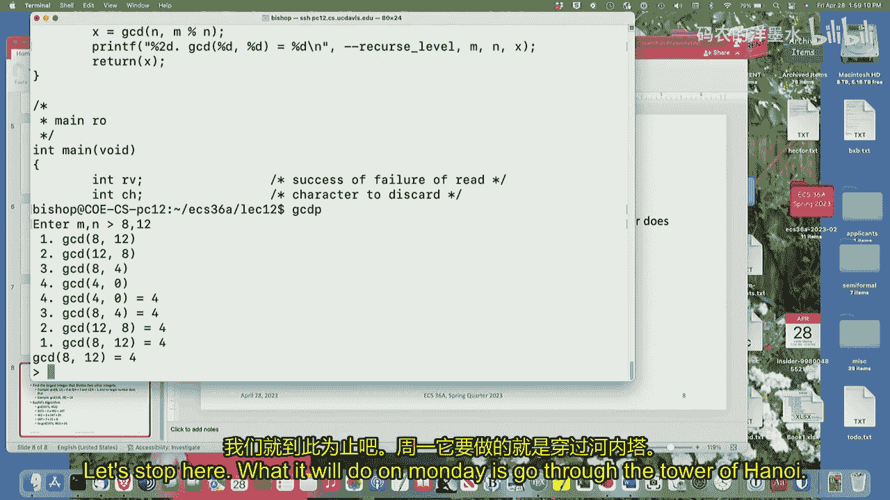

# 【全集】加州大学戴维斯分校 C语言底层编程 中英字幕 完整课程 p12 Lecture 12 - 字符串数组与逗号运算符 -BV15C6FBsE3L_p12-

じうですなし。Question is Sam Zhang here？

Okay， there's an an cardt here for him。Okay。First off。

 are there any questions from what we've been doing？And I'll look up in a second。Wish I hadn't。

Are there any questions？Okay， what I want you to do today。

Is review a couple of things and then give a couple of more examples of recursion。

The two examples there are three examples I'll give you。

One of them is much easier if it's done recursively， but it can be done iteratively。

For the second one， it can be done either way。 for the third one。

I suppose you could do it iteratively， but it would be very， very complicated。

 whereas with recursion， it's very simple。But first， a couple of announcements。

I'm not going to be able to hold office hours today。

I will be holding them Monday and I'll schedule the makeup office a hour sometime Tuesday。

The previous the next two are from last time， TA has new office hours on Friday， 12 to one。

 and you can get tutoring from the CS tutoring club， and that's an excellent resource。Also。

 I posted an announcement from Hack Davis，2023。 This is a group that。Runs hackathons。

 which basically are worldwide， and they。Have a limited time。 I think it's 48。

 I think it's like a weekend to write a program， write code that is。Does some social good。

So apparently， it's quite fun。嗯。You get to meet a lot of interesting people there， too。And finally。

 everything relating to homework to and extra credit too has grade scope entries up there now。

 so you can go ahead and try out your programs and so forth。

I'm not having office hours today because I have to go to a meeting。

 And since there are three people， no。6 people in four universities。

 some of which are on the East Coast involved。 That was the only time everyone could get together。

And considering the particular nature of the grant， it was imperative we do it because it's due next。

 next Friday。Just like you all have deadlines， we do too。Okay， but as they say。

 I'll schedule a makeup hour on Tuesday。As soon as I figure out， my schedule is on Tuesday。Okay。

 I want to review something because the first problem as you deal with command line arguments。

ProbleProblem one in homework two asks you to do various things。

 well asks you to see whether or not a string is reverse alphabetic。

And you have to get the string from the command line。So。Command。

 we're going to use here instead of lupius echo high there。You saw this slide earlier。

The key point is the second， the first one contains a number of arguments。

And this is appointed to an array of strings。 Sorry， yeah， this is an array of strings。

Each string contains one argument。And the name of the program is the zeroth argument。

So even if you don't， if you just type echo， for example， argument that's one argument。

 argument zero is the word echo argument one is the unknown pointer。So if I type echo high there。

 here's what it looks like。The first argue， oops。Sorry， the first argument should be echo。

The second argument should be high， and the third argument should be there。

 and this thing should be down here。 and I'll fix it when he posts the slides。

But the point is to get the you， you treat that just as an array of strings。

 and you can go ahead and read them without a problem。 You can also alter them， by the way。

 So be a little careful。Now， sometime， and this hasn't arisen in your homework yet。

But some arguments are what are called options。 They basically control what the program does。

 and I'll give you an example of that in a minute。They're usually preceded by dashash or D dash。

 there are a couple of very strange programs that don't have the arguments are not。

Proreceeded by that。 But there are very few。For whatever it's worth， the dashes the traditional one。

 the two dashes were introduced by a project called the New Project， which is very。

 it did the GCC compiler among other things。And so。

You treat it just like the system treats it just like an ordinary。Argument。

 it has no idea whether or not that's an option。 The program does the interpretation。

And so if it is an option that typically will set something like。

 don't print a new line or convert capital to lower， things like that。

And there are a number of ways you can handle this， depending on what the argument。

 what the option does， or what you want it to do。Usually it involves setting what's called a flag variable。

 which is either true or false。It's typically false if the you know。

Falults would mean faults might mean， for example， the argument is not set， so proceed normally。

True would meanwhile the option is there， so handle the option special。

But it could also be the other way around， it's entirely up to the programmer。Okay。

And so let me show you a couple of programs that do this。Yes。Regarding to your tutor in， yes。

My understanding is you do have to book an appointment。

 And in the announcement that I posted a couple of days ago， it's got a link to the calendar。

The thing is， tutors for classes are available only at certain times。

So that's why you need to book the appointment。I believe。I haven't used them myself。

 but that's what students of mine who have used them tell me。would probably help if I。Okay。Okay。

 here is the ECcho program。Everyone see， by the way， people in the back。All right。

Here is a program that does the echoing。Echo simply Princes arguments。And it's very useful in number。

 a number of circumstances like programming and programming the shell and things like that。

 But anyway， the way it works is this， you don't want the word echo to print。

Because that's the name of the program， you just want the arguments to print。

So you start at one and you go until I is at the next to the last argument。And each time through。

 you print the argument followed by a blank。When you get to the very last argument。

Then what you're going to do is to print a new line。And return success。If R C is greater than one。

 that means we have at least one argument we want to print。If RG C is equal to one。

 it doesn't do anything。So， for example。But if I do this。Just prince wine quits。Okay。

 now for the option one。 Sometimes you'll notice in each of these cases。It put a new line afterwards。

Sometimes you don't want that。 Sometimes you want it not to put a new line after。

So then you could do， I mean， a variation of this called Echo2。Now， notice this one。

And this one are exactly the same。 But there's no new line here。

So the prompt appears on the same line。That's an example of an option。Here， when you give the option。

 you suppress the new line。And generally， when you're doing options。

 it's best to make the program behavior be normal in what people would think of。

And then if there are exceptions， you add options to handle the exceptions， normally when you echo。

 you want it on a line。So that's why the echo doesn't require any options。😡。

But if you want to suppress that on return to that new line。

Then you have to tell him explicitly to do so。And here's what the processing looks like。

So thing first thing you do is you check to be sure that there's more than one argument。If so。

 it could be a string or it could be an option。SGRCP compares the string that R V1 points to。

 in other words， the first argument。With the string dash in。If they match。Stir comp turns zero。

And so if and the option dish N is given is the first argument。PR N L stands for printnt New Line。

 that's just my variable name。Anyway， I set it to 0。 Originally， it's one meaning， yes。

 print the new line。 But when I set it to 0， it won't be printing。

And the other thing I have to do is skip over that dash in。So instead of starting with argument one。

 number one。I'm going to start with argument number two。Because argument 0 was a program name。

And argument one is the dash in。Notice。I'm going to use I as the counter， by the way。

 And I initially， I assume there are no options。So I just said I to B1。 But if there is an option。

 I'm going to start at R V2。 So I set I equal to 2。And then I come down here and print the arguments。

And so forth。When done printing things。I check if this， the option was not set。 This is one。

 and the condition is exactly what it was before I put out a new line。But if the option was set。

 this is 0。 this is false。 And I just come down there。 I never do never put out the new line。

See how it works。Now， the programmer is responsible for doing all this coding for。

Figuring out how to handle options。And by the way， I did it this way。 So Den was the first。

 so it wouldn't get confused with other things。But you couldn't really buy some judicious rearrangement of code。

Put that anywhere you like。Makeking the 20th argument or whatever。And if you put that code。

Down in here with appropriate modifications， it would still work。

Because the dareen takes effect at the end。So if the option takes effect at the end。

 it pretty much can be anywhere in your command line。If it takes effect at the beginning。

You have two choices。First， you can scan the entire command line for the option。

Or you can require it be the first argument。Before any of the rest is processed。Okay。

 questions on this。Okay， I showed you let me get back to the slides。Okay。

 there's one operator that we haven't talked about yet in C。

 but that's actually very useful and it's called the comma operator。

Hello。Yeah， come operator。I don't know。Anyway， the comma operator works like this。Evaluate the first。

Then， evaluate the second。And the value of the expression is the second。Now。

 why do I have it in parentheses？ Well， common is the lowest precedence of anything。

So I I left off the parentheses。 The first thing before the comma would be assign A， the value of B。

And then the value of the entire expression would still be C。So here's a simple example。

 we have this。And again， the parentheses are around there because of this assignment。

Since comma has the lowest precedence of all， the equal signs would be evaluated first with parentheses I'm changing the order。

 So what's in here is evaluated。Okay， so a equals a plus 5， and a is initially 5。

 So it evaluates this。And the value of that expression is 10。

Because the value of an assignment is the value assigned。Then we have B plus plus。 So B changes。

 We take the value of B to B2， and then we add one， and we get three。We then take the value of this。

And assign it to x。 Now， the value of this。Its two。Because we use the value before we add one to it。

And so A is going to be 10， B will be 3， and x is going to be 2。By the way。

 if the plus plus were in front of the B， what would the value of x be？Three， exactly。

Because you're adding to， you're incrementing the value of B and then using it， yes。No look。

This was meant more as a demonstration。 Okay， here's an example where it's actually used。

I want to prompt someone。For a number。And I'm going to do this in a loop because I'm going to have them enter multiple numbers。

I could put a printf for the prompt up here and then one at the bottom。

But if there are continuous statements， for example。

 that will take me back up to the top before you reach the bottom。

 I have to put the prompt there as well。But if I do it this way。This gets evaluated first。

 So we'll go ahead and print the prompt。Then this gets evaluated and so it'll wait for the user to type in the number。

The other place commas are often used is in four loops。You know how you have the initialization。

 then the semicolon， then the expression， the condition， semicolon， and then the increment？

Sometimes you want to incr in two or three things。At the same time， at each iteration。

So what you would just do is put them in the increment area and separate them by commas。

Using the plus plus stuff。And that works too， you'll see that there。Yes。一动卡。Right。Yeah， yeah， but。

I'm trying to think of a case where you absolutely need the comma。

And it's typically used for organization like this or like in the for loop。

But I'm sure there are cases where you do need it。I just can't think of one。

 and I don't remember ever seeing one either， yes。With this expression evaluated based on user input。

 Yes， exactly。 what happens is this gets evaluated， then this gets evaluated。And this is the one。

That is the value of the， of the whole thing。So if the user type three， well。

 Scf will return one and set x to3。That's false。 And so you'll drop out of the loop。However。

 if the user typed， wait， sorry。If it's  three， that'll be one， that's true。 And so it'll no this。

Yeah， that's true。 and they'll go through the loop。Okay。Now。

 I've shown you string copy and other questions， yes。I I'm sorry。 I'm in trouble。I'm sorry， does。Oh。

 does it have tus， no。So you'll never get this confused with the dupple。Yes。Okay。

 scanf reads from the input。And if the user types control D。

That Xendophil and it traditionally means quit。And scanF will return EOF， which is a constant。

And so that's the exact meaning of this。And if it does read this。

And it will set x to the value it read。If it doesn't read this。

 but it's not an into file like you type hello， it'll return zero。That's still not AOF。

 So you'll go into the loop， and presumably you'll lift some mechanism for handling that。

Because every time I go through the loop， I want to do the printf。Now， as I said earlier。

 I could put it at the top and one at the bottom。Both having the same prompt。That's quite common。

 the difficulty with that arises when I in the middle of the loop， I have a continuous statement。

The continuous statement basically says， okay， end this loop and start a new one。

And if I don't put a prompt there。All the user will see is the program stopping or not doing anything。

However， here， I only keep it one place if I want to change the prompt， I just change it here。

And if there is a continuous statement， it'll come back up to the while and print out the prompt。

So it's both a programming aid and something that makes modifying the program easier。And by the way。

 when you write a program， always think about who's going always understand that it may be modified in the future。

So the easier you can make it for the person doing the modifications， the better。Any other questions？

Yes。You mean plus plus B？ButIf you do plus plus B， initially B is2。 So you really add one to it。

 you get three。And then you use the value 3。The plus plus afterwards means take the value first。

 use that， and then add one。If it's in， if it's。In front， the plus plus is in front。

 that means add one， take the value and use it。Yes。Yes。

 it would have no you could easily put this statement outside。And it would have the same effect。

I'm not sure what you mean by no purpose。 It would have no effect if you pull this out and simply said a equals a plus 5 up here。

 and then x equals B plus plus。It would be exactly the same。And the second one， though。

 is it would be a little different because it's a wow， not a。Yes。Well what？The bar。

From the comm operator。All the comma operator does is it says， evaluate the first one。

Then evaluate the second one。Then return the value of the second one。So in the A equals B comma C。

B would be evaluated。 Then C would be evaluated。And then the value of C would be assigned to A。

And there's an example which I worked down there。That's a contrived example just to show how it works。

 And then this is one example， where。It's fairly common in programs。

You print the you would do the print app first。Then evaluate this scan of is unequal to E OF。

And that's the value that Y would use。To emphasize that the first expression is used。

 and it doesn't affect the value of the of what X gets。This， as I say， was a contrived example。

This is an actual code。Other questions？Okay， we've talked a little bit about string operators， too。

So here are four that are very useful。STR LEN will give you the length of the string。By the way。

 to use these， you have to include the header file string。t H。I talked about stir copy earlier。

 just copies the contents of B into A。And the problem is if A is shorter than B。

Say B is 100 characters and A is an array of 50 characters。It could cause problems。

So if you use A B N and put 50 to be N to be ，50。Actually，49 here。

Then it'll copy the first 49 characters of B into A。And then afterwards。

 you can add the trail new line。If。A stirring copy does not copy the entire string B。

 not It will not add the Nobyte， not new L Nobte。Now， sometimes you want to put two strings together。

 And by the time， that's a plus。In C， that's Stircat。String catnation。嗯。And you have， again， here。

 this takes B and depends the contents to a。If A is 50 characters long and B is and contains two characters now。

 and B is 30。After this， they will contain 32。If a is 50。And B contained 60 characters。

A will be overflowed。So that's where you do that's when there's any chances that use the stir end cap。

And being the length of a。I'm sorry end being the number of characters to be copied。Yes。

I was hoping someone would ask that。 Thank you。 No。 And the reason is this is not a comma operator。

 This is something that separates parameters in a function。So within a function like this。嗯。These。

 these commas don't force anything。However。You can put a comma operator in there。

 but you have to put the things in parentheses。Anyone who does that quite frankly。

 is writing is probably participating in an international obfuscated Sea code contest。

Which is a contest where you write the most cryptic C program you can that actually does something。

 For example， one program was 300 lines， 298 of them were preprocessor directives and the entire program was the letter X。

Have fun figuring that one out。Actually， the judges did。Now， if you want to compare strings。

You saw a stir comp。 You can also check only the first end characters。

 But since A and B are unchanged， there's not going to be overflow or anything like that， so。Now。

 this one returns。Positive。If any。Preceeds be， would precede be？Zero if they're equal。And negative。

 if B would precede8。Be careful。When I say positive or negative。

 I don't mean positive one or negative one。All I mean is it could be any positive number or any negative number。

So you check the sign。And for zero， rather than saying， well。This equals five。

 so what does that tell me， this return is five， so what does that tell me？Questions on that？

These are quite useful， all of them require that you do you include string string。 h singular。

In the header。On some systems， you can make that strings plural。

 but on all systems string got string singular dot H works。Yes。No。Nope。

A would have the first arguments would have to be these first arguments would have to be as。

It may be that the second one is also an array。The only immutability of strings is when you actually put the string in the program。

But if I type a string。And you start it in an array， that's quite mutable。Other questions？Yes。No。

 what I'm saying is that if you define the string in double quotes anywhere in the program。

The compiler is the option of making that immutable。If， however。

 you construct the string yourself into an array where you read it from the input or things like that。

And it's not in double quotes embedded in the program。 then it's changeable。That clarify。

Okay other questions？Yes。String copy， A， BN only copies the first end characters of B。

And it's most useful for avoiding overflowing A。So in other words。

 if a has 50 characters and B is 60。If you use stirir copy。A B。

 it will just copy all 60 into where A is， and that'll mean that the last 10 characters will overwrite whatever is stored in that memory。

 Usually it's an integer of some kind。 And you wonder what happened。嗯。If you used stir end copy。

Then if they were empty and you just wanted to actually for stir copy。

 if you wanted to copy the contents of B into A and A were 50 and B were 60。

 What you would do is set A to be， sorry。 you'd set N to B 49。One less than the length of a。

And if B is less than 49 characters long。It'll copy the whole thing and you're done。

If B is over 49 characters， it only copied the first 49。

And then you can put the nobite at the end to get the 50th。Yes。I'm sorry。Oh， this。

This is a null bitete。And it signals the end of a string。

And what it is is I said earlier that characters are stored in eight bits。At least most of the time。

If those 8 bits are all zero， that's industry。And the way it's written。

 it's called the nullbite and the way it's written is that way。Other questions， yes。Yes。

In particular， with stirir copy and Stircacher guaranteed it will be added。

With the end copy and the Ncat， you're not。As， as I said， if it can copy the entire string in。

It will go ahead near the nobite。But if it can't。Then it will not add the null bitete and you have to add it。

 That's why you， if it is 50， you would put 49 in instead of 50。Yes。Yes。

 if you're using the ones within。Just in case。Yes。Yes。

Which makes life very interesting when you want to put a nu bite in the middle of a string。

But we won't go there。Other questions？Os。Yes。Put it for the copy， it's put it in。

You'll overwrite anything in A。For cat， it's add to the end。So Cat would be like the plus and Python。

And copy would be like the equals in Python。Well， the equals。Open bracket。

 Co andclo bracket because you're making a copy of it。Other questions？Does the Python analog help。

 Python analogies help people or confuse people？Okay， good。 I'll keep doing them then。Okay。

 now on the assumption that you people were having would have as rough time with recursion as I did。

I thought I would give another couple of examples。 Here's the one that can be done iteratively or recursively。

It's called the greatest common device。And basically。

 you want to find the largest digit thats the largest integer thats divides to other integers evenly。

So GCD of 8 and 12 is going to be 4 because four divides 8 and4 divides 12。

But it nothing larger will divide both of them。For example，6 divides 12， but not 8， and 8 divides 8。

 but not 12。So that's where four comes from。And you can actually work this one out to see that it is。

 in fact，14。 and actually， yeah， no， that didn't work out out there。

Now there are a number of ways to do this， but the traditional one is Euclid's algorithm。

 this was done when Euclib was alive， which was in BC， I don't remember when exactly。

And the way you do it is you take this number and divide it into that number。

And remember this number and the remainder。So 1071 is 2， timess，4，62 plus 1，47。

So now we take this one。And divide this into that one。And take the remainder。

And then we repeat the process， this one and divide this one into it。And we get a zero at the end。

So that means the greatest common divisor is the one above。21。

So there are a couple of ways you can implement this。 You can do it iteratively。

 or you can do it recursively。 And recursive fund has a very nice。E。Part to it。

Notice how long the recursive one is。Two lines。The base case， when n is 0。

This is going to correspond to the remainder， and that's going to correspond to the div。

So when the remainder is zero。Then I want the value of the divisor， the one the previous remainder。

 which is M。Otherwise， what I want to do is。Take this and find out how many times。That will go。

 What's the remainder when that is divided into M。So I'll return the greatest common divisor of that。

And here's the actual call。Oh， by the way， if in the greatest commonisor。

 what's the greatest common divisor of 0 and 12？It would be 12。12 divided zero evenly， right。

 What's the remainder of 0 divided by 12？Nothing。And it drives into 12， exactly。

So that's why I have that little test up there。 And if both are 0。

 the greatest common advisor of 0 and 0， that's undefined。Okay， and then here's the call。

 the user enters M and M。Right here I use scananf to read it in。

And then you do a bunch of ER checking。The air checking here is。If that was I。

 if Scanish didn't read both of them。And it was not end file。Whatever was type is invalid。

 and then they go to the end of the line。If I don't， on the next loop。

 it's going to try rereading the same thing。And then if this gets me to the end of file， just quit。

Otherwise。I add one to the number of invalident entries。Do a print。Of the prompt and go back up。

 This is where normally I would put the printf before the first statement in the while and use the comma operator。

Okay， so let's see how this works。See， see the common， the prompt。

 that tells me I need to enter number one， Common number two。 So it was1，Yes， you could。

The reason I didn't is because I wanted the option to enter it multiple times。

But if we were only doing it once， yes， I would use the command line。

I have no idea what the answer for this one is。So this is one。Let's try a couple of others。有样。

Now what I wanted to do also was show you how this worked。So I created another version。

And notice of God here， the。The printfs。Adding the printfs didn't affect the work at all。

But what I wanted to do was each time it goes into the function。

 recursse level is going to go up by one。 so we can see how many times it goes in。

We'll also be able to see the values that it's being passed。And then， at the end。We go backwards。

Going up through the recursive versions。And be able to see what the return what the return values are。

 So let me go ahead and run this。嗯。All right， so what this says is， first of all。

 it calls GCD with 812。And then it takes this one and moves it there。And then takes the remainder of。

Of this， when divided by that， which is 8。 So it just flips the order for that one。

Then it takes and divides 8 into 12。Remainder is four， and you get an 8。

And then when you divide 8 into4 into8， you get four with a remainder of0。

Before it goes here and you get 0。 Now， this 0 means the greatest common divor is going to be 4。

Previous remainder。So since this is 0， the program says if n is 0， then return M。

So this is going to return 4。Now that it's returned4， this also returns the value。

 the greatest common divisor of this， which is4。Greatest common advisor of this， which is for。

And then the greatest common advisor of that， which is four。 So it called GCD four times。

Do you see how the recursion works？Let's do another one。I at this one。10，71，4，62。

This one called it four times again， pure coincidence。Here， this one is larger than that one。

 So that goes there。And when you divide 462 into 1071， the result is 1，47。So you divide 1，47 into 4。

6 Ti。 The remainder is 21。And 147 goes there。If you divide 21 into this， the remainder is 0。

Pretty clearly。 So you call it with this。When it gets。Here， one of them is 0。

 so it uses the previous remainder， which is 21。And then it just comes， everything just returns 21。

Yes。You can， but I didn't enter it into the term when I did it in the program。But let me show you。

It's very useful for debugging。hang on a moment。Okay， notice the printfs。Okay。

 so all I did was I printed the recursion level。Now， when its zero。Then。

Up there I printed GCD of whatever。So then when it's 0， I want to print the same thing。

And if you ignore。And I also， I'm also giving the value， I should say。If it's not zero。Then。

 I'm going to recurse。And when I return from that， I'm going to want to print。

The greatest common advisorisor。Now， each time I go down one level， I want to add one to the count。

So that's recursched level。 And you see a plus， plus recursched level there。When to come up。

 I want to subtract  one so I can associate the going down entry with the coming up entry。

And so I use minus minus here。Because among winding things。Yes。Yes。I think as。

I think I told you the poem， I really hate the star machine。 I wish that they would sell it。

 It only does quite， It never does quite what I want。 It only what I tell it。Yes。Of the steps。

You mean this？Oh， okay。 you mean the one without the prince。Oh， O。H on a minute。O。Right。

What's going on is， remember the thing I showed you about stack？

Every time you call GCD creates a new entry on the stack， a new frame is what it's called。

And when you call it again， it creates another new one on top of the old one。

And so what this did was it。First call GCD created a frame。Then the next call created a second frame。

Third call created a third frame。 Four call created a fourth frame。And in the fourth。

 in the fourth call， it's able to figure out what the answer is。Right， so then。

I removed the fourth frame。And。Compute with the answer in the third frame。And in this case。

 it's the same。 Then they remove the third frame and look at the second frame and so forth。

So in other words， the stack goes up。And when when it figured out what I want。

 the stack starts going down。And these numbers represent how deep in the stack I am。

 metaphorically speaking。Okay。Let's stop here。

What it will do on Monday is go through the Tower of Hanoi。Which is a very ancient problem。With some。

 with an interesting legend behind it。 And if anyone， when I tell you the legend。

 I'd be interested in knowing if anyone else has heard it。

Because it's very common in various circles， but。Okay。Have a good weekend， everybody。

