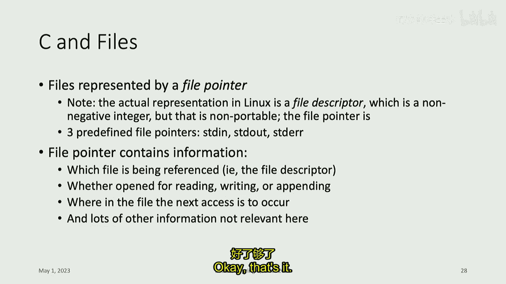

# 【全集】加州大学戴维斯分校 C语言底层编程 中英字幕 完整课程 p13 Lecture 13 - 动态内存管理入门 -BV15C6FBsE3L_p13-

Okay。Hello， everybody。 Are there any questions about what we've done or what's going on or。Nothing。

How's the homework coming？Good， bad， what homework？Yes。I'm sorry。

Reaffirmation of wind midterm is it is Friday。Basically， what we'll do is we'll out。

 pass them out and then collect them all。Other questions？Okay。

 what I wanted to do a couple of announcements， first of all。Again。

 reemphasizing tutoring is available in homework to an extra credit two problems are up and writing。

I promise putting out executables for the answers so that you could go ahead and run them first and then。

Compare output with yours before you went to gradecope or if gradecope is being particularly obnoxious。

 you can。嗯。You can try to reproduce the problem there。You can go into there。

 they're all world executable。Let me know if it's helpful。I shouldn't bother。

I'll leave them out though， for the entire assignment too。Any other。Thoughts， questions。Yes。

I'm sorry。Like a practice midterm。There's one already up on canvas。Look under words as exams。

Other questions？Yes。I'm sorry。Will there be a？Yes， I'll put it out today。Other questions？Yes。

It's due May 10th， which is Wednesday of the week after the midterm。Okay。Yeah。

 initially I was going to make it do the day of the midterm and then I thought。

 you're not that crazy。Other questions。I would have hated him。 by the way。

 here's the midterm Ain't your homeworkers do， which do you do。Yes。The study let's see。

 there is a study guide on Can as far as the specific chapters go， look at the headers。

 look at the syllabus。Okay。But。Fair game is anything done in class plus anything in those chapters。

Okay， other questions， yes。You need a pen or a pencil。 I prefer pen。

Because what we do is we scan them into grade scope。We scanned them。

 then we upload them to gradecope。 and then we， we grade them in grade scope。That way， for example。

 if。We don't get everything graded。Here on campus， we can easily go home and grade there。Otherwise。

 you have to s。In this class， this case， about 100 midterms， which。Kin of heavy。

Oh and what happens too， is we put comments and such on grade scope so that when everything is graded and we release it to you。

 if you lost points， you'll see why you lost points。Other questions？Okay。

 what I wanted to do was do a couple of more recursive things。

And then move on to the wonderful sea preprocessor。

 which I've already told you a little bit of about， which you've been using。

 even if you don't know it。So the first1 I thought would be good。 We did palindromes。

 Let's look at just reversing a strain。And whoops。Yeah。

 and so what we're going to do is we're given a string。And we want to reverse it。

ThereYou can do this iteratively， or you can do this reccursively。

And let's look at the recursive way。 First of all， if the string is emptier， there's one character。

 what's its reverse。What's the reverse of the string containing the letter A？Hey， exactly。

It's its own reverse。 So that right away gives us the base cases。If the string is empty。

 and there's nothing there， it's its own reverse。And if it's one character long。

 it's its own reverse。Otherwise， if we look at the string。

 the way to reverse it would be to take the two the beginning in the end， characters。And swamp them。

And then we look at the part of the string， one more than the beginning and one less than the end。

 and reverse that。And so forth。So。Here's the prototype for the function。

 We take the string to be reversed， and then we take the two indices at the beginning and at the end。

The reason we do this is if we simply pass in the string。

 we don't know where the reversed part ends and the part to be reversed begins。So with the indices。

 it's very easy to find the first and the last thing that need to be reversed and initially。

 of course， this is zero and this is SR LEN minus-1。This is the length of the string。-1。

 because C is beings indexes at0。So here's what it looks like。Let's say we have ABC DE，0 of4。

First thing we do is we swap the。A E。And then we call reverse again。

But this time with indices 1 and three。 So we're only looking at this part。

Because those two have already been reversed。Then we call。

 And so then we're going to reverse these two。And call reverse on what's left。 So we call reverse。

 These are reversed。And we add one here and subtract one there， so it's 2，2。Well。

 that's a single character。So we're done。So what we simply do is notice this string。 We return it。

 The string， the string does not change under the return。

And then the string does not change in the return， but notice the indices。A what they were。

That's because。嗯。The string， when you pass it in like that。 And by the way， this what。

 the right way to do this would be to put the string in an array and pass the array address in。To。

It's appointed to the string。So when the string changes， it says changed。

But when the two the B and the E indices are changed。Within the function。

They don't affect the collarer。So that's why this one restores to one and three and that one to 04。

 even though the string stays reversed。Yes。Yes， you're creating a new frame。やってみる。Correct。Right。

Starts at the top and goes， if it started at the bottom and went up。

 it starts at the top and goes down to return。Okay， so let me show you the program。told me。

Virtual network。Okay， here is the。Here's the routine。Same prototype as before。

First thing you do is check to see if it's great if you need to swap any characters。

So he compare B to E。If the because what's happening here is the。You're marching down the array。

Up from the beginning and down from the end。 And when the two passed。

 you've already reversed everything。 And if the two are equal， that means there's exactly one。

Character and string。So。If the beginning。Is no less than the end。Then you're done。

 You string reversed。Otherwise， you swap the two endpoints。The be the beginning of the string。

 and that becomes the end。 and then that becomes the beginning。あ。And being characters， I mean。

 And then you reverse what's between them。Which is B plus 1 and E minus-1。 Like I said。

 they're coming together that way。And at the end， you get a reversed string。Now。是呀。Okay， now。

The main machine here is notice it just calls reverse string。Here。

And notice also that the string you type on the input is copied into STR。Now， one thing about F NSS。

 it also includes the new line when I reads something。So in other words， if I typed hello there。

And hit return， FGS would return H ELLO and a new line。

And if I'm reversing things that don't want it to start off with the new line。

 I'm only interested in what comes before the new line。

So this is a common idiom that clos the new line。So the new line is the last thing in the line。

 in the line before the terminating no nullbyte， this is backslash 0。So I overwrite the new line。

With an end of strain with the no bite the back zerorup。

Now there's no new line and everything will work fine。And a compile it already， you believe。Yeah。So。

Pell。圆点儿。And so that's done recursively。 that's， at least to my mind。

 an easier way to do it than going down iteratively， walking down the line。

The problem with recursion， though， is， as you pointed out， it takes up a lot of stack space。

So you know for alignment of text and such for recursion。It's not going to matter。

But does anyone here ever know how long war in peace is the novel？Yeah， about thousand pages。

 If you tried to get this traverse that， my suspicion is that most computers would run out of Sspace。

And you get an error。Okay， now there's another problem and this one can be done iteratively。

I've never seen it done iteratively， because it's a real pain。Here's the basic idea。Where's that。为什么？

It's called the Tower of Hanoi。And the legend is that when the world was created。

Some monks were put in charge of transferring discs from pole from A to C， but there were 64 disks。

And the legend says that when they finish， the world will end。64 disks， by the way。

 would require a huge number of movements。嗯。Have you heard of the the comment where somebody did a service for a king and the king said。

 you know， anything you want。 And the guy said I'd like his chessboard。

Put one grain of wheat on the first two grains on the second，4 grains on the third。

8 grains on the fourth and so forth。And the king says。

 is that it and the person says that's going to wind up more wheat seeds than you have。

Because of the doubling， same idea here。Anyway， you can do this iteratively。

The problem is move everything from A to C， but you can never put a larger disk on a smaller one。

So you can't simply， for example， say from move from A to B。Move the second one from A to B。

 Move the third one to C。And then move the top one， which is the larger of the two from B to C。

 and then move the remaining one over to C。Because in that one， in the second move。

When you move the second disc from A to B， you're putting it on a smaller one。

 and that's not allowed。Now。If you try to do this iteratively。

 I'm not sure how you would approach it。But if you think of it as a recursively。

Look at the three disks。If I can move the first two disks to B correctly， that is larger and smaller。

Then I can move the bottom one to C。And then move the two from， I have from B to C。

So really what we've done is what this does is it breaks down the problem。

Instead of hanging can move free disks。I only have to move two。

 and then I can put the third over and then move the two over。Now， the one issue here。

Is that when you move the two， you can't move them to C。You you're trying to go from A to C。

And as a result， the big disc would only be able to go to B， which is not what you want。

 You don't want to move from A to B， you want it from A to C。

So you're going to have to move the two disks to B。Now， if we have two disks to move to being。嗯。We。

 if we put the smaller one on being， then the larger one will go right on top of it。

 So that won't work。What we can do instead is take the smaller one and put it on C。

Then the bigger one on be and then move it back。And so that's an example of where recursion is essential。

 So let me go ahead and walk through it。Here's the first move， we moved the top disc from A to C。

And now we' moved the second disk from A to B。And then we move the third disk from C to B。

 So now we've solved the problem now we've moved from the top two from A to B。

So now we're simply going to move the big disk to see。And then we can can' move the top disc to see。

 because if we do that， there's the middle disk。So instead， we're going to move it to A。

Then we can move the middle disc to see。And the smaller disk to see。 So it would go like this。

There it's move to A。And now we can move what's on B to。There。And we're almost done。

And then we move it over there， and now we are done。Like I say。

 I don't know how to do this one iteratively， but it recursively。Here it is。 This one， by the way。

 returns the number of moves。Okay， here we go again。Oh， wait a minute。That's weird。

If it's in presentation mode and I hide it。You get the。Blank screens。

But if I escape presentation mode and don't hide it and then hide it， it works anyway。

Here is the tower function。Now， the base case is if there's one disk and I want to move it from A to C。

 how do I do that。Is there a larger disk anywhere that I have to worry about？No。

 so Id just pick up the disk game and put it on sea。So if there's only one disk to move。

And the pay it's going to is empty。Then I simply will move that one disk。And this will print out。

 move the top disc from tower or whatever。To the other tower。 So if I'm dealing with three。

 once I've got two on B。There's one disk on A to move。And so I'll move the discount on agency。

And forget about the ends for a moment。And then what now have reduced the problem。

Because if we've got three discs。I want to move two of them from A to B， the top two from A to B。

 so I can move the third one to C。And then I'm going to move the top two from B to C。

And if there are four， it's a little bit more complicated， but that's the general idea。

Put n-1 on the intermediate peg。Move the last one to the final peg and then move the n -1 to the middle peg。

 So first thing I do is I move them from whatever tower they're on。To a temporary tower。

That's the one that is not final。And then I just move the one discri on the from tower。Over to the。

To the true Tower。And then I moved everything from the tempt Tower to the Che tower。

Now every time I move it， I'm going to add one to n。Because and return in。So that way。

 I can keep track of how many moves are made。Anyone care to guess， by the way。

 what how many moves for three it takes？I showed you actually the anybody count。It was seven。

How many do you think it would take for four？How many for two？Three， exactly。So fortuit takes three。

For three， it takes seven。Does anybody anybody see a pattern here？Sorry。Very close。

Here's the pattern。Um。If it's if there are two pegs or sorry， two discs， it takes three moves。

 That's two to the second -1。If it's three disks， it takes seven moves。

 which is two to the third minus1。So in general， the number of moves will be the number of pegs。

 two raiseds to the power of the number of pegs minus1。

And I'll give you an example of that and I mean， actually can do that right now。If we do 10。

It gives you the moves and then says， well， it's 1023，2 to the 10 is 1024。So， anyway。

This gives you the set of instructions to actually do the move。嗯。Okay， now。

I also wanted to show you this。Because there's an interesting feature of it。

 which is not the emoticons。All right， first of all。I'm going to read in the number of disks to move。

And has to come in as an integer。Now there are two ways to do this， you can use scanf。

But the problem with that is if it's not an integer。You have to read the rest of the line。

Because otherwise， it'll keep coming back and seeing that character and saying that's not an integer and you get into an infinite loop。

Okay， so the way I do it is a little bit longer， but it's cleaner。

I use Afghanistanhan to get in the string。Maxim input is a macro defined earlier。

 which we'll get to in a minute。But what this says is if there's no error or end a file。

Then come down to here。By the way， this is in there。 You saw the prompt， which said B O F to end。

I showed this to my grandchild， and he immediately typed D OF。So I added that line too。Handle him。

You call that the grandchild line。Anyway， here。I take the string。And you're doing it S scanf。

S scanf means string scanf， so it's going to act just like scanf except on a string and not on the input。

So here， what I'm saying is， go， look at this string that was typed in。And see if it is an integer。

 if it is stored in n。If it's not an integer。Then。Then enter then you print an error message。

And continue， which means you go back up there to the wow。 If it isn't in a。

 I only want a positive in。 How would you move negative 3 disks。I don't know。So I also check that。

And then the rest of it is， I have N discs on Tower A， and I want to move them to Tower C。

Tower B is the intermediary。And then it goes through the machinations I showed you in the earlier routine。

And then it prints out the number of disks。To be printed a number of discs that were moved。Okay， now。

Grammar。Okay， and then I prompt for a new one， new number。Now， if you type EOF。

 the problem is there's no new line put out， so your prompt appears directly。

 the shell's prompt appears directly after the program's prompt。That works。

 but it's a little bit inelegant。 you'd like your program to finish。

And then put out a new line so the shell prompt is on its own line。

The only way we can get out of this is by typing end to file。And as I say。

 that doesn't terminate the line。 So instead， I do it。 I use put care。And then quit。See how it works？

Basically， with recursion， what you're trying to do is take the problem you have and make a smaller version of it。

And then you can take the smaller version and make a still smaller version and so forth。 This is why。

 though， you need a base case。Because you can't shrink it forever。 At some point。

 you've got to stop and say， here's the result。And then you pass that result to the collar。

 which is the slightly bigger one。 It uses that and keeps on going back。It's a very powerful tool。

Okay， are there any questions about that about recursion？I'll periodically go back to it in lecture。

Because it is a rather。difficult mechanism to work with until you get used to it。

If you've had a math background there and are comfortable with mathematical induction。

This is not going to be that hard。 If you're not， then it will take a little bit more effort。

 But again， after some practice， it becomes fairly easy。I'm sorry， fairly straightforward。

 Easiness or not depends on the problem。Okay， now， let me go through。Okay， and for three， here's。

 here's the particular sequence of moves。And here is the breakdown into recursive。The first one。

 we're moving the top two discs from A to B。And。That's the recur。 That's the first recursion。

Then we move A to C。And then we move everything from B to C。 And that also is the recursion。

And if there were four， then all of this would come。And then you would say move D， move disk。

 top disc from towers A。To Tower C。And then you would move everything from B to C again。

 using the same pattern。Questions on this？Is this type of s helpful？Okay， good。Okay。

 and in the program， I did one thing that I wanted to mention。Namely reading and reading the integer。

 I stripped out the the grandson clause， grand grandchild clauses。Here's really the heart of it。

You read something into the buffer。Okay， and I don't have to worry about the new line here because I'm going to ignore it。

 And I'm not gonna take the length of the string， which。Would require。

 which would require me to get rid of the new line。So anyway， I scan it and then I read it。Now。

 the nice thing about this is。If it's a letter like hello。This will fail。It will not retry。

If you do scan F。It will， it goes back to the input and tries to read again。So this way。

 I avoid the infinite loop。 and the rest of it is this， I showed you。 let me。Again， show you that。

Because the scan F。Here。Because the S scanf here reads the string and it fails。

It prints out an error message。And then goes up to F getS， which is now waiting for new input。

So the only place input occurs is there， and it only occurs once per entry。

If I used F scananf up there and didn't and weren't very careful。

What it would do is it would continue reading。 It would read the input。 It would fail。

And so we would go back and read the input again。If you do want to use scanF， by the way。

 what you do is if the scanf fails， you immediately read the rest of the line using gettcare repeatedly。

And so basically you're eating up the rest of the line， and then when scan F comes back around。Well。

 there's nothing in the input queue。Questions on this。Okay， now I want to take a slight diversion。

Into how the C compiler works， because it's important for for you to know something about that。

 I'm not going to go into details， but I'm going to go， I'm going to show you instead the structure。

When you go to run a program compile a program， you have a source file， dot C。

It goes into the compiler， this part is invisible to you。

The first part of the compiler is the preprocesor， which I've mentioned earlier saying it does textual substitution and handles include files。

It then goes to the compiler proper。 By the way， the output of the C preprocesor is stored in a file called main dot I。

It then goes to the C compiler， C1 for name is from historical reasons。And that actually generates。

Assembly language。This， by the way， is very helpful if you take from what they call it used to be 60。

I think it's 12。 No， it's not 120。Anyway， there's a class on language and it's very useful。

To see this so you can compare it to the source code and see how things are compiled。 Anyway wait。

 this is enmbr source file。So you can read it。It then goes into the asmbler。

Which generates what's called a dot O file。Now， this is given to what's known as the linker。

 sometimes called the linking loader。And if you've used any libraries or anything like that。

 the linking loader pulls them in。And then the result is the eightI out file。Now。

 if you're only compiling one file。Which we've been doing for most of the class。

All of this goes away。 The only thing you'll see is the a dot out。 The source will be there。

 The A dot out will be there， and that's it。If you're compiling multiple files。

Then this one stays in the intermediate mode those two are deleted。

If you want to see what the C pre processorces looks like。

 give it the component of the dash capital leaf flag。 and I'll show you that in a moment。嗯。Okay。Now。

 the CP processor has several commands that you can give it。

And all the commands lines for the C preprocessor begin with a shark sign， pound sign。Now。

 there are a lot of commands。 I'm going to show you three of the more common ones。But there's also。

 for example， an if。And else。Well， FI， which is anything in F。There are some called pragmas。

 which are basically system defined。One of the pragmas when I was a grad student said essentially it was prag。

 then you could play a game in the middle of the compile。

So it would pile things until it got to the pragma line， bring up the game。 you played it。

 And when you quit， then it would finish the compile。It was done more as a prank than anything else。

Anyway， here are the three。Ones that I want to talk about。Pound define。

 which defines what's called a macro。Pound undeath， which basically clobbs the definition of a macro。

 So it goes away and forgets it。And pound include which youve seen with the STbiO。 age。

 that basically interpolates the contents of a file。So let's start with define。

It's basically a macro。😡，In the sense that wherever it sees the word bored。

 it will replace it with 8 star 8。It will not compute that for you。😡，It has no notion of computation。

All it knows is， well， I see the word bored and I replace it with a by8。

It's usually used so that you don't have to keep saying8 by8 or whatever。As an example， null。

 the null pointer， which you''t seen， that's really a macro。

And it's replaced by zero because that's the antsi definition of null。Same with EOF， it's a macro。

And it's replaced with -1。So that's how these things work。 That's how it works。

What's really critical is you realize this is not that that board up there is not a variable and it's nothing like a variable。

This is strictly textual replacement。And if you forget that， that can get you in trouble。

I'll give you an example， it's one which actually took me about two days to figure out。

I was riding a board game with an8 by8 grid， and I needed boards around it for various reasons。

 So it was really to be 10 by 10。And so what he did was I parameterized it。 The side would be 8。Plus。

Two the two borders on the outside of the board。In order to use those for computation。

I then define this。Because look， that's 10， right， So you get 10 times 10， which is 100。

 which is what I wanted。That's why I made my mistake。Because when you do the textual substitution。

 a plus2 goes here。And E plus2 goes there。By the rules of C， this is evaluated first to give 16。

And then I add in 24， 26， so I get 26 squares。So you need to be very careful of things like that。

 The right way to do this。Is to put parentheses around the macro around， the macro。Basically。

 whenever that's anything more than a single。Constant or word。You want parentheses。

So once they did this， it did the substitution， but notice what it substituted。

Straight textual substitution。Now it will do the two editions first， which is 10。

 and then it'll multiply 10 by 10 and give me my 100。This is an extremely common error。

 and it really tends to bother people until they realize what's going on。嗯。So questions on this？

This also becomes important because a macro can take an argument， parameterized macro。Whoops。Oh yeah。

 that's right。 So let's say I want to Mar a macro to see if the number is between 0 and 9 inclusive。

What I can do is this a pound defining in the macro and the parentheses。

 Notice there is no space between the 9 and the parenthses。If there were。

 it would assume the x was not a macro， but something else。

And the way I'm defining it here is 0 is less than or equal to what to the argument。

And the argument is less than or equal to9。 Notice the parentheses around the argument。Whenever you。

 whenever you have something that's parameterized， at least in a macro。

It's a good idea to put parentheses around that argument wherever you use it。The other problem。

 though， you have to be aware of is， since its textual substitution。

 the argument will be evaluated anew。Each time。So for example， if I use plus plus x plus plus。😡。

Let's set it to nine。Okay。Now。That will result in this expression。Typically。

 what will happen here is since it's a logical expression， it'll do this part first。

And then that part。Because with logical expressions。

 it starts at the beginning and goes until it can determine the value。So in this case， you've got 9。

 So this will be 9 is greater than 0， which is true。And then it will add one to the value of x。

 which will make a 10。But 10 is not less than or equal to 9。 So this part is false。

It will then increment X to be 11。And then return this will be false。

That's because when he did the substitution with this。

It doesn't evaluate it and then replace the Mac， then replace the text with the macro。

 the macro text with the definition。This is strictly textual。

 The C pre processoror actually has no idea what that means。All it knows is it， okay。

 whenever I see an X up there。I replace it with an x plus plus。That's it。Oh， and by the way。

 I probably， I just realized。The parameter does not have to be the same letter as what you actually use。

 It can be anything。Okay， questions on this。There's actually a lot more to this。

 which we'll get into later， but this is the general idea and you will see this in programs。Alright。

 now undeath， that's basically forget the definition。Why is it useful。For a couple of reasons。

 the first one is， let's say I' define X， Y， Z， Z Y as dizzy in one part of my program。

And I realized later on， that's a very good variable name to use。

 but I don't want to change everything。So what I do is I do an undeaf。That says。

 forget this definition。So now we can do something like this。Because the pre processoror will not。

 since it's forgotten the definition， it's not going to replace this。This is just another word。

If I didn't have that unde here， this line would become this。Which is illegal。

And will cause the compiler to bulk。Now， normally， when you're writing things。

 unless it's a fairly complicated program， you won't use undeath。

Where it becomes very useful is when something in an include file。Is different than what you want。

So in that case， you'll do you can't do a pound define and redefine it。

You have to undeefine it and then redefine， unefine it and then define it again。

If you try to replace it simply with a pound defined the compiler will。

 we'll give you an error message。Questing三？Okay， the last one that I want to show you was。

 at least for now， was include。This simply interpolates the file contents。

 so it just dumps it in there。Let me give you an example of that。Contl the。Okay， here is a file。

I've defined four macros there。9 side and side 1。 And then the is between function。

 This is between macro。 This is exactly what we saw earlier。So first。

 I'm going to print out the two values of side and one。Both will be 10。Then here。

 I'll print out the product of side times side and side one times side1。These will be different。

 as you saw。Then， now， x is 9。Which is。The， the number 9。If I do this， since 9 is between 0 and 9。

 it will say， yes， that's fair。 that's true。But when I do the next part。With' X plus， plus。

What you're going to see is it'll come back and say it's false。So let's go ahead and run this。两院。

Side and side 1 are both 10。 But when you multiply them。

 since there are no parentheses around the a plus 2， this becomes 26。

Since there are parentheses around the a plus 2 with side 1， it becomes 100。

And then if I just say is between 0 and 9 and pass in 9， x 9。It says， yep， that's right。

 But then when he passes in x plus plus。It returns the latest value of x， which is。Which is 11， yes。

是另外一个。Yes。Yep， what happens is here when you since this is x plus plus。This first one is 9。

 and then it increments X to get 10。This part works。But now X is 10。

10 is not less than or equal to 9， so it fails。But it's still increment tax。

 so that's how you get to 11。😡，Good question， other questions。Okay。

 let me show you one other thing about this。See。Let me do it all the way out。Alright。

 now what I'm gonna to do here is show you what happened happens when you。Interblinated a file。

In this case， I'm interpolating STDIo。h。 Now the preprocessor runs through that file as well applying the same rules as it applies to your file。

So what you're going to get is something that looks a little bit odd。Okay。

 the first line says we're compiling at macros do C。

So it ends up going to the file user include STDC predeaf。And it interpolates that。 This is just。

Various files being interpolated。All right， down at the bottom here we get into interesting things。

This defines what is a character， what is an integer， and so forth。And see more of that。

And then it defines various other functions that are defined in， sorry， I shouldn't say define。

 you should say declare。In ST TDI O dot H。And then notice this number9 macros gott C。

When you interpolate other files。The line numbers change。Now。

 the problem is this is a very short program。 So my reaction if I got an error saying， hi。

 line 132 is wrong。I'd spend a lot of time scratching my head。

So what the preprocessor will do with that pound 9 macro。 c is say， okay。

 compiler pretend that the line following this is actually line 9 of the file macro。 C。

And that's how it gets around the issue of keeping track of line numbers。

The compiler and everything following it will then treat in main void as being on line 9。

And when you do debugging with GDP， it will also assume that line 9 is on main， is line with main。

The other thing， too， is you can nest inrb book N includes。

S TD I O dot H contains a lot of includes itself， which is why you saw that really ugly thing at the beginning with a lot of file names and numbers。

Those were all things that needed to be included。And the CP process just goes ahead and includes them。

Other questions？Okay， what I want to do now is get on to some some stuff about files。

 reading files and writing files。 give me a second here。Now。

The important thing to remember is that you access files by using library functions。

These provide an interface between your program and the operating system。For example， on Linux。

 if you get down into the details。When you open a file。

 it becomes represented by a number called the file descriptor。

That's actually an index into a table that contains a lot of information。

problemblem is that's non portable。 Windows uses a very different representation。

So what you do instead is you use the function F open。That returns what's called a file pointer。

And the file pointer points to a data structure that contains a bit of information about the file。

 like it's file descriptor， is it open for reading or writing or what， things like that？

And in the Standard IO library， which is the STDo。H thing。

Everything you do makes use of that file pointer。 You can ignore completely what's underneath it。

And when you open the file， you can open it for reading。Get the contents of。Writing。Write things in。

And if you do a write， by the way， the contents are deleted first。Or a pending。

 which means you add to the end。You can also open a file for reading and writing at the same time where you're reading part of it and then writing another part of it。

 but there are some tricks to doing that because if you don't do it right。

You'll really mess things up， mess yourself up。Okay。

 so what we will do on Wednesday is get into files and things like that。Are there any questions？OK。

啊，这。Or watch the announcements because they will schedule an office hour tomorrow。

