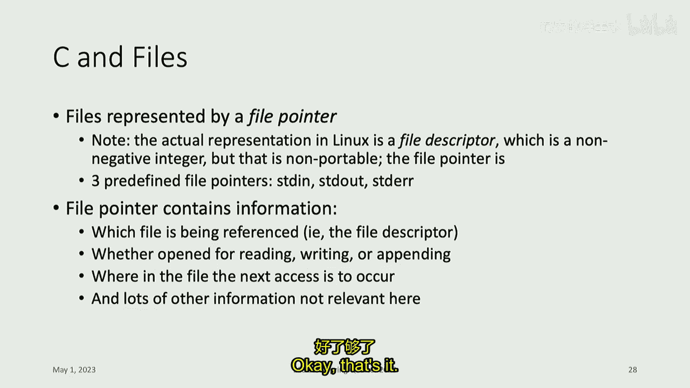

# C语言底层编程：13：动态内存管理入门


在本节课中，我们将学习递归编程的两个经典示例，并深入了解C语言预处理器的工作原理。课程最后会简要介绍文件操作的概念，为后续学习打下基础。

## 递归示例：字符串反转

上一节我们讨论了递归的基本概念，本节中我们来看看如何利用递归来反转一个字符串。

核心思路是：如果字符串为空或只有一个字符，那么它本身就是反转后的结果。对于更长的字符串，我们可以交换首尾字符，然后对剩余的子字符串递归地应用相同的过程。

以下是实现该逻辑的函数原型和核心代码：

```c
void reverse_string(char *str, int begin, int end) {
    if (begin >= end) {
        return; // 基线条件：无需交换
    }
    // 交换首尾字符
    char temp = str[begin];
    str[begin] = str[end];
    str[end] = temp;
    // 递归处理内部子串
    reverse_string(str, begin + 1, end - 1);
}
```

在主函数中调用时，初始参数应为 `reverse_string(str, 0, strlen(str) - 1)`。需要注意的是，由于我们直接修改了传入的字符数组，因此不需要返回值。

## 递归示例：汉诺塔问题

接下来，我们探讨一个更复杂的递归问题：汉诺塔。这个问题很难用迭代方法解决，但用递归则非常清晰。

问题的目标是：将N个盘子从柱子A移动到柱子C，每次只能移动一个盘子，并且任何时候大盘子都不能放在小盘子上面。

递归解决方案是：
1.  将顶部的N-1个盘子从A移动到B（借助C）。
2.  将最大的第N个盘子从A直接移动到C。
3.  再将B上的N-1个盘子移动到C（借助A）。

以下是计算移动次数的递归函数：

```c
int tower_of_hanoi(int n, char from, char to, char temp) {
    int moves = 0;
    if (n == 1) {
        printf("Move disk from %c to %c\n", from, to);
        return 1; // 移动一次
    }
    moves += tower_of_hanoi(n - 1, from, temp, to); // 步骤1
    printf("Move disk from %c to %c\n", from, to);  // 步骤2
    moves += 1;
    moves += tower_of_hanoi(n - 1, temp, to, from); // 步骤3
    return moves;
}
```

移动N个盘子所需的总步数是一个指数函数：**总步数 = 2^N - 1**。这展示了递归虽然优雅，但在问题规模较大时可能带来巨大的计算开销。

## C预处理器详解

在深入新主题之前，我们需要了解C代码是如何变成可执行文件的。编译的第一步是“预处理”，它进行纯粹的文本替换和处理。

预处理器指令均以 `#` 开头。以下是三个最常用的指令：

### #define 宏定义

`#define` 用于创建宏，即简单的文本替换规则。

```c
#define BOARD_SZ 8
#define SIDE (BOARD_SZ + 2)
```
编译器在预处理阶段，会将代码中所有的 `BOARD_SZ` 替换为 `8`，将所有的 `SIDE` 替换为 `(8 + 2)`。

**重要警告**：宏是文本替换，不是函数计算。定义带参数的宏时，务必为参数和整个表达式加上括号，以避免运算符优先级导致的错误。
```c
// 错误示例：可能产生非预期结果
#define SQUARE(x) x * x
// 调用 SQUARE(a+1) 会被替换为 a + 1 * a + 1

// 正确示例
#define SQUARE(x) ((x) * (x))
```

### #undef 取消宏定义

`#undef` 用于取消一个已定义的宏。这在你想重新使用某个标识符作为变量名，或者需要重写某个来自头文件的宏时非常有用。

```c
#define DEBUG_MODE 1
// ... 一些使用 DEBUG_MODE 的代码 ...
#undef DEBUG_MODE
int DEBUG_MODE = 0; // 现在可以作为一个变量名使用
```

### #include 文件包含

`#include` 将其后指定文件的内容原封不动地插入到当前指令的位置。我们一直在使用的 `#include <stdio.h>` 就是将标准输入输出库的头文件包含进来。

预处理后，头文件中的所有代码（包括其本身可能包含的其他头文件）都会被复制到你的源文件中。编译器看到的是一份合并后的大代码文件。

## 文件操作简介

最后，我们简要介绍C语言中的文件操作。程序通过标准库函数与文件系统交互，这提供了一个跨平台的接口。

核心概念是**文件指针**（`FILE *`）。使用 `fopen()` 函数打开文件会返回一个文件指针，后续的读写操作（如 `fprintf`， `fscanf`， `fgets`）都需要使用这个指针。

`fopen()` 的第二个参数指定打开模式：
*   `"r"`：只读。
*   `"w"`：只写（如果文件存在则清空）。
*   `"a"`：追加（在文件末尾写入）。
*   `"r+"`：读写（文件必须存在）。

操作完成后，必须使用 `fclose()` 函数关闭文件，以释放资源。

## 总结

本节课中我们一起学习了：
1.  使用递归解决**字符串反转**和**汉诺塔**问题，理解了递归如何将复杂问题分解为相似的子问题。
2.  深入了解了**C预处理器**，掌握了 `#define`（宏定义）、`#undef`（取消定义）和 `#include`（文件包含）指令的用法及其注意事项，特别是宏只是文本替换的本质。
3.  初步认识了C语言中**文件操作**的基本概念，知道了如何使用 `fopen` 和 `fclose` 来打开和关闭文件。




这些知识是进行更复杂C语言编程，特别是涉及代码组织、条件编译和持久化数据存储的基础。