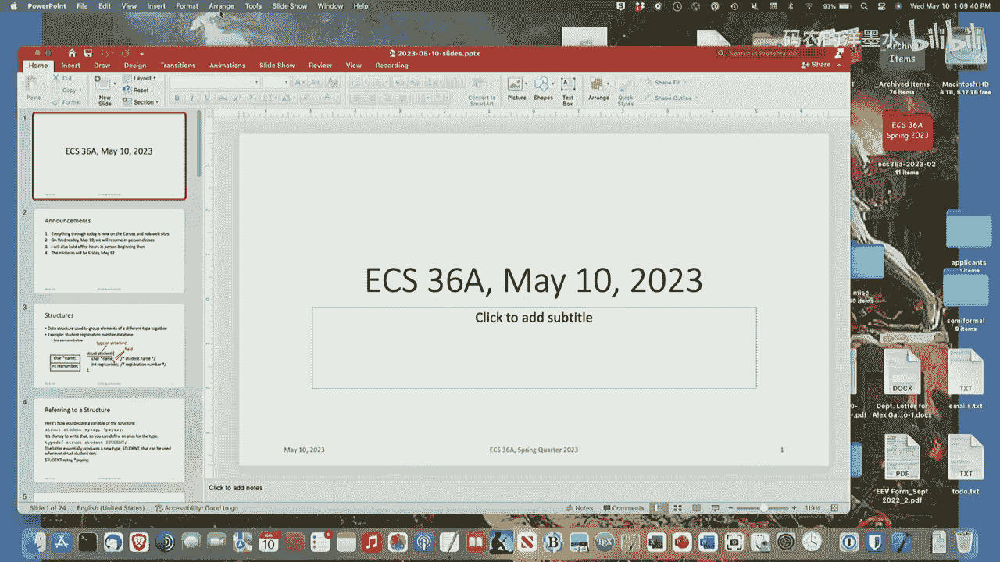
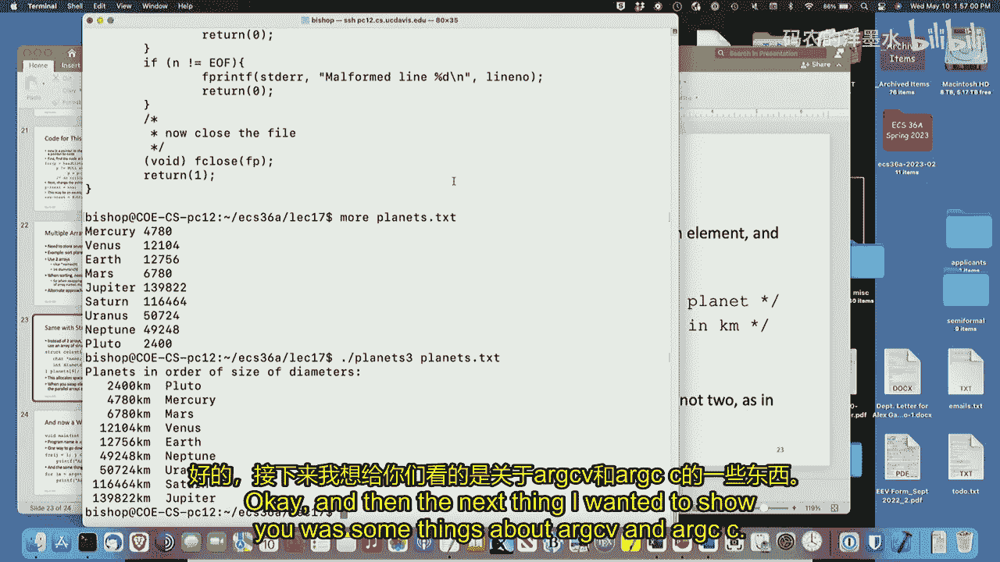

# 【全集】加州大学戴维斯分校 C语言底层编程 中英字幕 完整课程 p14 Lecture 14 - 结构体与文件IO -BV15C6FBsE3L_p14-

Judging from the noise Zga shell can hear me。Okay， welcome back everybody to in person classes and such。

嗯。First off， are there are any questions before I start。The office hours are the same，2 to3 to day。

 watershed sciences in person。Recursions fair game for the midterm。

Everything up to and including recursion， yes。嗯。I expect you to be able to， for example。

 use print De to print out an integer。And I expect you to know about order of arguments， evaluation。

So it can be evaluated in any order。I'm not going to ask you to do any fancy stuff with printf。

 like for example， percent N， which means print the number of characters， sorry， save in a variable。

 the number of characters that have been printed so far。So don't worry about real fancy stuff， yes。

What is the extent to what you have to know， Linux commands。

 You should know the basic ones about moving around the file system。CDLS。More cat。Things like that。

Other questions？Yes。可偿我。他是保目。And sorry。Is the Tower of Hanoi on the midterm。No comment。

Other questions？Okay， please do remember that the midterm is。嗯。Is is Friday。In person。Okay。

 we left off。Then ask like everything， yeah。Okay， we left off talking about。Structures。Because。

It's a way to group different data types together。And I'll give you some examples of that in a minute。

 but first I need to show you what a structure is。It's very much like a record in other languages。

 probably the closest thing in Python would be a list at level zero where there are no sublists or anything。

 actually there could be sublists anyway。The way you declare it is the following。You saystruct。

 And if you want， you can give it name。If youre can refer to the structure。Again。

 you should give this a name， it can be， again， any legal sea identifier。

And then you put in the data that you want to store。It does not have to be the same type。

This is appointed to a character， and that's an integer。And then it ends。

 What will happen is the compile will allocate something like this。

 space for the name and space for the integer。And it will treat these as a single unit。

 They're not two separate things。 They are a single unit。A couple of words of warning。

You cannot assume that this structure is the size of a character pointer。Plus， the size of an int。

Because the compiler is the right， number one to put junk in the middle or at the end or the beginning。

Sometimes that's needed to pay things out。And number two。

 you don't know that the fields will be in this order。 They may be in the reverse order。

That's intent。I'm sorry。Of structures you'll see in about 2010。About thigh light。哎。Okay。

When you refer to a structure。The top one is the declaration。X， Y is Z Z Y is a variable。

 So that will be the structure variable。 So we'll have room for both fields。Star P， X， Y， Z， Z。

 Y is a pointer。To something to something of a student， of a struck student。Now。

 writing this out can be very tiresome， particularly the struck student thing。

So if you want to abbreviate the type or create a new type that's identical to that， you can do this。

Type de， then the actual type， then the alias for the type。So in essence。

 student in capital letters now is a type that you can use to declare things like this。

That line at the top and this and that line put together are exactly the same。

They just expressed differently。Y事查。Type de is saying that student is a new name for the typestruct student。

So it's just like you would declare a variable， except here you're declaring a type。

 If you got rid of this， you see it's exactly like that first part up there。

But you don't want to declare a variable， you want to declare a type。

 so you put a type for type definition。And then you put what the type is to represent。 In this case。

 it's astruct student。 and then you put the name of the type。Questions about that？The name can be。

Any legal sea identifier。That's not used elsewhere， of course。Actually。

 I think you can use it elsewhere， but I would avoid that because it would be very confusing。Okay。

 so there are a couple of ways to declare structures。This is the one that I showed you earlier。

Except instead of just ending at the closed curly brace， you put the variable names following it。

 So this declares X， Y， Z， Z Y as a structure of that type， And P， X， Y， Z， Z， Y is a pointer to it。

You can also say if this struck student is defined， you can also say struck student X， Y， Z， Z。

 Y and star P， X， Y， Z， Z， Y， as we did before。Again。

 there's no difference between the two and sometimes the former one。Whoops。Yeah。

 sometimes the top one there。Is easier to use。 So what you would do is put。Any on？

What you would do is put this at the top of your file or near the beginning of your file or wherever。

Separately。And then you would declare。The structure like that。

 variables the type of of the structure that way， or you could just put student in capital letters like the bottom one has。

Okay。You can also do this。Compressed student and type de。

 The struck student and type F into one line。Which is basically it's exactly the same。

Except you're declaring a type of student。 So you have to put type de before thestruct。

Now the compiler sees student as。A type just like int or a care or whatever。

And so you can insert the pointer there。You can also declare a type that's a pointer。So for example。

 you could say tight de andt star pant。And now Pint is pointed to a type。And when you do that。

 you do have to be a little careful because the first question that comes up is。Why do you need this。

 Why don't you just define pound signstruct， pound sign student space struck student。

And that the idea is that will replace every occurrence of student with truck student。

 It's the same type。Not always。Here's an example。Here's tight death。Now。

 Pit now is a point or two integers。And so now A， B and C are all pointers to integers。However。

 if you do this， which logically seems like it should match that。And have the same declaration。

 You get something very different。 A is now appointed to an integer。B and C are integers。

Because if you replace it in there， it becomes in star A， which is a pointer to an integer。

Int B and in C， the star goes with the A。Okay， now you're asking， what do you use these for。

 and here's an example。Sometimes when you store things on a computer。

You want to put them in separate elements and link them together。

 this is useful when you don't know how many elements you're getting。

So the data structure to handle that is called a linked list。

And in the context of what I'm presenting here， we're looking at sorting these things。

 but it can be used for a very wide variety of things。So here is a linked list。

And the structure would be。Ent。嗯。In in toppper in data。

And then this would be a pointer to the next structure。So 13 points to the set structure with 82。

 which points to the structure with zero and so forth。And here's the type of declaration。

In numb is holds the integer that you're reading in。Struck node next points to the next node。

And then this declares a list。Appointed to the list。

 So what will happen is when you create your first element of the list， you'll assign its location。

 It's addressed to this。And then with the second， you'll put it either before or after and so forth。

 and we'll show you those in a minute。But the key point here is this is a pointer to the next node。

And some really weird languages， which I hope you never encounter。

You could actually leave that star off， and it would embed another instance of its own type within itself。

C will not do that。 It goes bananas if the compiler really objects， if you try。

That is going to be a pointer to the next node in the list。See here we have the list。

And this would be the next。Plans to the next element。Okay， now why is this so useful？Well。

 there are a couple of reasons， but here's the primary one。Remember， I said you， you allocate memory。

And one way to allocate it is to allocate some initial value of the array。

And then started adding on reallocating spaces more and more comes in。

Another way to do it is use that linked list。And the advantage to that is there's no wasted space。

So you can insert a note at the beginning of a list in the middle or at the end。

And I'm going to go through this slowly and then actual we'll look at a program that does this。

So let's say we have a node with the nu1。And here's a list。This list has already been sorted。

 By the way， what I'm showing you is known as insertion sort。

So what I want to do is I have to put one before five and head list points to the list。

Beginning the list they should say。So the first thing you do is you take this field， which was null。

Because that's how I allocated it。And you change it into a point or a pointing to the same place that list head points to。

So now this is。This is an alternate beginning of the list， if you like。

But the problem is we don't want an alternate beginning。 We want it to be at the beginning。

So the next step。Is to take head lists and point it to that。So now if we start searching the list。

 we'll go to one first， then five， whereas earlier。We would start off with。5ve。

So that's an insertion at the beginning of the list。All right， and by the way。

 here's the code for this。First of all， you make the new， which is the new structure。

 the one containing one。Point ahead。Point to headless as its next element。

And then you make headless point to new。So the first line corresponds to this。

And the second line corresponds to that。Okay， now that's the beginning now。A little bit complicated。

 but not that bad。Inserting in the middle is more complex。Okay， so now we have 15。 So the new node。

 we scan down the list。Until we find。A structure whose next node points to something greater than the number。

So now we know the new node will go after this one。So now we have to juggle pointers。

To put 15 between 12 and 23。Now， if we simply take next and point it to 15。From the 12。

 we lose all of this。So you have to be a little careful here。 First， you make 15。

PointedPo to this structure。Make the next of that structure point to this one。

And now if you remove this link and point it to that structure。You still have a list。

You haven't lost anything。So now it goes 5，12，15。23 and 49， which is correct。And again。

 here's the code for this。First of all， you scan the list， go down the list until you find one。

Where the next element is greater than the one you look is greater than or equal to。

The value and the new one。So。I started at the head of the list。Check the next value。

 And this is less than。The value in the first one is less than the value of new。 One is less than 15。

 or 5 is less than 15。So then I go on to the next element。And I continue。Until this becomes false。

Now， remember， I told you about defensive programming earlier。Everybody remember that。Okay。

This condition should never happen。In other words， when you do P equals P R next。

Since I'm inserting in the middle， that will never happen。Just the same。 I'm gonna to check for。

 just to be safe。Because if I don't check for it， want I reference this。The program will crash。

And I don't have to do anything in this oh， fo。 There should be a star slash here。I'll fix that。

And then you change the point you're in new。To point to the same thing P is pointing to。Sorry。

 the same， the thing afterpy。Because that's where this is false。

And then you change the node in the the next point you're imped to point to new。 So you have this。嗯。

Okay， this is the first one where you do the for loop。

 you just go down the linked list following these pointers。And the new node， it turns out。

 will go after that one。Then you change the pointer in the structure with 15 to point to the structure with 23。

And you change the pointer in the structure with 12 to point to the structure with 15。And now。

 you're done。And there's the code， okay。The last one is we've done the beginning。

 we've done the middle， so we need to do the end。Here's the way it goes。 First。

 you scan down the list until you reach the end of the list。嗯。In that that case， P next。

When you're here， P next will be no。So that's how you know you've reached the end of the list。

And you want to insert the new node behind here。It's actually should have been 65 or 68， yeah。

So what we do is we change the end pointer from nu。To point to the new node。And then we're done。

So inserting at the beginning requires a change of head list and the pointer in the new structure。

And the middle requires changing this， this and that。Sorry， yeah， yeah。And at the end。

 only requires changing that。And again， here's the code for this。 You just go down the list。

And then you change the pointer。To what P points do。 And you always make sure that。

The pointer in the new structure is null。If you don't， when next time you go down the list。

 you'll know the list ends when there's an null pointer， well there won't be one。Okay。

 so let me give you an example of this。I'mll to margin this in a second。

Can you focus in the back see this？Better。Better。All right。Okay。

 let me move it over so we can see the end。Okay， and the program here is linked。

So let's go ahead and run it。wait minute。Let's go through the program first。Okay， first of all。

 whoops， here's the。Try that one again。Okay， first of all， here's the program。

 I put a comment in there。To describe the data structure and amusing。And then I declared it here。

Notice I'm just declaring it as a struck numb。 I'm not。Putting any variables or type F up there。

Then they define head， which is going to point to the head of the list。

 and since there's no list that doesn't point anywhere， we'll say no。Okay。

 now what we're going to do is as each number gets read in。We're going to create a node of type dumb。

And we're going to put the number in the data portion， which is the top portion。

And the pointer will be set to know。You don't have to， but it's considered good hygiene to do that。

Reason is you may forget to do it when you worry about adding on to the end。 If you do it up here。

 you won't have to remember。啊。And we allocate it by using malloc。And， of course。

 if you can't get any memory， it returns No the null pointer， which will be used to signal an error。

Otherwise， we have P。P points to it。The second thing we have to be able to do is insert it into the list。

So the function insert uses preve and temp。Temp is the temporary pointer to the new thing。And pve。

And and new is sorry， new is the point to the new structure， the new element。

Tempt and preview used to insert it。The first thing we do is。If we reach the end of the list。

We simply point the head of the list。To the new field。

This whatever you return and insert here is set up so it will go to become the head。嗯。Yeah。

 so whatever when insert returns， it needs to return the address of the head of the list。Okay。

 so now there is once we've done that， there's something in the list。We'll go past that if。

So the next thing we do。Is determine if the first element of the list contains a greater number than the one we're trying to insert。

 If so， it's going to go at the head of the list。 and there's the code。New next equals head。

And when you return， head will point to new。Now， if it's not in the in the at the beginning。

We have to go down the middle。Or it could be at the end。

 So what we're going to do is use these two pointers to go down the list。

We're going to set previous to head， which is the first one。

 And then temp is the the one following it。 So we'll have preve here and temp here。

 And what will happen is as we go along， we'll advance them both。So now we've got a bracket。

Where we hope to put it？So now temp is null， because if that's s nued youre at the end of the list。

 you don't want to go any further。If it's not no， then you look at the data and compare it to the new data。

 And as long as it's less than you advance。Notice we're advancing both pve and temp。So now。

 when this is false。嗯。It fail， we have the one before where we're going to do the insertion and the one after。

The temp just makes it easier to do this， you could use preveon next。

 but then you have to add some checking code that I showed you earlier。Okay。

And then what we do is we take the new pointer， the pointer of the new thing and point it to temp。

 because that follows。And then we take the point of deprive and point it to new because that's before new。

Now I want to show you something interesting。Let's say temp finally becomes nu。Okay。

So when we come down here， this automatically will set the next field of new to null。And prive。

 which is the end of the list。Will set its pointer to new。

 so this works for both the middle and the end。By the way。

 this code is all on on the CSIF under Le 17。Okay， and then here。You can see we just return。

What's at the head of the list？If we're creating a new head， we to return。

 We have to return the address of new。 but if we're not creating a new head of the list that's going in the middle or the end。

 we just say， okay， the head hasn't changed yet。Okay。

 so now what we do is we're going to read in some numbers。And then control the end at all。

And they're all sorted。So that's how the routine works as far as the reading goes。

 let me show you the end of this。Okay， so what happens is。

I have a what I'm going to do is for every number I read。

 I'm going to create a new element of the list。So that's a newstruct nu。

So first I read in the number and store， I use Scf to read in the number。

 so now n contains the number。I also take the return value and set I to that。If I is zero。

Then I entered an illegal number of some kind。By the way， remember， EOF is minus1。

 so EOF is not zero。So there's an error of some kind。

So what they do is they print out illegal number。And since Scanff has not removed that illegal number from the。

A line that I typed。I just go ahead and write out the entire line。

 put a new line on there and go back to the Atlanticman number。Notice too。

 I'm writing everything to standard error。So that way， for example。

 if I'm reading my numbers from a file， I'll still see the error。Assuming there's no error。

 then it comes down here and creates a node。 Notice it calls create node。

It doesn't do the mallaching directly。I've always found it easier to put that off in a separate area。

Because quite frankly， when you're debugging， it's easier to either put a break point or a print F in that one in the function。

 rather than in main， it just keeps things a little neater。

So this creates a node and you pass in the number as an argument， and it will go ahead and create。

Use it created， it will be a structure， be the first and will be the data and nu will be the pointer。

And let me just call insert and insert it into the list using the methods I showed you earlier。

And when I'm all done。The problem is when you type EOF。

Normally that ends the program and it just prints out your prompt。After the last one。

 which looks ugly。So I found it easier to put a new line after that。Your taste may vary。

 And then here I just go down the list printing things out。 I start at the head of the list。

 which hopefully there's something in the list。And so I print out the data there。

Then I go on to the next element。That， if that's null I stop。

 if it's not null I print out the data there and so forth。

So I just go down the list printing each element。Questions on this？Okay， by the way。

 I'll show you another use lists in a minute。啊。Okay。

 now let's say we have data of two different sorts， we have planets and we have diameter。

We can store them in two separate arrays because array elements have to be of the same type。

And so what we do is we store the AMmeter of Mercury first。Then Venus next。

Then earth next and so forth。So the array indices tie the planet。To the diameter。Now。

 the issue there is you have to make sure that。The arrays stay synchronized。So if you have to swap。

Or exchange two elements。You have to do it in all the arrays， not just one， and again。

 I'll give you an example of this。This program has a well， let me show you。

I want to hit that already。This program has an array of names for the planets。

I know Pluto is technically not a planet， but I learned it that way， so we'll go with it。

And it also is the diameter in kilometers。Now， Mercury's diameter is 47， 80 kilometers。Earth's is 12。

756， I think these are yeah diameter and so forth。Okay。

 so you see how the things here line up with the things here， the things up there。

Lining up with each of these。So I've got two arrays， diameters and names。

And to figure out the length of the diameter array。

And I know the same number of I know names is exactly the same length。So here's what I do。

 this is called selection sort。What I'm going to do is I've got all the data in a list。

And the way I'm going to sort it is make repeated passes。

 I'll go through the list and find the smallest thing。Exchange it with the first。Then that's sorted。

 so then I'll go through the rest of the list， find the smallest thing there and exchange it with the second and so forth。

By the way， there's a lot of work on sorting if you haven't。Gathed that yet。Anyway。

 so what I'm doing now is I'm going from zero to the number of diameters that are listed。

I assume that the first one is minimum。 Now， this is an index into the array。 It's not the value。

And the thing is， the index here can be used for both the name of the planet。And the diameter。

So what I do now is I go down the list。And I check to see whether or not the diameter that I'm looking at。

Is less than the diameter that I've declared to be a minimum。If so， I've not got the right diameter。

😡，And so I， again， I changed me to be the index。Of the smallest diameter。

And I'm guaranteed that men will not be， no， will not be some， some junky value。

 because if none if this is not true for any of the others。It will be。 We have I。

 which was the first one。So now we found that， if we found the new minimum。

Then I want to swap it so the planets are in order of size。But， look。

 I have to change it in the door。 I have to swap it in the temporary。

And then I have to swap it in the main， in the names。So I'm doing two exchanges here。

And just to show you， this works。There we are in order of size。Okay， the alternative to that。

So we don't have to worry about keeping asynchronized and all that。Is to use a structure。

So what we do is we combine the two arrays into one。

 The first element of the structure is a pointer to the name。Of the planet。

And then the second element is the diameter as an integer in kilometers。

And now we define an array9 of planets of size 9。Actually， there should have been 10。0 to 8，0， 9。

 It's of type celestial。Actually， you take a back。 that's 9。 That's right， yeah。

So now we've allocated。10 of these， allocated 9 of these structures。

And so now when we swap elements in planets， we can swap them directly。

We don't have to do swap the fields individually。 We just tell the system to swap them directly。

And another here's an example of that。Noticice here I first defined the structure celestial。

It's having point you to a name in a diameter。And because I don't want to keep typing structural celestial。

 I， I amious it to the type planet。So wherever you see planet think struck celestial。

And then I put everything into the array。 I have planet。And then a list of the planets， name。

And diameter。These were from the， in the order going out from the sun。 And the important point here。

Is that you put the initializations。In the same order as you list the， the fields。

So that's why the first thing is the planet name and the second thing is the diameter。

 If I reverse that so or in diameter and then carestar name， I'd have to reverse these two columns。

And then I get the size of the array。So again， this is just the main routine。

 and they have a temper if I'm going to swap， I'm going to swap structure two structures。

So I define1 planet as the temporary holder for the structures。Now。

 as before I assume the first one in the array is the smallest。Now。

 I go down this list by comparing diameters。Now， planet's I J is a structure。

It's not a pointer to a structure， but it's an actual structure。So I used a dot。

 and then I named the field。So this will take the diameter of diameter this will take what's stored in the diameter field of the structure planets J。

 and compare it to the diameter field of what's stored in structures and structure planets min。

And if this is correct， then the minimum one becomes J。 So it's just like before。

 except we're using a structure instead of an array。Okay， now。If we have found the new minimum。

Then we go ahead and swap the elements。 Notice here， I'm only swapping once。

Because when you exchange， when you assign an when you assign a structure。

You assign all fields of the instruction。Of the structure。You can do it field by field， in fact。

 way back in the dim， dark days of the 70s in some cases you had to。But。No one ever does that。

You always do it this way unless you're going to change something。Yes， questions。Okay。

 and then when you print them。Here I'm changing here I'm printing。The array。First。

 I'll print the diameter because I'm in a for loop。

 so this will start at planet 0 and go to planetet 8。So I have the diameter。

And then they print out the name and notice the dots。If you're referring to a field of a structure。

 you use a dot。And so now。Gives me the correct order。Okay。Now。We'll be doing more with structures。

 but I want to show you something about yes。Oh where I initialized them。There。

Mercury would have been the dot name。验收管理局。Oh， where did I the compiler did it for me automatically。

This is how you initialize a structure。 You list the fields going across in the same order you have them。

And when the compiler sees planet， it says， okay， I'm gonna get a bunch of structures。

And it just goes ahead and builds one structure for each of these things。

This comm is unnecessary because it's the end of the list。

 but I've always found it easier to put it in than ignore it。And that closes the initialization。

Makes sense。I think yes。Go ahead。Oh， that separates。

The first first structure visualization from the second。

 if you don't put it in the compiler complaints。关系他。Its just like。Well， you write。

 because there's more than one character in a planet name。

 what they could do is have declared that in array。So I could say care name， open bracket。10。

 I think that would do it。 Yeah，10 clothes bracket。Yeah。Okay。

 so now let me show you a couple of other things。Okay。

 now I'm going to read the planets in from a file。So I start here。

 and I'm going to assume that the planets， there are no more than 100 planets。

And that no planet name is longer than 100 characters。I use this for allocating space。So first。

 again， same structures before。Same array。But here I'm keeping track of the number of elements of that array myself。

And here I have a prototype saying I'm loading the plants all right。

 but I'm going to load them in a separate routine。Alright。

 so here you have mained with Arg C and Arg V。And the first thing I do is look for the file。If they。

 if no file is named， there are several files that are named。

 I want to return an error because you only get to name one file。

So if the number of arguments is not two， that is the program name and the file。

Then I print the error message and return one。If I do have two arguments。

Then R V 0 is the program name， and R V1 is the file name。So let me go down to that routine。Okay， so。

I'm assuming again， that things are in a certain order within the file。

So the first thing I do is I open it for reading。If this fails。

I'm going to let the system tell me why， with this PR。And it will print out the file name， colon。

 and then the system error。Otherwise， I go into a well loop。And I loop。

Until one of two conditions is true。嗯。If。Actually， until both conditions are。

 one of two conditions is false。First， I check to be sure that I'm not going beyond the bounds of the array。

That's what that line means。And second， I'm checking to be sure I read in two things。A string。

 which is the name。And the diameter， which is an integer。If both of those are true。

Then I've read it in the name and the diameter of the planet。

So the first thing I do is I allocate space for the structure。So now we have a structure。With。

A character pointer。And to to the next structure。Both of those are uninitialized。

So what I have to do next is allocate space for the name。And that's exactly what I do here。

 I get the length of the name。And then they allocate space for it。 Not the plus one。

That's for the Nobite。And that's the size of character。 And if this fails。

 I print out near message indicating that it was the second mallet， which is this one。Failed。

 and then it'll tell me why。If it doesn't fail， if it succeeds。

Intempt now I've got a pointer to pointer that means something。Before the this assignment。

Name could contain anything， and in fact， in this case。

 it would contain just whatever happened to be there。It's junk。Here， though。After this line。

 it points to a space reserve for the name， and it's of the right size。

So what they do is they simply copy the name into the field and set the diameter appropriately。Then。

Copy that temp into the array planets and add one to the， add one to the index。

 So it goes to the next one。And then I add one more for the line number。

So I can keep track of the lines。Okay， now when all this is done， I have to see why I dropped out。

First thing。If there are too many planets， I print too many planets and give the maximum number。

Otherwise， if something happened and it was not an E OF。

Then that must mean the scananf didn't F scanf didn't work。So there's a malformed line。

And I tell the use of that。 And I actually give them the line number。

So that way it'll help them locate the line in the file。

 it's always good to give the when there's a problem。

To give the user as much information as you have。And here's the file。s exactlyly as before。

So now let's go ahead and run this。And again， it prints them in order。

So this was done exactly the same way as the two planets2。

 except that I read the data in from a file。And so I could have added a few other exoplanets here。

Okay， and then the next thing I wanted to show you was some things about Arg V and Arc C。

So let me start that and I'll finish in on Monday， remember the finals up。Midterm is Friday。Tvis。Yes。

 the midterm is here。 it's going to be in person。 I'm going to bring hard copy for it。

So we'll pass that out when you write， please press heavily or make sure it can be read easily。

Because if the pressure is， we're going to load these into grade scope and grade them there。

 If the pressure is too light， the scanner may not pick it up， in which case we have to go to your。

Let's go to your paper and grade it that way。The second one is。

 please be sure I can read your writing and the TA can read your writing。

That sounds silly because it's what you've always been told。

 but you'd be surprised how often things are hard to read。So please write clearly and carefully。

And if you have to draw a picture， that's fine， too。 you can always use， yes。饿。

I don't remember what it was I taught this chorus last about four years ago， offhand。

 I don't remember。Would it help if I posted that， I will let you know what the average is once。

 once we're done。Sorry。Is the midterm super difficult， I hope not。

I'm not trying to flunk anyone out of this course， okay。Yes。No， the midterm will not be curved。

 The final grade in the course will be。 and I'm going to be using the root square， the root method。

 yes。Are you going to have cheat sheet？No。From your memory。Yes， you work next， I think。I'm sorry。

 Could you speak louder。Is this stuff on midterm？No， the midterm is up to and including recursion。

 We did structures and pointers and all that afterwards。Yes。There are， if I remember correctly。

 five multiple choice and four longer answer。或就是。Pointers are may well be pointed the midter part of the midterm。

 It's just that。Structures won't be， for example。

