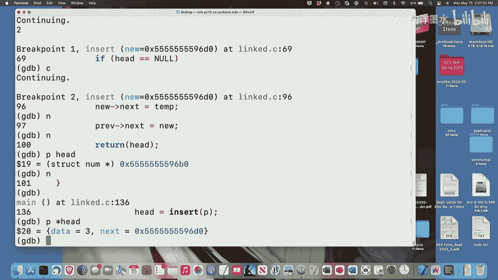

# 【全集】加州大学戴维斯分校 C语言底层编程 中英字幕 完整课程 p15 Lecture 15 - C程序调试 -BV15C6FBsE3L_p15-

Has everyone recovered from？We haven't graded the yet。

 we're going to try to get that done by Friday so that's our plan。How did you find the midterm。

 Was it hard， easy， impossible， Why did you even bother？Dead silence。Okay， well。

What I wanted to do today， rather than go through slides， was's focus on debugging。

And so we've got some programs with bugs in them and we'll go through how to do the debugging。

But there are two types of debugging。The first is static。

That's where you insert things into the code， and then compile it。

And use the results of what comes out to guide you Basically， what you do is to put it less formally。

 what you do is you put a lot of printfs or other printing things in there。And as your program runs。

 it will print out extraneous data。And then by going through the data， you can hope to。

 you can narrow down where the bug is and ideally you'll be able to find it。

There's another type called dynamicy， which is where you compile the program。

And then you execute it under what's called the dynamic debugger。It runs the program。

 but allows you to see what's going on inside it。So let's start off with the static one now here's the program。

With a bug in it。And let's pretend we don't know what the bug is。Okay。So we run this。First。

 we compile it。Okay。And now we run it。Whoops。Now the goal of this program was to add2 to J 100 times 099。

So it should prono out 200。But it's only printing out too。So the question is why？Looking at this。

 we may not see why。Yes， it looks obvious。However。Sometimes your mindset is such that you don't see things like this。

Like I said earlier in the quarter， one time I spent about two days trying to find a bug on a program。

Someone walked by and asked what was going on and I explained it and he looked at and pointed to the for loop and said。

 shouldnn't that be a comma instead of a semicolon？Work perfectly。Okay， so first of all。

 let's get in there。And he had a couple of printfs。The first thing here is we want to know what。See。

 it's inddented， so that's why I think it's tied to the for。Okay。

 now I know at this point Jay is two。So let's watch as we go through the four， yes。I'm sorry。Oh yes。

 print not pro， thank you。Sure。No， in fact。To let you。Jump ahead， that's the bug。Okay。

 so anyway we have this， now let's also put it。Right before the J。Plus， equals2。嗯。Okay。

 and let's also put that in brackets because I want to include it with the J+ 2。Okay， so if I'm。Okay。

 so if I'm right， what should happen is we would get i equals zero， j equals zero， i equals 1。

 j equals  two and so forth。Up to 100， so that's 198， so let's go。嗯。We compile it again。

And all of a sudden it stops。So this tells me that I'm never getting to the for loop。So。嗯。

Let's take so what we would do is then take a look at the for loop and notice this semicolon。Now。

 what this semicolon does is it says， okay， the for loop is nothing after it。So it does nothing。

So in other words， it would reach this line exactly once after the for loop was done。

And that's the bug。So。What we do is。Let's go in and。Remove that， see if that works。And there it is。

 that actually worked。Okay。Now， something that's very important in this code。

 it really doesn't matter， but on most programs it does。In general， don't remove debugging code。

But we don't want that printing out because then they use a littlehuh。So what we do is this。

We define a macro。Call debug。Now， if you leave it like this， debug is defined as one。

And then what we do is we make we do this。Os。And this was the other debugging line。Okay。

 and what this says is。If debugging is set。This talks to the compiler。 if the debug flag is set。

 which it is up there。Include this line in the source。If it is not set， skip this。

So let's do it once with and then we'll do it without。All right， so there。

 now we really only want that last line。So we go back into the program。Get rid of that。

Now the reason you do that is later on in a larger program， a bug may recur， a problem may come up。

This way you can use it to check that what you did worked。

And you may be able to track down that something's going on with what you already debug that's affecting what's going on later。

Yes。Yes， that's exactly what the purpose of that was。

I'll show you a couple of more complicated ones in a minute， Are there questions on this？All right。

 let's take a look at the next one。Okay， so this one。You start off with us being three。

 and you add S to itself until the sum exceeds 100。

So the idea is we have three and then while I is equal to one。Add S to itself。

 and if S is greater than 100 set I to be0， so this will come around to be false。诶。Oops。

So it's hung there， all right， so let just break out of it with the control scene put in some print statements。

Okay， now the problem was it hung somewhere， and we don't know where。

 So I'm certain it didn't hang between these two。But take look at let's go ahead and add some print statement here。

Yes。Because you should havehand。I should have gotten back by prompt。Hang on us one a second， please。

有样。Okay， when to run sample one。It prints a line， and then it prints this。

 which is the pro to the shell。So that tells me I finished。But when they do sample two。

I don't get any prompt， oop。Sorry。Yes， it's in， it's in what's called an infinite loop。Okay。

Good question by the way， I hadn't， if I had thought of it that， I would have put it print enough。

Okay， so we put the printf there to see what's going on each time through the loop。 Now。

 we know the loop is going， we want the loop to end when it is greater than 100。

So let's put a print in there as well。Okay， now what's going to happen is it will print the value of I each time through and S。

And then whenS is greater than 100。They we'll go to the if。

 because I don't know if what's going on is it's skipping the if or it's doing the if and something else is wrong。

So let's put a couple of prints in there and find out。Oops。Notice the problem。

S is zero all the way through。So。What that means is， for some reason。Initially， S is3。

Let's check that。It's a lot of output。Oh， here's what's going on。

So we go up to the top of this where we run it。Notice it is I equals 3 I then s equals 6 and so forth。

 and S just keeps getting larger and larger than 100。But it didn't stop。

And what finally happens is it just becomes too big for the computer to handle。 So it flips it。

 so it becomes 0。By the way， what I should have done if I had been thinking about it is this。

Now the difference between oops。Now the difference between cat and more both display the file or the output in this case。

But more does it page screen by screen full。So I can see what's going on without it going。

Like it did。And you all recognize this as the pipe。

 the output of sample two is going to be the input to more。And there it stops there， okay？

S is getting bigger and bigger， and if we press return or press some space。We get down to there。

 Allright， so the problem is it's never getting into that。

 The problem is it seems to be getting into the if statement。InF， you see。But。

The problem is it's not resetting I to be 0。 So let's go back into the file and take another look。

All right， so we know this is not the problem。WeWe know I is resetsent to zero here。😡。

But then when we go up， I becomes one。And all of a sudden。Notice this is an assignment。

 we need two equal signs。😡，And that's the problem。So let's fix that。嗯。See。

 one of the things about C is an assignment statement is value。Its value is whatever you've assigned。

 yes。The intent is it goes down to here and when S is greater than 100 and we saw it had no problem being greater than 100。

 you'll go into here and set I equals0。 Then when you come up。

 this is false and you'll come out Okay， I could have put a brake statement in here， but。I tried。

My own personal philosophy of programming is try to avoid breaks and continues when when there's an easy way to do it。

And in point of fact， I expect the compiler to optimize a lot of that out。

 So it the compiler will take what you've got and rearrange it as necessary in order to make your code faster。

 If you want to really fast， give a dash capital low option。I'm sorry。Oh。

 a personal preference solely。 It's just because for me。

 at least it's easier to see the logic of the program。 If you put a break in that。

 it's perfectly fine。Okay， so let's see if that was it。Yep， that was the problem。

As as it hit' not 192， it stopped。AhOkay， that is interesting。You see。Okay。

 I'm not real good at drawing on the computer， but let me see what I can do。Basically what。

 let' me try explaining it first， basically what happens is you have  32 bits for Nr。The number。

 the earlier number， was much larger than 32 bits。And the way it handles anything larger than 32 bits is it discards the high order part and just leaves the low 32 bits。

Which in this case was always zero。So the reason to flip to zero is because of word length。

 it has nothing to do with a bug in the program。😡，Well。

 it did have something to do with a bug in the program， but that's not why I changed to zeros。

It just counted too high。嗯。On this machine on the CSIF， integers are 32 bits。By the way。

 how many anybody here heard？In any programming language， floating point numbers called real numbers。

Okay， good because they're completely different。I won't go into that explanation。AYes。

 an integer has you have 32 bits， an integer really could only have 31 bits。

 and then the 32nd bit is a s bit。If it's said it's negative， it's not said it's positive。

If you go to unsigned。Then that 32 bit is counted as part of the number。

But I remember we were looking at one voting machine once and they were using very short integers on it。

And it turned out if too many people cast votes， of votes would the number of people voting would go to zero。

It didn't affect the channel。 the results。 It just affected how the machine just affected how many people use the machine。

However， with elections， there are a lot of double checks， and that one was caught almost instantly。

 yes。Because it's static debugging， GDP coming up in a few minutes。Okay， let's see。

The last one that I wanted to show you is a version of n factorial。All right， we have up there。

The factorial。And then it returns。嗯。It returns its's recursive。So let's go ahead and try that one。

You compile it over right， yes。No。Let's do 10 factorial。Oops。Okay， something really went wrong there。

 so let's go in and take a look at the code。If you're doing static debugging， wait a minute。

 wrong one。If you're doing stat debugging， let's find out what end fact is being called with so。Okay。

 now just because I'm very cautious。Oh。Helps to call the right program。Notice that n is increasing。

It should be decreasing， right？All right， so let's go in and change that。

And we'll still print the ends to make sure it's really decreasing。We'll do 10 factorial in。

And now at least we're going in the right order， but look what happens when we hit zero。

We keep going down。So that was clearly one fix， but there's something else that's wrong with it。

So let's go in and see if we can spot it。Okay， with recursion， there are two elements。

There's a recursive element， but what's the other one， what's base case？Where's the base case here？

From the printing statement， we see that it's going past zero all the way down and we need it to stop when it hit zero。

So now we can add this。And there we are。Is this helping people， People find it' useful。Okay。

 so there we are， that's what we did was we first found one bug。

From the output it said when what was going up， so that was an obvious bug。Then we got it to go down。

 but it kept going down past zero， which is another bug。

So then we add the base case and that stops it。Yes。😊，Hang on a second。You mean here return one。

Because in fact， the zero factorial is one。Other questions。

Okay let me break this program again and what I'm going to do now is show you what's called dynamic debugging。

Good。Okay， now when do you compile a program？There's something in there called a symbol table。

And it contains information about where functions are located。

And it may contain the information about where variables are located。

The reason this is necessary is if your program contains occupies more than one file。

Some functions will be in one file and some in another， and the compiler has to put them together。

 It's called linking。So that's why the simple tables are in those files。Now。

When you compile a program。It's possible to get a symbol table that is the name of every variable。

 even local ones， that is the ones within the functions。

And the way you do that is you give the D G flag。You can think of it if you like a standing for GDP。

 It doesn't， but that might help you remember。And what that does is。When it compiles the program。

 it creates the usual symbol table， but adds more to it。And the compiler won't use that extra stuff。

But the debugger will。So we've recompiled it， let's rerun it。Okay， so now in order to run this。

 the first thing we need to do is we're not going to interact with the source code。

What we're going to do is interact directly with the executable。😡。

And then we typed the name of the executable after GDP。

And then we get this most of this you can forget， it says it's free software， no warranty。

 if you want to see the copy right and the warranty you can。

 it was configured for this type of system， which is the CSIF。

 If you're really interested in how it's configured， you can type that。 I've never in my life。

 type those three， by the way。And then it tells you how to report bugs。

And where you can get the manual？Benett says， and this is the important part。

 reading symbols from N fact2。So it's right all those symbols in there。Now。

 first thing I'm going to do is run it。😡，Because I want to recreate the crash， but within GDP。

 watch what happens。All right。It says says using a specific library to help you with a debu so you can ignore this too。

This says the program received Sig seg V， which is a segmentation fault。And it did it in fact。

At line 12。And it says error reading variable cannot access memory at this address。Okay。

What they really need to take from that is it couldn't access N。

That means N was in an area that I don't have access to or。

So what I'm going to do is look at line 12 because that's where it blew up。

Now there's this nice little command called L。1 comma 20 means begin at line 1 and go to line 20。

So it blew up right here， where' is it？There's my mouse there。So it blew up on the call to Nf fact。

Now let's try to figure out why。Rather than using printfs， we can use what are called break points。

A break point stops the program。😡，At a specific place。And allows you to look at variables。

So a break point in GDP is B。And what I want to do is stop it at line 12。So now I run it again。

And since the program crashed， GDPB says it hasn't stopped it just died。

Do you want me to continue and you say yes， and it'll start up a new invocation。 Forget the old one。

Okay， now it's stopped。It called tells me， look， it called in fact。With n equals 10。At line 15。

So it broke here， notice I put line 12 in。😡，Line 12 is right after the function declaration。

GDB always stops at the first statement the the first statement that can be executed。

After where you tell it to put the break point。 So when he said break point at 14。

 it would have stopped at 15。 But if I said break point at 15。

 it would stop at 15 because that line is executable。All right， so now I'm here。

Now let's see what happens。Now there are two commands you use to step through a program with GDP。

The first one is called S step or S。😡，And all of a sudden' back at the same break point。

And N went up to 11。And let's see what X is。Okay， so x that is there， let's do it once more。Actually。

 you can just say P for print。Okay， so X is getting all sorts of junk in it。

And it looks like it's going up。And they're just flipped to zero。So something is wrong。

 so if we look at this。We will see the n fact of n plus1。 So now what we can do is。Now。

 we have to go out to the source and change that to a minus。And when you do that， it will say。

 by the way， should I quit anyway， because you're already running something？And the answer is yes。

 go ahead and quit。All right， so now as before let's change this to a minus。Oh。Close， but no cigar。

 So let's go back into GDP this time with the one we've modified。And again。

 we're going to put a break point at line 15。I think it's line 15， let me check。

You can say El instead of List， by the way。Yeah， let's stop it at line 15。Now we run it again。

When you say run， by the way， you typed the arguments that you would be giving the program directly after the run。

So in this case， when I ran it from the command line I type， in fact to space 10。Here I type run10。

Yes。If you don't have any command line arguments， you would just type one。Yes， it would。 well， yes。

 you'd have to give a prompt or something like that。But yes。

 it will run exactly as it would normally。All right， so let's try this。Okay， we've got 10。Got nine。

C means continue running the program。And n means next。

 but with n you skip over the function you're calling unless there's a break point in it。😡。

There is here so I can do either C or N or S。It's going down just as we expect。

And now that's what we don't expect。Let's see what x is just out of curiosity。Yep。Okay。

Since we're going down， since we're decreasing， nothing has been assigned to X。

And x is just declared as an integer。And it's not initialized。

So whatever's in there is meaningless until the assignment completes。

But this tells us when we get to zero， we don't stop。So we need we need to add the。We that as before。

And now it works。This do we have a link there？哦。Everyone remember this program from last time。

It's still an inist program。Okay， what I'm going to do now is introduce a bug。And before you ask。

 this bug happened to me when I was debugging something from homework assignment 3。

 which will be out later today。All right， I haven't put in yet。

 or I commented out really the code that goes before the first element。Okay， so let's go ahead and。

Rend this。First of， we'll compile it。Yes。If your system uses a compiler called LLC or LLVM。

 the equivalent is LLDB， they work just about the same， but the compilers are different。

 so the name is different。Plague。Oh， yeah。 there is， I think it's CBB。Not 100% sure of that， though。

 but there is a debugger associated with it。Okay， so now we do linked。

Now this is supposed to print things in order， but notice it's out of order。30729。All right。

 so let's go in and try to figure out what's going on。Remember， I compiled the link with the DG flag。

Okay， now it's pretty clear whatever is going wrong is going wrong and insert。So。

Let's take a look for search。Dot， by the way， means current line。😡，Oop sorry， it doesn't work here。

So we'll go to 40，60。And you can just type L to keep going in groups of 10。

So what we should do is put a break point in this function。

So we can check new and be sure see what's going on there。

And we can check at the same time what head refers to。So let's put a break point at line 66。

And notice it's telling me， hey， you can't put a breakpoint there because that's on an excutable line。

The next one is line 69， so I'm going to put the break point here。哎。And now we run it。

What did I say before？3，7，9，02。 K got it。Okay， and now it stops， so let's print what head is。

Remember， head is a pointer two the head of the list。And it's null。

 which makes sense because nothing has been put in the list。So。Let's continue by typing a C。

And now we'll put in these in the9。And it stops。All right， now first of all， let's see what head is。

Notice head is an address。If you simply give it the name of a pointer to a structure。

 it will tell you what that pointer is。😡，But if you want to see the actual contents of the structure。

Whoops put a star in front of it。So there's one element in the list。

The data field of that structure is three。And the pointed to the next element is zero。嗯。

Just to be sure everyone remembers。Here's the structure。嗯。

There should be there's some stuff below this， but。It's got data。

And it's got a field points to the next。Yes。Let see me a second。Sorry， go ahead。Correct。Yeah。Yes。嗯。😊。

Theteger these GB prints pointer values always in hexadecimal。So that's why。

Let me it down there again。That's why you got this be here。

You don't need to worry about what that means。😡，All you need to know is is it zero or not。

 it's not zero。Okay， so now let's see what we're inserting。You， not dumb。Okay。Interesting。

 the new one。New pointer is exactly the same address。As the old one。And yet， it should not。

So let's take another look at that。9ine and zero。Okay， now let's go ahead and insert into the list。

And let's make sure it's inserted correctly。 So now we just type in a few times。Actually。

 stop here for a minute。Okay， so。That the head pointer is null。

 So wheel head and then it points to the next field。 It points to the next。Element， but it's not。

 nothing's there。 So it's all。Okay。Sheley let me make this a little bit quicker。

I'm just going to go through the w loop quickly。All right。

 now it should have been inserted in the list， so let's take a look。All right。

 three was inserted in the list。And then let's look at the next one just to make sure it's pointing to the nine。

No。Yep， it is。This arrow。Means take the address that's in the variable head。😡，And go to it。

 That's a structure。 I declared this is technum。That's the structure of type numb。

 and so grab the next field。It's exactly equivalent to this。See。

 two of them have exactly the same value here。Here and here。Okay， so one of them works。

 now let's go on to the next one。We're put in a deal。Just a sanity check here， okay。

 head is still not null。So at this point， let's go on。And let's take a look at what's going on here。

Okay， we have head。And head points to two， so now let's look at the next one。是。The arrow means。

Here's a clean example。okay。Ignoring the star for a moment， okay？

The error means take the address that's within head because that is a pointer。😡。

And it points to a structure of type numb， struck numb。So that is two fields， data and next。

And so this says， go to this address。And take the field named next。It is exactly the shorthand。For。

Which got blown off the screen， of course， hang on a second。It's exactly the same as that。

Head the references to the address， the pointer says go to the structure。Remember。

 pointers do reference to addresses so they say where in memory to go。😡，And what I wanted to do here。

😡，Was again a particular field in the structure that it pointed to。So if it helps to think of it。

 you can think of next as sorry as head is pointing to a structure of two elements， data and next。

And the arrow here says。Get the next field。This does exactly the same thing， it says， okay。

 go to the variable head， figure out what address it contains and go there。

And then give me the next field of whatever is there。Okay。did that right。Oh， no， I didn't oh well。

Okay， so now we've got headers two。And。We had three， and。N in there as well。

 so let's be sure they're in order。I always wanted to try this， I don't know if it will work。

 but it should。Yep。Oh， wait a minute。We have two。But then， the next structure。Contains nine。

So something went wrong。Okay， so we know now。we started with the three and that worked。

We started with， we then went to the 9， and that was inserted afterwards， and that worked。However。

 when we did the two， it had to go in front of the three。

 so head should point to two and the two pointer should point to three to the structure with three。😡。

But it's not。 It's point to the one with 9。So something went wrong right there。

 so let's take another look at that insert。If it's empty， it goes to the front， all right。So。That's。

Let's try it again， but with a much simpler case。Nly。Oh dear。Namely。

 we'll put a three in there and then we'll put a two in there。Okay。We'll continue this on Wednesday。

Because it's 159。And what we will do is basically clean this up， yes。Zero like zero。

 that means it's a no pointer。Because the0 x means it's tadeimmal and the  zero means zero。😡。

It's not pointing anywhere。Yes。I'm sorry。し。Oh， okay， C means continue。

 it just starts running the pro continuing from where you left off， okay？P means print something。

So if I typed， for example， Phead。It would print the value ahead。And n means next。

 it means just go to the next execute this statement and go to the next one。C doesn't stop。

 it goes on until it hits a break point and program ends。😡，Sorry。N only goes one line。

 C goes on forever well。C goes over many lines， yes。Nothing。Basically， yes。

 because the point of points to an address， dereencing will simply get you that address。

The pointer contained the address within it。So normally， if you access the point。

 you'll get the address。The star says access to pointer and go to where it points。

 go to that address， and give me the value there。😡，Here。

Because they only asked it for the value and the I only asked what is in this point or head？Correct。

That's what I was trying to do， but it was an error。If you a double star， AOR。

The first one would take you to ARR0。Then the second star would take you to whatever address was contained in there。

Because you're can have a array of pointers。

Then it would try to take you to wherever the first。

