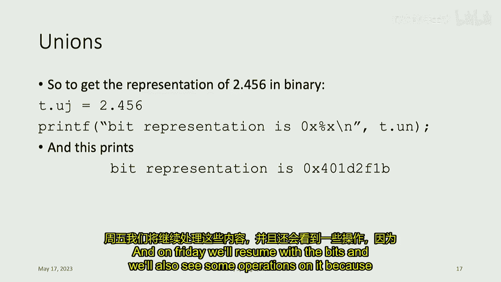

# 【全集】加州大学戴维斯分校 C语言底层编程 中英字幕 完整课程 p16 Lecture 16 - Unions与gdb高级调试 -BV15C6FBsE3L_p16-

Can everyone hear me now？Okay， are there any questions before we start？

Iam to spend a little more time on GDP because it's such a useful tool。OkayAlso。

 we've not finished grading the midterms yet， goal is still by Friday。

 it will'll certainly get him done by Monday。Okay， I mentioned we went through some of the GDP and I thought I'd just make some slides to help people out。

It's a dynamic debugger to run it。 Be sure you comp with the SG option。 It will work without that。

 but。It will have trouble dealing with certain variables， local variables。

And there is a program called Strip that will remove your symbol table。If it's been stripped。

GD GDPDB works only in binary。So。Do not run that program。Anyway， you load it into GDPB by doing this。

嗯。Where the executable is the executable。If you forget to type that executable。

 you can always type file and then the name of the executable like this。

The other thing which I neglected to mention yesterday， was help。

It's a very important command because it will give you information。About how things work。

And you can even， if you type help， you get a list of things you can ask for。

And then you can type help in a command， and it will give you information about the command。

Questions on this？You type file， the word file， and then the name of the executable。

That should have been in italics， the executable should be in italics。Other questions？Okay。

When you execute the program， you just type run and then give a list of command line arguments。

Don't mean the program in that list。But everything from any any arguments you're going to give to the program put in there。

If you don't have any arguments， just say run and it will run。If there are no problems。

 what will happen is you'll get a message along the lines of inferior process， whatever completed。

 the inferior means GDP is running it as a separate process。On the other hand。

 you may get something like this。These lines。So what this says is。It stopped an end fact。

And the parameter， if you remember， was N。And saying， I couldn't read it， I can't access。

Memory at that address。And then it says， this happened at N fact2 line 12。

So this can help you track down errors as you saw yesterday。monday。Somewhat readily。Now。

When you get that message， you're probably going to want to rerun the program。

 but stop it midway so you can look at things。The way you do that is with what's called a break point。

So you'll have to start the program up again。Best way to do that， by the way。

 is to actually know you only need to start the program。

 you just say break 15 or break point 15 or B 15。And it will tell you where the break point was put。

 in fact， C line 15。And if you're curious， this is the address where the break point is。

And when it hits。Mine 15 execution is going to stop。Now， later on。

 you'll see that C programs can be spread over many files。

When you're using GDP with a program that is more than one source file。Name the file。Since N fact。

2 do C is a one file program。That and that are exactly the same。Allright。

 And so then you go ahead and run it。 Line 15 is just after the call。Or just at the call。

And when it reaches that， it will print out break point1 and then in fact within 15。Equals 15。

 line 15。And line 15 is this。Someone tells you exactly where it stopped。I'm sorry。你スタル。Yes。

This one you have to run。No， you can die break 15。From the start and then Di run。By the way。

 you can also name function there。 You can say， for example， break main。

And then as soon as you start with the program， it'll stop because it hits the rate point at Ma。

Or you could say break in fact。And then every time， in fact， it's called， it will stop。

Other questions。Now， sometimes you don't want to stop every single time you hit a break point or a function。

You only want to stop when certain conditions are met。

 like a variable is in particular value or something like that。

You can use for that what's called a conditional breakpoint。And what this says is。

Break it line 15 if the variable n is at least 20。So if it's 15， 16， 17， 18 or 19。

 it's not going to stop when it hits 20， it will stop。And again， with multiple source files。

 you get that。The break point will not tell you， I'm stopping because n is greater than 20。

It'll tell you I'm at break point one。Now， each break point as a has a new number。

 so if you do three break points that'll be called one， two and  three。

And you can delete them by typing deletele3， for example。

And so this is telling you which break point it's stopping at。3。1。Now， when it stops。

 you can do a lot of interesting things， you can restart it from the right point， type con C。

If you want to do one statement at a time， you would use step， or single step。Now。

 the issue with single stepping is that if you call a function like print F。

It will go inside the printf。😡，And since you don't have source for printf， it's going to look very。

 very strange。If I called it from Maine， for example， from the program I was showing you earlier。

If I hit N fact and I type S， I'll go into the call to N factAC。

 and it'll show me the first line of N factAC。N means if there's a function。

 just execute it and stop when you finish the statement。So next effectively skips over functions。

S does not。 That's the difference。Sure， a break point is a point in a program where you're telling the execution to stop。

So GDPB will run until it's either the program exits or it hits break point。If I type B 15， break。

 break point 5 line 15。The number there would be the line number。

GDB would then assign that break point to number one。Then if I said， for example， break 25。

That would create a second break point at line 25。And that would be called to GDP。

 it would be break point2。Okay， you might want to print into values， which is usually quite useful。

You can print an expression。Which is usually， I've found it's usually going to be a variable。

It may be a pointer as well。And you can also say， if you want to see it in hexodadeimal。

 you can say slash X。That's not particularly useful at this point， but later on， it will be。Okay。

 now sometimes。You're not really interested in stopping at a point in the program。

What you want to do is stop when a variable reaches a certain value。

So you have things like break points， but they're called watch points。

 they don't stop at a line or a position in the program that you tell it to stop。

It will stop certain when a certain condition or when a certain variable。Is changed。

So if I type watch X。😡，X would be a variable， and what will happen is the system will watch that。

And if the value changes， in other words， if it's assigned to。

It will stop print the old value in the new value。Okay， so let's take a look at some of these。

Let me get over there。Can everyone see that especially in the back？Okay， good。So let's go to。Here。

Okay， let's start off with NFAC2。I've already compiled NF2 with the DG flag。

And in case just to show you。So in fact， it's a problem， so GDP， in fact。2。All right。Now。

 if I do a break point。That will work because I'm telling it where to put the break point。

But if I try to watch a variable， in this case， I would want to watch n the parameter。If I do this。

And spell it right。It basically says，huh。That's because the program hasn't run yet。

 so it is no idea what I'm talking about。It will have the names of variables， though， when I execute。

 so I'm going to stop it right at Maine。So that way I can go ahead and add the watchpoint。

See if it's in that context that yeah， there it is。You can ignore the hardware， by the way。

 it does the watchpoints by sending a flag in hardware。All right， son I can run it， so let's run it。

Oh， I'mt already wearing it。 So let's continue。Okay， it hasn't changed。And。The old value was 0。

 and the new value is 15。And it changed it in here。This is part of the standard I O library。And so。

 basically， you ignore it。Oh， the break point。Tlls the system look， tells GDB look。

 the program is to execute until it calls Maine， which is the first thing it'll do。Then， stop。Now。

 if I type watch in here before he had started the program。😡。

So the variable n has we' been created yet。So it can't do anything with。

 It doesn't know what I'm drawinging him out。On。And that's way up there。Once I run the program。

Then it can go ahead and。Spot N because N is declared in the。mIn Maine。See and。Okay。

 now the ups that I typed。The system， remember， I've talked about the system stack。

Where every time a function is called， something gets pushed onto the stack and when the function returns。

 it gets removed from the stack。All right。What happened here？ Hang on。Okay， what happened here is。

It called Maine。Main called something Ecanf， I'm not sure why。Oh， yeah， I know why。

 Because I called Scf within the program。So called S scanf。

 which then called another internal function。So it's three levels down。It died in up here。😡，In this。

And I don't know why it died there because they don't know that particular routine， yes。

It's trying to give you。 the reason it's listing so many addresses is it's trying to give you complete information。

So if you know exactly architecture what the architecture of the system is。

Then this will give you a lot of information。Basically， you can ignore it with one exception。

 pointers。And I'll show that in a couple of minutes。Okay， so let's see， let's just continue this。Yes。

Okay， what I'm looking for， what I do is。This and this it doesn't of source code do because those are in the standard IO Library and I didn't write them。

So I'm assuming that they're correct。So in other words， if something died here。

 it's because of something I did here。Okay。Now this tells me， okay， you stopped at Maine。At line 24。

Now， if I hadn't compiled it with DG， I wouldn't have this。

So then I would use the address to figure out where I was。I don't recommend that。

Great if you really know the system and they're comfortable working in。

 in that working with addresses in that form。Otherwise。

 the best thing to do is either recompile your program with DSG or。Hope it will。Okay。

 so let's continue。Okay， and now it's got a signal saying there's a segmentmentation fault。

So it can't read the variable there， so let's see。BT is the back trace。

 it lists every function call that has not returned yet。

And it lists them in the order they were called bottom up。Okay。So now this is saying。In fact。

 at this point was called with N being 174-728。It called NFAC with N being 174， 729。

 which in turn called NFAC with 174， 730， and so forth。And。Let's see。

I'm not going to go through all this， but you can see。What's going on right here， in fact。

 is just looping or in fact， it' just calling itself repeatedly。So let's quit there。

And now let's stop。When N is more than 15。Now， one thing I should warn you about。

The watchpoints follow scope。So the watchpointint for and that I typed earlier will only work in Maine。

That's why he didn't stop when it did anything there。So what I'm going to do is do a watchpoint。

 but do it in noting right now in and fact。So I'm going to go ahead and do the watchpoint here。

I'm sorry。Oh oh， oh， thank you， sorry about that。L is a list command and it will list 10 lines。

You can also do this。And it will list 20 lines。 The actual form of the commander's list。

So if I'm told it's a problem with lying 300。I can type list 290 comma of 310 or something like that。

 and then I'll be able to see exactly where the error occurred。Okay， so now let's。Get back into。

 in fact。Okay， and now。Allright， so now we'll run it。With 15。Okay， that's the original watchpoint。

I they break point， sorry。Okay， what happened there？Anyway， there it。It blew up， so let's try this。

Oh， let's see。I'm sorry。No。However， it'll save you a lot of time when you're debugging programs。

 especially with pointers。Okay。Let's quit this and go back in。All right。

 so I'm doing it so that the program will stop running around here it'll actually stop there。

And then at that point， Iagon had the watchpoint for N。Kab the Dell is delete。

 and I just removed rate point1。So I remove this break point because they don't want to stop every time I call a routine。

But the launch point I want。 and that' that's item 2。So if I continue at this point。嗯。

I'm not sure why what should happen is if n is greater than 20。And should should stop it should stop。

 It should not be doing this。 And I'm not sure why it's doing this。Yes。Okay。

 what happens is when the programs compiled and put on the machine。There are several。

 it breaks the program into several segments。One of those segments is where the stack is located。Now。

 a segmentation violation means you' trying to write。

To try to write somewhere where there was not a segment。So what happens here is the stack gets full。

 so that segment gets full， and then it tries to right beyond the segment， which causes the error。

So it's violating the segment boundaries。Okay， the question was， actually。

 I bet you did something like this。Is that right？样。Okay。

 what's going on if you try to do copy a string。You have to allocate enough space for it。

And so if you don't。Then you'll go beyond the bounds of the array。Now。

 if that's at the end of a segment。You'll get the segmentation violation。

If it's not at the end of the segment， anybody care to guess what happens？

It overwrites whatever is there。So for example。Sorry。Yes。Exactly。Okay。

 here's a program I use in other classes when I'm teaching about what are called buffer overflows。

You call Maine and that calls get STR。Now you have this getS， which does not check bounds。

 it's not like E getS。So it reads whatever you type and stuffs it into the buffer there。

If you type more than 12 characters。You'll start overriding information。

And that information may not cause any overrning。 It may not cause any problems。 On the other hand。

 it may cause your program to crash。 Let's see。What happened was。

It tried to write that whole string into buff。Went beyond the end of Buff。

And on the stack is stored information about what to do when a function exits。

What this should do is return to right here。What it actually did was the buff。

 the length of the string that he entered， overwrode all that。

And so now it's trying to return to a dress it can't find。So I get the segmentation fault。Yes。That。

 by the way， is one of the reasons we everyone strongly recommends never using getS。 In fact。

 I'll show you this。If you try to compile with GES with this with GCC， it goes ahead and compiles it。

 but it gives you a warning。Basically saying that is one dangerous function。And it says。

 did you mean FGS？And down here， it says， the gets function is dangerous。I'm sorry。

Historical reasons， mainly， it exists because there are a lot of programs that do use it。嗯。Also。

 I think it's an analog to a function called Pus。Which writes things out。But if you're asking me。

That should be one of the first functions to delete。By the way， if I run this now。

 watch what happens。And let's give it exactly the same thing。Oh， of course。If you ever get this。

Message。Sax smashing detected。 What that means is you went beyond the end of a buffer that was allocated local and within a function。

The technique for exploringing it is called smashashing the stack。

And that's why they put that in there。You can disable this。I strongly discourage that。

Notice also this said segmentation fall， which means memory failure。This says aborted。

 What that means is the compile added some extra code to look for this stackmshing。

And when it saw it。It said， okay， that's bad， I'm going to stop the program。😡。

And a call the function called a B， which basically terminates the program。

So that's where you get that message from。是。is that， why did it abort the whole program？

What I showed you was basically how to crash the program。嗯。Not on this program， but on others。

 there are ways to break into systems using this。So it's a security feature。 In fact。

 the first Internet worm。YeahI believe it was the first one。

Used exactly this technique to gain privileges。By the way， in case。You didn't know。

 I do computer security。I think that probably came across。Okay。Let's see。 Let's take another look at。

In fact， too。Okay， and I'm in the context of Maine。So if they look at the stack。

 it's not called anything yet。So it just says， hey， look， you stopped the line 21。Now。Continue。O。

Okay， said， I haven't done anything yet now if I continue。

I'm stopped in in and I can type back trace。Or by the way， another a synonym for back trace is where。

And so now it tells me， hey， main at line 29 called N fact。And I stopped at line 15。

And then if I go on。Now it's stopping again at line 15 because I'm down one more level。

And now I'm down several levels。So this is extremely useful for figuring out if your program doesn't work where it stopped。

 yes。嗯。You can use the print desks， but this is a little bit quicker and you don't have to keep modifying your source code。

Until you with the printfs， your goal is basically to narrow things down until you find where the program stopped。

With this， it tells you where its stopped。So this is quicker。But if it's。

You have to use your own judgment as to which one to use。Also。

 you don't have to insert debugging lines in your program。Okay。

And when you try to equate it basically says， hey。You're doing a debugging session， inferior one。

 which is this process， which is the end fact， will be killed。

Quit any way and you can say yes and it quits。Killed here means basically terminate with extreme prejudice。

 it sends a signal that can't be caught。Okay， let's see， let's go back to this。Kay。

What he wanted to do， oh， a couple of other useful commands， you've seen most of these。

Back trace and where we just did the or Dell。 You saw that。

 If you want to list the break points and watch points， just say info break point。

And if you want to see what is on the stackt that is current to this particular function。

You can type info frame。That， at least for now， probably won't mean much。

 but when you get into the assembly language class， you'll see how useful that is。Okay。Now。

 one more thing。About the Plans program where we were using structures。We have this。The program name。

 as I said before， is RV0。And there are two ways to go through the argument list。

The first one is this， you start at one because zero is the program。😡。

Name and you just go through the argument list until you hit Asy， which is the count。

 and then you stop it。Because remember if you have three， three things。

 two arguments in the function name， function name is R V0。

 then the commands and then the options are R V1 and R V2。And so， but Arc C is three。

 so that's why you stop when you hit Arc C， yes。Here， because if you try to reference Arg C3。

 that's the nu pointer。U。They should be actually a little bit messed up but yes。Actually。

 what would happen here？I take it back， it wouldn't say us it would print argument nil。

Because when it tries to print， no point it prints Neil and parentheses。

But if you tried to go beyond that， then yes， you would run the risk of segmentation。

It's a number integer。ArcC does not every argument does， every element of ArgV does。

And it ends in the nope， sorry。Every argument of。everything in R V ends with no bite， no bitete。

And A V ends with a null pointer。Arg C is just an integer。Correct。Yes。

You're working with a no pointer。And since the as are characters pointers。

 if you try to dereence that you will get segment a memory crash or segmentation problem。

The other thing you can do is go through the list like this。

So a here is declared to be a pointer to care。😡，Star star A， just like ArgVs。

So I set it to the first argument beyond the zeroth。And now I check to see if it's no。

 And this is where what you were asking comes in。 So thank you。It's not null。So I go down here。

And I print。Star A， which points to a string。And I continue doing this until I reach the end of the argument list。

Then。Want to go to the next thing。It will be the null pointer。No pointer is 0。 So this is 0。

 So I drop out of the loop。You'll see both things， in fact。哎，呀很好。Hang on a second。Okay， it specified。

 it was going to drop out of the loop here。 As long as this is nonze。

 what goes continues through the loop。If it's zero， it falls out， remember this is an expression。

And this is a somewhat obnoxious way of saying star A is unequal to null。That's a typo。

It's supposed to be J， and that should be J plus plus。I'll fix the slides before I post them。

Thank you， good eyes。And realized that while I was presenting and going， hope nobody notices。

There's one in every crowd。Okay， let me show you to go back to this， I think it was in lecture 16。

Yeah， that's it。Okay。Oh see。So it's4。Okay。This is correct with asy。

With this particular version of the plan program， you can list many data many many files。

 and it will go through each one and load it into the。The linked list。So that's the first one。

The second one。Is。Here。And this is exactly what I showed you earlier。

starts with the first argument beyond the program name。

And keeps going in the loop until star A is unequal to null。 I could leave the star A。

 I could leave the unequal to null off。Because when this is null， that's0。That inequality is false。

 and so I would drop out。One interesting thing I did want to show you too。Notice the。

 the second line down from the top where it says if St Comard v0 planet's four。

The way it decides which one of those four loops to use is it looks at the name of the program。

If it's planet's four。Then it uses count the index。If it's anything else。

 it's going to use the pointer。So you can tailor your program so it will do different things depending on the name by which it is called。

By going to argument zero。So sometimes that's very handy in particular。

 if you have two versions of a program， yes。If I simply said ArgV， that's the same as ArgV0。

 which is the name of the program。呃 yeah。And if I tried to do that。Load plants would fail。

And so I be， I， I quit。question was， you keep looping and with three arguments。

 it calls the fourth argument。 Is that when you would drop out， Yes， you drop out right here。

When you go to the fourth one， if there are three arguments。

 then the fourth argument is an no pointer。Okay， and that's why you would drop out。

 If you go to the fifth 1， I have no idea what would happen。 It won't be pleasant。

That's the right idea。 Let's put it that way。 I don't know anyone who would refer to it that way。

 But， yes， you have the right idea。 R V has four elements。Yeah， let's say it that way。Okay。

Any questions so far？Whoops。That's the one I wanted。That's the one I wanted， okay。Now。

 there there are a couple of other things that I want to show you。

Both of them are based on how numbers are represented on the computer。

And I think everyone here knows the computer uses binary numbers。All right。Everything is binary。 So。

 for example，3，4，5 in binary， this is 302bit machine。 is this。If you put a minus sign on it。

 you get this。嗯。And then if you， it turns out if you add these two up， you'll get zeros all the way。

 There'll actually be a one that will go out here。But it's ignored。Now characters。

Also have their own numbers。And the computer doesn't store the character A， instead it stores 97。😡。

And how you use that interprets whether determines whether it's a number。Or a or a character。

And anyway， 97 in binary is this。Yes。Yes。Now， I'm going to ignore floating point。

But just so you see it。2。456 looks like this。You have the sign bit。This is the exponent。

 which in this case is one because it's two times 10 to the first， sorry。

 which is and I'm sorry yeah， which is going to be two times 10 to the first。

And here is what's called themana。 That's the。Two point， that's the two， four， five，6。

So this is really 0。2456， the exponent being one will move you to 2。456。Having seen that。

 all you need to know is that frauding point representation is very different than integer。

 That's all。That's where type coercion comes in。What this program does is it takes the floating point number。

2。456。And translates it into an integer by truncating it。So the float is 2。456 and the in is2。

 These zeros are added， by the way， because if you just say percent F。

 it will give you six numbers past the decimal point， six places past the decimal point。

So this tells you。What the integer is， you can also coerceerate the other way and do things like that。

 You've seen this a lot。But here's what you haven't seen。

 Suppose we want to get the actual bit representation of the data。Right。

The way you do that is you use something called a union。

A union is essentially two or more data types。That occupied the same space。

So you can refer to it in this case， I could refer to T。

Either as an integer or as a floating point number。And I can read it both ways。

The syntax is identical。😡，To structures， the only difference is the word union and what's useful。So。

If I want to get the representation。Of 2。456 in binary， what it would do is store in U J。

And it occupies exactly the same space that UN does。These were overlapping。By the way。

 and then what I would do is go to the integer。And print out in binary。Yes。I did。

Tearers union inflow。See， because this currentlyly breaks and that currently breaks match。

I could have said， just put a semico in here and then said， union in floatat T。It's just this is。

F only comedy。Okay， so let me give you a couple of examples of this。Okay， here there's a program。

 we're doing integer X。And a character array of  eight。

 So this will allocate space for the characters because that's bigger than the int。Okay。And so now。

The string I want to look at is。Where to go， Oh，1，2，3，4，5，6，7。

 And I want to see what that looks like as an integer。So the first thing I do is I copy it into。

The part of the structure that's declared to be a character pointer or a character array。

And then I write it out as a string。 sorry。 I write it out as first， the string。

And then the hexadeadecimal number。Same thing expressed in decimal。

And Friday I'll show you why Hexadeadecimal is so popular。So let's go ahead and run this。Okay。So 1，2。

3，4，5，6，7， if you look at as an integer， it's this。Now。Heexodadecial 31 corresponds to the inger 1。

Hexxisal 32 corresponds to the integer 2。How do I know this。

 Because I've been in computer science too long。That's three and that's four。

 so it only does the first four。If you put it in decimal， it doesn't really mean anything。Questions。

Like I say， I'll go through that representation more thoroughly Friday。

And then the last one is I want to show you is this。Oops。

Here's the int and float that I showed you on the slide。

And there's the floating point number I want to use， 2。456。So now I'm storing 2。

456 is a floating point number。And they want to see what that looks like and what the bits are like。

And again， here I print it in hexadeadecimal and decimal， but I'm going to print the integer。

Format of that。Of that float so。So here's the flowing point number。

Here's the heodadeimal representation， I'll show you the binary one in a second。

 and that's an decimal integer， which again doesn't make much sense。But。See。Whoops sorry。

D3 the slide anyway。Yeah， what would happen here is。40 in binary，4 in binary would be 0，1，0，0。

 This would be all zeros。 That would be 0，0，0，1， and so forth。

 So you can easily derive the binary representation from this。

 And I'll show you how to do that next time， yes。Remember， structures of field。 Remember。

 it's exactly the same thing here。Okay， let's stop here and on Friday we'll resume with the bits and we'll also see some operations on it because they're very widely used。

