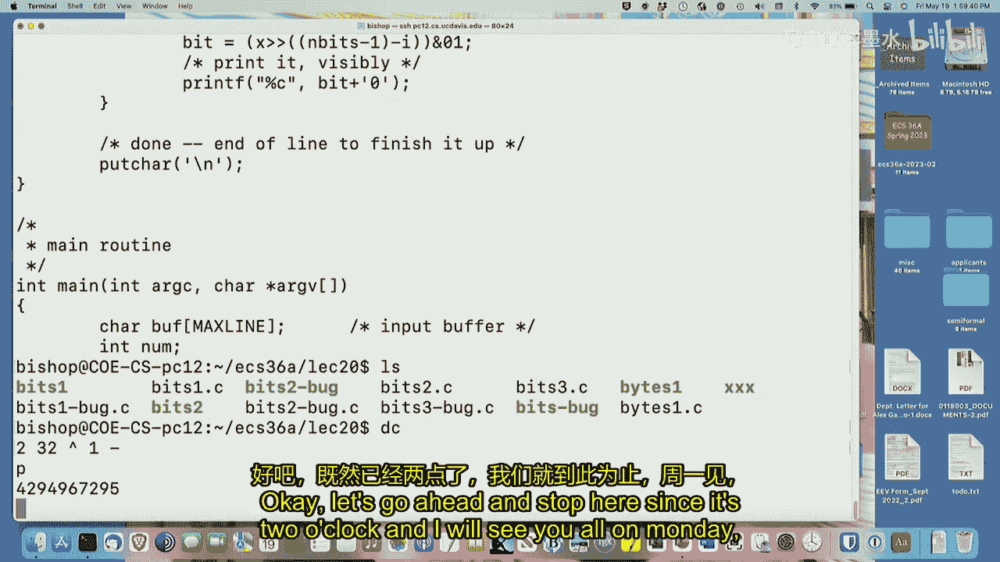

# 【全集】加州大学戴维斯分校 C语言底层编程 中英字幕 完整课程 p17 Lecture 17 - 位运算符与基数 -BV15C6FBsE3L_p17-

Can you all hear me？Okay， a couple of comments。First of all， the OR。We put this up。First off。

 we're still grading the midterms we'll have them done by Monday。呃。Second。

The great scope for homeworks 1，2， and 3， problems，1，2， and3 are up。

And the grade scope for the extra credit will be up this weekend。There was a rather obscure bug。

And getting one of them up。It took me a while to track down。It turned out， as usual， it was。

The error was a common one。 It was the person behind the keyboard。But it got fixed。 Okay。

 are there any questions about what we've done。Or what we're doing。Okay， I want to continue this。

And talk about bit manipulation。One of the reasons she became so popular。Is because。

Unlike other languages at the time。It was very easy to get to the actual architecture of the machine。

 the bits and the bytes。And manipulate them。And so I want to go through that。

 It's still very widely used。In other places。So it's important to understand how the bid operations work。

The first thing。Is converting to binary so。How many here studied bases？Okay， let's go through this。

Converting from headecimal to binary is really easy。Just grouped them in sets of four。

And then use this table to find the hexadecimal digit。So， for example， if you see 0，1，1，1。

 that's a 7。If you see 1，0，1，1， that's a B。 And it can either be written in an upper case or lower case。

 Sometimes it matters。 Sometimes it doesn't。So here is a heasal number。This is 4，0，1。D。2， F1。B。And。

If you want to go the other way。Translate hexadecimal into binaryry。

Then you start with the table and go the， look there。So for that was hex into binary。

 This is binary intoadeadecimal，0，0，0，0，0。 sorry its binary。 Yeah， binary indexadeadecimal，1，5。9ine。

See how it works？Any questions about this？Okay， now let's go for the more difficult one。

 Deimal binary。 This actually works for M2 bases， but I'm going to stick with base 10 and base 2。

The way you get from deimal Diry。Is you repeatedly divide by two？And as you go along。

 save the remainder。When the division gives you zero。Then we off the remainders in reverse order。

So as's an example，3，4，5。We divide it by two， and there's a remainder of 1。 It's 172。

172 divided by 2。 Well， that's even so the remainder is 0 and now we have 86。

86 divided by two remainder 0，43 divided by two or remainder 1 and so forth。

Until we get down to here，2 divide by 2 is one with a remainder of 0。

One divided by 2 is 0 with a remainder of1。 And so 345 would be 1，0，1，0，1，1，0，0，1。

So you just read backwards。And binary de decimal。You know how investment notation。It's。Safe for 345。

 it will be three times 10 to the second plus  four times 10 to the first。

 plus  five times 10 to the off power。Isactly the same with binary except you use too。

So there's a binary number。So let's see，1，2，3，4，5，6。

 So we started 2 to the 8 because there are 9 digits。 and the last one is going be2 to the 0。

So we have one time38 plus， and so forth。Going down the line。And when you add them up， you get 3，4。

 5， which is exactly what we would expect。Are there any questions with this？Okay。

 one other thing you will see sometimes， but not often。Is ocal。Baase 8。

And converting from ocal to decimal， rather ocal to one。Binary。Is also very simple。Essentially。

 build a table like this， except only of three digits。 So you'll go up to here。

And chop off the leading0。And then you can do the translation in exactly the same way， yes。I'm sorry。

You should know how to convert and you should know those tables。Well。

 it might give you a he estimateimal number and ask you can convert it to binary。

Or binary number guess， you convert it to binary。 sorry to two decimal。Yeah。

 you should know that for whatever it's worth， It's fair the way Im， I learned it。Is。

Start with all zeros and then just add one in add one using binary notation。 So 0，0，0。

1 plus 1 is going to be 0，0，1 to 0。Because if you add one to one， you get 2， and that's 0，0，1，0。

And then just write down。 So you do that all the way out until you get four ones。

And then you write 0，1，2， just going down。So it looks like it's a hard table。

 but it's really not that hard。一但这。Why did they pick the first few letters of the alphabet。

 probably because it was easiest？One machine I worked on used bait used。It used numbers in base 36。

 don't ask me why。And so it was0 through9， and then A through Z。A machine was interesting。

 it's probably the best way to put it。Okay。Now， as I said。

 everything on the computer is represented by bits。And when you run a program。

The system reads those bits and either executes the corresponding instruction or does whatever manipulations you want。

If you want to manipulate bits directly， there are some operations that will help。First of all。

 you can do and。So bids， if you have two bits， both zeros， then when you land them， you get 0。

1 in0 will give you 0，0， and one will give you 0， and one in one will give you one。

Notice the ampersand。 That's how you indicate it。 Notice there's only one apersand， not two。

Two of them is for the logic， logical one， for the logical and。 One of them is for the bitwise and。

You also have ore。H。Okay， you also have or， which is the vertical bar。

And I have no idea why that tables that way should be。Zero111。You fix that right now。

 Ca it's a bad one。There we are。Not as a tilda。This differs from the logical one， logical one。

 which is an exclamation point。So the tde here simply means flip the bits。So0， if you put a til to 0。

 it becomes a1， a tilde when， it becomes a 0。If you have 10 and you want to take it negate it bit wise。

 that's zero and that's a1。 And so you wind up with that。By the way。

 there's also an exclusive or Xor。Which is true。When。The two numbers are different。

 the 2 bits are different。And faults when they're the same。

And that's represented by a character by the up arrow。I know a second。啊。一。

And here is the exclusive or， the up arrow。1 and0 and 0 and1， they're different。

 So those two are ones and 0，0 and 1，1 are the same。 so you get0。And。Yeah， and there's the negation。

That's an interesting question， by the way， in English， when you say or， you mean。

Exclusive war or both。Usually you mean it could be both。If you want to say it's one。

 but not the other， you would usually use either or。But that's not a hard and fast rule。Okay， now。

computers use 32bits。And so we can do ans， exclusive os， ors and so forth with all 32 Bs。

 But suppose we only want a subset of that。For example。

 suppose we want to know if the number is odd or even。

Or we want to know what bit 5 of the number is a bit8。For that。

 we use what are called the shift operations。You take your integer and shift it left。By N bits。

So what you're doing is you give you a number like this。

You move it this way and put in zeros in the zeros in the new spaces。And what goes over the edge。

 simply disappears。Yes。Those are injuries。They're bits， yeah。I'm sorry。

 He should have made that clear。These are all just all just bits。No， you get zero， zero。And in fact。

 I'll show you an example of some of this in a little bit。That's a good question， though。

 thank you for clarifying that。Okay， now the fun part is when you go to shift right， in other words。

Towards the low end。The question is， what comes in the high end as you shift。

And there are two answers。 The first one is， if what you're shifting is unsigned， zero comes in。

 the zeros come in。But if what you're shifting is signed。Then if it's positive， zeros come in。

 and if it's negative， one come in， one's come in。The specific reason for this is， remember。

 I told you the first bit in a signed integer used this assign。1， if it's negative 0， if it's not。

What's actually happening is when you shift right。The sign bit is replicated。When you shift left。

You just put in zeros。So that is the basic rule。Yes。By its declaration。You， you。

 if you simply say index， that's signed。 If you say unsigned index or unsigned X。That's unsigned。But。

Yes， the majority is you deal with sign values。Unsigned is typically used when you want。

 when you're going to do something really fancy with the integers or where you're dealing with very large numbers。

 And， you know， you'll never get a negative number。Okay， so here's how you extract the bit。

Number the bits。 So this high one is 31。And this low one is bit 0。So1 bit 1， B 2，3，4，5，6，7，8。

 We want to extract bit 8。Now， we're extracting one bit。Only。So this is three， four， five。

 by the way， in decimal。So what we do is we left shift it by 8。Right， hang on。

We shifted this way by eight。And so now what that looks like is from here， all is， this goes away。

And zeros come in。So it looks like this。Which becomes this。When you shift it。

And then we simply end it with one。Because what that will do is。

You have one here and all the rest are zeros。 So when you do the， when you do the bitwise and。

 everything becomes 0， except for that bit。If that bits a1， it'll be one。 If the bits is 0。

 it'll be a0。嗯。You mean here？Right。No。No， this is a binary number。 So this would be 2 to the 8。

Plus 2 to the sixth， plus 2 to the fourth， plus2 to the third， plus2 to the first， or2 the0。Okay。

It's really easy to make that mistake。Because it looks logical。Unfortunately， those blocks are hex。

So it's hexademal 159。But you have to convert that to decimal the hard way by doing the multiplications。

Okay， so let's go to。CSIF。And wait a minute for the connection to be made。I think so。Oh， fool。

LetsTry that one again。Okay， first of all， let's look at this program。

PR bits is supposed to print the bits in the unsigned integer that's passed to it。

And here's how it works。Now we want to print them in order。

So what we do here is we start with bit 31， Bi 31。 sorry， N bits is 32。

Unsigned into4 on the CSA F that becomes 32。So you start with 31。Left shift the number by 31。

And then just get that single bit。And then you print it out as a literatureature。

And you keep looping and doing this。So午。Where's the mouse。Okay， so。With 3，4，5， as they said。

 it's this in binary。 So it starts printing it out in binary，1 digit at a time。way up there。So。

 what happens is。It's X is。There we are。 X is 3，4，5。Now， first of all。

 you need to know how many bits to print。Size of gives you the number of bytes。In a data type among。

 there can also be a variable and so forth。So what this is saying is telling me how many bytes are in an unsigned int。

 which， if you'll notice is the parameter。 and then signed it， yes。A bit is a single binary digit。

 one or zero。A byte is eight eight binary digits。Yes， exactly。It's a set of eight bits。

Way back when they used to also be something called a nibble， which was 4 Bs。

 but that's not used much now。Anyway。This is four bytes。

And I multiply it by the number of bits in a byte， which is 8。 And that tells me it's 32 Bs。

And then here I start， I go through。 for first， I shifted 31 Bs。 Get that。Then，30 B and so forth。

And finally， want to get to the zeroth bit。I'm at the very end and I will print that one and then I will stop。

So。Here's another one。See。2，56 is 28。 There There it is。Now。If I want to extract it in。

 in terms of bitetes。I would have to modify the program slightly。Okay， so to do this。

What I'm going to do is I have to extract a set of eight bits at a time。So。First of all， here。

When I shift this， I can't shift it1 B at a time。 and we going to have to shift it 8 Bs at a time。So。

And then。When I shifted。Oh， wait。 first of all， when he start off， I have to start off a bit20。3。

Because me get that up again。Because if I want to bite， I want to grab these these as one as a unit。

And so 31，30，29，28，27，26，25，24。 So I have to left shift it by。8，16，24。

I'm going to cheat a little bit。哦。Okay， so now what I want to do。Is extract。

Eight bits instead of just one bit。So that 0，1 won't work because it's only going to extract one bit。

What you need to do is come up with some representation of8， of 8 bits， all of which are are one。

Anybody remember the hexadeadecimal for four bits being one？A丙 one。Okay， if you have。It's F。

Because if you add one to it， then you get 10。So it's F。So F gives you four bits， and we want。

Eight bits。调员。0 x tells the compiler。 hey， this is accidentimal number。And so it'll put down F。

 which is， which are 4 or 1 Bs。And F which are 4 or1 B。 So I'll get 8 B of1。

And then I going to print it。But I don't want to do it in a field of width。 Actually。

 Ill leave it field with one。Now let's see if I did this right。Yes。I am a little bit paranoid。

 I guess， when it comes to computers。So I， I， whenever I'm starting something。

 I give the dash G flag。 At the end， I'll just compile without the dash G。 But for now。

 I'll use that。All right， so I'm going to ignore ignore that for the moment。Let's see if this works。

Okay，1，8，9。Okay， something's wrong， And I'm not sure what。 It should have been1，5 died。

So let's dive in and take a look at it using GDP。Oh。There we are。Now。

 I don't really care about how it reads things or not。 What I'm interested in is how it。

How it prints things。 So let's， oops， so let's go。To PR bits where it's printing things。

And what we want to do here is see exactly what it's extracting。So。

Let's putut a break point at line 30。And then we'll run it。Okay， three， four， five。Now。

The dash slash tea here。Mean print the binary。And if you're wondering why it's T and not B。

 B means something else。 And T stands for2。 So that's why the evidence is2。Okay。

 so what a shoot print is 9。5，1，5，9。All right， so now let's go ahead and get the the first bit。

 bitete。Yep， that's right。Because there's a whole bunch of zeros at the beginning。Okay。

 so now we go up here。And let's see what I is at 16。So we're left shifting at 16。And。Again， is0。

 which is right。All right。 so we're off shifting at 8。And this was the part where the error came。

Where the era came in， if I remember correctly。So， let's。Right， that's right。All right。

 So now it shouldn't shift at all。 It should just。Get the low part。Oh， I see what happened。Actually。

 I don't。Here's P。Or rather， here's bit。And oh， it's printing it out as a decimal number。

 which there is 89， yeah， okay。So the error here， the error is。The air is right here。

I'm printing it as a decimal digit。But when I was reading it。

 I was looking for the hexadecial representation。That's why I printed 1，8。

9 instead of one instead of what I wanted， because when you have that 8，9。Sorry。

 when you hit that particular bit pattern。Representing the low eight bits。In decciimal， that's 89。

So let's fix that real quick。We'll also get rid of this thing。And then let's just print this as。

s the hex number。And let's see if that changes anything。By the does everyone know what this means。

 the exlamation point。What that means is look at commands I've typed previously and find the less command I typed that began with M GCC。

So that way you don't have to keep retyping the command。And it's， okay， that's， again， a warning。

 So I'm not going to worry about it。What it's complaining about is that starts a comment。

 This starts a comment。 and it's saying， you might have nested comments when you didn't mean to。

So that's what it's complaining about。Yeah， it's better。We have 0，0，1 and then 5，9。So it worked。Okay。

 now let's take a look at this one。O。All right。Now let's print 3，4。

5 in decciimbel using that program。And we don't get anything。So something's wrong with this。

So let's take a look at it again in GDP。No， it stopped。

I don't know yet why I didn't print out anything。Well， I'm sorry。 It's printing out something。

 but I can't see it。I don't know whether it's a new line or blanks and new lines or whatever。

 So that's why I'm going into GDP。 All right。Let's， once again， we're going to stop it at line 30。

Okay， so let's check I。That's right。And now let's check bit。We it's right。Again， we can check bit。

Well， I it one。That's 0。 Do folks see the problem。Oh， that turns out that is not the problem。

 which' is a very good question。Less than means go up to， but don't do this one。

The lesson than equals2 means go ahead and do that one。And since there are 32 bits。And N bits is 32。

We're going to start with bit 0 and go all the way up to bit 31。And so that's why this is less than。

And bits make sense。Okay， now。Take a look at this and take a look at that。Bit is an integer， right。

 it's going to be  zero or1。😡，Correct。嗯。What is percent seaprint？Character。

So what I'm doing is I'm printing the integer  zero or one as a character。

Are those printing characters？Nope， so that's my bug。So let's fix that one real fast。

What it's doing is it's putting out a no biteite。When it's a 0 and a control A， when it's a1。

Both of those are invisible。Okay， let's see。And let's see if this fixes it。

So now I'm living can print out D is in decimal。Great， it worked。Almost。What's the problem with this？

Backwards， exactly。So。The next thing is。We have to figure out why it's backwards。This time。

 let's not， let's not use GDPB。 Let's just take a look it at the program and think for a few minutes。

Okay， so we have 30， we have  three， four， five。0， blah， blah blah， blah bh1 at the end。

So we're starting at 0 and going up to end bits。Not including ins。Okay。

 what happens if we shift it by zero， well we're going to get the low order bit？

Then we're going to shift it by one。Men by two。Then by three。

And so what it's going to do is get each bit。 But instead of starting from the front。

 the most significant bit， it's going to start from the back， the least significant bit。

So we get the number backwards， so we can change this。Whoops。That's going to start at。

 That's going to start at the very first bit， the most significant bit。And we want to continue。

Until I is greater than well I is greater than or equal to zero because we want to get bid zero。And。

We should we make that minus minus， by the way。Yeah， minus minus because。

N bits -1 is certainly going to be greater than 0。So， now。And if we look。

 this is exactly the reverse of the other。Do you see how GDP can help you with this sort of thing？

It's an extremely useful debugger。And sometimes you can just look at the code and figure out what's wrong Other times when you have no clue。

GDB will help you narrow it down。Okay。OopHere's another one that does the same thing。

But I am still printing as a character。But printingcate is a character。 I take 0。 if it's 0 bit。

 I add the character 0 to it。 So we'll pronoun a 0。

If I have a one here and I add that to the character 0， I'll get the character 1。

 And so that will print out。So that's an alternate way of doing it。Notice again， the for loop。

 which is exactly what we showed earlier， what I showed earlier。So if you do that one。

 I think we've got that already compile going on yeah。We get that。That of curiosity。

So anybody notice anything about these two， this is the positive， and that's the negative。U。No。

The sign value。 and it goes along all the way up to the number。Okay。

The way you make something negative。Is you take this and you flip all the bits。

That so that would be a 0。 then you add one。So that way， if you add these two together。

 you're going to get zero。Now， the reason for adding one。It's kind of strange， but。

Early computers had two notions of zero。 you had positive zero and negative zero。That was used。

 The reason they did that was so that they were the same number of positive numbers as there were negative numbers。

Needless to say everybody got very confused。So instead， they changed the notation a bit。To this。

Style， which is， by the way， call twos complement。嗯。Okay。And then I've got yet another one。Okay。

 this does the same thing。Except them going from 0 to n bits。In order to compensate。

 since normally0 normal elite would start at the most significant bit and move down。

 what I have to do instead is。Start the0th bit。 the， the farthest one down， and move up。

So what he can do is subtract I。From n bits -1。So if it's 0， then it will print the 31st bit。

Or it'll get the 31st bit。If it's  one， it'll get the 30th bit because n bits is 32，32， -1 is 31。

 and -1 is1。And so this is yet another way to do it。Moreover of the story。

 there're usually more than one way to do things in a program。A good example， yes。

The compiler does it。And the computer helps in the sense that it wouldn't make sense they have an injure of。

 say， 36 bits。On the CIF。Because it operates in powers of two。But the compiler can say yes。

 an integer is 64 bits or 32 bits or whatever。By the way， if you do want to use all 64 bits。

 what you say is long int。That will give you the longer one。Okay。

Let's go back to the slides for a minute。嗯。Okay， so this is that's how you extract a bit at a time。

Any questions on this？Now， if you want to extract a bite or some group of bits。

 it doesn't have to be a bite。You do it in roughly the same way。

 but you have to change a couple of things。I want to get the ice through Js bit。 right。

 And I'm assuming here。I is greater than J。So I left shifted by J。

So now the bits that I want are positioned so that the Jth bit right is the zeroth bit。

I then have to put in a series of binary ones。So that I have the right number of bits。

 number bits to extract。So if， for example， I want five bits。The Z would be hexadecimal 1 f or。1，1。

111 in binary。So let's say want to extract these bits。And this is bits 8 through5。So this is 4 bits。

8，7，6，5。 y。 So instead of a one here， I have an F。Now， I started。

 I want bit 5 to be the one at the end。 So I shift right by 5。Left by five， sorry。And I get。

 I not sure why I repeated that anyway。 and I get this。This is the binary。

 And notice when I shift these。ししまし。These bits all go away， and I have 10 one。Those bits。

And then I use。Hexademal F to extract。These four bits。Which winds up giving me0，1，0，1， or 5。

Questions on this。Okay， how many of you are CS majors just out of curiosity？Okay。

 when you take a class called the Operaing Systems， you'll learn exactly how input and output works。

Basically， what it involves is manipulating bits。And so， for example。

 if you want to extract with sometimes if you want to read something from disk。

 you'll have to set a but specific bit to one otherwise to0。When you take assembly language。

 you have what are called condition codes， so if something is negative， the endbit will be set。

And so you'll have to extract those from memory。So that's why this stuff is so useful and important。

Okay， and。The last slide I had was print and minor， but you all saw that already。Okay。

 what I'm going to do。Today is Monday， Oh， Friday， correct， Monday， what I'm going to do is。

Start talking about how to put a program in multiple files。

So if your program is too big for one file， you can split it up over several。

And I will also show you a program that lets you read as much lines as as much characters as a memory will hold in one line instead of having to you having to tell it only read  a thousand characters。

This routine will let you read as many as you want。So it's useful， yes。Don't shoot me 2 to the 32nd。

 -1。So let's see what actually let's see what that is。嗯。There's this wonderful calculator called D。

 C。 How many of you have heard of post fix or reverse Polish notation。Okay。

 it eliminates the need for parentheses， and you put the operaand operator after the operaand。

 So this is2 to the 31st or 2 to 32nd。And then we're subtract one。And now a print， printed。

So there's the number。I've been told it was intuitively obvious。 My question is。

 what kind of an intuition did that person have。Okay。

 let's go ahead and stop here since it's two o'clock。

 and I will see you all on Monday and the TA will be going over the answers to the exam and discussion section。

