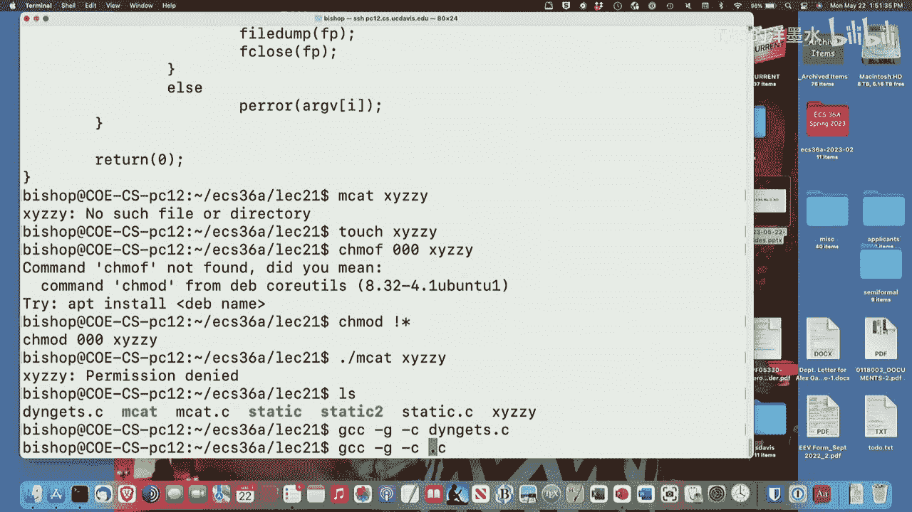

# 【全集】加州大学戴维斯分校 C语言底层编程 中英字幕 完整课程 p18 Lecture 18 - 动态字符串输入与多文件编译 -BV15C6FBsE3L_p18-

If you can hear me。Kind of bright。First off， are there any questions？Me， as you should， yes。

Do I know the aperture of the midterm。I would have to double check。I don't know exactly。I'm sorry。

I didn't。And you what， Oh rough idea， Probably around the 60 to 70 range。 All right。

 I'd consider that actually quite reasonable for， for the class。嗯。But remember。

 everything gets put together。Find the void it is assigned， and then I curve。So。嗯。

Which brings me to a couple of announcements， one of them was already anticipated。

The midterm grades are up on grade scope， if you want us to review anything。

 you can click request a regrade。And。You enter the problem number and then you put in why you think we messed up。

And we'll go ahead and look at it as quickly as we can。I also due to popular demand。

I moved the due date for homework3 and the extra credit3 back to May 30th。 That's the day after。

That's the day after Memorial Day。I'll still get homework。Four out this week。

And it will be due June 8th， which is the last day of classes。Our latest class will be June 7th。

 but they have classes is June 8th and then finals is June 9， begin June 9th。 Gu what our final is。

June 9， fortunately， it is 1030 to 1230，1030 AM to 12，30 PM。嗯。One time。

 I had one from 6 to 8 PM and another one from 8 to 10 AM。And those aren't fun。

The the students are for anybody。The website's all updated now， if you see I missed anything。

 drop me an note and I'll go ahead and add it。And grade scope for the extra credit is now up and working。

Let's see anything else。Any any questions or。Such yes。

The way the extra credit works is I look at the final grade after the curve。

And if you're on a borderline， I'll use that to decide whether or not to boost you。Okay。

 so it's not a hard and fast number。啊。Other questions。By the way。

 those of you who look at your grades is grade， go give you the average。Okay。

 I'll get figure out the average and get to you next get it to you on Wednesday， sound good。

Basically， though， if you got below 40， you probably should start coming to office hours or talking to me in the TA more。

嗯。If you got above 80， you're probably fine。In between， it depends on what the average was。

 So I'll let you know on Wednesday。Okay， what I wanted to do now is give an example of programming rather than dive into something new。

Basically， one of the problems with F getS is you give it a buffer and a size。

 and it reads that many characters from the input up to the next new line。

 so if you have a buffer or say a1 thousand characters，And your line is 2000 characters long。

It will read the first thousand characters， and then stop。There won't be a new line at the end。

 that's how you can tell that didn't read the whole line。And then the next time around。

 they'll read the next 1000 characters and so forth。

The problem with this is that requires you to keep track。

If you're trying to do things in terms of lines， it requires you to keep track。

Of whether or not you're in whether or not F GS read the entire line。

So it would be nice if you had a function like FGS that didn't require that。

 they could read a line of any length， not knowing what that length is。

And so the way you would have to do that is create a function like FGS。

But instead of giving it a buffer， it would return a pointer to an internally allocated buffer。

And that will contain the line。Then the next time you call it。

 it will return a pointer to a buffer that contains the next line and so forth。

Now if you're going to do this。This is a couple of little tricks for allocation that that you'll need to use in order to minimize the storage used。

But first of all， when you're looking at a problem and figuring out whether or not or how to write a program to solve it。

The first thing you do is you look at the requirements。What is this program or in this case。

 it's going to be a library function。 What does it do， Why is it important。

And so there are two requirements for this。 It has to be able to input a line of any length without knowing what the length may be。

Because that way， if you haven't gone through the document and counted line length， it'll still work。

And the second one is the interface has to be as similar to that of F get us as possible。

The second one sounds silly， but it's really important。Because。A lot of mistakes occur。

Because people misunderstand what parameters to pass and in one order。

There's an example which I won't give here， but I use in classes where I teach what's called secure programming。

 Rob programming would be better。Where one of the parameters。There are two parameters。

 one is a zero or a1 indicating whether you add something or delete something。

 and the next is the at the length of an array。It's very easy to swap those two。And in that case。

 you'll get an array of length zero or1。When you really wanted one to say 10000。

So you want the interfaces to be clear。In this case， we already have one with F GS。 so let's steal。

 I'm sorry， let's recycle it。Okay。🤧But。🤧我去谁。By the way， in programming。

 unless it's a requirement that you write your own。

 it's perfectly fair to look in the library and see what others have written。

The phrase that's used is don't reinvent the wheel。It's kind of a cliche， but it does apply there。

Okay， so let's first take a look at the parameters。So let's call ours D gets for dynamic get us。

Notice that the arguments are the same as for FGS。I changedt， I changed uns signeded in to be in。

 to be in。And I think I left off a con for the character。 But this is basically the。

interface4 F getS。All right， now we come to the fun part。What should Buff be？Well。

 we're going to allocate our own space for the line because we don't know how big it'll be。

So if the user。Wants us to， doesn't want us to do that。 But the user knows how long the line will be。

Then Buff should point to the array or the area where the user is going to the on it loaded。

And n is the number of characters that to be read。However， if you don't know how long it is。

We have to pass a special signal through。Now， we could use another parameter。

 but that would defeat the purpose of timeinga to F getS。So instead， what we're going to do is say。

 if buff is null。That means you allocate the space for it， use the internal point。

 use the internal storage。And in that case， we'll ignore end completely because what does it mean to if you don't know how long the line is。

 how you can say how long it is。And it's completely unnecessary， in that case。And as I said。

 n is the size of array buff if it's not though。But if it's no， you ignore in。

And FP is the file pointer to where you're going to read from。Okay， now。

The next thing we have to do is figure out how to handle allocation。

And we're going to go through this in a number of steps。Because。

If you start writing code immediately， what you， at least what I find and what most people find。

Is you have to go back and fix things up as you do things。😡。

So it's best to have at least some sort of a design laid out。And in fact， when you。

 if you do software engineering， there are several steps to creating software。

 The first one is requirements。 The second one is design。Okay， so we're going to create a buffer。

 What we want to do is create a buffer。Now。Here's the problem。You read one thing in， and you create。

 you create a buffer to hold it。 Then you read in the next line。Can you use the same buffer。

We want to。Why， because when we first start off， we're gonna to have a buffer of length 0。

So we'll have to allocate space for it。We don't want to keep allocating space for it。

Preserve the buffer and the address of the buffer across calls。

And the way you do that is by something called static， So let me。Get into。Can everyone see that okay？

Okay。Oops。I stripped out the comments so it would be easier to read。Okay。

 notice I've got a main routine here， which calls count calls。

And count calls each time through increments inements variable call count。 and then returns it。Now。

 the important thing is， notice the word static in front of end count。Normally。

 if you have just int count， that variable is allocated on the stack and when the function returns。

 it goes away。When you a static， it's allocated elsewhere。And when the function returns。

 it does not go away。So we go through this routine once。 It'll print an X and add one to count。

 which will make it one， and then we one。The next time through counts one。So add one account count。

 which makes it too and return2。So here's what it would look like。

Notice here that count is going up and it doesn't start over。 Now， watch what happens if I edit this。

 edit this。Notice it2 each time through。Because。In this case， It is allocated locally。

And when the function returns。That local storage where count is allocated goes away。

Then when I call it again， it's recreated。It's in a different space， though。

 or we actually should say it may be in the same space。 It may be may not be。 I don't know。

But the count is reinitialized to zero。But with static in there。It goes up because。

Because in this case， it's initialized when it's created to zero。When the routine returns。

 though count sticks around， whatever value it has remains there。Then the next time through。

 since it's already seen count once， it doesn't reinitialize it。It just goes on into the routine。

And adds one to count。You have questions。It's like decing a global variable。 But the only。

 But the main difference is you can only reference it within the function。

The scope rules of C say if it's allocated globally， which is at the top level。Anybody in that file。

 anybody in the file after， after you declare it can reference it。And in fact。

 we referenced externally to the file as well， but you have to， in another file。

 put X and then the declaration。Here， though， the scope rules say it can only be since it's within a function。

 it can only be referenced within that function。If I wrote another routine with count。

 that count would be completely different。Because this count。

You can only reference within count calls。This is very useful for keeping things around。

 but keeping things modular， using a lot of using functions。

 and you'll see that in a couple of minutes。Other questions。Okay。Back to the slide。

 if I can find them。So what we're going to do is we're going need a variable to keep track of where the memory is。

So we use the pointer for that。Because Malick returns a pointer。

But we also want to keep track of how big it is， how much space is allocated。

And the reason for this is that's how we tell whether or not we're going to overflow the buffer。

And if we are going to overflow the buffer。We first reallocate the buffer with more space。

And that way， we won't overflow the buffer。So here's the general structure of the routine。

If both B is not know， well， we want to mimic get S， F getS。Why should we rewrite it？

Let's just call it and return the value。G。Otherwise。

 what you're going to do is read a character if it's the end of the file。

You're going to do a little bit of cleanup。 And then you're gonna go to number 6。

 And I'm not sure why that's not there。Otherwise， once you've read the character。

 if there's room in the internal buffer， just put it in the internal buffer。 you're done。

But if there's not room in the internal buffer， you're going to allocate more space for that internal buffer。

And。I use， I'm using the macro increment to say how much extra space I should add。

The reason for this is normally I would make it 10，24 or 2048 or something big。

But order if you do that to test the program， you have to type a lot of input on one line。

So I set it to 10 or 20 to test the program， and then I type a line of 50 characters。

If it returns all 50， it works。 If it doesn't， I've got a problem。So anyway。

 I want to add some number of character spaces， some number of bytes to the internal buffer。

And notice， I say alloc or reallocate， allocate or reallocate。The first time through。

The sizes of the buffer will be zero。I can't put a character in a way there's no space。

So then they allocate space。Later on， though， if I went out of space and I to。

 I need to get more space， then I'm going to reallocate it。

 And that's important because there are two different functions involved here。

Then what I do after I've allocated space， I just add increment to the length of to the variable that's keeping track of the length of the buffer。

And then I go ahead and put the character again。 I know there's room now because they just allocated it。

If either of these fails， Id just give up。Okay， so。In order to structure this。

The main library routine will be will be get will be d get us。Now。

 I could put the allocation functions right in there。It turns out that's going to be quite messy。

The reason is we're going to have to insert characters at a couple of places specifically。

If we're at end of file， we may need to put a new line in。And in any case。

 we'll need to add a no bike at the end。So those two may cause the character。

 may cause the character count to be too high and then overflow the internal buffer。

So I need to treat those just like any other characters and check to be sure there's room。And if not。

 allocate space。So here's the structure of the main thing。 First， the buff is not null。I'm done。

Call F get S， it handles it。Otherwise， they just read the characters。 And for each character。

 I call this insertion function。Which is going to put it into the internal buffer。

If the end of file is red is the first character of the line。Then I return no。

 because there's no line。Otherwise， I'm going to attack on a new line。

Because they read an entire line。And then I add the no bitete。That ends it。

 And let me return the point to the internal space。So here's the heart of it。

 The character insertion routine。 And we'll go through this in a little bit of detail in a minute。

I checked to see if the internal buffer is full。Now I've got a variable called end space that keeps track of how much space there is there。

If it's completely full， I use the increment to allocate more space。If nothing is allocated yet。

 that is initially， the number was 0。I use malloc。Otherwise。I've already got some stuff allocated。

 so I'm going to use realloc， which reallocate space。 I mentioned this function earlier。

The nice thing about realoc is it will copy the contents of whatever I've malllocked into the new space。

 if needed。😊，Now， reallock may grow the existing space。Or it may create an entirely new space。

 You can't rely on it being the same。And then once， once that's all done。

 I add append a character to the input line。 Okay， so let's take a look at this function。Actuallyual。

 first， let me show you how it's called。Okay， MCcaAT， nothing to do with medical exams。

It just takes its arguments and prints out the contents under FileDump。

But what it does is it reads 20 lines at a 20 characters well， it's null。

 so it's 20 we really don't care about。But what it does is it increments the line number here。

And then says， actually， I shouldn't say line number。

 I should say it increments the number of calls to， to get S。It's reading 20 characters at a time。

 And that's the parameter I set in D Gs， by the way。And so， it will multiply。

The number of calls by 20 to say how much space have allocated。

Then it'll put in the length of the line read so far， and then it'll print the line。Now。

 if I didn't have nu there， if I just hit Buff。And now it created a buffer at the in in the local variable。

 in the local with the local variables。And then put， say，1000 instead of 20。

It would work exactly like FgS。In fact， if I left it of 20， it would still work like FgtS。

 but most lines are longer than 20。 So with FgS， you'd normally make it much larger。Okay。

 so now here's the function。And， oh， I apologize。 The increment I used was not 20。 It was 10。

So every 10 characters， it would reallocate space。And end care is the amount of space I want to allocate。

Each time every time I call an allocator。I have size of care there。 That's almost always one。

So technically， I don't need it。It's just that if a machine represents a character saying 9 bit or 10 bits。

Then I， I would want to take that into account。Okay， so now chins is the insertion routine。

 stands for character insertion。And it takes four parameters。

The character to be inserted and where in the line it would be inserted。

 So we keep track of the line of the character number in the line。Those get passed in。

This points to the space that we've allocated， if any， if not， it's null。

And this points to the number of characters that have been allocated， not used， but allocated。

And I've done some documentation here。Now I also put return codes and other information。

This will return 0， if it fails。And one， if it doesn't。And that's returned internally to Don Gets。

 The user never sees that。And there's no output， and there may be an exception。

 which basically means something goes wrong。If I can't allocate or we allocatecate memory。

 I just return 0。Since the only thing that can go wrong in this function。

Is that the allocation doesn't work。The caller， which is Donngeez， knows that if it returns 0。

Nowoc Ri failed， and it gives an appropriate error message。 I'll get to that in a minute。Okay。

 so the first thing I do。Is。Check。ですよ。I first thing I do is I look at pause and compare it to the current value of n space。

It was less than in space than I have room， so I would simply insert it。

But if it's greater than or equal to end space， I'm right at the end of the buffer。

So I have to do allocation。So the way I do that is the first thing is I increment end space to say how much more I'm putting in。

 in this case， it would be 10 could be whatever you like。Then I look at this。 if space is no。嗯。

Yeah if that's no。What that means is nothing's been allocated。So， I do the malloc。Now。

 this is why that has to be a double pointer。Space is appointed to the space that's going to be allocated。

😡，If I just made it a pointer。😡，Then it would never change。At the corner。Because。

You can't change a parameter。And in this case， the parameter that I want is pointer。Now， the。嗯。

The other issue here。Is。Well， why， why do I need to do that since I'm just allocating space and adding on to it。

If you use real lock， you may not get back the same space。 So the pointer may change。

 That's why it is to be a double pointer。Okay， so I do the allocation here。And if it fails。

 I return zero。If it's not nu， then I've already got some space there and presumably some characters in it。

So I do a real lock。I give the space that I'm reallocating and how big I want the new space to be。

And if that fails， again， I would it return 0。If if either of these succeed。

 depending on which one you call。Are points to the new space that's been allocated。

It may or may not be the same as star space。So I simply update star space to say that。By the way。

 if reallock changes the space。So in other words， you start off here and then you do a real lock in the space。

 new space is here。 This space is freed。So you don't have what are called memory leak because that's where you stop using a chunk of memory。

 but you don't release it。Okay， and then here we have enough space at this point， if we didn't。

 one of these would have failed and we'd have returned。So。Now， we simply add the character。

We go to P， O， S of the space that we've been allocated and stick and see。

And we know that will work because we've allocated more space。Told the character。

And if we couldn't allocate the space， if that didn't work。

 that would mean we didn't allocate the space， which means one of those two functions failed。

 which means we'd return。 We'd have returned already。And then we return to one saying success。

By the way， the type of analysis you're hearing me doing is quite common。

 it's always good to think of what can go wrong。And what to do if it does go wrong。

Because often things do go wrong in ways you don't expect。 you all know Murphy's Law， right。

If anything can go wrong， it will。And there's a corollary to it which says if anything can go wrong。

 it will， and in the worst possible way。It sometimes stated as Murphy was an optimist。Okay。

 so now let's see how this is used。Again， I have a preamble to d get S。

 which describes what the parameters are。Buff， it'll。Andput input characters in。 If it's nulled。

 you'll create possibly or use the own buffer。Int end is the size of the array buff and so forth。

When it returns， it's going to return one of two things。A character pointer。

Which will point to the area that space was allocated for。嗯。And if it returns a null pointer。

That means something went wrong。And what could go wrong is you could run out of room。

And that means you couldn't allocate space。 And again， that's an exception。

This will be printed on the standard error。If you run out of space。Okay， so。

Function is fairly straightforward。At least his first part。If the user gives you a buffer， use it。

 you're none。However， if they don't， then you're gonna to have to create your own。

So you start off by reading a character。 I is going to be the position in the buffer that you're going to put it。

 So the first character will go into position 0， beginning of the right。 So you call this。

C is the character and I as the position。Space is a pointer to the space you're allocating and end space is a pointer to an integer that holds the length of of what has been allocated。

Those， I believe， are globals。What were they defined find？Oh， okay， they're defined in diness。

 Notice here。 Also， I'm using static again。The reason is。

 I don't want outside programs accessing that space。

I only want that space to be accessible through Donngeness。So I declare it local。

To the Dngeist function。And I also declare it static。So that if you make two calls to dine get S。

 star space and end space will retain their values。That way。

 I don't have to have you pass in a pointer to the space or anything like that。

 It'll retain it internally。By the way， this is fairly common among functions in the C library。

So I'll point out a couple of them a later this week。

 but sometimes you need to be careful of how you use what is returned。Okay。

 and then you've got the character and the index， the position。Okay。

So now I to go ahead and do the call。If it return 0， there was an error。

 So I print out a message saying we're out of room。And then returned the k null pointer。

 which basically says， sorry， couldn't do it。If end of file is the first character in the line you're done。

So。We indicate that。U there。And。If there's a new line present。I'm going to insert it。And they'll。

 again。Go to the end of the space。 or if I'm beyond the end of the space。

I will again run out of room。Okay， so now I've read in the line， maybe say 10，000 characters。

What he needed to do now is put a no bite at the end。So that line will be seen as a string。

So once again。I call it。Same way I called everything before， but it put in an nu character。

On failure。I return no on success。 I return space。Okay， now questions on this。This is an example。

 by the way， of a function written in desperation。Because I was doing something and Afghan was driving me nuts。

So I figured it was easier to do this than keep fighting Fness。Okay， now one thing。

I showed you MCcat。And I showed you I showed you MCcat with some mouse。I showed you MCcaAT。

 and I also showed you9 getS。Now， MCAT calls Ds。So we have to put the two of them together。

To make a program。So。The way you do that is the following。Again， I give the dash G flag always。

And my output will go into the file inca。 I name the file。Or the files I should see， I should say。

That they want to put together。And what happens is the compiler automatically figures out where things are。

For example， in MCcaAT。Notice I have a prototype up there。

It says the first argument to Dnges is a character pointer。

 the second of an integer and the third is a file pointer。

So what will happen is since this is declared there。The system will first look for it in this file。

If it doesn't find it， the compiler will look for it in that file。

 If it doesn't find it and I have another file， itll look for it there。If it finds it。

 it links to the call with the function。Do you remember in one of the homeworks。

 I think it was homework number。Three or number two， the COVID problem。

If you didn't put the dash LM in there， you got an error saying I can't find the function power。

 POW for power。That's exactly what's going on。In your program， you would POW。😡。

And it looked for POW in your file， and it's not defined there。If you put in DLM。

 that loads a library of functions， one of which is POW。

 and so the system would link the two together。If on the other hand， you didn't put the DLM。

 the system would have known the pilot has no idea what POW is。And so when it tries to link。

Things together， it can't find that， and it complains。That's what that's what was going on with that。

 This is exactly the same thing， except I'm using a file。Instead of a library。Yes。

 you can create your libraries' no rather， no， if you're particularly interested in how to do that。

 please use the web。 It's messy。嗯。Okay， oh。Couple another function I wanted to show you。

 I mentioned this earlier， I think， but Pierre。Okay， so。I typed the name of a file that didn't exist。

So that F open failed。 so it comes down to here。Now what PR does is the system is at lookup table。

Of strings。When something goes wrong。The kernel puts in a number。

 an error code into a variable called E， R， R， N O。And。Pre。

Is a function that looks up what that error number means in a table。

And then it writes to the standard of error。Whatever between the parentheses。

 which in this case is the name of the file。And then， the system error message。

So let me see if this works。Touch creates an empty file， by the way。

Notice the difference in error messages。First， it didn't exist。Then it does exist。

 but I don't have permission permission to read it。So when F open fails。

The operating system knows the file exists。And it knows why it failed， namely don't have permission。

So it inserts into Arno， the number indicating lack of permission。And then when they call Pierre。

It prints out X， Y， Z Z Y because that was the argument and the message corresponding to the no permission is permission denied。

 and so it prints that out。Pierre is very useful for this sort of thing。U。

If you don't like that error message， there is a table called S T， R， E， R， R。

 O R with an underscore between R and the E。And then you can fashion your own message and use the number in ER RNO to index into that array。

Just be sure to check that you don't。 that E R R NO is within the bounds of that array。

 because sometimes people add things and。Don't put in messages like that。Okay， now。The。

 the way it links things together is the following。

Okay， do you see the two dot O files。Those are called objects files。

And they contain the machine code for each of the， everything in the file。

And they also contain at the end as symbol table， which says where things are located。 Now。

 because they put into the dash G。There are extra symbols in there and they're tied to line numbers of particular functions。

 That's how GDP knows where to go。 When you type D15， it knows where line 15 is。

But also when there are listed the names of the functions that are defined。So Dine get us。

Function is defined in here。And in the symbol table， this also has Dyns。 but basically。

 it's got something in there which indicates this Dyngeness is not defined here。

And so these two are compiled。Then。The link what's called the linking loader。Takes these two。

Does all of the linking to functions？And then puts them in a format you can execute。

So the compiler is really a number of things。 has a number of steps。

 The first one is the secret processor， which we've talked about。Then the compile。Proper。

Which generates assembly language code。That gets passed to an assembler which generates the actual executable instructions。

Once that's done， it gets passed， everything gets passed the linking loader。

 If there are multiple files， it'll compile all the files first， producing the dot O file。

And then put them all together and give them all to the linking loader。Then at least in the C S I F。

 it deletes the dot O files。 That's why you didn't see them before。Some machines leaving around。

 others delete them in the C S IF， my guess is they deleted because otherwise there would be too much space taken up by those。

嗯。Okay， questions on this。By the way， you can have as many files as you。 Oh。

 the dash C here means compile it down to an object file。But don't try to make it executable。

So in other words， if I do this。To execute MCcat。0。It basically says， can't do it。And if you look。

 you'll see that MCcaAT does not O do O does not have the executable bit set。It's。O。

 now I've made it executable。700。Remember I told you about the sets of three bits。

The first set is for the owner， the second set is for the group， the third set is for everyone else。

And the first bit in each group is the read bit， the second bit in each group is the right bit and the third bit in each group is the execute bit。

So I set that， readr and execute for me and not for anyone else。So now， let's try it。First of all。

 it tells me it's a binary file， which I knew。But it says， can't execute it。Exec format error。

When you combine a program。It's put into a specific format。In order to be executed。

And the operating system looks for that format， so it can set up the various parts that it has to set up。

What this is telling you is， hey， look。I know it's a binary file。

But it doesn't tell me what I need to know to execute it。 So I can't。And。There are several types of。

Ex executable formats。And again， you can Google them if you really want to know them because they vary from the system to system wildly。

Any questions on this？That being able to link multiple files together is extremely useful。

Because otherwise， you could literally only write programs。 you couldn't write the DDS profile here。

And here can be reused by other programs。It's not just for MCcats for a large number。 I use it。

 for example， in a program that tells you whether or not you can trust something。

And the reason is path lengths can get very weird。Your path links can get very long。

And that's the advantage to breaking things up into program， into files。McaAT is the driver。

 It's the thing that actually calls D get S。In my other program。

 I forget the name of the routine that calls Don get us， but it's there。

So this is exactly the same in both places。But the two drivers。

 that and the other one are completely different。Because they're looking for different things。

Other questions？Okay， there's a very nice way。To compile and execute multiple files。

It's called a make file。And basically， you set up a make file， and then you type make。

And what it will do is it'll build the program。What's really cool about make is。

 let's say you have five files。And you only change one of them。

Makeake will not recompile the other four， which will be in dot O format。

It'll recompile the when you change it and link them all together。Now， for four or five files。

 that's probably not much of a savings。 But one program I looked at had about。

At rough guests 3000 files。Want to try recompiling that every time。

 It took about 20 minutes the first time through。They used the make file， though。

And so the next time I went through it， when they only changed one file。

 they only had to recomile that file。And it was much， much quicker。

So I'll show you make on Wednesday。And also， I'll go through a couple of other things as well。Okay。

 any questions？Or answers。ok。Thank you all。

