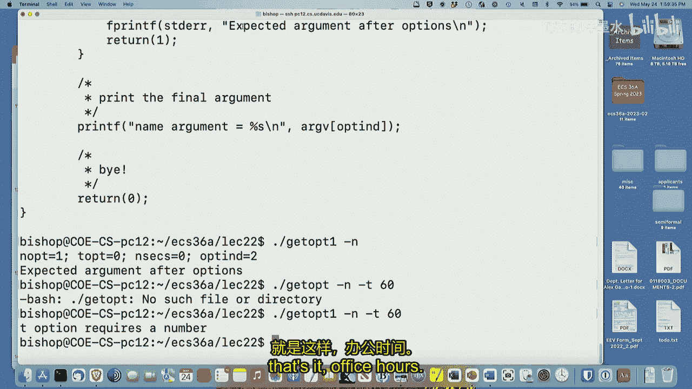

# 【全集】加州大学戴维斯分校 C语言底层编程 中英字幕 完整课程 p19 Lecture 19 - 字符串转数字与getopt -BV15C6FBsE3L_p19-

Yeah。First， are there any questions before we start？

I do want to say a couple of words about the midterm because an awful lot of people are panicked。

How many of you here have read the Hhick is a guy of the galaxyy， anybody。

In one of the themes that one of the。Phrases in the book that I've always liked it don't panic and bring a towel。

You bring the towel because you never know when you may need it。 But above all， you don't panic。

The midterim grades were the mean was 60， Well，61。 The median。

 which means half of the people were above 62 and the other half were below 62。 maximumim was 94。

 and the minimum was 27。Now， if I were grading this based on the curve I'm planning on using。

That would be about a B， B Thatd probably be a B minus or2 a B。So based solely on the midterm。あい。

If you've got， if you got right around the average， you're in no danger of failing yet。

The yet is there because of the final。And the homework。Yeah。So please don't panic。

The other thing is I don't know about you all， but if I panic， I can't study as well。

Now should you study a couple of things you can go through the book and the homeworks。

But try writing programs yourself， and see。Make up a program。

Or pick one out of book or something like that。Or go on the web and find a program to write。And。

Write it。And try out the things we've been talking about in class。If you do that。

 I'll be happy to look at your program once you've written it。And got it debugged。

 Or if you've trouble debugging it， ask and I'll help。Okay。Also。

 the curving method I I use does not depend upon a class average。It depends upon individual work。

So when I use it， I don't compare anyone to， well， this is the mean of the class。

 So that's going to be a B minus and so forth。Instead， it focuses， well， this person got this score。

 what base on the curve I'm using， what should I record as the final score。So again。Don't panic yet。

Paic after the final， okay。Does this help at all？Yes。Oh， absolutely。 What I do。

I actually do three things。The first thing I do is apply the curve。

The second thing I do is look at scores， all the scores， homework， midterm and final。

 if there's just one grade that pulls you way down。I take that into account。

 and I'll typically boost the grade a little bit。And then I look at the extra credit and decide whether or not that warrants another boost。

在。Pretty much clear。Okay。What I would suggest again is don't panic and try not to worry。

 I would say don't worry， but if you're like me， no way。And practice。Okay。

 now are there any questions？Okay， what I thought I'd do today is go through some of the libraries that she has available。

And then we'll look again at the preprocessor because there are a few directives that are widely used。

 and I haven't shown you them yet。And then we'll talk about multi file programs。Okay。

 so let's start off with libraries， first of all， though。Let me give you some background。Libraries。

 many libraries compute things。 Other libraries such as the one。

 some of the ones I'm going to talk about here。Ac as an interface between your program and the system。

The system is certain functions， called system calls。

That basically transfer control to the operating system。It will do something。

 and then return control。嗯。So you have to be have fine grain control。 For example。

 the operating system doesn't use file pointers。 It uses file descriptors。

The file pointer is a layer added on by the standard I O library because it makes things much easier to manipulate。

Especially if you're moving programs from one system to another。For example。

 when I take a Linux program， move it to the system I use， which is free BSD。

 I have to make minor some changes and relatively minor。But。If I use the standard I O library。

 basically the changes are very， very few。If I transfer to a Windows system without making any changes if they do at the system level。

The calls are completely different。And I'll have to rewrite that part of the program。

 But if I use the library， that provides the interface to the Windows systems calls。

I have to recompile it， of course。 But once that's done， I don't have to make any changes。

So that's why the libraries are so useful。As an example， here are some of the system calls for Linux。

Reading and writing， which you've seen as F read and F writeite。

 they actually call underlying functions， read and write。Networking， which also uses read and write。

 but in a very different way。Basically， if you're reading 10 characters from the network and only five are available。

You can tell whether or not to wait from five more or whether or not to return immediately。Fileles。

 change of ownership， change of group， information about the files and so forth。

Those will give those allow you to operate directly on the file itself。

Resources should use things like how much time can you use， how many resources can you use， you know。

 memory and so forth。And timing， youll have， for example， system calls get time of day。

 which tells you， of course， naturally what time to day it is。 and then time。

 which also gives you information about the time。But it returns it as a long integer or an integer。

 depending on which system we are using of the number of seconds since January 1。

1970 at midnightdite， Gwich time。嗯。So。I don't know why you， but I can't convert that time mentally。

So the library provides functions that will do things like that for you。

That will interact directly with the operating system， will interact directly with the system calls。

 hide all that from you and let you do things。You see some of these， by the way。

 in the Standard I Library。F open， for example， covers open。Which is， again， a system call。

 F closes close。FF read is read， Fri is right。Chone to group， change ownership and group of a file。

 Stat gives you information about the file， the size， when it was less modified and so forth。

And the libraries hide all this from you。The important point is。

 if you have a choice between a system call and a library function。

If there's any chance that you're going to move the program to another machine。

 you should always use the library function。On the other hand， if it's never going to be moved。

 you can guarantee that， then don't worry about it。

 Certain types of program system programs do use the system calls directly。Okay。

 now in the C library， there are several different types of functions and there are more than are here。

 but these are the ones that I wanted to talk about。Of course， you saw the standard I O Library。

 and you also had occasion to run into the math library when you were doing the Cols problem in number three in homework 2。

You had to， I'm sorry， the COVID problem， you had to raise some things to power。

And since he doesn't have an exponentiation operator， you had to use POW。

 which was in the math library， which you loaded by typing D LM on the command line。

Sorry on the compile line。Character type， youve seen this a C type。

 string integers or integers to or floating or double。And also handling options。

 if I give an option to a program that is going to alter its behavior。

 How do I know I've given it an option， We'll get into that in a couple of minutes。

Time and random numbers。 R numbers are important in two cases。

 statistical simulation and cryptography。Interestingly。

 the two require different types of random numbers。The statistical random numbers can be predictable。

The cryptographic ones cannot be。So you have different notions of。What randomness is。

And then various functions to manipulate string and memory。 And you've seen some of the string ones。

 yes。Okay。Technically， in most cases， what the computer does is produce what are called pseudorandom numbers。

Ma namely， they are numbers that act as though they're random。

 but they're computed from an algorithm。 Linear congressentional generator is the type most commonly used。

And if you don't know what that means， count your lucky stars。However。

 it can generate not random numbers the way it does it is it measures physical phenomena。

 for example， what's the waiting time for the disk to spin around to a certain point。

Or if you have a microphone， what's the ambient noise like。

And it takes that and collects it into a pool of bits。And then uses the algorithm on those bit。

 uses various algorithms on those bits。So。Technically， yes， it can generate truly random numbers。

 providing the background， noise and such。Is random。

One one program which used random numbers to protect itself was broken very easily。

Because it turned out the people who were using it， the version got the one that got broken。

Hed their office right outside their office was a generator。And it would go kch， kch， kch。

 producing very regular background noises。And so the randomness wasn't that random。

Random number selection in generation is a real big problem。

 You have to be very careful how you do it。Thank you。 That's a good point。

 I'm going to use the word random here， by the way， even when I means pseudo random， so。

Bear that in mind。Okay， now let's take a look at the standard I O library and some of its functions。

You've seen the open read right close and so forth。 So I'm not going to go through those again。

You do have to include SDDIO。h， and that's at the top of pretty much every UC program。

It's based on what are called streams。And basically， you can think of them as files。

The reason I'm using the term streams is because it can be used with networking as well。

 which we won't get into。And that is input and output that it buffers。

 which I'll explain in a minute。 And there are three predefined streams， input， standard input。

 standard output in standard error。Okay。Now here's the fun part。When a process reads from the disk。

 that's quite expensive in terms of process time。Because what it has to do， first of all。

 is wait for the disk to spin so that the arm of the disc can be positioned over where it's supposed to read。

And then it reads the characters in and reads bits in and sends it to the operating system。

 which then makes it available to the program。This， by the way is why SSD is so much faster。

Because you don't have the latency of the spin。It's just， go to this location， grab the number。

 you're done。Or grab the bit and you're bitit and you're done。So in order to make things move faster。

What the Standard I O Library does is buffer things。So within the library， there is a bigger array。

And when you say， for example， get C from a file， get a character from a file。That buffer is empty。

 the system will just read in all the characters it can up up to filling the buffer。

Then if you ask if for character gives you the first one。 Next time you ask for another character。

 gives you the second。 It doesn't have to read until the buffer's empty。By the way。

 anybody here remember the limitation on Ungetsy where you push something back to the input。

The limitation is at most that's guaranteed to work for one character。Sometimes it works for more。

 sometimes less， or nevertheless。 sorry， sometimes it works for more。

 but it'll always work for at least one。And the reason is。

 if you read a character in and that buffer is completely full。

 you get the first character in the buffer。Now， if you try to push back two characters。

 the first character will go back to the buffer。And there's no space for the second。

Will and overwrite it， no， it'll just throw it away。So that's the reason for the limit。Now。

 when you do a read， if that， if that buffer is empty， it will just grab another chunk of data。

And the buffer size is system dependent。So on some systems， it's 10，24 bytes on others， it's 81。

 92 bytes and so forth。So you can't depend on how many characters are being buffered。

When you're writing， it's pretty much the same thing when you write。It goes into the buffer。

 It does not get written out to disk immediately。And then you。

 it puts more characters in there when the buffer is full little right it all out。U。

That you can control this to some extent。And I'll get to that right now。

There are actually three types of buffering and Linux， full， line and unbuffffered。Or not。

Full buffering is typically used with large devices。

 They're called block devices like files and such， disk and such。

So what happens again is you read things into the buffer and it works exactly as I've explained。

You get the first character out of the buffer， and then it keeps going into reach the end of the buffer。

And then it goes to the goes on， reloads the buffer and so forth。 writing when the buffers full。

 it pushes things out。Writing will also push things out of buffer in two other cases。

The first one is， if you exit， when you exit or return from Maine。

 everything in the buffers gets flushed or written out。The second thing you can do is force a right。

By calling the function F flush。There it is。That will flesh all your buffers。

 so they'll all be written out。There's another one， I believe it's called F syncnc。

 that one Linux has， but。I have not seen it elsewhere。So F flush is the one you should use。嗯。Again。

 this speeds up reading and writing quite a bit。Questions on this are on the concept of buffering。

Okay。Now this runs into a problem though， suppose I'm working at a terminal。

And the buffer size is 1024， and I type a line of 60 characters in it return。

If it's simply doing full buffering。That would go into the buffer。

And then I would wait for more input。But that's not what I want。

 I want that line given to the computer。So that's why you have line buffering。

And this is typically used in character oriented devices like terminals and things like this。嗯。

The buffers get flushed。That're given to the program when there's a new line， red。

Or they're written out when a new lion is printed。That's why if your program crashes in the middle and you've done several prints but prints。

 but no new line going out。That's why you won't see it。But if it exits normally。

 it will go ahead and flush those buffers。And basically what it's trying to do is act just like full IO。

 fully buffered IO， except that instead of requiring the buffer to be full。

 it just goes to the next new line or return。Okay， and the last one you've seen with， oh， I'm sorry。

 yes。Oh I'm sorry， a buffer is an array。Okay， and so it's a chunk of memory that's allocated within the library。

That says， here's where I'm going to put things that I read or that you write。

Either after they come in from dis before you read them or。Before they go out to the disk。

 and after you've written them。Does everyone understand what a buffer is， that's absolutely critical。

By the way， buffering is used in a lot of places。Not just in Standard I Library， yes。Correct。

 it's in the library， but not your code。Because the library tries to hide details like that from you。

 so you don't have to worry about it。嗯。Other questions？Yes。Yes。

 it's faster and more efficient because if I'm reading in 10，24 characters。

If I do one big read and get it in， that's one read。If I read them in individually。

 that 1024 reads and each of those are。Maybe just a teeny bit less expensive than reading in a whole chunk at once。

Okay。The greater expense would be from what's called transferring the 1024。Oh。

 but then you'd have to transfer each character individually， so I take it back。If you buffer it。

 you will get always faster。Other questions， that's a good question， by the way， others。Okay。

You've seen unbuffffered， what that means is when you read a character。

You get it when you write a character， it's written out immediately。And this is somewhat expensive。

 so it tends not to be used or rather， yeah， not to be used that much。

 The one exception is error messages。Anything you write to the standard error is unbuffffered。

And it will immediately appear on your screen or wherever you read。

 wherever you tell it to put the error error error output。

And the reason for this is if the program crashes， you still want all the。

 you still want the error output there so you can see what's going on， yes。那嗯。Okay， Phil。

 let me answer that in two ways。As a computer person， I would say no。

As a philosophy if I were philosophy， yes， because what's in the buffer will change each time you load it。

 And so when instantiation of the So the library will change over time。 the library and memory。

 As far as functions go as far as doing the buffering and such goes。

 the library functions themselves are not changed。 It's just the data you read in and write out。

The buffer is allocated。So when you we started up your new program。Using the standard I library。

 it would go ahead and create a buffer for you。Other questions？Okay。When you read。

 it's immediately made available to the process。 When you write， it's immediately written out。

This is considerably more expensive。And so that's why you tend not to use it。

Systems will buffer things in different ways。 For example， Linux， I believe， uses the three。

Types of buffering。sorry， fully buffered for files。

 line buffered for character devices and unbed for others。

 There's another system which will you automatically make standard output。

To character terminals un buffered。 And if you want to buffer it。

 you have to tell a pig buffer this thing。And there is， in fact。

 a library call called setbuff that will let you tell it how to buffer。

 And you can even and on some systems， you can even create your own buffer。Okay。

So here's some useful functions for reading and writing。 We've talked about reading and writing。

But there's another aspect to this。When you read from a file， there's something called a file。

 a readr pointer。You'll hear it sometimes called a position pointer。Also。

 if you're not dealing with the standard I O library， you'll hear a call a file pointer。

But I'm going to use our readrite pointer。That says if you're reading from the file。

 that says where in the file your next character will be read from。

And this takes buffering into account。Similarly， when you're writing。

 the readWrite pointer says where in the file your next right is going to be put。😡。

And the advantage to that is you can hop around a file。

So instead of accessing a file from the beginning and then reading it bike by bite。

What you can say is， okay， skip the first 100 bytes and start reading there。

And you use this function to move you to 100 to the 100 byte 100th byte。And go from there。In。

There are certain types of files， which are called random access。

 They're typically used in databases and such， and their databases can be huge。

And there you definitely do not want to have to read the whole thing to get to a particular point。

So instead， you use the functions I'm going to show you to do that。F get pause says， okay。

What's the current position？In the file。And FtelL does the same thing。This should be set pause。

 by the way， not get set。 Anyway， this sets the rerite pointer to this position and rewind moves into the back。

 rewind starts you over at the beginning。And F C is the generic one for all of this。

 It works in a little。Unusual manner。Whens can be one of three things。

 can either say beginning where I am now or end， and there are special macros in the Standard I library for that。

And offset is how far from where do I go？So for example， if I want to read skip the first 100 bytes。

 I would set offset set to 100 and whens to seek set， meaning start at the beginning。

If I wanted to advance a， yes。This is a file sorry， this is a file pointer。

You can think of this one as an unsigned integer。 It's actually what would we call the size under bar T。

Which is basically uns integer。And when is an unsigned integer also？I'm sorry。

You have to come up with the offset and you have to figure out which of these three values you want for the seek。

So in other words， if I want to go to to 100 B from the end of the file。

 I would set offset to 100 and seek and use C N for wins。So I can bounce around the file that way。

Questions on this。Okay， that's basically all of the standard IO library that I'm going to show you。

 as I said， there are a number of other functions， including manipulating the buffer in the library or creating your own buffer。

 yes。Yes。Right， for seek， set and seek courage always goes forward。For Sik end it goes backwards。

I'm sorry。 Oh， for these。Uns signedigned in。Other questions。By the way。

 you do have to be a little bit careful with these functions。

Because since you're giving it an unsigned int。The functions all indicate return of value。

 telling you。Where I went to。If that happens to be the same as negative1。

You don't know whether it's because it's an error。Or it actually got that far。

So what you should do before each give these functions。

 do you remember the ERR and the whole number variable that he told you about？

It's the error number that the operating system uses to indicate what went wrong。Set that to zero。

Then use these functions。If you get back a negative one。Then look at that E， O， R NO again。

If it's  zero， you're fine。 If it's not zero， something went wrong。In fact， I think I'll show you。

 I think there's a program I have that will show you that， but okay。Now。

 we're going to go to the sum that you may find very useful。The first one is strings to numbers。

You know， you have this like 3，7，5，8，9，4。H2I will take that string and turn it into an integer。

Long int will take the character string。 willll take the string and turn it into a long。And。

AOF will turn it into a double。I've always found that I'm using that A2 F。

Is a double instead of a float。But there are historical reasons for that。

The one thing you have to be careful of with these functions is there is no error checking。

So in other words， if you get a zero， you don't know whether that's because the number you read was a zero。

Or whether it was because instead of a number， you tried to read ABC， D E。Since a is not a number。

It would immediately return， and it would return to 0。

So you need to be careful about that for all of these， for these folks。

The other thing that can happen is the numbers can overflow。The numbersumb can be too big。And again。

 you won't get any indication of that。The more sophisticated ones do give you an error indication。

This is basically like A2L。You give it a string。You didn't tell it what base you're working。

 is it base 16， is it base 10， whatever？And then you give it a pointer to another pointer。

What will happen is when SR TOL returns。It will have converted as much as the leading portion of the string to a long。

And then wherever it stopped converting。That's where EOSTR will point。要。For here。

 you don't have to allocate anything。 presumablysumably， you have the string in memory somewhere。

 okay。U。C plus plus， if I remember correctly， is not quite as sensitive because in some cases。

 you have to allocate things and others， the compile will do it for you automatically。

And the versions of C plus plus that I've used all the garbage collections。

 So you didn't have to worry about freeing memory。But the strings to numbers function don't allocate anything。

 That's your problem， not theirs。If the final， if EosTR， by the way， is null。

You're when you pass it in， you're telling SGR TO L， I don't care。 I don't want it。

If it points to the null character。That means what you read was a series of digits and that nothing else。

So that's a success。If it points anything else like the letter A or the letter X。

 that means you head along。And immediately following it was an A or an X。

Whether or not you want to interpret that as success or failure is up to you。 But the point is。

 you can tell。And also if there are no digits。Then the end pointer is set to the beginning of the string。

And it returns zero。So that way， you can tell whether or not you actually read anything。

And there are equivalents for floating and double。Let me show you a program with a couple of these。

Everyone see that， okay？Especially people in the back。Okay， these are all in EC S 36， A Le 22。

So you can get to the programs that I'm going to show you。Oh。Now connected， there we go。Okay。

 let's look at the CONV。This program simply reads in a line。And uses H2L to convert it to log。

And then it will do the same thing with flow。So。And at the end。

 I type end to file and in order to keep it clean。 So this。Greater than sign is on its own line。

 I put。 I put a new line out。 So let's go ahead and run that。See what happened with this。37 x 89。

 It reads the 37 and then says， well， wait a minute。 X is not a digit。 I'm done。

And so that's why you get 37。And you can also do this。Well。Here hear what it did。

This is a valid floating point number。But the E is not something youd see in an integer。

So it just reads the first 100 and says， okay， I'm done。Notice it handled the plus correctly。

The second one turns this into a float。 And there this means an exponent of can。

So that's what that long thing means。I was going to put 10th E to the 100th。

 which is a number called a Google。But I I'm glad I didn't because it would have taken too long to print。

And again， if we look at the program。There's absolutely no error handling。Because there's no way。

 I don't get any errors from the A to Y or A to L and Im A to F。Oh， let's see。Thats more。Yes。

Now hear what I did。Was a simply allocated space for the buffer that I was going to load with a line。

And I declared the size of the buffer to be 1024。That's what's going on there， and that's， again。

 very common when you're allocating buffers。This， however。

 is completely different than the buffer that the standard IO Library uses。嗯。

I'll bring in a program Friday that does that。But here。This is。

 if I were going through this character by character。

Then this would be a buffer because they put the whole line of input there and then read it a character at a time。

And I would keep going until I hit the end of string。Nothing。

A bufferffer is an array of characters or an array of angels or whatever。There's nothing special。一。

This goes wherever you put the array or where I'm sorry， wherever the compiler puts the array。Okay。

 now here's the other one， so let me get out of this。The same beginning， but here。I'm using STR TOL。

So I give it the input。But here I've defined a variable。That will point to the end of the string。

And doing in base 10。So we'll do the conversion automatically。Same thing down here with SGRTOD。

 the point with that though， is there's no base， you can't do floating point numbers in base 16。

You can， but this won't take it。So。Now notice what happened here。37 x89。

That turns out to be the integer 37。But look at what happens with that EOL。That's the。

 the the pointer points to that end of that end of long points to the first non long nondiigit character it finds。

Which is x。And exactly the same with the floating point number， goes as far as it can and then stops。

 and now I know where it ended。So now if I'm looking for a number。With that end。

It should be delimited by blanks or whatever。啊。I can check for that。So in this case， 3，6。

7 was definitely an long。37 x89， well， 37 was， but what they would do is look at this and try to figure out whether or not that's a legitimate way to end an integer for whatever purpose I was using。

Questions on this。And let's see。in-1 is legitimate。And -2，-1 is legitimate， but -2， -3 is not。-1，-2。

 -3 is not。See how worse？Questions on this？These functions are yes。第二是。sign。Well。

 it can read the minus sign， and then it reads the number， thinks it's a negative number。

So it gives you that。 then it sees a minus。The problem with the second minus is you can only have one minus for number。

 and that's at the beginning。This is kind in the middle。So it says， oh， that's not a valid digit。

 So I'm going to go ahead and return the -1， which is。And then I'll return and point you to this。Yes。

So I can do this。It recognizes as a plus at the beginning。As a sign， so that's one。

But then it sees the second plus right after the one。And it says， well， wait wait a minute。

 that's not legal in an integer。So it stops here and returns a to there。The rule is before a digit。

 before the number。Blannks tabs space basically， and plus and minus are legal。

If there's a plus or minus there， the number is to follow it directly。Anywhere else。

 after that it all has to be numbers or digits。Yes。I misuseed the term integer。

 It's really an array of digits here。 If you want an array of integers。What you can do is。

You generate the integers， however， and you write them out into a file as integers。

 so it's a binary file。If you were doing that， then you would allocate an， you know。

 youd create an array， actually。The standard I O Library would create the array for buffering。

And then it would just be reading it in bite by bite。Now， you can have an array of integers。

Basically hang on a second。You do it this way。我不是道。

What I've done here is Ive allocated buffer of 100 integers。Other questions on this？Yes。Yes。

There are a couple of ways you can do it。Something like this will work。

Where you just put them in individually， you can also do an Fre。嗯。

And what this will do is read 100 integers。From the file NFP points to。And then store them in eyeb。

Yeah， if you're doing a read， yes。If you're doing a right no。

 you can just create it directly and write would take the same form。

 except it would say F right instead of F read。Exactly。Okay。

 next one that I wanted to show you where you did mouse。Okay。

 the next one I wanted to show you is on how you handle options。

You can handle them manually by writing your own code。But the system。

 the libraries provide you with another way to do it。There is a function called get optt。

And you give it the number of， you basically give it your argument list just like you would for me。

But then you give it a string。And the string is a list of option letters。

And so what it will do is it will go down the argument list。

when Caesar hyphen is the first character， it knows that's an option。

And then it'll look at the letter accompanying that。And return that letter。It also has a counter。

Which has the index of the next element。And sometimes arguments have options like with GCC。

Remember the dare show， hello。Daashhow where you write write， you give the name of the output file。

That's an。 that hello was an option to the。啊。To the argument， De show， excuse me。

And so here's what it would look like。Okay， I'll bounce back up and down。Oh we are。Okay。

 you use Gettop like this。And this program， which basically does very little。

 simply takes dash n is an option， and dash T is an option。

You can also put two dashes in front of an option。And that indicates typically the option is more than one letter。

And if you just have two dashes or a single dash without anything， that says my options are done。

The N。Is just a letter。The T is a letter is an and it's just an option。 T is an option。

 But the colon says， hey， look， there's an argument to this option。

So I'm going to go ahead and handle it。And the way I handle it， first off， I set some flags。

 NO is set to0 unless the dash N flag is set， in which case it's one。T opt is the option for T。

 And that's set to 0 again， unless dash T is present。Since D T requires an argument。

What do you do is I？I'm assuming it's the number。So I take the argument and translate it into an integer using SGTOL。

And then， I compare。Whether or not it's ending with a null bitete。And if it doesn't。

 I print an error message。And if I have no idea you put in something other than an argument。

A legitimate argument。 Get opt return a question mark。So let's go ahead and look at this one。Yes。

 one of the requirements was that there be at least two arguments。Well， obviously。

 I did something wrong。 I'll fix it for， for todays Wednesday， right， I'll fix it for Fridays。

Talk what I'm going to do is finish this up， finish up the arguments。

 and then we're gonna go on to the preprocessor。 And then we're gonna go on to a program called make。

Which， quite frankly， is very， very helpful。Okay， that's it。A hours and。

我 take you from there。

