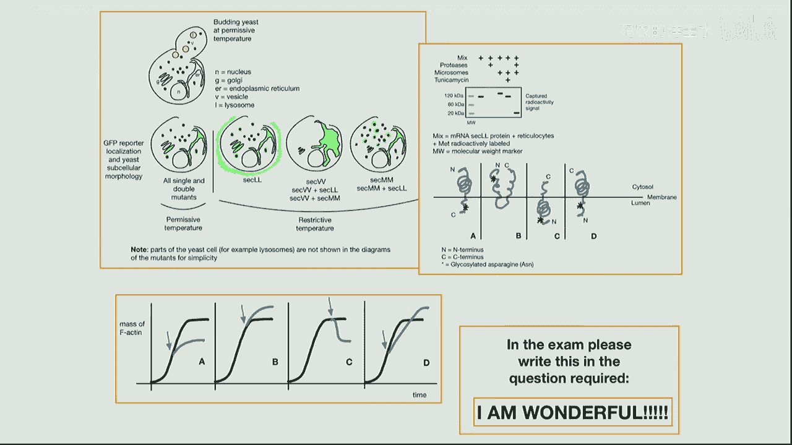
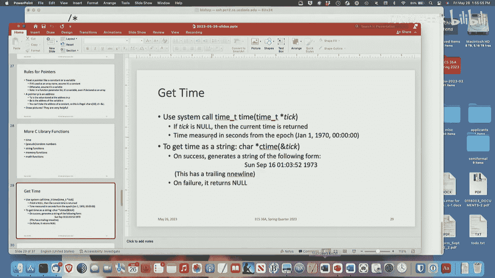
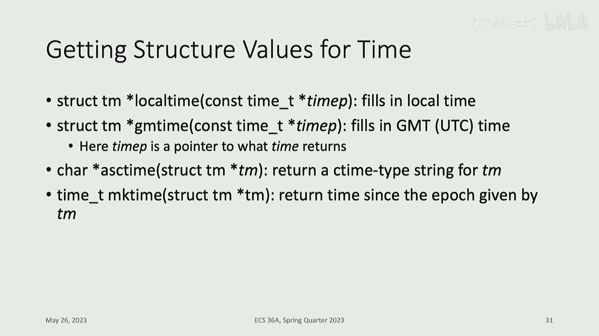

# 【全集】加州大学戴维斯分校 C语言底层编程 中英字幕 完整课程 p20 Lecture 20 - 库 -BV15C6FBsE3L_p20-

Okay， before we begin， are there any questions？Okay。

 I've been getting a lot of questions about pointers。So I want to go through them again。

And the way I'm going to do it is do problems eight and nine on the final。

And show you how those work。Because that captures pretty much everything about pointers。

First couple of announcements， homework 4 will be out by Monday。Well， wait a minute。

Yeah homeworkwork4 will be out by Monday， also if you want us to check an answer on the midterm。

 see whether or not you got enough credit or too much credit。

Please submit it through great scope if you email the request it becomes very hard。To number one。

 manipulate and change the grades。 and number two， it makes it harder for us to keep track of things。

Okay。What I want to do is like I say a quick review of pointers。A pointer is just an address。

It's like an integer 3，5，9， here you have addresses of what were there there and there and so forth。

So it's exactly like a constant。Or like a variable。Now。Appoint a constant like this。Can't be changed。

Because what happens is when the compiler sees this， it allocates 30 space for 30 integers。

And then PC refers to the first or zero address there。So it would be akin to assigning， say。

 two equals three。Doing that type of assignment with integers doesn't make any sense。

 so trying to change PC is exactly like that。You can't change it。

But a point of variable can be changed here， I have a pointer to an integer。It's uninized yet。

 so it doesn't really point anywhere。But I can assign to it。I can add to it， subtract from it。

And so forth。Questions on that？Yes。哪边去。A mean。If会 change着。法律。The value。Yeah。

 the value that it points to can be changed， it's just the pointer itself cannot be changed。

They cannot be。Correct。In a point of constant， that's absolutely correct。Yes。No， PC is not a keyword。

 I did this because。I needed a short name， so I'll go point a constant。

It's basically the fact that this is the name of the array that makes it constant。

And P is just for a plain old pointer I probably should have called it PV for point of variable。Okay。

 so let's look at a couple of examples of how this would work。Here is midterm question8。

This is the setup and in pictures we have this。And he is a pointer to。The first array。

It started to address and the first array begins at address 100。A is a point or constant。

Because it says age27。B is a pointer variable because you have star B。And it contained the address。

Of this array。And C is a character and it simply had addressed 300。B is an address 200， by the way。

Okay， here we go， first question。B is assigned the address of C。Okay， the question is， what happens？

我。The value of B changes。😡，It no longer points to this array。It contained 300。

 which is the address of C。Notice we don't know what's in C yet， that doesn't matter。

We're assigning the address of C。Not its contents， not its value。Any questions on this？嗯。This。

It's basically quote， lostt in memory， unquote。It's not deleted， it's not recycled。

 it just stays there。That， by the way， is called a memory leak because you can't free it once you lose track of it。

So it just kind of hangs there。Python automatically does recycling， it's called garbage collection。

Ced does not。Okay， and so the answer is that the value stored in B changes it to the addresses of C。

Okay， here's the second one。It said assume each question starts anew。

 so we go back to the original configuration。And we're assigning the value of B to a。That won't work。

Notice there's no storage associated with A。 It's a constant。There's an array。

But the address of the A， but the the address of the array doesn't change。So， here's a constant。

And when you try to assign a value to a constant。It gives you an illegal assignment error。

So in this case， it's illegal assignment。Any questions on this？Okay。Now was the third one。Yes。Please。

Correct。You can't assign anything to any constant。If it helps。

 a doesn't have any storage associated with it， it's just dere in the array。B does。

 which is why you can sign to B and not A。Okay。Here's this one。C equals star a+3。

So the way we get through it。Is。C originally points to where A points to， sorry。Let's take A。

So C would be the A is the contents of this， the contents of a plus 1 is this。

 a plus 2 and a plus 3 is there。So what's really going on is see first looks at。Then a plus 1。

 a plus 2 and a plus 3。And then it copies the character。From a plus3 to D， Go to see。

This is identical by the way， to C equals a open bracket， three closed bracket。And in fact。

 when the compiler sees。In a way， reference like a， open bracket， three， close bracket。

It internally translates it to this。And then puts that then compiles that。They're identical。Okay。

 next one。This one is weird。It relies on a quirk that you saw there。If。A of three。Is the same as a+3。

What would three open bracket A close bracket B？Well， the compile would translate into 3+ a。

Which is the same thing。And that's the key here。C is going to equal to a。

 which would be translated to this。Since addition of integers is commutative。You get this。

Which means you get this。And A2 is C。Yes。Like a variable。嗯。

You'd actually initialize it as Ampersand A oh no， you're right， sorry。

 you initialize it as A because A is a pointer so you don't need the star。

Would it still worked the same way？Yes。It would。Sees nothing if not consistent。

 The problem is sometimes the consistency is hard to figure out。Other questions on this？Okay， this。

 by the way， was the hardest one on the test I thought。Okay。

 the last one is B equals a and C equals B 25。So the way it works is this you're starting out here。

And while you can't assign B to A， you can't assign the value of a to B。So asking that's done。

You get that。So now B is pointing to the same place as A and this array is just hanging out there in memory somewhere。

Whoops。So now。If C is going to be B25。Ban now points up here。😡，So you go out to 25， which is Z。

Question三 this。Yes。I'm sorry， could you speak up a bit。W 2 of a is equal to。Oh， let me go back。

You're asking about this one， correct？Okay， the question is why does 2 a equal 2 plus a， right？

That that's the definition of an array。The definition of an array is， you take the name。

Say you want a of 23。You take the name， A。And you add to it the a said that you're going to。

 which would be in this case 23。And then you reference。The resulting location， which is right here。

So that's the definition。The compiler， like I say， tends to ignore or tends not to use the array format that almost always translates it into this star to star of whatever。

Yes。Does an array always begin with zero， yes， the index of an array is the initial index of an array is always zero？

That's why a lot of languages use zero as the beginning。 The other reason the reason they did this。

Is that where you have a。And if you want to access the first element of the array。

 that's it the address A。So you add  zero to it， and you get there。Other questions？Yes。For this one。

嗯。O。200 he just toB。No， 200 is the address of B。300 is the address of C。And a is 100。

 this array is based at 100。I'm sorry。No， we don't know where it is。It's whatever the value of B is。

 but that's not specified。Other questions？Okay。And goinging through that， yes， that's the young。Okay。

 now let's look at question nine。The tricky part about question9， quite frankly。

 is restraining yourself。It's very easy to simply do it line by line in the program。😡。

The problem with that is you don't know that the following line will affect the result that you would normally get。

So what I'm going to do here is instead of just answering each variable。

I'm simply going to go down the program and then at the end we'll go ahead and do the end write out what they should be。

So I'm going to start with a very crude picture。 Please remember， A。

 I'm not good with computer art and B， I failed art in kindergarten。 So in any case。

 I've got quite a handicap。But anyway， A is an anti drift 2。Aray is an array of  three elements，3。

4 and 5。And B and C are integers。I， no， B andC apointers。B points to array。

 the first element in the array， And C points to the second， which is A R1。

And then D andF are just integers。So the question is， at the end。

 what's this whole thing going to look like？So we go through the program slowly。

And we get the values。So let's start with the first one。We call Testaing index。This this， by the way。

 is set up for all the values in the declarations。 So this is the first executable。Statement。

 so we're looking at integer X。We're calling it with A。And a is 2。 So it creates another variable。

Local to the function called X， the parameter。And it contains two， which is what it was passed。

 This line means that up here， these things will stick around for a while down here。

 This is only going to last as long as the function call。Okay， so now we have that。The next one is。

 we。IH the return statement。Now， here's where the plus plus comes in。Annoyingly。

If it were x plus plus， you'd add one to x and use value that new value。If it follows。

 you use the value of x and then you add1 to x。So in this case it follows。

 so what that means is it's going to return the initial value of x， which is2。

And we assigned it to D， so it returns too。We then add1 to the value of x， which is 3。

And then the function ends。 So all that goes away。So at this point， D is2。

Are there any questions about that？All right， now let's go on to the trickier ones。

Here's P1 testingy。It'sPasing B and giving it D。B as a pointer to ARR。😡。

Since we're passing it into x， x gets that value of that pointer。

And both of them point to to the zeroth element of ARR。Questions about that。Okay。

 now we're going to return。Now the starX gets evaluated first。

Star x is the value which is located at the address X contains。Which is the address of B。😡。

Which is three。So it's going to return 3， and therefore， E will become three。You then do a plus plus。

Since you're adding one to X。X no longer points to the zeroth element。

 it now points to the first element because you added one to it。Everyone see that。I'm sorry。Right。

 x points to four。😡，Or I should say to the memory location containing for， to be precise。However。

 the next statement， the function ends。So all that goes away。So in other words。

 in the first two Testa ink and P1 testa ink， the plus+ doesn't affect anything outside the function。

It only affects the parameter， which is inside the function。

And so it would have been just as good to leave that off。Okay， now。

Here's where things get a little bit different。P 2 test in。 we're passing in the a pointer， C。

But notice here there are parentheses around this。So what that means is evaluate this first starX。

 and then add12。Whatever StarX is pointing to。So here we go。First of all， we pass NC。

And that makes x。2。The first element in the array 0，1 and 2。 so points to1。Which just contains four。

All right， now that we passed it in， the first thing we're going to do is return what X points to。

X points to four。So we're going to return four。😡，And F becomes4。We then do a plus plus。

But notice it's not to x， it's to what X points to。Starex。And that gives us。Wai a minute。

 why are you？A change of five。Sorry here， because x points to four， what was four？

And we add one to it， which makes it five。Now that's an example of how you do past parameters where you can change things。

Outside the function。You can't pass in the thing you want to change。

Instead you pass in a pointer to it。😡，You can change the value in that pointer。

 but you can change what it points to。And that's exactly what happened here。

We didn't change the value of C at all。But we did change the value of x。

So I'm sorry we did change the value of what X pointed to。And then， the function ends。

And so we're done。So then now that it got everything written down， we fill out the table。A is 2。

B is unchanged。C is unchanged。D， E and F are all changed to 2，3 and 4， respectively。

And then the values in the array are three。And this one was changed by P2， so it's 5。

And then this one was never touched。 So it's5。So those are the values， yes。

How does the second function change the value of。Yes。Here's why。Let me get back to the second one。

Okay。The rules are。First， you take the value of x。😡，And return what ap points to。

Which in this case was three。Now， since there are no parentheses around here。Plus， plus applies to X。

And so that's why x gets incremented to 0。24。But you've not done anything with the four。

And the x goes way。So without parentheses。You do the dereence。

And then you do the increment or decrement， yes。一。It's incrementing the pointer。

 which is equivalent to incrementing the index。The other one had parentheses around the star X。

So what this means is get this value。And then increment， not x， but what x points to。

If you did not have the parentheses here， it would be exactly the same as the previous problem。Here。

The previous one was incrementing the address。 This is incrementing the value with that address。No。

It stays the function stay will execute all of its stuff。If you want the precise details。

 what will happen is it'll evaluate StarX and store it somewhere。

And then go ahead and do the plus plus。Then it'll pull the stars from where it stored it and return that。

😡，On this one， it's not really returning to the value that you use the plus+ on。

It's returning the value of StarX。可。But the plus plus then is applied to what X points to。

And so the effect is outside the function， it changes the four to a5。Whereas in the earlier one。

You're actually changing the address and that address went away when the function returned。

Does everyone get that？For whatever it's worth， I will tell you that pointers are the worst part of C。

It's very easy to lose track of things。And it takes a little bit to realize that an address is really just like an integer。

So here are a couple of suggestions for you， let me get past this。Okay， first。

 just treat a pointer like a constant or variable。If it's used in in the name。

 assume it's a constant。If it is， otherwise， you can assume it's a variable。One little quirk。

If it's an array in a parameter list like ARR open bracket，'s closed bracket。

You can treat that as a variable。That's the only time you can treat anything with the brackets is in variableable。

Okay。And a pointer is just an address。These are the symbols that tend to get people confused。

 star P is called the referenceence。You take the address stored in the pointer or the address of the pointer if it's constant。

And then you go to that address and get the values storeded there， that's what starP means。

Questions on this， yes。That won't work。 That's an illegal syntax。

Because if you had the square brackets。That indicates this is an element of an array or an index into an array。

 but there's no name。U。Yes。Now， in a function parameter， since you're passing something in。

You presumably know how long that array is。So it's not going to worry about that。

If you declare it outside a function。Then I believe the compiler will bulk。嗯。

You should always declare it as a star P unless you're actually creating an array。

 unless you're actually， yeah， you want creating an array。

Let me clarify that for a minute if you declare an array。The compiler prelos space for that。

So when they said a， you know， care A 27。The compiler allocated space for 27 characters。Now。

 had I just said star。It wouldn't allocate in anything。

I would have then had used malloc in order to allocate the array。

The only use I have ever seen for it is the question was。

 is there a use for a pointer with square brackets after it instead of star P， right？ Okay， Yeah。

 the only time I've ever seen that done is in a parameter list of a function。

And that's why I say it can be treated generally as a variable， I would not use that declaration。

 but others do。It allocates 10。And A of nine or whatever the last one will be。Actually， no。

 it will allocate 10， and it won't have anything in there。If you copy a string into there。

 then it will automatically append to no bitete at the end of the string。

So if your string is Z characters long， then the8。Index8 of the array will be zero。Yes。

 starting at zero。If you try to copy in characters that are  12 characters in an array of size 10。

It'll happily do it。And you'll wipe out some information。

 you'll wipe out some characters some data that follows the array。嗯。The last thing。Oh。

 before I do that。This is illegal。See here is a constant point of constant。It's the array。

I'm taking the address of C， but C itself doesn't have an address。So this is illegal。

The last thing I really must emphasize this， draw pictures。The whole thing is an array。

C itself is the name of the array。Which is a constant pointer because it points to the beginning of the array。

 but you can't change it。Right， if it's a constant， it doesn't even address。Yes。U。Generally not。

 I can imagine you can。 Well， there are also rules for disambiguating things。So if you， for example。

 have three star star P。What the compiler will do is， okay， it's got a single star in front of P。

 so that's going to be treated as a dereence。And then it'll go ahead and do the multiplication。

But if you say three star P and P is a pointer。It'llreence what dereence P。

Get what's there and then say， wait a minute。I have no idea what to do with this and give you an error。

Yes。On the web page。 and in。This is E Y books。There's a table of precedence and associivity。

You'll find that the unary operators， star plus plus minus minus and things like that have higher precedents than the arithmetic ones。

Yes。是。Yes。The system will allocate space to what you declare。So if you declare an array like this。

It will allocate room for 1 characters。If you say， for example， int star peak。

It will allocate space for the pointer。And nothing else。So in that case。

 if you want to use P to point you an array。You have to allocate the space yourself。

So it's like in the homework。When you're doing number one， there's a linked list。

You declare P to be a struckuc node starP or whatever name you're using。

That allocates space for a pointer to the node， not the node。😡。

And so then what you have to do is actually create the space for the node using Maoc。

Now when I lift the star off， it would have allocated space for the node。

struct node P means P refers to the actual structure， it's not the address， it's the structure。

So in that case， it would allocate space for that single structure。So in other words。

 if I knew I was not going to have more than 1000。Structures。

What I could do is simply create an array of 1000。And then use that。

 instead of doing the allocations。But the problem is I don't know how long that list is。

So I can't do that。Does this help clarify things？Question， yes。I'm sorry。 Could you repeat that。

If there's only 10 here。I'm sorry， I don't understand， could you。Repeated。Encast。

X has got to be a variable there。If you put like。See from the。One afterwards。

 where she declares an array， that's illegal。Other questions？Okay， what this helpful？Okay， good。Yes。

是。The beginning。way的去。Right。I'm sorry。Yes。Okay， this 1。

 I don't need an ampersand on because I'm referring to a pointer。I could put Ampersand zero。

Andber Sandy then open bracket zero close bracket。That works。For number one。

 I could have said AR or plus one。Or this。Because here I'm getting the address of the assuming you're starting at zero。

 I'm getting the address of index1 of where index 1 is in memory。So here's index 1。

And then here's the address。For the first one。I'm simply saying， well。

 I want the beginning of the array。And so that's index zero。So I could have just done this。

 but replaced the one with zero。😡，That's fine。I could also。Just put in the name of the array。

Because ARR itself is a pointer。It points to the array。Got it， okay， yes。

That's a very good way to think of it， thank you， I wish I had said that。Right。Right。

That's a good way to think of it， that this is just the shorthand for Ampersand A open bracket。

 zero close bracket。Other questions on this。Okay。By the way。

 I'm going to put these slides up on the website， I don't know whether or not the animation will come through。

嗯。Hopefully it will， if it doesn't， I'm hoping that there are just。

 if there's one slide with three animations， youll get a four slide showing each of the animations。

We'll find out。Okay， any more questions on this？Okay。

 if there are things you want me to review in class。

 please let me know I did this because a number of people during office hours were having trouble with pointers and they thought it would be worthwhile clarifying it and going through it。

But if there's something else， yes。Yes， I can do that， I'll try to get that done by Tuesday。And。Okay。

Okay， let's look at some more library functions。 These are ones that are come up all the time。

What I wanted to do was look at time and then go through pseudo randomum numbers again。

Then strings and some of which you've seen， some of which you haven't。

 And there are a couple in there that will be useful for homework if you haven't finished it yet。

Then memory functions and some math functions。So let's go ahead and start。

If you want to get the time， remember， it's measured from midnight， January 1，1970。

 Greenwich time or Uni time。You would use this。😡，Time under our T really is a synonym for unsigned int or unsigned long。

 depending on which system you're on。嗯。And you've got an include file， by the way。

 called time dot H that you can put in and it'll do all the declarations for you。Now。

 you pass it a parameter， which is a pointer to a location。When it returns。

That location will have the number of seconds since the epoch， the January 1s， 1970 thing。In it。

But it also returns exactly the same value。So if you put a null as the parameter。

It'll only return the value， but won't try to write it。In in memory。The time is measured in seconds。

As I said。嗯。A fun question。 does anyone here remember the year 2000 panic？In computers。

A lot of dates were stored as two digits。Because the programs were written when memory was very expensive。

So here's the question。It's in 1999。You go to 2000。What happens is those two digits become zeros。

So a driver's license issued in the year 2000。Which show as being issued far earlier than one in 1999。

Because zero is less than 99。And whenever this happens。

 you always hear death of the internet or death of computers， that sort of thing。In point of fact。

 nothing much happened because people got prepared。U。With Linux， you didn't have that problem。

Because it stores time as an integer a number of seconds。

A fun thing to do is to try to figure out when you will have that problem。

At what date does the next second flip back to zero？Okay。Now。

 assuming you're not absolutely brilliant and very good at mental math。

 you'll probably want to know what day that number corresponds to。

There are a number of ways you can do it， but the C time is the basic one。

You take whatever value you get from time， stored in a variable and pass a point you to that variable。

It will return a string of this form， followed by a nullbte， of course。If it's a one digit。

 then this will be two blanks instead of just one。 Notice the zeros in front of the time。

It also puts a trailing new line on the end。Now， if sea time fails。

 and I'm not sure how it can fail because tick is just an unsigned int。Anyway。

 it will return to no pointer， so you should check for that。Before you use it， yes。Okay。

Time is of a type， time under4 T。That's defined in the sharp sign include time age。

So what you do is you declare a variable like actually， let me show you。I think I have that one in。

programgram。Okay good。Oops。Let me back up。Okay。What happens here is。

I want to know what time of day it is。 want to know what time it is。So I call time。😡。

It will return the time。As a return value。If I wanted to do it another way。

 I could have put declared time。 I could have put Amberand tick here。

And it would have returned it and stored it in there。

 I've just always found it easier to do this this way。

 And I'm not sure why they have the other way in there。Probably for historical reasons。And here。

 if it's -1， then there's an error。 So I call Pierre。

 which gives you an system a system error message。 And then I return an error。Instead of what？

Instead of E OF， because time expects a pointer as its parameter。 E O F is an integer。

KNoll is the pointer。Yes。That said， you can treat it as0 in many cases， fact in all cases because。

Remember showed I was talking you about the preprocessor earlier。

No is just the macro defined in there a  zero。So wherever it sees none it will' replace it with zero before it hands it off to the compiler proper。

If it's a pointer， you use no。If it's an integer or a character， you would use EOF。

Don't use ELF as a point because it's minus1， which means something entirely different than null。

Okay， let's see， I'm going to get back to this。Oh， okay， let me go on and show you something。And。

Okay， get time， yeah， here's C time。So once I've got the time。

Notice I pass in seat time using an ampersand because I want。I got to give C time the address。

And then he print out what he gives me。 It adds a new line， so I don't have to。

And then I just returned the time。So I get the time I return the number of seconds since the epoch。

Okay， now that said。That's really a shorthand。

For。How how you can actually get time。

When you ask for the time， what the system first does is it creates a structure like this and fills it in。

So you have the seconds， the minutes and the hour。And then you have the day of the month。

What's surprising about this is the day of the month starts at one。 Everything else starts at 0。

I'm not sure why。And then the month， which is 0 to 11，0 is January 11 is December。And then the year。

Which is the number of a years since 1900。So for example， this year an TM year would be 123。

Because Nike Ne plus 123 is 2023， and it's still 2023。You can also get the day of the week。

 Sunday is zero， a Saturday is 6， and the day of the year， 0 to 365。

 unless it's a leap year in which case you can go up to 366。

And then you find out if it's a daylight savings time。And it keeps up。

 somehow they keep up with all of the changes that go through the laws because when daylight saving times occurs has shifted over the years。

And the last two are for。Times zone handling。You don't don't need to worry about this。

 It's basically， as it says， the number of seconds from universal time。

And then the abbreviation of the time zone name。 So， for example。

 this might be and this would point to Pacific Time or PST here。So once you've got this。

You can print out time in any format that you like。So the question is how do you get that。

 and the answer is。There are specific functions for that。Local time， you give it again。

 the value of tick or whatever。And it returns a pointer to a structure like that。

And that has the local time， local day and so forth in it。Now， you do have to be careful。

Because that array is。Kept in the library。 sorry， that structure is kept in the library。

So in other words， if you call local time once and then later on， you call it again。

 you'll wipe out the first result。Oh you're right， this assumes I'm。This is the leap year。Thank you。

 I misspoke。Okay， you can also get。Granwich， meantime。Or now it's called UTC， Universal time。嗯。Now。

If you have that structure and you want to get C get a string like C time。

 you can't call C time because it expects a time token being put in there。

So instead you have to call ASC time。And pass it point you to the structure。

And if you want to change that structure into the number of seconds since the epoch。Use MK time。

And it'll return the number of seconds since January 1，1970 at midnight。Questions on this？Yes。嗯。

Ststruct TM is declared in the time。tH file。Okay and when you call this， when you call these。

You don't have to allocate anything because it returns a pointer to a structure that it's filled in。

The problem is， there's only one of those structures。 So if you call， for example。

 local time and then G M time without saving what's in the structure and local time。

 it'll get wiped out。一。Okay， it's 2 o'clock now。 So let's stop here。 We'll finish up with the。

Library on。Yeah， there's no class Monday。 So on Wednesday。

 And then I want to go through a couple of other things that the preprocessor has。

 which are widely used， but you haven't seen。 but we haven't talked about yet。Okay， thank you。

