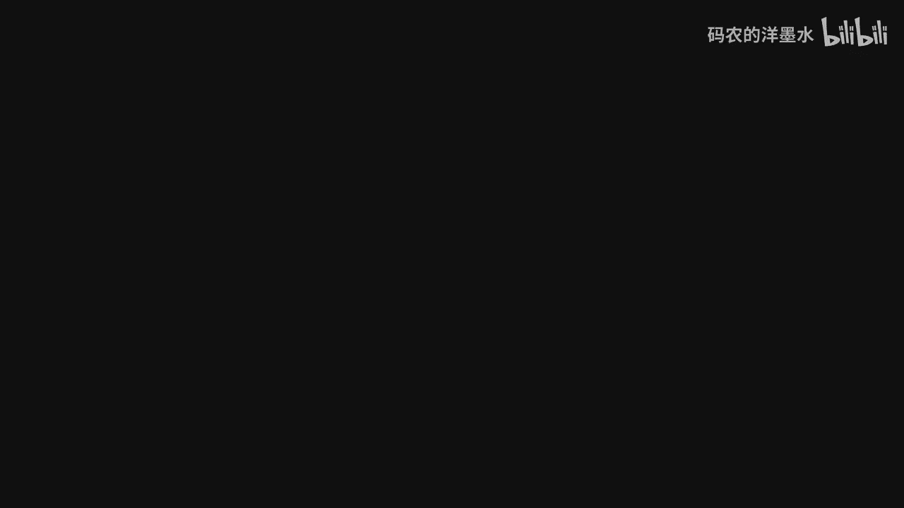
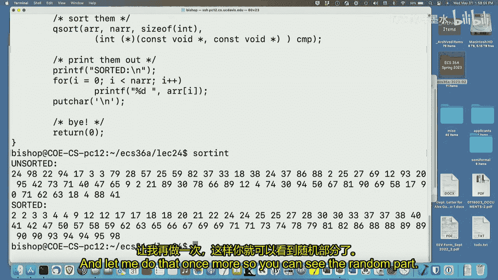

# 【全集】加州大学戴维斯分校 C语言底层编程 中英字幕 完整课程 p21 Lecture 21 - 标准库函数 -BV15C6FBsE3L_p21-

Well， I guess everyone can hear me now and it's being recorded。A couple of announcements。

 first of all， homework4 is out and gradeadecope is up and loaded。

I'm not going to be here Friday because my granddaught is graduating from high school。

 but I will tape a lecture and post it to Aggieviideo and to Canvas。So for whatever it's worth。

 you'll be able to hear what you may consider either pearls of wisdom or some more stuff。

And of course， office hours are going to be canceled。Now， a lot of people。

 I'm getting a lot of questions about homework three， and they seem to focus around two points。

 So first to you folks would another extension help。How long？

Bear in minded homework awards due on Thursday of next week。Yes。Could I make them do the same day？

Well， let me put it this way。I'll leave it up to everybody。

Do you think you'd be able to get homework 3 and homework 4 done by the end of the term June 8th？Yes。

Okay， then I will post the extension later today。Or maybe early tomorrow。

 later today means by the way， around midnight， yes。On Friday。Yeah， I know we have one here too。

I let me put this way。It's not ideal， but it's a lot better than a6 to8 PMm final or an8 to 1 final。

Okay。What I'm going to do， also。Is go through a couple of points with homework three questions one and two。

So some of you may already know this， but I'm hoping the repetition will help for you and for those of you who don't ask questions。

 okay？Okay， are there any questions before we start？This is stuff I'd be doing anyway， but。Okay。

The first part that people seem this。Oh， yes。Yes， I can do that。I'm not sure when。

 but it will probably be on Tuesday。Okay， now the first thing I'm getting a lot of questions on is。

How do you break up the line into alphamer words？Remember here。

 a word is a sequence of alphanumeric characters。 doesn't matter whether it's in the dictionary or not。

 it's just a sequence。Now there are two ways that people have tried that I've seen people doing it。

The first way is to S T R T O K， which breaks up a line into multiple tokens。

 the tokens being the alpha numerics， at least that's what you want。

The problem with that method can work， but it's extremely difficult。

And the problem is you have to exclude everything。Except the often American。 you can't include。

 You can't say everything but this is a separator。 You have to say all of these characters is a separator。

And so you basically have to loop through。And set up the string using a four loop from characters 1 to 256 and test 255 and test each one to see whether or not it is an alpha numeric。

If it isn't， then you add it to the string， if it is， then you skip it。And in theory。

 at least that should work， I haven't tried it but。It's messy。Okay。

The second1 I've seen a lot of is F scan in a pattern。 The idea here is， instead of percent S。

You a percent open bracket and then you have some characters in there。

And what it will do is it will match the first set of characters that appear。OrSo。

 the first sequence of characters that appear't that match those characters。

So what people are doing is putting a carrot at the beginning of the pattern， open brackets uparrow。

 And that means everything in the pattern is excluded。And then they're listing non oftenmers。

The problem with that is if you don't list them all， it doesn't work。If we're going to do that。

 it's better to list out inmers。However， there's a little gotcha there。

If it's only blank in alphanumerics。That works。But suppose you have blanks alphanumerics and then in Amberand。

When it gets to the empersand。That doesn't match the alpha numerics in the pattern。

So you read nothing。And then when you come back to read the next token。

The Amberand will still be there and you'll be blocked， so you'll read nothing。

And this causes all sorts of problems。If you really want to get around it。

 the way you have to do it is then go through a for loop。

On the input buffer on the input buffer and see whether and skip over the non alphamerrics。

Which basically gives another solution。What you do is you read the line into a buffer。

Put a pointer at the beginning of the buffer。And start moving down it。

As soon as you counter your first African American character。

Begin copying the alphanumerics into an array。The first non alpha numeric character you reach。

Put in no bitete at the end of that temporary array and then insert the word into the queue or into the list。

Then keep going until you find an alpha numeric and repeat。

You're guaranteed that you'll find a non alpha numeric， by the way。

 once you're in a set of alphanumeric characters because the no biteite is not alpha numeric。

So you will， at the end， reach that no bite。And then you'll stop and when you reach the Noll bitete。

 of course， if you have a word to insert， then you insert it。

And then you would just go up and get another line。嗯。Here's what it would look like in pseudocode。

By the way， this programming language does not exist。

Written out so that you can follow it and translate it into whatever language you like。Basic idea is。

 while you get another line， you set a pointer to the beginning of that。Well。

 the pointer is not pointing to null because if you point to null when you reach null。

 you're done with the line。You go into this loop。And so first。

 you look at what P points do if it's not alpha inmer and not a no bite。

Then you just advance it because you don't care about the character。If it is the null bike。

 then you break out of the inner while loop。And you'll go back up and get another line。Okay。

When you encounter an alpha numerics， start copying the alpha numerics into a temporary array。

 And as you copy each character， move the pointer forward。When you're done。

It's no longer enough in America。 put it nu bite at the end of the temporary and insert the word into the list or into youruming list。

 and then repeat。Until finally， you on P points to the nobide。

 in which case you have to go up and get another line。Now， if you're like me。

 it helps to draw these things out， especially when the word pointer is mentioned。

So here's a drawing。 again， I won't guarantee this is particularly good art， in fact。

 I'm fairly sure it isn't， but I hope it'll get the idea across。So we have this temporary of。

 I'm only going to show the first four， but there are a bunch more in there。

And the input line is two blanks followed by the letters DEF， followed by a tab。

 followed by the letters G， H and T。Followed by a blank。 And then thats。

 and then there would be the linegu one in there。So we loaded into Buff。

We got our pointer pointing to the first character。That's a blank。

So we simply skip it and go on to the next character。😡，That's a blank。

So we skip it and go on to the next character， which is an alpha numeric。

So we copy it into this array。The one after that， another alphanumeric。So we copy it into the array。

And after this， another alpha numeric， so we copy it into the array。

Now we hit a non alpha numeric white space。So that indicates that we've ended a word。

And so we put a no bite at the end。And then go ahead and insert DEF into the。Link list。

Makes sense so far。There are questions about how to do this。Yes。あなんですけど。Don't use the function。

There may be functions that you can use to do this。

 but it's much easier to read the line using F getS， for example。And then say star P equals。

 and then say p equals b。And then just use a wall loop。You may be able to do this with functions。

I think it would be rather complicated。And in programming， the rules is always go for the simple。

Actually I hadn't thought of that that question is a good one anyway。In said。A character。

As soon as we find。You mean in here？Okay， that indicates alpha。

 what we're looking for are maximal strings of alpha numerics。In other words。

 you start with an African American and you go as far as you can。When you hit a non alpha numeric。

The oftenmer characters you found are going to form a new word。

So you have to put this in to indicate that that's where the word ends。Other questions？Yes。

And so you keep getting incorrect exit status。Let me finish this。

 then if I don't say anything about it， remind me。O。Okay。

So now we advance it and there's another alpha numeric。So we stick it in here。H is the same。

 and T is the same。And then we hit another， a non alpha numeric。So we put a no bid in there。

And insert this into the array。Now we take one more step and we hit the null bitete。

And we're done with that line so we would go to the next line。Does this make sense？Okay。

 someone asked about exit status。Be sure when your program ends。

That it returns a number that you know。If it was successful， it should return to zero。

If it's not successful， it should return a one。One problem that I've been seeing people have is when they're in a function and something fails。

So they return to one。And then they basically discard the value。You want that one。

To be returned from Maine， or you can call exit parenthesis one close parenthesis。

Either of those will work。And the one will be is what's called the exit status code。

 it's the value we turn from main or the value you give to exit。Basically same thing。

And so if you're getting a mismatch for status code。

Look and see what you're actually returning or exiting with or returning from Maine。

 that's probably where your problem is。Okay。That help？Yes。No， you can break it up in functions。

 for this one， I think we've got four functions。One of which is break up the line and call insert。

And then insert is a separate function。And then allocating space for the structure that's。

An element of the linked list is a separate function。In fact。

 it's generally good idea in software engineering。To use a lot of functions， your functions。

 and the reason is that way each if each function is a single purpose。And the purposes don't overlap。

 it's much easier to figure out when things are breaking。It's also easier to change things。嗯。Okay。

 other questions on this？You will never be penalized for using too many of your own functions。

Or library functions or whatever， yes。If it's empty， what that means， the question was。

 will you ever get empty temporary？The only way you can get an empty temporary is to have two non alphamers next to each other。

Because if there's an alphanumeric between them， that goes into temporary。

But if you structure the program so that when you reach one non alpha numeric， you keep going。

 skipping things until you reach an alpha numeric， then it'll never be empty。Other questions？Yes。

Funny， you should ask。Ohoops， I get that too hard。 I wanted to go through generating the linked list and inserting things in them。

Okay， so a linked list is composed of structures and you got one element of the structure。

 one field is for whatever is being sorted in problem one in two's case， it's going to be。

Character string or character pointer。And then the other element is appointed to the next thing。

And you also have account field in there so you can count when they are duplicates。Okay。

 so here's the structure that I was using， you would put a carestar or PTR or whatever up there where inNM is。

Next。Is a pointer that will point to the next element in the list。

 You'll also sort have an int count， which is the number of times the thing has been。

 the word has been encountered。And then you have the head of the list。Now。

 the idea is when you get something。You allocate space for it。Basically。

 you create an instance of that structure。And then you put the word in there。

And you go down the list。You keep going until the element you're looking at。Follows。

The element you're trying to insert。You would then put that out what you're trying to insert before that。

Because you want it in order。Now， if it's at the very end of the list。

 in other words if you go to the end and there's nothing there and you it's still greater than the last thing in the list。

You stick it on the end， I'll go through all this in how you do this in a minute。If。

 on the other hand， it's at the beginning of the list， it's smaller than the first thing in the list。

You have to rearrange things so that smaller node， that new node is now the head of the list。

 and the old head follows it。So first of all， let me go through the allocation of memory。嗯。

In this when you allocate memory。You you're creating a space that holds an instance of the structure。

You then put the word in， you may have to do an allocation for the word itself。

You then set count to zero and next to null。Then at that point， you begin to look at the list。

it's the very beginning of the list， okay。First is the element that list points to。So。

 new arrow next。Says， okay， this new thing that I'm going to insert。

 I want to pointing to the head of the list。To be honest， I'm not sure why I use first there。

 I sure a list would work equally well。Anyway， the new node points to the list。

TheFirst element in the list。Then you take the list pointer and point it to the new element。

That's what that's saying， you'll see more of this in a minute。If you're putting it at the end。

 it's very easy， just go to the end， then change the pointer at the last node to point to the new element。

And if you're putting it in the middle， you have to keep track of both before and after。

And when you reach the after， the previous point the other pointer is before。

And so then you insert it between those two pointers。Okay， let me show you this and again， helps。

 it helped me in pictures。 I'm hoping it will help。Anyway。

Here is we have one and we want to insert it into a list of numbers。By the way。

 what function would you use to compare the strings？Sorry。SGRC， yeah。For number two。

 you have to worry about case for number one you want the case to matter， for number two， you don't。

Anybody know the fun one function you can use for that。I'm sorry。Yeah。

 you can use two lower to map it the lower the lowercase and then just do the comparison。

 you should also look up the function Stircase CMP。Because that will do the comparison ignoring case。

 yes。Oh， I'm not sure then now I'm not sure why if you send me your program I'll take a look at it。

 I'm kind of curious。O。Anyway。We want to put one in there。And we have the head pointer pointing to 5。

 So one has to go but。In front5。So here's how we do it。The first thing is we change this pointer。

Which was no。To  point to 5。Now， the reason we can do that is we have pointeder to that new structure。

So we're still keeping track of it。And then we take head list and point it to that new one。

And now we've got our linked list。Basically， this is what's called an insertion sort。

 So putting them in will automatically s them sorted for you。

That's why you do the stir comp or the comparison here。Now， how do you do it automatically？Well。

 when you get a word， you basically break the file up into words。And when you get a word。

You have an insertion routine。And the insertion routine does exempt。 First of all。

 it'll compare to the front。And if it goes before the first one， do exactly this。

In the middle in the end， I'll show you in a minute。And that automates the entire thing。

The key here is to split those files up into individual words。Afan Americanic sequences。

And then insert them。The other thing is， quite frankly， think small。 do it for one file。

 do it for one file first or for the standard input。And then change it over to look at the file。

I found that when I program and again， this is just me， so thank it for what it's worth。

 I found it much easier to build the program in pieces。Rather than try to do everything all at once。

So for example， for my answer to number one and2， well， number one。I built it up slowly。 did first。

 I did the insertion stuff to make sure it worked。 and I read from standard input。

And then I did breaking up the file。And for that， I typed in multiple words and made sure if things were breaking up。

And then I got the file name through the argument list and such。So if you do it in pieces。

 it's easier to see when something goes wrong。If you're a CS major。

 you'll see this over and over again in many different ways。Okay。Here's the code， by the way。

New is the pointer to the thing we're trying to insert。So we make it point to the same place。

 Headless points too。Like like that。And then we simply point headless to new。And that's an insertion。

The only difference between this and problem one for the insertion stuff and problem two。

 for that matter。Is that you do the comparison on words。Not not on integers。Okay， now for the middle。

We have 15。The new node is going to go after this。All right， so what we do basically。

 is we create two pointers， one pointing here。And we do it first to comparison to make sure it doesn't go there。

What we then do is we have two pointers， one pointing to one of the structures。

 and one pointing to the one ahead of it。And then we compare it to 12。It's greater than that。

 so we advance both the pointers。Here's 12。But here's 23。Which is greater than 15。

So it's going to go between these two。New note goes right after that one。So the first thing we do。

 once we've established that is take the pointer in the new thing and point it to 23。

So now both 12 and 15 appointed to 23。Now what we have to do is change this one， so it points to 15。

And that's exactly what we do。And now， despite the convoluted drawing， will 5，12，15，23，49。

And here's code to do that。The first thing is to figure out where it's going to go。

So we're going to find the node that the new new goes after， which is basically just doing this。

 except for number one， you'd put a stir comp up here。And when Stir comp。

 when P was not no and the stir comp is。嗯。Be positive。 You keep going。

And you don't really do anything。Okay。Once you get to the one before the node。

That you wheres gonna sorry， once you get to the node before you where you're gonna to put in the new one。

Once you're there。Take the pointer in the new one and point it to the second point to the one following that note。

And then change the pointer。Do not， under any circumstances， do it this way。Okay， notice I did that。

Under no circumstances， before you do this。Take this point or and point it to 15。😡。

Anyone tell me why？I'm sorry。Binggo。If I change this pointer to point of 15， how do I get to here？

I can't。This， by the way， is what's called a memory leak。 It means you're not using memory。

 and it means you're not releasing memory that you're no longer using。So that's why you have to。

 why the drawings help。 because you've draw up there， you'll notice there's no。

Ar going into this one and you've lost it。So what you have to do is make 15 point there。

 and then you can point that one up there。嗯。Once you find where you are。In other words。

 P is the one before the new node。😡，You make the new nodes point to the one following P。

And then you make P pointer point to the new node。This makes sense？Okay。

 I I'm also I put a code out here too。 hopefully it will help。And then the last one is。

 to my mind the easiest。Let's say it's at the end of the list。

 so we scan the list and we figure out that， oh， gee， it's got to be added to the very end。Okay。

 so we're right here and。Why did they say one？Okay， supposed to be 68。 Anyway，68 goes after 49。

So all we do is when we're at the end。We just change that pointer， which is no。The point to 68。

And we're done。The key point is you have to walk down this list。In order to determine。

where your new node goes。And you have to make sure you don't lose any of the list。Okay。Questions。

 yes。Okay， couple of things， the question was， if P is null， does that mean we ran out of memory。

 the answer is it depends on what you're doing。If you're taking if you' use calling Maloc and saying the return value to P and P is no。

 you're out of memory。In this case， if you get here in PSO。嗯。Then。

You're simply at the end of the list。So you've run out of the list。

 but you haven't run out of memory yet。So you should still be able to do allocations。

For whatever it's worth， this program should not cause you to run out of memory。Because number one。

 there's a lot of memory on most systems， and number two， this doesn't take up that much memory。

So if you find you're running out of memory， look for a loop in which you're generating new nodes。

And see if you're just looping there。Other questions？Yes。Oh yeah。Yeah， no。

 I did that simply because it was easier to put on a slide， but for this one。

 you would have a character pointer field to point to the new string。

Or you can make it a character array and copy the string in。

And then a field count in an injured field count， which tells you how many times that occurred。

And then a next field to point to the next。嗯。The next structure in your linked list。

One thing I forgot to put down on slides， but I do want to warn you about。

When you read the input buffer and then you put it into temporary。And then try to insert that。

 it's very easy to simply make the care pointer a pointer to temporary。

The problem with that is the next time you put something in temporary。

It's going to overwrite what was there previously。And so your entire linked list will all be the same。

So if you start seeing that。Check that you're actually taking temp。

 the temporary or whatever you're calling the equivalent。And creating a duplicate of it。

Using malloc or Stduop。And that will be separate memory from temporary。

And so you can just have the care pointer point out。Questions on this。Yes。Deecclare it。Yep。

 a structure pointer。It doesn't you have to when you your。When you go there。

If headless is empty or no。Point it to there directly。Other questions good question， other questions。

Okay， let me give you the code for the end of the list。Here again。

 we go down the list and notice that I'm checking that P next does not nu。When it is null。

Sat it tonew。And then make sure that the next pointer for new is null。

 because that indicates the end of the list。Good hygiene in programming。

When you create that structure。😡，Set next to null and count to0。Because that way。This is a little。

 you'll be， this is a duplicate。But if you forget that line， it'll still work。嗯。Okay。

 questions on this？Okay， now a little bit about homework 4。

 it basically asks you to read a file and print it out in a specific way。

And then it asks you to it says， know， create an array of， I think， 200。

Structures for this particular thing。And it then asks you to sort it in various ways。Now。

The problem with doing that is， first of all， it's in a rain out a linked list。

So you're going to have to sort the array， and that would mean moving things around。

But the second one is， why not use a function， a Linux function to do that。And here's the function。

It's called Q sort。If you have an array。You give it the pointer to the beginning of the array。

How big is each element of the array？ So for int， that would be size of int for structure that would be size of struct。

 whatever， and so forth。Oh， I'm sorry。 that， that would be there。

This is the number of members in the array。So if yourore consists of 1 25 elements。

 that would be 125。Everybody with me on the top 3。All right， yes。

You can use it for an array of structures。No， because it doesn't work with linked lists。

 it's not an array。It only works with a raise， which is why you can't apply it to homework  three。

Okay， now this one。This one is the tricky  one。 It's very easy to implement。What you do。

 what it will do is it will give you two pointers to elements of your array。

If the first comes before the second or is less than a second。You return a negative number。

If the two are equal or the same。You return zero。And if the first comes after the second。

You return a positive number。So it's a lot like St comp。It's the basic idea。Now。

 what gets confusing is this declaration。And I'll walk you through this first。

This is what's called a function pointer。😡，You know how pointer gives you the address and memory of a data structure？

A function pointer does the same thing except it gives you the address of a function。

So this way you can change function。If I were doing this with， say， three different things。

 I could change what compare points to and not have to rewrite much。

So you declare it as an in returning an integer because it returns positive， negative or 0。

And then you declare each argument as a void pointer。

The reason it uses white pointers there is because it doesn't know what you're going to pass in。

Are you going to pass in an integer or a character or a double structure or what？And void。

Will match anything。Whereas in some systems and don't ask me which ones。

I don't ever want to deal with them again。 A pointing to an integer differs in size from a pointer to a function。

 for example。But Vod basically says， I can handle any point you give me。Okay。

And you write this function。So let me give you an example of the function。

Notice X and Y are declared as void， void pointers。Now， if I want to treat them as integer， Oh， foy。

 should have been yeah oh。I want to treat them as integers。So I have to convert them to integers。

 integer pointers。So I assigned Px。To in star X and P Y to installstar Y。

 And then I should return star Px minus star P， Y。The fact that it's not a P in there is typo。

And I'll fix it before I boast these。Yes。我。Vooid is a term that's used in a number of different ways。

For a function， it means I don't return anything， as you said。For a pointer， it means， hey。

 this pointer is indetermininate。 I don't know what it's pointing to。 I don't know the type。是。

It's not so much a variable as a word with multiple meanings。Okay。

And the only time it's used as a function as a。It's a pointer。

Is when you're returning something and you don't know what type it will be。

Here you don't know what type is being passed in， so if you say void， there will never be a problem。

It's like with Maloc， Malck returns appointed to void。Really， though。

 you coercied very quickly into Instar or whatever。And。

The fact that it returns a void pointer simply means that you can change it to whatever you like。

In this case， these were both characters。In order to treat them as characters with without the compiler complaining。

 I would have to put these to the carestar and carestar here。If you drop the word almost， you got it。

Okay， now with this， let me show you how Q sort is called。I'll show you the program in a minute。

Baase， I have an array of 100 elements， and that's the actual number of elements that are in there。

 So I may have 20，20 things。 may have 100， but I've got room for 100。

So first thing I do is I'm going to sort them。 I point to the base of the array。

And they give it the number of elements I want sorted in the array。That's an int。So I say， well。

 the each element of the array is the size of int。And then I say， by the way， here's comp， CNP。

Here is the type。If you don't put that in， it still works， but the compiler says bad type。

Most programs actually leave that out。Yes。Attached。Yes。Okay。

 this simply means that there's a function。There， so this is the saying this。

Whatever's in here is a point to do a function。You know what it is if it's before。

If it's after there's usually a type following it and the pointer applies to that。

 the star applies to that type。You see this a lot way the term const is used。

Cons simply mean tells the compile that look。This particular variable is not going to change。😡。

And so for example， going back to here， minute。Yeah。

What this is saying is that it's telling the compile that， look。

 I'm not going to change those pointers at all。I may change what they point to。 I'm sorry。

 I may change things within them。But I'm not going to change them at all， yes。

Would it say the same thing？So so。U。No， that would be a slightly different syntax。For now。

 always just write it that way。Okay， I need to see an example of exactly what you've seen。

To know what it is， the way you read types， though normally as you go right to left。 So this is。

 why is a pointer to avoid type that is constant。Yes。I'm sorry。你两。You can do that。

 but the problem is you don't know how many words there will be。

 so you don't know what size to make the array。Otherwise， yes， and in fact， in homework 4。

 the reason I say you should use an array。Is because I explicitly tell you how many elements there will be in there。

 There'll be no more than 200。So if you declare the array ofstruct elements as。

An array of 200 elements，200 structures。 you're fine。Other questions？Okay。

 let me get over to the CSIF and show you this program actually in practice。Whoops， hang on a meant。

 cancel that。Okay， let me get this。Expand it。Everyone see that， okay。Okay。

First I'm going to show you the sorting part， then I'm going to show you how I generated the numbers。

Okay， this is what should have been up there。It's exactly the same except it uses X and PY。

 which is what you want。Because they're going to be sorting integers。And there's array， the array。

And there's the number of elements in the array。All right， now。Okay。

 forget about this starting stuff， here is how you sort them。Give the array。

 give the number of elements of the array you want sorted。

 give the size because it's going to be an integer。And then give the function， which is CMP。Again。

 you can leave this off， the compile will give you a warning， you can ignore that。And。

Although you should not do that for homework 4， because I think great Scopal bulk。Anyway。

What I did was I wanted to create an array of no more than 100 characters， 100 ingers。

 but at least nine。So I did something to sort。So I figured why not generate them randomly？

So here's an example of how you do things randomly。The first thing is。

 this stands for pseudoandum number generator。The first thing is I want to。

 I got to tell her where to start。If I don't tell it where to start。

It's going be as though I put a one in there， instead of time。But if that happens。

 then every time I rent it， I'll generate the same numbers。Yes。Oh。

 I'm just telling the compiler that it doesn't return anything。

 I probably could have left that one off， because it。Oops， hang on where。Are you was signing it？No。

Well， I will be。 But S。 random just sets the seed， just sets the thing up。

And now what I want to do is figure out how many， I want to give it some random number of inres。

 So what I do is I take random。 It generates the number between 0 and 2 to the 31st -1。

 and my array is under big。So I reduced it mod 90， and then he had 11， because if I reduce it mod 90。

Then the highest it can get is 89。And if I add 11 to that， Id get 100。

So that's why he did it that way。And now here， I generate random numbers and stick them into the array。

The first time I didn't have this model 100 there。 So I was getting these 2020 and10。

20 digit numbers， which were hard to read。 So I just decided to make them less than 100。

Now I print them out。Sort them。And print them out again。So。No。嗯。For the 100， that was more。 ge。

 I don't want these big numbers。 It's gonna be far too hard to show。For the Ahmad 90 plus 11。啊。

I did a little bit of guessing。啊。Yes， which is what I want。See， because here。

 if I get the number 3568， I only want the last two digits。 So if I do it， mod 100， it'll give me 68。

Okay， here goes。Here's the unsorted set of numbers that had generated。

And you can see it's really unsorted。After I called Q sort， I got this。

 and you'll notice that they were all sorted。So that's how you use Q sort。

And let me do that once more so you can see the random part。

Notice this set and that set are completely different。That's because every time the program runs。

It starts at a different point， which is based on the time of day。If you're doing cryptography。

 you would never do this because it's too predictable。But for general purposes， it's fine。

And if you notice down here， it's also sorted。So。Anyway， that program is in Le 24， I believe。

 so you can look at it there。And I'll have the samples for homework for out in ECS 36A。

And also I'll double check to make sure the samples for homework3 are there as well。嗯。Yes。I'm sorry。

Thank you。Yes。Yes。You'll give an there'll be an option given to the program。

 this is for number two of homework4， there'll be an option given to the program like D S or D N or D W。

So what you're going to have to do is you have the program name and then the option and then the file name。

So you're gonna have to check that first argument，0， the first argument there。

If it begins with a hyphen。That's an option。If it doesn't， it's a filing。I'm sorry。那是。因为那为什？Oh。

The option will tell you， D S would be， for example， on the atomic symbol name。

 D W on its atomic weight and D N on its a name。And so you have to structure your functions in such a way that。

Given the option， when you do the comparison， you compare that particular field。呀。被告是。

On the command line， yes。Or if it's not there， you ignored it。And just assume it's by atomic weight。

Other questions？Okay， I've got a bunch of emails to answer。 I will get to those right well。

 after office hour。And then they will bunch of emails from this class。 I should say。

 was this at all helpful to folks。Okay， I will also change the due date for number three to be June 8。

Remember the final was June 9， so don't wait until June 7 to start homework 4 and complete homework 3。

Yes。Yes。I。