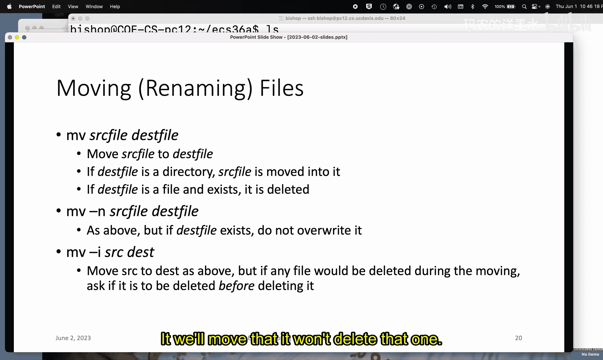
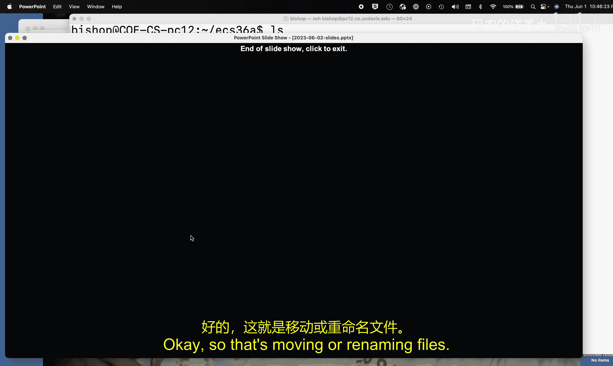
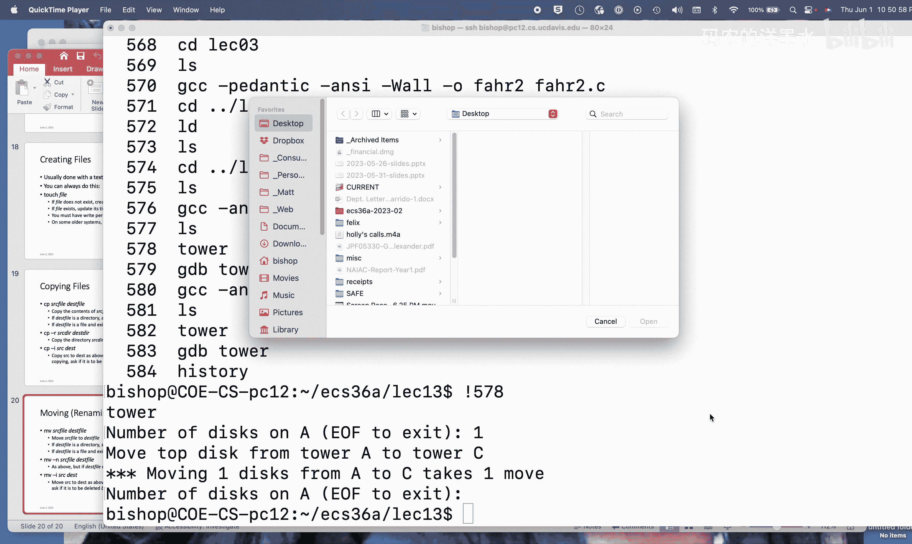

# 【全集】加州大学戴维斯分校 C语言底层编程 中英字幕 完整课程 p22 Lecture 22 - 预处理器与宏 -BV15C6FBsE3L_p22-

And welcome to。The class。Of June June 2。I'm sorry I can't be there。But。

I'm hoping that you find this recording useful。Before we begin a couple of announcements。

 first of all， the due date for both homeworks 3 and4 and the extra credits。A due June 8。

Don't wait until the last minute to do these。They will be。

 the reason is the final was on June 9th from 1030 to 1230。So if you doally。

 you're going to hurt yourselves both in the homework and in preparing for the final。Okay， today。

 what I thought we'd do is a review of Linux and CSIF。

We're going to focus on first logging in because I'm getting a lot of questions about that。

 and then we're also going to look around show how to look around the file system。

And I have my CSIF system up here。So we can bounce among the recordings。Okay。Now。

Hopefully people can see that better。Okay。Now log into the CSIF。嗯。Get out of this。嗯。You type SSH。

 then your Kbs name。Unless it's the same as on CS S IF。The at sign and then PC and for example， 12。

And it will normally ask you for a password。 It may say， I don't recognize the system。

 Do you trust it， type yes。Then it will ask you for your password。

 I have mine set up so avoids the password。啊，O。Now to do this， you have to be on VPN。

 the library VPN， or the engineering school VPN。For all of you students。

 it's going to be the library one。And so if you don't have that， get it from here。

 it'll tell you how to install it。Then you can go ahead and connect to the CSIF。

And as far as the I had 12 here， but it can actually be any number between 0，1 and 4，3。

 it's always two digits。Furthermore， I recommend staying between 11 and 30。

Because systems one through ten0 are primarily used for graphics。

Um and the other ones are the usual PCs， the ones that you're used to。

If you have trouble connecting to one of the systems， you can always look on this web page。

And what it will do is it will show you the status of the systems。Red dot means it's down。

 Green means it's up， and there are a few other color symbols。All right。

 let's say you want a copy from sorry onto the CSAF。 so you've had a local file on your system。

And you want to move it to the CSIF or make a copy of it on the CSIF。

SSH is a secure shell that uses encryption and a number of things to protect your exchange。

SCP is secure copy， it's based on SSH， you don't have to worry about SSH。

 SSH doesn't need to be running to do this。But it securely copies your file down。

So you give it the name of the local file in your system。

 you're working from the shelves from your own shell command interpreter or run package or whatever。

And then you type the name of the。C， S， I have system you want。 And again， it can be any。

 It doesn't have to be the one you you usually use。

And then give the name of the directory that you want to put into。

Best way to do this is use dot because that's going to be your home directory。On the CS S IF。

And in fact， you can leave the dot off， make sure you put this colon on though。

 because that's what tells CSP， hey look， that's a machine name， it's not part of a file name。

If you want to pull things up from the CSIF， oh， one thing I do need to mention。

You have to do this from your laptop or whatever system you're using to connect to the CSIF。

The reason is the systems there are the systems that you use to connect typically get very random names as far as the university is concerned。

So it's best so that going from the CSIF up。From being on the CSIF is very hard。Instead。

 you have to go down from your machine to the CS S I F and to bring things to onto to your machine。

 just reverse the names。Give the full path name or the relative path name if you're relative to your home directory。

And the name of the five you wanted in so for example， here word sort。

1 is in my home directory on the CSIF。So what I'm saying is go to PC 14， one of the CSIF machines。

Get this file and copy it onto dot。Which is the current directory that I'm in。

 I can also give another file name or another directory name where that dot is。Okay。Now。

Let's see what's there。The command LS is the list， so you can do an LS and it will show you the files and directories that are in the directory you're in。

So in my home directory。I've got four directories， NS1，2，3， and 4。ECcS 36A。

 which is the one you can go into。 and then the rest of these you can't。Now。

If I don't want to look at the current directory。But instead， I want to look。At the。

But instead I want to look at another directory， I can do this。I just named the directory。So。

 for example， old tells me。That El Old tells me that this is what's in that directory。Now。

 if they want to get more information about the files， they just type LSL。And it lists things。

I'll go through this way exactly what this is in a little bit more detail in a minute。

 but notice the D here， which means it's a directory。And the hyphen， which means it's a file。

And here I've got R。Wx。These first three mean the owner can， readwr and execute。

Then I have the next three， which means the group can read and execute。

And then I have the last group， which means everybody else can read an execute。

We'll go into this in a little more detail， in a minute。

Now the other thing that I want to show you is this。If you type A when you type LS。

 it does not show you any file names that begin with dot， historical reasons for this。

 but mainly because the files that begin with dot are mainly configuration files。So for example。

 dot login is executed when they log in。When my mail， if I run MH， sorry， mail。

 which is a mail program， of course， it'll read that file。MH is another mail system。

 it'll read that file when MH starts up。And that forward again is related to mail。

Dot viminfo contains information that Vm reads whenever it starts up。And let's see this one。

I wanted to break out special when them runs， if。The connection is dropped or vim， for some reason。

 crashes。Since the only way to out fire a way to out。

The contents of the file that you're editing every5 or 10 minutes， I don't remember which。

You stand to lose a fair amount of work。So if the problem happens。

 it writes out the file in an SWP or swapWAT file。So I was editing Gen。

c when I believe the connection dropped and so created this file。Now， if I want to recover that。

When I start up the M a type V IM gen dot C。And it'll give me a little dialogue saying， hey， look。

 you are editing a copy。 I can recover it if you want me to recover it， type bum。R。

 if you want me to delete a type D， that sort of thing。And then if you say recover it。

 it'll recover that， it'll generate regenerate Gen dot C to pretty much as close as you can when you pretty much very close to when you lost when you disconnect it。

Now。If you don't want to go through the dialog， you can type V IM space dash R。

 which means we cover space， space， Gen do C like this。And basically， it says it's starting it up。

 it recovered it。In this case， since I typed their Sha had already recovered it。

 so now I can hit enter。And there's the beginning of the gen file。

 which was all I had typed when I disconnected， by the way。Okay， now， oh， yes。

 one other thing with LS。Let's go into ECS。36， a。If I want to list the contents of that directory and everything below it。

 I can type LSR。Notice it lists everything in the direct， all the directories。 and then。

The contents of each directory。So it starts off by listing what's in the directory。And then in HW2。

 you have these files in HW3， you have these files and so forth。

I can combine this with other options like L S D A R， which means same thing。

 but list the files that begin with the dot and notice the dot and dot dot。Listed in each case。

And I can also do LS D LR， which will do the。Which will give the long same information。

 but in the long format。All right。Let's now move on to look at exactly what it's giving you when you type dashL。

P had a line like this as you saw， see， here's the here's a similar line。

The first things are permissions， and again， I'll go through those in detail in a minute。

The next the owner is listed here。And the group to which the file belongs is listed here。

 and you'll see the importance of that in a moment。 Actually， I'll show you right now。

In the permissions his first character tells you what kind of file it is。 Defer directory。

 hyphen for a regular file， S for what's called socket， L for what's called a symbolic link。

And so forth。The next three。Ohoops， slim me back up there。

The next three RW dash are the permissions that the owner， in this case。

 Bishop has over the file so I can read and write it， but I cannot execute it。

The the dash after a W would be x if I could。The next set of three bits is simply the group。

Permissions and the group can read members of the group can read it， but not write it or execute it。

And then the last three are for everyone else， everyone who's not an owner and not in the group。

And in that case， it has re permissionmission only。Now。

 the way these are interpreted always is checks for the owner， if you're the owner。

 those are the rights you get。Then if you're not the owner that checks to see if you're in the group。

 If so， you get the group rights， otherwise you get everything else。Now。

 this is the size of the file and bys， and this is when it was less modified。

 Since it's over six months old。 It doesn't give me the actual time of day。

 It just tells me the year， the day in the year。And there's the file name。Now， for this one。

 that's what's called the number of links to it。It indicates how many names， how many other files。

 names。Referre to exactly the same file。Um， and this is sometimes useful for making life easier because you can put one thing in several places。

You don't really need to know much about this， except that if it's greater than one。

 then there's another connection to this file， another name to it。As an example。

The D means list the directory。But do not。Pist its content， so。There。

Notice I have 28 links to this particular file。 That's not unusual， by the way， for Dot。Okay。

 moving on。There are special directories。You've seen Dot that's actually the current working directory。

 where am I？You've seen dot dot， which is the parent directory and it refers to the directory that I'm a subdirecty of。

There's one exception to this， and it's exactly the same as up here。

This actually should be down there。Dot dot in the root directory。

 which is at the top of the file system， everything is below that。Root doesn't have parent。

 So Datt refers to rootot。And I mentioned this earlier， the Tilde is not really directory。

 but if it's done put in at the beginning of a file and followed by a slash or there's just a Tilde。

 it's interpreted by most command interpreters。As your home directory。

So that's a nice way to make things easy。All right。

 now let's say we want to see the contents of files， there are a couple of ways we can do this。

The first one， the most basic one is called cat。 Let me。Get to。Direct this directory， which has a oh。

嗯。Okay， so let's。Get up to this down in this directory。 and it's got something called tower。 C。

 So let's take a look at what's in there。I do a cat。Caboon， whoops！Wait a minute。

 it doesn't begin with if Stir comp， there's more in front of it。

Now I can scroll down if you're on this type of a system。However。

 if for some reason I can't get to the top， I can use the command more。It's just， I can't。

But it pageaginates， in other words， it will show you one screenful。

And now if I want to see the next screen full， I simply type space。

And if I want to see one line or two lines， I hit return a couple of times。

Now if I want to go back a screen， I type controlr B。If I want to go ahead of screen。

 I type control F。Oops， is control F。If I want to go back half the screen， it's control D。Oh， sorry。

 Control D control D is the end。Let's try that again。All right， if I want to go back。I have a screen。

What I would do is hit control B to get all the way back and then just。Hit until he reached the end。

Now， when I re this， if I want to get out， I can type Q for quit or。I can take C D。Oops， sorry。

 control D scrolls down。Ha a screenful。 notice tower up there。 Control D。 Towers gone return in。

And now the last line here is printf。So when I hit control D， I go down to printm。

Go down below printf to there。 If I want to go up a page， it's。Ha。Well， you can。

 I don't remember the command off hand。 So let's get out of that。Now。

 there are a couple of other commands that are useful。

 Let's say I only want to see the first 10 lines of tower。They are the first 1。If I want to see 20。

let's say 30， I type head。 but this time I say dash 30， which says print the first 30 lines。

So we do tower。And notice it doesn't paginate。But it does show me the first 30 lines。Similarly。

 if I want to see the last 10 lines， I type Ta。And there they are。 And again。

 I can see more than that。So I see there are 30 lines。

Taale also is a nice feature which is useful when you're running a program and it's adding things to a file and you want to make sure it's doing things right。

Run tail and give the dash chef option。That prints the last 10 lines。And then if any。

 as lines are added， it will also print， display them checks。

 I think every  five seconds or 10 seconds or something like that。Now， for this。

 it's not much use because tower is not changing， but for a log file or file you're writing data into。

 it's very， very useful。Okay， so let's stop this by typing controlr C。Okay， moving on。

The next thing is the directories。Now， you've heard me refer to root。 That's because the Linux file。

 Linux files were arranged in what。It's most easy to think of it as a tree。

One where the root is at the top and the branches go down。Now， in this case， slashes the root。

 as I said earlier。And that is several subdirecties， been， home， live and user。

 and then there are others I didn't put down。Bin is a program called Bash in it。

Home has all of the user directories， yours， and so forth， including mine， Bishop。

Lib as a number of files that are useful。 All of your libraries are stored in there。

 The ones that when you type Lm， for example， that refers to a file in Lib。

And it also can contain another directory called X11， which deals with the windowing system。

And then you have user BI contains programs that are used for system administration or are very。

 very commonly used like shells。User bin contains ones that aren't that common。

For system administrators to use， but users will use them a lot and user local contains things that are not part of the standard system。

 And then again， there are a lot of other directories under here。

So this tells this gives us a hint on how to refer to files。And directories。There are two forms。

 you can have the full path name。Sometimes call the absolute path name， but that's somewhat rare。

 usually it's full。And what you do there is you start at the route directory and work your way down。

 So， for example， if the full path name of bash is slash bin。Slash up here。 Then you have been。

Then you have another slash in its bash。For my home directory at slash home， slash bishop， Basically。

 wherever you see a line， you put a slash， except for the lines coming out of root。

Because you already have a slash。Slash Lib slash X 11。Slash user/lash bin and slash user/lash local。

So that's the oops， sorry， that's the most basic way。However， if your current working directory is。

 for example， bishop。You can use what are called relative path names or from any directory。

 basically a relative path name starts at your current working directory。Here are examples。

Let's say my friend Psard has a suby under home and I want to get there。

 I could say slash home slash Psard。But since my current working directory is here。

 I can say dot dot， which is my parent。Then， slash， and then piesered。Similarly。

 if I want to get to lib， I could say slashlib， or I can say dot dot， slash， dot dot， slash lib。

And so that way， I can refer to things with respect to where I am when you type your command name like word sort one to execute the command。

That's a relative path name。 It's relative to the current directory you're in。Okay。

 now I want to move around。I use CD， which stands for change directory or change current working directory。

C D and follow it with the name of the directory that I want to change to。 So， for example。

 if I wanted to change to Pser's home directory， I would do。

 I could do either C D home pieser home slash home slash Pser like this。

 And I would go there and there。 or I could do C， D dot dot slash Pyser， and go that way。

It's all relative to this directory， which is my current working directory。

Sometimes it's easy to get confused。 So if you get confused， you can type P W D。

 So let's give an example of this。 I want to go up one level。 I want to go to select 15。

So I typed a relative path name of dot dot slash Le 15。不是。LetMe see if it's there。

I picked the one that isn't there。 alright。Flash， home slash。Bishop slash E， C， S 36， A slash Le 16。

It's a lot of typing。I can also feel。 I can。 It's easy to do this。Since I'm in Le 16。

 I have to go up to ECS 36A， which is the dot dot， and then I go down to Le 17， which is right there。

And now if I forget where I am， I can type PWD and it'll give me the full path name that always gives you the full path name。

 never the relative path thing。Also， and the CS S IF bent the shells， I believe are set up。

Prompt you with part of your directory name。Here， this is short， so it'll show all of it。

 But if I'm down， say 15 or 20 levels， it will probably only show me the last few directories。Okay。

Now you can create and remove directories。By using MKDIR for creation or RMDIR for removal。

Now these come with a couple of tricks。If the directory exists， you get an error。 So， for example。

 let me go back to the。呃。L Le 16， let me go back to don't want to do it there。Let me go back up one。

 so I go back up。And now I have all this。Let's say doll make dear。Black。Z2， which already exists。

I get the error file already， file exists。I can do， though， make de X。X doesn't exist。

 so it simply creates the directory X。I can then C D into it。And create a file。

 I'm going to do it the easy way。So now I have a file in that directory called X Y。

I decided I want to get rid of the directory so I go up and I type our MDDIR X。Sa says。

 wait a minute。 your directory is not empty。Because it contains the def file X Y。

It also contains dot and dot dot， by the way。But those exist in every directory。

 So those don't matter。 The X， Y does。So if we remove X Y now。

 and I'm going to remove a file in a bit more detail， but that's basically。AtRM。Now。

 LS doesnt LS doesn't contain anything other than dot and dot dot， which we don't worry about。

So now I can remove X easily。So youve got to make sure the directory is not empty。By the way。

 only dot and dot dot matter here， if you have something like dot bash Rrc in the directory。

 it will refuse to remove the directory。You'll have to delete it。

LSSA is probably the best way to look for hidden for those files。Um，Oh， yes and。If it doesn't exist。

 which because I removed it， it simply says noage file or directory。Okay， moving on。Let's go to。

Fileles。You saw me use RM in the file， this RM is extremely dangerous。Here's why。ULet me see。

I'm going to make another directory。And we will do is this。

I'm going to create a bunch of files in there。So， I have this。Whoops。Oh brother。Actually。

 I can do it here Okay， let's say I want to remove the ones beginning with ABC so I can type RM。

I'll explain the backation in a minute。RM， ABC， star， star matches 0 mark for characters。

And now when he look， those two are gone。Let's recreate them。

The exclamation point means go back and find the。Most recent command that begins with touch。

And run it again。 So now it creates。Creates again。But now watch what happens if I type RM。Dash。

Oh sorryrry， RM， ABC， and I accidentally put a space in there。没。It can't delete the directory。

But notice it deleted not only ABC， ABC ones。But also tried to delete everything else。

And it couldn't delete ABC because that didn't exist。The reason is this blank。

If you make a typo with RM， it's very dangerous。The right way to do it， by the way， is to do this。

 let me do the touch command again。All right， now if I type RM D I。ABC star。

Notice it asks me if I want to delete it。If I make the mistake I did before。

It'll say there's no such directory as ABC， and then it'll say。

 do you really want to remove by and I don't because they wanted to remove ABC's of files files the name of which begin with ABC。

So I strongly recommend using the dashI option all the time。

 I believe the CSIF has programmed in automatically。But you should check。By the way， the backslash。

If I say any， Ill start， it will。Delete that file。 And if I tag add control C。I get out of it。

 So there we have by and hello。ABCS and ABCX were deleted up there earlier。Okay。Now。嗯。

You can do this。You can go here and create files。 You saw me use touch before。 It creates the file。

 if it doesn't exist。If it does exist， though， it updates the time of last access and of last modification。

In order to do this， you have to have correct right permission on the file， if you don't。

 it won't allow it。On the systems in the CSIF， I believe you just need right permission。

On some other versions of Linux and some older systems， you also have to be the owner。

This is on theops this is on the theory。That only the owner should be able to change the time of less modification because that basically is equivalent to writing。

And， in fact， very old versions of touch used to read one character and then write it back。

If you want to copy files， you can do this。Copy the source file into the destination file if destination file doesn't exist。

 it creates it， if it does exist， it overwrites it， it will not tell you that it is overriding it。

So you can give it a dash eye option just like you can with RM。

Now the D R here is typically used when this is a directory， the source is a directory。

 because what it says is copypy this directory。Into the destination。

And also everything under that directory。So you're moving SRCDIR and all of its subdirecties。

 all of its files， all of their subdirecties and files and so forth。Into this directory。

So let me give you an example here， let's say want I have X here。

I want to copy the file by in there IucCP BYE。X。Now when a list X， there it is。Now。

 let's say I want to move MISC index。Ohoops， let me show you what's an MISc M。All right。

And now if I show you， what's in X。You'll see M。And I can also type LS D Rx。

And it's going to show me up the subdirecties mist， lying Missk。

 and then it'll show me what's in mist。Okay。You also move it back。Moving to the current directory。

And there we are the way we were。Okay， now you can also change the name of a directory using MV。

 It's just like C， except the source file doesn't exist anymore。

Now there are a couple of gotchas here。If dust file exists， it's gone。It'sDed。

If D file is a directory， MV moves it in just like we're doing a CP。If you don't。

 if you want to know whether or not the target， the file you're copying to exists。

 the file you're moving to exists。You can use dashhi again and it will interactively go through and whenever a file that will whenever there's a file itll delete in order to do the move。

 it will ask you， do you really want to delete this。The dash in basically says， no， to all of those。

 So if you give the dash an option。It will copy everything except， sorry。

 it'll move everything except where there already exists a file by that name。 we't move that。

 I won't delete that one。

Okay， so that's moving or renaming files。

Now， let me show you a couple of other things。We'll go here。Let's say， let's go down into。

Like I think zero3 will work。Yeah， if you remember these are Fahrenheit centigrade。 Okay。

 let's say I want to compile this。I would give this normally pedantic。A NS S I WA L L O， FA HRR。

To F A HRR2 dot C。The dash show means the output file。

The executable is being named FAHR 2 if I leave off the dash O FAHR。

Then it will simply name it A dot out。Ok。So now it's giving me a warning。 That's right。

 Let's try another one。 That's in there deliberately to show you that you need to match。啊。

Integers and doubles。s so that's a bug。 Let's go instead tolect 12， which is， I believe。

 what we where we were before。It was 13。Notice I'm typing the relative path names because it's shorter and there we are。

 we have tower。Okay， so we'll type Gcc， D and C。Dash pedantic。Dash wall。Dash O tower。Poward dot c。

And this time， it creates an executable called tower。So I can do tower。

And it will say number of discs on a will put three and take seven mos， as you saw earlier。Okay。

Now let's say there's a bug。In this。And what I want to do is debug it， So I type GDP in Tower。

Now notice it says no debugging symbols found in Tower。If you look at the compile command up here。

There's no SG。That's what happened， so let's redo it。Now I can use。See。Exclamation point， GCC。

To rerun the same command。But what it can do also is add the dash G flag。And now。Same thing。

Tower works exactly as before。And now when we do GB。Assuming I type tower correctly。

It says reading symbols from tower。t do that tells me that there's information in the new form。

 the nu version of tower， the one that I just compiled with the dash G flag。

That will allow G D B to work。 So， for example， I can list contents of things。

 I can put in break points into whatever。The second thing that I wanted to show you。

What' this exclamation point thing I did。What that does is it says。

 look at the commands that you've executed。Find the most recent one that begins with GCC。

And execute that。This would be the command with G。If I want to see what commands have executed。

 I can do history， type the word history， and it'll show me all the commands。So if I could also type。

 for example， exclamation point。5，78。And that will execute command 578， which is power。Okay。

 and with that， I'd like to thank everyone for listening。And coming to this video recorded lecture。

I will be back by Monday， and I will have regular office hours Monday and Wednesday。

And I will hold special office hours on Tuesday and Thursday I'm not sure of what time or how long they will be。

 but they will be at least an hour。And I look forward to seeing you all then。Thank you very much。

