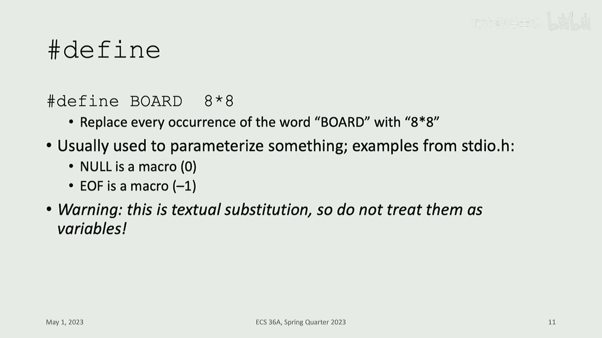
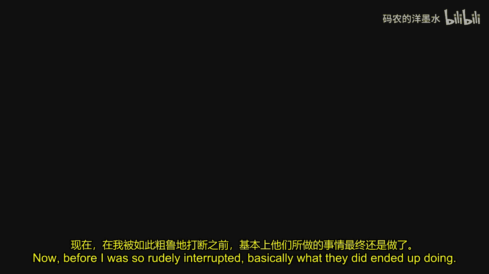
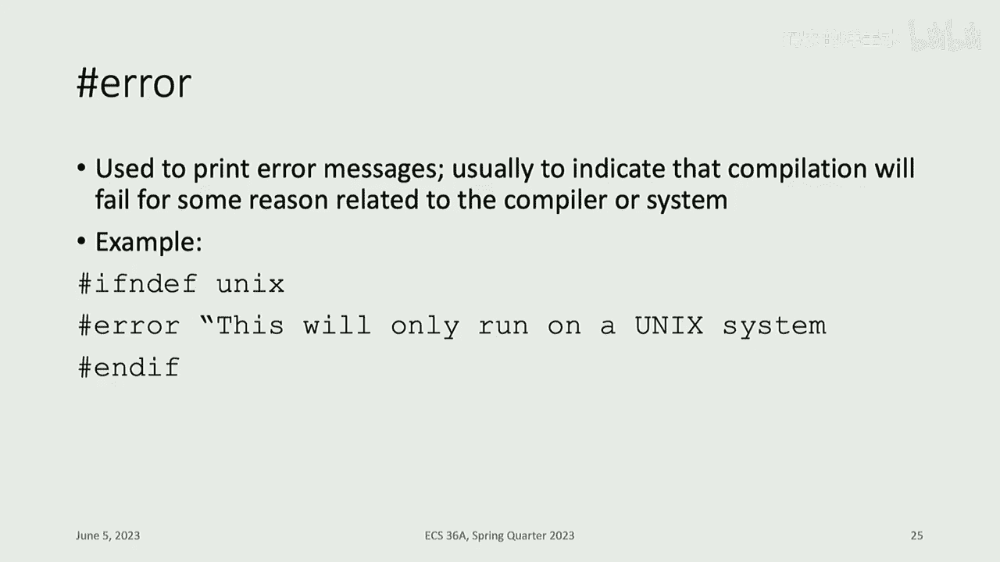
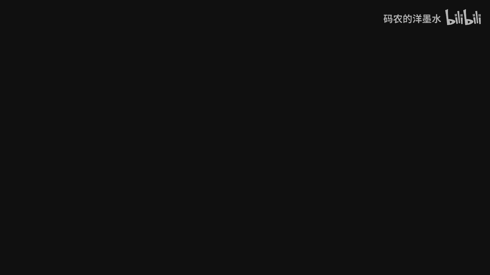

# 【全集】加州大学戴维斯分校 C语言底层编程 中英字幕 完整课程 p23 Lecture 23 - 总结 -BV15C6FBsE3L_p23-

Okay folks， see。I put up。The lecture for January 2nd， it's got link on the Canvas page。

And the video for May 31 was not visible。 So I went ahead and made that visible。

Are there any questions？Okay， a couple announcements。 oh wait， let me make this bigger。嗯。Okay。

First of all， I put up a final study guide and a sample final exam。

And then also for questions on recursion that are the sort of thing I depict you to be able to do。

I'll also add some more to non recursion stuff later today or early tomorrow， I'm not sure which。

The answers to the sample final that are on there are all on canvas。

 They're not on the general website， but they are on canvas。

So go ahead and try the questions and if you have any questions about them， feel free to ask。

I'm holding two extra office hours， Tuesday， 11 to 1150 and Thursday， 110 to 2。And beyond that。

 I'm going to move Wednesdays off I'm going to have to move Wednesday's office hour。

 it will probably be 10 to 11。But I'll post all of this on canvasva。Let's see what else Oh yes。

 and Wednesday is basically a whole review session。

If you folks are interested and think that would be helpful。 Yeah。

 I think I know it was when I was a student， so。So on Wednesday I'm not going to have any kind of lecture planned。

 so please bring questions and so forth， and I'll do my best to answer them on the spot。Okay。

 any questions？Yes。Yes， it is on great scope and it is now due on June 8。Yes。

I am sorry I can't hear you。It's the extra office hour in the same room。

Is the extra office out in the same room， yes。It's in the usual place。Other questions。Yes。Oh。

 it's going to be longer。The sample final is just intended to give you the flavor of the questions。

But there are， I think， five short answer and no six short answer and six longer answer。

 if I remember correctly。But I'm told my mind is going， so I may be off a little bit there， yes。

I'm sorry。Are there no multiple choice， nor there may well be multiple choice。In fact。

 I'm pretty sure there are。Yes。Is the grade and Can accurate right now for the first two homeworks and the midterm it probably is。

 but two things， number one occur。 number one， remember， you still have homework 3。

4 in the final okay。So remember what I said don't panic， number two。

 I'm going to curve the final scores。As of now， the way I intend to curve them is what's called a root curve。

That means you take the square root of the number that you have and multiply it by 10。

The advantage to this is if you get zero， it'll stay a zero。If you get  100， it'll stay 100。

But what it will do is， for example， if you get 64。That will turn into 80。

Because the square root of 64 is 8 and you multiply that by 10， you get 80。

That's the mechanism I'm planning on using now。Ma change， but as of now that's what I'm thinking。

The scores on Cans are accurate only as far as the first two homeworks in midterm goes。Yes。Overall。

I'm not going to apply to each one individually。I tried that once and it was just two。

It didn't work well。Other questions？Yes。I'll check it I。Give me a split second here。

Let's check it right now。HYou're right，Go ahead and see what's going on there。

I'll make sure it goes on tonight。You're right， it's not on there， I thought it was。For。

I'll make sure it's on there tonight。Oh， wait a minute。Homework for extra credit。

That will't work on grade scopepe。 You'll have to submit it through Canvas。And the reason is， it。

 does everyone know what homework for extra credit is。It's basically。

To do what's called the birthday paradox。 If you have。

 how many people in a room do you need in order for the probability of two of them having the same birthday to be greater than one half。

Anyone careing me。Speculate。Well， the intuitive answer is 365 divided by 2。

It turns out that is correct。 If you say， how many people do you need in order for someone to。

 in order for a person to have the birthday of another person。So like which。

 if your birthday is December 8， you want to find someone else who has December 8th birthday。

 That's really the probability of that is。嗯。1 over 364。However。

 if you just want two people who match， it turns out that the probability is over five if you have around 23 or 24 people in the room。

And the homework asks you to basically compute that to demonstrate that。

The reason it won't work on grade scope is because since its probability。

 it requires you to use random numbers。And if you use random numbers。

Since grade scope demands an exact match， the odds are very low against you getting an exact match and you'll get a zero。

So what you should do is put it on upload it to Can， Canva is open that way。And then you can。

 then what I can do is run it and visually check that in fact。It works。Other questions， yes。

I'm sorry， are there any？There is no discussion section this Friday， classes end on Thursday。

So you can go to the Wednesday one， if you like。On Friday。It usually holds them one 11 to 12。

The problem is， the final is 10，30 to 12，30 on Friday。

So there's not giving to mean much him an opportunity for him to hold them。嗯。

Wednesday is the discussion section， and he will hold office hours on Wednesday。

 I'll hold extra office hours on Thursday。I'll also hold some office hours on Wednesday。

 and I may add to this， I may add another hour on Thursday once something gets settled。Yes。😊。

The way extra credit works is I grade you normally。

And then we' look and see if you're close to the boundary。And if you are。

 the extra credit will help me decide whether or not to boost you。O。It's not added directly in。

Other questions？Okay， then let me。Proceed。W。Okay。Now I made an interesting error when I did homework  three problem two。

And I just wanted to point it out to people because it's a very common mistake。All right。

 remember Q sort？AndYou've got this comparison function that returns an integer。All right。

 here's what I did for the integer。Now the energy returns something greater than zero。

If the first precedes a second。Negative less than zero。

 if the first follow if the second precedes the first。And zero if the two are the same。

Does anybody see the problem with this？Hey bear in mind， these two things are doubles。Yes。No。

 both are doubles。A pointers to the doubles， I should say。Wops yes， that's a typo。

 there should be a star here， thank you for pointing that out I'll fix that before I post it。

So both of them were pointers to doubles。Yes。You。Right， exactly。

 what happens is let's say x points to 2。3。And y points to 2。1？When you do the subtraction。

 you have 0。2。But since it returns an integer， it truncates that to  zero。

So now that even though the first one pre is greater than the second。What happens is。

They appear equal。So the right way to get around this is to not do the subtraction， which by the way。

 is tempting because if both were pointers to integers， that's exactly how you do it。Oops， sorry。

 going backwards there。Instead， you replace the return line and again， you put a star before that PY。

 exactly like this。If Px is greater than Py return 1， otherwise if it's less than Py return minus1。

 otherwise you return  zero。Moral of the story， be very careful when you're mixing doubles with integers。

Yes。😊，Correct， you don't need the cells。Because it's this， because if this is true。

 you're going to return and you'll never get beyond that。If that's false and you don't have an else。

 it'll still do this in return minus1。You notice I didn't put elset before the return zero。

I didn't need to because either of these cases is true。The function ends。Question， other questions。

 Good observation。Other questions？Okay。Just to demonstrate the point。I wrote a little program。

For to show this。All right， you'll notice here， by the way， I got the stars right。

Now compare want CMP does it the original way。CMP1 does it the way with the greater than or less than and again。

 notice there's no else there before the less than part because they don't need it because if。

If it's greater， I'll return one beforehand。And so what this does is it， first of all。

 prints out the original ordering。Then it sorts them。Using CP。And then it sorts them using CMP1。

Now here's the original array。39。95 and 39。10。When this was pointed out to me。

 that was the example that was given。All right， so now we have Q sort here， so we run Q sort。Okay。

 so。Originally， it's this。 And if I do it the subtraction way， I get this。No change。

 But if I do it the if way。Then I get them in the right order。So。Excuse me。So in other words。

 when you're doing your homework， be very careful how you sort the atomic weights。Okay。

 questions on this。I just wanted to point that out， because。I don't want it to get folks。Oh yeah。

 that reminds me。 I've got about 20。 Can you help me debug this thing in the queue。

 So I'll go ahead and do I'm doing those as quickly as I can。 If it involves homework  two。

 problem two of homework  three， please try rerunning it and see if it's fixed， yes。

If I were comparing the address， I wouldn't have the star。With the star。

 it goes to the address that the pointer contains and picks the number out there。嗯。

Because this is saying that PX is a pointer to a double。Okay。And what this says is， okay。

 this is the address， a pointer。And dereference it。 if you like。

 it's a little difference between the two。 But this is how they。

 how Siig declares things as pointers。I hate just saying that's the way it is。

 but that's really the way it is， yes， oh yeah。AOkay， good question。

Q sort function requires that you pass in voids。It'll work if you don't。

 if you say double star x and double star Y， but the compiler will give you a warning。😡。

So if you put it this way， then what I don't want to do is subtract StarX or deal with Stars comparing Stars to star Y because they're both voids and the computer will bulk。

So what do you do is I take X。And cast it into a pointer to double。

That works because since sex is appointed to a void， I can change it into anything I want。You can。

 but in that case， the compileer complains。 it gives you a warning， not an error， a warning。

 saying that you have not declared you're passing into into cu sort something of the wrong type。

And for whatever it's worth。You should really do it this way。It's just a little bit clear。

The big problem is that if you don't。And you pass something in， it might be misaligned。

I don't think that'll happen on the machines we're using in the CSIF， but。Okay， other questions？

All right， there's one more operator in C we haven't talked about and they wanted to introduce。

It's the question mark Co， those who are together。What this says is， okay， evaluate A。If it is true。

 then evaluate B。😡，If it is false， then evaluate C。😡，If you evaluate B。

 you don't evaluate C and vice versa。 So in other words， only one of B or C will get evaluated。

So if you have something like x equals a question mark， B plus plus colon C plus plus。

Only one of B or C will be increment， not both。This is essentially the same as if， A， then B， L， C。

But in this case， you can write it with an assignment， you can assign things。

So you'd have to say if a， then x equals B， L x equals C。Why is it in there sometimes if the A。

 B and C are simple， it's easier to type that than the if？

particularlyicular if your sign gets something。Questions on this？

Can let me give you a couple of examples。First one on the left。WellLet's at A0， B1， and C2。

 and A looks like this。Here we have b plus plus， and here we have C minus minus。A is 0。

 so this is false。So A get x gets the current value of C， which is true， which is true。

 And then you subtract one from C afterwards。 So C is one。Notice by the way。

 x gets the value before the subtraction。😡，That's because the minus minus comes after。If it were。

 well， here。On this side。If a is3。And B and C are the same。 This is true。

 So A gets the current X gets the current value of B， which is one。And B is increment to two。

 So afterwards， x is 1 and B is 2。Does everyone see how the question mark colon works？

The point that confuses a lot of people is。They'll evaluate both of these。😡，That's incorrect。

 You evaluate one or the other， but never both。Yes。I'm sorry。Y is x equal to1 over here？Okay。

 because we're doing B++。Right。Plus， plus follows the be。😡，That means you use the value of B first。

And then you add one to it。So we use the value of B by assigning it to X。That gives us x equals 1。

Because that's the current value of B。And then we add one to it， which makes it two。Yes。Sure。嗯。

Excuse me。Question mark。If this is true。Then you execute this part。If this is false。

 then you execute that part，So if it helps you to think of it， this is the if， this is the then。

 and this is the else。But the difference is you can't say x equals if A， then B L C。

You have to do it this way。Or do the assignments within the event and the elses。Other questions？Okay。

 this， like I say， this is an inman see that it's used fairly often。So you really need to become。

 you really need to understand how it works。And the whole key to it is。

Only one of B And C is evaluated， never both。Because you can't have something that's true and false at the same time。

Questions on this？Okay。I wanted to basically close the new stuff， we'll do a review on Wednesday。

 but what I wanted to talk about was review the C preprocessor because that's so fundamental。

Basically it's a separate program from the compiler if you're really interested in desperate look at CPP。

 manN CPP will give you the manual page for that。Anyway， it's run first。

And then the compiler proper runs when you type GCC， by the way。

 it first runs the preprocessor and then the actual compiler。The compiler does sorry。

 The preprocessor does pure textual substitution。 It doesn't know anything about C or any of the language。

It's simply。You define something。It simply copies that definition whenever it sees that phrase。

So for example， let me skip this one for a moment。If I want to deal with the constant pie。

I can do this。 That's pi to about 8 digits。When the preprocessor comes through， it sees this line。

 radius times P。 This is a separate entity。 This is on its own。 It's not P X or anything like that。

 It's just P。So it replaces this with that。And that's it。So it's pure textual substitution。

 It doesn't know anything about variables or anything else。Here's another example。Now。

 it's sometimes used， for example， too with the pie so that it don't have to keep retyping that 3。

1415 thing。And if I wanted to change the value of pi to three， as some people have suggested。

 believe it or not。Then I could just change it in the define。

I don't have to go through looking for each occurrence of it。

The other reason it's used is to make things a little clearer。For example， if you use zero。😡。

All over the place。you may have trouble figuring out whether it's a zero with a pointer。

Or zero is an end of string， or0 is an integer。So what you can do is define two macros。

 EOS being zero。And null being this， which by the way， is actually how it's defined。

So then when the preprocessors sees these lines。It sees EOS by itself。

 so it looks up in its table and says， oh， replace that with zero。

Then it sees aLL looks that up in its table and says， oh， replace it with this。

And if there's no zero， you'd have it。That's a type， another typo。Incidentally。

 there was a formatting program。That was widely used called T Roth。

And it was written for Unix version6， and they did not use the preprocessor。

When they went to make it portable from the machine， they developed it on。

The people who were porting it， basically， it took them three times as long because they had to track down the meaning of each zero and figure out whether or not it was a pointer。

Or was it something else because the machine they were moving it to use different values for pointers and such then the。

Now before I was so rudely interrupted。Basically what they did ended up doing。

But the ended up doing was doing macros。For the things and so then when they moved it to the third machine。

 it took them very little time。Because all they had to do was look at the finds and change those things。

Now， you have to be careful。 I showed you this once before， but I want to review it。

You've got to be careful。Because you have to think about what's the consequence of doing the textual replacement。

Now， if this were C， the compiler would the preprocessor would multiply8 by8。Assuming it new C。

 which it doesn't。Textual substitution simply says wherever it sees the word bored。

 it replaces it with8 star。Again， their board is a textual substitution as is no and EOF。

Don't confuse。 Don't confuse them with an actual variable， yes。Exactly。

It sees the string board and says， okay， I'm going to replace it with the string8 by 8 star8。各自。

And here's where the fund comes in。You're doing a chess board。

 each side is eight squares and you want to add another set of squares around it for computation。

So I define side like this。Now， I want this to be 10 by 10， but it actually becomes this。Which is 26。

To avoid that parenthesize。Generally， when you do a macro， unless it is a simple number。

Like 0 or whatever。 If there's any operator in it， put parentheses around it。That way。

 this will be interpreted as a unit。 So now the substitution becomes this。Which is 10 by 10 times 10。

And in fact， that's a general rule。When you're using the preprocessor。

And even with an operation gets parenthesized， yes。I'm sorry。

I'm not doing an operation on the string。 I'm doing what happens is when it does a replacement。

The compiler then interprets it as though the programmer typed it。Okay， so in other words。

 the compiler， sorry， the text processor CPP just sees these things as strings。

 It doesn't know what their meaning is。But when it gets inserted into the program。

 it's just like you type it。Yeah。And so if you have eight star8 and that's inserted。In the program。

 the C compiler proper。We'll interpret that as eight times8。You mean on this one？Or this one。 Yeah。

 that one。Okay。What this is saying here is 8 star8。The preprocessor sees that as， okay。

 character eight， character star character， just like when you type it。

 your terminal sees it as as character star character8。Once it's inserted， though， for example。

 like this。It simply replaces side with8 plus2 and side with a plus2。

Now comes along the compiler and what it sees is this。

So I recognizes this is a mathematical operation。 And those are also stars， precedent。 So that 16。

And then you add8， and then you add two， which makes it 26。That clarified？Other questions， yes。drink。

啲五。No。If you do a string compare， it's going to treat it as a number。And basically， it'll say。

 what are you doing？The preprocessor treats these things as strings。Once it inserts them。

 then the compiler treats them as ordinary text， meaning that it will interpret mathematical signs。

The main thing I'm trying to get everyone to realize is that it's strictly text substitution。

 That's it。The compiler does not know， for example。 Sorry， the preprocessor does not know 3。1415。

 blah， blah， blah， is a floating point number。It just knows it's a string of characters，3 dot 1，4，1。

5， et cetera。When the Gobier sees that though。It recognizes it as a double precision number。Okay。Yes。

是。What's the difference between a double and a float， Do basically has more precision。

 It is more decimal places than a float does。And it occupies typically two words where Florng re occupies one。

嗯。In the past， if you declared something has floated and passed it to a， a function。

 it would be automatically converted to a double。Nowadays。

 that doesn't happen if you declare things as float。But double just gives you more precision。

 That's all。No。No， there is not。The compiler will interpret it， which if you're signing that。

 the compiler will interpret it way whichever way is appropriate。So you don't have to worry about it。

And the compiler flips between the two。The one thing you do have to remember is if you take a double and turn it into a float and turn it back into a double。

 you're going to lose the precision。What you mean by that is when you take a double and convert it to a float。

You lose some of the deimbelal places。When you convert that float back to a double。

 those decimal places are still gone。It's always the ones towards the end。But。

How many you lose depends entirely on the architecture of the machine。Other questions？Okay。

 I mentioned put parentheses around there。And， in fact， that's a general rule。Okay。

 now you can also use macros with parameters。Like this。So it is between zero and nine， this says。

 okay。What you're passing in is greater than or equal to zero and less than or equal to9。

So if you put four in there。F is greater than or equal to0 and less than or equal to9。

 so this will return one。If you put minus100 in there。

 the first one is fault because minus100 is not less greater than or equal to0。

And so will immediately return falses。What's important to realize， though。

 is the X' will be evaluated every time。It's not like。 It's not a variable。

 It's a parameter for macro。So let's say I have this。X equals 9， then blah， blah。

 blah blah and then I check is x between 0 and 9 thinking that if it is， I will then add one to it。

But that's not exactly what happens。It gets when it does the textual replacement。

 it sees the xs x plus plus， so it replaces every occurrence of x in the macro with x plus+。Now。

If this were falses。You would， in fact， only add1 to x。But just so happens that this is true， X is 9。

So this is true。And after it's used， you add one to it， so now X is 10。

This is false because 10 is less， not less than or equal to 9。 So the whole thing becomes false。

 but you add one word to X， which makes it 11。So you have to be careful。Whenever something。

 when you do the substitution， again， it's just straight text。

And then the C compiler will go ahead and evaluate it。And if you pro。

 if you're using things like this and your program really starts acting weird， the first place。

 first thing you do， if it's in any way connected with anything。

 any of the macros is you look at the macros and be sure you parenttheize things properly。And here。

 notice I put parentheses around the X。And they also put parentheses around the whole macro。

The around the whole macro is probably not necessary in this case。

But the reason I did it it basically was habit。And is necessary around the X。

 because if x is some complex expression。I don't want it getting confused with the logical tests。Now。

 if I decided I want to change the meaning of a macro。Halfway through the program。

I can use something called un deathath。So if I define X， Y， Z， Z Y as dizzy， the string dizzy。

And then later on， I want to declare it。I have to undeefine it。

The reason is if I don't have this undeaf line， this will be replaced by int， double quote， dizzy。

 double quote。😡，And the compiler will have a connectiontion fit。And me give you an error， of course。

Now， this is most often used when you run into something in a， in an include file。

That is the same name as something you're doing。And you want to get rid of the thing in the include file。

 You do an undeath。And then you do a define of yours。Which brings us to include？

Include basically says okay。You got a file name。Copy it in here as though the user type the contents of the file。

 it'll usually strip out comments， by the way。嗯。And it preserves line numbers， too。

 So if your file is macro macro is dot C， after you've done the include file， which is。

 I think about 200 lines。You don't want an error message to say， well。

 this is at line 201 of this file。Because it may not have 201 lines for openers。

The pound 9 macro C says， okay， from now on， treat this current line as line 9。

 and's just increment by one as you go on。So it allows you to change where the compiler thinks the compiler。

 what。It allows you to change what the compiler thinks is the line number。Now。

 one more thing I wanted to show you。About include。Notice the angle brackets。

 That's what we've been using for standard I O， for example。

What the angle brackets say to the preprocessor is go look in system locations。

Usually it a look user include user Lib include and user local Ir。And possibly some others。

And if it doesn't find it there， it'll give you an errorus。

If you wanted to look in the current working directory。

Or rather in the same directory as the file containing it。But quotes。

 double quotes instead of the angle brackets。And that tells it， okay。First。我跟。It varies。

 but it's usually first look in the system directories。 If you don't find it。

 look in the directory of the file。On some systems， it's done the other way around。

 Look in the local， look the file and the directory containing the file， this file。

And then if you don't find it， look in the system ones。Gnew does it the first way。

 So that's what GCC does。 I don't remember what sea Lang or LC do LCC do。

If you want to add directories。Then you put D I， this is a capital I， not an L， and then D IR。

And what it will do is it'll add this to the list of directories it's going to look for for its include files。

And the way that happens is they go， that directory goes in after the system runss。

So you'll go through the system ones， and then you'll start looking in the directoriesary name。

You can have multiple dash eye options。Questions on that。Yes。Yes。

 that's the file that contains the include。Yes。If you put macros 2 dot C。

 that would change the name of the files of the compiler。 It wouldn't bring anything in。In fact。

 you should never use this。 This is internal to the compiler。

 I'm just showing you so you know that when you do an include file。

 it's not going to affect the line counting in the file you're actually compiling。No。

This is just to show you that， in fact。The preprocessor tries to be friendly。Okay， other questions。O。

Now there's also something called a conditional compile。

 What that means is you only compile certain parts of your program。

 And the way that's done is by using a sharp signine if。And you can have many cases with LF。

 this is else if。This is a pre processoror construct。 It is not a C construct。 C does not have an L。

And then you have an else， and then an endith。Now， the way this works is if you define as a macro， X。

 Y， Z， Z， Y to be 1。X gets set to one。If you define it as 2， x gets set to 2。In any other case。

 x is set to0， so like this。Notice that if xY's easyY is undefined， x gets0。😡，And also。

 you have to place the defin the pound sign defined before this if you can't do it after。

The buyer of the C preprocessor is not that smart。It just does things in order。Now。

 if you just want to take some action based on whether or not you've defined a macro。

If death doesn't。Ifs death。Well this line， what's between the F F and the N， if at the top。

That will be compiled if X， Y， Z Z Y is defined。 If it's not defined， it won't be compiled。

This part does exactly the opposite， notice the end。If ABCD is defined， you'll o all that。

If it's not defined， then you'll put it in。嗯。And there are a couple of idioms here。

 and then I'll show you exactly where this is very valuable。If you go through C code。

 others have written， you'll often see this if deaf， not deaf。

That's a cheap way to comment on a lot of lines of code。

Because people generally do not define not death。Not definition。

And so that gift death is always going to be false。And so everything between the if， death。

 not death and the end if is omitted。If you need to comment out one line， it's not worth it。

 You would just use the。Pound star or whatever。But if you need to comment out， say 100 lines。

This makes it very easy。Pound if theft not the at the top of the 100 lines and end it pound end if at the bottom。

Yes， questions。Not in the compiler or the preprocessor。Yeah， no， the short answer is no。By the way。

If zero does exactly the same thing。Because zero is false， and the preprocessor will respect that。

Now， when is this meanly used， It's used in two situations。The first one is for debugging。

You'll notice in some of the programs I did， I had a lot of debugging printfs in there。Now。

 there are two ways to handle it。 You can delete the printfs。

 The revenge to that is the code is not in the compiled， executable。You can leave them in。

 but put an if， you know， have a variable called Dbug。 if it's set the one you。

Print the debug statements， if it's not， you don't。

The disadvantage to that is all that debugging code is in。And in some cases， it doesn't matter。

 But if you're working with something like embedded systems where memory is very， very tight。

 you don't want that。So what you can do instead。Is put this at the beginning of your file。

And then put all if the debug。Around， and the end if around all of the debug statements。

So while you're working with the program， all of those debugging statements will be printed。

To prevent them from being printed， you just just comment out that definition。

Then when it gets the ifFF debug， well， debug's not been defined。

So you skip over everything to the end of the advantage to this is twofold， number one。

You don't have that extra code in。Number  two， if you need it， you can get it very， very quickly。

The disadvantage is you won't get if something goes wrong， you'll have to recreate the problem。

 You won't get the information from the actual execution of the program that failed。

So you have to balance all of this。There's an alternative approach you can use。

 So you don't have to comment out debug， by the way。Give this to the compiler。yeah， omit that line。

 the define B bug。 And when you compile， you go Gcc dash this。That defines debug。😡。

The actual left issue is it sets it to one， but you don't care about the value。

 You just care what's defined。And then when everything is working and you're convinced of it。

Just omit this flag， The dashed de debug。And the debug code won't be there。

So that's probably the most common use。Of that。There's another use that also is very as common。

 probably not as common as debug， but it is very common。

That's where you use it to determine the type of machine you're on or the operating system you're using。

Generally， the pre processorcesor has certain macros predefined。To tell you。

 and those macros are will tell you， for example， what machine you're on。So what you can say is。

 for example， if the Linux。And then the code in there will be put in if you're in Linux。

Or you can do if death Unix， which is one the compile compiler has is that they know about。And what。

 if it was only designed， if it was designed to run on a window on Unix only。

 and you tried to do this on a window system。Well， Uni would not be defined on a Windows system。

So it would print this error message saying this will only run on a Unix system。

Should be a double quote there。And then the program exits。

So you got an error gives you an error message and terminates the CPP processor and the compile。Yes。

对。Right， regardless of the machine。Oh， sorry。Exactly。

For whatever it's worth when they worked at NASA， we built a program， they did something useful。

 but the problem was they had crrays， Amals， sons， irisees， and a system called VX。

 so that's seven different systems。Or six， all of them are incompatible。So the startup file we built。

 the dot H file we built has got about one page of macros for each different system。

And it's all surrounded by the if de， Am doll， if def Cy， and so forth。And it worked beautifully。

 we were able when we port it to a new system， it took about 10 minutes because we just had to redefine those macros。

Okay， let's stop here and I hold office hours right after this。

Bring your questions and such to Wednesday's class。 Otherwise it's going to be a very short class。

But I suspect people have questions， enough questions to fill up the hour。嗯。Okay， thank you。

