# 【全集】加州大学戴维斯分校 计算机科学 中英字幕 1080P p01 Lecture 1 - 安装软件 -BV1cqFNzYEvp_p1-

we will take breaks but we have about a two hour before lunch so we're going try to power through that again just on wired Okay Good morning everybody I think Pamela the great job be producing the workshop but to be very specific about the order that we're going to do this we're going to do this morning we're going to do a workshop specifically about installing software that's not actually part of our Python basics reader so that's why there's two readers over there the first reader is going to take either this workshop without installing software that's what I'm going to do right now and then we're going to go into the python basic stuff starting this afternoon and throughout the rest of the workshop within next two days so we're starting with installing software because especially with Python you need to know how to install all kinds of software you need to know how to install Python but you also need to know how to install packages for Pyon。

These are bundles of code and tools that you can reuse across projects and they're part of what makes Python really really great and I think Vi he's going to say more about that when we actually get to the Python content。

 but we're gonna to start with just how do to install software so that you can use it with Python and this will help you get everything set up that you're going need to do the Python basic stuff that we're going to do and the rest of the workshop but one thing that you're going to need right away if you are a Windows user if're if you're a Mac or Linux user you don't need to do this but if you are a Windows user you're going to need a tool called Gitbash and we're not actually using it or which is a version control tool that's wonderful you should use it but we're not going to talk about it in this workshop but you need something that it installs alongside itself called Gitbash which is like a terminal because the Windows terminal doesn't really work so well for research computing lots of problems and we like to have everyone sort of running similar or the same commands and if you're going to do that on Windows。

You need to install some third party software， you can't just use the built in stuff。Yes。

 that was one thing I was going to get to so you don't actually need to read this website。

 but what you do need to do is go to this website it's get go SCN and we can。谢谢。org or。com。Yeah。

GITscm。com again， this is just for Windows users who're going to go to this website。

Yeah yeah so so so this is why this is why we're starting with this so so you're gonna you should see a website similar to this when you when you go to that URL in your browser if you have trouble getting to the website but up a red sticky there should be a little monitor in the corner and your should say download for windows not download for Linux you're going to click the button and download it Okay and then hopefully we're not going to bring the wfi to its knees when we're all downloading。

At the same time， but we're going to try to do that I will talk for a bit while we wait for it to download。

Okay， everybody clear on those steps？I'm going to talk about other stuff while I'll give you a chance to let it download and then I'll say more in a minute。

Okay。So coming back to this。This is our reader， this reader has a bunch of different things in it。

 but we're just going to be looking at the section called installing softwareft with Pixie。Okay。😊。

So starts on yeah， get dash SCM。Okay， so we're starting on part 11 of this reader。

 don't worry you're not going to be missing out a ton of stuff that you didn't see that other parts。

You'll be able to follow along， okay。So this is going to be all about installing software and let me。

Sidebar if I can。The。Why is anybody letting you did that？Okay， I've never had that happen before。嗯。

Oh there we go， okay。Oh， okay， is that big enough for everyone to read？

It also go to the website and just tell that up yeah that's my suggestion for people。Way in the back。

This go to the website this is the first one so you certainly see the on lab at Ohio workshop eight a week。

Right。So。As I said， we're going to learn all about installing software in particular。

 we're going to learn about how to set up your computing environment and what is your computing environment。

 your computing environment is all of the hardware and software and other stuff you have on your computer that you're going to use to run code or other programs。

😡，so you need to be able to set up your computing environment so that you can make sure that you can actually run the code you want to run。

 you also need to be able to set this up so that if say you have a collaborator you can tell them this is where I did my computing this is the kind of software I had this is the kind of hardware I had and then they can run your code as well does that make sense to everybody。

Okay。There's a few other reasons you might want to do this I've got a list of these in the reader。

Sometimes you need to be able to specify a specific version of software for something you're doing so with Python there's a big difference between Python2 and Python 3 and we're gonna to want to use Python 3 throughout this workshop but you might run into tools that require the older Python2 and you need to be able to install both of those potentially depending on what kind of projects you're working on so all of these tools they're going to help us do that you might also be working on a computer that maybe you're not the administrator for hopefully you're all the administrator for the laptops that you brought today。

 but if you're working on something like the UC Davis highperformance computing servers you're not the administrator there and so if you want to install software you need a way to do that okay that doesn't require administrator privileges and so we're going to learn how to do that today too。

Okay。Does this kind of make sense are there questions about why we're learning about how to install stuff？

These are transferable skills they're not just going to apply to the workshop we're doing today。

 you can use these for other things you can use the tools we're going to learn about to install other software。

Now really I said that we're going to assume you have no competing background I'm curious to know though how many of you have program to know like maybe are or NAA or。

Okay， great， so hopefully some of this will be review。

 but we find that this stuff isn't actually often taught how to think about designing with projects that you're doing with the computing languages。

 especially and what are're you talking about we use exclusively open source。

So that's going a lot of them it going to talk about。

 but as I mentioned that does apply to those other methods they do normally。

One other question for y'all is how many people have used the command line the terminal on their computer before？

a you we're going to i'm going to try to help everybody that hasn't used it before and we'll all get there we're not。

You know that。So raise your again again if you feel comfortable and command I don't I don't know if we announced it' a prere for this。

 it normally would be。if you get or you can't remember， especially if you talking in a tech editor。

 it'll confidence and point they are going to be your best friend today and all feel that red flag。

 we're happy to walk through。Okay， so we're going to get to that in a second， but。

How do you actually manage your computing environments I've told you like you need to know how to manage your computing environment you're going to need to be able to install different software or different projects but how do you actually do that you're going to use a tool called the package manager or sometimes an environment manager as the title says up there these are tools that you can use to download and install software if you are using a Mac you maybe have heard of home group how many people have heard of home group。

Okay less than I expected， but that's okay so Homebrew is a tool that you can use to install software just by typing a command in your terminal Okay Windows has something similar there are a few different things for Windows one is called the Windows store you might have seen this if you've used a phone you probably have play store or iOS store that's another kind of package manager for your phone okay so it's just a tool that helps you install software and keeps track of different versions so we're gonna to learn about a package manager today called Pixie that you can install on any operating system Windows Linux Mac okay so that we can all run the same commands to get software installed and get Python installed。

Okay。This will also help you update packages， manage which packages are installed of different projects with different versions of packages。

 so all of this is a way to make sure that you can be in control of your computer's software environment okay。

One of the things that。This package manager is going to help us do is it's going to let us create something called virtual environments。

So this is where you have several different software environments that are side by side and theyre sort of independent of each other。

 so maybe I want to use python2 in one project and when use pyon3 in another project。

 I can install both of those at the same time by making a virtual environment。

One for the Python 2 and one for Python 3。Next。Any other software you have that maybe is not compatible you can put that in its own virtual environment and then you can install that side by side with other things okay so the idea is we have lots of projects for all researchers and different research projects require different sets of software that might not be compatible with each other so we need a way to install all of that。

对。😊，There are a bunch of environment managers available。

 but the one that we're going to use is one called Pixie。

This is a relatively new environment manager。It's mostly focused on and we make that a lot bigger。

It's mostly focused on Python but you can also use it with R if you're an R user it can install R and R packages as well as Python and Python packages as well as a bunch of other software has anybody here used Conda before okay so if you've used Conda before Pixie is compatibleible with Conda and it will install Conda packages for you if you don't know what that means don't worry but if that means something to you Pixie installs Conda packages。

So you can use this to install all sorts of software on your computer， open source software。

So we're going to install this in just a moment， but before I do that， I want to sort of go back to。

The get download that I asked you' all to start。So folks that are downloading Git。

 is there anybody that's still waiting on it to download？Okay。

 so if you've got get downloaded and actually thing you're going to do you're going to find where it downloaded the to。

 double click it and run through the installer， you should be able to just keep all the defaults。

You don't need to change any of the defaults。The really critical thing that you do is make sure that it installs something called GitBash that should be automatic you shouldn't have to change any defaults to get that。

 but if you are changing the defaults make sure you don't uncheck the box about in selling Gitbash okay。

So go ahead and install this if you have trouble getting the installer to work。

 raise your hand or put up a red sticky and we will come health。I seeOkay。

So it asks about the Gitbash profile for Windows terminal that doesn't matter you can check that or not。

 but what you need to do is make sure you install the Git baash。Comman of the Giabash program。对。

You said this is only for Windows if you're on Mac， you don't need to do this okay。

You already have a terminal if you're on。对。So going to assume the Windows folks are working on this trying to get this installed。

We're going to come back to that in just a moment， but let me go back to。Pixie stuff on the leader。

so again， Pixie this is going to be our package manager， we're going to use to install Python。

 we're going to install Pixie itself in just a moment。嗯。嗯。Part of why we want this again， there's。

Two things about this one is。Python has let's open this up， Python has。

Thousands and thousands of packages okay In fact this is the website this website is called PpiI this is the website that Python uses for package distribution so all of the packages available for Python usually end up on this website okay right now it tells us how many packages there there's 644000 packages for Python a little more than that okay these packages are all community contributed so they're varying quality but it's a huge number of packages a huge amount of code that's out there for free for you to be able to use with Python okay if you're an R user you've probably seen something similar with Crran Crran is that our equivalent of this okay Crran I think last time I checked I think it was above 100。

000 but I can't remember how many packages are on Crran。

But Python is easily two or three times the number of packages on credit okay？

So Python is enormously popular， it's one of the most popular programming languages in the world it's typically in the top three every year and。

Huge number of packages code available for you to potentially use these are packages that are going to let you do things like say you want to do some math with Python well Pythononss built in math libraries are not so good for like matrix multiplication things like that。

 so there's things like nuPI that you can use to do math in Python efficiently and matrices and vectors and other things you're used to or maybe you want to do some kind of like image processing in Python right there's packages you can use to do things with images in Python there's things or processing audio files there's all kinds of things that you can do using Python there's data science libraries if you're used to using data frames and R there's an equivalent package or several equivalent packages for Python。

So that's why we want to be able to get to these packages， okay？

Now PpiI is one place we're going to get packages from。

 another place that we can get packages from is something called Condaforge。Okay。

CondaForge is similar to IP in that it bundles stuff up as packages the difference here is that condodaforge is not just for python it's distributing all kinds of software okay so this there's condo packages for R there's condo packages for R packages there's condo packages for just like software you might use on your computer like text editors okay。

So Pixie will let us install both of these kinds of packages condonda packages and Ppi packages and that's why we're getting this does that make sense to everybody are there questions about why we're doing this but hopefully I've made it clear why we're spending two hours talking about how to install software。

But if it's not， please please ask。I want to make them book。Exactly bye。

I was just asking for clarification that this was county se to the。

but not really understanding what the difference so holdings P is just python packages so just python code the people have written to use with python Conda is bigger than that it's like a superet it's got all the p packages or most of the P packages and then also a bunch of stuff for R a bunch of other like system level packages like text editors and latex and other things that you might want to install。

Conde is a website， it's also a packaging system system。

But it's a way to get packages to your computer。对。嗯。我。

We're going to make this all a lot more concrete in just a moment， so if it seems a little abstract。

That's okay。Okay， if anybody is。嗯。😀Yeah。😊，But again， keep it up。

 it a monitor' time to be encouraged to be healthy。Okay， for everybody installing Git baash。

 if you have not successfully been able to run the installer。

 please put up a red sticky at this point or raise your hand so that we can come help you otherwise if're not if I'm not seeing a bunch of red stickies go up。

 I'm going to assume that everybody that needed to install Gitbash was able to do so and the installer ran and did not like spit out a terrible error message or something like that。

Okay嗯。Okay。So now I'm assuming everybody has some kind of terminal。

 we'll talk about opening that up in a second。What we're going to do is install Pie so that we can actually make some of this concrete and install some packages。

So to install Pixie the best way to do this is to go to their official install instructions。

 which last time I checked were on the front page of the website， I'm not sure if that's still true。

 let's see。Okay， it is still true good so if you go to the Pixie website Pixie。s px。

sh there's also a link in the reader。Go to the Pixie website。

 scroll down until you find installation and this is for everybody not just the Windows people。

 everybody needs to do this， okay。Scroll down until you find。

This installation choose choose your operating system right hopefully you know what your operating system is but if you don't put up a red sticky or raise your hand and someone will come help。

Um。嗯。Choose your operating system and go to download installance。Or I think on Linux and Mac OS。

 you're going to instead up download install you're going to copy this and you're going to。

Put this in a terminal which I can look like。Okay， so Windows people。

 lets let's do this one operating specific at time Windows people download the installer。

And one more installer for you to download。Linux Mac OS people。

 you're going to open on Mac OS a program called terminal say you should have this built in you don't need to install anything to get terminal that comes with Mac OS so open up terminal。

You're going to copy this command and paste it into the terminal。

 this is going to install Pixie okay。So again， one more time in case anybody missed that for Windows。

 you're going to download the installer and run it。嗯。For MacOS or Linux。

 you're going to open a terminal and you're going to put this command into the terminal it host is the command that just downloads the installer and then runs it。

Great。If anybody is not able to go through those steps。

 put up a red stick to here if you get stuck or get an error message， put up a red stick to ear。

 raise your hand， I'll wait about three to five minutes for everybody to do this since everybody needs to do this。

To follow along and me and Vicki and Lilith will all be circulating to try and help people raise your hand let us know if you have a question we'll start back up that 1040 ish。

Does anyone have any questions where we'll see。你个是。そのことして。你我不想。

Yeah a virus like long you been if fixing looks like it's a virus， it probably isn't a lot of。嗯。

Are youSure。We're。Also is known spelling， all the symbols。

 everything we see vary important the administrator。嗯は。怎么全都不。Yes。Oh settings。没那如此。

setting's keeping Microsoft。it。That might be。

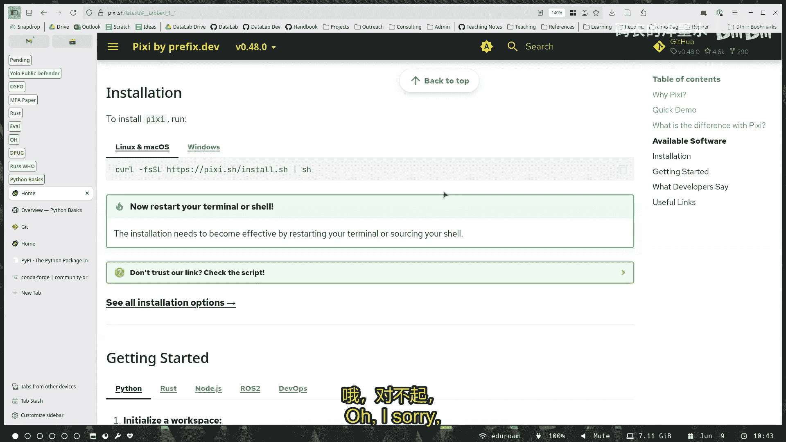

Very可。first't reopen the。Re。😊，I update sometimes far too long theyre like usually' glad。あの。Oh。wish。

okay not didn't actually。That's such a good idea， can you always yell for me？And take someone six。

A up down80。of the some files。话你间就。诶 you know don。Pro。Anyone else has spoken stuffs in watch kisss？

Yes so。不。就非常 nice始。次ね。think we'reAnd this always takes an reasonable just seems like it's a reasonable amount of time and that's just these computers are yes this is normal that it takes this long I know I said we start back up in five minutes it's been about 15 that's normal and not going to throw us way off course so we will start I'm going to give it another like two minutes for the last couple of people to try and resolve the problems they're having。

If anybody is still not able to get this working after after all this time that we've tried to get this working。

 then you're welcome to come talk to us at the lunch break as well。

 we will try to help you as best we can。嗯。So anyway。

While we're while we're waiting is this font size large enough for the people in the back to read or no。

 if you would like the font to be bigger if you're in the back two rows， please raise your hand。

 let me know Okay， so let me make this a little bit bigger。U。Yes。

IfI can remember my keyboard or mask。然后。

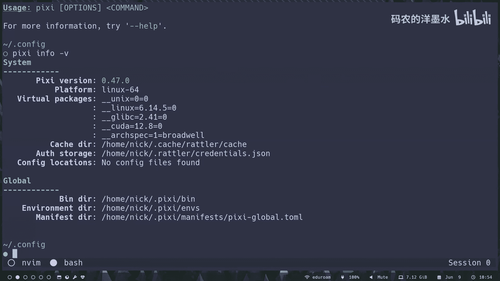

Is that better for the folks in the back we're going to be using the command line a bit in a moment。

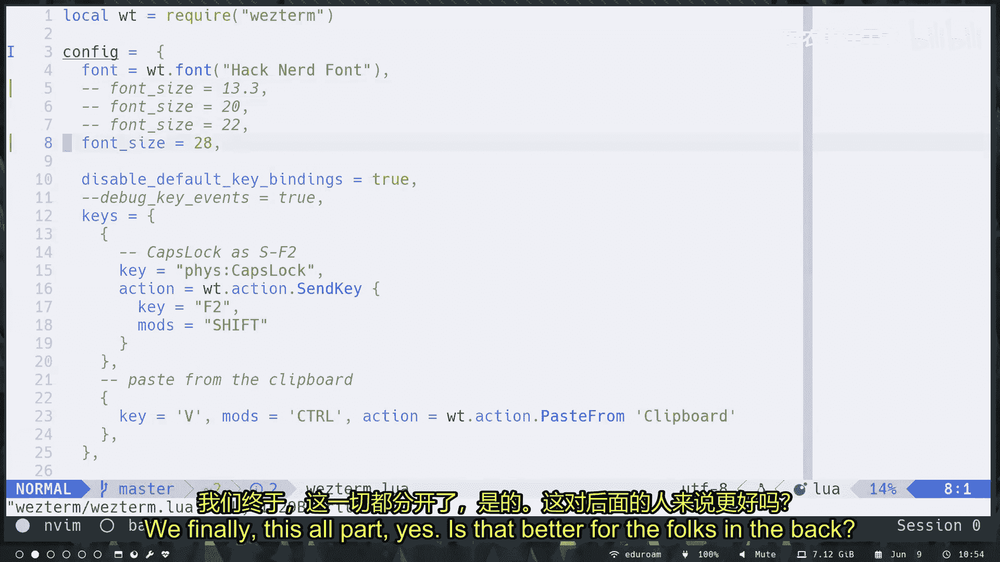

对嗯。By the way， this is the typical kind of output you can expect to see if you run Tixieinfov so if if you're not seeing this when you run Tixieinfov your terminal。

 the first thing to do close the terminal open open a new terminal try again。

 it still isn't working then something has you might have a different version of Pixie I don't know if I have the latest version。

This information will probably be different if specific to your computer。

But you should see some kind of ftile and not see it saying that it can't find pixie。Okay。

In what way larger or smaller oh what operating system not easily if you ask me at lunch。

 I can try to help you， but not easily no，Okay。All right。

 so I'm going to assume that we've resolved all of the problems that we're able to resolve and anybody that's still stuck come talk to us at lunch or after the workshop。

So we're going to keep moving along。嗯。So now we've all got a terminal hopefully with Pixie able to run。

 the first thing we're going to do is we're going to do a quick sort of getting to know your terminal thing because most of you said you haven't really used the terminal before。

 okay？So this is your terminal。Probably looks something like this。

 your it might look slightly different in terms of the pointss and the layout and things like that。

What you will probably see and is you'll see some kind of prompt yours probably looks different than mine but somewhere where you can type things right we already all type Pixieinfo V okay this is your way to communicate with your computer using text commands and we really like that here at data lab in the Davis Python users group we like being able to use text command because text commands are very reproducible right if I type a text command I can copy and paste it and give it to somebody else and they can run that command whereas if I do something by clicking through stuff it's a little bit harder I have to write a description and I might forget some steps and easy to go wrong so this is why we like using terminals to do research computing because it's easy to share easy to reproduce hopefully you'll all be able to follow along the terminal。

 the way this works it's a lot like your computer's file browser how many people here have used the file browser on their computer on Windows it's called Expr on Mac it's called Finder if you're not raising your hand I'm skeptical that you're telling the truth。

Okay。So if you've ever accessed files on your computer。

 you probably used a file browser right you move between different directories， you find files。

 you move the files around， you can make new directories right this is the same idea just presented in a different way Okay it's going to tell you that it's at some particular directory just like your file browser right when you open your file browser tells you you're looking at this directory my documents or whatever okay it tells you you're at some kind of directory in the terminal as well and it tells you as the path to that directory。

 the text the name of that directory okay you might see just a tilda what's。

But you might see just a tilda squiggly like this probably not for little Pixie and all the other stuff but you might see it something like this at your prompt itd probably be something like your name and then ailda okay that's telling you you're at what's called your home directory that's the directory where your computer sort of keeps all your stuff generally。

It's different on different operating systems exactly where it's located。

 but one thing you can do is just like in in your like file Exper where you can just see all the files if you want to see all the files in the terminal。

 you type LS that stands for list。And if you type LF。

 you're going to see a printout of the files in your probably your home directory。对。😊，So try that。

 see if you can see the file， see if you recognize where your terminal is actually at if you type PwD。

That will tell you the actual name of the director you're at。

 the full name of the director you're at。Okay。嗯不允许。

So you can kind of see here's the files in my directory。

 here's the directory I'm looking at right now， okay。

 so this is my home directory but most the terminal also uses Tilda as a shortcut for your home directory so you don't have to type out。

好飞嗯。Your home directory will be different than my home directory because your name is probably not Nick。

Okay。😊，嗯。It might also not be a slash home if you're on a Windows or map I think it'll be slash users most likely Yes。

 so if you want to change your directory， a command to change your directory is CD and then whatever director you're trying to get to。

Okay， and this has to be either a full path on your computer。

 so this would be something starting from the top level， the slash。Right so you can think about this。

 this is saying we're at the folder knit inside the folder hole。

Okay then that's the highest that goes on a computer there's no folder above that okay if you're on Windows I think you'll see a forward slash C forward slash as your highest level or possibly D or E depending on what your drive letter is on Windows but if you're on Linux or Mac you'll see a forward slash okay so if you wanted to go up a directory you could go c dot dot the two dots means go up。

Okay， so you can try that that will take you up， you can keep trying this。

 try to get to the roof of your drive。对。Mine has a little lock to tell me that they can't edit these files。

Yourears probably doesn't have that， okay。This is you said to you this is your computers hard drive just hard yeah so these are your files。

 the same is what you see when you use a file browser。对。

You can still use LS and it will tell you what's in that particular directory so like now I can see i'm at the top level I'm at slash and I can see that I've got a directory called where is it home right。

This is the home directory where my user directory is， so if I go back into home CD home。

They know I'm at the home directory。L I can see there's two folders in here， one is called Nick。

 one is called lost of Fountain。嗯。And again， this all will looks a little different depending on what operating system you're on。

 but the idea is the same， the commands are the same。Okay。

Any questions about these commands how you move around in your file system and so very much like a file browser。

 but you use different commands to move around use LS to see what's in the folder or the file CD to change directories and pwD to see where you're at and I see a question。

啊。That should work on allThat should work on all operating systems and you need to make sure you have a space between the two CD face。

If yes that' that's a very good point so if you're feeling uncertain about command line。

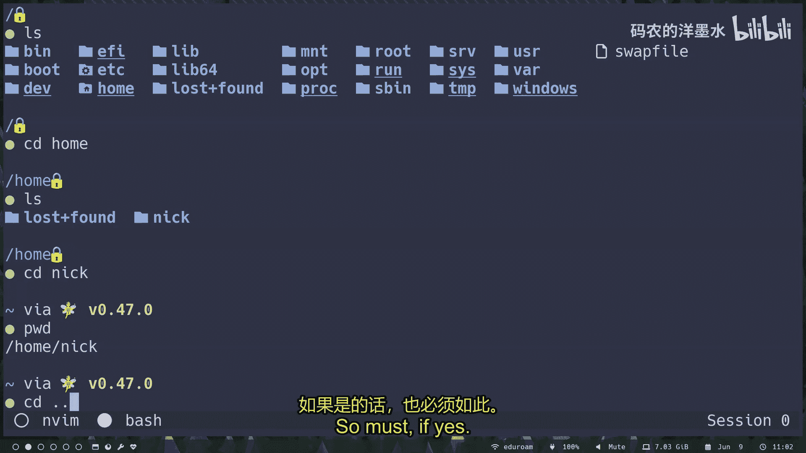

In the same reader as the Pixie stuff in the same reader as installing software with the Pixie。

 there's a whole section called introductiontrouction to command line。

Take a look at this later on after the workshop tonight whenever you have a moment if you want to refresher on how to use the command line this goes through all the details Okay a lot more than i'm talking about right now yeah I'm just introducing the most fundamental things how do you navigate around in your command line so three commands L。

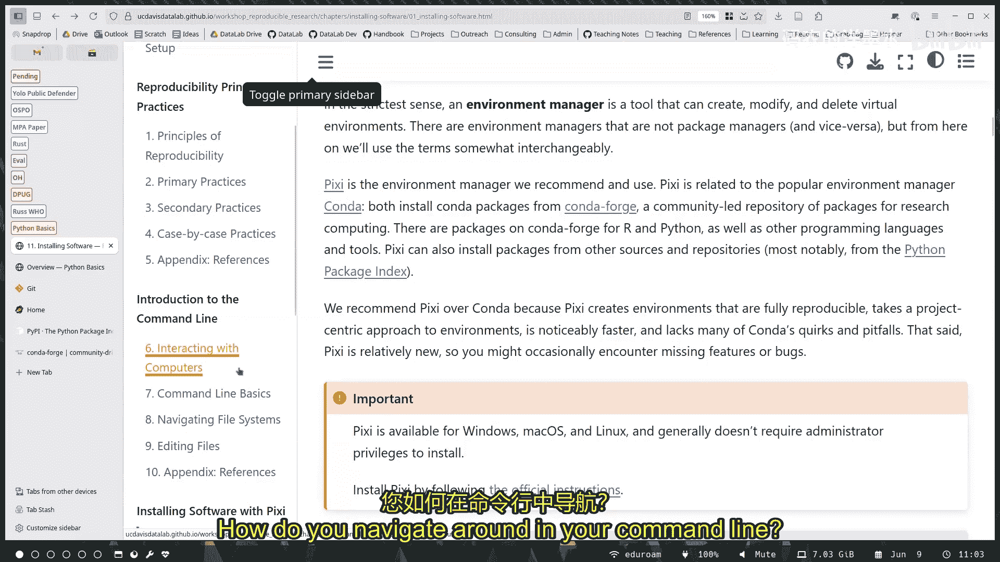

Thank家。because especially when we working on our remote there's not really about it this is going he's talking with that little。

I see there's still a couple red stickies if someone。Okay， I think that's resolved then， okay， good。

All right， so that's how you can you can actually navigate around what I'm going to have everyone do is。

Type CD without anything after it， this will take you to your home directory。Okay。

 so if you just enter CD with nothing after it， that'll take you to your home directory。Okay。

 go ahead and。LS to see what's in there that will and see what files are in your home directory。

 hopefully that will give you a sense of where this is on your computer。

 maybe there are files there that you recognize。嗯。And what we're going to do。

 we're actually going to use Pixie now that。Now that now that we've sort of familiarized ourselves with the the terminal a little bit。

 okay，'re going to we're going to set up。A folder just to do stuff with Pixie Okay。

 and so the way that you can make a folder in the terminal。

 there's one more command of the one other command we need to learn MD IR this means make a directory。

诶。TheMKDIR and then what we're going to put after it is the name of the directory that we're going to create and so I'm going to call this Pixie workshop to follow along with what the reader suggests。

 you can call it whatever you want as long as you remember what the name is and don't put spaces in the name because that will make your life a lot more painful。

Okay。So I'm just going to call it Pixie Workshop， that's what we've got in the reader。

And then if I run LS again， now you can see I've got a new folder called Pixie workshop and you should see that on your computer as well after you run these two steps。

This is where I'm going to put all the stuff for Pixie that we do today。Okay。

 just to keep it out of the way of your other files。

 make sure that we don't overwrite your other files and I'm going to go ahead and change directories to that new directory。

By the way， one thing that you can do when you're working in the terminal to make it make your life easier if if you type CD and then start typing the name of something like Nixy workshopshop and then hit tab。

😡，The terminal will try to autocomple。And getting used to this。

 taking advantage of this will make it a lot easier to use the terminal make it a lot more comfortable okay so again。

😡，Yes， also help you avoid spelling errors。If you type a command and then start typing a file path。

 just type the first few letters and then hit tabab and the terminal will autocomplete it for you。😡。

Yeah。So this is a really helpful thing to learn and get throughquied。Okay。

 so now we should all be at the Pixie Work directory I'm going to confirm that with PwD the first part will be different on your computer。

 but you shouldn see Pixie workshop at the end。嗯。So I want to make sure everybody can get to this step。

And this is where we're going to put all of our fixie stuff。OK啊。

So once you get to this point what you're going to do the way that Pixie works the idea of Pixie is they it sets up separate installations or separate environments for every project you make so the idea is you'll make a directory for each project you work on and then you'll install whatever software you want for that project into that directory okay if youve used Conda before is different from the way that Conda works Connda kind of installs things in global environments。

If you haven't used Cont don't worry about that， but we're going to start by making a project directory this is just a really good habit to have even if you're not using Pixie like for each project you work on make a new directory put all the stuff in that directory that way you don't lose it and get it spread all over your computer。

😡，So we're going to use Pixie to make our new directory because we're going to have Pixie manage all the software in that directory so we're going to say Pixie in it short for initialize okay and then a name of our project in this case I'm just going to call the project a very generic my project。

With an underscore okay， you would probably want something more descriptive if this was a real project but since we're just learning Pixie with this we're just my problem so again Pixie in it and then the name of your project。

 which again you want to avoid stasis is that will make your life painful if you have spaces in the names of things。

When you're working in the journal？Okay。So。PixieIn it my project I'm going to run that and you're going to see it should say something like this I created project and now a you。

LS and this director， you can see now there's a folder called My project。

Pixie set up a directory for us for us to put our project files in。

 it's also going to be where Pixie installs all the software we want to use。Okay。😊。

So now that we've got the project， let's go ahead and go to that directory， so we'll seed my project。

Okay。And let's take a look。嗯。And you can see there's one file in here Pixie do Tommel right I can tell it's a file because it's got the dot extension on there This is the file that Pixie is going to use for all of its settings for this particular project。

 So it's going to be where Pixie keeps track of all the the packages that you choose to install。

 So for example， if we install Python it's going to。

Lft Python in this file and in a minute we'll see how to look in that file and see what's in there。

But。😊，This is Pix's like critical file you don't want to delete this because then you're throwing away all your information that Pixie has about the software in your project okay if you wanted to say share this project with somebody else so that they could install the same software this is the most important file to give them。

😡，OkayObviously if you have a bunch of code and research in there you want to share that too。

 that's also very important， but this is how they recreate their the environment that you're using。

Okay， emphasize that they saying question you go to publish your paper you may forgotten what version you were using you tell this makes it really need to look that up so you're going include method or also so you can actually share a lot of papers now publisher require you to that code to them So this isn't going be great is what what the reviewers may send your collaborator that you want to revisit something this is be doing So imagine this is like your portable piece with you that's going be out this project Now I want to go say something else because those of you maybe that are coming from our。

For other language this is kind of really right thinking about it is you like your suitcase for the project versus your global settings and what's really key。

 especially as you mature do different projects you maybe using different person of a package or of the software or other a library or different library and you can have all of those scholar machine and it's not going to test homework or problems because you're only set and language ones in that PCC suitcase that you have for that content so I like to use that as dynamicical model for why we helpful or you the affordability all those aspects for working。

You can make other toolss function for you， this one to pioneer or our roof can badly fantastic。

One one other thing I want to add that Pamela sort of mentioned in passing is that your collaborator could' mean future you so I keep saying like this is how you share with your collaborators but。

Maybe you're not working in a collaborative mode a lot of PhD students are not right a lot of grad students are just working independently but your collaborator could be you three months in the future when you don't remember what software you used or a year in the future when you really don't remember what software you use to run something okay and having this file will really help you if you need to figure that out or if maybe you change computers for some reason then you can easily set up the environment on your new computer so it it's not just like if you have another collaborator that's another person it's also yourself right you're your own collaborator。

嗯。Okay。So going back to some of the commands we're going to run， let's let's do one more thing。

 so we're going to。There's actually a few more files in here that are what are called hidden files these are files that by default the computer doesn't show you because usually they're either sensitive and you shouldn't mess with them or they're just not very important okay and if you want to see those with this LS tool you can add a dashA this is how we add arguments to these commands。

So if I run LS A， I can see that there's actually two more files in here that are hidden。

And most operating systems， the way you make a file hidden is you just put a dot at the beginning of the name。

Okay so there's two files called dot git attributes dont gett ignore these are hidden files that Pixie set up for us in case you're using git if you're not using git these won't hurt anything to have but if you are using git this will make sure that git handles all the Pixie stuff correctly okay so that's all those are and'm just that's all we need to say about those I don't think we need to get into the details of what's in those just the if you're using git。

Pixie will work with Git， it works very well with Git。Okay， so let's take a look at the pie。con file。

so this is where Pixie is going to put all the all the metadata。

 all the information about your project， so we're going to take a look at this file and we're going to do that with a text editor that I think you should all have installed we're going to see if it goes horribly wrong。

 but we're going to try it with nano and then Pixie。 toble。Okay。

 and let me close this and actually show the command again the nano Pixie。

com okay try running that if you see nano not found or something like that raise your hand。

 let me know。But I think everyone should have this by default。Okay。

And when you actually open this up， it will look something like this。

Except it'll probably not have my hand。In there。OkayIt might have your name。

 it might just not have a name。嗯。Okay， yes， absolutely， Okay， so nanoixie。t。Yes。对。

So then'm assuming everybody got to this point because nobody's raising their hand putting his red stickies if you have a red sticky app。

 someone will come and try to help。嗯。If anybody is getting the nano not found， let me know because。

Then we will figure out something else。All right。So this is just a text file it's just got text that you can read as you can see and it's that's intentional this is meant to be a file that you can read and potentially edit okay it Pixie set this up automatically when we ran Pixie in it and you can see it starts off with a bunch of just metadata about your project which you are free to correct or edit so for example it's got an authors's section。

Okay and this this syntax is going to look a lot more familiar once we start getting into some Python stuff。

 but you can probably guess what's going on here already that like authors this is just a list of our authors for this this project right so you could put your name there and your email address if you want or not whatever whatever you want to do for your project if you're going to distribute it。

The other people， you probably should put some kind of name and email so that people can contact you about your project。

嗯。There's also a section called channels which i'm going to skip over we'll talk about that later there's name which is just the name of your project it's the same as the directory so in this case it's my project you could change it if you wanted to。

Platforms this is telling you what operating systems are you going to try to run this project on Okay so by default it will just have your computer's operating system so we can see my computer as a Linux computer right you probably have OS Mac OSx or OSx 64 or maybe OSx arm 64 or Windows 64 right you can list other platforms in here if say you wanted to support something else so maybe I have two computers and I want to support not just Linux but I also want to support maps so I can say OSx 64 and I just if I can type it right 64 okay。

So if I wanted to support both operating systems then I could say this and then what Pixie will do is try to make sure that any packages I install are available for both of those operating systems okay so that I don't like go to my other computer later and find out that oh。

 that package I've been using for a month on my first computer doesn't actually exist for this this operating system right so this is a way to sort of make sure that you're going to be able to run this on whatever platforms you want。

Okay they will tell you right away as soon as you try to install a package if it's not available for one of your platforms that you want and then there's a version number if you want to use version numbers for your project you're welcome to but you don't have to。

And then there's a couple of other sections there's something called tasks we might talk about today we might not and then dependencies this is where all the packages that we actually installed are going to be listed and we haven't installed anything yet through Pixie so there's nothing here yet right？

😡，佢。😊，Questions so far。Anything that I've said that doesn't make sense？Yes。

 the question thing we have in that is why have multiple platforms that because my platform？

So there's a few reasons for this。How many people here are using Linux？Okay。

 so for those of you that are using Linux， if you go and do some computing on Davis high performance compute clusterster good news because that's also Linux okay everybody else in the room you're not using Linux if you go and want to run your project on say the Davis HPC that's high or farm or genome center computers。

 you're going to be using Linux if your project only works on Windows you're not going to be able to run it on the HPC okay so that's one reason how many people are using an operating system that one of their collaborators or labmates or somebody in their cohort is not using。

So how many if you're a Windows user， how many of you know a Mac user， if you're a Mac user。

 how many of you know a Windows user that you might want to collaborate with， okay。

 this is why you might want to support multiple platforms okay because you need to be able to run your code on other computers that might have different operating systems depending on what your code is that may or may not be like a high priority for you if it's something that you know you're only ever going to use on one computer。

😡，Maybe it's not a big deal， but if you know you're going to use it。

On a bunch of different computers or if you want to make a package that you can distribute you to other people。

 you probably need to support other platforms or if you want to run it on the HPC。

 you need to support Linux。maps also been taught over maps is my yes， my leading way of doing it yes。

Yes so if you see if you're on a Mac and you see OSx arm 64。

 congratulations you're on one of the new Macs if you're on a Mac and you see OSX 64 you're on one of the old Macs okay people on the new Mac you have better hardware people on the old Mac your hardware is more compatible with everything okay so。

那个。There's frozen cons to both。So you're going to put whatever platforms you actually want to support in there typically for today's examples。

 I'm just going to leave it as my operating system just to make things faster because the more platforms you put in there。

 the more time Pixie is going to have to think about what packages can I actually install。Okay。

 so I'm just going to leave it just my platform today。But now you're know aware that okay。

 any other questions about this， yes？嗯，行可以。我认道。So if yes， if you want to support other platforms。

 you can change it before or you can change it after it doesn't actually matter there's a way to update after the fact if you want but。

Doing it before has the advantage that you find out earlier。

 like if something is not going to be able to be installed。

 because especially so let's look at the troublemaker platform。The new new max。

A lot of packages are not available for OSX aren't 6 and this is because it's a new hardware and new hardware is hard to support and eventually the situation is going to get better it gets' better every day。

 but a lot of packages are not available for this platform。

And so if you have this in your dependencies and your platforms。

 you can find out early if a package that you're trying to install isn't supported on platform。

 if you don't have this in the dependencies and then add or the platforms and you add it later。

 then you might find out oh， that package I've been using for a month is not actually supported on this other operating system that I need to support。

Okay， so。ItIt's good to know in advance that way you can sort of work around it I may be making the situation sound a little more bleak than I should for this platform also like if you have an m1 or M2 Mac don't panic the deal head。

嗯。Okay， yes。So it's figuring your email and name out from hit so if you've used Git before then configured it。

 then it's pulling your name and email from that。😡。

You wouldn't have to re downloadload it but you would have to change your name and email in Git and so if you wanted to do that。

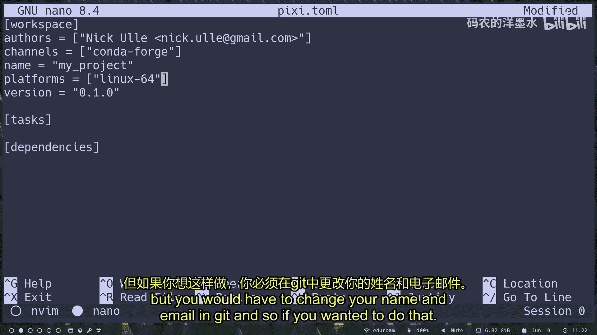

There's yeah， so both can help and there's also instructions for how to do that in our reader in the introduction to version control chapter so。

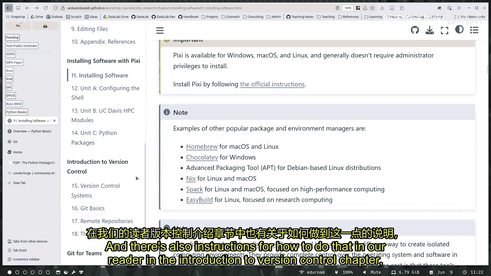

Yes，So it probably means that if Git ist either not installed or not configured and so you can just add authors by typing it it means that you won't automatically get your name and email put in there if you wanted that you could install Git and set up Git use the reader I just shared the introduction to B control we'll tell you how to set up gi if you want that but otherwise it's it's simply find。

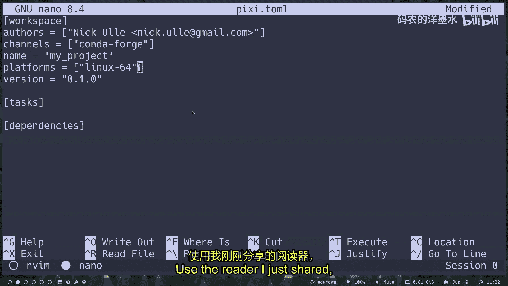

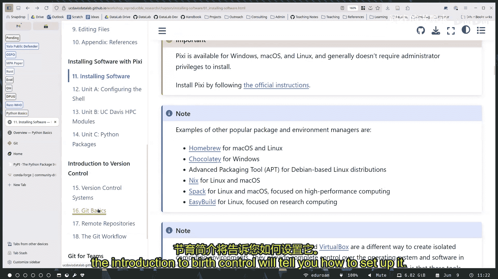

嗯。Potentially if you just installed git with Git bash are you on Windows okay， yeah。

 then what you have to do is is configure git so that it knows your user name and user email。

And again that's in the reader， but the easier workaround is like if you just want to get up and running with Pixie you can just type this in there you don't have to have it type it in for you right so if authors is missing you can just add it。

Okay in the format looks like this。嗯。Any other questions？I would recommend that you not use your。嗯。

I would say it's not necessarily bad the problem with UC Davis email specifically is that they go away after you graduate so if you if you don't want that sort of。

That teach you an email that might disappear later then you might want to use another email。Okay。

 so now we've said a lot about this file， but we still haven't actually installed any software。

 so let's let's actually install something。So let's close this and you're going to close this。

 you can see at the bottom of nano， it gives you hints about how you do stuff we're going to exit and this little symbol means control so if you hit control X。

Then it will try to quit and it might ask you if you want to save and you can just type yes or no if you've made some changes that you want to save。

 type yes or why。So I'm just going to say why and then it'll say it's going to save for this finally press enter。

喂。😊，The control X and then Y if you want to save。And then enter。

And you should get back to the prompt。Okay。😊，没有。Let's do。First。

 let's just see what's actually installed， let's confirm that nothing is installed。The Pixie list。

 this tells me what are the packages installed in this project？

And you should see something like this， so no passengers are found in default environments。

 because we haven't installed anything Nick matches what the file said。Okay， so let's yes。

Go back to you here。So。We're going to go control X。And that should just exit us out。

 it might ask you to save。Thank。And if you want to look at that file longer。

 it's in the reader so you can go look in the reader。

But so when you pick the list we saw that nothing is installed。

 let's install something let's install Python Okay。

 so we're going to say Pixie and then the commands to install stuff is actually going to be add Okay we're adding a dependency to the project that's how you should think about it we're adding something that's required for this project so we're going to say add and then the name of the packaging。

As far as figuring out the names of packages， often it's not。

It's just the name that you see in the documentation all lowercase so like the nu P packages nupy the Python package is python right if you're not sure if you're having a hard time figuring out what the package name is you can often figure it out like googling or whatever you're interested in so。

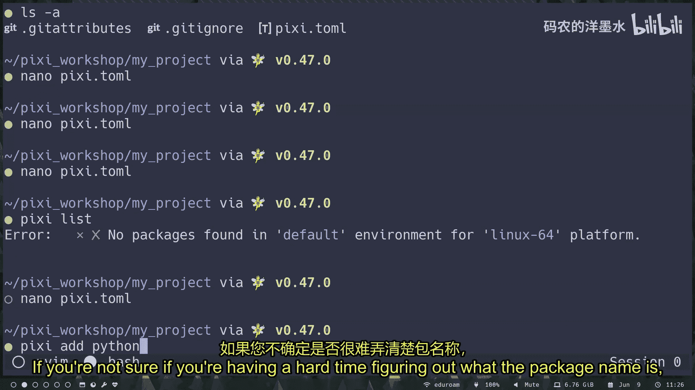

Pyhon and then Condeforge。And I know that's really small。

 unfortunately I don't have a way to make it bigger。

 but I'm just I'm searching in a search engine I can make this bigger。

I'm just searching in a search engine for the package I'm interested in in the word Con deforge。

 okay。And Python is maybe not a good example because the Python package is so ubiquitous。

 but let's try one called map Fotlet。Okay and then often what one first thing will often come up is a the page on Anaconda。

org， which is another listing of all the packages on the condoda forge。

And it tells me map problem right so we can see this is that this is the name of the package。

Or another one that I think I always。Forget the name of is psyit learn。

And when I say forget the name of， I mean， I forget the package name。Because the the。

And it's got two words and packages can't have two words in their name。With face。

 So let's see what's this called。Yeah sta so you can see on the website site hit dash Okay。

 so that's that's how we figure out what the package name is for something if it's not clear just from looking at the documentation a lot of packages they just say in their documentation here's how you installed it this particular name right so they make it easy for you。

 but if you're not sure you can you can Google。

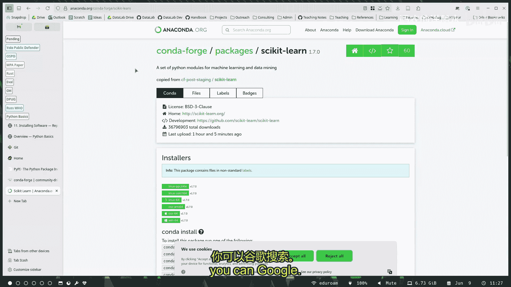

对你。哪一好。So if the first reason is it might not be a P project Python is not a P package Python itself so you tip install Python wouldn't work because you need Python to run Pip right so that's the first problem the second is that if you're installing a package that has dependencies on things that are outside of the Python so like a common example is if you're doing geospatial work you you often need a library called gole GDAL this is a library that's written in the C programming language and it can be quite tricky to install and a lot of packages for R and Python depend on this if you're going to do geospatial work so you need to have it on your system Pixie will install it for you so if you say Pixie install in the name of some kind of GIS package geospatial package it will install gole along the way if you need that。

So that's why you would want to do this rather than something like pipe if or a P so if you use P it's not necessarily going to install those kinds dependencies for you it only installs pipe on stuff yeah。

Add automatically add packages that so we saw on that but also be installed at this point or you is around this and then you click install to install other you would use Pixy ad to install the other packages so this will just install Python I don't think Python has a lot of other dependencies we can look what will look so i'm going run this well let it install it'll take a moment to download and and figure out what it needs to install because part of what it's doing here is the python package has things it depends on and so this command is going to install all of those dependencies as well and then it will install Python。

Yes， sorry there are many just like it saw。So it depends a little bit on what you mean by Jupiter installing Jupipyter notebooks if there's many different ways to do that。

So Anaconda is giving you another package manager Connda which is similar to Pixie the main difference is it's slower Conda is known for taking hours to figure out how to install things it is not reproducible in the way that the Pixy autoomm file is so Conda gives you a list of package names but not versions so you might if if you give somebody your Conda environment。

 they might install it and get wildly different versions from what you had so those are the two big things I could think of。

But it Connda also will install all the dependencies when you install something like anybody。

So already ahead you don't have to it't it probably won't cause problems but it takes up space so you might if you like Pixie after using it for a while and you might want to remove it but but it won't hurt anything to happen them side by side as far as I have seen already condo since it's not going to I guess right Pixie is only putting things in the directory that you are actually running it。

So was there another question or did？行。是会。SoOkay so so the question there were two parts to this question the first part of the question was what are the differences between Connda and Pixie which I already answered in the previous question then the second part was what is the difference between a package manager and an environment manager get it the difference here is a package manager lets you install packages okay that's it。

But typically a package manager is not going to give you a way to install the same package twice with two different versions so if I have a package manager and I want to install Python 3。

8 and then I also want to install Python 3。12 I might not be able to do that right the package manager might say you've already install Python why would I can't install it again or okay I can upgrade you but now you're losing your old version right so what we also need is something to make virtual environments these are like separate independent environments where we can install different sets of software and so the environment manager is letting you do that。

😡，And most of the time the environment manager is bundled with a package manager。

 so it creates these virtual environments and it also installs packages。Okay。

 so I would describe Pixie as an environment manager， Connda is an environment manager。

 PIP is not an environment manager， it's just a package manager。Okay。

 it doesn't give you a way to create virtual environments。对不起。Pixie is both， condoda is both， yeah。

you're working with somebody he doesn't understand。

And you're using Pixie you so there's a few different things you can do if it's just a matter of like how do you share the environment with them Pixie can export to Connda's format andnda can well Pixy can import Conndas format so you can use their environment and they can use your environment if you export it for them of course Connda again is not precise about versions so they might get different versions than you but they'll get the same packages so if it's like how do I actually convince them they want to be using Pixie rather than Conda number one it's faster because Connda can take literally our to solve environments and number two it's。

Fully reproducible， right it gives you exact versions。those are the big things。

 there's other stuff too， but I think those are those biggest things。Okay。

 so hopefully we all got to this point where we were able to add Python。Okay。Now。

You might have gotten a different version， but that's okay。

 but now what I want to do now that we've added Python first of all。

 I just want to look at Pixie list again。And you can see now we've got a lot of output。

 I'm going to go up to the top。Okay so Pixie list and now you can see there's a whole bunch of stuff that was installed each line is something that was installed and the lines are wrapping because my font is so big but you can see it installed something called Live Gcc Mut。

 something called openmp Mut something called lease it to CA certificates so on right Okay so all of these things are dependencies for Python。

And somewhere in here is Python itself and you can see it's actually in bold and green。

 that's to say that this is something I explicitly installed rather than a dependency okay。

So this is all the stuff that got installed， a bunch of packages and on your computer it might be slightly different。

It depends on operating systems。That the question， yes， yes。

 you might see slightly different things depending on your platform because different platforms support different stuff。

Okay， so now we have Python in this project and we can run Python in this project。 So let's。

 let's try that to run something in Pixie the way you're going to do that， Pixie run。就系。😊。

And then the name of the thing you want to run， okay， so in this case， I thought。

And if you do Pixie run Python， you should end up in a Python prompt。

Okay it looks something like this if it doesn't work check make sure you don't have a typo or anything like that and if it still doesn't work put up a red sticky or raise your hand someone will come help。

嗯。喂。Hopefully you're able to get to the Python front we're going to do more with Python later on for now just to test it。

 we are just going to type。I in quotes press enter should see something like that。Thank。Okay。

When so now we've sort of confirmed that we can run Python。

 you might not have had Python installed on your computer before， so now you do。To exit out of this。

See if I can remember right I think the command is exit and two parentheses Okay yeah got it right I always I always mix up r it's quit and yeah so great work oh okay well that would be nice so control D also yes。

 you can you can control D as well。Okay but exit so so now we're back at the prompt so that was how we run something in our environment there is another way that you can run things in the environment。

 especially if you're used to Conda and you've used conda activate okay this might not work on Windows there's a bug with git ba that causes this not to always work in gibsh but it should work。

On Mac and Linux， if you type Pixie shellll and press enter。And you can try this on Windows。

 like the worst thing that' will happen is you have to close and reopen your terminal。

If you type Pixie Shell and press enterter， you should。

Get sent to another prompt okay it might look like almost nothing has happened。

 the prompt might be slightly different okay， it might say something about default。来。嗯。

And now you are actually in the environment that we've set up with Pixie。

 so now you can just type Python in here。And you get。The快ython。Yes。

We make an environment that's why we pixie in it instead of make MD or this so that pixie in it that's setting up the environment for you。

Yes。嗯，O。All right， so again， I'm going to exit this。

And if you if you were able to run Pixie shell and get into the Pixie shell。

 this is nice because now you don't have to type Pixie run in front of everything。

 but if youre not able to make this work if you're on Windows and get bash doesn't like this command。

 you can just use Pixie run， that's kind of the way that works everywhere。

So I'm going to go ahead and type exit to get out of。对。Environment and now I'm back to my regular。

Computing environment that doesn't have Python or doesn't have the version of Python I installed with Pixie。

Yes。It's a mixy show when you bring that on your。Pro that the environment and becauseyth that it yes。

 so any anything youve installed in the environment you can run when you're in the Pixie show。か。

Another another thing you can do if you， if you want to kind of figure out what's going on。

 if you type which and then the name of a command so like which pyon。

 this is going to tell you what command it's running。Okay。

This is my system installed python you might have one you might not if you if you type the name so if you don't have python installed you'll have something like this is the output no python in blah blah blah blah blah yes this Pixie right system my packages yes if you if you've installed the yeah so so if we go to Pixie shell。

And then which ion？So you can see it's finding a differentty now。

Okay again this which command is telling you what is what command is going to be found if I use the python command Okay so we're saying what what is going to run I use the python command you can see there's that pixie in there that's the hint that this is the Pixie version of Python okay。

If you're on Windows and you want to kind of see this effect。

 I think you can read Python or Pixie run。whichch by phone。取。

Right so you can see that when we try to run Python through Pixie run。

 we also get the one that's installed in dot Pixie rather than the system wide one。Yes。

its kind of like that yes this is installed specifically to the project directory so instead of being system wide it just is in your this project directory yes you just showing that on your computer youyon installed twice I do yes。

Just in general。Theyveve always fun having left。So then in fact， they might be different versions。

 let's see。呃，Maybe not。No， the same version， but two different pipelineythlon installs。嗯。

So this is just running Python。Systemwide this is runninging Python in the environment and so I can see the biggest same version in though different programs。

 so I've got two installs of the same python。嗯嗯嗯。You could make this a little more dramatic。

 so let's do that。Let's go look at the Pixie do Tail again。Then a minute since we looked at that。

 so if we look at this file I'm opening it in nano again。

 you can see now Python is listed as a dependency and it tells that this project requires Python and it also puts some version information in there。

Right。It says here's the versions that you need to have right and it gets pretty specific。

 it says that automatically it shows that you need to have 3。13。

3 or higher and then has to be less than 3。14。And it chooses this particular version because even minor versions of Python can often lead to incompatibility right so going from 3。

13 to 3。14 could potentially break your code。嗯。So this is ensuring that anybody that theals Python is going to get a 3。

13 version， right。Like revision number， this generally isn't going to break with thatibility。

 so if this goes up to four， five or six or one number that's。

The small the last number is generally not going to be something that breaks compatibility right that that's usually like security fixes bug fixes。

 things like that。对对。Questions about that I know that was kind of a whirlwind introduction to versioning but so you've got your major number that tells you like major changes every time the number increases minor number some minor changes that could lead incompatibility and then a revision number which is usually like low fixes and things that are not going to break so yeah have such a big install like entire。

Aace。Is there a way that you can say Jack， if this dependency is already installed。

 it does it automatically。OkayBut we just discussed that there was。

A local python and then a wheres the so the local python is not something I installed with Pixie it's something I installed a different way and so Pixie doesn't know anything about that。

 but when you install things with Pixie if you install python in three different places with Pixie and they all use the same version it's really only installing one of those on your hard drive。

Okay， so Pixie doesn't do anything to stuff that you didn't install with Pixie。

 but if you install stuff with Pixie， it will try to be smart and not duplicate files on your heart。

See。Other words cite on that you've already installed？嗯。

If you have a system wide install a Python and you want to use that， the solution is just。

Don't use Pixie yeah。Part of the reason we're doing this is like so that we can be using our system wide install and have more control over what gets installed。

Well。Yeah。Okay， so what I wanted to do flower here， I'm going to go and edit this a little bit。😡。

Because you can also edit the dependencies in this file。

 and I'm going to go ahead and change this instead of getting 3。13。

 I'm going to go downgrade us to 3。8。And I'm going to say has to be between 3。8 and 3。9。哎。😊。

I'm going to edit it like that。You can follow along if you want。we're going to change it to 3。8，3。9。

 maybe I have a something that requires this particular version。

OkayAnd I'm going to go ahead and exit and it will ask me if I want to save and I'm going to say yes。

Okay， why， and then I'm going to press enter earth。

And I will put that back on the screen for everybody to see for a second。

OkayBecause we're going to downgrade to 3。8。Just to show how you do this。喂。

So we're changing the dependency， the constraint on it。

and now what we're going to do now that we've downgraded it doesn't nothing happened yet is but we need to tell Pixie that something has changed and one way to do that is you just type Pixie installst this will reinstall the environment so it'll check Pixie。

omel and reinstall to make sure everything matches up if I hadn't changed anything and I ran Pixie installall it would just say there's nothing to do because nothing changed but if I run this now you can see it's thinking about stuff。

It recognizes it has to install some stuff because I changed the version in the Pixie do it is yes so it's it's changing our python installation now if we look at Pixie list。

You can see in Pixie list， the version of Python is now 3。8。3。8。20 to be specific。Okay。

 so those were the commands。And now that we've got that old version of Python。

 let's do Pixie run Python again。And you can see i 3。8。Okay。😊，So if I exit this。

And if I just do Python without Pixie run。313 right， so you can see this is the Pixie version。

 this is the global version。Okay。So hopefully this is helping drive home that point that when you run things with Pixie run。

 you really are running a different piece of software。Right。

 you're running something in the environment， yes，Yes， in fact。

 that's the default version you'll get。Yeah。Not easily there's probably some way you could sort of escape the shell。

 but that's beyond what I want to talk about today。So first you need to exit。

 let me exit Python and then to exit the shell， you just type exit。Yeah。行。😊，Any other questions？嗯。

Yes。II don't have pyth can't right so back to the Okay， try control C that might。

Did that or are you on a Mac or Windows？Or what you might also try。

That doesn't work as close the close the terminal and open a new terminal。

 but that's a kind of a fix for any trouble you get into generally。Okay， other questions。好不。对方。Okay。

 so we've seen how to install software and you can install all sorts of other things with Pixie ad if you want。

 you can also remove software， so if I decided i'm done with Python I don't need it for this project anymore。

 then you can pixie remove Python。And that will just remove it。Okay。

 and so now it's no longer in the environment if I go ahead and look at Pixie list。

No packages if I go ahead and look at Pixie。tmel。Not took out the dependency section even。

 but it'll put it back if we add more stuff， but you can see python's not in here so that's that's how you remove software okay so add remove them right？

See。So。The sake of time， I'm not going to talk about everything lets。Here's what we're going to do。

 Let's set up an environment that you're going to need for the session we're going to do after lunch。

 so we're going to go ahead and pixy a。Okay， and we're going to add a whole bunch of things。

 so we're going to add Python and then a space and then we're going to add。

Numpy and then a space this is a package for a numerical computing and we'll talk more about that after the break。

We're going to go ahead and add Jupiter。And it's spelled with a Y GUP Ython。

 this is a system of notebooks and editors for Python。What else are we going to add。

 we're going to add polars。嗯嗯。Poers is going to be our package for data frames if you don't know what that is don't worry we'll tell you later and then we're going to add plot9。

This is going to be our authors that we're going to use for。哎，我。So one， two， three。

 four five five different things so Pixie add Python nup Ju betterter folderers plot9 okay and it's just going to install all of these five different packages。

喂。😊，I'm going to press enter。And let it install。This will take a little bit longer because we're installing five packages instead of one。

But these are the packages you're going to need to follow along in the afternoon。嗯嗯。

rryYou might want to because that we have downgraded the Python 38 when if you're on Python 3。8。

 it might not win nice with the other packages。Okay okay， let's。Okay， so。Run this。

 well take a minute to run， see well we're doing that。Okay Simon well。

I'll let everybody run this for a moment Are there questions while'm letting this run？Yeah so。

When we install the earlier， we installed it each the left1 and then one what about when we ran。

Right， so the Pixie run Python versus just Python so this this was one of the one that was in the environment that we installed。

And then just Python by itself， that's one that I installed separately or came with my operating system specify environment Pixie She So this also is just running things in the environment but it's a different way of doing it where instead of Pixie run instead you can do Pixie shell and then any command that you run now we're going run in the environment So it's like it puts Pixie run in front of everythingixie so you don't have to keep so you don't have to keep typing Pixie run Pixie Pixie run if we wanted to have more environment the that's the easiest way to do it so that's the easiest way to do it if you want multiple environments within one project there are ways to do that too。

 but I'm not going to talk about that today。Mick， if we want to install his dependencies andixil can youix ad or Pixie ad or well。

 so you're asking about adding something to the Til file or installing what's already there。

Pixie install。Yeah。嗯。Okay， so I'm going to exit out of my shelf。Okay， so now。

Hopefully you're able to add all of these things and just to test that to make sure that that works what you should be able to do is Pixie run i Python okay。

 so the python but with an ion run。OkayAnd this is a nicer version of the Python shell that gets installed by Jupyper。

3。Okay， so you should see something like that。if anybody is having trouble with that red stickies and we will come try to help you。

And I'm going to I think circulate as well because yes， the yes， mainly do that。呃。It。

These are the versions you're going to need。within this directory so the question was where can you access these this environment and it's just within this directory or any subdirecties you make if you navigate out of the directory。

 you won't be able to do this。嗯，就这。Yeah， so that let me。Yes， so let me do this。

Let me go back to the project okay， and I'm going to go up one level this is outside of my my my project directory and then if I do Pixie list。

Tells me you can't find Pixie dotal， right because there's no pixie environment here。

And this is the kind of area you'll see if you try any。第二。咁 see。那不。Okay， so now hopefully you have。

It'sAn environment that's set up with these packages， okay？

As you're going to need that in the next session if you're having trouble you'll have a chance to talk to us during the lunch break but there's there's like one or two more things I want to say before we go to break so the first thing if you run LS in the directory again。

 you should now see there's a new file called Pixie。lock。喂。😊。

This is a file that is much more detailed about what you've installed compared to Pixie dotomil so if we look at Pixie dot Tail again。

😡，Pixie。t tunnel is giving us a lot of detail already about the packages it's telling us the name in the version constraint。

 but it doesn't notice that it doesn't tell us the exact version right this is a range okay so this isn't the exact environment that i've got installed it's just a pretty good like idea of what the environment should be and you want this kind of like flexibility because other platforms they might not have the exact same version right often like you need it to be in a range and that'll be good enough。

But they might not have the exact same revision number available for their platform。 Okay。

 so you want this flexibility here， but you also。You also probably want。

To have the exact versions recorded somewhere。 And that's what this Pixie dot lock is doing。 Okay。

 and this Pixie dot lock file。It's not so easy to read for a human， it's still human readable but。😡。

Ih， human readable ish， it's really meant for a computer。

And what this is it's just a bunch of URLs to the exact place where Pixie found the package。

 so that includes all of the details about what you've installed like the exact version number。

 the exact URL to go download that package right and so you're generally not going to want to edit this file you're just going to let Pixie edit it automatically。

But what you can do is if you're redistributing the project， you can distribute Pixie。lock and Pixie。

com。And if the lock file is there， when someone tries to set up the environment when they run Pixie install because that's all they have to do if they have this filed。

 they just run Pixie install and it will automatically set it up if they have that Pixie dot lock it will try to set up the exact same environment okay。

So this is how you can make sure you get exactly the same environment on another machine。

And in some cases， that might not be possible if you run into problems because of a platform or something like that。

 one thing you can do is you can delete Pixie。lock and then try again and just install with Pixie。

tmel and that gives you that extra flexibility that I was talking about in terms of the version numbers。

Okay。So。Generally， you're going to want to save both of these things。

 just to do both of these things with the advice that try to install it with Pixie install if that doesn't work for the Pixie but block right again。

Okay。😊，Any questions about that？What the difference between these files are。

 what the purpose of these files is。Okay。你那个。喺话使嘅单你买。你他好啊他少。I don't think so。

 you can convert it to the conduct Yal file， but I don't think it's exactly the same。不。一定嗯。Yeah。

 whenever we're talking about Connda， if it doesn't make sense。

 that's not not something you need to worry about， okay。

Yes so you could remove it with your file browser or if you really want to do it in the shell。

 it would be RM Pixie。t lock。But be very careful with this RM command because there's no undo。

 there's no trash can， make sure you know what you're deleting before you believe it。

'sSo that would be how you could do that， so I don't。

Probably a safer way to do that would be like move the file somewhere else。

 so either open it again in a file browser， go to this directory and file browser put the Pixie dont lock somewhere else that's probably the safest way。

Or if you want to move it in the terminal， you can use MV so you could say Mv Pixie dot lock and then maybe like Pixie dot that should be good enough。

Now it's in a different place。And that will allow to Yeah。

 so Pixie would ignore this because it's not  all50。And then when you want you could just， yeah。

 drag it back or move it back so I could pick seed out food to and see out log。And it's no it's bad。

And then's too Yeah， in the case for some reason the Pixyt lock file whatever is found is the right packages to install doesn't actually work on their computer it's computing this file across platform if so if you've listed other platforms。

 they should be in there as well like even though you didn't install those packages on your computer it still has the exact package for that platform too but once in a while。

 somebody will just have a computer where the hardware is somehow subtly different and the package can't install or something and so that's what deleting the lock file can hold that's why need to do this it seemed like we could platform most of the time you won't need to do this most of the time you should be good okay last thing you want to say and we'll go to lunch if you're using Git。

Put these in version control okay if that means nothing to you if you don't use gett。

 don't worry about it you go and take our workshop。On这这个。

Okay and the other thing I will say is there's a lot more about Pixie in our reader we didn't have time to do everything and that's okay I think we've got enough for what we what we need to know today so in particular the installing software section I think there's a few more commands that we didn't talk about that are not as important and there's a unit C section that' specifically about installing Python packages packages from Ppi so we've been installing packages from Condeforge when we run Pixieab you can also install things from Ppi all you do is add one extra flag to Pixieadd so it looks like that pixie adfish P that install from Pypi instead of Condaforge usually you should use Condaforge but if something on Condaforge doesn't work you might want to do this or you find a package that isn't on Condaforge and is on Ppi you can do this。

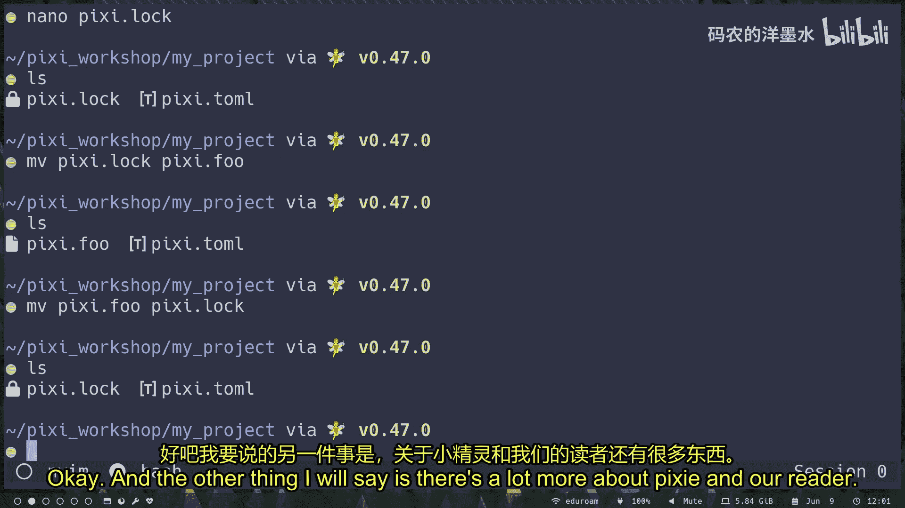

Its always be it does， yes。This is a big difference we talking from our and we go to plan right。

 since there's two different different ways to。Okay。

And I think that's everything we need to talk about this morning。

It always takes long right install getting your machine set out for every project you' still going want to3 you know your project program right just like you would anyway for where your folks going to go where your data's going to live put to each other we call this the paying it forward stuff right the full order is just getting yourself in the good practice of how you lay it out for those of you who haveve never put it before I know this is fresh just want to get on what we're going do that next that's what good off out going actually start to playing this so。

If you didn't get everything done this morning， you're going to want to spend a little bit time at lunch making sure that you're totally hot up that you have fixing installed。

 you have all those different credit specifications with the software and fixing if you don't those afternoons you not going to go really through you。

I know if you of you didn't have administrative privileges on your machine。

 you're going to want to get on the phone with IT during lunch if that resolved so that you can absolutely goable。

Just remember though you always have these resources to go back to the explain interview there's way more text there then we can even cover in the workshop go lot of that digital explainers and just so you know because everybody's coming at a different level we're gonna get questions all over the board I should have added this to for say ask your questions right if it feels like progress should have already know anyway someone else probably has that question if using the in case Foundation we when we pick up on her we don't get the full explanation to ask your questions if it's something where you I didn't understand at all feel free to ask a follow up and we'll tell you actually that that's for how we don't worry about it。

Okay， but we'd like to expose you because maybe you'll ring a bell later I' you run to that will shoot。

So we'll go lunch A is fine this week so food options are a little bit limited on campus the MU has a few places to open there's also gal really fun something you doing for any lunch if youve brought lunch you're welcome to eat here the courtyard is also lovely probably get thought if you did not sign in when you please sign in the sheets lunch there's your lunch negative youre able to help seek care some funding I don't feel bit some knock to or getting lunch if it's not well just go to but if you know you're gonna to be here tomorrow and you would like lunch make sure that you broke yes the lunch if you have any dietary restrictions you can let me know and I'll make sure that it get it's going to be you've done。

Yeah。😊，Oh sorry when to come back yeah around one o'clock we' start maybe a little bit after since we're leaving a little bit after so it's 105。

here time。

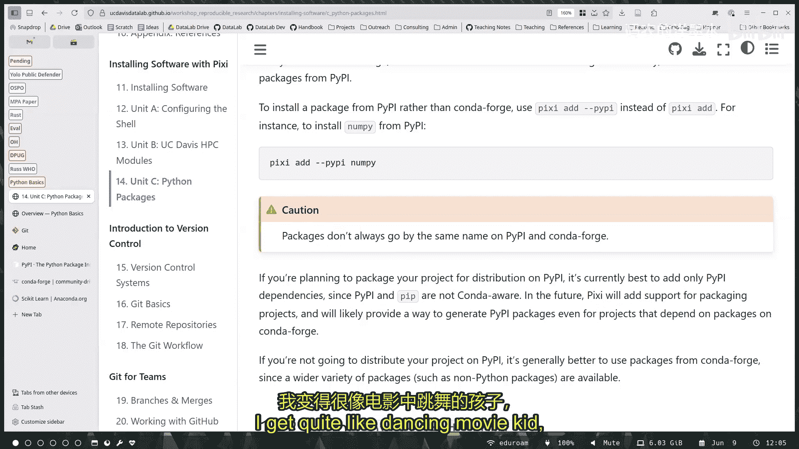