# 加州大学戴维斯分校计算机科学课程：第1讲：安装软件 🛠️

在本节课中，我们将学习如何为Python编程设置计算环境。核心内容包括：理解计算环境的概念、学习使用包管理器Pixie来安装和管理软件，以及掌握在命令行中导航和操作的基本技能。这些技能对于后续的Python学习至关重要。

## 什么是计算环境？ 💻

计算环境是指您计算机上用于运行代码或程序的所有硬件、软件和其他配置的总和。您需要能够设置计算环境，以确保可以运行所需的代码。同时，当您与协作者合作时，也需要能够告知他们您所使用的软硬件配置，以便他们也能运行您的代码。

有时，您可能需要为特定项目指定特定版本的软件。例如，Python 2和Python 3之间存在巨大差异。在本课程中，我们将使用Python 3，但您可能会遇到需要旧版Python 2的工具。因此，您需要能够根据项目需求安装不同的版本。

此外，您可能在没有管理员权限的计算机上工作（例如，在UC Davis的高性能计算服务器上）。在这种情况下，您需要一种无需管理员权限即可安装软件的方法。

## 如何管理计算环境？ 📦

您将使用一种称为**包管理器**或**环境管理器**的工具来下载和安装软件。例如，Mac用户可能听说过Homebrew，Windows用户可能使用过Windows Store。这些工具可以帮助您安装软件并跟踪不同版本。

今天，我们将学习一个名为**Pixie**的包管理器，它可以在任何操作系统（Windows、Linux、Mac）上安装。使用Pixie，我们可以运行相同的命令来安装软件和Python。Pixie还能帮助您更新包、管理不同项目中安装的包以及不同版本的包，从而确保您可以控制计算机的软件环境。

Pixie这类包管理器还能帮助我们创建**虚拟环境**。虚拟环境允许您在同一台计算机上并行安装多个独立的软件环境。例如，您可以在一个虚拟环境中使用Python 2，在另一个虚拟环境中使用Python 3。这样，您可以将不兼容的软件放在各自的虚拟环境中，实现并行安装。

对于研究人员来说，不同的研究项目可能需要不同的软件集，而这些软件可能彼此不兼容。因此，我们需要一种方法来安装所有这些软件。

## 为什么选择Pixie？ 🐍

有多种环境管理器可供选择，但我们将使用**Pixie**。Pixie是一个相对较新的环境管理器，主要专注于Python，但也可以与R一起使用。它可以安装R、R包、Python、Python包以及其他许多软件。

如果您以前使用过Conda，Pixie与Conda兼容，并且可以为您安装Conda包。Pixie可以安装各种开源软件。

## Python的包生态系统 🌐

Python拥有成千上万的包。这些包通常发布在名为**PyPI**的网站上。目前，PyPI上有超过644,000个社区贡献的包。这些包的质量参差不齐，但数量庞大，可供您免费使用。

如果您是R用户，可能对CRAN很熟悉。CRAN是R的等效平台，但Python的包数量通常是CRAN的两到三倍。因此，Python非常流行，是全球最受欢迎的编程语言之一，通常每年都位列前三。

这些包让您能够用Python完成各种任务。例如，如果您想用Python进行数学计算，Python内置的数学库可能不适合矩阵乘法等操作。这时，您可以使用像NumPy这样的包来高效地进行矩阵和向量运算。同样，如果您想进行图像处理或音频文件处理，也有相应的包可用。对于数据科学，如果您习惯在R中使用数据框，Python也有几个等效的包。

除了PyPI，我们还可以从**Conda Forge**获取包。Conda Forge与PyPI类似，但它不仅限于Python，还分发各种软件。例如，有用于R的Conda包、用于R包的Conda包，甚至用于文本编辑器等计算机软件的Conda包。

Pixie允许我们安装这两种包：Conda包和PyPI包。

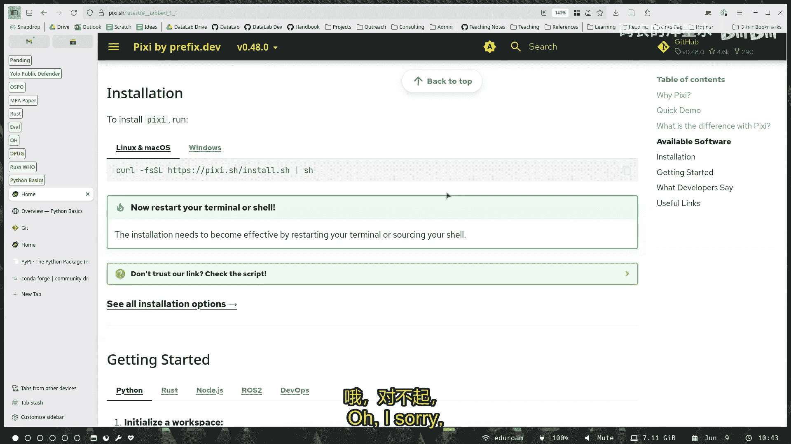

## 安装Git Bash（仅限Windows用户） ⬇️

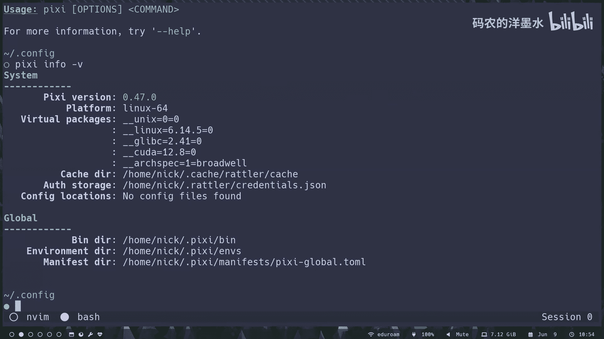

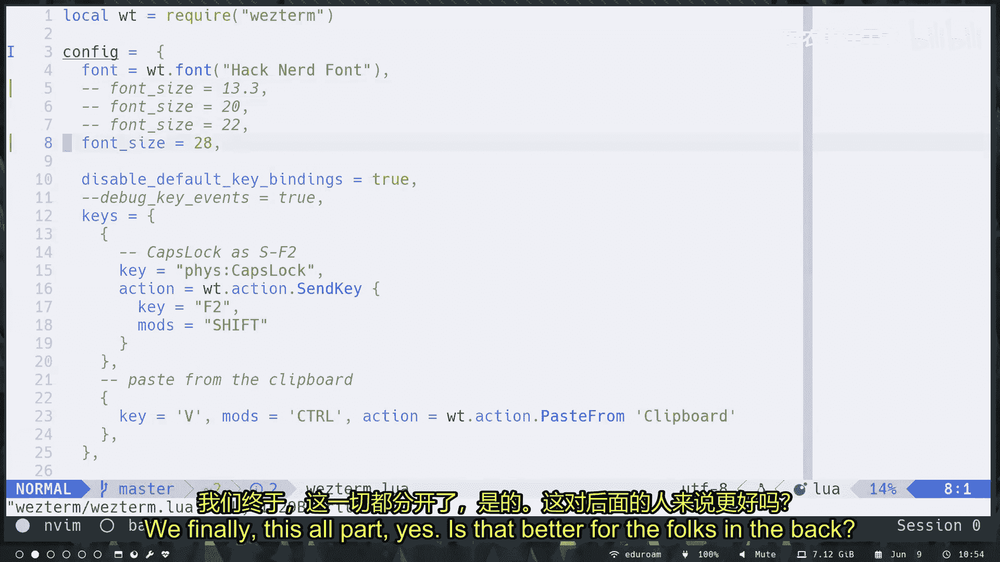

如果您是Windows用户，您需要一个名为**Git Bash**的工具。Git本身是一个出色的版本控制工具，但我们在本课程中不会讨论它。然而，Git安装时会附带Git Bash，这是一个类似于终端的工具。因为Windows自带的终端在研究计算方面存在许多问题，效果不佳。我们希望每个人都能运行相似或相同的命令，而在Windows上，您需要安装第三方软件，不能仅使用内置工具。

请访问网站 `git-scm.com`。您应该会看到一个类似的网站。点击“Download for Windows”按钮进行下载。下载完成后，找到下载的文件，双击并运行安装程序。您只需保持所有默认设置即可。关键是要确保安装过程中包含了Git Bash（这通常是自动的，但如果您更改了默认设置，请确保不要取消勾选安装Git Bash的选项）。

如果您在安装过程中遇到问题，请举手或贴上红色便签，我们会提供帮助。

## 安装Pixie 🚀

现在，我们将为所有人安装Pixie。请访问Pixie官方网站 `pixie.sh`（读者材料中也有链接）。向下滚动直到找到“Installation”部分。根据您的操作系统选择相应的安装说明。

*   **Windows用户**：下载安装程序并运行它。
*   **MacOS或Linux用户**：打开终端程序（MacOS自带“终端”，无需额外安装），复制提供的命令，并将其粘贴到终端中运行。这个命令会下载并运行安装程序。

如果任何人在这些步骤中遇到困难或出现错误信息，请举手或贴上红色便签。我们将等待大约三到五分钟，让大家完成安装。我和其他助教会四处走动，尽力帮助大家。

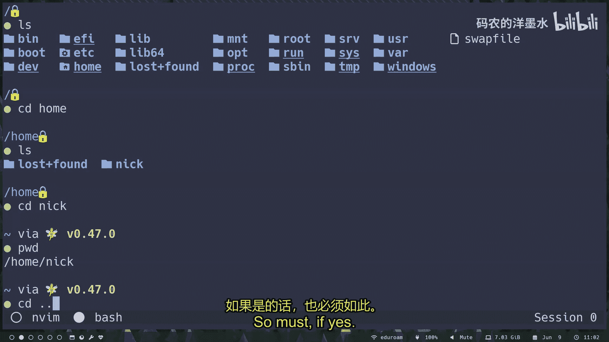

## 命令行基础导航 🗺️

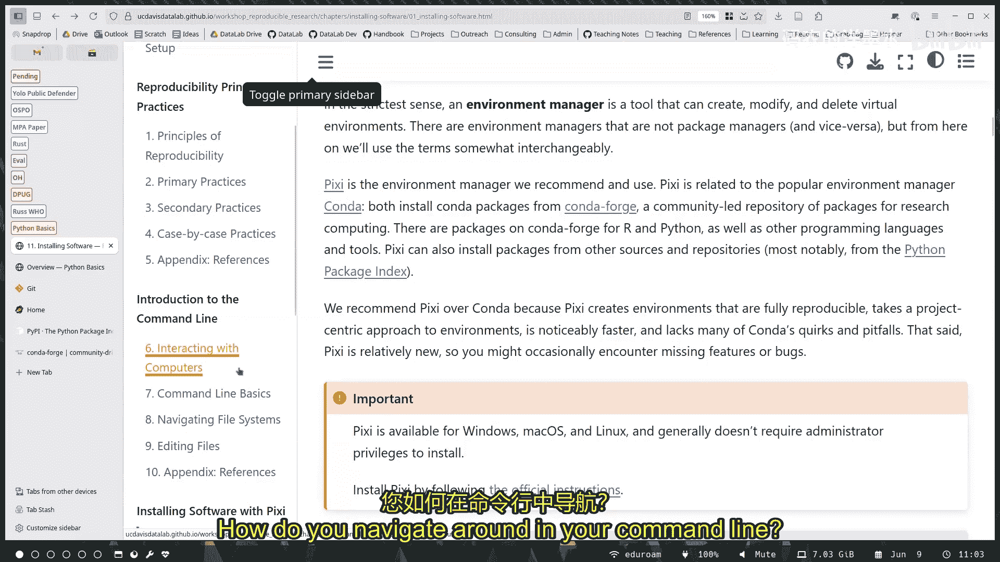

现在，假设大家都已经安装了终端（和Pixie）。我们将快速熟悉一下终端，因为大多数人都表示以前没有真正使用过终端。

终端可能看起来类似这样，具体外观可能因布局和字体而略有不同。您会看到一个提示符，可以在那里输入命令。我们已经输入过 `pixie info` 命令。这是您使用文本命令与计算机通信的方式。我们喜欢使用文本命令，因为它们具有很高的可重复性。我可以复制并粘贴文本命令给其他人，他们可以运行相同的命令。而如果通过点击图形界面操作，则较难分享和复现，容易出错。

终端的工作方式很像您计算机上的文件浏览器（在Windows上叫“资源管理器”，在Mac上叫“Finder”）。当您打开文件浏览器时，它会显示您当前所在的目录（文件夹）。终端也是如此，它会告诉您当前所在的目录及其路径。

您可能会在提示符中看到一个波浪号 `~`。这表示您位于**主目录**中，这是计算机存储您所有个人文件的目录。不同操作系统中主目录的具体位置可能不同。

以下是一些基本命令：

*   `ls`：列出当前目录中的文件和文件夹。
*   `pwd`：显示当前目录的完整路径。
*   `cd`：更改目录。例如，`cd Documents` 进入“Documents”文件夹。`cd ..` 返回上一级目录。`cd` 后不加任何内容会直接返回主目录。

尝试这些命令，看看您是否能识别终端当前所在的位置。使用 `pwd` 查看完整路径，使用 `ls` 查看文件。

## 创建项目目录并初始化Pixie项目 📁

Pixie的理念是为每个项目设置独立的安装或环境。因此，一个好的习惯是为每个项目创建一个新目录，并将所有相关内容放在该目录中。这样，您就不会丢失文件或将文件分散在计算机各处。

我们将使用Pixie来管理该目录中的所有软件。首先，确保您在主目录（使用 `cd` 命令返回）。然后，使用 `mkdir` 命令创建一个新目录。`mkdir` 代表“创建目录”。

```
mkdir pixie-workshop
```

然后，进入这个新目录：

```
cd pixie-workshop
```

现在，我们使用Pixie初始化一个新项目：

```
pixie init my_project
```

运行后，您会看到Pixie创建了一个名为“my_project”的文件夹。Pixie将在这个文件夹中安装我们想要使用的所有软件。进入该项目目录：

```
cd my_project
```

使用 `ls` 命令查看，您会看到一个名为 `pixie.toml` 的文件。这是Pixie用于存储该项目所有设置的文件。它将记录您选择安装的所有包。如果您想与他人分享项目，以便他们能安装相同的软件，这个文件是最重要的文件之一。同样，对于未来的您（例如，几个月后当您忘记使用了什么软件时），这个文件也至关重要。

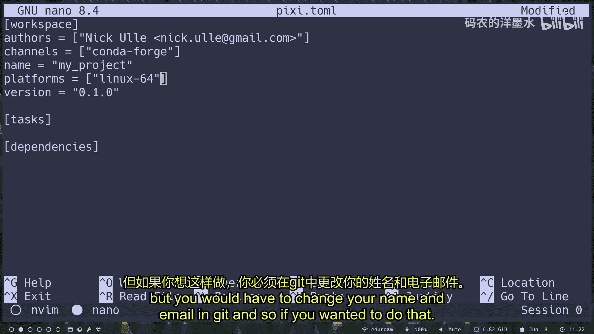

## 理解 `pixie.toml` 文件 📄

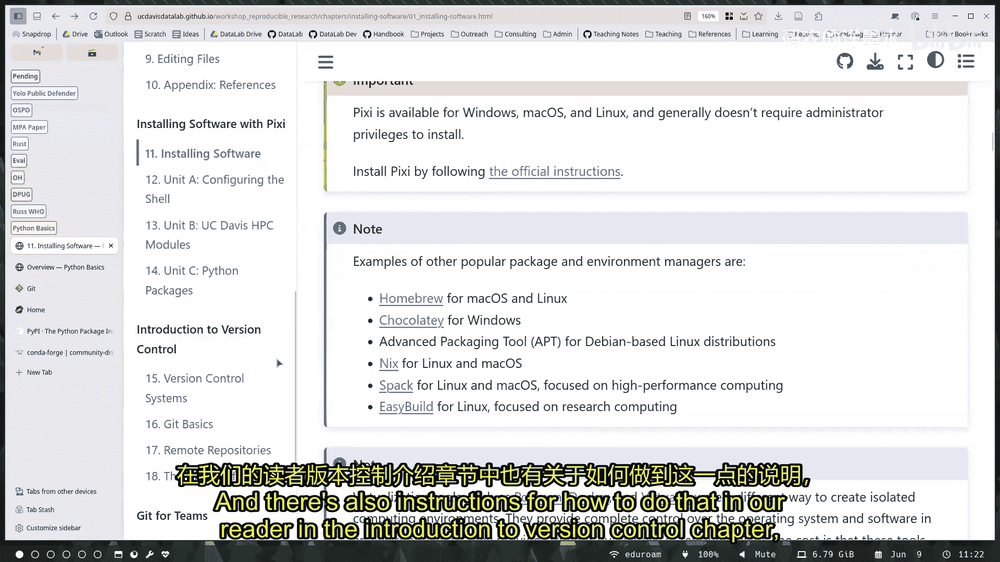

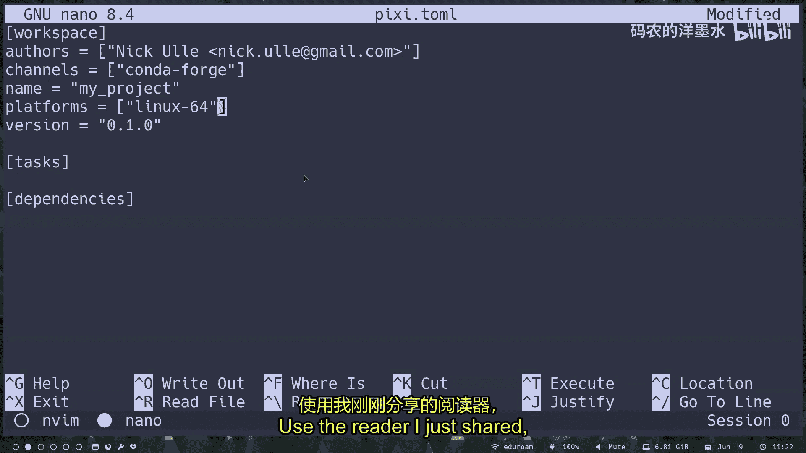

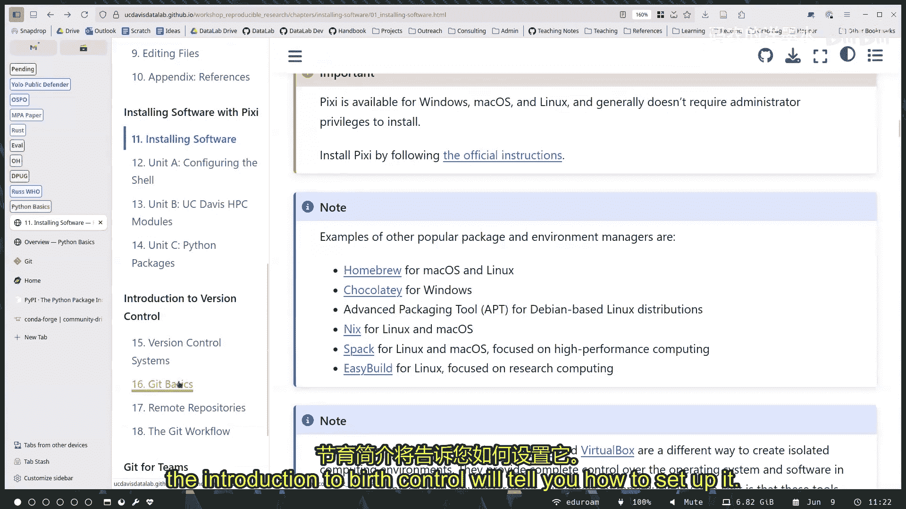

让我们查看 `pixie.toml` 文件的内容。我们可以使用 `nano` 文本编辑器：

```
nano pixie.toml
```

文件内容大致如下：

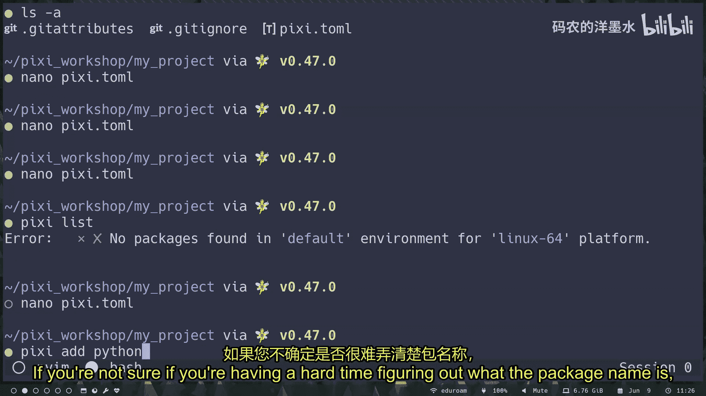

*   `authors`：项目作者列表。您可以在此处添加您的姓名和电子邮件。
*   `channels`：我们稍后会讨论。
*   `name`：项目名称，与目录名相同。
*   `platforms`：列出您希望项目运行的操作系统。默认是您当前计算机的操作系统。如果您想在多个操作系统（例如Linux和Mac）上运行项目，可以在此添加。这有助于确保您安装的包在所有目标平台上都可用。
*   `version`：项目版本号（可选）。
*   `dependencies`：列出所有已安装的包。目前是空的，因为我们还没有安装任何东西。

要退出 `nano`，按 `Ctrl+X`。如果文件有更改，它会询问是否保存，按 `Y` 表示是，然后按 `Enter` 确认。

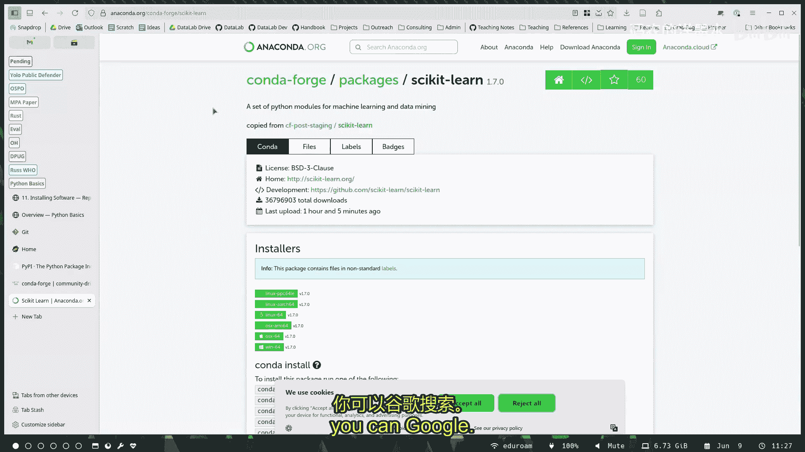

## 使用Pixie安装软件（以Python为例） 🐍

现在，让我们实际安装一些软件。首先，确认当前没有安装任何包：

```
pixie list
```

输出应为“No packages are found”。

接下来，安装Python。使用 `pixie add` 命令来为项目添加依赖：

```
pixie add python
```

Pixie会下载Python及其所有依赖项。安装完成后，再次运行 `pixie list`，您会看到许多已安装的包，其中Python会以粗体或绿色显示，表示这是您显式安装的包。

现在，我们可以在Pixie环境中运行Python了。有两种方法：

1.  使用 `pixie run`：
    ```
    pixie run python
    ```
    这将启动Python交互式环境。您可以输入 `print("Hello")` 进行测试。要退出Python，可以输入 `exit()` 或按 `Ctrl+D`。

2.  使用 `pixie shell`（在Mac/Linux上更常用，Windows的Git Bash可能有bug）：
    ```
    pixie shell
    ```
    这会激活Pixie环境，之后您可以直接输入 `python` 等命令。要退出该shell，输入 `exit`。

## 管理包版本和项目环境 🔄

`pixie.toml` 文件中的依赖项可以指定版本范围。例如，Python的条目可能显示为 `>=3.13,<3.14`，这表示需要3.13.x版本，但不包括3.14。这确保了兼容性。

您可以手动编辑 `pixie.toml` 文件来更改版本约束。例如，将Python版本改为 `>=3.8,<3.9`。保存文件后，运行 `pixie install`，Pixie会重新解析文件并安装指定的版本。

要移除一个包，使用 `pixie remove` 命令：

```
pixie remove python
```

## 为下午的课程设置环境 ⚙️

为了准备下午的Python课程，我们需要安装一些额外的包。请运行以下命令：

```
pixie add python numpy jupyter polars plot9
```

这将安装Python、用于数值计算的NumPy、用于笔记本编辑的Jupyter、用于数据框的Polars以及用于绘图的Plot9。安装可能需要一些时间。

安装完成后，您可以通过运行以下命令来测试Jupyter的增强型Python环境：

```
pixie run ipython
```

## 理解 `pixie.lock` 文件 🔒

安装软件后，您会注意到目录中多了一个 `pixie.lock` 文件。与 `pixie.toml` 文件（指定版本范围）不同，`pixie.lock` 文件记录了**确切的**版本信息以及每个包的下载URL。这个文件主要是给计算机读的。

当您分发项目时，应该同时包含 `pixie.toml` 和 `pixie.lock` 文件。如果接收者有 `pixie.lock` 文件，他们运行 `pixie install` 时，Pixie会尝试精确复现相同的环境。

如果由于平台差异等原因导致基于 `pixie.lock` 的安装失败，可以尝试删除 `pixie.lock` 文件，然后仅使用 `pixie.toml` 运行 `pixie install`。这样Pixie会重新解析依赖并安装，可能会获得更灵活、兼容的版本。

## 从PyPI安装包 🌉

默认情况下，`pixie add` 从Conda Forge安装包。如果您需要从PyPI安装包，可以添加 `-p` 标志：

```
pixie add -p package_name
```

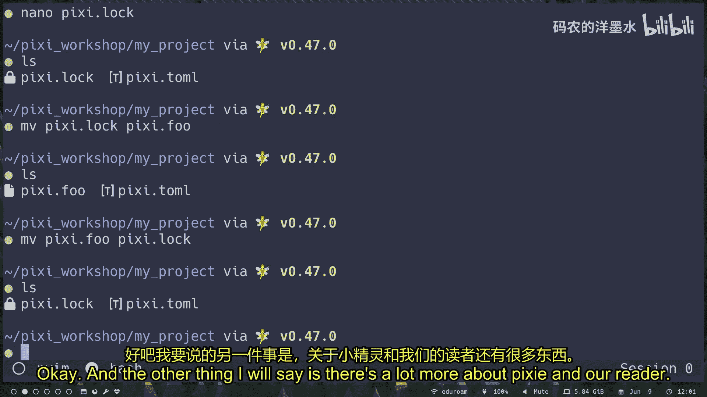

通常建议优先使用Conda Forge，但如果某个包在Conda Forge上不可用或有问题，可以使用此方法从PyPI安装。

## 总结 📝

在本节课中，我们一起学习了如何为Python编程设置计算环境。我们介绍了计算环境的概念，学习了使用Pixie包管理器来安装和管理软件，掌握了命令行导航的基础知识，并创建了带有特定依赖项的Pixie项目。我们还了解了 `pixie.toml` 和 `pixie.lock` 文件的作用，以及如何从不同来源安装包。

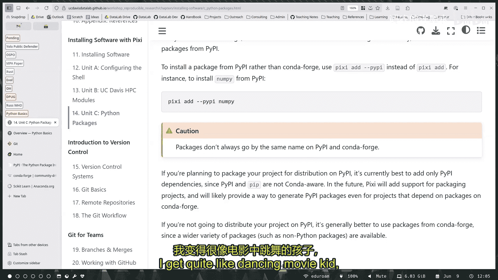

这些技能是进行可重复研究计算的基础。请确保在午餐期间完成所有必要的安装，以便为下午的Python学习做好准备。如果您遇到任何问题，请随时向我们寻求帮助。