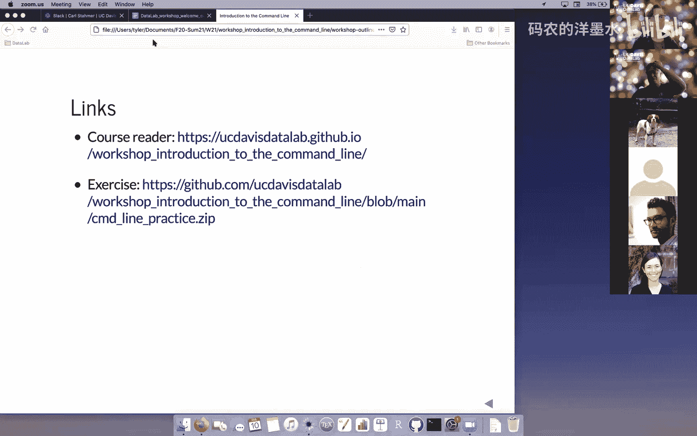
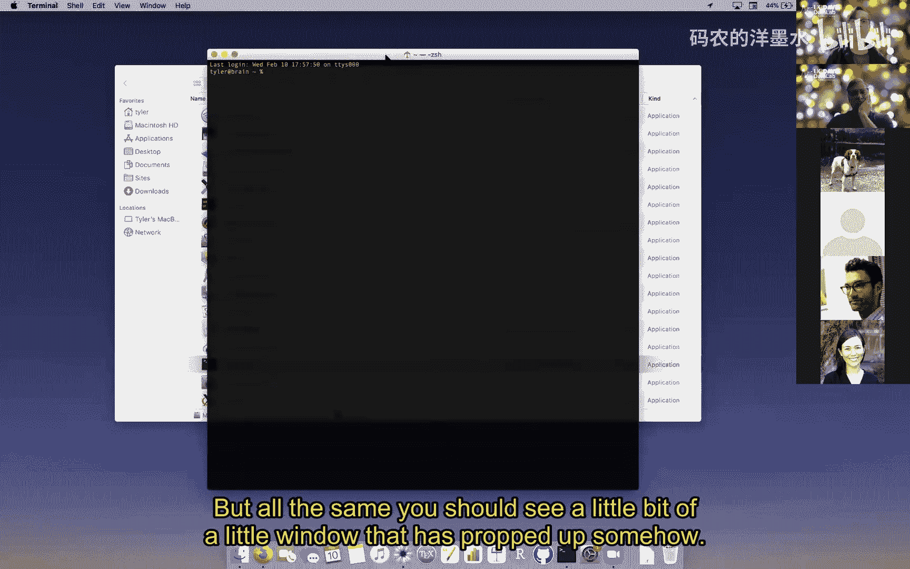
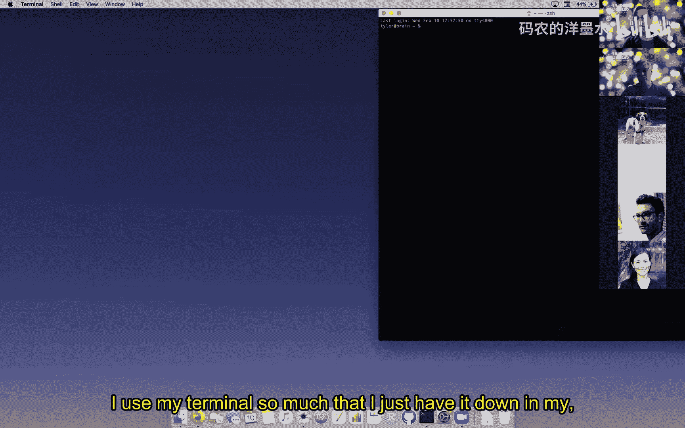
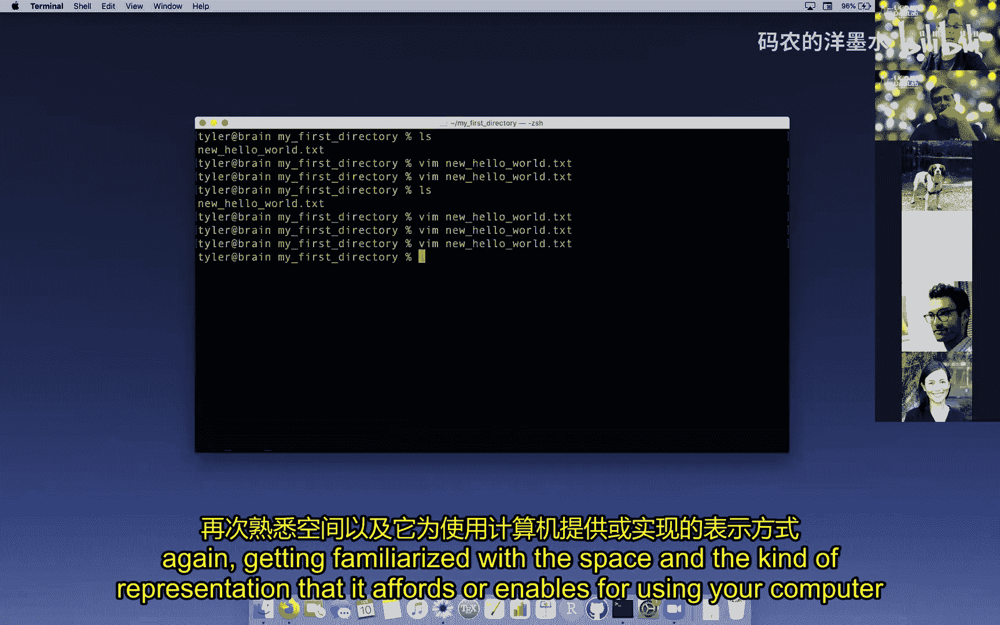
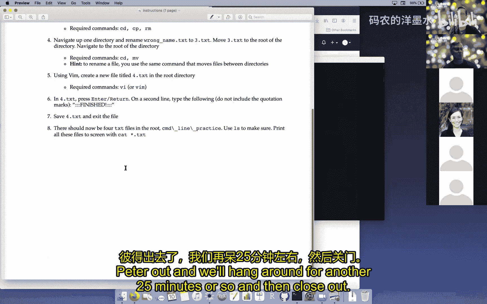

# 【全集】加州大学戴维斯分校 计算机科学 中英字幕 1080P p02 Lecture 2 - 命令行入门 -BV1cqFNzYEvp_p2-

All right， so my name is Tyler Shomaker and I am a postdoc with the UC Davis data lab This workshop is held under the auspices of the data lab data lab is a program funded by the UC Davis Provost and supported by the UC Davis library to facilitate the application of data science methods technologies and best practices to enhance research and learning in all domains across our university we provide a data lab research services including office hours and project support host and teach training events like this one and facilitate community efforts to build and grow capacity in the data sciences much of what we're going to be doing today is kind of ground level work about how you use a computer in order to do data science。

 those are the kinds of conversations we have at data lab as well as more higher levelve questions and inquiries into method into how to acquire data sets and all of that so today's workshop is offered by。

Data labb in conjunction with a wider array of workshops that are kind of under the broader heading of the UC Love data Week。

 we'll post a link in the chat for you to check out other training opportunities that are happening at Davis and across the UCs this week in just a moment here。

All right。So there is good introductory work I am going to share my screen and i'll be working from a screen share for the majority of the discussion today。

 but I would also encourage you to follow along so to you know not leave zoom in an entirely full screen but rather kind of situated in a way where you can be working with your computer as you're going along so I will share now。

And I'm just going to share really briefly my web browser to show you quickly an outline of what we'll be talking about today。

 so there are all of three slides on this， this outline。

 one of which is our title the second is just simply what we'll be doing the workshop is slated to be about two hours I think there will be maybe an hour and a quarter hour and a half of kind of guided walkthrough and then after which we'll open that out to an exercise that we can do together that you can do on your own we're gonna just kind of hang around and be there for Q&A and for working through a little sort of puzzle exercise at the end so we'll start with an introduction to the command line and once we have familiarized ourselves with using the command line we'll move on to using a text editor on the command line and going from there after that then we'll do our exercise。

ですケ。对。There are a few links that will also drop in chat really quick briefly here they are to a course reader that will circulate now and then also to afterwards and that has just a kind of more formal right up and walk through of the material that I'll be covering today as well then on this particular repo that I've made for the workshop there's the little exercise folder so I'm just going to go ahead and show you briefly this is what the reader looks like it's kind of broken off into a few sections。

And I'm going to go ahead and copy into chat right now this link。

 so I'm going to do that I'm going to stop sharing briefly for a moment and then get onto my desktop so that we can walk through。

Oh， Carl already posted the link， wonderful， thanks Carl。All right。

So we can all see my desktop get on that。Perfect， all right。

 so today we're going to be working on a kind of different plane of representation。

 we could say in your computer。The computering environment is sort of built up in a number of levels。

 starting from the kind of very lowest bit representations of ones and zeros。

 that's the kind of common parlance that you hear all the time。

 a computer just runs with ones and zeros or something and running up sort of step by step up through a number of different abstractions to get us to something that we can actually read on screen and play around with and move with images or use a cursor or something like that。

The command line is just another representation on our computing and environment and it's a sort of step away from the one that you see just in front of you this what we would call now is a graphical user interface it's built of a number of windowing systems and folders that we can interact with most typically with a mouse right so I can open up for example a finder window down here and I can move this around I have a lot of extensibility and a lot of malleability with where I can move something on my desktop or in my sort of file system can make this bigger I can drag it。

 I can zoom in and all of that that's wonderful and that's really useful software companies and software and computer developers and manufacturers really push using a computer in this way because it's rather intuitive it's pretty easy to get。

on it and they can make it a proprietary system right so Apple or Microsoft uses as a selling points the particular way of interacting with your computer as something that's very brand specific right so they have die die hard Apple users die hard PC users sometimes these conversations really just come down to whether or not people prefer to look at their computer in one form or another right so that's one kind of environment that we often use their computers in。

The key to remember though for this environment and for using your computer in this way is that it's effectively just a metaphor right the metaphor that we're seeing on screen right now it really has two components it has a desktop which we can see here right there's no actual desktop in front of you this is just kind of a planar space that I can put files onto put in quotes here。

And then we have a finder window right so the window as a kind of metaphor itself for how we interact with computers。

 we can think and reflect a little bit more on you know what it means to work with these metaphors window is something that you see through a desktop is something that you put something on and those kinds of metaphoric implications control how users work with their computers right it makes it very intuitive on the one hand to use a system like this。

 but it also comes with certain rules about what you can and can't do with your computer when you interact with it in this way。

So the command line gives us another way to interact with the whole structure of our computers and to do so in a way that doesn't quite use the metaphors of say。

 the desktop or of the windowing system， right？So that's the kind of conceptual overarching frame for the workshop today and I start with this because I think a lot of times the command line can be particularly intimidating especially if you've never used it before it sort of signifies I'm doing real kind of computer work right now and there's a lot of baggage around what ultimately ends up being something that's just a couple lines of text that you use to navigate around your computer so that's very strange and it's worth thinking about a little bit further why it is that so much kind of hesitancy or anxiety accumulates around using a computer a little bit differently than what we're used to but what I really want to emphasize today is just simply that it's another metaphor it's another way of representing what your computer your computer structure is and what it looks like and then how you interact with it so if you take。

Nothing else away from the workshop today， I hope that it sort of at least ameliorates or mollifies some of those kind of weird hesitancies that I think are built into interacting on the command line or interacting with our computers in a slightly different way。

 right？So here we are let's get in then to this different representation of our computer if you're on a Mac that's where I am and i'll be getting to the terminal window of the command line from there PC users have a slightly different route that is outlined in the coursetz reader so please reference that if you are on one of those machines although you should have also done a little bit of sort of preemptory work if you're a PC user to install some specific software to help you follow along for today。

 so that's the kind of big disclaimer make sure that you have that installed if you don't or if you had trouble with that flag in the chat and Carl can help you a little bit but we will have to move on and over through the material today just so that we can cover everything so。

Again， if you're on PC you can follow with the course reader， if you're on a Mac。

 you can just simply open up a finder window regardless it's all going to take you to the same black box of the command line so on Mac what I do to get to the command line a couple of different ways。

I just go to applications。And you can see here， we've got a whole list of them and the application that Mac users use to access the command line lives in a little subfolder。

Called utilities。And that's right here。So we just go into utilities。And we go， and。

Down into the terminal， So if I click this。You'll see here that it opens up a screen yours might look a little bit different depending on how you've configured it or if you've configured it。

 but all the same you should see a little bit of a little window that has propped up somehow so again that's just under applications it might look a little bit different but utilities and then terminal。

Terminal is itself an application PC users we had you install an application called gett batch and these apps are just ways of emulating for us the command line environment and letting us get into our computers through through the command line so this is itself a piece of software and we'll use it to interact with our computers accordingly okay。

So Ra terminal， of course， you could have just used， say the search bar and gone that way。

I use my terminal so much that I just have it down in my dock at the bottom of the screen。

Okay， but we're here and I will assume then that we've had no trouble so far。

 if anything comes up again， just let us know。And we'll get started from here。

I'm going to go ahead and adjust my font size a little bit so that it's a little bit easier for you all to see。

How does that look， Are we decent with this if I type some text in？跟。😊，Perfect， al right。

So the first thing to note about this particular application。

 you'll see something similar if you're on GitBash is that it's a very mute application。

 one of the real difficulties of getting your head around the command line and getting used to it are comfortable with it is that it doesn't really talk to very much and it doesn't give you a whole lot of information at the start about where you are。

 what you're seeing or what you can do in the way that our file system and our windowing system normally does right if I were to open my finder again you could see that available to me are all of the different applications or directories that is my folders and my files that I could go to。

And click and open and do whatever work I need to do for the day。

 but the command line doesn't give us this information when I open it it gives us some very sort of terse information about when I last opened it a few minutes ago and then it gives me a brief little sort of tag that shows me where I am we'll talk a little bit about how I know where I am and then opens out until what's called a prompt。

So on this line there's a little bit of useful information and we can track how it changes over the course of the workshop I'll call attention to this a few times。

 but you can see here that I have my username for my computer it's Tyler you might have something different at and then my computer's name right over here so this particular portion probably looks different for all of you。

 but it's just telling you that you're the present user who is using the command line at the moment right。

Then we'll see a little mark here called a Tilday we'll talk a little bit more about this in a second and then a percent sign for me sometimes this is a dollar sign there are a couple other signs that mark what's just called the prompt and all of this is sort of saying to you is that it's ready for instruction right I have this percent sign it's just the kind of end points that says all right let's do something so again all we have are some login information the user the computer this little symbol that I'll talk about in a moment and then the prompt itself and then maybe a blinking cursor or something like that right。

Anything else well have to use some sort of command to pull up information if we want to see it so there are two sort of broad classes of commands that we use on the command line in order to see the information that our computer contains and then to manipulate that information in some fashion so I just like to think of this as a difference between navigation commands。

And manipulation。Or execution commands。Those are sort of informal ways of bracketing just kind of in a general sense。

 the two different types， I think in general of the type of commands that you will use on the command line with with high frequency so we'll start with navigation commands and we'll just start with getting a decent sense of where we are right now and then we'll move on to some manipulation commands in a little while。

Okay so we've got a blank screen here we are， but I need to see more information with this if the command line is going to be useful and to do that we need to send it some sort of commands the first one that we're going to do and that I would like you to sort of follow along and perform with me is just a commands called LS or list。

So I just type Ls into the command line right after the prompt and I hit return or En。

And you can see suddenly that I get a little list of。Of words， right， desktop， downloads， movies。

 pictures， sight， documents， library， music， public Zotero， right？

Okay great well what is this where is this if I were to open my finder window you can see right here I have desktop documents downloads movies music pictures public sites ends of tarro in my home folder right so this is the kind of graphical user interface with the windowing system and it represents the exact same thing as typing Ls into the command line right this is the same information。

That this particular way of looking at the computer represents to us right so Ls。

Is how you can see where you what is in the present folder that you've opened up to at any one point。

 you'll use this command constantly LS and then once more there's a desktop downloads， movies， etc。

 and likewise we can see that here right？Good so far。

Excellent okay so I say this in part just to once more reiterate the fact that we are using our computers in ways that are ultimately the same even if they look a little bit different so this is the kind of first step to saying don't be scared of the command line so here we are I am at my home directory and in there I see a list of other folders actually I am a little la retentive about the command line I think it also just it's getting really cluttered right now so I like to clear it。

Periodically and you're gonna see me do that。 That's just kind of a tick that I have on Mac。

 you can clear your screen with clear right so that's another brief way just to kind of if things are getting cluttered there you go so I've got Ls but I could get more information if I wanted if I go back to this home folder in this particular view you can see here that I have additional information available to me so far got date modified so various modifications done to these folders there's a size and then there's a kind as well we don't have that with just pure Ls but we can get that by adding to that commands。

 what's called a flag So if we use Ls we can hit that commands and then a space and then a hyphen。

And this hyphen flags for your computer that you're going to be adding or modifying the base commands that you've just declared in this case。

 LS with some sort of nuance or further information。

 so this flag L that I'm going to show you shows us a little bit something different when we use it in conjunction with LS。

Here we've printed out a whole lot more information， we've got this kind of strange string。

 we've got me， my user， we've got a particular group to which my user belongs。

And then we have similar information that we were seeing with the windowing system。

 the last time that this particular file was modified。

 which file it is and then you can't actually see it but this is the size of that particular file on my computer right so that was just LS and then we flag it with the hyphen and then。

喂。So this is a really useful way of just getting a little bit more information about what's on my computer or what's where I am in any particular directory。

😊，all of the commands or most of the commands on the command line have these flags。

 there are a whole bunch of them and we're not going to be able to really talk about the ways that you can sort of match them together。

 combine them or why it might be valuable to use one or another but one sort of resource that you can look at in order to get a little bit better sense of what a command is doing is by going to its manual page on the command line to get there we use something called the manual command which is just MAN and then we type in the command that we want a little bit more information on so if I wanted to see all of the different ways that I could use LS I could type man and then I could hit LS。

And then I could get a little manual that's on this backside of the command line that contains all of the following options right so I can use the at sign。

 I can use one， I can use capital A I can use lowercase A and all of these are going to just give me a little bit different information than the base LS commands right so that was once more just man which is itself a little commands and then LS。

You get out of Man this manual view by pressing Q。Right so just that I won't spend too much time on manual if only just to kind of flag it as a resource for you as you continue to learn a little bit more on your own about how you interact with a computer this way so I'm going to clear my screen the one flag that I do want to show briefly that is still part of the LS command is a so that's LS hyphen a。

Here we're getting a significant more significantly more information that is sort of spat out than what we would get if we just pressed LS right on LS。

 we just have desktop downloads， movies， etc cetera， but on LSA。

We're getting a whole list of all these kind of weird names and terms that are all appearing with a period in front of them。

 you can see that here。So your computer and probably your screen looks a little bit different than what mine has。

 maybe you have more of these types of files and directories or maybe you have less what they are is they're called dot files and usually they're just various kinds of configuration files that programs and applications or you yourself might have set up that to make various things that you need to do on your computer a little bit easier in one form or another right so for example these history files。

 there's a Python history， there's a ZSH history or in R history these are kind of like web browser histories my computer is just tracking your computer is to some of the commands that I will use either on the command line or in other programs and it just makes it a little bit easier to find out what I've done and to reference those commands if I want to repeat something。

Right， so for example， if I just press up on the arrow here。

 you can see that it pulls up automatically LSA。so that's just up and A。

 and that's because my computer has stored the most recent command that I sent to it on the command line in this little file he here called ZSH history。

So we could cycle all the way back through you know to the very beginning of this workshop just with this upke pattern or I can go back down right so again think of this almost like browsing history on your web browser。

Okay so these dot files are normally things that you don't really want to mess with too much。

 but it's good to know that they're there as you get a little bit more comfortable with the command line environment。

 you'll learn a little bit about where you might want to tweak them or change them for example I have made a modification to one of my files in this directory to get color output on my command line and I just like to do that because it makes it a little bit easier to see the difference between a directory which is in blue and then a particular like a file which in my computer is green so I use a little bit of color coding in this instance and have kind of modified my base view a little bit just so that I can more intuitively grasp what it is that I'm seeing and kind of quickly say okay I want to go right here or I want to open this object over here and know that just kind of intuitively because of their coloring so a dot file which again。

Is LSA gives me that ability to make those kinds of changes。Okay。

So that's great we know what directory or we know the additional information that might be in a particular directory in this case i'm in my home directory and this is all that's available to me but there isn't a whole lot of stuff there that I could do much with I think I saw Carl saying that I keep that directory pretty sparse and indeed I do so if we wanted to go elsewhere or pull up something else we're kind of out of luck if we just stay here。

To get into other portions of my computer I'm going to have to work with a series of other commands。

 but before I do those particular commands， I want to show you where I'm at in with with regard to my computer as a whole right so our computers have what's called a root and that's the kind of starting points and down from which。

All of the different files and directories kind of descendsent so that route keeps kind of steady and stable location for my computer as like an address。

 you can think of it like a street address town hall or something like that and then from that come all of the different directories and files that each have their own address and their own location and can be accessed accordingly。

 but they can only be accessed because they're kept at the very top in line with this kind of single address called root so to see where I am in my computer and to see where you are in your computers we do something called the present working directory or print working directory commands and that's just going to show us。

A string that is where we are in relationship to root。

 where we are in relationship to the kind of anchor point that keeps our computer knowing where all of the different files and all the different folders or directories are at any one point so that's once more PwD print or present working directory。

And it's a pretty simple little command， but it gives us a sense of where we might be at any one point in。

When I'm on the command line， so here is the very start of root。

 then there's a folder right above me called users and then I'm in the present folder Tyler。

 which is my home directory， right？If I wanted to go to another directory or so another folder that is in the Tyler folder where we are right now。

 we're going to enter a command called CD So let me show what's available to me right now I've got desktop documents downloads and so forth and so say I wanted to go to desktop well I need to send another navigation command to my computer that will march me down or up from that kind of whole string that is my file path right so desktop lives underneath Tyler and so I need to get down to desktop from where I presently am that's kind of a weird garbled way of thinking about this for a moment but it'll make sense in just a moment once I send in the following command I'm going clear my screen I'm gonna show you all that's in my folder。

And then I'm just going to hit CD， and then I would like to go to my desktop。

 so I'm going to type in desktop。Nothing really has happened。Again the command line is pretty mute。

 there is not a whole lot of information that it gives you and so as a kind of rule of thumb if something hasn't happened you can kind of trust or you haven't seen something happen you can kind of assume that the operation was successful obviously there are caveats to that but we just had to sometimes have to act on faith that indeed my computer took me to where I wanted to go so CD is just changed directory so I used that to get to my desktop。

The one bit of information that did change is that you can see now over here。

Desktop has appeared next to my computers name in the prompts right here right so that changed and that lets me know what particular folder or that is my directory where I am。

At any one point right so desktop is where I am right now。

 if I were to print my working directory you could see here then that at the very beginning was the root then into users。

 then Tyler， which is where I just was and then now desktop So in the kind of overall address schema of my computer desktop sits lower than my user home directory Tyler。

 which is to say that the desktop is a subdirecty of Tyler that's how we would sort of call that in the language of computer addresses right So we're in desktop。

But there's nothing on my desktop， you can see here I just have a completely blank screen。

I again keep it fairly sparse because if I see things on my desktop it usually means that they are something that I have that to do for that day or that's incomplete and it drives me insane until I actually do it so I keep my desktop clear or I try to keep it clear at all times and so there's not a whole lot of information there even if I were to flag with LSA there's really not a whole lot of information there as well all there is this kind of R history which is a little file and then a dot dot and a single dot right so that's all that's available to me on my desktop here we are。

So we would be stuck if we went down into my desktop from that kind of higher level of my user folder and found that there was nothing there and couldn't get out of it right there's nothing that further I can go to from my desktop there are no other files to open and there are no other folders to jump down into so for the moment it seems like I'm kind of stuck here right and that can be a sort of other points of flag I think is that it's easy to sort of feel like you've hit a dead end sometimes on the commands line because you can go to a directory and kind of corner yourself into a location where you kind of seem to have run out of options or something like that right？

But our computers give us a way to get out of even an empty directory if I hit LSA one more time。

 you can see that sure there was this R history file， but there are also these two little dots。

These dots are really important for the overall structure of a computer what they're doing is that they're symbolically marking two things well each of them marks one thing dot is a way to represent a way that your computer represents represents the present working directory right so just dots so that doesn't really mean anything to you a whole lot right now。

 but it'll make a little bit more sense in just a second dot dot on the other hand says represents the directory that is directly above the one I'm in right now。

So in the overall scheme of where I'm at in my computer， dot dot is the same as Tyler。

RightBecause I'm at the desktop I'm at the desktop and then the next folder that is above me in the kind of metaphor of the tree that we're speaking of right now is Tyler so our computers keep these two little addresses nestled hidden away in our each folder that we create on our computer and that lets us hop around from location to the location either further down into our computer or further up into the directories that sit above it right so dot is just saying I'm here this is the particular directory where I'm at dot is the same as desktop。

And then dot dot would be the same as Tyler。 So what that means is。

 is that I can use that dot dot to get out of my desktop。

 And I just use C D or change directory to do this。 C， D， dot dot and enter。

And you can see then that this has changed back to the little tillilde。And if I hit LS。

Then you can see， well， now I'm back to where I started this whole workshop with desktops， downloads。

 documents， and so forth。Okay。So I'm going to show this one more time I'm going to get down into my desktop。

Where there's nothing available to me。But there is a way out， CD dot dot。

 which is the same as saying， go back to Tyler。对。嗯。

Now we didn't actually see the word Tyler appear in the prompt over here。

 instead we're just getting this little tillilde the tillilday is another symbolic representation on your computer that just means home。

So home is the tillil day and it's a shorthand method of just saying， well。

 I can return any points to my home directory or know where my home directory is by just marking that with the tillilday right so I could have done。

I could have gone down into my desktop。And then it could have just hit C。

And then tillday and that would have also brought me back up to where I am presently in my home folder this tillday little sign using it in conjunction with with change directory with CD is a way of is a sort of shorthand way of bringing you back wherever you are in your computer to your home directory so if at any point you get lost in the kind of subfolds or wherever that you are in your computer you can always hit CD tillday which is change directory to home and you'll get back home and then you can kind of start piecing your way through to kind of find where it is that you lost the trail and get back to the folder or the file that you need So this till day you're going to see all of the time when you're both working on the command line and then if you're interested in get into other forms of writing code you'll see this often。

There's another special symbol that's on the command line， and that's this backlash year。

or forward slash actually and that equals root right and that root remember is what I was talking about earlier it's the kind of single anchoring point for all of the other address locations on my computer so if I were to type out printwork directory one more time you can see that it actually begins with this slash and that slash represents there's no other it says there's no farther up I can go this is the root of my computer everything has to come down from here right So likewise I can use this slash in shorthand I can hit CD and then slash and then you can see here then that I am now in my root and if I were to print working directory there'd be nowhere else for me to go it would just be this slash here。

😊，So these two symbols， you've got tillilday for home and then slash for root are good shorthand ways of finding your way around your computer at any one points。

 okay？Everyone gets so far。Grace， all right。So。We're going to be moving toward file manipulation in just a moment here。

 but there is one quick thing that I need to add to this concept of the root and that is that there are two ways of sort of writing paths when you want to change directory that is CD on your command line。

 there is what's called a absolute path。And then there's a relative path。

The differences between these two can be a little bit difficult to sort of get in your brain at first。

 I find that it was one of the things that when I was still learning what the command line was and how to use it that I found to be most confusing so I'll describe it here。

 we'll talk a little bit more about it， but I think it's one that you'll just kind of get used to as you've actually started to move around in your computer。

The absolute path is the equivalent ofE of typing PWD。Right。

 so the absolute path is the kind of canonical sort of。

Base never unchanging immutable string that represents at any one moment where you are in your computer or where you might like to go So I'm at root right now。

 if I were to use an absolute path to get back to my desktop。

 I could type it out in the full by saying this。C，D dash。

And then remember we were in users and then we were in Tyler， and then we wanted to go to desktoptop。

So if I entered this in。This would bring me directly down to my desktop and this would let me skip actually a whole number of little mini operations that I would need to otherwise enter to get down to desktop right so I could have done CD root and then I could have said okay well what's in root there's a number of things well I could CD to users but then here I am with Tyler I need to CD to Tyler and then okay。

 where can I go from here I can go down to desktop right that was a lot of typing to get down to my desktop。

If I use an absolute path， I can declare it in all one go and not have to do all of those extra steps。

 so I'm going to start back up at the root。Clearing。And instead of going down into users over here。

 I'm just going to type CD users。Tyler and then desktop。So this is an absolute path to my desktop。

And there I am you can see that it changed over here right so one of the real things that's powerful about the command line is that I can get to any point on my computer。

 any location on my computer from any other location with a single string if I know where in my computer a particular file lives。

 I can open that without having to do any clicking without having to move through any windows go up or down or wherever I can just enter it directly into the command line and open that file or go to that directory immediately。

😊，So when you start to get used to working in this environment you'll actually find that it can be significantly faster to work around your computer and to navigate it than it would be to go into my like your applications folder or something like that right in order to move around there I have to do all sorts of clicking right there's my documents and then maybe I want to go down into GitHub and then I want to go into a folder there or something like that right there's a whole lot of clicking that I need to do to get down to a particular folder whereas with the command line I could just write it out right I could just give its absolute path and get there instantly。

So that's one of the real advantages to this type of system and that is then the absolute path we use this accordingly the relative path is a version of the of the same kind of principle but it's truncated it's not the full kind of string that you would need to write out rather it's one that changes depending on where you're at in any particular location on your computer right so what I just mean by that is let's go back to home。

In order to get down to my desktop， I didn't actually need to write the whole path here， users。

 Tyler and desktop， which I could have done all I had to do is write desktop。

And get down there right and that's because desktop was just immediately available to me when I was in my home directory。

 So when I do CD desktop， what I've actually done is I've made a little relative path that's a version of this longer one up here but that I just don't have to type out all the way right It can get there instantly the kind of difficulty with this is that it's always going to change right So if I'm at my home directory and I want to go to documents。

Well there is no desktop link from documents right we have EB。

 we have a couple other folders over here， but I can't get to my desktop from this particular folder。

 I could once more use CD users， Tyler， and then desktop to get there， but that's kind of a lot。

Alternatively。I could write a relative path and we'll walk through this a little bit slowly。

 but it's just a way to kind of get yourself into the mindset of why location changes and why it matters to no location where you are when you're using the command line。

 so I'm in documents here。And we've got a number of different folders and then likewise we have。

 if we sort of unveil the hidden folders， a couple other little things around right。

 but we also have this dot dot right here。And remember that that dot dot brings me to whatever directory is directly above the present one I'm in in the case of documents that would be Tyler right so CD dot dot would bring me back to Tyler and then desktop is there and I could go in accordingly Okay。

 that saves us a little bit of time。But there's one other option that I could do。

 which would be to use a relative path， so I'm going to just show us once more。

 I'm going to get down into my documents。Here we are。Here's the additional information。

And since I know that this dot dot brings me up to Tyler， and since I know that in Tyler。

 I can get down to my desktop， I can use this dot dot in a relative way to get to my desktop。

So what I mean by that is I can say CD space dot dot slash。

 remember this dot dot right here means Tyler and then I can hit desktop。

And that brings me to my desktop。So what I've done here is I've basically used the symbolic notation of the two dots as a kind of placeholder for that home directory and that dependent on where I was right。

 it's because my documents were underneath direct my home directory folder and I used that as a kind of little anchoring point in a relative sense to then launch me over into the desktop。

喂。So you can start doing this in a number of different ways to get all over and around your computer accordingly。

So again， this is sort of what you would get acclimated to and as you use this a little bit more。

 you'll get a little bit better sense of where to use。

 say a relative versus an absolute path and you'll get quite fast。

 I think if you use this particular representation enough and quite sort of agile and navigating around and finding your way through your computer。

Tyler， can you quickly address the issue of spaces and special characters and names？

I was in your plan but it's coming up in chat more than once Yeah so wonderful I'm glad people are having that problem I was about to discuss it before we move on。

 this is the last little bit of information that we need to give when about these navigation commands so spaces are your enemy on the command line the reason that spaces are your enemy is that the command lines syntax uses space as a way to piece out all of the different elements of a particular command right so if I'm at my home directory if I want to go to my home directory for example CD and then space and then tday is what I would type in but what the space is doing right here is that it's telling my computer here's the command and then separate and then here's the particular little bit of。

😊，That is going to get coupled with this command in order to complete it properly right so I have to use CD space wherever I want to go in order to get to wherever I want to go。

So when we have spaces in our file system or in our folders or in our file names。

 that is really difficult for our computers to parse on the command line because it thinks that you are using that space in a syntactic way to send commands rather than declaring a file name or a file path or directory path that has space in it。

 you see the kind of difference there。So。I could show you the differences between using a sort of path that has a space in it versus one that doesn't but I actually my computer has no spaces in any of the file names or in any of the directories or anything like that and that's because I use my command line so much that I don't want to ever deal with the ambiguity of what happens when there's a space in the file name and I'm trying to open it on the command line so you're not totally sort of out of luck if you do have spaces in your files or in your folders but if you start using the command line in a really serious way you'll soon quickly learn that those end up really bogging you down these spaces so for demonstration purposes I'll give you a little hint Carll might have put this into the chat but what you have to do is you have to escape your space so imagine for example that。

I have a folder that's let's actually just make one really quick here。Well， no。

 I think we'll stick with just kind of showing in the abstract Here I am。

 and I want to get to some sort of directory that's maybe called new space directory and I want to get there and if I were to say Cd new space directory that wouldn't work right but what I could do。

Is escape the space which is basically tell my computer to ignore it in the kind of command line syntax and rather read it as part of the file or the file name so CD space and then I could give my information and what I would do is I would make a little backslash right there and then that would give me or that would tell my computer to read that space as part of new directory as a whole name rather than as CD new and then some other command or something like that that I would like to use on the command line right。

So spaces are your enemy on the command line or they can be I would encourage you if you decide to kind of go this route of using your computer a little bit more to not use them there also just kind of generally in kind of data upkeep a number of other reasons why we try to avoid spaces because they produce various kinds of ambiguities and address locations in the ways that we import data and all of that that's for another workshop but there is of course a way to use the space in a way that actually accesses the directory or the file name on your command line so I'm glad that question came up i'm glad the problem came up there are solutions to it this escape character by the way lets you work with a number of different kind of weird characters that you might encounter either in programming environments but also on your command line we can't go into that today too much but。

Escape key is your friends when you finds that you can't open a file or something on the command line。

Okay。So with that， we have kind of closed out of these navigation commands and we're going to talk a little bit then about manipulation commands。

 this kind of other class of commands。So I'm on my home directory and I have another few directories available to me。

 but say I want to make a new folder and do something with it I nearly did that a minute ago but I decided against it because we've got stuff to do with it right now。

So。To do that， I can in fact use the command line and use a particular commands called make directory。

 which in the shorthand for command line is MKD IR right so right now。

There's just this base set of folders in my home directory。

 but say I wanted to make a new one called my first directory。

What I would do is I would say MKDIR make directory space and then I'm going to type in my first directory and you can see here that I'm not using spaces I'm going to use these underscores as a way to make it a little more human readable for me but also as a way to avoid having to deal with those escape characters that I was just talking about so if I press enter here。

Nothing happens we once more get the kind of mute blank that is the command line interface。

 but if I hit Ls you can see over here and you'll see on your own screen。

My first directory is now available as a folder on my computer And if I can go into my windowing system over here。

 you can see that my first directory is also open right here right it exists in either way。

 I've just instead of going to file and the new folder。

 which would be the how I would do this in the windowing system。

 I've used make directory instead to create a new folder that I can put something in So that's MD IR And then we'll just say the name。

Of the folder。Or the directory。不能。We can do something similar with particular files So say we wanted to make a little text file and what we're going to do is we're going to make that file and then we're going to put it into the directory that we just made so a similar kind of principle is at work in making different files。

I am going to use a command called Echo to make a little file。

 but there are a number of ways to do it， so I'll just flag that bets for further exploration on your part。

I've got here my home folder and I want to do my first directory。

 what I'd like to type in and what I'd like you all to type in as well is Echo。

 which is a little commands and then hellello world。喂。So if I just do echocho hellello world。

 all this does is print it back out to screen on the command line right so echo hello world。一个问。

Tyler just prints out to screen right nothing particularly exciting。

 but we can send that little output to a file and then start doing something with it so we do that by saying echo and then hellello world。

And then we use this little carrot character over here。

 which is to send whatever the output of a command is on the command line to something else。

 and then we're going to just send it to a new little file that we're calling helloworld。txt。

So I don't have a file on my computer right now called Hello world Txt。

 but my computer is going to automatically make it for me when I enter this command so I can do that again I don't get much。

In the way of other information， but if I LS。You can see now helloworld。

txt exists on my computer and likewise， just for the sake of sort of clearly demonstrating where this stuff is。

 I can see that file right here。Great， so you'll notice that I had to actually include the dot TxT extension this is one little thing that is particular to the commands line you do need to specify what kind of file you're creating when you do so whereas if you're using something like Microsoft Word or Excel or something like that。

 the software just knows what file type it wants to create or it gives you a list of options that you would maybe use with a dropdown menu or something like that。

 but with the command line you actually need to type this out in full。😊。

But I could go in and I could open this and see， in fact， here we are。

 and there's little hellello world it might be a little hard to see。

 but there you go it's right there。Okay， we get on that， I think so。

 no sort of crises in chat it seems like for the moment。

Except for the most recent question which is delightful it's the next thing we're going to do we're gonna move that hello world text around a little bit so we've got it here in my home folder or in your home folder but what I'd like to do is move it into that directory that I just created so what we're going to do is we're going to move hello worldd Txt into my first directory we do that with a command called sensibly enough move which is shorthand MV on the command line so move has a particular syntax to it which is to say it needs a certain order of information that you're going to give to it and that is it's move the file that you want to move。

😊，You could also move a folder。And then the location。

Where you want to move it to right so that is move space the file that i'm going to move or the folder that I'm going to move space and then location。

In this case， what we want to do then is say MV hellello world。t TXT space。

 and then I'd like to move it into my first directory so that's MvHello worldld。 TXT。

 my first directory。If I do that， nothing happens， but if it hit LS。

 you can see now that hellello world is gone。喂。If I were to change directories and go into my first directory。

Hit Ls there， there it is。So MV or move just move that file around behind the scenes in this kind of quiet way to my first directory and there it will sit and I can do whatever I want with it so yes indeed you can move it to your desktop is the question in the chat you can move it wherever you wanted to the nice thing about move is that you can。

Use a relative or an absolute path to move it wherever you want so I could move it all the way up to my root if I wanted to or I could say move it down to my documents folder if I wanted to or something like that right so you can use an absolute path in conjunction with MV to move something all the way over onto like you know the very farthest point away from your computer or on your computer from where you are right now and that'll work right it's great。

Likewise I can copy that file and we'll do that too and the syntax is very similar copy is CP and that's copy and then what it likewise does is it uses the name of the file that you want to copy in which case hello world。

 but in。The difference being that instead of the location where you want to move something to。

 you give the name of the new file。so we need to name this helloorld。txt， something else otherwise。

Bad things will happen either the。Most likely what' will happen is nothing at worst you might overwrite a file which probably isn't that big of a deal if it's just the same thing。

 but again we want to be very specific here and actually write out the name so I'll just do this by saying CP hellello world new underscore hellello world。

😊，TxT and there again， you need to be very explicit about the text file。There nothing happens。

 but if I hit LS， you can see now that I have two files rather than one in my little directory here right so it just made a copy they're the exact same file and that's all there is。

Okay。Last little manipulation command and then we will get into text editing say I want to remove a folder or a file from my computer with the command line This is the only command that has a little bit of a threat to it or a little bit there are more stakes to this command than there are to other commands and that is because on your computer when you remove something with the command line it doesn't move it directly to say your recycling bin or your trash it just immediately gets rid of it so you need to be really sure that you want to get rid of your file and you need to be really careful about what file you specify as the one that you want to get rid of because if you don't specify carefully enough or you type in the wrong file name you can remove some important information that you might want you're probably not going to mess up the entire structure of your computer with this particular commands because。

Computers are built in such a way that they're that sense of that kind of base or core functionality is protected from everyday use。

 but say， you know you had a paper that you were working on or some sort of documents and you accidentally removed it chances are it's going to be gone。

 So we just need to be careful about what we specify as something that can be removed。

 So the remove command or delete is just RM。 And then it's quite simple。

 It's just the file that we want to delete in this case， let's get rid of the original。

Hello worldorld。txT so I usually kind of double check there are some flags that you can use that even put more kind of I don't know warnings we could say or you know training wheels around remove that you can look at if you look at the manual entry but here that's kind of a low stakes thing so remove and then hellelloorl。

TxT nothing happened but if I hit LS once more you can see that new hellello world is now the only thing that sits in this folder。

Great。Okay。So that is navigating the command line and that is the basics of manipulating files on the command line。

The next thing that we're going to do and this will be a shorter little section is work with files and their contents with what's called a text editor that lives on your command line so we have documents like Mac pages or Microsoft Word that allow us to interface with text and manipulate it or create it in ways that I think we' probably all pretty familiar with one of the things that I was sort of astonished by when I was first learning about the command line was that there's actually a whole number of little applications and text editors specifically that live just under the surface of your windowing system that you can use to access and edit and manipulate or delete text without having to use Microsoft Word or pages or Google Docs or something like that and these little editors are pretty useful if you need to make。

A little quick change to something or if you need to create a kind of sparse spare simple file that you would maybe share with someone or put with some data into or something like that and didn't want that cluttered by all of the extra information thats something like maybe Microsoft Word ads the problem with something like Microsoft word or pages for that matter is that there's actually a huge amount of information that those applications include in your Word doc or your pages doc beyond just the simple text that you are actually writing so that's formatting information for example。

 additional metadata about where the file is created where it's coming from all that kind of stuff。

 but sometimes we want just a really simple little text file later workshops would discuss why this particular form of data is important。

 especially for word data science， but for the moment you just need to know how to interact with this textual data specific。

Using command line text editors so the command line text editor that's the one that I use most frequently。

 that's my favorite that ships on Mac that comes with get bash is called vim。

And you can open vim by just typing this into your terminal or and that'll open a kind of home page that sort of just looks like this。

 please don't do this for the moment because it's a little difficult to get out as you'll see in a moment。

 but here's a kind of homepage information okay wonderful but what I can also do is use this little vim command or in conjunction with the file that I want to open so what I'd like you all to do is open this new hello worldorld。

 Txt with vim。So what we're going to do， I'll just clear off my screen。Its a。Vm and then space。

 and then the way to open this particular file in VIm is to say vimspace new hellowl。txt， right？

If I press enter。You can see that the entire file system has changed or the file view has changed。

 suddenly we're in the text file。And we see a little bit of information but there's not a lot。

 we didn't write a lot to this text file and themm is very spare it doesn't have a lot of information available to us so here we are and what I'd like us to do is to add a little bit of text strings accordingly。

😊，TheOr into this file rather。The difficulty with themIM is that it operates through what are called modes they're just a sort of series of ways of interfacing with your text data and you have to know what those are in order to enter or exit the editing modes and then also to enter exit the program itself。

 you can see here， for example， that there's no sort of indication of how I might exit them right and even worse if I were to just type some stuff。

There's actually， for the most part， no real way to enter information from the particular view I'm in。

 that's because I'm in something called。嗯。Command mode， which is a kind of overview of。

Representation or sort of view rather of this file。

 but if I wanted to actually make some changes to this document I need to enter another mode and that's called insert mode so I do that by just simply pressing I I sort of maed around a little bit so i'm going to when I was showing that demonstration of not being able to type so i'm going to exit out of this really quickly and then get back in。

And。😊，HitI and you can see down here over on the corner that this little message has shown up that's called insert and that lets me know that I can actually go in and enter some text so if you hit I and see that little insert then you know that you are able to go in and say hellello world my name thats type。

喂。You can go down， add some spaces， how are you today。What was the weather like？exer。

So in this sense it's actually quite simple it' a text editor and relatively intuitive I think you know you can't use your mouse within this space that's one of the difficulties of them you need to navigate it with usually with your arrow keys there are a couple other ways that we'll talk about in just a second maybe。

 but otherwise this is a very straightforward text editor right。

But there's still not necessarily a way to get out of it so I'm going to show you that in just a moment i'm just checking okay yep thanks Pamela for showing the exit protocol it is a little bit difficult so we'll actually go through that ourselves we're in insert mode right here but we need to get to that command mode that we entered viM on in order to actually begin。

The exit procedure， I guess you can call it it it's sort of a weird little roundabout way of exiting this program。

We're in insert mode， which we access with I to get into the normal mode or the command mode。

 we just hit the escape key。And you can see when I did that， the insert message went away。

 so I'm going to show you that one more time， I'm in insert mode。

 I press I and then I just pressed escape。And now suddenly I'm back into that view where I couldn't actually enter information first off right。

 so that's once more I and then escape。So vim when in doubt I think press escape because the normal mode。

 this kind of commands level editing mode that viIm begins with is always going to be available to you when by pressing escape so if you can't remember where you are or you can't remember whether or not you can access text or something like that or edit text in themm just hit escape a bunch of times and make sure that you're on the normal mode that begins the that you sort of begin on and from there then you can find your way around once more so VIm is a little bit finicky and there's a little bit of a learning curve sometimes I think but it is quite useful to know how to use it okay so one last time insert mode you can see that here and then escape is going to bring me to normal mode。

So now we need to exit them and that as I said， has a bit of a procedure behind it。

 if we wanted to save the changes that we just made to this text file。

 we need to send the program them a little commands and we do that by starting in normal mode so by making sure that we're in that kind of initial starting place with escape and then typing in colon。

And you'll see here that then that made a little colon appear down at the bottom。And then W。

And that W for Vm is a little command that means write or save。 So if I hit colon W and then return。

You can see here then that new hello world appeared at the bottom of the screen alongside a little bit more information that's not particularly useful for us today but could be。

 there are six lines in this file， there are 80 characters in this file as well and then it's just confirming that this file was now written with that additional information to my computer hard drive。

so I'll show that one more time， we are in normal mode， I pressed exit or escape。

 though it wasn't technically necessary and I'm just going to hit commands and then W。喂。Great。

 we've saved our file let's get out of Vim and then get back into it actually so what we're gonna do is send another command which is how we quit and that is colon and then Q right so I think Pamela mentioned this in the chat quitting vim is the just one of the most ask questions for early programmers and on stack overflow and whatnot I I think I was trapped in Vm onces for like 10 minutes when I started using the command line I just didn't know where I was I also wasn't on my own computers so I didn't want to mess anything up but I could not get out of it and so I eventually had to Google it and felt kind of silly for doing so but all you need to do is hit Col queue and then enter and you'll actually be taking completely out of it and then suddenly here we are back in the command line and back in the view that we saw when we were looking at that my first directory right。

😊，We can see there's new hello worlds and we can either go back in and make some further edits or we can move on with whatever else we need to do for the day right so I'm just going to enter V one more time just to kind of prove although it hardly needs doing that the changes that we made are there。

And if I wanted to exit again， that's colon and Q。So。

I'll just kind of stem back briefly and say that one of the really useful things about knowing how to interact with text data and other forms of data on the command line with something like ZIM is that a lot of data science work gets done remotely。

 it gets done on servers， it gets done on other people's computers。

 it's also sort of reliance on shared data that you might need to make a little tweak to or an edit to and then send off to someone else or to keep or make an edit in some sort of shared space where other people can then access it。

And sometimes those storage places for these files say if it's on an external serverver。

 don't even have screens that you can go and use sort of mouse and keyboard with to make some sort of change to a file right we're all remote right now mostly at least and if I want to access the data that I have stored in at Davis。

 I need to use the command line in order to get to those files and if I want to make changes to those files。

 I need to know how to use something like viIm in order to manipulate that data。

 make some little tweaks here and there， run the code that I need to run and then get out of it for the day so there's a really sort of practical dimension to knowing how to do all of this because the kind of network infrastructure that data science is built on and that it uses in that not just data science a huge amount of cloud computing。

Cuting environments， the internet itself is all built on most often using these kinds of representations of data and of file systems and file structures and file views over what we are normally used to。

In the form of say Microsoft Word or you know。Bixer or a Windows 10 or something like that right so it can be very empowering I think。

 to know how to use these tools because they are really the big support for so much of our computational technology and our computational media and knowing how to use them getting into them and starting to manipulate things gives you a much better sense or eventually will of how this world of computing and this world of data science is put together and how then you might be able to make some sort of intervention into into that world with the kind of skills under your belt that something like this would give you something like using the command line so that's the kind of sales pitch I think in part using some of this that's something that both really matters for the kind of day-to-day work of something like doing data science but it also matters I think very deeply for what these technologies are doing。

How we use them and why it matters to know them in some sort of more thorough way right most of all of this information is occluded from us on a day- to-day basis when we're using all of this when we're using network technology when we're using computers but here it is it's available to us and we can manipulate it and put it to whatever ends that we see fit do good work with it potentially so that's again the pitch all that sort of face you know on this kind of like little six lines of text that I just wrote but it is there and from hopefully this you can kind of see where you might get。

To kind of build out further skills and further familiarize for yourself with say how VIm works or how the command line works the one thing I'll end with just really briefly is a kind of glimpse of where you might go further with something like vim is just to note that the course reader gives out a link to both a cheat sheet and then a wiki further things that you could do with this particular program Vm is highly extensible vim is highly modifiable it's incredibly complex program I've shown you four commands maybe there are hundreds and thousands of them that you can do and that you can modify and make your own if you so please but one of the kind of neat things that you can do just to begin sort of exploring how you might familiarize yourself with vim a little bit more is just to note that you can chain commands so really briefly remember in order to save。

And then quit this particular file， we did colon W， and then colon Q。

And then that brought us back out to the command line where we started。

 but the nice thing about VIm is that you can actually chain these commands or create what VIm calls chords and so that we could just sayWQ and then that sends both right and quit at the same time。

And then that brings us out， so I'm just going to open that one more time queue。

Or rather colon and then WQ and then go from there， send it in。

Right so there are dozens of such commands that you can chain together with VIM and indeed。

 like I said， you can sort of create your own sequences that will let you manipulate your computer or cause some sort of functionality to happen or know run software or something like that from inside themm and it can be incredibly powerful that way。

 although again we won't really discuss all of that right now because frankly it just is so complex that。

we could use two hours actually I think on talking about just this tech editor in fact it might be a kind of interesting workshop to talk about so okay so we are right on time it's a quarter or half past actually half passed and what I'd like to end with is both some Q&A but then also a little exercise what we're going to do is hang around here and you can all complete this exercise if you like if you need to get going and have other things for the day then you can take it with you and do whatever you'd like or ignore it all together I just kind of made it up as a sort of almost little puzzle that you can use and interact with as just a way to familiarize yourself with the command line a little little bit further practice using vim a little bit and just again getting familiarized with the space and the kind of representation that it。

Affordwards or enables for using your computer so that particular file lives。

Oh， where is it， It's online。It's here at the second link and I'm just going to open this up and then I'll copy it over into the chat if it's not there already。

Okay， I've sent that over also just as a really brief note。

 please be sure to fill out the survey that Pamela has passed around it's really useful for us to get some feedback on these workshops so that we can know how better to manage them or put them together。

 what works， what doesn't， if you liked it wonderful。And so forth， so that's there。

 but I have just pasted in the location on the web for this little zip file that I'd like you all to download and you can do that by just going over to the download button that's on GitHub here。

And if you hit download， you should get prompted with a little message to save the file。

And that'll enter into your downloads folder， okay？

So I am going to just walk through really briefly where to put this folder and so that you can actually complete the little puzzle that it contains I just have it over here in my downloads and it's perfectly fine to just unzip it from here so I'm going to unzip this folder and all I did was click on it right from my computer and you can see now it opened up a little file window and it's just a folder called command line practice if I go in this is in my downloads folder so what I can do is I can go CD home and then my downloads is in my home folder downloads。

I can see that little file or that folder over here。I can go do it。

And then you'll see that there are some instructions in there if you'd like you can follow along in the sort of command line here。

 so I'd encourage you to find your way to the downloads folder that's probably by saying CD home Soilday and then downloads。

And then you'll have that unzipped folder available to you。

And what you can do then is move command line practice to your home directory。

 which is where I'd like you to put it so that you can do this little exercise so we can move that。

Command line practice up to home。That's what the file will look like。

And you can see here then it disappeared。If I CDd and then go back to home。

Now it's over in command line practice， which is in my home directory over here right。

 so once more that was if I was down in my downloads folder。Let be MV， move， space。

 command line practice。And then back to home， I used that little shorthand。

 I could have also used dot dot and then for good measure I just did the back forwards lastlash year just to be very clear about where I wanted that to go so there and then I would just hit enter。

Okay， so there it is， you are free to open that command line practice folder from home。

And you'll see in there， you could use if you wanted Vim to open the instructions。

And read accordingly or you can also just go ahead and you know get to your home folder go to command line practice and I've included a little PDF as well so that might be a little bit easier for you to follow along especially as it's going to be asking you to do some commands on the command line and manipulate some file so there's a little PDF in this folder that you're completely free to look at if you don't want to use the markdown file which is also in there so as I said we're going to hang around for a little bit I am going to stop sharing and we'll take some questions if there are any if there aren't but you want to play around with this little directory structure feel free to do so and if questions come up as you're practicing a little bit we can help answer those but otherwise that should do it for me for now I'm going stop sharing and well also stop recording when Q&A。

Seems to kind of peter out and will'll hang around for another 25 minutes or so and then close out so thank you everyone。

And I'm happy to take questions if they come up。So I see yeah。

 thanks Carl Nancy just asked if you can use the RM command to remove a folder。

 in fact you can you just need a special little flag and that's Carl posted that over into the chat that's RMR and there you are so and then he's given a little bit information but yep you can absolutely remove a folder with RM。

Great， I think I'll probably just stop recording and we can call that good， but again。

 we can answer questions if B and B， I just don't see there's a need for recording any further。

 I think we can be good on that。

