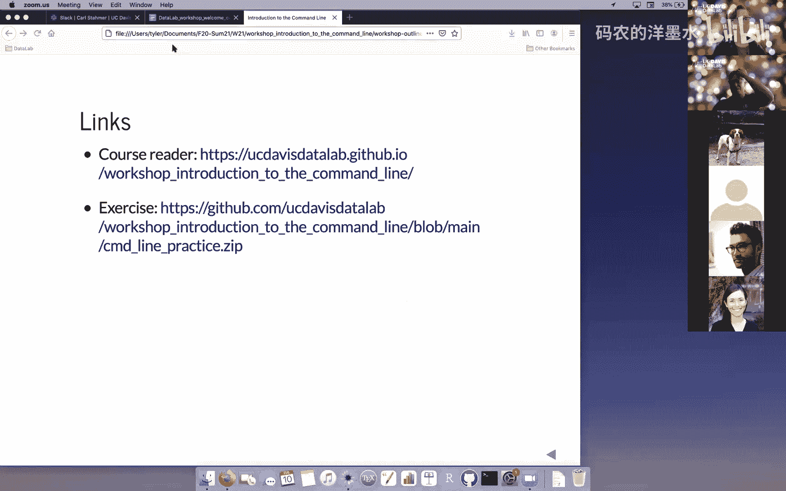
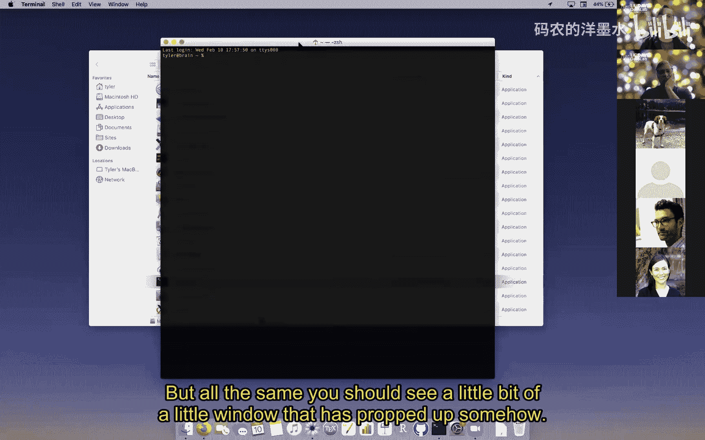
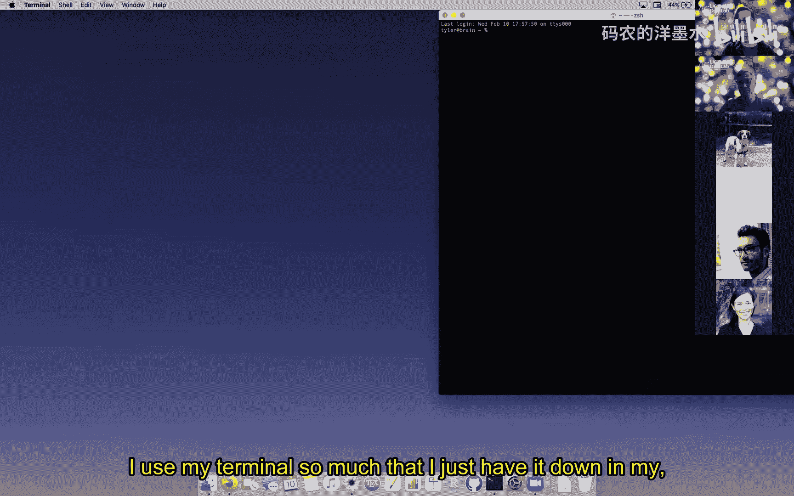
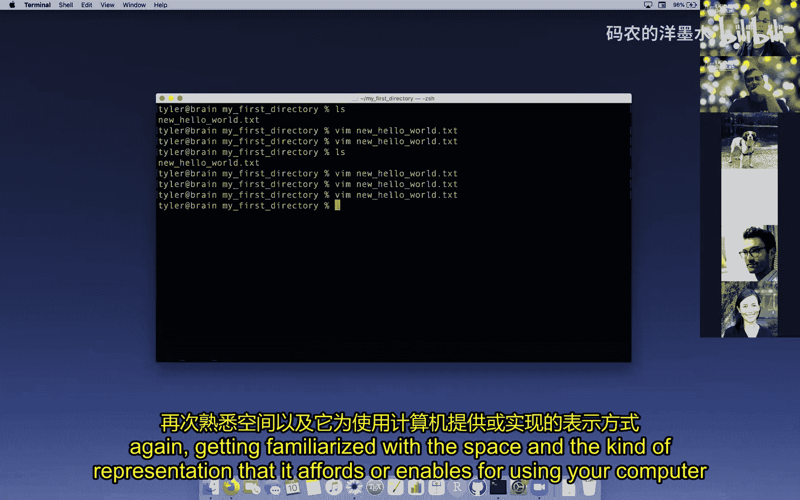
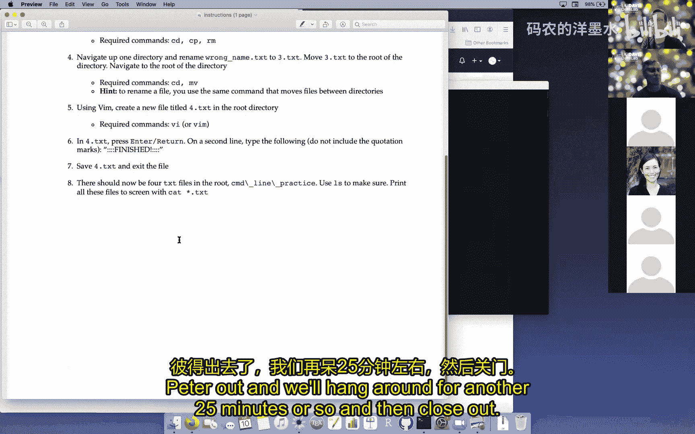

# 命令行入门：第2讲：命令行基础与文本编辑


在本节课中，我们将学习如何使用命令行界面与计算机交互。我们将从基本概念开始，了解命令行与图形界面的区别，然后学习核心的导航和文件操作命令，最后介绍如何在命令行中使用文本编辑器。


---



## 概述：计算机的另一种视角

计算机环境由多个抽象层级构成，从底层的二进制（0和1）开始，逐步构建到我们熟悉的图形用户界面（GUI）。命令行界面（CLI）是另一种与计算机交互的方式，它不使用桌面、窗口等图形隐喻，而是通过文本指令进行操作。理解这一点有助于消除对命令行的陌生感和畏惧感。

---

## 导航命令：探索你的计算机

上一节我们介绍了命令行的基本概念，本节中我们来看看如何通过命令行在计算机的文件系统中移动和查看信息。

### 查看当前位置与内容

打开命令行后，默认界面信息很少。要查看当前目录下的内容，我们使用 `ls` 命令。



```bash
ls
```



执行此命令会列出当前目录中的所有文件和文件夹，类似于在图形界面中打开一个文件夹窗口。

### 获取详细信息

`ls` 命令可以配合标志（flag）使用，以获取更多信息。例如，`ls -l` 会以长格式列出详细信息，包括文件权限、所有者、大小和修改时间。

```bash
ls -l
```

### 查看隐藏文件

在计算机中，以点（`.`）开头的文件通常是配置文件，默认情况下不会显示。使用 `ls -a` 命令可以查看所有文件，包括这些隐藏文件。

```bash
ls -a
```

### 获取命令帮助

如果你不确定某个命令的用法，可以使用 `man` 命令查看其手册页。

```bash
man ls
```

要退出手册页视图，按 `q` 键。

### 理解文件路径

要了解你当前在计算机文件系统中的确切位置，使用 `pwd`（打印工作目录）命令。

```bash
pwd
```

输出结果是一个从根目录（`/`）开始的路径字符串，显示了你的当前位置。

### 切换目录

要进入另一个目录，使用 `cd`（更改目录）命令。

```bash
cd Desktop
```

命令执行后通常没有明显提示，但你可以通过提示符的变化或再次使用 `pwd` 来确认位置已改变。

### 使用特殊符号导航

命令行中有两个重要的特殊符号：
*   **`~`（波浪号）**：代表你的家目录（home directory）。
*   **`/`（斜杠）**：代表根目录（root directory）。

你可以使用它们快速导航：
*   `cd ~` 可以随时返回家目录。
*   `cd /` 可以进入根目录。

每个目录中还包含两个特殊的符号条目：
*   **`.`（单点）**：代表当前目录。
*   **`..`（双点）**：代表上一级目录。

例如，在 `Desktop` 目录中，使用 `cd ..` 可以返回其父目录。

### 绝对路径与相对路径

*   **绝对路径**：从根目录（`/`）开始的完整路径。例如：`/Users/Tyler/Desktop`。无论你在哪里，使用绝对路径都能直接到达目标。
*   **相对路径**：相对于你当前位置的路径。例如，在家目录时，`Desktop` 就是一个相对路径。

使用绝对路径可以让你从任何位置直接跳转到目标，这是命令行高效的原因之一。

### 处理文件名中的空格

文件名中的空格在命令行中会造成歧义，因为空格通常用于分隔命令和参数。如果必须处理带空格的文件名，需要使用反斜杠（`\`）来“转义”空格。

```bash
cd My\ Documents
```

更佳实践是避免在文件名和目录名中使用空格，可以用下划线（`_`）或连字符（`-`）代替。

---

## 文件操作命令：创建、移动与删除

上一节我们学习了如何在文件系统中导航，本节中我们来看看如何创建、复制、移动和删除文件和目录。

以下是几个核心的文件操作命令：

### 创建目录

使用 `mkdir` 命令创建新目录（文件夹）。

```bash
mkdir my_first_directory
```

### 创建文件

有多种方法可以创建文件。一种简单的方法是使用 `echo` 命令将文本输出重定向到一个新文件。

```bash
echo "Hello World" > hello.txt
```

这行命令创建了一个名为 `hello.txt` 的文本文件，内容为 “Hello World”。

### 移动文件或目录

使用 `mv`（移动）命令来移动文件或目录。其语法是：`mv <源> <目标>`。

```bash
mv hello.txt my_first_directory/
```

这会将 `hello.txt` 文件移动到 `my_first_directory` 文件夹中。

### 复制文件

使用 `cp`（复制）命令来复制文件。语法是：`cp <源> <目标>`。

```bash
cp my_first_directory/hello.txt my_first_directory/hello_copy.txt
```

### 删除文件

使用 `rm`（删除）命令来删除文件。**请谨慎使用此命令，因为它通常不会将文件移至回收站，而是直接永久删除。**

```bash
rm my_first_directory/hello.txt
```

要删除目录及其所有内容，需要使用 `-r`（递归）标志。

```bash
rm -r my_first_directory
```

---

## 命令行文本编辑：Vim 入门

上一节我们掌握了文件的基本操作，本节中我们来看看如何在命令行中直接编辑文本文件的内容，这将使用一个名为 Vim 的文本编辑器。

### 为什么使用命令行文本编辑器？

像 Microsoft Word 这样的图形化编辑器会在文件中保存大量格式和元数据。而在数据处理和编程中，我们通常需要纯净的文本文件。命令行文本编辑器（如 Vim）功能强大，尤其在远程服务器或没有图形界面的环境中必不可少。

### 打开与编辑文件

使用 `vim` 命令后接文件名来打开文件。

```bash
vim new_hello.txt
```

Vim 有几种模式，最常用的是：
*   **普通模式**：打开文件后的默认模式，用于执行命令、导航。
*   **插入模式**：用于输入和编辑文本。

从普通模式按 `i` 键进入插入模式，此时可以开始编辑文本。编辑完成后，按 `Esc` 键返回普通模式。

### 保存与退出



在普通模式下进行保存和退出操作：
1.  输入 `:` 进入命令模式。
2.  输入 `w`（write）并回车以保存文件。
3.  输入 `q`（quit）并回车以退出 Vim。

你也可以将保存和退出合并为一个命令：在普通模式下输入 `:wq` 并回车。

---

## 总结与练习

本节课中我们一起学习了命令行的基础知识。我们了解了命令行是与图形界面平行的另一种计算机交互方式，学习了使用 `ls`、`cd`、`pwd` 进行导航，使用 `mkdir`、`mv`、`cp`、`rm` 进行文件操作，并初步接触了使用 Vim 编辑器在命令行中编辑文本。




为了巩固所学，我们准备了一个小练习。请下载练习文件，按照其中的指引，运用今天学到的命令来完成一系列任务。通过实践，你会对命令行的使用更加熟悉和自信。