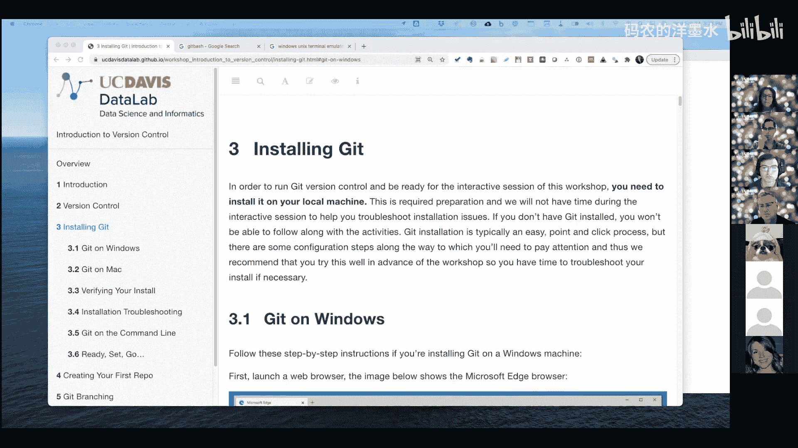
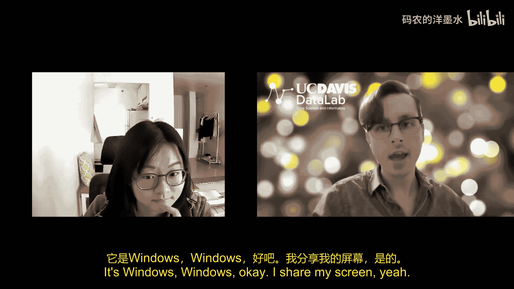
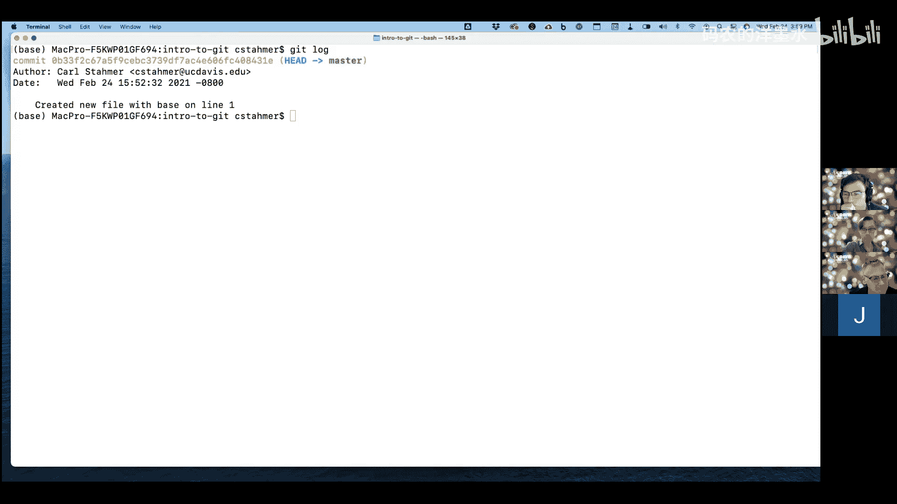
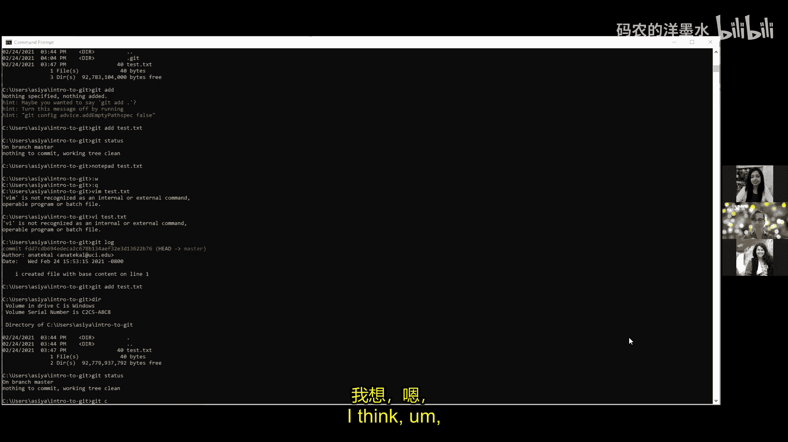
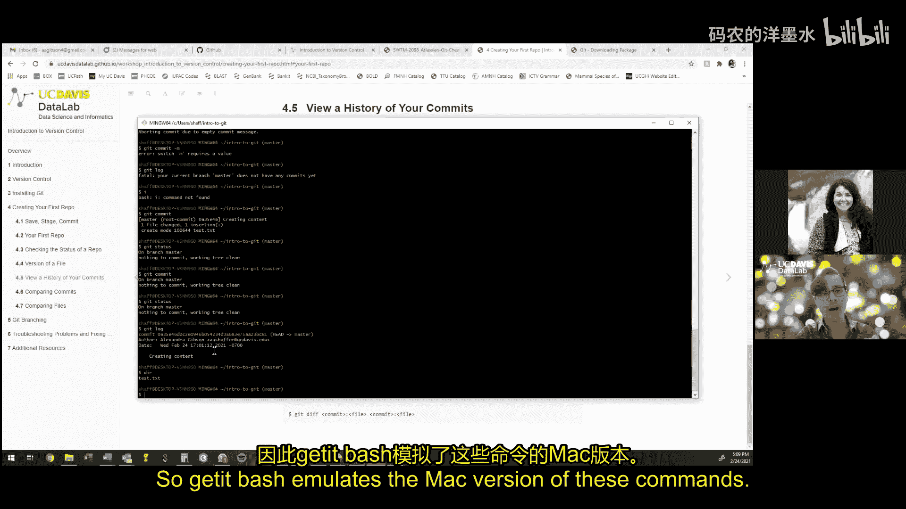
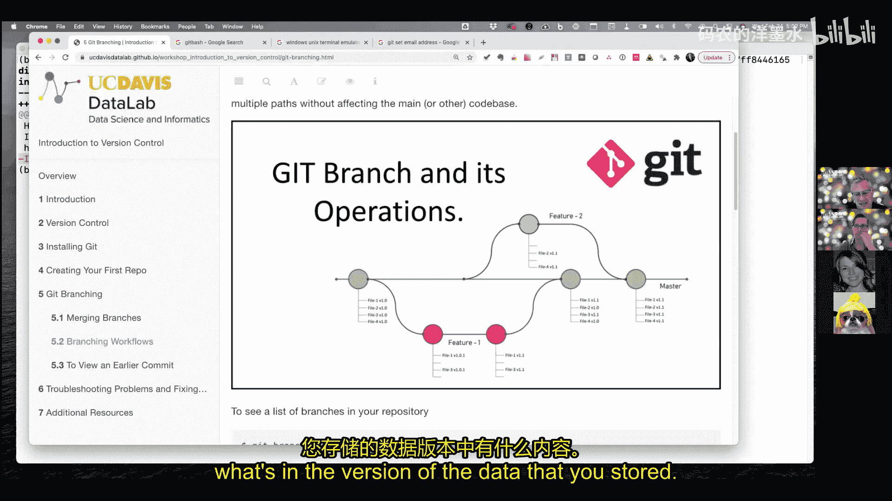

# 【全集】加州大学戴维斯分校 计算机科学 中英字幕 1080P p03 Lecture 3 - git -BV1cqFNzYEvp_p3-

So you will have and the reason we record really is so you'll have the recording as a reference to go back to so we will post it from the workshop page on the website so that you'll have it at your disposal at the reader afterwards to get things going okay so that should be all of our logistical things that we need to cover business wise so I think we will go ahead and just dive right in and the content again which is version control and particularly to get software and using that for version control。

I'm going to go ahead and now share my screen here with everybody， let's go with desktop two。

So everyone should be looking at a version of the reader in my screen。And。

I want to talk just a little bit about version control itself。

And what version control is and you why we use it。So this is a screenshot from a a folder on my Macintosh computer。

 my folder。 If you were on your windows， obviously。

 your Windows Explorr would look slightly different。 This is a very common。

Thing to find on people's computers， which is a single folder with multiple versions of a document version one version2。

 version3， version4， version5， version 286 if you're writing your dissertation up to version 2095 however many versions of it that you save so that you you know as you go along the way so it' is something we see that's very common both just working individually。

When you' on your own files and then especially when we start sharing files and we'll see these file names grow with people's initials and all kinds of ways that people tried to track that you know or maybe you you put the dates in them again initials things like that you know this is a form of version control with you're trying well this is a form of versioning when you better than version control the idea here is where you're creating multiple versions of files but this very quickly get out of hand and there's a couple problems with this approach to things。

Which is that we can try to store some metadata。In the file name as I've done here。

 like a date that lives in here that tells us something about it。

 but there's very little attached to these versions that tells us anything about what's in each version and so that's one problem with this type of system is it doesn't really only we have to open every document to understand what's in it and to see why I saved a version then like why did I make you know on October 12 a version of this file I don't remember or I don't know and there's nothing ever to tell us we have to actually go into the documents themselves and read them to recreate the version history so this is you know has a lot of versioning but there's not a lot of control of the versions there's nothing surrounding those versions to help us make sense of them or understand what's happening in those versions。

And this can very quickly become unwieldy。I mean， this can start to grow to be a very long list that just gets out of hand and especially if we're talking at the project level like here we're just looking at a single folder with a single file。

 but most of us the way we work I may have a folder for a project and 20 different files in there all relating to the same project right my notes。

 some actual code， some exhibits， you know， various types of files that live there。

And you know you can see now if I have multiple versions of each one of those various types of files things will get out of hand very very very quickly。

 so the idea between version control is that we have a system that actually controls these versions helps us organize them tracks them and does a better job and solves this fundamental problem and that's what version control is all about。

There's a long history of computer assisted version control or what we now call a VCS。

 a version control system get what we're going to use today is not the only option。

 there's a lot of other options out there that have been used throughout history。

 Microsoft visual source safe source forge。You know version version control system real there's a lot of different ones that have been out there so we happen to use get it's kind of grown as of late into an industry standard it's the most used version now out there and you know that's why we use it and it has some advantages over older versions。

One aspect of version control that I want to point out is the question of local versus server based version control。

So this is a key concept。There's local version control what you do on your computer that allows you to use software to manage and control versions files that you create on your local computer。

 and then there's server based version control， which is using a server out in the world to actually handle the management of the version control。

 something that people have。Probably everybody here has heard of is a thing called GitHub。You know。

 GitHub is a server based system for managing version control， it happens out in the cloud。

But it is actually and one of the reasons why people love Git is it's a hybrid between just local and server version when we're working in Git。

 you can use GitHub just on the web and just in the cloud。

 what we're going to do today is we're going to run Git locally we're actually going to install Git on everybody's computer if you don't already have it and we're going to run version control locally。

But the great thing about Git and the thing like GiHub or Gitlab and there are other services out there is that Git will actually communicate with a server based system and allow you to work in teams across the network so you work locally to track your files。

 store them all the things we're going to learn today and manage that repository and manage your files on your local system but it can also communicate out with with a server for teambased stuff we are not going to do GitHub today today's lecture and workshop because ultimately I'm going to stop talking or you know at least talk less and we're going to start doing things。

😊，Is really we're going to focus on Git locally and just how to use Git itself and how Git functions because those functions are the same。

 whether you're working locally or remotely。So that's what we will be covering today。

In order to do that and for everyone to work successfully， everybody has to have gi。

Running on their local system。Now， many of you will already have Git running。😡。

If you are on so the first thing I need everyone to do and this is going to be an interactive workshop so hopefully everybody knew that going in it's not just lecture we're going to actually do stuff here together。

The first thing to do is to if you're on a Mac this you're going to go to your。

Where is it applications directory？Utilities。And you're going to have an app there called the Teral app。

Everybody should probably be familiar with because the one of the prereqs for this course was some familiarity with。

Command line。If you launch that terminal app on a Mac。Then you can just type gi。Dash， dashed。

 get spaate。 and let me zoom this in a little bit better。So people can take ca。See that okay。

 if people can just put some thumbs up or。Let me know that that should。

 but that should be visible to everybody now perfect。

 I see some thumbs up Thank you get space dash dash version。And you should。

 if you already have Git installed， you will see something like this Git version boom boom boom。

 if you don't have Git installed， you'll get some type of an error saying don didn't understand the Git command。

On a Windows machine， if you have previously installed Git， if you go to your programs。

The where you launch your Windows Explorer and go to programs or and you can just search for it or you can run it。

 you want to look for something called get bash。If you've previously installed Git。

 you will have Git bash on your system。And Gi bash operates just like the terminal。

In in on the Mac app， when you launch that you'll get a command prompt that will let you type the Git spacespace version so you want to look for Git bash if you have Git bash you probably have gi but once you go ahead and launch it and just check with a git dash dash version just to make sure that you do it if you don't see Git bash in your programs then probably you don't have Git so we'll move forward to the install but everybody should just check to see if you already have some version of Git on the system by running this Git dash dash version。

嗯。If people did this successfully， let me get a。Trying to get back to where I can see people。

Just so that I have some sense。If you go into your。User interactions。And the participants。

 if you just give me a yes。Or a thumbs up or some indicator that I know that you already have get people that discover they already have yet。

 just so I know how many people already have it versus how many don't。 So I've got one。2，3。For。Okay。

 so。We've got a few people that already have Gi， but most people do not already have it。All right。

Perfect， so the people that already have get， what time is it 3，20。

You can probably safely take a break until330 while we get the other people back in and get them hooked up with the。

With get on their system so that everybody's there so if you you know want to get a cup of coffee or drink or whatever and then just come back to 330 I will make sure that even if we get faster than that we won't we don't start again until 330 so that you don't get left behind and the rest of the folks will need to pay attention here to our to get get installed。

And。In that course reader。That I put a link and I will drop another link specifically to this section。

installsal and Gi。So everybody else that doesn't have it。

 what you're going to want to do is go ahead and go to this link。Let's see participants chat。

 I lost my chat window。Where did my chat windows hiding from me？More chat， there we go。Okay。Okay。

 if you if you have。Get but get bash I see people have already answered those。 you should be fine。

We see that， okay， but everybody， so everybody who doesn't have get。嗯m。

You're going to want to go to this link。And follow the appropriate direction。

Whether for your operating system so there's there's detailed instructions for Windows which is a little bit of a longer installation process it has screenshots of every single screen along the way so you should be able to follow that no problem。

嗯。The Windows version is also are on the Mac is also down there。 It's much simpler install。

 It's really just a basic Mac install and sets everything up。

 So you'll want to go to your appropriate。Operating system。And go ahead and work through the process。

And start that install and then we have a team of people here to help you。

 So if you have problems during that install process， just pop in， unmute yourself。

 say something or drop something into chat。And so that we can help you get through whatever issue you are confronting。

All right， so you should be on。Self directed at this point getting the install done。

And if you finish just a 330， will reconvene， or if you have a problem， let us know。

Hello， okay， so let's see， so are you're on Mac。It's Windows windows， okay， should I share my screen？

诶。这什 list。Is this what we should be using？Yeah， so that does look right if you try to do Gi version。

 let's have you type that in。Oh。You're actually set must have been the magic of the breakout room。

 but yeah， you should be fine。😊，Thank you。

Okay， it is 3，30。 if I can get in the。Interactions of everybody and your participant interactions。

If everybody can give me just a yes。嗯。That if you successfully have get if you're done and I will that helps me keep track so yes。

 it's better than the thumbs up because the thumbs up will disappear。嗯。

And then once I see that everybody。Is yes checked。We will。Move forward。Okay， let's see。 Okay。

 I got a lot of yeses that were in the chat， too。 So yes， yes， yes， yes， yes， yes， yes， yes， yes。

 yes。 Okay， so looks。Like most people， one， two， three， four， five，6，7， eight，9 10。Okay。

So we'll wait just a couple more minutes， it seems like we have a few people that still aren't quite done yet。

But most people are。Okay， let's see。Is Tyler back， Tyler， are you back。

 Are you still in the breakout room with folks here Okay， all right。

 is there anybody who has not finished installing get。

Then just go ahead and give us a no in your participant actions or go ahead and unmute yourself and say no wait a seconds see if anything shows up and if not I。

We'll think that we are good to go and we can move forward。Okay， I'm not seeing any nose。

 so we will go ahead。And march forward perfect， Okay。

 so we are now ready to go and we can actually start doing some things with get。So。

The first thing we're going to do is have everybody， whether you're on a Mac or Windows。Um。

To and you can do this in your well let's let's all do it command line actually just so we can get start getting some command line shops ready to go So on the Mac I'm going to launch that terminal application utilities terminals and windows you will launch。

Get bash。And I sorry， I typed it， but you should just you be able to search for get Baher to just see the icon in your programs directory。

So that you。Tyler， are you watching the waiting room？Okay， thank you。

So that let's see it where I lost my window now。You get to a command line right when you have your command line we're ready to go and so here's it again everybody can check。

Make sure that your Gi version， it doesn't matter which version you have if it's the latest version of the newest version and we know that we're there Okay so what we're going to do is we're going to start tracking files we're going to talk a little bit about how the files get tracked but the first thing we're going to do is we're going to just make a a you know practice directory for this workshop so it doesn't mess everything up and for a simplicity sake。

 we're going to all put it in the same place， which is in our home directory and so if you're in your get ba or your terminal if everyone just does a C space till day。

Right here， that will move。Green。😊，Which on a Mac will look like。

The actual file path is user see Stemer on Windows， I think it's home dash。

 but it doesn't really matter because we'll just use that till day shortcut CD till day we'll get everyone to their home directory。

And then from there， we're going to make a new directory， MDIR or make directory。

And our command line， and let's just call it intro。To get。

Probably nobody already has an intro to get on their thing。And if everyone executes that command。

Then we should be good you should have that so I'll move a little bit I'm going to try to move a little bit slower just so that because everybody here doesn't have a lot of practice in Uniix probably in the command line。

 I'm going to run an LS command for list。And just look， and I can see。

That I should have a intro to get。File directory， excuse me now in my home directory。

Which is perfect， so now I can CDd into that。CD intro to get。And。

We're good I'm now in there if I that there's nothing there。

 which is what I expect PwD tells me I'm in my intro to get so let's if everybody just can make sure they get that executed and just once you have that directory in place and you're well situated there go ahead and just you know flash some plus signs or。

嗯。Coms up good， it looks like people are getting there。嗯。Okay。

 and I see yeah Tyler's also retyping those commands in the chat whether it's much easier to follow so good job Tyler。

Okay， so I am now in my。Intro to get folder， I got some thumbs up， Okay， I've got one X。So。

Alexandra is having an issue。It looks like if you're still having that issue。

 go ahead and throw it into chat so we can see exactly what it is if it's still an issue。Okay， good。

 I see a check there now。 So it looks like we're all good。 Al right。

 so now what we're going to do is we， first of all， just so that everybody sees， again。

 that command here。 and I'm going to make mine even bigger。 So it's very easy for people to see。

mOn my screen。If we run an LS。Again， for L and Uniix land we get nothing。

 this is an empty directory we're doing this for a reason。We're going to run LS space dash A。

And that's all that will show any hidden files and any of living in this directory and。

All we will get， this is standard Uni， just the dot for this directory and dot dot。

 which is a pointer to the parent directory。So still there's nothing living in this directory in any way okay。

 and that's what should be to be expected we created a brand new empty directory in our folder。

 but we're going to do now is we're going to do what we call putting this directory under version control or creating a repository。

We're going to make this directory a Gi repository or repo for short。

 you'll hear that all the time because people say my get repo instead of repository。

The way we create a repo is we take some directory on our system and we place it under the control of the Git software that we're running locally。

So what we do here is we're going to just type a gi command get。Space in it。

 which is short for initial eyes。I'm going to hit return。

And you're going to see you should get a message something similar to this。

That yet initialized an empty git repository。In user C staer intro to get and then you can see I have this new little gi here right and everybody should be able to execute this on their machine and then you will have now a git repository。

And the first thing that I want to show relative to this is that if we run an LS again。

 once you've run that command and youve got you have a repository， if you hit LS A。

You'll see that now I do in fact have this new hidden directory that's a git directory。😡。

That is where Git stores all of its data that it needs to do its work so all of your versions and your history and everything actually live in this folder and we're not going bother to explore that too much because it's beyond what you need to know to use Git but it is interesting to see that that's how Git works because Git workss this way。

 it doesn't store anything like on a server somewhere or somewhere else in your file system it's all right here once you put a folder or directory under Git control you make it a repository you can actually move that around on your file system and it'll still work just fine。

😡，Because it's always working relative to itself wherever this gi folder lives is the root of this repo and then everything that happens below that is part of that repository。

 so it's recursive moving down the directory stack from there。

 but you could move this directory around and get will continue to work just fine。😡，So， you know。

 that's one of the nice things about it it's not like some big centralized thing living somewhere else it just lives。

In the directory itself。So I'm going to introduce here a really useful Git command。

 which is Git status。Get space status and if everybody types that。

You'll get back some information here that it tells you about its current status as the command implies。

😡，Now also before I do that as you're seeing the way we use Git always is we type the word git itself space and then whatever the Git command is that's how we invoke it so we run Git in it to initialize we run Git status that tells us the status tells us we're on branch master and we're going to talk about branching in a little bit and I'll explain what that means the master branch is the default first branch that you live on in Git it's it's your home base in Git is the way to think about it for right now until we get to talking about branching a later on to think about as you are at the beginning at the home base and there's no commits we haven't。

Committed anything to this repository right now is just an empty repository。 there's no files in it。

 there's nothing to do。RightSo is everybody able to get a get status， see where they're at。

 give us some kind of interaction thumbs up， yes。I mutute say yes， good， I see plus is okay， right。

 awesome。People are chiming in good all right， so everyone's with me beautiful。Okay。

 so now we can really start having some fun once we got everybody on board。

So we're going to get we have our empty repository here what we want to do of course。

 is track some files right so what we're going to do first is just as a group let's just all use。

VI we'll just use since we're all command line anyway。

If everyone just says VIt file or let's just say test。

 Txt you can use VI or Vm if you're an experienced user you have nanono or some other text editor you want to use you you know Emax。

 whatever you is good for you but for those that aren't experienced with a text editor best to just follow me in VI or VmM I always do VI it's actually going run Vim but you can just type VI and it will work text and that is going to when I hit return here。

 if you don't have a lot of Uni experience here， don't freak out when this happens we'll walk you through it。

 it's going to enter you into a Unibased text editor。

We we always teach this as part of our command line introduction class because you end up in the UniIX text editor a lot in your Uniix world。

If we look at the bottom of this， you can see it's telling us that we are in test text and that it's a new file and everyone should see something similar。

And to as a reminder， and I'll put this in chat。Right now we're in console mode。

 have to we can't enter any information in this text， we have to get into insert mode。😡。

To make this happen。So what you do is just hit your eye key， it will put you into insert mode。

And you'll see that when I hit I， it changed to insert on the bottom here。

And now I'm in insert mode and now I can start typing actually typing text in my file now I'm insert mode。

This is actually， let's just say。Hello， world。We'll go with some conventional stuff。This is my test。

Get file。You can type whatever you want， but this is what I'm typing in mind if you copy me then your' as we go through the rest of the class your log files when we look at logs and stuff will look more similar。

But you can just put whatever you want in this file now as a reminder。

 I need to get back into command mode here。In my VI， if I want to save this file and if that is。

 I'm putting this in chat， your your escape key is the first thing you want to hit if you hit escapescape。

It will。if I have to hit escape， not when I'm in chat。

 I have to hit escape when I'm over back over here。Escape mode， then you're going to hit。

 let me get my chat window back。A colon key。Followed by A W。You can do that all in one thing。

 so it looks like this Col W。If you type that。So I have to get back over here。Escape。Colon W。

 you can see on my screen that that colon W after I hit the escape key。

 I'm able to type text in the bottom， I do my colon W。

Hit return it's telling me that it wrote one line 40 characters written to that file now we just need to get out of here we'll do again what we have to do is just do colon Q。

For quit。You can see at the bottom， I have a colon queue。Return。

And it takes me back to my regular console so hopefully everybody was able to create that file if I run an LS command。

Again， hopefully people can see my screen， that's just LS。

Then I can see that now I have a test dot text file in this directory。

 I'll go ahead and do an LS dash just so I can see everything I've got my Gi directory I've got test dot text。

And everybody else should have something similar， we can just get some thumbs up。

Or if anybody is stuck， give us a thumbs down so that we can try to help you make sure you get something。

Get through the VI process to get something written。Awesome， okay， I have one。

Person that's having problems， Tyler， do you see that？

Can you jump over and see if you can get a chat going Yep， if anyone who is having trouble。

 just go ahead and pop a comment into into the chat there or message me directly and we'll either try to solve there or jump into a breakout room。

Okay， so while they do that， we'll let try to get that worked out， everybody else that's good。

We can go ahead and do this and we'll get used to doing this again a lot。

 this is a very useful command it is your friend get status。Okay。

 and we see that when we run gi status this time things have changed。

 I'm going to ahead and clear my screen。So that it's easier for you guys to follow and run that again。

It status， there we go。now when I run Git status， I can see that I'm on branch master still。

 this is all fine， I have no commits， but Git is telling us something。Untractracked files。

 it has a file test dot text。That's not tracked and what is telling us that specifically is saying in this repository and gets mind is saying I have found a file that you're not doing anything with and now lives here right？

😡，And it's telling us this is something really good about Git when you first start using Git move slowly and pay attention to what Git is telling you Git is quite smart and it is almost telling you exactly correctly what your next move should be it's really it's it's very verbose in this way and so it's telling us say you have untraracked files use Git add file to include and what will be committed right and it turns out this is exactly what we would want to do before we do it though。

😡，I want to just go back and talk a little about what it means when we track and commit files on how Gi does this。

😡，So if we look。Here in the course reader and don' you should be able to see it on my screen。

Gt works like this okay it's it's a couple stage process the way get so we're right now in our working directory it just has the one file test。

Dot text that's in there。When we talk about versions。

Gt is not saving every single change like every time you type a new word。

 it's not tracking every single file change that was ever made so you couldn't just go back and undo every single character you've typed or things you've deleted along the way that's not the way it works。

😡，The way Gi works is we tell it， I care about this particular instantiation of a file， this version。

 and I want to save this version， so you have to actively tell it。😡，To save a version of the file。

 it doesn't just do it for you automatically。😡，And when you do that， it's a couple step process。😡。

First you tell it， okay， I want to create a version。😡，And we call we're calling a version a commit。

I want to create a commit。And I want to include these files from the directory I'm working in in that commit。

😡，So in this particular image we right now have one file in our directory and that's all we need for right now。

 but in this image we have three files in the working directory we have to tell get。

To stage those files and that's what the official terminology is staging。

 to stage the files we care about for this version or this commit。😡。

So step one is just to stage them until get， I care about these and I want to include them in this commit。

That's where we're at。When we're right here。We have untracked files。

We haven't done anything to it if， but if we run a get addd。

 it will stage it so that the next time we run a commit， that file is included in the commit。😡。

So let's all go ahead and do that and here again， we can do exactly just follow the directions we just type get。

Add。Test dot。TXT。And。In Muix land， it looks like nothing happened that's usually a good thing if I didn't get an error。

 it probably worked and we can check this by checking Git status again。

Now we see our Gi status has changed。😡，We're still on our branch master， we still have no commits。

 but it's telling us specifically that changes to be committed。

 we have a new file test do TxT that will be added to this commit。Okay， so at this point。

We now have our file in our staging area， but we don't actually have a commit。

 so Git isn't tracking this version yet， it's not saving it， it's just they're ready to be committed。

😡，In order to actually save this version of the file。

 we have to actually tell now get I want to commit this file。😡，Okay， so back on Gi。

 everybody look at my screen， this is pretty easy the way we do this。What we do is we type git。

Commit。And let's do it long version here first， I'll show you a shorthand a little bit。

 but this first time we'll just do it short， we just do get commit and hit return。

And this should look familiar when we type that， it throws us immediately。Into VI。In of Vm。

 right or whatever your default text editor is。Arthur Tyler someone watching chat I see some things going on there make sure that there's not no one that needs help thank you。

Okay， so we're here。And what it's doing is it's asking us for a message。😡。

So please enter a commit message for your changes。 and it's telling us that the line starting with。

A hashtag will be ignored。And then it's suggesting some basic commit structure on branch master initial commit boom boom boom。

 but all of this stuff is going to be ignored because it begins with a hashtag unless I unhash it and decide I want it to be part of my message。

Okay， here what I'm going to do is hit I for insert to get an insert mode。

And what you want to do is type and here I'm going to be really I want everyone to be sure you hear me there's a couple there's a kind of rule when you're using Git and it's like commit often and comment verboly。

These comments are your friend and you'll see in a minute why as we start looking at the logs and start working with multiple versions。

 but when you comment you want to put in a very specific comment。😡。

Like I'm going to say created new file。With base content。On line one。

Right if I were writing code or this is a data file or a bunch of code a long code file。

 I try to be very specific like I made changes to these lines of the code and this function this thing like you want to really be explicit in your comments to your commits it will make your life way easier when you have to go back six months later and try to figure out which version of the file you're looking for which commit does it live in。

😡，So once I'm there， I've made my commit message， I'm going to use again the way we always work with VI。

 again， remembering that the escape key， I'll put this in the chat is what gets us into back into command mode。

And then once I'm in my command mode， you can see insert has disappeared off the bottom of my screen。

Let me pull my chat back up。Again， we can just do command W or colon W for right colon Q depending on what kind of system you're on。

 you may be able to combine those into a single WQ right and quit that will not work for everybody but for some people it will and that will save our commit and do it so I'm going to run it online。

When we do that， it's just going to close and then we get this nice message from Git。

Which you should get to。Which is it created a new file， one file was changed with one insertion。

 that one insertion means how many lines were affected and we only did affect one lines there was only one line changed it was in create mode because it was new and this was the file。

If we run Git status。We see that we are on branch master nothing to commit the working tree is clean okay。

 we have nothing to commit why because we haven't made any changes since our last commit everything is there and we're totally coppotic and ready to go。

What we can run is a thing if we want to look at our commits and we'll do this several times as we move forward in the class to start looking at different versions of commits。

 but if you go gi log，Let me let me run it clear and then I'll just run that at the top again get log。

It's giving us a lot of information。 Now it's telling us we have one commit。

 That's the commit we just made this。Unique identifier will be different on your screen than mine because it's generated locally on the fly。

 and it's a unique identifier for that。Commit。It was committed it's currently the head of the master branch。

 and again， we'll talk about branching in a minute the head and get means the top。Commit。

Wherever is the top of the commit stack because each time we commit。

 we're going to get a stack of these， right？ And then we get。

Our message that we put in shows up in the log right I'm the one that committed it because I'm me and it'll all always be you when you're working locally。

 but it won't be once you start working with teams the date and time of the commit。

And the create new file base on line one is the the that is the message that I put when I did my commit Now you can imagine and we'll start to experience this going on if I have 20 of these things commits in a row or even 100 or 200。

Having a good comment helps me figure out which of the earlier versions I care about or might want to look at。

😡，If yours says one file changed two insertions it's because you probably because you hit carriage return at the end of the first line and so there's actually two lines in your file second ones just a blank line I happen to see that one come across but that happens often so that's probably exactly what it is whereas I didn't hit a carriage return at the end of my line so there's only one line in my file and again gi counts insertions is the lines that were that were acted on in that case Okay does everybody feel happy and coptic that this is working for them so far or do we have any big problems。

Perfect。Okay。We are at。358 we've been here for an hour what we're going to do is take a quick break this is a good stopping point for just a very fast break for people that want to stop away we'll just take five minutes so we don't lose too much time if you have if you're having problems stay and we'll try to work it out。

And， but otherwise， we'll take a quick break and we will be back， we'll reconvene at。

405 so that's six minutes from now five minutes30 seconds and then we'll kick back in and the meantime we'll deal with the few people that have some some problems but everyone else will be off for we're not closing the zoom or anything but we'll reconvene at 405 okay。

All right， I see one problem has a problem with the BI editor。

不。Hi， Tyler， so I。Was I reached a place where。Can you hear me， Yeah， yeah， sorry， just catching up。

Sorry， yeah， so I I was in the Git in it option where I check the Gi status。

Nothing I did the Gi commit。I'm a little lost now so i'm at the place where I typed the insert come on and then create new file but I don't know I think i've done something but I don't know how to get out of it are you able to share your screen。

对。嗯。There。

Let's take a look this is the one place where Windows throws me off a little bit。

 so I have to think across the platforms here so can you enter。A message from here。

 So try to hit eye and just type something。Okay， so good。Yeah。Now， what do I do？Okay， so from here。

 if you hit just escape for me really quick， I just want to I'm going to look for something as you do that。

No， it's just it just goes okay， I'll ring all the one Yeah， I'm trying to think about which。

I pressed enter2 and nothing。I don't know what this is， Why there are。Yeah， I'm quite sure either。

 let me just see here。Is it because？I'm in get commit。 I don't know this moment than on。No。

 there's just one。Okay， so let's try One last thing， so。

So we're it escape I just want to make sure just double check that we're not in vim of just already so i'm pretty sure this won't work。

 but let's just do it let's do escape and then。Colin Wq。And then， hit enter。I'll type that in。

O the Q Q。 I don't。 It's not typing。Apress escape。And Col Wq it' not typing anything a but perfect So this is actually good you can see down over in the left hand corner in the bottom you see that there's a little cursor over there Oh yeah see now so you're actually in vim right now which is great so you can follow along pretty easily so just hit backspace。

😊，And then， hit W。And in Q。And then enter。 and then there you go。 Now you are out of。stop us。

It should have said it committed， right one？I think。So。It comment。And then get status。

Go ahead and hit get log for me。And then let's do a D the DIR command。So two files。

 and there should be three when I didn' dig it。对对。So that should be the good and then you have that file test our text。

 let's do get add。嗯。And then， test up text。Os， sorry。No' problem。And then let's do git status。

Previous， I did no bad test dot text。Yeah， and that's just to make the file originally。

 but it's rather strange to me that it just disappeared entirely， hold on just a moment。

I tried creating it again。Yeah， and then it seems that you。But the high， yeah。So you havet there。

 if you just do VM test。txt， what happens？Am I able to do this step with Q？没有。

So go ahead and hit VIMspace Tst。text。ESD， right？Okay， so and then VI still didn't work there。

And then okay， but that shouldn't matter because we are on。You are able to make it。

 So I'm sorry one more time， just hit Git log。And then and just go in over the motions one more time。

 get add T and then that file testt text。Okay， so。We have it there I let's let's put a pin in this。

 And then when we actually do。A change will'll see whether or not this is working。

 I think right now you're okay。 it's just the dos prompt as being very terse in its responses。Yeah。

 just。Yeah， nothing to comment。that's okay already because you just put you already put that in so I think what you could do is either go in and edit that test file and then make a change and then see and then you'd have to say get add that file again and then you might see some more information but right now I think we're actually okay here in terms of you know sort of stepping through the difference between adding the file to the staging area and then actually committing it so once you've committed it you're fine but the commands that you can get into vim through the commit command from from Git so there you would do that colon W colon Q to get out once you've made a change there's a shorthand that you can do which is just Git commit。

The file。 And then。M M and then your message in quotes like that。

 and then that way you actually don't have to go into another editor。

 you can just enter the message from the command line。好的，O。Thanks Diyler yeah。

 I'm sorry there's a little confusion on the Windows part it there's always a little so oh yeah。

 it works in some windows I mean within the comment window but not yeah I outside I have no explanations。

😊，But yeah， I think where's set for the moment， Okay， thank you。😊，I think I was having the same。

Alexander， you're the same problem I think I think she was able to help when you were working it out if I can just share my screen really quick。

 I think I just got lost when I had to set my identity and then I wasn't paying attention and got confused but I'm not sure if this is like the endpoint that I need to be yet。

Yeah， I'm just going to read through these really quickly here。How did you make your file？嗯。

So this is where。I so I did the get a the test stop text and then I got this so then I made my email account and then I think I accidentally was hitting things here that don't mean anything and then。

诶。Gs。😔，Daus so I was getting the same thing with nothing to commit as her。

 but I think it's because I did add it successfully and I remember seeing this that Carl was showing but I didn't take a look at it close enough to know if that's where I need to be Okay yeah I think you're okay let me know if not and we will'll correspond again but I think this looks okay to me and then yeah you can use the same sequence so you're using Git bash or just Okay if you're in gett bash and you should be able to follow along actually directly with Carl to get emulates the Mac version of these commands Okay so so you should be set on that Okay thank youep。

嗯。Okay， I think we are all back and ready to go。So。We should be able to march on。All right。

 so at this point， everybody has one commit。We lookeded at the log， we see where that is。

We can see our nice comment that we made to it so it's easy to figure out。If we run again。

 they get status。Then we see， again， we're back on branch master nothing to commit the working tree is clean and we are all good。

Okay， now let's go ahead and just make a change to our file。So I already got what it's called test。

t text， so I'm going to go VI。Test text。I'm back in my file。

I'm going to hit I again to go into insert mode。And。I'm going to just add some text。

I purposely miss making a typo。In the text， my last word Tme just so I have something to change there that's going to be the same。

Okay， then I'm going to go ahead and I'm going to do an escape to get it back into command mode。

You can once again see that insert has disappeared and then just a colon WQ。Or call W， calling Q。

Boom and I'm back out。And so everybody should have been able to make a change。嗯。And then again。

 if we get status。We get， again， some really good。Information from get。

 we get a little more than we got last time on our initial commit。We can use Git add。

To update what will be committed， so to put this file in the tracking area。

Or we can use Git restorestore。To discard the changes in the working directory in this case that would completely delete the file or no it wouldn't excuse me it wouldn't delete it it would just revert it back to its last version because it's not new。

嗯。😊，I'm trying to watch the chat are we good Okay looks like we're good Okay。

 Har really quickly I think you might you're just back a little far enough away where we can't see your face it's just disappeared into thats。

How's that， that's perfect。That's funny， okay。It was just the void。

 a voice from the void coming to the。😊，Okay。All right， so we can we can throw the changes away。

 restore it to the previously committed version， or we can add it and make a new commit let's go ahead and add it make a new commit。

Add。And I'm going to add test。txt。And I'm going to go。LS that's only there， let's go get status。

And now it's you know， ready to be committed。So changes to be committed are my one modified file and here I'm going to show you the shorthand now there's a shorthand way to do a commit and give a message without having to go all the way into the eye or into your text editor。

And it looks like this get。Commit dash M。Single quote。嗯。I added some text。AboutWhat is forthcoming？

In this file。Single line， beware if you do this， if you do it this way and you put a single quotes in your message。

 it will fry so don't do that right creatively or just do a regular get commit。嗯。😊，And there we go。

 I have one file change， two insertions because I affected two lines of the file。

If I run to get status again。I can see I' on branch， nothing to commit to two。Clean and I'm all good。

Okay， I'm going to go ahead and clear。someone having an issue？Though I heard something no， Okay。

 it was just some ghost noise。 All right， so if I again， get status as good。And we're all there。

And at this point now， you should be able to see。To do this。Get。Long。And now I see that I have。

Two commits。I've got the head commit， the one at the top where I added some texts about what is forthcoming in this file。

And I also have this where I've looked at it， you know。

 my original one where I created a new file on the base right， so which we've all seen before。So。

Now this is again， we can see where the commits get really useful。

Because they allow us to see what is going on。And it was obviously if you imagine if you had lots of these。

 it's way easier to read through these messages and get some sense about which one you might care about。

 right？Now let's say we want to see the difference。Between these two commits。

Then we want to see what's going on differently。Here。I can do， I'm going to just clear my screen。

 actually I'm not going to clear it because I want to see that。I can go like this get。Dff。

And let's just say we only have two here， but you can compare any two commits doesn't have to be the top one。

 you know it can be any level， I'm going to compare this commit the head and I could just say head。

 but I'm not going to do that just for here。With the second commit。That I want to compare them to。

From。And。When I do that。I get this really interesting return。Okay。😊。

It's comparing a test text to B test text， I get some unique identifier index information about them。

The key difference here is that。A is missing things that B has added。We've got。3 light 1。

Let me parse this out now。If we look at hellello world。

 this is my test kit file and the other one has I'm going to add some really profound stuff and here's here someday when I have time。

 those lines do not exist in the other one。So there's a plus one。

Insertion between the two files because these two count as a single， but there's three lines totals。

 that makes sense to everybody。 There's a negative one because I took out。

A carriage return there's three lines affected and the second file inserted one thing you'll get used to these don't spend too much time trying to make sense of that you can always look it up as as time moves on the key factor is to see that things were added in the second file and you can see what those were that these are the lines that are new in the second file。

Right it's showing us that difference everybody got that。嗯m。And so you could， again。

 you could compare these in any direction。I'm going to reverse the order on this。对。

We'll compare the first one to the second one。嗯。So now I'm putting my older file as the first file in the second file。

All right。And now it shows those as insertions， not deletions， right。

 because it's added those to text A。Does that make sense to everybody， whereas in the first one。

 they're missing。So they show up is deletions and the second one， their' additions。

Because of the order at which I put the two files， right？😡。

It's not it's not inheriting the order that by the age of the file it's looking at them explicitly in the order that I put the unique identifier for the file okay hopefully that makes sense to everybody。

😡，Um。And then you can see what is what has changed so it's a really useful way to start to look if we had multiple files in the commits it would show us the changes in every file in the commit that was there and so it allows you this quick way to go back and look at what's changed and what what hasn't this gives us a moment it's a good segue for a little interlude here just some discussion about what kinds of files can go in to get。

And the answer is， you can put anything。 You can track versions of anything and gi。

 But things like this diff engine。Will not work on nontext files so it can't identify differences between two binary image files in any way that makes sense。

 but it will still store accurate versions of those binary files no problem and manage them for you So you know it's getting more robust and its support for do csv files for spreadsheet files in terms of being able to diff things like and actually recognize that things fall in the columns and stuff。

 but it's not fully functioning yet so for now the diing will only work perfectly on text data of some sort but but the tracking in the committeeting works perfectly no matter what kind of file you put in there so you know it's still very useful if you use good comments because you can say this is the version of this image file where I change this right and where I change that etc So again your。

So you' friends and you really can do anything that you would want to do。From that very particular。

Repository， it just won't be able to use the dis。Okay， now I'm going to introduce a new concept here。

And so I'm going to go back to their reader quickly so I can just show you a graph。

So before I do that， let's run again， remember if we do all do a Gi status。A branchch master。

 nothing to commit， we're going to be clean remembering this on branch master。

And I said that was home base right for working in Git for lack of a better way to put it now I'm going to really explain exactly what this means。

And Git has this concept of branching。And the way branching works。Is that it allows you to pursue。

I'm going to just go down to this one。Parallel tracks of development。 Actually， I take it back。

 I'll show this one。Okay， if this in this image。Don't worry that you can't read the words。

 it doesn't it doesn't matter much if it's if the view is too small， we have the green line。Okay。

 this is our master branch。And our master branch， each of these circles is a commit。

Right so like right now in our master， we have two commits that we've enacted。Right？

On the master branch and that's what we've been doing so far。

 but you can create a parallel what we call a branch。

 it's really just a parallel track writing track for lack way to put it where at any moment from from the master branch or really from any branch I can create a new branch I can say take the commit where the master branch is right now in this case and make a new branch if you can read this this branch in this example it' called feature one right and the first version of feature one。

All everything will look exactly the same as it is on as this commit on the master branch。

But the advantage of this office is you can start changing so if we look at this timeline down here on feature one。

 we've made some changes and added a second commit。😡，Okay， at this point。

 the files look different in the feature one branch than they do on the master branch。

But we can also go and create another feature two branch。At this point in the timeline。

 that feature two branch， its files look exact because because it was created off the master branch off the green line。

😡，That feature two branch， the files in here look exactly like the last commit on the master branch。

 it doesn't know anything about。😡，The commits that were made on the feature branch down here。

At all right so we have multiple different versions of files floating around that are going on and ultimately then we can merge them back in So once we finish working on feature one。

 we merge the files together。😊，And then feature two then gets merged in。

And provided that nobody has overwritten the exact same line of the file Git can handle this just fine it actually will just take multiple versions and move them back in now why might I want to do this。

 there's a lot of reasons why I will'll talk about workflows in a moment but a primary reason why is I just want to work on a particular problem or particular section of things or I want to do something experimental let's say where I'm going to majorly change around the code but you know or whatever I'm working on you know my dissertation writing。

 whatever it is。😡，And I just don't want to mess everything up because there's a really good chance I'm just going to roll everything back right and go through that。

 right So so it allows us to differentiate our work efforts and keep things clean and make then later decisions that we want to put things back together。

😊，And branching is extremely useful when you get to team development。

 it makes your life a lot more simple， but we're going to start just play with some simple branching ourselves right now。

On our local version of repository， so if I go back to our terminal the command to create a new branch。

If we just go get。Check out， check out us how we move back and forth between branches。

Dash B for branch， I want to check out a branch。And here I'm going to name my new branch。

 let's just call it a working， we'll just call it working。Well。

And I get a message from Git that says we've switched to a new branch called Working。

If I just type gett branch。Command。You can see that it's telling I have a master branch。

And I have a working branch and the working branch has an asterisk and is highlighted telling me that that is the branch I'm currently in。

Okay。This is it's important that you know where you are on your branching tree at any given time。

 so I'm in my working branch， I'm not touching my master branch。😡。

I'm going to do just a UniX LS and see that right now。I've got all the same files， it's no problem。

 things are good。Right everything's there。I can now。 let's do a couple things。 Let's， let's V I。

The test。txt again。I'm going to go into insert mode。And I'm going to fix the typo。

That I've located on time。Okay， so I've done that it's fixed， it's good。

 I'm going to again go escape to get out of insert mode Col WQ or colon W Col Q。To write it。

I'm going to do a Gi status。And I can see that I'm on branch working now before we always saw that we were on branch master now we're on branch working I have uns stage committed unstage changes to commit Okay。

 so I have to then do a get addd。S dot Txt。I'm in there to do something here you can also use wildcard characters like I could just go get add dotxt the asterisk。

txt will add every text file this can become handy when you start working with multiple files you have lots of files in a directory that you want to deal with the wildcard can be useful。

Okay， now I go get status。I can see that I have something ready that's been modified。

 it's been ready to commit again I can just do restore。

To get it to unstage it or I can go ahead and do a commit and I'm going to go get commit。Dash M。

Fixed typo in line three。One file changed， one insertion， one deletion。Okay， perfect。

 That worked Get status tells me it's all good on working nothing to commit。

Let's just clear and get back to the top and I'll do a good status again Okay。

 so now we're all good and I'll slow down just a second hopefully if other people were able to follow that and do that yourselves locally。

So I fixed my typo and that's good。Let's do something else interesting here， let's add a new file。

 let's do a VI。Test 2， TXT。I'm going to again go I to get into insert mode。And I'm going to say。

This is for my。Second。Generation。Testing data。I'm just making this up period。

 escape to get back into command mode。Ca on W。Coll in Q。m， all right。

 and I'll slow down a second here let other people finish making that file。All right。

 and then we'll do a get status again， see where we're at。We've got again。

 we've got an untracked file， our new file。So let's go ahead and add that。Get add。Test 2。txt。

And let's commit it。Commit dash M。New file。To hold。Second gen。Data or whatever I said。Okay。

 and we have it the new file， it's there if I go get stas， we should get clean now。

On branchch working nothing to commit working tree clean okay so we're back to the beginning。

 we're clean， we're there， we've made some commits。

I'm going to just clear my console and I'm going to now run a get log， let's take a look at our log。

OkayWe now have more things in our log。We can see here we have a couple things。

We have our master commits that we did down here at the top of our。Or I mean。

 at the bottom of our tree。Barcumentary。We have our other ones are happening under head working and currently working this is where we're at。

 This is our current head is in the working。Branch， right。

 so the two different branches show up here。And so you have to make sure that you check。

Once you started branching， make sure you know which branch you're looking at and which one you're talking to when you get at your log。

 but you can see that all of our commits are here， we can still see everything we've done。

 it's all good。嗯m。Let's do this now， so let's just say this constituted the end of the changes we wanted to do。

 So we currently have our two branches。But let's look at this if I go get branch again。

 remembering we have。A working branch and a master branch right now， I'm on the working branch。

If I run an LS。I see that I have two files， test。txt and test2。txt as we'd expect。

 right we have those and we've committed them。Now。We're going to run get， check out master。Okay。

Notice it is' not go get checkout dash B master that dash B that we used before was to create a new branch when we're moving just between branches I just go get check out master。

 it tells me I've switched to branch master。😡，Okay， as soon as I do that， I'm going to run LS。

Test2 is not there， it has disappeared from my file system。😡，Okay， why？

Because right now I'm in the master branch and that file doesn't exist in the master branch。

 It only exists in the working branch。So Git has removed it from the file system。For you。

 because the file system reflects whatever branch you are currently working on。😡。

Does everybody understand？What just happened there？

Give me some thumbs up or something because it's a crucial concept that you realize you're not。 yeah。

 you're not losing those files。 Git is managing your file system。

 This is under version control and the word control should be taken seriously here。 right。

 So it's removed it。 If we go back check out。Check out working again and hit LS。

 Now my file is back and it is there。Right。Carl， do you want to run through that sequence one more time just to flipping back and forth yep questions thank you so let me clear my console and get back up to the top。

If I go。Let's run an LC so let's do let's do first Gi branch。 So right now I'm on my working branch。

If I do an LS， I see that I have two files。Ca we that we were in our working thing and we had our original test dot text and we now have test2 dot text right that we've created if I look in those。

嗯。You can see that I have here corrected the word time because we made that correction before we committed it。

 it's there。And we're， you know， and that's the version。Let me put out it here。

Test 2 is the file we put。 So We have our two files。

 But now I'm want to switch back to our master branch。 Now， remembering that we created this file。

After we switched to the working branch， there was no test to text file when we were on our master branch。

 we switched to working branch， then we created that file。😡，So if I go back to my master branch。

Like got master。It's telling me I've switched to branch master so that worked if I run an LS。

Now when I'm at my master branch， that file does not exist and it shouldn't exist because it did it we didn't create it there。

 we created it over in the other branch， similarly if IVI test do Txt。😡，Time is still misspelled。

 it's the older version of the file。😡，Because that change only exists over in the master branch or in the working branch world right we haven't moved it in。

 we're in a minute we're going to show what we do to merge these。

 but right now master exists as a totally separate universe and it doesn't know anything about the changes that happened over in the working branch。

😡，I have to get in the right window to make that happen。There we go。

 so the file looks different and file a second file doesn't exist at all。If I look at the log。

When I'm in head， you can see it doesn't know anything about those。

 It just knows about my two commits。 the mask， the the working branch is。Invisible to。

The to the master branch， but if I go， let's go back out， get check out。

Working now I'm back on my working branch。Now both files are there。

 it's going to be the corrected version of test text and if I do a git log again。

 it has the whole history， it took these files from master at this version down at the bottom and it has the two changes we made。

One that I fixed the typo and the other that I created a new file。Okay。

 so hopefully that's really clear to everybody now and understands how these two I literally have separate universes running。

 you know， separate tracks that we call branches。They don't and they exist in their own worlds right。

 but one was a derivation of the other we branched off at a certain point and that created the second branch。

Now， if I do this， not that let me clear first。But let's say we've made whatever changes we've decided。

 so I created that second branch， my working branch because I wanted to make a whole bunch of major changes and I just wasn't sure if they were going to stick or if I was going to keep them I thought there was a good chance I was just going to throw them away。

😡，Right but now that I've gotten that point I'm like no I'm happy I like this。

 I want this to be my master again right so we want to do what's called a merge right we want to merge the two things back together and we want the changes that we did in the working branch to be merged into the master branch so that the master now has a record of everything that's been done。

The way we do that first is we change to the branch we're merging into。

 so we need to do a get check out。Master。And that puts us in the master branch。Right now， again。

 the only file， right， that's there。And then we want to do this， We're going to go get merge working。

That I need to spell working correctly。 We're going to tell it to merge the things together。Okay。

 when I run this command， get merge working。Okay。It's telling me that it's a fast forward that working contained changes that didn that weren't already there in the。

In the master branch。It had two changes in test dot text， one insertion， one deletion。

And that was part of my just fixing a typo and then it created test2 dot text。

And it just inserted the one line， two files were changed。

 you can wait the same information we're in create mode。And for the test2 dot test。If I do this now。

 a couple things have happened， let's look at Gi status。M branchch master。

 nothing to commit working trees clean， let's do LS。

I can see now I can see both files in my branch master that weren't there before and。If I do get log。

I can see that the head is now a combination of master and working have the same history。

Because those changes have been merged into the master branch， Does that make sense to everybody？

So we've put these things back together again。😡，In the in their universe and everything is coppathtic。

 okay now。I want to cover one other thing relative to this， though， let me clear this。

That you will inevitably face in a variety of situations， and that is this。

Let's have everybody go back to the working branch or actually take that back。 Let's start here。

 let's go。Now let's go to working first， so get check out。Working。We're on our working branch。

Let's VI just test dot Txt。嗯。And。Let's do this， let's go into insert mode so I to go into insert mode I hit it twice。

And then。Let's go。Sometime I'm going to add a new line here。That reads。It will be interesting。

And then I'm going to go escape to get back into command mode， colon W， colon Q。

And so we've committed that change， we've saved that change if I get status。

It's telling I have a modified text， this should be starting to feel familiar to you now。

 we do just what it tells us get add。To put it in there。And then we can do a get commit。D M。

And let's just say added， I think that's a third line， added last line。About interest。Level。

And that's there。 So now everything should be。Just back to normal on branch working and we're fine。

 Okay， now let's all switch back to the master branch。 So we we all we made that change。 It's there。

 We have a version there。Get check out master。Wic a band master？嗯。We have both our files。

 as it should be， let's V testest。txt。Here。And here it was a fourth line。

 So we're going to add a line here also to the same line， and we're going to say that we。

What did I write in the last one？This。This will be。Really。Instead of interesting。

 there's something close， but something different， right？

So now I'm going to go escape to get into command mode。Colon W， Col Q。And I'm going to commit this。

Get commit dash M added。Last line about quality。Oh， I didn't。Okay， see， that's what it is。

 I got ahead of myself， right， I didn't add it。 This was a good example。 I'm glad glad I did that。

 Get is see， it's very smart。 It's telling me exactly what I did。 I forgot to stage it to commit。

 There's nothing stage to commit because I didn't really get at， right， If I get status。

 I can see that。😊，I'm going to clear just to get back to the top。嗯。It's there I need to of course。

 stage it first right， so let's get add。Test do text。

 we put in our staging area now we can do our commit。Dash in。Add last line about quality。Okay。

 get status。I have to spell it correctly。Okay， so。We're here。We can see this on branch master。

 nothing。 this is good。 If we look at the version here and we'll just。

 I'm just going to do this really quickly。 You guys can try to follow， but I'm just going to。

 you know， we're going to look at the differences。 So my master branch。I've got。

My last line says this will be really good。And if I check out。Working。And then， IBI。Testcottt TXT。

It's this it will be really interesting so my last lines are different in the same place in the same file。

 I have different information。I'm going to quit out of here。Okay， now let's do this。Get check out。

 We'll go back to master。So if you think about our our initial first merge。

 it was pretty simple there nothing had been overwritten in the same place we had a brand new file。😡。

That we created did not exist in the master branch， and we had a new line that we added to the file。

 the test。txt file， it did not exist， that line did not exist at all in the master version。

So there was no conflict it was very easy for to just say， okay。

 just add the new file in and when I compare the two versions of the files。

 I see that that line's been added and there's nothing on that line in the other file so it just stitches them together and problem solved right and now we have the new merged version。

😡，This is a little more complicated because we've actually written code on the exact same line。

And so it's a more complex problem that we're facing in this instance。

So what we're going to do though， is we're going to still run get merge。Working。

And when I run get merge working。I get this message， auto merging， test dot text。Conflict。

Merge conflict in test do text， automatic merge failed， fix conflicts and then commit the result。

 Okay， and that's telling us that it it encountered a situation where。

Two different branches had done different things on the exact same line of a file。

And so Git is not going to make a decision for you about which of those you want to keep。😡。

In in your merged version， it's going to make you figure those out and so it gives you this message and the way we do that is we VI the file。

Or open it up on whatever your text editor is。And when you look。This is like this is。

The protocol that get uses。😡，It's telling you okay， in the head。

The head being the then that is the branch that we are in， so we were in the working or excuse me。

 the master branch when we ran merged， so that was the head。😡，The file reads。

 this will be really good。😡，Then it gives you these three lines saying that's the break and in the branch you were merging from being the working branch。

😡，This is what the line reads。Right and then that's the end of the change working right we happen to have a line by line difference there could be like three lines and one and six lines down here that get can't figure out what to do with right。

😡，So we have to decide which of these we want to be actually in the final merge version of these two things and to do that we have to go into insert mode and we just have to fix it。

And let's just say that I'm going to keep。I decided it's better that it's interesting。

So I'm just going to delete what was in the head。I'm going to delete my indicator that this was the base of the working。

I'm going to get back up here right， and at this point I'm just going to go back into commandmo by hitting escape。

I'm going to。Co on W to write。m callingll QY quit。I'm out， I did something wrong。

Oh I see what I did okay， you have to actually hit Q to quit so。And。There we go， Okay。

 so now if I go like this， get status。Now you can see something， I have unmerged paths， right？

So the unmerged path is modified， so I have to actually run just as if I were running a new commit。

 I'm going to do get add the file that I just fixed。Test dottxt。Now， if I run get status。

 this all looks very familiar， right， We have to commit our new fixed version。

 I'm just gonna go get commit dash M。 And I'm going give it a message like something like， you know。

 fixed merge conflict。On fourth line four。And I might here get more robust， you know。Default。

 accepted。Value from master。Version or something like that to remind myself of what decision I made。

 how I merge that， right， It's there。 Get status。Booom， we're on branch master， nothing to commit。

 let's look at our get log。Now our Gi logs getting pretty。You know， substantial。But we can see。

 you know all of those commits， including the merge and the merge conflict being fixed。

 everything up there and everything is totally up to date and we are good to go。嗯。

I'm just going to hit when you get to the end， you can purge your way down。

 you just hit Q and that will get you out once you're once your're。

Gt log gets longer than one screen then it gets you know you have to page through with a space bar or a return or just hit queue and it will get you out of there I will share also with your git log when you grid it over here。

 which is。Um。I think that's in this section。No， it is not creating your first repo， boom， boom， boom。

 where is it， here we go， the file。Where is it？Here we go in the reader there's also a good help that you can get online for you know lots of places。

 but there's various ways and flags and you can send the log like you can just use the stat to get an abbreviated version or we could just say I just want two commits。

Right， you can just tell it that you only want a certain number and that will just say I would just give me the last three。

 So if I went get log dash3， it's only going to give me the last several commits， last three commits。

 one，2。1，2，3， right that I got there。 so you can reduce your overhead that way。 There is this thing。

I should have had this queued up， but I will just get it for you right now and send it to you。嗯。

Lets let's use the GitHub one since we'll mostly be there， there we go。

I'm going to put this in the chat。Um， I would get cheat sheet。That this cheat sheet is very useful。

 it lists a lot of the different commands and things that you would need and could do。

 so it's something really nice to keep at your fingertips while you're working through this。嗯。

I also want to point you to another resource。嗯m。The get book， it's a beautiful open source book。

 I will put this in chat， also。😊，And this is they really like this sort of definitive you know best guide it will answer all your questions in more detail than you ever wanted to have them answered about how to do things and get。

 but it covers all the basics， you know how to get the stuff to get started the basics Git branching and so we've covered today everything but you can you know relook it up being the course reader the simple version or much deeper more technical directions here in one through three items。

Um。We will offer so you keep paying attention to the data lab workshop listings in our calendar。

 we offer a second Gi course that is Git for teams we call it。That is。

We'll pick up from here using Git for server and mostly people think of that as using GitHub as I said there's other services beside GitHub we actually will use GitHub on that but we and that's more geared towards using for teams or backing up your stuff to a second repository on GitHub that type of thing and so we cover that in another workshop after this one。

😡，But it is are both of the cheat sheet and this should be enough resources to get you going in the beginning of this book to where you can really start using this effectively there if we wanted to。

So I'm looking so I'm going to answer the question in a second I see a question about the differences in time that this will mark sort of the wrap for the workshop。

 the main part of the workshop， but we will stick around for a little bit to answer questions specific questions or problems people are having before we close out the hour but we'll stop the formal instruction here and then i'll just start with the questions I see in chat and then if you people have so you know you're free to go but also if you have questions feel free to hang around and we will continue to answer them you can also come to our office hours every Monday just check the data lab website。

And you will you know， be able to find when the next workshops are and you know。

Also links to this material and everything like that， so you should be good to go Okay。

 the one question we have was to check changes between commits。And the changes between commits。

 we do that with a di， which I showed a little bit earlier， and that is also it's pretty simple。

If I can get back to my git window。If I just say。Let's see， let me move this a little bit。

 it's bugging me it's too big。嗯。'm I don't like full screen views。

 it makes me nervous when I can't see my desktop around the edge。

I feel like I've lost control of my system somehow out， okay。

 I'm in my log and let's just say that I wanted to see the difference between these two commits。

The one that's at my head。And the one before it。Or actually， let's just。

 let's make it more interesting。 Let's say the one。I'm going to do a full Gi log。

I'm going to take my head and let's say for some reason right where I added the new file to hold the second gen data is the one I care most about right I need to grab the IDs。

For these， and I am going to do that because this view is larger than a single screen。I'm going to。

Just store them here temporarily in a text file that was my head ID and this is the ID here from my the commit that I want to compare to。

Because you don't have to always just be going and you won't always want to just go to the one right before you'll frequently want to look farther back。

Once I have those at my disposal， I can quit out of this view。

 I'm going to just clear it and then I just go gi。Dff。And I'm going to put the head on top。

This is the ID for the head。And this is the ID。For the second one。

So if you want to just look back and forth。You can just keep checking out go to the one open the file look at it that's what I was doing just to kind of show the point that you can see the difference in the file or you can use Gis di function。

To actually look at the differences that are there。And when I di that， it's telling me。

It's showing me again， the difference in。The file that was created。There。

Does that make sense to whoever asked the question there's been some scrolling in the thing there。

 but so you have two choices which is to use diF to look at the differences you get this kind of summary view or to you know yourself check out back and forth between branches and look at them。

All right。Do we have any other questions？Oh that's a really good question that we got a question about what happens to the path of the working branch and you can also just unmute and ask the question too there's probably a fewer of us here but we'll take them on chat either way that path is still there there you can remove the branch。

There's a dash if you go to the Git branch。Has a way that's just a dash R removed flag that will remove that branch permanently and then that path is gone。

From the system， if you do a remove so sometimes you do go around and clean out your branches。

 but as long as you haven't removed it， the the path is。Um。Is there， it's just there in principle。

Can you show or test？Two and test text takes R and that visual earlier in the circles。嗯。So， yes。

 I can do that。 So if this， I'm thinking this is the visual。If it's here。

 like if we just imagine that on here master， our master branch had only a testt text file in it。

 it lived here。We first did a branch。And it still had test only test。

 but we created the second file down here。😡，And we committed this was our working branch。

 it has now the two files in it。But it doesn't exist up here。😡。

It's only when we come and then we did our second one。

 actually the way we did is we first fixed the tyypo， then we added the file with a second commit。

 then we merged back in and it's only when we merged back in that the master branch knew anything about test two as a file。

嗯。Okay， so I don't understand this would actually work with any more complicated things di see Tyler Amsterdam text actually work just the same yeah like manuscripts are easy manuscripts will work exactly the same and even works pretty well since like Microsoft Word is gone to XML is a base for the files it actually does a decent job but you'll get a lot of Garly goodook for some of the XML that's changed。

But it will work just the same， it will notice that you've added files or things have been changed。😡。

And the it hasn't gone official yet， but the there's stuff in the sort of dev versions of Git right now。

 right now would treat an Excel file or a CSV file just as text。

It doesn't recognize that the column delimiters is actually denoting columns。

 it would still notice that something has changed in a cell， it just doesn't know it's a cell。

 it just knows that that data has changed that number or that text literal has changed。

 but when you the newer versions actually have some experimental stuff that I think will roll out probably within the next year actually that actually are as very column data savvy and actually will' look at delimminators recognize them as columns and track changes and give you back information in that diF comparison that is more useful for actually thinking about it as data。

But it will recognize even now any change it will store those changes so it's still a really good way to store versions just comment well so you know which version what's in the version of the data that you stored。

Um。