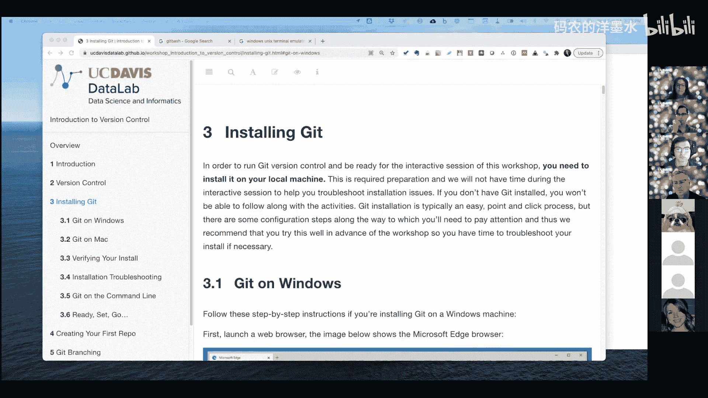
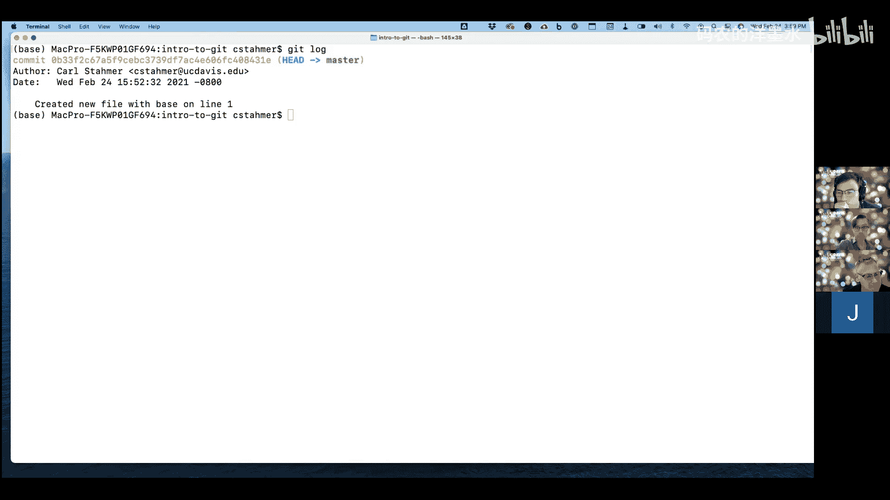
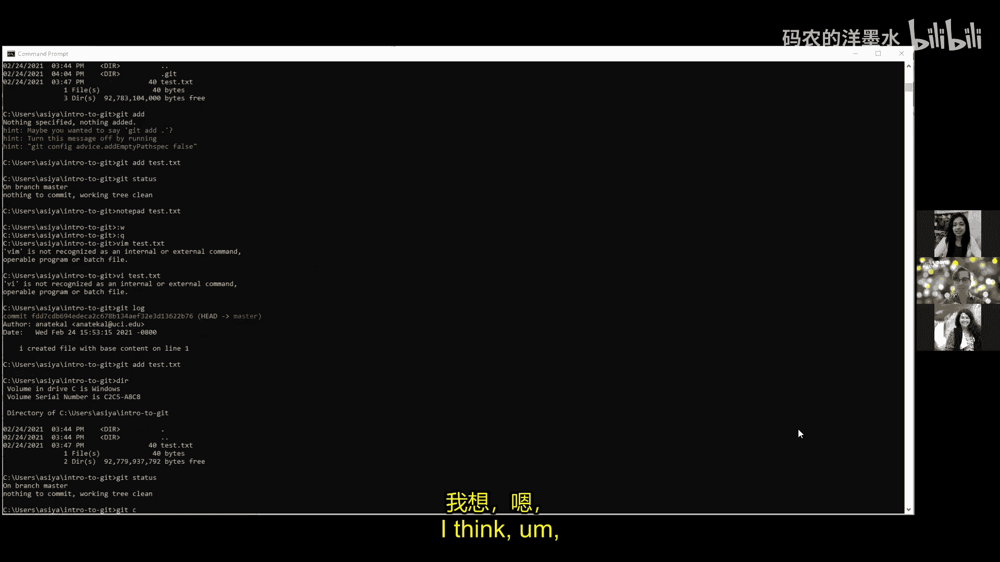
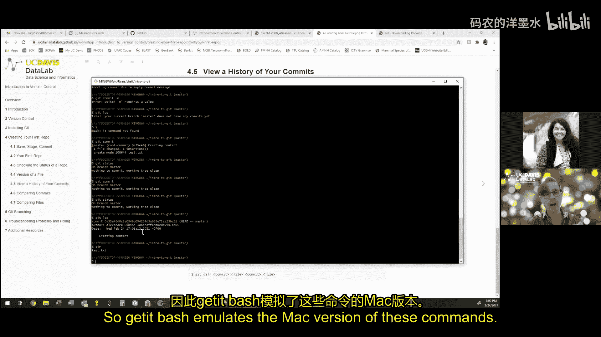
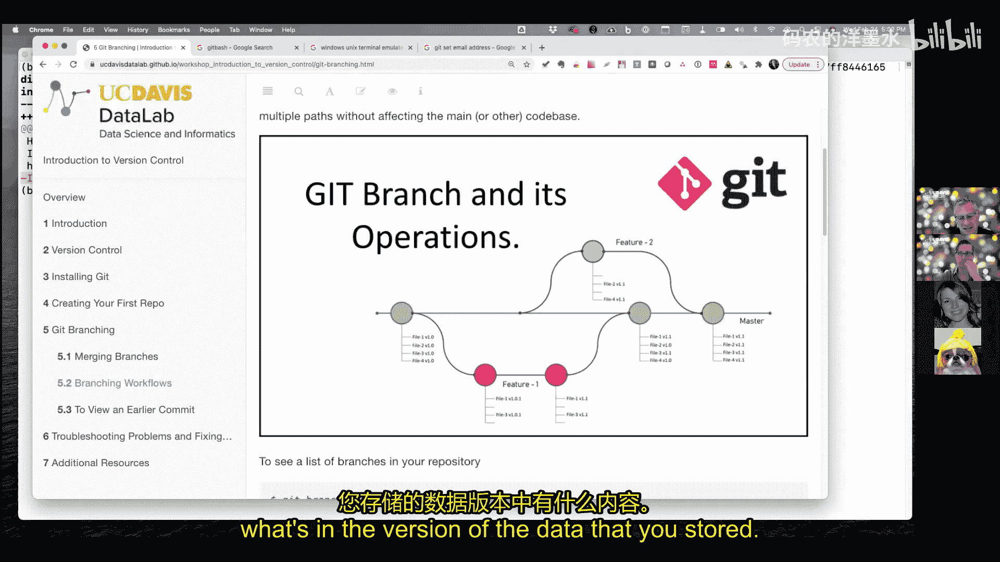

# Git入门教程：第3讲：版本控制基础


在本节课中，我们将要学习版本控制的基本概念，并动手实践使用Git进行本地版本控制。我们将从安装Git开始，逐步学习如何创建仓库、跟踪文件、提交更改、查看历史记录以及使用分支功能。

## 概述：什么是版本控制？

在开始动手之前，我们先来理解一下版本控制。你是否曾在电脑上见过类似“文档_v1.docx”、“文档_v2_final.docx”、“文档_v3_really_final.docx”这样的文件？这是一种非常常见的手动版本管理方式。

然而，这种方式存在几个问题：
1.  文件名中能存储的元数据（如日期、修改者）非常有限。
2.  我们无法快速了解每个版本具体修改了什么内容，必须打开文件才能知道。
3.  当项目包含多个文件时，这种管理方式会迅速变得混乱不堪。




版本控制系统（VCS）就是为了解决这些问题而生的。它通过软件帮助我们系统地组织、跟踪和管理文件的不同版本。Git是当前最流行的版本控制系统，它既可以在本地独立工作，也可以与远程服务器（如GitHub）协同，实现团队协作。

## 第一步：安装与验证Git

为了顺利进行后续操作，我们需要确保每个人的电脑上都安装了Git。

**以下是检查Git是否已安装的步骤：**
*   **在Mac上**：打开“应用程序” -> “实用工具”中的“终端”应用，输入命令 `git --version` 并回车。如果已安装，会显示版本号；如果未安装，会提示命令未找到。
*   **在Windows上**：在开始菜单中搜索“Git Bash”。如果找到并打开它，输入 `git --version` 命令检查。如果找不到Git Bash，则可能需要安装。

如果检查发现尚未安装Git，请根据你的操作系统（Windows或Mac），按照课程资料中的安装指南完成安装。安装过程中如有问题，可以随时在聊天区提问。

## 第二步：创建你的第一个Git仓库

安装好Git后，我们就可以开始实践了。首先，我们需要创建一个用于练习的目录，并将其初始化为Git仓库。

上一节我们介绍了如何安装Git，本节中我们来看看如何创建并初始化一个本地仓库。

1.  打开你的命令行工具（Mac终端或Windows的Git Bash）。
2.  使用 `cd ~` 命令确保进入你的用户主目录。
3.  使用 `mkdir intro_to_git` 命令创建一个名为“intro_to_git”的新目录。
4.  使用 `cd intro_to_git` 命令进入这个新目录。
5.  现在，使用 `git init` 命令将这个目录初始化为一个Git仓库。你会看到提示“Initialized empty Git repository...”。
6.  运行 `ls -a` 命令，你会发现多了一个名为 `.git` 的隐藏文件夹，这就是Git存储所有版本历史和数据的地方。

此时，你已经创建了一个空的Git仓库。可以运行 `git status` 命令查看仓库的当前状态，它会显示你位于默认的 `master` 分支，并且还没有任何提交。



## 第三步：跟踪文件与提交更改


拥有一个空仓库后，我们接下来要学习如何让Git跟踪我们的文件变化。这需要理解Git工作的几个核心区域：工作目录、暂存区（Staging Area）和仓库。

**以下是Git工作的基本流程：**
1.  **工作目录**：你实际编辑文件的地方。
2.  **暂存区**：你通过 `git add <文件名>` 命令，将想要纳入下次版本（提交）的文件快照放入的区域。
3.  **仓库**：你通过 `git commit` 命令，将暂存区的内容永久保存为一个新版本的地方。






现在，让我们按照这个流程来操作：

1.  在 `intro_to_git` 目录中，使用文本编辑器（如Vim）创建一个新文件。例如，运行 `vi test.txt`。
2.  按 `i` 键进入插入模式，输入一些内容，例如“Hello, world. This is my test git file.”。
3.  按 `Esc` 键退出插入模式，然后输入 `:wq` 并回车，保存文件并退出编辑器。
4.  运行 `git status`。Git会提示有一个“Untracked files”（未跟踪的文件）`test.txt`，并建议使用 `git add` 来开始跟踪它。
5.  运行 `git add test.txt` 将文件添加到暂存区。
6.  再次运行 `git status`，你会看到文件状态变为“Changes to be committed”（等待提交的更改）。
7.  现在，运行 `git commit` 来提交这个版本。这会打开你的默认文本编辑器（如Vim）让你输入提交信息。
8.  在编辑器中，按 `i` 进入插入模式，输入一条有意义的提交信息，例如“Created new file with base content.”。然后按 `Esc`，输入 `:wq` 保存并退出。
9.  提交完成后，运行 `git status` 会显示“working tree clean”（工作区干净）。运行 `git log` 可以查看提交历史，其中包含了刚才的提交记录、作者、时间和你的提交信息。

**记住一个原则：频繁提交，并撰写清晰的提交信息。** 这能让你在未来轻松回顾和理解每个版本的改动。

## 第四步：理解与使用分支

分支是Git一个非常强大的功能，它允许你在一个独立的“平行时空”里开发新功能或尝试修改，而不会影响主线（通常是 `master` 分支）的稳定性。

上一节我们学会了提交更改，本节中我们来看看如何使用分支来管理不同的开发线。

1.  首先，确保你在 `master` 分支（`git status` 会显示）。然后运行 `git checkout -b working`。这个命令创建并切换到一个名为 `working` 的新分支。
2.  运行 `git branch` 可以查看所有分支，当前所在分支前会有一个 `*` 号。
3.  现在你在 `working` 分支上。修改 `test.txt` 文件（比如修正一个拼写错误），然后 `git add` 并 `git commit` 这个修改。
4.  你还可以在 `working` 分支上创建一个新文件 `test2.txt`，同样添加并提交它。
5.  运行 `git log` 查看，你会发现提交历史在 `working` 分支上延伸了。
6.  现在，运行 `git checkout master` 切换回 `master` 分支。运行 `ls` 命令，你会发现 `test2.txt` 文件消失了！这是因为 `test2.txt` 只存在于 `working` 分支的提交中，Git会根据你当前所在的分支来呈现文件系统。
7.  再次运行 `git checkout working` 切换回去，文件又回来了。

**分支的核心概念是隔离**。每个分支都是项目在某个时间点的一个独立发展线，它们之间的修改在合并前互不影响。

## 第五步：合并分支与解决冲突

当你在一个分支（如 `working`）上完成了功能开发并测试通过后，通常需要将其合并回主分支（如 `master`）。

**以下是合并分支的基本步骤：**
1.  首先，切换到你想合并**到**的目标分支，通常是 `master`：`git checkout master`。
2.  然后，运行合并命令，指定要合并**来自**哪个分支：`git merge working`。
3.  如果两个分支修改了不同的文件或同一文件的不同部分，Git会自动进行“快速向前合并”，你会看到合并成功的提示。
4.  运行 `git log` 和 `ls`，可以看到 `master` 分支现在包含了 `working` 分支的所有更改。

然而，如果两个分支都修改了**同一文件的同一行**，就会产生**冲突**。Git无法自动决定保留哪个修改，需要你手动解决。

1.  假设在 `working` 分支和 `master` 分支上，你都修改了 `test.txt` 文件的同一行，但内容不同。
2.  在 `master` 分支上执行 `git merge working` 时，Git会提示“CONFLICT”（冲突）并告知哪个文件有问题。
3.  用编辑器打开冲突文件，你会看到类似这样的标记：
    ```
    <<<<<<< HEAD
    这是master分支上的内容
    =======
    这是working分支上的内容
    >>>>>>> working
    ```
4.  你需要手动编辑文件，决定保留哪一部分内容（或者进行整合），并删除这些 `<<<<<<<`， `=======`， `>>>>>>>` 标记。
5.  解决冲突后，使用 `git add <文件名>` 将文件标记为已解决冲突，然后执行 `git commit` 来完成这次合并提交。

## 总结与资源

本节课中我们一起学习了版本控制的基础知识和Git的核心操作。我们涵盖了：
*   **版本控制的概念**：解决了手动管理版本的各种弊端。
*   **Git安装与仓库初始化**：使用 `git init` 创建本地仓库。
*   **文件跟踪与提交**：通过 `git add` 和 `git commit` 记录文件版本，并强调提交信息的重要性。
*   **分支管理**：使用 `git branch`, `git checkout` 创建和切换分支，实现并行开发。
*   **合并与冲突解决**：使用 `git merge` 合并分支，并学会如何处理合并冲突。

要熟练使用Git，关键在于多练习。你可以尝试在自己的项目中使用Git来管理代码、文档或数据。

**以下是一些有用的学习资源：**
*   **Git Cheat Sheet（速查表）**：一份命令速查指南，非常适合新手随时查阅。
*   **Pro Git 书籍**：一本开源、详尽的Git指南，深入讲解了所有概念和操作。
*   **进阶学习**：关注后续关于“Git团队协作”或“GitHub使用”的课程，学习如何将本地仓库与远程服务器连接，实现备份和团队合作。



恭喜你完成了Git的入门学习！现在，你可以开始用更高效、更可控的方式来管理你的所有项目了。