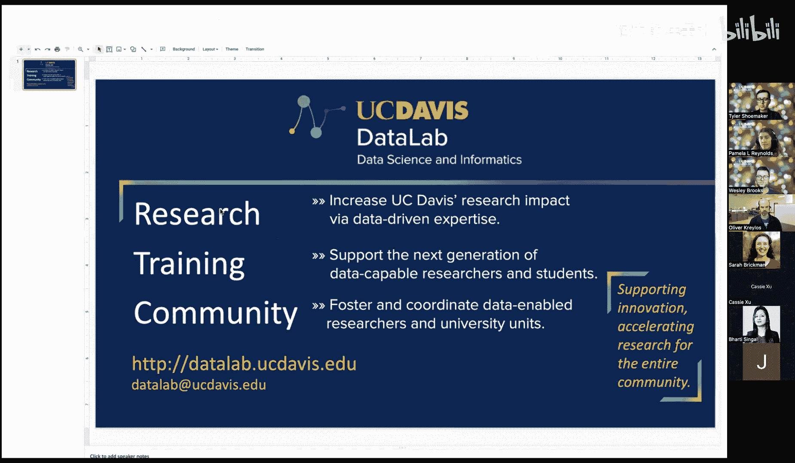
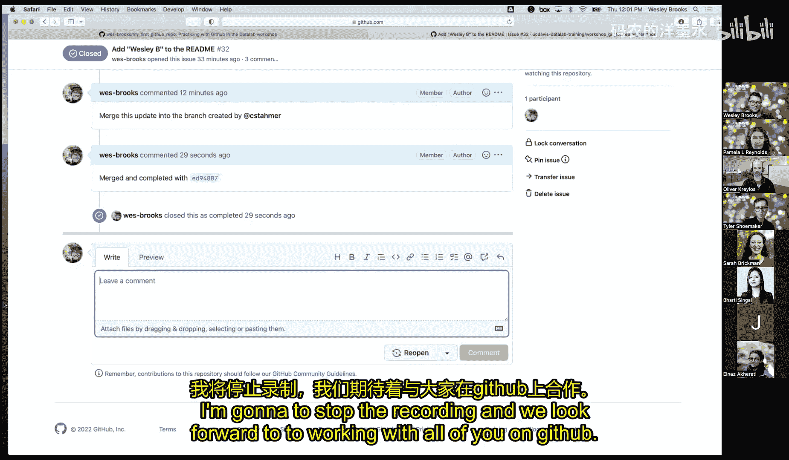

# 【全集】加州大学戴维斯分校 计算机科学 中英字幕 1080P p04 Lecture 4 - 面向GitHub的可复现研究 -BV1cqFNzYEvp_p4-

All right well hello everyone and welcome to the Reproducible Research for Teams with GitHub Workshop My name is Pamela Reynolds and I'm the associate director here at the UC Davis Data Lab for data science and informatics and I'm going to be hosting your workshop today and I'm joined by several other members from the data lab as instructors and helpers and I'll introduce them in a little bit Now it was a little bit of background on data lab for those of you who aren't familiar we're a program that's funded by our provost and the library to facilitate the application of data science methods。

 technologies and best practices to enhance research and learning for all domains so we have researchers here today from many different disciplines and welcome we think that the content that we're talking about will be very useful to you both within your current learning journey and where you'll be going after your tenure at UC Davis。

😊，Daily Lab just so you know we do provide research services， including office hours。

 so if you have questions about the content today， you can join us at our Zoom office hours that we hold weekly and we have lots of other workshops that're having this quarter and next and I'll post a link in the chat in a moment to where you can discover more about our upcoming activities。

😊，Now today in this workshop， we're going to cover the basics of using GitHub。

 which is an online platform for software development and version control that's very popular with researchers。

 especially ones that are working on team research projects。

 although you certainly can use it as a team of one quite effectively and it will help with your reproducible and transparency and backing up of your projects。

😊，So today we're going to practice setting up， sharing and collaboratively working on a repository or I could think about a code base or a project that were hosted locally and in the cloud。

Now as a reminder this workshop is designed for learners that are already comfortable with using Git and the N command line。

 so if you're new to the command line and Git you may have some trouble keeping up。

 I'll paste a link into the chat for materials on those two content areas。

 we recommend that if that's completely new you that you start there and then come back to this GitHub workshop at a later time but you're welcome to sit and watch today as a demo if you're finding that it's something that you need a little bit more practice at。

😊，Okay， and we also had to some pre workshop activities so you need to have your GitHub account set up you need to have your GitHub handle and your SSH keys linked and ready to go that's something that you weren't able to do you can start doing it right now。

 but if you have trouble and need help troubleshooting that you'll have to come to our office hours so we can help you with another time。

😊，Lastly， just a note for the UC Davis Gduate student postdocs that are here today。

 this workshop does qualify as part of a UC Davis micro credential pathway so I'll paste the link in the chat if you're interested in enrolling the pathways and want to learn more about the Grd Pathways program in general and'm just putting a plug at the end of the session there's gonna be a survey link please do complete that it really helps us to get your feedback on how we can continually improve our workshops and develop new ones and keep offering them to you for free so now it is my pleasure to introduce our instructors our primary instructor today is Wesley Brooks he is a data scientist here at datalab with a PhD and statistics we're joined by helpers we have Tyler Shomaker who actually developed the first draft of this workshop reader so he knows inside of out and we'll be able to help you in chat today Tyler is our postdoc and has a PhD actually in English and if you're curious about。

😊，English major being a data science I'm sure Tyler would love to chat with you about the really interesting important overlaps there and we also have Oliver Koss and Oliver has a PhD in computer science and has been using command line and version control tools for his entire career so if you need convincing about why to do this he will be happy to talk your ear off in that respect so with that I'm going to go ahead and turn it over to Wesley to get us started。

😊，All right， thank you， Pamela， before we go any further。

 I just want to make sure that everyone is hearing me clearly。I don't know。

 maybe just now a thumbs up， okay， great。And we have three great helpers， Pamela。

 Tyler and Oliver who will be active in the chat all along。

 so I hope that if and when you encounter questions you will send them you will address them and we'll get stuff sorted out and the big one that's going to come up is we are going to be using GitHub which is a。

It is a tool for enabling collaborative research。And collaborative software development and so it is a cloud tool that like a whole bunch of people can have access to and therefore you need to be set up with an account。

And that like you all should have received an invitation this morning to join a team called October 2022。

 which has been added to。ASo-called repository that we are all going to be working on today。

 so hopefully you have seen that and responded to it and you will be able to participate in that part of the activity if not you can do that now or whenever you have time during the presentation like we're not going to get to that until。

The second half， definitely。And one of the things that will be required for full participation is that you have created an SSH key on your computer and copied that key or the public version of that key to your GitHub account so that GitHub will be able to verify that your computer is connected to your account。

And。There were instructions about how to do that in the preliminary emails。

 but if you did not end up doing it， we do have some helpers in the chat who can hopefully walk you through the steps。

 it is simpler on some computers than on others and if you are on a Windows computer。

 especially you will need to be using the Git baash command line。

 which is separate from the Windows console command line even though they look almost the same。嗯。

Because the tools and commands that we're going to use in the workshop are only operational within the get bash command line。

Those are some preliminaries， it's a lot to dump on you I know。

 but bringing them up up front hopefully will resolve some questions that might otherwise crop up as we go。

 and I just want to make sure that we are all on the same page and able to follow along and learn the maximum possible for today's workshop。

Okay， so to get started。We are going to be so sorry one thing I'm going to do now is change my screen share to instead of being this slide I wanted to show。

My command one so that I will。During the course of this workshop。

 type commands into my command line and then。They should be。

嗯。They should be exactly what you need or with some changes to you know reflect that my name is not your name。

 my email address is not your email address， but essentially you're going to be following line for line with the things that I put into my command line and I'm going to be following a script that you also can follow along just in case you get lost。

And this is the web address to that script， it is UC Davis Dataab。That Github， that IO。Slash。

Workshop underscore GiT， underscore4， underscore teams。Or the easy way is to simply click the link。

By going to this gift Wesley put I posted it in the chat so oh great it's been put into the chat that makes life nice and easy so if you click that link you will open up the script that shows the steps that we're going to be following as we go through today's workshop。

Oh yeah， actually maybe I didn't， I'll get the right link。Now。

I want also just before we get started before I go too far to make sure that people can comfortably read my screen that I'm sharing。

 is the text big enough？Or instance that， yeah， okay， I got some nods from our team that's good。

And so this is my command line interface， I'm going to go back to my home directory and now we can begin talking about what is GitHub。

Okay， so。One of the prerequisites is that folks have learned the basics of Git。

 which is a tool for version control that can operate on your local machine and help you track all the changes you make to files during the course of developing software or developing a research project and writing papers。

GitHub is an online platform for software development that uses Git for version control。

And during this workshop， we're going to practice setting up， sharing。

 and collaboratively working on a repository for a research project。

And so what makes GitHub different from Git， the biggest difference is that。

It is a tool that you can use to operate with repositories that are on your machine。Or remotely。

And GitHub is simply a place for repositories to live remotely。嗯。And if I could add to that。

 I think a GitHub is the cloud right GitHub is this other server that you can utilize to be able to access the same coded information regardless of what local machine you're working on as long as it's connected with that cloud with that GiHub。

😊，That's right so it's a service for hosting it's a cloud service for hosting Git repositories and there are lots of other cloud services for storing files。

 but what makes GitHub special is that it specifically stores files that are GitHub repository or its right that are Git repositories。

And that you can interact with this website using Git from your computer on your command line。

And so you can do all of the things that you ordinarily do that you've been taught to do maybe on our workshop with Git like。

Creating a new repository。Committing to it， branching， merging。

All of those things you've learned to do in our workshops with Git on your local computer。

 you can now do them。Using Git connected to this cloud account that is hosted on GitHub。

And what makes it special that it's a cloud account is now the same folder。

 which is a git repository。You can have a team of people who are all working on that collaboratively to develop a project and in our setting that project is going to be a research project where we probably have data and analysis and papers that we're writing other people might think of a software project where you're developing an application and you have a whole bunch of code files in any case。

Get the tool interacts with GitHub with storage location。

To make collaborative development work really nice。So。

In addition to being a place that stores these files。GitHub is also a communications platform。

Not like a social network， not like email， but a different sort of thing where。

There are communications channels specifically oriented toward collaborative development that are enabled by GitHub。

So I have GitHub open here and perhaps demonstrating is easier than telling， showing。

 not telling we have things like issues。Where I can。Create。

I can create issues that I use to communicate with a team。Except you know。

 it shouldn't just be something silly like high team would be like we need to learn to use GitHub。

It is。嗯嗯。😊，We have okay， so the ability to share messages through GitHub。诶。

We also have documentation in the form of read me files。Which have a special role in GitHub。

 they turn into sort of the front page of any project。诶。There is。

The ability to do something called poll requests， which is like a fancy form of merging gi where。

An entire。New branch of a project can be made to work and then brought in with messages to merge it with the main branch and。

Oh yeah， so GitHub also provides tools for creating Wikiis。Every every project comes with a wiki。

which of course in this case is blank， every project comes with project boards。

 which of course this being a basic project is blank， but anyway。

 there are all sorts of ways for people to communicate about the project they're developing using GitHub。

And I'll just jump in so what Wess is showing right here is our sandbox for today this is a repository that you get to play in and so you this is a way of interfacing with the cloud you could do it through the browser but we're going to show you through the command line how you're actually going to interface with it and so all these different areas here these issues the pull request there are ways for managing your development and we're going to call it software development but it could be you could be writing a paper together you could be collaborating on so it's not just for code in this case and we won't be able to go through every single feature of GiHub today but there are some other really great tutorials that we can connect you with if you're wanting to learn a little bit more about the specifics on how to set up a project board or how to utilize your wki those types of things so today again the focus is really getting you started make your repositories making commits。

😊，Pulling， merging， you know， doing the actions that that you need to be able to do to share the work that you're doing with the cloud。

That's right。😊，And you should all like once you have responded to that request to join the team October 2022。

 you will be able to you will have access to this repository and you'll be able to try out all of those tools that I've been talking about and I'm going to walk you through several of them as we go through the workshop over the next couple of hours and I'm going to ask really quickly if you could give a green check if you got the email and you're all ready to go with the being on the UC Davis team if you didn't do that don't know what we're talking about are confused go ahead and give a red X and we'll we'll reach out to you。

啊。Okay， so I see one redx。Okay and if you're just following along today in demo mode。

 just give a green check so that we don't bug you。Now。So I think。

Tyler well actually any of us should have the ability to add people to that team October 2022 so I'm going to keep presenting well hopefully one of the helpers in the background will be able to resolve that。

嗯。Okay， so the last sort of preliminary about Gitthub I want to mention before we get before we start digging into you know doing some work is。

There are some files because this is a cloud service that should。Not be pushed up to GitHub。嗯。Now。

Some of that is files that are like extremely large。

 there's a storage limit in GitHub and it simply won't let you push up files that are you know gigabytes in size。

嗯。But there's also。More subtle issues， for instance， this repository can be viewed publicly。

 so if you put a file in here that has stored that has like passwords or sensitive information written in it。

 you would not want to post that to a repositories that can be viewed publicly。Um so。

Thinking about that， the appropriate sorts of things to be tracked with GitHub would be code。

Documentation。And then scripts like make files。And then maybe some supporting media like small images。

 but we typically don't put our data in Github know data often has sensitive information。

 but it's also just。Typically not the sort of thing that you need to track using Git because if you're doing reproducible research。

 the data should be generated once and not be changing。

And then any modifications to the data can be made by script so that。

If you need to run through versions of the data， you do that by running a script as opposed to knowing that like。

 oh， the file that's saved here currently is the updated version and not the original or vice versa。

So we try to make sure that that is created once and shared。Locally shared by。

You know email or by having access to the correct data storage。

And then we use GitHub to track project files like code， like make files and documentation。

And certainly， yeah， sensitive information like API keys， passwords。

 and personally identifiable information should be kept out of files that are going to be tracked by GitthHub。

Okay， so。Now， in order to use GiHub， you're going to need to have created an account and I know。

This was part of the prerequisites， so rather than walk through how to create a GitHub account。

 I want to do what we did before and use the green check red check green check red X system。

And so I think。We have the power to clear people's previous selections or。Okay， well， anyway。

 I'm seeing。I'm just looking in the participants list now to make sure that everybody comes up with a green check to indicate that you have created a GitHub account。

Yep， I think we're just getting there about three people that were getting added。Okay。Wonderful。Then。

The next thing to talk about is how do we interact with Git if you've learned about Git from our workshop。

 you've learned how to use Git at the command line and that's what we're going to be doing today。

There is also a graphical interface called Git desktop or excuse me called Gitthub desktop， which。

Is a program that connects to GitHub and allows you to do a lot of the interaction with your project using point and click interfaces。

嗯。We in dataA don't like to teach that way because the lesson。

 you know the way you learn to interact with Git then is going to be sensitive to the particular version of that graphical interface that you have installed。

Whethers you're on a Windows or a Mac or Linux that program looks different and the systems you learned。

 like where to click and what things should be， what the tools should do don't work the same way between different operating systems。

So。We like to make sure that you learn get using the command line because in fact。

 all of those graphical tools are simply a。嗯。诶。Simplified way of。

Doing those same command line commands anyway like you click a button that gets translated into something like git clone certain repository so we just teach you directly the commands not the graphical interface。

If I may Wesley just really briefly to the other reason that we do this as well is because if you are doing any kind of remote computing you won't have the luxury of a screen to work from there is no GUI you know desktop app for GitHub on the campus computing cluster for example so if you want to do any kind of remote work that requires heavy computation or someone else's computer there's simply no way to use these desktop apps so really it's the command line that rules in those spaces and it's really important then that you learn how to use the tools that we're going through today and have been over the past few workshops from that space itself because that's where you know you're going to live if you want to do those kinds of tasks that's a great point thank you。

Okay。Now， one thing about working with Git is that when you。

Use get you want to make sure that your name is properly attributed to the work you do。

 especially when you're working with a team so that the team knows who makes like。Who it is。

 who is working on certain files and knows who to talk to about conflict between say merge conflicts。

 which is the concept we're going to talk about later on。嗯。

And so in order for get to attach your name and email address to the work you do。

 you need to have configured get with your name and email address and so this is going to be our first。

Jump into our command line during today's workshop。

We're going to check our Git configuration to make sure that it knows what name and email address to attach to any work that you do。

And the way to do it is with this command kit config。Dash， dash， global。

And there should not be a space between dash dashash。

 which should be dash dashash Global and the first thing I want to check is user。t name。Okay。

 so I have properly set up my git with my name。And I also want to check getconfigdaglobaluser。e。

Okay and get also knows about my email address but Wesley just a question here and that email should match the email that you have associated to your Github account it that doesn't matter actually okay this is for informational purposes Okay so get does not require it doesn't check this to match it to anything this is for。

Knowing who has done what because on a collaborative project， you need to。

Be able to keep track of who's doing what work。So。I am。

Not everybody may have configured their get to know who they are and so if the responses you got here were blank。

I'll show you quickly how you can set up these variables。I would you simply type in the same command。

 but then you follow it by the value you want to put in so for instance。

 if I want to change my name from Wesley to West，I would say Gi config D D Global。User。 name。

And I'll say Westby。Okay， so just to make sure that that change worked， I will type in again。

 get confiIg。Stash global user top。And we see the change registered。

 so hopefully you all have a meaningful name put in for yourself and a meaningful email address it's an essential part of working on a team。

Now。This is for keeping track at a human level of who's done what work。

 these are human readable values。As far as the machine is concerned the way get。

The way GitHub knows that your computer is connected to your account is by associating your SSH key。

 creating an SSH key on your computer。And copying it to Github。嗯。I know I already mentioned this。

But we're getting to the point where our account needs to be attached to our name。

 so I just want to make sure that we have all done this。

So the way you know you've done this is you can check your you have a secret folder on your computer if you've done this called dot SSH。

 so I will list using the LS command。A location called Tilda。Which is my home directory/。sshH。

And I have。A key。And then this with the dot pub at the end is my public key。

And then known host is not relevant to what we are doing now。

And if you followed a different set of instructions， your key might not be called ID underscore RSA。

 it might be called something like ID underscore HB。5 five515 or something。That's fine。

 it doesn't matter。The important thing is that you have both a key and a public key。

And that this public key is the one you want to copy to Github。 So the way I would do that is by。

Looking at public key， and I'm going to use the less function。

So I once again put in this location from my home directory， I go to the hidden folder。sshH。

And then I want to take one specific file from there， ID_rssa。hub to get the public version。Okay。

 this。Nonsense of a random string of letters and numbers。

Is the unique identifier that associates my computer with my GitHub account。

 so I need to make sure that this is copied。Wesley this was part of the pre workshop instruction。

 so I wonder if we might move forward it's good that people have seen this。

 but okay yeah I just know it's part of the the prerequisites and I know that most people will have done it。

 but I just want to make sure that everyone has done it because we're if you haven't done this you're not going to be able to continue。

嗯。So yeah， I'm not going to beor creating your SSH key。

 but just making sure that if you click on your icon at the top right your GiHub of any GitHub page。

And go to settings。You will have a menu on the left hand side and one of the items in the menu is called SSH and GPG Keys。

And you need to have at least one。Or。You need to have at least one key that's attached to your account and it needs to be the one that you just copied out of your public key file。

And that's for me right here。And you will need to have done that。

In order to continue and if I were creating a new key。

 which I'm not because mine is already associated， I'd do it by clicking this green new SSH key and copying in。

This。This string。And that'll be it then your account is associated with your computer and your goal。

O。So。嗯。Oh yeah， sorry， there is and just to confirm that that worked。

So I press Q to get out of the less screen。In order to confirm that that worked。

 there is a quick command line line one minorr。And that is to attempt to connect to GitHub via SSH。

Which SSH is a remote terminal program。So if I attempt to connect to GitHub。It should tell me that。

It recognizes my computer， but it doesn't allow connections and as long as we get that message。

 we know that we are connected。Okay， so the way to do that is SSH。Dash capital T。

And then space and the address get at github。com。And it says hello you've successfully authenticated but Github doesn't provide shell access this message is a success message it tells me that I've successfully identified I have successfully authenticated that is all that matters here if you can do that then you are able to work with your GiHub account from your command line。

Okay。With the preliminaries all out of the way， we are now going to go about creating a new Git repository on our computer locally。

 so not on GitHub but on our computer。And we all are going to create this in our home directory ideally so that。

It's in the easiest possible place to find and if you remember from。

Our data lab command line workshop you get to your home directory with the Tilda Key okay。

Before creating this new Git repository， I'm going to change directory to Tilda CDd Tilda。

Takes me to my home director。And within my home directory。

 I'm going to create a new folder using the maker function or command。

MakeD and I'm going to call it my verse。GitHub， we。

And now I'm going to change directory into that folder I just created my underscore first。

NitHub Real。And this is all stuff that hopefully is reviewed from when you took the dataL workshop teaching the basic use of Git。

To turn this folder into a git repository， we initialize， so git。

 we go inside we C D into that folder and then type git in it。

And we get back the message that we've created an empty git repository in。This location， of course。

 yours will be a little bit different because you won't have your account at users W Brooks。Okay。

 so now we are working within a git repository。And the most basic thing to do in a Git repository is to add a line of text to a read me file。

 so let's do exactly that。At the command line， the easy way to add a line of text to create a file with a line of text is with the function echo。

And then use the right carrot。Excuse me。Echo first weve put the text in， so it'll be Ho GiHub。And。

I want to use single quotes because。Putting an exclamation point and then double quotes。

Your computer may or may not recognize that for what it's supposed to be。

And then I'll use the carrot to read any that。And I'm going to widen my screen so that all goes on one line。

Okay， and now I will type LS to list the contents of this folder and we see that we have a read a file called readmeet。

md and if I want to look at what are the contents of that file I can use the less function。

Les readme。md。And we see the only contents of that file is Hello GitHub。Okay， so from within less。

 you can press either Q or or you can press Q to get out of。呃。

Get out of the last command to get back to your command line。Okay。And now we've created that file。

 but we haven't yet told Git to start tracking it so again， to review our basic Gi commands。

 we want to add that file to get tracking get add。Readme。md。And after we add that file to tracking。

 we now need to。Commit all the changes we've made so there's only one change。

 but we still need to commit it。And we want a meaningful commit message。

 so I will say I created a repo。And。I created repo and added a read。Well， I misspelled， read me。

 but I'm going to be satisfied with that。Okay， now， but so far all we've done is。

The same process that we did in our basic learning to use Git workshop or if you learn gett from some other source。

 we're doing stuff that you。You know the basic Git commands using the command line。

 but we haven't done anything about GitHub， there's nothing yet that has connected anything we've done to a remote repository。

So the way to do that， and this is where we first diverge from our basic Git workflow。

Is to go to Gitthub。And I'm going to click on the little Octocat to go to my homepage。

And then on my homepage， I'm going to click next to recent repositories。

New in order to create a new blank repository on my GitHub account。

And hopefully you all are following along and the only difference for you is that you are not creating this repository under West dashashbros。

 you're creating it under the GitHub account that youve set up for this workshop。And gosh。

 what do we want to call it here， well， we may as well match the name that we put on the repository on our command line and what was that it was。

My first Github repo。Okay， so that's going to be the Github repository name， my underscore first。

That's pretty。And then in the description， we can say。Gated。呃，是的。Djective。Practicing。我也解开了。

In the dial lab。S。And then there's a list of choices to make and GitHub provides some useful defaults for you。

First tries to make is whether you wish for this repository to be public or private。嗯。

Public is the default and is suitable for most repositories in order to create private repositories you。

Well actually I'm not sure at this point whether free accounts are able to create private repositories。

 but in any case there's nothing that we're going to be doing today that is at all sensitive and there's no reason to not make it public。

 so I'm going to make this file public。Next choice to make is whether we want to let GiHub create a Readme file now that can be useful sometimes。

 but we already created a readme at the command line so I'm not going to check that button。

We also can add a get ignore template， I'm not going to do that。诶， the。不。

We willll talk in a moment about what Git ignoreR does。

 but when I'm not going to create i'm not going to add one to the repository right now。

 I'm also not going to add a license to the repository right now。

But these are choices as you get more comfortable using GitHub that you may wish to make different choices than what I'm doing here by staying with the default。

Okay， then at the bottom， there is a green button to say create the repository。Okay。

 and GitHub is kind enough to provide you instructions about what to do if you have an existing repository to push here。

Or if you wish to or if you need to create a new repository at the command line。

And you might notice that if you're following the。Command line instructions。

 they look very similar to what we did already when we created the repository so we created the repository already and so we're going to use these instructions。

Which you can do there are two ways to do this， one is to just copy this block of text and paste it into your command line。

I'm going to walk through it a little more slowly because we're here to learn。So。

In order to connect to Github from our computer， we first need to know the address of this repository and the easy way to get it is to look at this。

Block of text right here。This looks like a web address right it kind of looks like an email address it's actually an SSH address but。

We have set up an SSH key， so we're able to use SSH addresses。And I'm just going to copy this。

As you get more advanced with GitHub， you'll recognize this pattern and you'll see it a lot more often and you might even learn to memorize it。

 but for today rather than try to memorize it， I'm just going to copy。

That is the address of the repository on GitHub。So。What do we need to do。

 We need to tell our local repository how to connect with。This remote repository。

And Git has commands to do that。And that command is called Git remoteote。

So you can see in this block just below the command we're going to type in。

 which is we need to add a new remote， so get remote add。We'll call it origin。

And then we need to specify the address。And I copied that address。

 so I'm going to use command V to paste it。Okay， and now I am going to hit enter。

Now a we can actually look at what branch we are on currently。ops by typing Git branch。

And we are on a branch called master， which is a default name。

 we prefer to change the default name to main and the way to do that right now is to use the command git branch。

Dash capital M to rename the main branch name。嗯。And then。

We have already committed some changes locally now we wish to connect we wish to push them to GitHub what that means is those changes are committed or commits on our local repository and we want them to be on the GitHub repository and that is a push it goes from local to remote so you can imagine pushing those changes away from you going from close to far。

It' probably get push。And we put in the U to indicate that we're tracking what upstream or what yeah upstream branch is called origin。

没。真系。你。Just make sure that。Okay。Good。Okay， so I have done a push。

 I have taken the commits that are on my local computer and I've taken them from local to remote once again that' sort of analogous to pushing something。

 you take it from close to you to farther away。And what that means is the commits that we have made on our local computer should now be reflected in this remote repository。

And so I just reloaded my browser。And I can see。That in fact， the Readme file that I created is。

Shown in the Github version of this repository and it has。

And GitHub is smart about files named Readme， it knows that they are typically meant to be a first place to look。

 and therefore it turns them into of a sort of homepage for your repository so we can see right here。

 the content of the Readme is hellello GiHub。I'm going to pause here and make sure that everyone else has followed those steps as I've typed them in and that we've all gotten to the same point where you have a。

Repository created in your GitHub account。And you have pushed some。

Commits from your local repository。To the GiHub version of that repository。Once again。

 let's do green checks as you succeed。And if people put up a red X。

 we've got helpers who can drop in on the chat and hopefully resolve whatever questions you have。

And also folks in the chat yeah， so helpers， data lab staff like if you're seeing consistent issues and you want to raise them for the team。

 you know， please chime in and I'll try to answer any questions。

Yeah I think it would be helpful so some folks are getting the message in terminal asking them to log in to GitHub I'm like why is it asking me that I'm already connected with SSH keys and maybe you could talk through what's going on there。

😊，Yes， okay， so if。You。Let me close the chat Okay， so if you are getting a message that says you need to log in。

It may be because are you have connected to the web address， which is sorry。

 let me explain what I just did。I am on the GitHub homepage for this repository I just created。

And there is a green button here at the top of the list of files， which says code。

If I click that button， I get a dropdown。By default for me。

 this comes up with the SSH address of the repository， which I showed you how I connected to。

If you have not set up your SSH key or if you just happen to copy the web address of the repository instead of the SSH address。

You will have copied something like this。And this looks like an ordinary web address because that is exactly what it is。

 it matches exactly this web address in my address box。

If you connect to a GitHub repository that way。ge诶。

GitHub is going to ask you for your password every time you try to interact with with that repository。

And we don't like that like it's the whole point of having an SSH key is you can use the key to unlock。

Your account。So we don't want to also have a password。

We don't want to have to use our password all the time。We're going to go here， once again。

 copy the SSH address。Now。This。May well okay， so this we now have to do something slightly more advanced。

 which is to look in the hidden gi folder of our repository so。

I am still looking at my command line in the same location。

 it's just a local folder called my first GitHub repo。And of course。

 if I list the files here using LS command， there's only one， it's called Read。

 but if I also show hidden files using the dash A man we see there is a folder called dot git that is how gi that is how gi knows this is a repository。

And we can。Look at the contents of that file， LS of。Most of these we don't want to touch， but config。

We may have to。And so。Tyler likes Vm and uses it in the reader I like nano。

So well actually sorry nanono is not going to be installed for Windows folks。

 so let me use viIm just to keep this cross platform if I use vim to open。Go get。Slash convicg。

You'll see contents of the files look like this。And you may have something here that says remote origin where the URL is HtTPS。

Colon slash slash。GitHub。com/ your account slash my first Github repo。That's the。

That's the web address version。嗯。I expect that that is how folks will have gotten into the situation of being asked to log in。

If that is what happened， then you can。Within them。Change that text。

 so I've pressed I to get to insert mode。And I'm going to deletete。This is this address？And then。

Go back to Gitthub， click code。Click SSH。Click this little button to copy the address。

Go back to my command line。And the。Haste。And then because I am in VMS。

I want to save this file by pressing。So I'm in the insert mode here。

 I'll press escape to get out of insert mode。Then a colon so that them knows I'm about to enter a command。

 you can see the colon at the bottom left， I press Wq。That means right， that was save。And quit。

And having done that， you should then be able to。Fathlow。

 you should be able to push without having to put in a password。嗯。Did that？Well。

 I'll pause for a second to see whether that resolved anything for anyone。

And there is an instance too depending on how you have it configured where you can have a request for you to put your password in like every time that you push up we generally don't do that。

 but it is another kind of layer of security if you think that。

It might be important for you to do we're happy to talk about that at office hours if you run into that situation Oh yeah。

 so well I think what Pamela is saying is your your SSH key on your computer might have a password attached to it like when you there were instructions for setting up an SSH key and you may have been asked to you may have been asked for a password。

I always default to not having a password on my SSH key。

But if when following the instructions for setting up your SSH key， you added a password to it。

 then that is the password you need to enter。After typing get push。Was that the issue for folks？

Potentially， I think that was a great summary and if individuals are having trouble。

 just just comment in the chat and we'll try to help you out。So。嗯。

Hopefully the pause and the discussion there was long enough for the large majority of folks to get to this point where you have created a repository on GitHub。

 you've created a matching repository on your computer。

 you've connected them and then pushed your commits your local computer from local to remote。

Now I want to show a cool trick， one of the nice things that GiH does for us。Whoops。

 I probably did that too quickly。We're looking here at my Readme file and one of the things you can see you're looking at when you're browsing a file in GitHub and actually I'm just going to click readme。

md。So when you click a file in GitHub， you'll get an interface that looks like this。

And if you want to make small changes， you can do them without going through the process of。

Pulling to your local computer， making the changes and committing them and then pushing them back to the remote。

And the way you do that is by clicking this little pencil icon。

Which is to edit this file directly within GitHub。And I'm just going to make。

 I'm going to add a couple of new lines and make it like GitHub is replying to me。

And GitHub is going to say hi We。Okay， so that's the change I wish to put into the file。

Then I scroll down to the bottom of this page and we have a dialog box here that says， okay。

 here's how you can commit changes。I'm going to say this change was to add any response from GitHub。

And。We know who is making the change， we're going to commit it directly to the main branch。

And that changes。Okay。And now we immediately see the changes reflected in the repository。Now。

One of the。Yes。点样。Okay。😊，So what I'm going to do next is to I've just made a change to the remote repository and I want to show you the inverse of the push command。

 which is taking changes that are reflected on a remote repository and getting them to your local and so when we went from local to remote。

 we called that a push。We we're going from remote to local， we call that a pull。

And so I'm here in my Git repository。And I can just type get。I could potentially add origin name。But。

I'm just going to type Git poll。And。The changes that were in place on that remote repository have now been pulled down to my local repository and I can see that if I inspect the contents of the readme。

md file， so I'll use less。let me打 m啲。And we can see this is the thing I added from GitHub。诶。

So we're beginning to see how it's possible。For changes to be。Reflected from。

One version of a repository to another。And you might be able to imagine how that's going to be useful when multiple people are working on and collaborating within the same repository。

O。So now we will need。诶。Now we're going to start making some changes。Right。

 we're going to start making some changes and see how that is reflected in。

in the remote version of our repository。So。诶。We've already made a file locally。

 pushed it to the remote， made a file or made some changes on the remote and pulled them to our local and now let's finish by changing that file one more time。

嗯。And I'm going to use the Vm editor again because this will be cross platform。

 I guess I could just use vi。嗯。But。嗯。Okay， and I'm going to press I for insert。

And add at the bottom of this file。Working on。How about this created during。Data lab workshop。

And then to save that change， I press escape to get out of insert mode。

 I press colon to start entering a command， and the command I want is save and quit。

With bi called write and quit， so W for right， Q for quit， and then I hit enter。

So I've saved the file and now once again we have access still to all of our traditional git tools。

 for instance， we can look at Git status。And we see that the Readme。md file has been modified。

So in order to。Add this change to a commit I'm going to use。The get add function or command。

The file to add changes from is Readme。mv。And now I want to commit those changes。

With a commit message， which is。Added a bit of context to the read me。诶。And now， once again。

 we still have all the same traditional Git tools， so again， Gi status。The working tree is clean。

But because we are now interacting with a remote repository。

Git is nice enough to tell us that we are ahead of the remote repository by one commit。

 which is to say that the commit that I just made on my local repository is not yet reflected in the remote repository。

嗯。Yes。😊，I had checked this a few minutes ago before doing Git pull。

 I would have seen that we were behind the remote repository by one commit， but I forgot to do that。

So anyway， at this point， we are ahead。Of the origin。

By that one last commit and so in order to fix that situation， I will use the command git push。

And even though it's not necessary in this case， because we have such a simple project。

I'm going to specify that I want to push to the origin。And the branch I want to push is made。Okay。😊。

And again， we get the helpful messages about。How many？诶。You know。

 changes were made and to what branch and what commit we started from， what commit we are at now。

And we just want to make sure that。All of those changes have actually been reflected in the remote version of this repository and in fact they have。

So。Simple enough， hopefully folks are following along there。And just。We're going to。Oh， yes。系。

So the last thing to do before we move from working with。

A repository that is created on our personal account and interacting with that personally。To。

Interacting。Collaboratively with a。You know， all of us together on a single repository before we make that step。

I want to return to something I talked about when we first talked about GitHub。

 which is what to do with files that you don't want to be tracked remotely。So。

There is a special file in Gitthub called a Git ignore that handles that task。

Now we currently don't have one， it is just a simple text file。

And so if I list the contents of this repository， there's nothing in here called gett ignore Well in fact。

 in order to see git ignore， we would have to use we would have to show hidden files with the dash a flag。

But even hidden files do not include anything called gett ignore， so let's create one。嗯。Hunch。

Dot get ignore。And then。When I list files。L S dash。I see now that there is a file called get ignored。

I haven't added anything to it。So let's go in and add to something to get ignored。

So I'm going to use V again。And the way gettINre works is you simply tell it what files to ignore what you're telling gett what files to ignore。

And you can do that with some shortcuts。Such as。If you put in an asterisk， it matches anything。

So for instance， if I want to ignore all files that end with let's say。嗯。Xls。

 so if I want to ignore Excel files。You can put an asterisk to match any name do Excel ads。诶。

And then when I escape out of insert mode。Press Co。WQ or right quit。I can then get bad。Or sorry。

 at this point。Based on the contents of that gett ignore file。Get will by default， ignore any files。

 any Excel files， any files that end witht Xls。And that's not super useful for Excel files。

 but for things like。So I'll go back into get ignore vi。

Some of you on Mac might see a bunch of files called dotds underscore store those are part of the operating system I'm going to we don't really want to track those are those are part of the file structure of a Mac they have nothing to do specifically with our project so。

There's no need to be tracking changes to them。So let's tell you to ignore them。嗯。

Let's also tell get to ignore anything having to do with。With what are called OOF keys。

 which help tell us what things we are or are not allowed to do when interacting with GitHub。

So I can tell get to ignore any files called dothtTR oA。嗯。

And I can tell get to ignore the entire file called data。The entire folder called data。

By that command data slash。Astra where the asterisk will match anything and you might notice that like none of these files actually exist that's fine you don't have to be telling git ignore or you don't have to be telling gett to ignore real files you can tell gett to ignore。

Patterns that may eventually come up in your project and get will know to ignore them when they occur these if these aren't real files。

 if these don't match anything now it's not going to cause any problems。

And I'll just jump in really quick and you may for you know basic projects you may not need to modify or get ignorere but we want to make sure that you know how to do this because as Weley mentioned there are some files that you don't need to track its it's not useful like your data files you typically should not be doing version control in your data files themselves you should use the script to be creating new extracts or clean versions or whatnot and then you would be tracking your script so check out the reader if this is you know still not and clear there's some other good examples and narrative that'll walk you through this when you get to that point。

Yep， so for us， this isn't super relevant， but it's good to know for real projects。Okay。

 so I get out of this file by right the WQ command。

And now in order for this to be part of the project。

 instead of just something that lives on my computer。

 I of course need to add it to tracking and commit the change and push it up to the remote version of this repository。

 so I'll add do getign to tracking with the oops。I made a couple of mistakes here， I misspelled。

 well， it's just hit。And get will say that Git nor is not a git command， so I forgot to say gi add。

Because I want to add this to tracking and then of course I made a typo in the file name。No problem。

 it pretty helpful， it tells you useful messages。I want to now commit that change。And dash end。

 but in the message that is I created a thought get， ignore。Wow。😮，And now I'm going to push。Yet push。

That。To the remote repository and if I now flip back to the remote repository and reload the page。

 I will see that yes， there is a get ignore file。Now。There's lots of other useful information。

 you can look at past commits。Or you can look at changes that are made within each commit you can also。

诶。Well， I would have to。Right there， we see。嗯。啊。We also see the key for the current commit that we are on we can this clock icon shows the history of the repository。

 so now we've made a bunch of commits and we can see how GiHub likes to show the list of all the commits that we've made。

And also look back to。All of the。By clicking these buttons。

 I could look back to the status of the repository as of each of these past commits。Anyway。

 that's not what we're going to do now what we're going to do now is。

Start working collectively on a single repository， so this is the meat of like what what GitHub is about for collaborative development。

嗯。The address I'd like you all to go to i'm going to put it into my into my browser。

 but hopefully one of the helpers will copy it into chat it is github。com/uc Davis dataab slash。

Let me make sure I get this right workshop。Underscore。Get underscore。F underscore teams。O。Oops。

 that wasn't what I wanted I wanted to go to。Gitthub。com slash。You see， is。Oh。

Sorry we pasted it in the chat for everybody so I think the learners are there so it's the UC Davis the sandbox right yeah the training sandbox movie yeah so I'm just going to click the link from the from the chat instead of trying to remember it off the top of my head because it is sort of convoluted a lot of underscore right UC Davis Staab training slash workshop gett for Team sandbox so we all should navigate to this this page you can see this one is a bit more fully featured again all it has is get ignoregnore and read me but the read being actually has a bit more useful information。

And this what we have here are the instructions for what we're going to do over the next 20 minutes or so。

 which is to clone this repository， make a new branch。

 and the branch should be named with our first name and last initial。

 and then we're going to write our name into the file。Okay。So this is for everybody following along。

You're going to do this right so you've been watching leslie hopefully you've been typing along now it's your turn to be pushing up to this repository and we're all going to work together on it Yes thank you so this is。

😊，This covers what we're going to do， yeah， we're going to take 20 minutes to do it。

 but it is the stuff that is we're saying to do any instructions here so。诶。

Big picture're going to create we're all going to create a new branch and we're all going to modify the same file。

Now we're going to push it back up to the repository。Okay， so to begin。

 the first thing is we need to clone this remote repository。So。I go into get or sorry。

 I go into my command line。And I no longer wish to make these changes in this folder called my first GitHub repo。

 I want to create a new folder and I want to create it under my home directory。

 so we should all navigate back to our home directory with the CD or change directory command。

 CDD Silda。ok。😊，We can see I am currently at my home directory。Or I can PwD and see I'm at users WRs。

Yeah。To clone a repository that already exists on GitHub。We use the function Gi。

But of course I just typed that it's going to say what It I don't know what you meant。

 so here's some things you might try。Paal， you must specify a repository to clone， okay？That's right。

 I didn't specify what repository to clone well I want to get clone。

And then I just need to tell get the address。Once again。

 I'm going to use the SSH address so that I can interact with this repository using my SSH keys。

So I could try to remember this complicated address， but we already saw me fail at that。

 so instead of that i'm just going to click the copy button。And I go back to my command line。

And I paste this address after Git clone。ok。😊，And it provides some messages about what it's doing。

But long story short， we now have a new repository called workshop Git for Teams Sandbox。

And just to confirm that you have it， list the contents of your directory and your home directory。

And because it starts to the W， it'll probably be at the end workshop get for Team sandals。

 so let us all change directory into workshop。Underscore get for teams。Sandbox。I misbu workshop。Okay。

Now here's the cool thing， we all made a copy of this folder， the St repository。

And we're going to start making changes。And we're somehow going to have to keep track of who's doing what and which of these changes have precedence over the other。

And this is where the magic of Git really comes into its。Okay。So。Having cloned the repository。

 the first thing we want to do is create a new branch because the changes that we make on this repository are going to be very similar to the changes that other folks on the team。

 which is to say other folks within this workshop are making to this repository。

And if we're all working on the same file at the same time。

 you can imagine how much chaos we are going to create。Well。

 one way to reduce that chaos is for each of us to be working on our own branch。

A branch is simply a independent history of tracking a specific of tracking commits to a repository。

And then there will eventually come a time to resolve those independent histories into one main history and where that is the opposite of branching that's called merging。

 but to start with we're going to branch and so to branch the easy way to branch。

Is to use the command get checked out。And then specify dashB to create a new branch。

And then give a name to your new branch and I would like everybody to make the name your first name underscore last initial so for me that's Wesley underscore B。

And gives the nice message， we've switched to a new branch。Wesleyby。So most importantly。

 there's a new branch and we've also switched to it。And you can confirm that by the get branch。

M you can see that Wesley bead is highlighted with an asterisk and colored green。

 those are both ways of telling us that that is the branch that we are currently working on。Okay。Now。

Here are the changes。Sorry， before we start making changes。We want to。

Demonstrate some of the abilities of GitHub as a communications medium。Which is to say like。

This is a collaborative project if I just go off and start making changes without communicating to the team。

That's going to cause chaos in the project。People are not going to know what these changes are or why they happened。

And a great way to communicate with the team when it comes to。

Tracking changes we're planning we're making or planning to make is by using Github issues so I go back to this this Github main page for the repository that we are all editing collaboratively sandbox。

I'm going to click the issues button。And I am going to create a new issue。And。The title。My name is。

I'm going to make it and all of you should。Follow along with this as well， so create go into issues。

 create a new issue。And mimic this， but don't copy it exactly because I'm going to say add。Wesley be。

笑。呃，微不。And so of course， for you， you'll want to change。

The name to match your own name and blast initial。And so that is the title of the issue and then I'm going to flesh it out with a comment which is say。

We need to add。静啊。Number。Names to the read me。啊。嗯。And what。嗯。😊，And then before I click submitit。

What I'm doing here is describing some work that needs to be done。And。Actually。

Instead of saying I'll add Wesley's， I'll say。食啊。And you can put whatever you want here this is a communications thing is not this is not code。

 you don't have to worry about this matching any particular format。

 this is about communicating with your team members。

But one of the things we can do is assign a team member to this issue。

 this work that needs to get done。And so I'm going to add Westbrooks。You， when you create your issue。

 should add your own name as the assignee。And I'm not going to add a label。

 I'm not going to connect it to a project， I'm not going to connect it to a milestone。

 those are all more advanced than what we're doing here。Okay， so here we are looking at an issue。

 it also indicates who is assigned to work on this issue。Who created it， what the comment is？

And know we are able to。Do you leave some follow up like？这第一点inport。

And this will simply be a comment thread。Below the issue。So if I flip back to issues。

 I see that there are 10 Okay great so folks are following along we've got at least half of us who have successfully created an issue and most of us have。

You can see folks who've assigned themselves because there's an icon here over on the right hand side。

 so where these that icon is blank。嗯。Is where folks have not assigned themselves as the worker who should as。

Do the work for that issue。But anyway， you are doing great。

There was a comment in the chat some folks don't have access to be able to sign permissions and so just so you know behind the scenes when you're setting up a repository for a team there's a bunch of permission settings so you can give some people the ability just to view you can give some people the ability just to write to repository and you can give others ability to like manage and assign so if you're not able to there's probably just a backend permissions issue going on which doesn't matter for today because it's just a demo we mostly want you to know about this functionality that you can do it and if you want to talk about permissions that's something that would be great for office hours anybody who anybody who accepted the invitation to join the October 2022 team should will have the necessary permissions so that。

Yeah， the point of adding you to the repository， that's a great teaching moment。

 like until you are added to the repository as a team member or as an owner or something like that。

 you will not have authorization to make changes。And the default the default a this is a public repository anyone can view it。

 but yeah if you actually want to be interacting and doing stuff you need to have been added yeah so everyone has been added but just so you know there are some default settings when you're added which is usually kind of lowest permissions so。

Just something to keep in mind if you get to the point where you're setting things up for a team。O。

So now that we've all created and opened， yeah， we've all opened an issue that we're going to work on。

 let's actually do the work to resolve it。So I have already created my new branch。

Hopefully everyone else has as well。And so that means I can make changes to the readme and they won't interfere with anyone else。

 okay， so I am going to use V to edit the readme。So that's by readme。md。是。And I want to go down and。

嗯。嗯嗯。I'm going to put in。OkayInst， so I want to go into insert mode and where it says name。

 I then want to like Wesley。诶。Now， again， with V， the way after you've entered something and you want to save and quit。

 you press escape to get out of insert mode， poll to enter a command and that command is WQ for right and quit。

He doctorctor。Okay。😊，So now let's check Gi status。You can see that I've modified the readme。

I need to add it， add the changes to a commit， so I will get add read me。M啲。And now I'm going to。

I'm going to commit now with a special message， so get commit。And then of course。

 dashM to add a commit message。And I'm going to the commit message is going to be added。诶。

It added Wesley。二2。They' read me。Okay。Resves。And then。Before I finish writing this message。

 I'm going to click back over to the page of issues。

And we can see that each of these issues is tagged with a hashtag and it's actually just a number sign it's issue number 39。

My issue is issue number 32。So this hash 32 identifies this issue within GiHubs within GitHub and GitHub is smart enough to know that where。

Where hash 32 shows up in messages it should be connected that that's a link to this issue Okay。

 so if I put in that this。This commit resolves number 32。And now I have made。

 I've committed that change in my local version of the repository， but I need to push it。好。

Now pushing is going to enter is going to be broken for the moment because I have created a new branch and that new branch is not yet reflected on the remote Wellley。

 do you mind if we pause just for a moment to let people get a little caught up on just making sure they've walked through the resolution of an issue via the commit？

If could just throw a green check when you've gotten this far and then we'll talk through how to push those changes up。

Okay。对。But。嗯。So I'm seeing green checks and no red xes yet。

 although not as many checks as there are people， so I'll wait for another 30 seconds。

And if you're stuck， you know， throw the Redx we'll get to you。

And so specifically what we're looking at is that we want to have created a commit message that references the issue number that we just resolved。

Okay， so I continue to see nobody saying they're stuck so what I'm going to do is。Get。

Git is friendly enough to tell us exactly what to do to create a new branch on the origin that matches the name of my local branch。

So I could copy and paste this text， I'm going to go slightly slower just so that folks aren't baffled by what I'm doing。

So this Gi push didn't work because there's currently no branch on the remote called。

Wesley underscore B。Therefore， I need to add a special command to it。Which is get push。

Deft dash sets。Upstream。And I want to set this on the origin。

And I want it to be called Lesley underscorecor B。And。

The message we got from Gi now is a little bit longer than we are used to。

And so it's worth taking a moment here to see why this message is longer than it has been in the past。

You see， we have。This block of text， which is a response from the remote。And。

One of the like this block of text is longer because it gives us these additional lines。嗯。You have。

You can create a pull request for Wesley be on GitHub by visiting this address。嗯。

That is we're going to get to that later on， but like this is telling us how to take the changes that we have just pushed to a branch。

And。Merge them back into the main history of this repository。We also see。Something uncommon。

 which is that we have created a new branch。And so we were connecting Wesley be locally to Wesley be on the remote。

 of course。And then of course， that is confirmed by the next line。

Branch Wesley B set to track remote branch Wesley_ B from the origin。And of course， for you。

 that will be different because you've used your own name instead of mine。

 but you'll see a comparable message， okay。So。嗯。Let's flip back to our issues page。

And I'm going to click again on issue number 32。And the reason I want to click back here is because where we left it last time was just I had entered this message seems pretty important。

But when I。Pushed a change。That was connected to this issue。Because I included hash 32。

GtHub is smart enough to recognize that I was doing work to resolve this branch and have therefore put that message into the history of discussion about this particular issue。

And so。GitHub issues are great for tracking the work that you're doing to resolve a particular piece of your collaborative project and anytime I tag a commit message with hash 32 it will become part of this message history and I see that one of us in the in the workshop copied my number my issue number into your commit message and that's why。

Your。That is why your commit message ended up in the history of this issue instead of the issue that you created。

Just a little something to keep in mind the number here is specific to each issue。

What else another important part of working with a remote repository is knowing what branches are available on the remote and I sort of skipped over this a moment ago。

 but if I look at my local branches， we have seen that a few times by just looking at git branch and seeing that I have a main and a Wesley bead branch。

But if I want to also look at what branches are available on the remote， I can look at Git branch。

Dash A is the all。Ag。Flag。嗯嗯。😊，And I'm seeing here all of the remote。Branches。

And I think that might be only the ones that were there as of the last time I communicated with the remote。

 so if you all up did your gi push after me， they may not be shown to me。Okay。Okay。

 let's go back in any case to looking at the。Main page， which we get to by clicking the code button。

嗯。Okay， so Wesley B had a push five minutes ago。other I can look at this drop down Okay。

 so I am seeing yep there are a bunch of new branches that folks have created excellent。So。

As a collaborative project。We can， you know， the way we work with each other。

 like we can each create our own branch and therefore we're not stepping on each other's toes。

 but eventually we're going to want to merge our merge our individual work into something collaborative。

And I want to pause really quick because like if I was doing a real development project and I saw this many branches I would kind of have a panic attack right like what is everybody doing。

 you know， if you're trying something experimental or if you're not quite sure if something going to work that's when branching is really great。

😊，Or if you kind of have chunked out the project where people know different pieces they're working on and you just don't want to clutter up the main space。

 maybe you do branching for that otherwise you you may actually be working on the same branch but today we really want to have you get in this process of dealing with merges and so this is a great way to suddenly force you to have to dealing with merges so I just want a takeaway from this not to be that you always should be writing in a branch because that's not necessarily true but sometimes you might want to and there's a little bit more on that on the reader。

 the get reader， the workshop that preceded this if you want to dig into more about like when you would branch or need to be branching Yes and the upshot of that to me is that you create a new branch for work that you want to keep independent of the main history until it's done。

Or in this as in this case we have multiple people editing the same file it's much easier to do that in branches and then merge at one time than to be merging after each individual change Yeah so just just to contrast this it's not like Google Docs right where everybody can be live editing a document the same time you're really doing independent edits and then we're collecting all of those and going to combine them with this merge so just to keep that mental framework that it it's not that you're all touching the exact same file at the same time you're touching your copy of the file。

Yeah， so we're here looking at the main branch and I'm going to reload the page just so we're all sure that we're looking at the most recent version of it and see that the name is blank okay。

 but I'm going to use the drop down to flip to my branch Wesley B。Okay。

 some important communication that GiHub does to does for you here。

 we can see this branch is one commit ahead of mainine we saw a similar message on our Git status not too long ago and that was telling us that our local branch was ahead of the remote。

Well， similarly， this branch is one commit ahead， which is to say that there is a commit in this branch that does not exist in Maine。

And as you might expect， that commit is to put my name after the name here。嗯。

This would be the case for your branch as well。Oh， yes。If we。

Like GitHub is pretty smart and like I say， it knows to connect anything tagged with the hash and then a number。

To an issue of that number， so if I。Click this commit message。

Sorry if I click the hash in this commit message。It will take me back to the issue that this was working on。

 which is a great way of keeping track of。What these changes are supposed to mean because the commit message is short。

 but the history of this， this is essentially a chat in the issue。This history can be quite long。

Rather than relying on this brief commit message。We actually can see okay what is this really about well I click the the tagged issue and see like oh wow we have a lot of history saying we need to add team member names to the read me and this seems pretty important and like of course if this were a real project these would be more interesting。

But you get the idea。Okay， I'm going to go back to the。

Hge here and now we are going to take all of these changes that we just made and we are going to merge them。

嗯。However， we are not going to all merge into the main branch and the reason we're not going to all merge into the main branch is because merging。

Multiple contribution， more than two contributions into the same branch is even more complicated。

 So we're going to start with merging。Two different branches together。

And that's going to be more typical of the workflow you do on collaborative projects。

Because you typically don't have this many people making conflicting changes at the same time。ok。So。

Rather than all'll merge into the main branch， what we're going to do is each merge into one other person's branch。

And。I want to look at branches， which because I have compressed this so much， they don't all show up。

So I'm going to make the screen a bit smaller， there we go， 14 branches。

And I'm just going to pick one in here， I am going to merge with CarlS。

But the rest of you should pick one of these。Active branches that you would like to merge into。嗯。

And I'm not the merging will not happen on Gitthub。 we're going to do the merging on our。

We're going to do the merging on our local machines。But before I do that。

 I'm going to make a message in my issue。So I've picked one， I've picked Carl's branch。

And I'm going to then go back to the issue I created。I'm going to say。Merge。This update into。

The branch。it and then to tag the specific user， the team member who who I want to communicate with。

I'm going to put the at symbol and then we get a drop down of all of people who we can tag here。嗯。

And。瞓个节。Select call。ok。😊，Having made this message， I'm going to click the green comment button。

 it now appears in the。The discussion history for this issue。

But I'm going to actually do the merge on my local computer。Okay。

 so that begins by fetching that update to my local computer。And。

To begin tracking that remote branch， I'm going to use the command hit switch。Carl underscore。Okay。

 and。That is my bad， I should say。Get track。Oh， yes。Well， actually， before I do that。

 I needed to say get fetch。Sorry， just get fetch without the branch name。Wonderful， okay。

That's all I needed to do to get all the rest of the branches and then I can say get right。Yeah。

 so this is really cool because it's showing you a way that you can immediately go on。

From your local machine right going on to GitHub and saying， fetchch me everything's going on。

You don't necessarily want to actually on your local machine be working with everybody else's branches。

 so then the next step this tracking is what Wesley's doing to say okay。

 I actually care about this one branch locally so this is a really cool part of GiHub is that you can still have access to everything but you don't have to have it locally if that makes sense。

Yeah。And so you may like depending on a version of Git you have， this may have worked for you。

 I do not have a version of Git that includes switch and track， but that's fine。

By fetching all of the branches， I'm now able to check out the one I want to merge with my own。

So I will get。And。Now， I want to。哦。Excuse me I want to actually check out my own branch I got a little confused about the way I was doing the merging so get check out。

Oncely。咦。😊，Good， okay， and I'm up to date with the remote。And now I want to merge， get， merge。Carl。

Underscore S。O。Great。When you。Type get merge with whatever branch you've chosen to merge with。

 you should see this message， which is okay， we're auto merging oh。

 there's a conflict merge conflict in readme。t markdown therefore automatic merge failed。

You have to fix the conflicts and then commit the result this is。

A scary message to get when you're starting out， and that's why we want to expose you to it here。嗯。

And why is it scary because it's saying like， oh， this auto merge failed。

 what does it mean to fix conflicts？Well。As you might have seen。I'm going to go back to the code。

 switch to。The Wesley be branch。I've put my name into the name line of the repository and Carl has put his name into the name line of the repository and so when we want to merge these two branches together。

 we have to decide which of those changes to actually adopt。

And that is the merge conflict Yeah and I'm going jump on here and just as a refresher reminder you know get it going through line by line it's not smart enough to realize that both of those are valid right because it's just looking line by line it's going to tell you if there's two competing things that are trying to write on the same line that's the conflict and now you as the human have to say oh which one do I actually care about and if I care about both。

I need to make some changes here。And so let's also just check the Gi status。

And we can see that get is giving us a helpful message。

 both branches have this is what are our unmerged patents。

 well it's this one file where both branches that we're trying to merge have changed the file readme。

md。And now let's look at how that looks in readme。md， so I'm going to use V。你唔可打两 d。は。

And here is the upshot when。We have。2 people， two branches modify the same file and get can't figure out automatically how to resolve that it gives us this little bit of。

诶。What might appear to be gibberish？But it actually is structured quite nicely。

We have a bunch of less than symbols or a bunch of carrots。

And then head head is indicating the current location of or the current。You know，Poer of the。

The Git repository locally。Then we have a line of we have some text in here。

 this is the text I enter。Then we have a line of equals。We have some more text。

 which is the text in the Carl S branch， and then this bunch of greater than symbols followed by a branch name tells us that that is the end of the conflict and also which side is being shown。

So we're being shown the two versions that Git could not decide between。

There's the one that came from my changes。And then separated from that by this line of equals are the version of the file that came from the Carl S branch。

And the way we resolve this kind of conflict is to simply edit the file directly to what we。

Like because this couldn't be done automatically， we now have to go in manually and make this change ourselves。

So what I'm going to do is add both names and put them。And put an and between them。

 so I'm going to use I to get to insert mode I'm going to delete。This automatic message from Git。

Go to。Delete that parts。You don't need。嗯持。And so what I'm doing here is making I'm making decisions with my brain that Gi couldn't do by checking its logic。

喂。And I just make the changes directly into the file there's no need to。

Like get complicated until get like， oh， use the。The Wesley version and then an and and then the Carl version。

 I just make the changes myself， so I leave the file looking the way I think it should look after this merge is complete。

Press escape to get out of insert mode， call in WQ to save and quit。And now let's look at Gi status。

Okay， we still haven't changed anything about our status because I need to get add Read。At Mvy。Okay。

 I can look at the status again。Okay， changes to be committed， so I've all conflicts have been fixed。

 but I'm still merging。And so to conclude the merge， I then need to say gi MIs。And give it a message。

 which is I emerged。I'll put resolved， change it， resolved。Conflict。And merge。

With Carl underscore S branch。哎。😊，And。Now I'm going to check my status again。

And working tree is clean。My branch is ahead of the origins version of Wesley Ve now by seven commits because merging adds a bunch of history。

It adds both my history and Carl's history to the file。

 so it's not too surprising that that took up more than one commit。But。

It's also not indicating that there's any discrepancy in in like the。

Emerge is now complete so I can push these changes。嗯。And I'll just put again。

 it was that I want to push to the origin and to the branch West Lady underscore B。

 although it is smart enough to know that anyway。ok。And now I can go back to Gitthub。I am looking。

 I want to look at the Wesley underscore B branch because that is the one I merged into。

And I see that the changes are here， Wesley be and Carl S。So if you've been following along。

 then your personal commit should。Should。Show your name plus the of the file you merged with the name that came from the file you merged with yours。

嗯。And so the last thing for me to do is to indicate that the issue I opened is now complete。

So I go back to the issues page， I click on issue number 32， the one that I created。And I can say。嗯。

Os。Actually， one thing I want to do， I'm going to click back a couple of times to get to the get back to my commits main page。

And I want to。Copy this。That commit number。ED94887 it it's a random string so it'll be different for everyone。

 but the reason I want to copy that is because I can GiHub is also smart enough to recognize that that is a reference to a commit。

So if I go back into my issue， I can say merged and completed with。And then I paste in。That。

That commit tag and。Actually， I just wanted ED94887， so I'm going to undo。Md and。ED94887。

And then I will close。Post the comment and close Yeah and we are at noon so I just want to acknowledge that for those of you that have other commitments they have to hop to so weley walk you through this lack activity you can try it yourself now this will be open to you for a while for you to keep playing in the sandbox space trying to do some merging you can keep making changes pushing stuff up make some me what is it have fun get messy I'm not quoting Mrs。

 Friizzle correctly but that's what the space is for please also before you go there's a brief survey the link is in the chat and we do have office hours on Wednesday so there's anything that you get stuck on or you need some help with in reviewing the reader and today's lesson please come come join us and we'll be happy to talk to you then so I get sick out a little bit and' mess up the recording and we look forward to some working with all of you on GitHub。

