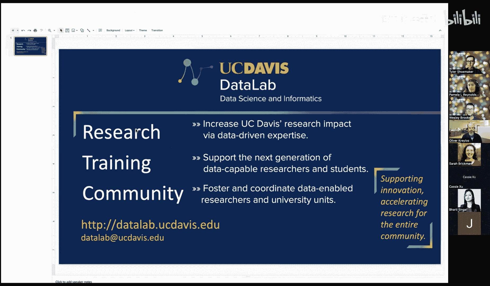
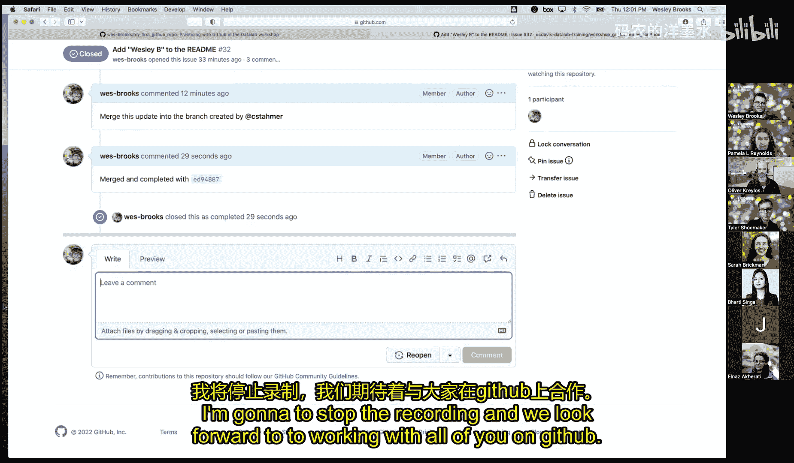

# 面向GitHub的可复现研究：04：GitHub团队协作入门

## 概述

在本节课中，我们将学习如何使用GitHub进行团队协作。GitHub是一个基于Git的在线平台，广泛用于软件开发和版本控制，尤其适合团队研究项目。我们将练习如何设置、共享并协作处理一个代码库或项目，涵盖从本地到云端的完整工作流程。

---

## 课程背景与准备

大家好，欢迎来到“面向GitHub的可复现研究”工作坊。我是Pamela Reynolds，加州大学戴维斯分校数据科学与信息学数据实验室的副主任。今天我将主持本次工作坊，并由数据实验室的其他几位成员作为讲师和助手协助。稍后我会介绍他们。

对于不熟悉数据实验室的学员，我们是一个由教务长和图书馆资助的项目，旨在促进数据科学方法、技术和最佳实践的应用，以增强所有领域的研究和学习。今天我们有来自许多不同学科的研究人员，欢迎你们。我们认为今天讨论的内容对你们当前的学习旅程以及未来在加州大学戴维斯分校之后的发展都将非常有用。

数据实验室提供研究服务，包括办公时间。如果对今天的内容有疑问，可以参加我们每周举行的Zoom办公时间。本季度和下一季度我们还有许多其他工作坊，稍后我会在聊天中发布一个链接，以便大家了解更多即将举办的活动。

今天的工作坊将涵盖使用GitHub的基础知识。GitHub是一个用于软件开发和版本控制的在线平台，在研究团队中非常流行。即使你独自一人，也可以高效地使用它，它有助于提高项目的可复现性、透明度并备份项目。

我们将练习设置、共享并协作处理一个存储库，可以将其视为托管在本地和云端的代码库或项目。

提醒一下，本工作坊是为已经熟悉使用Git和命令行界面的学习者设计的。如果你是命令行和Git的新手，可能会在跟进时遇到一些困难。我会在聊天中粘贴关于这两个内容领域的材料链接。如果你完全是新手，我们建议你先从那里开始，然后再回来参加这个GitHub工作坊。但如果你觉得需要更多练习，也欢迎今天以演示的形式观看。

此外，我们还有一些工作坊前的准备活动。你需要设置好GitHub账户，准备好GitHub用户名并链接SSH密钥。如果你还没有完成，现在可以开始做。但如果遇到问题需要帮助解决，可能需要参加我们的办公时间。

最后，对于今天在场的加州大学戴维斯分校研究生和博士后，本次工作坊符合加州大学戴维斯分校微证书途径的资格。如果你有兴趣注册该途径并想了解更多关于研究生途径计划的信息，我会在聊天中粘贴链接。在会议结束时，会有一个调查链接，请务必完成。这有助于我们获取反馈，以持续改进工作坊、开发新内容，并继续免费为大家提供。

现在，我很高兴介绍我们的讲师。今天的主讲是Wesley Brooks，他是数据实验室的数据科学家，拥有统计学博士学位。我们的助手包括Tyler Shomaker，他实际上起草了本工作坊阅读材料的第一版，因此对此了如指掌，今天他将在聊天中为大家提供帮助。Tyler是我们的博士后，拥有英语博士学位。如果你好奇英语专业如何成为数据科学家，我相信Tyler会很乐意与你聊聊这两个领域之间有趣且重要的重叠部分。我们还有Oliver Koss，他拥有计算机科学博士学位，并且在整个职业生涯中一直在使用命令行和版本控制工具。如果你需要说服自己为什么要这样做，他会很乐意与你深入探讨。

接下来，我将把时间交给Wesley，让他开始我们的课程。

---

## 课程正式开始与初步检查

好的，谢谢Pamela。在我们继续之前，我想确认一下大家是否能清楚地听到我。也许现在可以给我一个竖起大拇指的确认，好的，很好。

我们有三位出色的助手，Pamela、Tyler和Oliver，他们将在整个聊天过程中保持活跃。因此，我希望当你们遇到问题时，可以向他们提问，我们会一起解决。

最重要的一点是，我们将使用GitHub，这是一个促进协作研究的工具，也用于协作软件开发。它是一个云工具，许多人可以访问，因此你需要设置一个账户。

今天早上，你们应该都收到了加入名为“October 2022”团队的邀请，该团队已被添加到一个我们今天将共同协作的存储库中。希望你们已经看到并回应了邀请，这样就能参与该部分的活动。如果没有，现在可以做，或者在演示期间的任何时间做。我们肯定要到下半部分才会进行那部分活动。

完全参与所需的条件之一是，你已经在计算机上创建了SSH密钥，并将该密钥或其公钥版本复制到你的GitHub账户，以便GitHub能够验证你的计算机已连接到你的账户。

在之前的电子邮件中有关于如何操作的说明。但如果你最终没有完成，聊天中有一些助手，希望他们能指导你完成步骤。在某些计算机上操作更简单，如果你使用的是Windows计算机，尤其需要使用Git Bash命令行，它与Windows控制台命令行是分开的，尽管它们看起来几乎一样。

因为我们在工作坊中要使用的工具和命令仅在Git Bash命令行中有效。

这些是初步事项，我知道信息量很大。但提前提出来，希望能解决一些可能随后出现的问题。我只是想确保我们都在同一页面上，能够跟上并尽可能多地学习今天工作坊的内容。

好的，那么开始吧。抱歉，我现在要做一件事，就是把屏幕共享从这张幻灯片切换到我的命令行界面。这样，在本次工作坊过程中，我将在命令行中输入命令，然后你们应该能够逐行跟随。当然，需要做一些调整，因为我的名字不是你的名字，我的电子邮件地址也不是你的电子邮件地址，但本质上，你们将逐行跟随我输入命令行的内容。我将按照一个脚本进行，你们也可以跟随这个脚本，以防迷路。

这是该脚本的网址：`UC Davis Datalab.Github.io/workshop_git_for_teams`。简单的方法是直接点击链接。Wesley把它贴在了聊天中，哦，太好了，已经贴到聊天里了，这让事情变得简单方便。所以，如果你点击那个链接，就会打开显示我们今天工作坊将要遵循步骤的脚本。

实际上，也许我没有，我会找到正确的链接。

在开始之前，在我走得太远之前，我还想确认一下大家是否能舒适地阅读我共享的屏幕。文字够大吗？例如，是的，好的，我从团队那里得到了一些点头确认，这很好。

这是我的命令行界面，我将回到我的主目录，现在我们可以开始讨论什么是GitHub了。

---

## 什么是GitHub？

好的。前提条件之一是大家已经学习了Git的基础知识。Git是一个版本控制工具，可以在本地机器上运行，帮助你在开发软件或研究项目、撰写论文的过程中跟踪对文件所做的所有更改。

GitHub是一个使用Git进行版本控制的在线软件开发平台。

在本工作坊中，我们将练习为一个研究项目设置、共享并协作处理一个存储库。

那么，GitHub与Git有什么不同？最大的区别在于，Git是一个工具，可用于操作本地机器上或远程的存储库。而GitHub只是远程存储库的一个存放地点。

我想补充一点，我认为GitHub就是云端。GitHub是另一个服务器，你可以利用它来访问相同的代码信息，无论你在哪台本地机器上工作，只要它连接到那个云端，连接到那个GitHub。

没错，所以它是一个托管Git存储库的云服务。有很多其他云服务可以存储文件，但GitHub的特殊之处在于它专门存储Git存储库的文件。

你可以使用计算机上的Git通过命令行与这个网站进行交互。

因此，你可以做所有你通常在Git工作坊中学到的、在本地计算机上用Git做的所有事情，比如创建一个新的存储库、提交、分支、合并。所有这些你在Git工作坊中学到的操作，现在都可以通过连接到托管在GitHub上的这个云账户的Git来完成。

它作为云账户的特殊之处在于，现在同一个文件夹（即Git存储库）可以有一个团队的所有成员协作开发一个项目。在我们的场景中，这个项目将是一个研究项目，我们可能有数据、分析和正在撰写的论文。其他人可能认为这是一个软件项目，你正在开发一个应用程序，里面有很多代码文件。无论如何，Git工具与存储位置GitHub交互，使协作开发工作变得非常顺畅。

除了作为存储这些文件的地方，GitHub还是一个通信平台。不像社交网络，也不像电子邮件，而是一种不同类型的平台，GitHub启用了专门面向协作开发的通信渠道。

我这里打开了GitHub，也许演示比讲述更容易，展示而不是讲述。我们有诸如“Issues”这样的功能。在这里，我可以创建问题，用于与团队沟通。当然，不应该只是像“嗨，团队”这样随意的东西，而应该是像“我们需要学习使用GitHub”这样的内容。

我们还有通过GitHub共享消息的能力。

我们还有以README文件形式存在的文档。README文件在GitHub中具有特殊作用，它们会变成任何项目的主页。

还有称为“Pull Requests”的功能，这是一种高级的Git合并形式，整个项目的新分支可以完成工作，然后通过消息将其合并到主分支中。

哦，对了，GitHub还提供了创建Wiki的工具。每个项目都附带一个Wiki，当然在这个基本项目中是空白的。每个项目都附带项目板，当然这个基本项目也是空白的。但无论如何，有很多方法可以让人们使用GitHub就他们正在开发的项目进行沟通。

我想插一句，Wesley现在展示的是我们今天的沙盒。这是一个你可以玩耍的存储库。这是一种与云端交互的方式，你可以通过浏览器进行，但我们将通过命令行向你展示如何实际与之交互。所有这些不同的区域，这些Issues、Pull Requests，都是管理你开发的方式。我们称之为软件开发，但它也可以是你们一起写论文，一起协作，所以在这种情况下，它不仅仅用于代码。我们今天无法涵盖GitHub的每一个功能，但如果你想知道如何设置项目板或如何使用Wiki等具体细节，我们可以为你连接其他一些很棒的教程。所以，今天再次强调，重点真的是让你入门：创建存储库、提交、拉取、合并，做你需要做的操作，以便与你正在进行的云端工作共享。

没错。

一旦你回应了加入“October 2022”团队的请求，你将能够访问这个存储库，并尝试我一直在谈论的所有那些工具。在接下来的几个小时里，我将指导你们完成其中的几个。我想快速问一下，如果你收到了电子邮件并且已经准备好加入UC Davis团队，请给出一个绿色的勾选标记。如果你没有这样做，不知道我们在说什么，或者感到困惑，请给出一个红色的X，我们会联系你。

好的，我看到一个红色的X。如果你今天只是以演示模式跟随，请给出一个绿色的勾选标记，这样我们就不会打扰你。

我想，Tyler，实际上我们中的任何人都应该有权限将人员添加到“October 2022”团队。我会继续演示，希望后台的助手之一能够解决这个问题。

好的，在开始深入进行一些工作之前，我想提到的关于GitHub的最后一点初步事项是：由于这是一个云服务，有些文件不应该被推送到GitHub。

其中一些是像非常大的文件，GitHub有存储限制，它根本不会让你推送像几GB大小的文件。

但还有一些更微妙的问题。例如，这个存储库可以被公开查看，所以如果你在这里放了一个包含密码或敏感信息的文件，你就不想把它发布到可以公开查看的存储库中。

考虑到这一点，适合用GitHub跟踪的内容包括代码、文档，然后是像Makefile这样的脚本，也许还有一些像小图片这样的支持媒体。但我们通常不把数据放在GitHub上。数据通常包含敏感信息，但也通常不是那种需要用Git跟踪的东西，因为如果你在做可复现的研究，数据应该生成一次并且不改变。

然后对数据的任何修改都可以通过脚本来完成，这样如果你需要运行数据的不同版本，你可以通过运行脚本来完成，而不是知道当前保存的文件是更新版本还是原始版本。

因此，我们确保数据只创建一次，并通过本地共享，例如通过电子邮件或访问正确的数据存储来共享。

然后我们使用GitHub来跟踪项目文件，如代码、Makefile和文档。

当然，是的，像API密钥、密码和个人身份信息这样的敏感信息应该保存在不会被GitHub跟踪的文件之外。

---

## 账户设置与SSH密钥配置

好的。现在，为了使用GitHub，你需要创建一个账户。我知道这是前提条件的一部分，所以与其逐步讲解如何创建GitHub账户，我想做我们之前做过的事情，使用绿色勾选/红色X系统。

我想我们有能力清除人们之前的选择，或者……好吧，不管怎样，我正在查看参与者列表，以确保每个人都给出一个绿色的勾选标记，表明你已经创建了GitHub账户。

是的，我想我们刚刚让大约三个人被添加进来。好的，很好。

接下来要讨论的是我们如何与Git交互。如果你从我们的工作坊学习了Git，你已经学会了如何在命令行使用Git，这就是我们今天要做的。

还有一个图形界面叫做GitHub Desktop，这是一个连接到GitHub的程序，允许你使用点击界面与项目进行大量交互。

我们在数据实验室不喜欢以这种方式教学，因为你学习与Git交互的方式将取决于你安装的特定图形界面版本。无论你是在Windows、Mac还是Linux上，那个程序看起来都不同，你学习的系统，比如点击哪里、工具应该做什么，在不同的操作系统之间工作方式不同。

因此，我们喜欢确保你使用命令行学习Git，因为事实上，所有这些图形工具都只是……嗯……一种简化方式，执行那些相同的命令行命令。就像你点击一个按钮，它被转换成类似`git clone`某个存储库的命令。所以我们直接教你命令，而不是图形界面。

Wesley，请允许我简单说一下我们这样做的另一个原因。如果你进行任何类型的远程计算，你将没有屏幕可以工作，没有GUI。例如，校园计算集群上没有GitHub的桌面应用程序。所以，如果你想进行任何需要大量计算或使用他人计算机的远程工作，根本无法使用这些桌面应用程序。因此，命令行在这些领域占主导地位，学习如何使用我们今天将要介绍的工具以及过去几个工作坊中介绍的工具，从那个空间本身开始，真的非常重要，因为如果你想做那些类型的任务，你将在那里“生活”。这是一个很好的观点，谢谢。

好的。现在，关于使用Git的一点是，当你使用Git时，你希望确保你的名字被正确地归因于你所做的工作，尤其是在团队合作时，这样团队就知道是谁在做某些文件的工作，并知道在发生冲突（比如合并冲突，这是我们稍后要讨论的概念）时该找谁讨论。

为了让Git将你的姓名和电子邮件地址附加到你所做的工作上，你需要用你的姓名和电子邮件地址配置Git。这将是我们今天工作坊中第一次进入命令行。

我们将检查我们的Git配置，以确保它知道将什么姓名和电子邮件地址附加到你所做的任何工作上。

方法是使用这个命令：`git config --global`。注意`--global`之间没有空格。首先我想检查的是`user.name`。好的，我已经正确设置了Git，知道我的名字。我还想检查`git config --global user.email`。好的，Git也知道我的电子邮件地址。

Wesley，这里有个问题，那个电子邮件应该与你GitHub账户关联的电子邮件匹配吗？实际上这并不重要，这只是为了信息目的。所以Git不要求它与任何东西匹配，这只是为了知道谁做了什么，因为在协作项目中，你需要能够跟踪谁做了什么工作。

我……不是每个人都可能配置了Git来知道他们是谁。所以，如果你在这里得到的响应是空白的，我快速向你展示如何设置这些变量。你只需输入相同的命令，然后在后面跟上你想要输入的值。例如，如果我想把我的名字从Wesley改为West，我会说`git config --global user.name "Westby"`。

好的，为了确保更改生效，我会再次输入`git config --global user.name`。我们看到更改已注册。希望你们都为自己输入了一个有意义的名称和一个有意义的电子邮件地址。这是团队合作的重要组成部分。

现在，这是在人类层面上跟踪谁做了什么工作，这些是人类可读的值。就机器而言，GitHub知道你的计算机连接到你的账户的方式是通过关联你的SSH密钥。在你的计算机上创建一个SSH密钥，并将其复制到GitHub。

我知道我已经提到过这一点，但我们正接近需要将我们的账户附加到我们名字的阶段，所以我想确保我们都完成了这个步骤。

你知道你已经完成这个步骤的方法是，检查你的计算机上是否有一个名为`.ssh`的隐藏文件夹（如果你已经做了的话）。所以我会使用`ls`命令列出主目录下的`.ssh`位置。

我有一个密钥，然后这个以`.pub`结尾的是我的公钥。`known_hosts`与我们现在的操作无关。

如果你遵循了不同的说明集，你的密钥可能不叫`id_rsa`，可能叫类似`id_ed25519`这样的名字。这没关系，不重要。重要的是你同时拥有一个密钥和一个公钥。

而这个公钥是你想要复制到GitHub的那个。所以我会通过查看公钥文件来复制它，我使用`less`函数。

所以，我再次输入这个位置，从我的主目录，进入隐藏文件夹`.ssh`，然后我想从那里获取一个特定的文件，`id_rsa.pub`来获取公钥版本。好的，这一串随机的字母和数字是将我的计算机与我的GitHub账户关联起来的唯一标识符。所以我需要确保这个被复制。

Wesley，这是工作坊前说明的一部分，所以我想我们是否可以继续前进。让大家看到这个很好，但我知道这是前提条件的一部分，而且我知道大多数人已经完成了，我只是想确保每个人都完成了，因为如果你没有完成，你将无法继续。

所以，是的，我不会详细讲解创建你的SSH密钥，但只是确保如果你点击GitHub页面右上角的图标，进入设置，你会在左侧看到一个菜单，其中一个项目叫做“SSH and GPG Keys”。你需要至少有一个密钥附加到你的账户，并且它需要是你刚从公钥文件中复制出来的那个。

对我来说就在这里。你需要完成这个步骤才能继续。如果我要创建一个新密钥（我不会，因为我的已经关联了），我会点击这个绿色的“New SSH key”并复制这个字符串。然后就可以了，你的账户就与你的计算机关联起来了。

哦，是的，抱歉，还有一个确认它是否有效的方法。我按`q`退出`less`屏幕。为了确认它有效，有一个快速的命令行命令。那就是尝试通过SSH连接到GitHub。SSH是一个远程终端程序。所以如果我尝试连接到GitHub，它应该告诉我它识别了我的计算机，但不允许连接。只要我们得到那个消息，我们就知道我们已经连接上了。

方法是：`ssh -T git@github.com`。它说“你好，你已经成功通过身份验证，但GitHub不提供shell访问权限。”这条消息是成功消息，它告诉我我已经成功验证身份。这就是这里最重要的。如果你能做到这一点，那么你就能够从命令行使用你的GitHub账户。

---

## 创建本地Git存储库并连接到GitHub

好的，所有初步事项都已解决，我们现在将开始在本地计算机上创建一个新的Git存储库，不是在GitHub上，而是在我们的计算机上。我们最好都在主目录中创建这个，这样最容易找到。如果你还记得数据实验室命令行工作坊，你可以用`~`键进入主目录。

在创建这个新的Git存储库之前，我将使用`cd ~`命令切换到主目录。`cd ~`将我带到主目录。

在我的主目录中，我将使用`mkdir`命令创建一个新文件夹。我将其命名为`my_first_github_repo`。

现在我将切换到刚刚创建的文件夹：`cd my_first_github_repo`。这些都是希望从你参加数据实验室工作坊学习Git基础使用时复习过的内容。

要将这个文件夹变成Git存储库，我们进行初始化。所以，我们进入那个文件夹，然后输入`git init`。

我们得到消息，说我们在这个位置创建了一个空的Git存储库。当然，你的会有点不同，因为你的账户路径不会是`/users/wbrooks`。

好的，现在我们在一个Git存储库中工作。在Git存储库中最基本的事情是向README文件添加一行文本，所以让我们就这么做。在命令行中，创建带有文本行的文件的简单方法是使用`echo`函数，然后使用右尖括号。

首先我们放入文本，所以是`echo 'Hello GitHub!'`。我想使用单引号，因为放入感叹号然后双引号，你的计算机可能无法识别它应该是什么。

然后我将使用尖括号重定向输出。我将加宽我的屏幕，以便所有内容都在一行上。

好的，现在我将输入`ls`来列出这个文件夹的内容，我们看到我们有一个名为`README.md`的文件。如果我想查看该文件的内容，我可以使用`less`函数：`less README.md`。我们看到该文件的唯一内容是“Hello GitHub!”。好的，在`less`中，你可以按`q`退出，回到命令行。

现在我们已经创建了那个文件，但我们还没有告诉Git开始跟踪它。所以，再次回顾我们的基本Git命令，我们想将该文件添加到Git跟踪中：`git add README.md`。在我们将该文件添加到跟踪之后，我们现在需要提交我们所做的所有更改。虽然只有一个更改，但我们仍然需要提交它。我们需要一个有意义的提交消息，所以我会说“I created a repo and added a readme.”。嗯，我拼错了“readme”，但我将就一下。

好的，现在到目前为止，我们所做的只是我们在基础学习使用Git工作坊中做的相同过程，或者如果你从其他来源学习Git，我们正在做你知道的使用命令行的基本Git命令。但我们还没有做任何关于GitHub的事情，还没有任何东西将我们所做的连接到远程存储库。

所以，这样做的方法，这是我们第一次与基本Git工作流程不同的地方，是去GitHub。我将点击小章鱼猫图标进入我的主页。

然后在我的主页上，我将在“Recent repositories”旁边点击“New”，以在我的GitHub账户上创建一个新的空白存储库。

希望你们都在跟随，唯一的区别是你们不是在`wbrooks`下创建这个存储库，而是在你们为这个工作坊设置的GitHub账户下创建。天哪，我们想叫它什么？好吧，我们不妨匹配我们在命令行上为存储库起的名字，那是什么？是`my_first_github_repo`。

好的，那将是GitHub存储库名称：`my_first_github_repo`。然后在描述中，我们可以说“Created during the Datalab workshop.”。

然后有一系列选择需要做，GitHub为你提供了一些有用的默认值。

第一个选择是你希望这个存储库是公开的还是私有的。公开是默认设置，适合大多数存储库。要创建私有存储库，嗯，实际上我不确定免费账户此时是否能够创建私有存储库。但无论如何，我们今天要做的任何事情都不敏感，没有理由不公开，所以我将把这个文件设为公开。

下一个选择是我们是否希望让GitHub创建一个README文件。这有时可能有用，但我们已经通过命令行创建了一个README，所以我不打算勾选那个按钮。

我们还可以添加一个.gitignore模板，我不打算这样做。我们稍后会讨论.gitignore的作用，但我现在不打算向存储库添加一个。我现在也不打算向存储库添加许可证。

但这些都是选择，当你更熟悉使用GitHub时，你可能希望做出与我在这里坚持默认值不同的选择。

好的，然后在底部，有一个绿色的按钮说“Create repository”。好的，GitHub很友好地为你提供了说明，告诉你如果你有一个现有的存储库要推送到这里该怎么做，或者如果你需要在命令行创建一个新的存储库。

你可能会注意到，如果你遵循命令行说明，它们看起来与我们创建存储库时已经做的非常相似。我们已经创建了存储库，所以我们将使用这些说明。

有两种方法可以做到这一点，一种是直接复制这个文本块并粘贴到你的命令行中。我将更慢地逐步讲解，因为我们在这里是为了学习。

为了从我们的计算机连接到GitHub，我们首先需要知道这个存储库的地址。获取它的简单方法是查看这个文本块。这看起来像一个网址，实际上是一个SSH地址。我们已经设置了SSH密钥，所以我们能够使用SSH地址。我只需复制这个。

随着你对GitHub更熟悉，你会认识到这种模式，你会更经常看到它，甚至可能学会记住它。但今天，与其尝试记住，我直接复制。

这是GitHub上存储库的地址。那么，我们需要做什么？我们需要告诉我们的本地存储库如何连接这个远程存储库。

Git有命令可以做到这一点。那个命令叫做`git remote add`。

所以你可以在这个块下面看到我们将要输入的命令。我们需要添加一个新的远程，所以是`git remote add origin`，然后我们需要指定地址。我复制了那个地址，所以我要用`Command+V`粘贴它。好的，现在我要按回车。

现在我们可以实际查看我们当前在哪个分支上，通过输入`git branch`。我们在一个名为`master`的分支上，这是一个默认名称。我们更喜欢将默认名称改为`main`，现在这样做的方法是使用命令`git branch -M main`。

然后，我们已经在本地提交了一些更改，现在我们希望将它们推送到GitHub。这意味着这些更改或提交在我们的本地存储库上，我们希望它们在GitHub存储库上。那就是推送，从本地到远程。你可以想象将这些更改从你身边推走，从近到远。

可能是`git push`。我们加上`-u`来指示我们正在跟踪哪个上游分支，叫做`origin`。

确保……好的。好的，所以我做了一个推送，我已经将本地计算机上的提交从本地带到了远程。再次强调，这类似于推送某物，你把它从你身边推到更远的地方。这意味着我们在本地计算机上所做的提交现在应该反映在这个远程存储库中。

所以我刚刚重新加载了我的浏览器。我可以看到，事实上，我创建的README文件显示在GitHub版本的存储库中。GitHub对名为README的文件很智能，它知道它们通常是首先要看的地方，因此它把它们变成了存储库的一种主页。所以我们可以在这里看到，README的内容是“Hello GitHub!”。

我将在这里暂停一下，确保其他人都按照我输入的步骤操作，并且我们都达到了相同的点：你在你的GitHub账户中创建了一个存储库，并且你已经从你的本地存储库推送了一些提交到GitHub版本的存储库。

再次，当你成功时，请给出绿色的勾选标记。如果有人给出红色的X，我们有助手可以加入聊天，希望解决你的任何问题。

聊天中的人也是，是的，所以助手们，数据实验室的工作人员，如果你看到持续的问题并想向团队提出，请插话，我会尽力回答任何问题。

我认为这会很有帮助。有些人在终端收到消息，要求他们登录GitHub。我在想，为什么它要求我登录？我已经通过SSH密钥连接了。也许你可以谈谈那里发生了什么。

是的，好的，所以如果你收到一条消息说你需要登录，可能是因为你连接到了网址，抱歉，让我解释一下我刚才做了什么。我刚刚创建的存储库的GitHub主页上，文件列表顶部有一个绿色的按钮，写着“Code”。

如果我点击那个按钮，会得到一个下拉菜单。默认情况下，对我来说，这会显示存储库的SSH地址，我向你展示了我是如何连接的。

如果你没有设置SSH密钥，或者你只是碰巧复制了存储库的网址而不是SSH地址，你会复制类似这样的东西。这看起来像一个普通的网址，因为它正是如此，它完全匹配我地址框中的这个网址。

如果你以这种方式连接到GitHub存储库，GitHub每次你尝试与该存储库交互时都会要求你输入密码。我们不喜欢这样，拥有SSH密钥的全部意义在于你可以使用密钥解锁你的账户。所以我们不想还必须使用密码，我们不想一直使用密码。

我们将在这里，再次复制SSH地址。现在，这可能……好吧，所以我们现在必须做一些稍微高级的事情，那就是查看我们存储库的隐藏.git文件夹。

我仍然在命令行中查看相同的位置，它只是一个名为`my_first_github_repo`的本地文件夹。当然，如果我在这里使用`ls`命令列出文件，只有一个，叫做README。但如果我也用`-a`标志显示隐藏文件，我们看到有一个名为`.git`的文件夹，这就是Git知道这是一个存储库的方式。

我们可以查看该文件的内容，`ls`一下。这些大部分我们不想碰，但`config`我们可能需要。

Tyler喜欢Vim并在阅读器中使用它，我喜欢nano。但抱歉，nano不会为Windows用户安装，所以让我使用Vim来保持跨平台。如果我使用Vim打开`.git/config`，你会看到文件内容看起来像这样。

你可能在这里有类似`[remote "origin"]`的内容，其中URL是`https://github.com/your_account/my_first_github_repo.git`。那是网址版本。

我预计这就是人们遇到被要求登录的情况。

如果发生了这种情况，那么你可以在Vim中更改那个文本。我已经按`i`进入插入模式。我要删除这个地址？然后回到GitHub，点击“Code”，点击“SSH”，点击这个小按钮复制地址，回到我的命令行，然后粘贴。因为我在Vim中，我想通过按……保存这个文件。我在这里处于插入模式，我按`Esc`退出插入模式，然后输入冒号，这样Vim就知道我要输入命令了，你可以在左下角看到冒号，我输入`wq`。这意味着写入（保存）并退出。

完成之后，你应该就能够……嗯，你应该能够推送而不必输入密码。嗯，这样做了吗？好吧，我暂停一下，看看这是否为任何人解决了问题。

还有一种情况，取决于你的配置方式，每次推送时都可能要求你输入密码。我们通常不这样做，但如果你认为这对你很重要，这是另一种安全层。如果你遇到这种情况，我们很乐意在办公时间讨论。哦，是的，所以我想Pamela说的是，你计算机上的SSH密钥可能附加了密码，就像你在设置SSH密钥时，你可能被要求输入密码。

我总是默认不在我的SSH密钥上设置密码。

但是，如果在遵循设置SSH密钥的说明时，你添加了密码，那么那就是你需要输入的密码。在输入`git push`之后。这对人们来说可能是问题吗？

有可能，我认为这是一个很好的总结。如果个人遇到麻烦，只需在聊天中评论，我们会尽力帮助你。

---

## 在GitHub上直接编辑与拉取更改

希望暂停和讨论的时间足够长，让大多数人都达到了这一点：你在GitHub上创建了一个存储库，你在计算机上创建了一个匹配的存储库，你连接了它们，然后将你的提交从本地计算机推送到远程。

现在我想展示一个很酷的技巧，GitHub为我们做的一件好事。哎呀，我可能做得太快了。我们在这里查看我的README文件，你可以看到的一件事是，当你在GitHub中浏览文件时，实际上我只是点击`README.md`。所以当你在GitHub中点击一个文件时，你会得到一个看起来像这样的界面。

如果你想进行小的更改，你可以不经过拉取到本地计算机、进行更改、提交然后推回远程的过程，而直接进行。

方法是点击这个小铅笔图标，直接在GitHub内编辑这个文件。我只需添加几行新内容，让它看起来像是GitHub在回复我。GitHub会说“Hi Wesley!”。

好的，这就是我希望放入文件的更改。然后我滚动到这个页面的底部，我们这里有一个对话框，说“好的，这是你提交更改的方式。”我会说这个更改是“Add a reply from GitHub.”。我们知道是谁做的更改，我们将直接提交到主分支。然后提交更改。

好的。现在我们立即看到更改反映在存储库中。

接下来我要做的是，我刚刚对远程存储库做了一个更改，我想向你展示推送命令的反向操作，即将远程存储库上反映的更改获取到本地。当我们从本地到远程时，我们称之为推送。当我们从远程到本地时，我们称之为拉取。

所以我在这里，在我的Git存储库中。我可以直接输入`git pull`。远程存储库上的更改现在已经被拉取到我的本地存储库中，如果我检查`README.md`文件的内容，我可以看到这一点。所以我用`less README.md`。我们可以看到这是我从GitHub添加的内容。

所以我们开始看到如何可能将更改从一个存储库版本反映到另一个版本。你或许可以想象，当多人在同一个存储库中协作时，这将多么有用。

---

## 再次本地编辑并推送

所以现在我们需要……嗯，现在我们将开始做一些更改。我们将开始做一些更改，看看那如何反映在我们的存储库的远程版本中。

我们已经本地创建了一个文件，推送到远程，在远程做了一些更改并将它们拉取到本地，现在让我们最后再更改一次那个文件。

我将再次使用Vim编辑器，因为这是跨平台的，我想我可以用vi。好的，我要按`i`进入插入模式，在这个文件的底部添加：“Working on this created during Datalab workshop.”。

然后为了保存那个更改，我按`Esc`退出插入模式，按冒号开始输入命令，我想要的是保存并退出。在Vim中叫做写入并退出，所以`w`表示写入，`q`表示退出，然后我按回车。

所以我保存了文件，现在我们仍然可以访问所有传统的Git工具。例如，我们可以查看`git status`。我们看到`README.md`文件已被修改。

为了将这个更改添加到提交中，我将使用`git add`函数或命令。要添加更改的文件是`README.md`。现在我想提交这些更改，并附上提交消息：“Added a bit of context to the readme.”。

现在，再次，我们仍然拥有所有相同的传统Git工具，所以再次，`git status`。工作树是干净的。但是因为我们现在正在与远程存储库交互，Git很好心地告诉我们，我们领先远程存储库一个提交。也就是说，我刚刚在本地存储库上做的提交尚未反映在远程存储库中。

是的。几分钟前，在做`git pull`之前，我检查了这个，我会看到我们落后远程存储库一个提交，但我忘了做。

所以无论如何，在这一点上，我们领先`origin`一个最后的提交。为了修复这种情况，我将使用命令`git push`。即使在这种情况下没有必要，因为我们有如此简单的项目，我将指定我想推送到`origin`，我想推送的分支是`main`。

好的。再次，我们得到了关于进行了多少更改、到哪个分支、我们从哪个提交开始、我们现在在哪个提交的有用消息。我们只是想确保所有这些更改实际上已经反映在这个存储库的远程版本中，事实上它们已经反映了。

所以，希望足够简单，大家都能跟上。我们只是……哦，是的。

---

## 使用.gitignore忽略文件

所以，在从处理在我们个人账户上创建并与之个人交互的存储库，转向协作处理我们所有人一起的单个存储库之前，我想回到我们第一次谈论GitHub时提到的一些事情，那就是如何处理你不想被远程跟踪的文件。

在GitHub中有一个特殊的文件叫做`.gitignore`来处理这个任务。我们现在没有，它只是一个简单的文本文件。

所以如果我列出这个存储库的内容，这里没有叫做`.gitignore`的东西。实际上，要看到`.gitignore`，我们必须用`-a`标志显示隐藏文件。但即使是隐藏文件也不包括任何叫做`.gitignore`的东西，所以让我们创建一个。`touch .gitignore`。

然后当我列出文件`ls -a`时，我看到现在有一个文件叫做`.gitignore`。我还没有向其中添加任何东西。所以让我们进去向`.gitignore`添加一些东西。

所以我将再次使用Vim。`.gitignore`的工作方式是你简单地告诉它要忽略哪些文件，你是在告诉Git要忽略哪些文件。

你可以用一些快捷方式来做。例如，如果你输入一个星号，它匹配任何东西。所以，例如，如果我想忽略所有以`.xls`结尾的文件，所以如果我想忽略Excel文件，你可以放一个星号来匹配任何名称，然后是`.xls`。

然后当我按`Esc`退出插入模式，按`:wq`写入并退出。然后我可以……嗯，在这一点上，基于那个`.gitignore`文件的内容，Git将默认忽略任何文件，任何Excel文件，任何以`.xls`结尾的文件。这对Excel文件来说不是超级有用，但对于像……所以我会回到`.gitignore`，`vi .gitignore`。

你们中的一些Mac用户可能会看到一堆名为`.DS_Store`的文件，这些是操作系统的一部分。我们真的不想跟踪它们，它们是Mac文件结构的一部分，与我们的项目无关。所以让我们告诉Git忽略它们。

也告诉Git忽略任何与OAuth密钥有关的东西，这些密钥帮助我们了解在与GitHub交互时我们被允许或不被允许做什么。所以我可以告诉Git忽略任何名为`.httr-oauth`的文件。

我可以告诉Git忽略整个名为`data`的文件夹，通过命令`data/`和星号，其中星号将匹配任何东西。你可能会注意到，这些文件实际上都不存在，这没关系。你不必告诉Git忽略真实的文件，你可以告诉Git忽略可能最终出现在你项目中的模式，当它们出现时，Git会知道忽略它们。如果这些不是真实的文件，如果这些现在不匹配任何东西，它不会引起任何问题。

我想快速插一句，对于基本的项目，你可能不需要修改你的`.gitignore`，但我们想确保你知道如何做，因为正如Wesley提到的，有些文件你不需要跟踪。例如，你的数据文件通常不应该在数据文件本身进行版本控制，你应该使用脚本来创建新的提取或清理版本等，然后你会跟踪你的脚本。所以，如果这还不清楚，请查看阅读器，有一些其他好的例子和叙述，当你到达那个点时，会引导你完成。

是的，所以对我们来说，这不是超级相关，但对于真实项目来说，知道是好的。好的，所以我用`:wq`命令退出这个文件。

现在，为了让这个成为项目的一部分，而不仅仅是存在于我计算机上的东西，我当然需要将它添加到跟踪中，提交更改，并将其推送到这个存储库的远程版本。所以我会用`git add .gitignore`将它添加到跟踪中。哎呀，我在这里犯了几个错误，我拼错了。嗯，只是点击。Git会说`.gitignore`不是一个Git命令，所以我忘了说`git add`。因为我想把它添加到跟踪中，然后当然我在文件名中打错了字。没问题，它很有帮助，它告诉你一些有用的消息。

我现在想提交那个更改。`git commit -m "I created a .gitignore."`。哇。现在我要推送。`git push`到远程存储库。

如果我现在切换回远程存储库并重新加载页面，我会看到是的，有一个`.gitignore`文件。

现在有很多其他有用的信息。你可以查看过去的提交，或者查看每个提交中所做的更改。你也可以……嗯，我可能必须……就在那里，我们看到……嗯。我们还看到了我们当前所在提交的密钥。这个时钟图标显示了存储库的历史，所以现在我们已经做了一堆提交，我们可以看到GitHub喜欢如何显示我们所有提交的列表。也可以通过点击这些按钮，查看每个过去提交时存储库的状态。

无论如何，这不是我们现在要做的。我们现在要做的是开始协作处理一个单一的存储库，所以这是GitHub用于协作开发的核心内容。

---

## 团队协作：克隆共享存储库与分支

我想让你们都访问的地址，我将把它输入我的浏览器，但希望助手之一会将其复制到聊天中。它是`github.com/ucdavis-datalab/workshop_git_for_teams_sandbox`。哎呀，这不是我想要的，我想去……抱歉，我们为每个人粘贴在聊天中了，所以我想学员们都在那里了。所以这是UC Davis的沙盒，是的，训练沙盒。所以我只是点击聊天中的链接，而不是试图凭记忆记住它，因为它有点复杂，有很多下划线。是的，UC Davis Datalab训练/workshop_git_for_teams_sandbox。所以我们都应该导航到这个页面。你可以