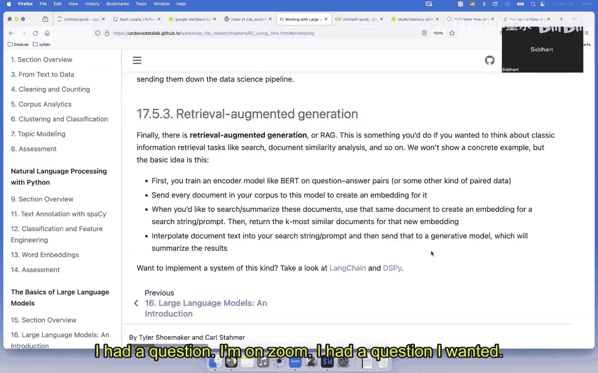

# 【全集】加州大学戴维斯分校 计算机科学 中英字幕 1080P p05 Lecture 5 - 大语言模型 -BV1cqFNzYEvp_p5-

This recording。

Okay so heres the official starts to the basics of large language models or an introduction to LLMs。

 my name is Tyler Shomaker， I'm a postdoc in the lab here at UC Davis。

 the UC Davis Data Lab services is a research service that you know kind of operates across a number of different domains wherein data might be and formative point for doing research and help in the humanities really wherever data and research meets data labb is there。

 so I'm going to be walking through a number of kind of considerations and showing you how to use a large language models。

 LLMs for especially academic research， I'm assisted today by Nle in the back who will be helping especially in these kind of early moments in which we set up the data that we're going to need as I mentioned the workshop reader for this session。

I linkeded over at the bottom of the board on my left。

 Pamela has dropped it in for Zoom participants into chat。

There is a series of chapters here on LLms that you'll see what we'll also need to do is go ahead and get the data for this session that's at datalab。

ucdavis。edu/nlp workshop data we're using underscores to separate those and go ahead and download this bebclassifier。

Unzip it and then put it in whatever director area that you will be working from today so whether that be on your local machine perfectly fine or if you would like to use Google collab and access a GPU for instance you're welcome to do that as well just remember that you'll need to mount your drive in order to have access to that data so if you're kind of unfamiliar with how that process works。

 let me just open up drive really quickly here。What you'll need to do is after you've dragged your data into drawings。

You can go to more and select Google Collaboratory。

And that will open up for you a kind of Jupiter style notebook in Google coab this may take a minute here。

 so I'll zoom in just briefly。The section overview over the chapters rather and the reader will actually give you some boilerplate code that's section 15 or chapter 15。

 so you can go ahead and copy that in。If you'd like。

And you'll just need to amount that notebook in order to have access to your your drive or rather other way around you need to bounce your drive if you want to access the GPU that is sometimes available on Google coab depending on you know they kind of get access depending on how many people need it at any one time you can change the runtime before you do this bit of code。

And change your runtime type。Here in this instance， what we would want to do is select a GPBU。

GPU stands for graphics graphical processing unit， so you this is what many of the models are using in order to run really。

 really large computations in a way that maintains some kind of decent performance and speed for your usage because again。

 these are large language models and they can be quite resource intensive。

The thing I'll say a little bit about this as well and we go along。

 we can talk about it in QA too but UC Davis as any research university at this point now is the case with has GPU access or researchers on campus sometimes that is going to be GPU access that you need to pay for if you're faculty so HPC staff on campus can help you kind of buy out and reserve a slice of a GPU or an entire one depending on what you think you need for your own research but there are various other ways to gain access to HPC as graduate students whether by affiliation with the lab or the data lab in fact that can get you on and then there are a few kind of free to use GPUs floating around on HPC here on campus but be warned they are in himate because many people are using them right now so and that said all of these models that we're going to。

Talk about today with the exception but a few will work on CPU machines just fine。Great。

 so a little bit of additional setup is required for us drive or coab comes with。

Torch pre install this is ptorch it is a framework that's very similar to nup if you're familiar with numpP that people use to build machine learning models of all sorts the kind of spec you can think of torch as being a general drop in for nup but it adds the ability to do auto differentiation to accumulate gradients。

 that is to let these models perform back propagation when they are training and so you'll need pitorrch on your machine if you wanted especially to train one of these models but also to use them generally。

Now there is a special caveat with installing Pytorch because it will interoperate with various kinds of GPs and then also CPUs。

 but you need to specify how you're going to install it to do that operation， luckily。

I have a link here and again this notebook I'll share at the anniversary session as well if you go to ptororch。

org。Dooom out one slice so I can actually see what I'm doing and go to get started。

You'll be given a little kind of configuration box that you'll need to use to select the particular type of configuration for your machine to install Pytorch so if for example you're on a Mac as I am and you want to install Pytororch via Honda or mamba instead of PP you just need to hit this little button here。

And then copy the code down below to install Pytorrch so today we're not going to be using torch vision or torch audio so you could actually just install this line here from the Ptorrch channel way at the end。

 but you need to do this and kind of follow the directions that the this website is giving you so if for example you had to Linux machine。

You could set that and you had Linux that you wanted to run Py on Kuda 12。

1 so a particular type of GPU then you would select that configuration。

 and then maybe instead of Connda， bring it down。So I'll give everyone just a moment to get that installed。

 it may actually take a few minutes that's okay， it's a rather big library in fact。

 so just be warned on this。Great。So we will wait just a moment and then I know we're probably also still unziing some files and all that it is a very large set of data and models that we need to be working with today hence the large。

All right are we which one are we extracting from the so from the data directory what we want to pull down here is a berkl classifier yeah and that's about 500 megabytes or so it's pretty big。

On Zoom， if you all don't mind giving me just a quick check mark when you've been able to at least copy down the code for Pytororch and get that set up。

 there is then also a few other pieces of this environment that you can do if you want to get things set up。

So in the meantime， once you have moved on through Pytorch installation。

 you will at the very least need these three libraries。

A high arrow we probably have that if you've set up a environment from the YaML file that for those who've been with us this entire week。

 this is just to work with parquet files so a special kind of data format for binary data we're going to install the transformers package and then also the data sets package and this is just for ways of interacting with the models we are not going to fine tunena model in class that would take a while so but you would need this final library evaluate the reader outlines this as well。

 if you want to be able to log and evaluate metrics of various kinds for your model to know what it's doing as it's fine tune in so this is we'll call this kind of optional for today。

But you are welcome to bring it down yeah questions I to install the power transformers。

And it looks like it successfully tells some of the thing then I got error message for some of the things or some of the things okay。

 okay， Nick will probably take a look at it and maybe just let's start with what actually was able to install successfully。

不是常。Give everyone just a few minutes moreuren。If you are having some trouble with this。

 you can always do each of these separately， so just you know I'm writing them all out as one。

 but again， you know you can kind of install iterativeably through this to get your environment set up just again to get you going with interacting with these models。

you'll kind of quickly learn especially in the machine learning landscape that's just as with data science and Python and so forth there is a kind of whole set of frameworks that you'll find yourself using that really starts and ends with byCch that really is kind of what most people are at this point writing in。

 but you'll recognize that TensorFlow， if you've heard of that。

 which was a Google sponsored project for a while was also another machine learning library。

In Python， but it's my sense that people really moved away from some tensorflow to work primarily in bike because it's actually a very nice interface overall。

So。Yeah还。Yeah， it's actually， so you might just need to like do a hard refresh on that reader because I just upload them。

嗯。Yeah， I mean， so it's whatever heart。I don't know what the actual key combo is on a kind of Google's drive。

は。It's you might not even need to do that but just like do a hard refresh I mean for me when I do a hard refresh that's shift command r but again i'm on a Mac so but it's it fits some key combo but it's the。

In the reader， it's sections 15 through 17 that we're going to be working with primarily today。Great。

 yeah， to be a test when this classes is like is it indefinitely？Yep。

 it's here for you all to kind of refer to for as long as possible like legacy。Right。

 until it becomes obsole until it becomes obsole maybe。update 얼굴。I don't have a water。I mean it does。

All right。So I know some of you are probably still getting set up with some of the data。

 the first part of this session or the session rather we're not going to actually interact with some of the data that I'm having you install so I feel comfortable moving ahead as I kind of generally talk about these models and then we can download one so as long as a torch is a setup on your machine for the first half hour or so of this session you are actually golden so we're completely fine there。

And then when it's time to interact with some data， I will let you all know。

 so just keep unpacking things and then loading those uncompressed versions of the data in the model to wherever you're going to work from and then we are going to fored by importing a couple modules or so that we've installed and talking about these word models。

Okay， so here the libraries that I'm going to install when modules I'm going to import for this part of this session。

 we're going to import torch。Just in case we need it。And then from transformers。

 so we need this as well。We're going to import two classes。Auto tokenizer。And Ottawa。

And that is actually all we need for this first part of our session unless you know otherwise with and if we need anything else。

 we can kind of go along as we talk about stuff。Great， so I'm going to go ahead and initialize these。

😊，Answer time。So。Large language models I will not be covering the entirety of the landscapescap and the different kinds of model architectures that are available to us when we are within the space of large language models because the field has completely exploded in the last few years so I'm going to talk at a fairly high level about what these models are what they're doing。

 we can drill down if need be， but I really kind of want to emphasize how do you start you know working with these models in your own research。

Maybe one of the first things to really distinguish for ourselves is that the kind of cultural cachet around a large language model in this moment makes them entirely synonymous in the public eye with generative chat agents。

And you need first of all to forget that as soon and as expeditiously as possible because large language models are in fact a wide swath of different model architectures that do different kinds of things that and only a few of them end with text generation you can use these models for so so much more than just interacting via a chat agent we will talk about text generation at the end of the session。

 but what I really want to emphasize is that these things are models they are models of language they work with embeddings and you can use those embeddings that is these kind of dense vector representations of text for a variety of different research purposes so we're going to talk about those first and then that will kind of generalize out to any number of different model types large language models as a phrase has actually been in circulation for nearly 20 years at this point so this idea that again you know。

The chatbots of open AI and everything are where this has started no it certainly is where it has gotten public attention。

 but in 2007 Google researchers at Google actually start using this phrase the phrase generally refers to any big neural network style model that we typically are now thinking of as a transformer style architecture so I'll talk about that in a little bit here that is trimmed on a huge swath of text。

 very， very large， often for an extended amount of time often with heavy resources computationally speaking。

So we're talking billions， if not trillions of tokens that go into the training of these various models。

 the training that goes into this model is so expensive that in early phases of development researchers quickly realize that it would be very untenable to retrain a model for every task that you might want to do there is no point in trying to being intractable in other words to get us a separate LLM for every little application for every project that you have so what the kind of general pattern of use that has emerged from the fact that these things are so big that they are so difficult and expensive to train is that what we will see is that we get a retrained model that is a model that a group of people or a company or an organization has trained on those billions and trillions of tokens of text and using spending millions of dollars to do。

Yeah？That is a kind of generalized representation of language。or language data or text data。

 depending on how you want to really think about that relationship talk a lot about that this week for those who are kind of in the know and then what you do is you fine tune that pretrained model for individual tasks right so the same model can be reused by taking the parameters that represent all of that pretraining。

 all that huge amount of data and compute that went into training the model and then using those weights as the point initial of an initialization for further kinds of things that you want to do。

So you could further train a model to adapt it to a particular type of corpus or you could change the kind of task that you might want your model to perform so typically these big models are trained on next token prediction that is they're usually working in some fashion to guess either what tokens should be generated next from a you know kind of chatbot sense or a GT style architecture or it's a model that is trying to guess mask out tokens from some sort of text stream so if you're familiar with the words to that style of you know having some sort of。

This is a string of text。What we might do to ask a model to start learning representations for individual components of that text is that we might start masking out certain tokens there and then asking the model to guess what should be under in place of this mask when it trains。

So this is kind of more of a BRT style mask language model approach to training these things that again。

 it should be somewhat more familiar to those who have worked with word embeddings a little bit more generally。

Great， so the nice thing then about these giant models is that for the most part with the exception of you know some very notable examples。

 there are many， many many and many of them now online available for use where you want to go to and where you're most likely going to go to find one of these models is Huging face this is an AI company that services a huge amount of you know the AI community and the NLP community now by hosting not only different kinds of models but then also datas that you can download to use。

 I have a little profile here and you can sign up for an account on hugging face and that will help you supply people who host models with your contact information。

 your credentials so for example， if someone has gated access to a model to only academic researchers if you have an account here you can supply your information make that request and then get。

Access to the model this is pretty relevant， for example。

 if you're you know like biomedical research and you might need to do say like the city certification or something of that nature。

 you can actually manage all of that here and then get access to the various models that you need so the hugging phase is really kind of rolling out a number of different ways to gate and then provide access to models in addition to this huge swath of models that you can otherwise just download question and know this might be like a silly question but。

First for a model that is not a discrete like linear like linear regression equation X number of weights like for a neural net with something like how is it even stored like when you download the model what are you downloading Yeah so that's a great question the question for everyone on zoom is just you know how are these models actually represented in terms of like disk footprints what does it look like usually what you're doing is you're grabbing these big binary chunks of data and pulling those down transformers is really nice in its ability to kind of coordinate all the moving parts that are necessary for the model。

 but we're can actually talk a little bit more about this when we think about what tokenization is in these models。

Let me just show you all here that if you go to the models listing on Huging face。

You'll see here that currently there are over 700，000 models available to you on Hugingface。

 many of them， I think you're probably never going to see， maybe even never use。

 but you know the kind of big ones that have been released are going to be here。

 stability AI metas models are on here， Mistrral， if you've heard of this company those are also on here where I'm pointing you to especially on this is this lefthand column where you can really get a sense of the different kinds of models that are available to you from this download so there's I'm going skip over these vision models and go down to the natural language processing component so that there are models here that have either that are either ready to be fine- tuned or happen fine tuned to do a series of different tasks ranging from text classification to feature extraction to translation to text generation summarization and then more。

Right so you can you know filter this information or this listing that we get over here on the right by those different tasks。

 we can't cover all of the different tasks types that you might use a large language model for。

 but there are ways to kind of select and filter that listing on Huging face and then hugging face actually has a wonderful set of examples around you know if you wanted to go in。

And see a model card。Look at the task it was trained on。And then download it for use。

 all of that is available to you here。Great。So I'm going to go back to the models。

 we are going to download a kind of classic LLM from 2019 called BEt from Google。

So I have searched for that up here and we're going to download it's actually this first one Google Bt Bt based oncase so Bt stands for bidirectional encoder it is a specific type of model architecture that is built on the transformer again we'll see a little bit more of what actually is going on here when we bring this model into our computers or down on direct computers do use one of these models。

Once it's actually quite simple， all you need to do from Hugingface is to copy this string so that's going to be the organization that hosts the model and then the model itself。

 the model name。We call that model named the checkpoint。

 that is it's a sort of point at which pre training stopped。

And then you can think about producing other checkpoints from training there。And。

Just save it to like a variable in Python。So we're going to load from here。

So Google hyphen Bt slash Bt hyphen base hyp uncased， just like so。

Now what we need to do is load up a tokenizer and a model and if this is the first time using this particular model。

 Huging face will actually go in and download it for you on care machineine so let's start this I'll talk a little bit about that where things get downloaded on your computer and then we'll actually start doing some stuff。

So I am going to create a variable here called tokenizer。And then with auto tokenizer。

 we're going to use the from pre trained method。And then supply it with the name of the model that we want to download。

Or least。Then what I'm going to do is create a new variable， I'm going to call it MEt。

And we're going to use that auto model。And use that same from pretrained method to load this up onto your computer as well or download it if you haven't yet brought it down on your machine。

 so go ahead and run this cell when you are ready and it will load up the model。

Now you'll see here that we have brought in two different classes from or two different objects excuse me from transformers and auto tokenizer and an auto model Transers actually has a number of different interfaces that correspond to the task types for each model so there is in other words a special object here that you could bring in for text classification or sequence generation but these auto classes are really nice because under the hood transformers will figure out for you which kind of object to actually use so these auto tokenizer and auto models are kind of abstract wrappers around a specific type of python object that transformers will supply or furnish you when you are actually working with a model so let transformers do the heavy lifting in other words but you could always actually say here。

That is， for example， the specific object that you could use to instantiate a bur model from transformers。

 I just， you know， you rarely need to do that kind of thing。嗯。

I should say also that transformers is directly integrated with Hugingfacease。

 so Huging F develops transformers and uses that as a way to host these models and so forth。

 so they really do kind of go hand in hand when you are using these models。

We'll let this kind of download you may see some logging messages that's perfectly okay but let's maybe just get a thumbs up or a kind of a you know flag me if this has been a successful download for you again it may take a little while thumbs up see some that's good question in the meantime also thumbs up so the tokenizer and the model are separate。

Like objects in a pipeline like they can be connected， but they're not。

Right in the same model yeah so the question here is just about what is why why two why two pieces and I will get to I will answer that in three minutes I promise but yeah you're right that these are actually two separate pieces here and that's an important consideration just as a kind of point of where this model is getting downloaded from this is getting downloaded from a hugging face hugging face kind of also operates almost like a Gitthub for models。

So that's where we're pulling this down from， but then I also had you all download a fine tuned version of this particular model and that was kind of you can load models locally from your own machine in addition to pulling them down from the cloud。

The thing here is that once you have downloaded a model。

 it will sit on your local computer indefinitely so you don't need to do this process every single time。

If I pull up a terminal just really quickly。嗯。The models are stored。In your home directories。c。

Directorory， so a subdirecty of home， and you will see something like hug face here。So if you CDd。

 cash huggging face。And then you'll see actually that there's a number of different subdirecties within that that corresponds to the different things you can work with on Hugging and Face。

 I bring this up because if you're special working in an environment where you might have a limit on your home directory and user your land as it were。

 you may need to set the path to a particular download location to elsewhere on a computer。

Right so for example， apps Farm。Which is on our campuses HPBC。

 everyone or the admin prefers us to go under the group。

Diectctory here from roots and then install data there。

 but this group is you need to have access via you know some sort of like PI who would you know let you store all of that kind of data on these missionaries over here so we assume that any of the models you can download from hugging face are not going to be on the scale of something like out the gold which might available on your computer Yeah so this is the thing there are a number of different kinds of models on hugging face including giant ones like truly truly enormous models metas models Falcon if you know that model that does mean that you could end up bringing down you know several gigabytes of information onto your computer and it's likely that you know you probably just won't even be able to load that model into into memory。

When you initialize it， there is a hugging face。I think it's here， yeah， there's a really nice。

Model memory usage calculator from Huging face I quite like this what you can do is you know I just Google this so you'll get to it that way。

 but you can actually calculate the memory usage for the name of you know for a given model on your computer so that isn't a really handy resource just in terms of what it might actually take to run this machine run inference or run this model run inferences with this model versus also train it so here you can start to get a sense of what those resource requirements would look like for your machine or for the model rather that you with。

Awesome， okay。So let's do some stuff。We almost did Bt downloaded okay。

 you have an LLM on your machine， mostly set， yes。Still waiting， good， good。Awesome， great。Okay。嗯。

So if you are familiar with the NL key pipeline， you will know that text needs to be tokenized in order to make it available for modeling。

 tokenization for those unfamiliar is just the process by which we segment a string of characters into sets of countable or modelable units。

😡，One way we have thought a lot in NLP land about how to tokenize is by just simply breaking up a text along white spaces。

So for example， I could think about how to， sorry not strip but split this string along each white space character and the original Python representation of this is a mask of text and then break it up into these individual components here。

 these individual tokens， right？Great。😊，Large language models throw away a huge amount of conventions around tokenization that have accrued in NLP and information retrieval for like 40 or 50 years。

 so they use a very different style of tokenization than many of the strategies that we've discussed to this week。

 for example， and any kind of strategy that would kind of makes I think intuitive sense to someone first encountering one of these tokenization protocols in LLMs for the first time。

I'm going to show you the results of akenization a tokenization run with the tokenizer and then we're going to talk about it here in just a moment so I have a phrase。

That I'm going to token ice called and I'm going to say large language models。

Language models use what is called subword tokenization。Great。

 so let me just encode and then decode with the tokenizer this string so we can see the output of it。

 then I'll actually walk you through the various stuff that are going on。So I'm going to say tokens。

Tokenizer phrase。And I'm going to decode those tokens in just a moment or just like this。

 again I will talk this through that I want to show you what is actually happening。So。

We get this wonderful。At the start here， we will see that we've actually seen some new kinds of tokens input into。

The the original string we get these special tokens I will talk about these in just a moment。

 but what we will also sometimes see if we use one of these tokenizers is， for example。

 let me just kind of change a。Different string here。So say， for example。

 I have like a little typo odd tokens。Oh' oh， right， sorry， I need to do it this way。Turnancesors。

And then tokenizer Gcode。This one is actually kind of doing it all for us。

 but what we'll actually see if we didn't want to decode nice and cleanly。

 so let's actually look at these。We'll see here that the numbers that represent each one of these tokens in the input sequence is actually considerably longer than what we would expect to find in the input given our string。

 so let me just go back to this small phrase here， large language models use sub tokenization just to kind of show you in part what I'm getting at。

What is your problem？We have these input IDs， if we take the length of our phrase and split it along just white spaces。

 we get six。But if we take the length of token's input ideas。

 remember these are the unique identifiers， we've talked about this in a couple of different instances where models are using an ID to represent a token。

 we actually get 10。And that is two more than these even inserted special tokens again to come why is this happening。

 it's because if we actually looked at every one of these individual token IDs for token ID token ID and tokens input IDs again I'm just showing this but you can put along if you'd like。

We're going to say a token here is the tokenizer decode。

That token ID and then we're going to print it。We can see here that the model has actually broken up some of the words in this input string into smaller segments。

And those small segments are prepened with two patches here。

These we call subwords so as that phrase suggested at H。

 large language models use subward tokenization， the idea here is that LLMs are not breaking text up along white space and then preserving every single token within the input for later use in modeling。

 rather they are using a subset of all possible tokens in your corpus and then reserving certain kind of morphinelike units for rarer words and then actually building on the fly a representation that would corresponds to the whole phrase or words that we would ins in raw text。

 otherwise though they're literally spelling out certain words and have different models like vector representations for each of these chunks that then。

coordinateordinated together to represent the entirety of that kind of nice human readable phrase when we are using them for any kind of task。

They are doing this because again， these models are trained on so much data that we are going to encounter that long tail problem in which really rare tokens can cause a lot of trouble for these models for any model。

 in fact。So what developers will do is they will figure out a cutoff point at which no other of these kind of rare tokens gets their own full token string and identifier。

 rather model the developers choose to instead use these kind of individual subward components to represent that string。

😡，And represent all the components in that certain。

a kind of further reference about what is actually going on here， well。

 the tokenizer itself is a model。So under the hood what happens is that you have to train up a tokenizer that starts by blasting apart all text in input in the data into individual characters that are have white spaces in between them and then what happens is that as the tokenizer trains it will go through and find the most frequent five gra pair of characters in that data and it will say sush those together right so T often occurs very frequently in the English language so that's going to be an early token that gets built literally from the characters of all that text when the tokenizer is training。

Then in another iteration， the tokenizer will say， now what is the next most frequent bigram in the character string？

Say it's ERR and then it smes those together as well。

 and it keeps on doing that thousands of times to build up literally from characters。

 individual characters， something that resembles or approximates words。😡。

So this idea again that I really harped on this week that tokens do not correspond to words。

 tokens do not correspond to language， we actually see this very clearly in that particular instance with subword tokenization。

 this is an effect of training of the model and then actually usually the way that these developers will set a cutoff point for what should and shouldn't be a tokenizer。

 is when a really simple kind of language model reaches a certain like perplexity threshold。

 you know when the overall distribution of tokens can adequately represent or handle the number of different variations that tokens might might have。

 then they use that as a cutoff point for tokenizer training， another strategy is to say I want 30。

000 tokens total and then just stop there， but more frequently you'll see this as a kind of probabilistic process of training in which we build up to our vocabulary set and say that when perplexity。

is a certain threshold that is the model's ability be to guess kinds of sequences that it might see。

 then we cut there and reserve individual little subwards to handle the rest。

This also then means that models can handle any text。😡，Unless you're like using really。

 really strange Uniicode characters in which I fully support you but unlike other kinds of NLP methods where you always need to be constrained to the particular vocabulary that you train your model on well this particular vocabulary is a general vocabulary that lets you you know kind of use any kind of text representation。

 you can think about this both from a very like from a very pragmatic point of view。

 a method ofGBT just didn't know a certain word and it didn't have the ability to compile that word on the fly。

 those millions of dollars in compute resources which is like either be broken or totally use in that instance and so that's why in part were doing mean this。

Subver tokenization let me also just show you the results of that。

 but I also want to answer questions too so let me see here i'm just scrolling into this is a kind of example。

But you can see。That I've done for you all actually in a thing。I know it's a little hard to see。

 but for example these are all of the characters split out in a little toy data set so you can see here that each character is split with full and white space after one iteration the data looks like this when the tokenizer is training。

After 200 iterations， we get this right instead of like cement up at top there is partially built iron is fully built again just kind of treat this like a wall of text。

 don't kind of read it， just look。After 500 generations。

 we get something that looks a little bit more like words。And then after 250 or 2500 iterations。

 we get something that looks really nicely like full packs right so that's actually kind of what's going on under the hood。

I really can't emphasize enough the kind of philosophical and conceptual point of interest and import for this that large language models are themselves modeling models。

They're not modeling text data directly， they're modeling an inference generated by a tokenizer that is itself the product of some kind of statistical modeling。

😡，Which is I think super interesting right like where is the relationship of language then to that kind of process we are seeing this kind of schism or you know alternative representation to what this this text actually is in any kind of language it might represent so that's like you know the depths of how you might think about these things sort of theoretically and philosophically but again i'm just kind of highlighting that that is part of what we were seeing we have two questions in the middle and then I know that others are asking。

So maybe we'll turn them back so my question is is the word with the double just treated the same as word or is it indicating that it's part of something so this is also really interesting the question for Zoom is is word here the same as word without the hashes future is no？

Right so sub wordss are not equivalent to words so again at like a theoreic level you might ask yourself what is the relationship between word as word and word as subwords those are not the same Well in that case why is sub whats part of the subword but why does in have to double pinch that's right so and and this is the particular model convention for tokenizing this model or this tokenizer will treat sub wordss。

As the thing that gets propented with the hashes， but sub here is itself a full word in as much as you could imagine this actually existing in other contexts right I sub out a word for its sub word representation so the way that this tokenizer was trained this got kind of sort of survived the cut instead of saying being represented as。

Some like that。The tokenizer saw enough instances of SUB that it decided to call it sub。

 but when then it is compiling these sequences into tokens or splitting them rather into tokens。

 what you actually see here is that you get combinations of full words with subwords right so this is a full word plus a subword words。

But again， you know kind of one another way to think about this is that actually these are all just sub wordss。

 they just happen to correspond to what we would consider full constructed words。Makes sense。

That's super interesting， I think right this is a pretty significant point for thinking about these models in the middle So if so I'm guessing this is because we stopped better that's right so if you had gone through I don't know let'd say a0 word or whatever with the subword one word again yeah so and you can train your own tokenizer so to answer the question then yeah if you were to further train on this data whatever it may be。

 you could actually get to a point where there are no sub wordss in the tokenizer output of a subword tokenizer right it would just look like full strings that we recognize as words but again this is why you know throughout the week especially we've just been saying over and over again these aren't words tokens are their own thing and so even if that happens to correspond to the word token to this process it' it's just any variable length sequence of text。

And so if you also see you know， like various errors that come up from this that have to do with you know internet text。

 if you're familiar with for example。It's all little gold， the magic carp is the famous one。

That got thrown into GT data because someone was using this string at enough times in the internet corpus that GT was trained on so that we see this as a full sequence a full token so again it's not language they're not even words they're tokens they're their own thing follow up on that and then we have stopped whatever like half theism what we are at now would let's say language be also broken up because those are still characters being sta together and would they have site so any of that kind of like very sitting iteration around how many times you iterate through those character sequences you may see unexpectedly certain words brought together and some not and again there are a couple of different strategies for thinking about how to train up a tokenizer but most things that I've seen is it's like we try to minimize perplexity。

In a simple probabilistic setting so how surprised is a model by a sequence that it sees of characters。

Question there and then as Sara and included。My tokenizers not returning subwords just full words't be kind of float into something so if you've got it just on this Z code it's actually kind of going under the hood and yanking it all together so that's why you won't see it here but if we actually access the individual IDs for each one of these tokens that's how i'm kind of coercing it into returning the subs themselves。

嗯。Yeah， it's not iterating through， it's returning of the full tensor and just decoding it。

The full time even when I try to for a week to like but so maybe it can take a look。

 but you we want to make sure we're turning here and then iting through just these what ideas I mean that。

嗯。So yeah there's also a question about knowledge English or non Latin languages Yeah how that works subs Yeah so I'll answer I'll speak to that on zoom so these models are a sensibly multilingual but that need not necessarily be the case you need to think very carefully about what languages may or may not be representative and represented in a data set subwords organization is going to apply to any character string so that you could build the Hong character set if you wanted。

 you could do you know like Hong will download， you could build any of those sequences into sub wordss split them all power but you want to do it what I will say is kind of poking around these models it does happen to be the case that you see a kind of privileging of Latin alphabetic scripts that gets built into these full words whereas non Latintin。

Characters especially so not even just English but nonlain characters are actually more often sub wordss right or built into these different little sequences The question then is you know how often does the model have an opportunity to train on those sub wordss and does a performance deteriorate because those characters may appear less frequently in the data so that's like an interesting research question is there a kind of proxy here for when a token is subword rather than a full string and the model's ability to kind of know what that token means questions if you go ask the reader。

When you use the tokenizer return cancers and return attention Yeah。

 I'm going to talk about that people are studying those you will not see the sub wordss try to follow the example Okay。

 if you take those away you can see the subwards yeah so just have it be like this I will talk about some of those return types here in just a moment because we are going move on briefly last great questions on subwords organization because I do want to dive in I just have a quick question if you like where going get this report after yeah and then again this is all in the reader too course I think it's models don't get skating to model Yeah。

 that's a great question So you know why not plural do a kind of plural here I can tell you for a fact that tokenizer。

Does have。We can what is the input ID for it， I will tell you。啊。Let's see if antelopes。Gets it。

 I think it will and so if we say for token and tokenizer， well let's say tokens。

For to ID and tokens， input ID。Prince pokenizer。Decodeed to be。

Right that string correctly so here actually you didn't quite get it。

 but you can see that there's a kind of morphological sort of or morphme like entity that's here。

 but in other instances you will actually see that plural it just whatever the you know tookkenine or happen to see when it was training so it saw mob goals enough times to be able to represent that as a whole strain so you know one place where this does actually get very powerful is in certain highly inflected languages like German or finish some of these languages that really depend on inflection can you know nicely combat those rare word problems by dynamically constructing these sub wordss on the slide so you will see that pretty frequently when you were going through these models。

So I know that we have a couple like s people in the room。

 you could also think about like DNA sequences as the product of a sub tokenization run right so I could say just you know randomly。

Some man like that。You can think about how like a DNA sequence could be represented as upward tokens right it's any kind of text strength thatoom was also asked to get numbers yeah in the same way。

We get various tokens for numbers。So you know you might actually use these tokenizers for something completely separate beyond an LLM say you just wanted to think about you know general sequences of some kind of text data or data that you could represent as text。

 build up a little sub tokenizer and see what you can find but that is yet completely available to you you'll note here that these are all casing down to lowercase。

 but there is a case variant of ver that will preserve casing so you can use at that little fls。

Good on here。It's kind of a little bit to get your head around， but it actually， in my opinion。

 it one of the most interesting things about these models。

So I had the longer phrase where it included the odd tokens of the miss feing about the left space and the first time it sees token。

 it makes it one word and then the second time。It separates odd and then to and it ends Yeah like why didn't it if it saw token on the earlier sentence。

 Why didn't it recognize it on my later partis So do you want to write up tell me what that string is to form time it says large language models use subward tokenization comma。

 which produces odd tokens one word Thank you。So now if you look at that。就。

The tricky thing about this is that we also need to take into account even though it's stripped out when we tokenize white space characters。

 so white space characters can be counted as part of an ngram of characterlink sequences when the tokenizer is training so again you have to imagine then that there are enough instances of seeing odd on its on its own I think that makes sense but token as some other segment of a model or of other pieces of the training data。

 but then also what the summer tokenizer will do is depending on spaces that either prepen or append a sequence and then depending on what the sequence actually is it's not always going to canonicalize to say tokens and let's see if this actually will work here。

Tokens， I'm going to give this a space just to see what it does。

So actually here's a great example of where we're seeing the pluralized form here but the tokenizer itself is you know making some decisions under the hood about how to kind of fork those sequences into one another I think there are a couple of different also ways to make those decisions algorithmically but I have to kind of refresh myself on what they're doing there so I can't remember for example the tokenizers pulling for many probabilistic stuff when it's doing this to see about what would be the best fit for the string but you can imagine actually doing that and that could be an interesting points of interest or you know of research yourself and one more in the front and them will go back and then I do want to move on to get a lot to do today。

Get on that Oh I just so this subwar would be like the beginning of thinking that this model have a prove adaptation because scary right Yeah so so the question really here is like this is this I'll just kind of in my response summarize that so this is a moment in which we kind of think about generalization of these models right their ability to generalize across all different kinds of texts number a number of different languages。

 data types all that kind of thing actually starts to happen really。

 really early on with subver organization because again it needs this ability to represent numbers a number of different instances of text but one of the things that they said already that I think is really interesting about this is that you can think of this output of itself the product of a modeling malform So we're also in our own little world here right we're in a world in which what is available to us。

mayy be very flexible， but itself is the product of a series of decisions made by model developers to China up a little subway tokenizer that creates these kinds of outputs。

啊是还是。I are the number of iterations hard coded somewhere in the model or is it like deciding on apply how many So you mean when we generate subs or will we train them？

嗯。Are you generating them here Yeah we're kind of tokenizing Yeah so here this is more of a kind of rule-based process for generating these there is intellectual like a series of iterations that the tokenizer goes through to make a decision about how string should be tokenize all of that kind of stuff happens during training but then this is more kind of rule-based halfet type setup in terms of what actually gets broken into what when we are training these models last thing maybe you'll say here is you can also add tokens to a tokenizer if you wanted to say for instance。

 to you fine tune a model and you knew that for some reason two different sub wordss are going to be seen so frequently and your text that you want to combine them together you can actually assign a new sub wordss to the tokenizer and then let the tokenizer break the text that way rather than into individual components so that that's pretty useful in circumstances。

As well。Great okay， let's tokenize and then I want to at least get us through talking through the embedding that this model produces I'll do so somewhat at the expense of model architecture。

 but that will at least get us going into the general space of using these things and then after the break we'll fine tune。

So I'm going to create a sentence here。That we're going to work with。

This you'll recognize from the other day then I tried to find some way of embracing my mother's ghost。

This is from Odyssey Book 11， if you are familiar with that or saw it earlier in the week。

What I'm going to do is I am going to assign the output of tokenizing this sentence to a variable called inputs。

And then here what we're going to do and the reader reports this， we're going to send up a sentence。

 but then we're going to ask for a few other things in return。😔。

That will help the model do its thing。So what we need to do is we need to specify the data type。

And the framework that is returned to represent these individual IDs that corresponds to the tokens and our data。

 so we're doing here is say return type tensors or return tensors PT stands for Pytororch because we're using Pytororch to you do this modeling that's we're going to send its tensors from Pytororch I think if you had tensorflow it's just TF。

嗯。While we're using pipetorch， then we will also return something called attention mask。

 which I'll talk about in just a second here。That's going to be true。Great。😊，Okay。

So now if we actually see the output here， we get a dictionary of a number of different things that are key value pairs between the thing that was returned and then the kind of tensor that went along with it。

Input Is we already saw， these are the unique。Identifiers that a model uses to know what token it should be looking at and pullinging from。

Input IDs。And we already saw instances in which we decodeed these IDs back into their plain text variantance。

The tokenizer just to kind of show you。We'll have。Ids for punctuation。

So there's an apostrophe and a period。But let me just copy this for you。

Wite space in this particular instance when it's kind of annual stuff this will be model dependent but in this particular instance the birdt tokenizer strips out of all white space you don't always see this happen。

 but here you do you will note again however that we get these two input IDs even though we the tokenizer dropped that information ostenensibly why is that。

These are the special tokens that I mentioned earlier on。

So various models will do this in various ways， but these are the beginning and end of sequence characters or tokens。

 rather。CLS is for birth style models， especially prepened to every input sequence。

 and it just marks the start of a sequence。So later on we'll see actually that in certain tasks like classification。

 this token acts as a summary token for the sequence as such。

 so the model kind of loads up a bunch of information about the entire sequence and then stores it in the representation for CLS。

We can also use CLS andEP in various sort of points of combination so that we could send multiple sequences to the model at the same time。

So if you're training up， for example， question answer pairs。

 know what is the capital of France and then you say Paris， then what you use here is a s。

To separate out those two pieces of the input and then if you were training a particular type of model。

 it would know to look at one part of the sequence to ask the question or to see what the question is。

 and then another part of the sequence to see how to answer that question。

So you'll see these kind of come up and go， we're not going to really deal with them a whole lot today。

 but they are present for you， just kind of know。诶。We also get water arefalls， token type Is。

This is another way to start distinguishing in various parts of a sentence so or parts of some other kinds of you know task in model training and in generation what I can I mean by that well you know see that this is just a series of zeros but if I were to send a question and then like a response to the tokenizer we would get somethings slightly bit different so i'm actually just going to copy this over just to show you the return here。

So what I said is what did I do then and then the sentences we've been working with then I find some you know tried to find some way of abraising my mother's ghosts wonderful。

 what we actually see here is that this is a mask that distinguishes one part of the input from another part of the input。

So if you're asking a question and then expecting a response or say if you're working in translation and you want to think about how to translate two sentences。

 what's going on under the hood is that there's a mask here that corresponds to each component of a pair that you would want to use to train up the model。

Finally， there's an attention mask。So I'm going to go return to this original inputs。

And you can see here that this is just going to be a binary vector of ones and zeros。

 and attention mass is going to do is going to tell the model what part of the input sequence to pay attention to and run computations on。

That may feel like something of redundancy， but you can pad and truncate input sequences and in fact you will often need to do this so I will show you what that looks like。

I'm again， just going to copy this over for the purposes of time。

But here what you can do is you can pad out a sequence to and have a couple of different strategies for doing so to fill out the length of that input sequence so here again we just got that little short question what did I do then that goes on in the normal you know number of tokens that we'd expect to see and then pads down to zero。

怎用。And then we will see that reflected in the attention mask。那什么？

So we get pay attention up to a certain point and then don't。

Why do we need to do this kind of padding， it has to do with the fact that when we utilize the parallelized processing that these models are capable of doing。

 especially in GPUs， the input sequences only to be the same shape that is the same things。

So and if you have what are called ragged tensors that is you know we cut the tensor just to here and then had another one that went to full length。

 the model would be wouldn't be able to batch process and speed of computation we have to like look individually at every single input sequence at a time that would be extremely inefficient and in vector wouldn't use one of the real points of these models which is to do parallel lot processing so we need to pad out all the way to the end of the longest sequence that we see here just to ensure again that we are。

Getting those nicely shaped tenss for training。What happens then is that the model is just going to ignore when it kind of looks and creates a dynamic representation of an input sequence。

 anything that is padded out with that token I zero。So it's usually best practice。

 although you can kind of， you know， there are some decisions to be made here to actually pad out to the max length of a model。

In this case， 512 tokens。So you can kind of give yourself the full length to work with。

 but if you know that you're working with really， really short text。

 you might feel like you can set this yourself and not worry about it in the same way。

The thing here though is that these models are constrained to whatever their input size is。

 so for 512 tokens， that's actually the largest context window we call it that BRT can handle when it is looking at text。

So if you're modeling novels， if you are modeling some sort of long dialogue or interview set。

 you would need to think about how to actually chunk up your text prior to sending it to this model because you're likely to encounter a place where the input size exceeds with the model。

 the kind of computations the model can do on that full length。And so just going to be aware of that。

 the kind of trick to make sure that you can， in fact。

 that you can know what the input size of your model is is that you can check the tokenizer's attribute model max length。

 good tokenizers will have this configuration stores。

 not all will but know that it's available to you。If you see an instance in which， for example。

 you have a really， really long text， I'll just show you what you' you'll probably see as an error。

So here I just multiplied a space 10，000 times and then sent that to the tokenizer and you'll get this little message here。

 token into C sequence length is longer than the specified maximum sequence length for the model。

Running the sequencechs through the model will result in problems in ining tariff。

 right so you will have some problems here。What you can do to combat this is a truncage the input。

And so that will then truncate down so that。Squeze us。That's 5vol tokens。

If you are chunking up the text is there some way for you to append an identifier so that even though they are process of separate input at the end the model understands what text belongs to do Yeah so the question for Z is you how do you start telling the model that you chunk to text that you want that text to be counted together there are a whole number of different kinds of formats that you can use。

 this is especially relevance in like dialogue and chat settings so we'll talk about that in a little while here。

 but there are some interesting challenges if you're thinking again like how do you model an entire novel on this you know you could for example interpolate a couple tokens at the beginning that might give you some indication of where you would be at in that model is this paragraph is this dialogue but know then that what you're also doing is shaping the training process and you could be risking a slight overgeneralization。

Or overfitting excuse me in doing that right so it's actually a kind of complicated problem BRT was a simple relatively simple model back in 2019 so it has a fairly small input size for what can actually be processed at the same time more recent models will expand this greatly so you know GBBT now is in like the tens of thousands I think the most that you could really reasonably expect to run on something like farm so RHBC is 4000 ish tokens at once but it is a kind of outstanding question in terms of how you might best format some of this informationclin。

Great， okay， so in a few minutes here， we're going to take a break， but I'm going to run these。

Mo these inputs， what I am going to do before。I do that is ensure that my model is actually on H GPPU if it's available。

 you'll often find this pattern in code and it's a good one to get if you're doing this work。

 you can say device zero which will be the first GPU if available on a computer if torch Kuda is available。

E it's just the CPU。So I'm actually on a farm right now， so I have access to a GPU。

But you might see CPU here or even a string， well you won't see a string in this particular expression。

 but you could and then what you can do is move your model to that device。

Just like said if you needed to。Did that just make sure that it will run on？

Lachine or the component of this like you wanted to when you are also initializing a model。

 you can say auto model from pre traineded。Checkpoint and then set the device this way。

Or you can set it。Like。Devicice map and then auto。And that would be another way to have transformers kind of dynamically select which component to load this model onto to。

Okay， so I'm not going to run these bits of code because I'm already been set up。

 but that's available to you or let's say you do it what I want to do is now set this model into evaluation mode。

What this is going to do is it's going to prevent the model from using certain layers in its internal kind of architecture that have to do with dropout。

So one part of what we see when we are training up models。

 certain layers will at the very end or certain parts of a process。

 you will randomly ablate or remove certain parameters in a layer and that kind of challenges the model to generalize a little bit more than it might otherwise do when you are training but that's a little bit of stochasticity that you probably don't want once you've trained up a model and are going to create embeddings for it。

 so what we do then is when we put it into eval mode we are kind of freezing the model from making those kinds of dropout changes and then we are also telling the model well we'll do this in two different ways but this is one part of how you tell the model that you don't need the gradients from a computation that is you don't need a way to update the weights of this model because you're just running it through a forward pass to get a representation for。

Sequence that house。Here then we can actually see the architecture of Bch we get an embeddings layer and this is a kind of initial point of furnishing your input sequences that you are represented by those token IDs with dense embeddings so that's learned during the model training process but you should treat this as fairly synonymous with say Word ofec embeddings if you're familiar with those but they will change dynamically as you put them through each of the 12 layers in this model right so the big kind of distinction or one of the big distinctions between traditional word embedding types like Word ofec and these LLMs is that instead of。

Producing static embeddings。Which early like words of X stuff， we get dynamic embeddings。

That is to say we get context sensitive embedding representations for our input sequence。

That's part of what these kind of models are able to do that would help us， for example。

 produce a different representation for the token banker as in riverbank and the token banker as in bank rubber。

 right the context is going to change the way that this model represents the token under consideration here。

So I can talk a little bit more about like what attention is maybe over a break or maybe later if we're all interested。

 but I do want to make sure that we actually see the outputs of some of this these models and then we can be a little bit more fine grained if we really like。

So here's the full architecture， you can see this if you also want to start thinking about how you might build your own model。

 then look at the you know way that these model developers have built this thing for you。

Then what we're going to do yes， could describe again evaluation mode and what they're confused Yeah。

 so when models train part of what they're doing is they're adding some randomness at various layers just to help that those models generalize and when we put it into aval mode we're saying turn off we don't want we want to make these a little more deterministic the outputs so that we get more stable representative inferences from the model when we run stuff through it so we're saying turn off those layers when we put it into eval mode。

Does that lead to overfitting for so we we add that randomness to prevent overfitting during training is what we're basically doing is we're saying at a given layer。

You know at one of these layers， for example， do all these computations and then at the very end。

 randomly oblate certain features that you've learned so that you're not actually you know learning just the particularities of your data as a trains。

 but you're having to kind of skip around， make other connections and the network and between the neurons。

 the individual weights in the model and all of that so that the model gets a little bit more of a generalized representation。

 but you don't need to worry that when you put your model into EL mode you're somehow producing overly fitted results from doing so what we're just saying is that we don't need to worry about that randomness and in fact we don't want it so that we can get we can get more expected outputs from our model every single time we use it to embed a sentence。

嗯。Good there。Great。So I a question in chat， if you are on a Mac。

M1 chip or something of that nature you are not going to use kuta you'll need to Google around and see what the particular interface is to your M1 I forget what is in torch it might be。

Is it M1？Yeah， good old stack overflow where are you， it's MS is what you want to do there。

So that is the kind of interface to M1 modules， but this is in general。

 what I would recommend is that you actually just and use auto for the device map and the metal can of handle things for you。

Great okay so let's get some outputs from this model the other thing that we're going to do is I mentioned is that we're going to prevent the model from accumulating gradients because we don't need to send the information that is produced by producing and embedding for this model back to the model to update ss that's that's what those gradients are so we're going to say with torch no grad no gradient。

Outputs and this you know really what we're doing here you could accumulate gradients if you wanted that's not going to impact the input sequence。

 but it will take up a lot of memory on your computer so there's no point you know like what why why use additional resources if you don't need them so in this instance we're saying with torch no grabs don't accumulate those gradients。

We're just going to send Bert。Inputs， so this is going to dynamically unpack each component in that input。

 the input IDs， the attention mass， the token type IDs。

 and then what I'm going to do is I'm going to return the hidden states so output hidden states。

Is true。And that's going to run。Nice and quick for me， I am， after all， on a GPU。ol， good hear。

Excellent。So there are actually a number of things stored in the output of this model here that you could think about using as a representation for the text sequence that you sent as input so this is just again。

 a dense vector that represents an input sequence that could be for every individual token in your model but could also be transformed in some fashion to create a kind of mean embedding or generalized embedding for those who are earlier in the week around you'll kind of know that we talked about some strategies for this。

 but we'll see some other ways to produce those as well。

So last hidden state is a tensor that's stored in outputs。

This contains the final set of weights for or the set of weights rather。

 for the final layer in the network for every single token。So I'm going to take the size of this。

Or maybe all do shape them。So what you can see here is that this is the batch size。

 we sent a batch of one text to our model， there were 17 tokens in that text。

 and then for each one of those tokens we have 768 dimensions of data that is to say 768 features with those dense kind of float values available to us。

Yeah that just going to show you some other parts of this。Before I talk about， you know。

 but how do you start using these things so outputs？Also has something called cooler output。

It's another tensor， but let's look at the shape of it。It is of dimension 1670 or 768。

 this still is the batch size， but instead what we're actually getting is we're getting just the tensor for that CLS token。

So remember that this is a summary token that kind of packs together a lot of the information that is in the sequence from pooler output what you can get is just the tensor。

 the vector， the embedding again these are all kind of synonymous with one another for CLS that kind of works as a generalized representation of that sequence so this would be ready to go for something else you don't have to worry about how would I combine different vectors in the output of last hidden state I could just take CLSs embedding and use that for whatever I want to do。

For the classification task that we'll talk about in a little while here， again。

 models look at CLS to make a decision around classification。

 so they're actually using this Tensor here。Finally。

 we can also get here the hidden states for everything。That's when I set that flag to true。

 this is the tuple of tensors that corresponds to the output weights of the embeddings for every single layer in this network。

奥吐我刚。There are a couple of other return types that you get， you can get the past key value。

 not going to talk about that one， but it's for speaking up to computation and generation。

 you can get the attention waiting for tokens， not going to talk about that too much as well。

 but it is available to you， should you wish。The broader question to my mind here is which layer？

And which took them。Right because we actually have multidimensional data that corresponds to our input sequence。

 how are you going to make a decision about where what we would take from that data or how we might further manipulate those several dimensions。

 remember each one of these， for example。These are hidden states。If I look at the fourth layer in。

The embeddings that correspond to there， you know how would we deal。

 how would we use 17 different tokens with 60 or 768 features each as a representation for the input sequence。

 which one do we choose。Most often people are going to choose that CLS token。

 but there are ways of pooling this information we call it into a kind of summary of our own。未见。

So there is some research that suggests if you're thinking about layers that for BRT。

 especially this does generalize to a few different model types。

 though earlier layers in these networks correspond more to syntactic features that where the model knows a little bit more about syntax and later layers tend to correspond to semantic information that's where the model is capable to make some more distinguishing bits and pieces about the meaning of that sequence。

 so you might think about what your task is what you want to get。

 it can for many people again to use that CLS token and then to use the final layer representation last hidden state from the model and use that token as the kind of final product for you know some sort of clustering on the data that you have embedded with BRT。

But there are different ways to think about this。And could， for example， do you mean cooling？

In which we take the mean of all token embeddings in a sequence。对。Max pullinging。Takes the max of。

For each feature for all token embeddings in a sequence。

You could think here about mean pooling as being a kind of general representation of the input sequence。

 maybe， although I think you know， it's kind of unclear earth if this is actually the case that max pooling might drive more salient features kind of know outlier features in the input sequence。

But then people have also played around with， and again。

 this is it's all sort of a term a matter of art in some ways as much as it is， you know， kind of。

 there's no like sort of set best practice for this in other words。

Some people will take the mean of the last four layers。Then use ZLS。

Or you could take the max of that as well。You can also take the sum of the glass four layers。

 that will be one way to do it。Or you could concatenate。呃。Or CLS。

All features from the last four layerss。So in other words。

 that would be a vector that would be  four times 768， so just like this big long stream。

And these kind of modes of concatenation or of taking later components from the network。

 you might think about how that could capture some of that semantic stuff that we were talking about from the model。

 but also combine it with some more abstract knowledge， say。

 about positional information in the earlier layers。But this， again。

 this is situation dependent and it will take some trial and error to kind of figure out what you want to take。

You can perform these computations yourself if you'd like or。

What I highly recommend this is linkednkedIn the reader。

 you can use the sentence transformer's library get to embed your text by wrapping it。

 wrapping a model with one of their objects， and then just derive a certain pooled representation for the input sequence from there。

So this will kind of get you a。And dimensional。Andbedding。For every input sequence。等下麦。Once at that。

So I often find myself actually using sentence transformers I won't show you the API for that it's very straightforward and it's linked in the reader especially so you can take a look at how to do that。

 but again these are these kind of considerations around which layer to use which token to use you could extract another token from the input if you wanted and use that for various things。

 I know some linguists for example， are really interested in say a model's knowledge of like the subject of a sentence so they track which token in every input sequence corresponds to the subject of that sequence and then they'll pull that out。

And there you might think about again， what's the linguistic knowledge that could be embedded in that model。

 but so that's also just a point where you can really think about how you might adapt the representation of these embeddings that are again。

 these just big dense vectors or some sort of research question you have。Great。Okay， good on this。

Excellent we're gonna take a 15 minute break so we're actually we'll come back at noon and then we will talk through some fine tuning stuff I'm not sure if we'll have time to fully fine tune i'll walk through it and we'll talk about text generation try to answer any questions as we go along if you're not already set up with some of the data and all that but you do want to work with it as as I go along then be sure that you can get set up over break and Nick Elise or I will be around to answer some questions if you have them so let's reconvene at noon thanks everyone。

Okay， so we're back， we have still got quite bit to talk about today in another hour to do it。

I would just want to take a brief poll people in slackla feel free around Zoom sorry feel free to chime in。

 I do want to show you all how to fine tune， but like how many of you want to get stuff？三。

Yes no we're luwarm on generative AI okay like you're the only people in the world who you know don't want to think like what would be alternatives we could spend time on well the alternative here would be to think about building a classification model using BRT features but also then to kind of show you the general workflow around what fine tuning generally looks like with transformers so can I'm going to show you that one way or another it's just a question of how in depth we want to get there versus turning to the generative stuff。

嗯。Maybe it's the generative side。Your vote is regenerative let's think about maybe reserving the last 20 or so minutes of the session to talk about a generative model and devote ourselves to some of the training fine tuning sequence with with Bt so I am going to copy and paste directly from the reader to move this along I'm not going to type stuff out it is in the reader so you can follow along that way should you should you wish。

So what I'm going to do is import a bunch of different libraries for the rest of this session again this is going to be。

Available to you and the reader。So a truly enormous set of imports again i'm getting torch I'm going to get some functionality in torch or performing softmax which we'll talk about a bit here。

 nonly pandas data sets I'm going to import a couple of different model types from transformers then I'm also going to import。

Sack of objects for doing the fine tuning and training then we're going to talk about here oh we don't even need seaborn you're fine then I'm going to import a pipeline。

 some generation configuration stuff this evaluate will help us log steps during fine tuning and then there's a classification report and computer matrix that we're pulling fromsy kit just in case we felt like we wanted to。

Look at the results of classification。Yes， so it is at that link， the bottom link。

 the reader is at that link and then under over on the board there。

 it's under natural language processing for data science。

What I'm going to do is I'm going to import a perquet file。

That is a bunch of those book blurbs that we used earlier in the week for those who are seeing these for the first time。

 these are jackets， blurb descriptions for books。And you can see here that they have a genre identified here。

 and what we're going to do is we're going to train a model on their genre。So what I will first do。

You'll find yourself doing this a lot in pandas especially is I'm going to create a mapping between the string representation of a book's genre and then just an integer representation for that genre so it's just a unique ID for each one of these blurbs so that we have like ID to label so that the model is going to look at these IDs numbers and we're going to look at these nice human readable strings when we are examining the model。

What I'm going to do then is write a map replacement around to replace the string representation with the integer representation in our data frames。

So that。We see here over on the far right， we get that mapping there because that's what the model is actually going to look at when it is making the decision。

Great。Now， to speed things along generally for yourself， you can use instead of a pans data frame。

 a datasets data set， which is a kind of optimized library vocabulary data and actually any popular data of any kind that transformers works with the nice thing about this。

 which we won't use right now because we can perform all of this work in memory and virtual memory that we have loaded on our computers。

 but if you had a huge data set you could actually stream in from the disk a bunch of data that you have stored elsewhere on your computer and not worry about overloading your computers brand。

So datas is just going to require us to have text and label。

 so these are the two pieces of information we're going to send to our model。

I am again going to use BERT to build this model。The small change here is that instead of using auto model as we did before。

What I'm going to take is an auto model for sequence classification。

It's a slightly different wrapper。That呃。Transformers is using。To train up this model。

 what's actually happening here just so you're kind of aware we get the base BRT model and then we're actually going to add a new linear layer on top of all those 12 layers that we have。

That has a set of features that we reduce the embeddings that we were looking at earlier to that is to say in other words。

 this particular model is going to reduce the dimensions of six 768 different features down to。

1en different features that correspond to the labels。And our data。

So numb labels here is just going to be blurbs and。

The last thing that I'm going to do is I'm just going to set as a kind of configuration。

Internal to the model I'm going to get those mappings to our model and this is actually just for the sake of human readability it will let the model present what it finds in those nice human readable strings so I'm just adjusting some configuration on the inside here。

Once more we need to tokenize all of our texts， this is a function that will do so again this is all in the reader it's doing exactly what we。

Talked about early in the session， except for this time。

 it's taking batch wise sort of pieces of our data。

 which come to it as a dictionary and then we just need to access the values that are under text。

So why are we doing this kind of separately outside of the normal workflow we were looking at well first let me split the data。

Into a trained test split。So now what we have here are train sets and test sets if I wanted to be really careful。

 I would do another holdout that I would test with very later on。

 but I'm not going to worry about that for now。Once I have those built。

 I can actually use data sets to map a function across you know each one of these splits that I've done。

 so this is a kind of like our like vectorized apply function that you can send all pieces of data to in one of these data sets。

So this will go ahead and map， it will do so in a batch process if you'd like to again maximize the ability for these processes children in parallel with one another。

So now if we take a look at trainet and the columns in trainet。

 we'll see that we get text label and then those pieces that we were looking at earlier。

 input a ease tookken type like theses and the de basket。Finally。

 recall that we need to be able to pad out sequences in our data。

We could just set to max length every single time， all of our data， but we can。

Use a data coator to help us dynamically pad out sequences as we go along。

 so what i'm actually going to do here is remove the padding。Of this tokenizing function。

Redo my split。Where are you having problems。嗯。Yep， so I'm actually going to move truncation too。

And then get yelled at even more as happens with these kinds of things。

 it's not a big deal if we can't get it totally set。

So what I've just done here is actually stripped down to just doing the tokenizing。

 but then instead of having the tokenizer manage the truncation and the padding。

 I'm going to instantiate a data coator and the data coolator with padding will during train dynamically pad for us so I'm kind of breaking tokenization into a couple of steps well I do that。

And not just do it earlier like what what are the pro cons Yeah so why do it this way well it could be the case that if I was dealing with a batch which is just you know a chunk of my data that was all relatively short text it would be computationally inefficient for me to pad out the entirety of that sequence to max model length if all of those tokens are only like it's only 100 tokens each so here what we're doing is we're basically padding to max length in the batch。

And that， again， just helps speed things along。I'm going to just show you this logging function that I've built。

That will log accuracy in F1 scores for model training。It's pretty simple here。

 it just gets evaluations from the model and then makes a prediction by taking the R max so the maximum value in thelogits。

 and then it will do a accuracy metric and an one metric。And then just return without there。Okay。

 so now we're ready to set up the actual parameters that we used for this training run。

The first thing that we have available to us are the number of epos or epics I really want to say it。

This is the number of times that your model sees the entirety of your D。

So what we are going to do is that we are going to train our model and during training。

 let it see our data 15 different times。Training is broken up into individual steps and then batch size will determine how many samples a model processes at each one of those steps so we get 15 epos and then we have a number of different steps within those epos and then we get the batch size that happens to the model is seen at each one of those steps steps correspond to how often we update the parameters in our model so every step the model is going to update its weights in order to better fit to the data that we are asking it to train on。

It。We can set a train batch size and evaluation batch size， so there is a little bit of art to this。

 but the important thing to keep in mind here is that again。

 these are the number of different examples that we are asking a model to look at when it takes a step。

If we set this number a little too low。We might be able to combat some memory problems because the model has less information to look at at every time。

But we could end up not letting our model kind of generalize out because remember it's updating its weights at every single step。

 and so if it sees just it happens to see sampled a particularly weird set of documents in a batch and then updates its weights on that batch that could actually lead to kind of going curving off into some weird space in the possible ways that it might make adjustments while it trains that would lead it to fail later on when it sees other kinds of examples from the data。

If we set this too large， then we might not let the model have enough specificity as to look at a number of different documents all at once and make its updates on that and there it might have a kind of two general representation of these documents because it had to kind of summarize and look over all of the different kinds of tests that we might say well。

 you actually might really want to pay attention to X。

 Y and Z in this thing rather than see them all in aggregate。

 usually like 32 to 64 is a good training batch size。

And then I like to cut my evaluation batchpt size down pretty small so that the model is having to kind of really hone in specifically on kind of unique instances and train on that so the kind of same logic of specificity versus generalization applies to how we do it evaluation and so usually I will often set my evaluation batch smaller。

 so I have more specific examples of these documents to look at and basically in other words make the models challenge the model a little bit during evaluation to see if I can kind of more accurately gauge how well it's being fitted to the data question back so eight is the number documents state so eight is actually the number of different if you think about all of those like 1400 documents we have in our data set eight is actually and 32 is kind of the more relevant number here。

 what we're going to do is we're going to split up that all。or 14000 excuse me。

 all of our blurbs into chunks of 32 blurbs each and then each one of those is going to go to the model in as it takes a step so 32 documents then another 32 then another 32 and each one of those is an update to the parameters。

So we have a number of documents， we chunk those into batches。

 we chunk into batches and parts of a model can update its parameters with a wider set of examples at once。

 but we also do it because again these models can work in parallel so it speeds up training a little bit and then but we just step through every single one of these batches and again that's kind of why we get these like funky tensor sizes at the end of output because we were seeing a batch size of one 17 1768 so one document 17 tokens with 768 features for example earlier but now you'd be seeing 32 whatever number of tokens 768。

And so you said 32 and 64 were good numbers if that independent off the number not only had 14。

000 documents but say you had like $1000 or like a million or something a good size like I haven't encountered frankly scenarios in which I'm dealing with like a million documents and haven't been able to really test out if something like this 32 64 batch size sort of saves invari across that performance that's an interesting question here。

 I do think that there is going to be a limit at which too large of a batch size will negatively impact the model because it will just kind of get general representations of that corpus rather than the specificity we want。

 but it is a tuable parameter and so you could think about grid searching in a way that would you really maximize the performance and discriminative powers of this particular model。

Yeah。😊，Good here。Let's check the chat。Great okay so i'm going to go ahead and initialize those there's a learning route that we need to set this is just how quickly it really controls how quickly a model fits to the data it's really a fairly important type of parameter it's the amount by which the model updates its positive negative when it is。

Tragedity。So these are typically values between their float values and they're very very small。

 typically， you know， but usually anywhere between zero and one is the learning rate size that we want a hugging face trainer goes to 5E。

And get a five。It's 。000005。We're going to set ours to three。Again， this is a tunable parametermmar。

 anything between two and five though I think is a good starting place for thinking about the learning rate。

Do answer that。And then what I'm going to do is set up warm up。So learning rate again。

 is the amount by which that model is updated at every single step。

One of the challenges is that if you set your learning rate a little too high or if your data is kind of wony for whatever reason。

 because there can be a few you might end up making too drastic of an update early in training that would lead your model to either overfit or to kind of diverge in some odd way after a manner that wouldn't give it a true optimized representation of the corpus data。

 so what we can do is define a series of warm up steps that start that training like even lower。

And then gradually bring it up to that full learning rate here after x number of steps。

So that's just to say， you know， like holding your horses。

 don't get too excited because you saw a bunch of documents about Dracula， you know。

 like doing some lumberja love or something that's in this you wonderful blurb of data sets。

 you know， pump the brakes， don't update too quickly until you've seen some other examples。

What I like to do， you'll see this also in you know just forums in some literature too。

 I like to take 10% of the total steps that I know I'm going to take during training for my warmup steps so over 10% of total train step time in this model that is to say for 513 steps I'm going to gradually raise that learning rate。

Finally there's one other yes is the learning rate increasing from zero or some negative it's increasing from zero but you can also set it to there there's actually this this can be a very advanced calculation that some people will do they'll use。

I don't actually know what they do some I know that like you can use cosine similarity as a way to start measuring across some of the documents and use that as a way to like dynamically shift that learning rate back and forth。

 but this can actually be a really advanced point of training that I like never need to do that when I'm trained for this kind of example it is available though too。

Great question。So the last thing I'm going to say here is a weight decay and this is a relatively small number as well。

 but a good range for it is like you know 1 e negative5 to 1 negative two ish。

 and it is just going to help prevent overfitting by adding a penalty value to the loss function inside this model that you know that loss can be a number of different things but it's a relatively small number here that we just can again say don't get too excited when you see certain examples here。

I'm going to copy over a huge chunk of code， but what you do when you are training one of these models and again I really want to emphasize that this is the same for no like whatever you're doing in transformers it looks like this。

 you want to train a chat agent you do this you want to train a classifier like we're doing this is how you find to right so we are adapting those big general weights in the model to the particularities of a corpus for a certain kind of task in our case classification of genre over blurbs。

You wrap all of this information in a training arguments object and then set a number of other couple parameters here like defining an output directory we're going to log at every 100 steps we're going to set when it is that we want to run an evaluation on our model so that's after every F that's also where we're going to save and then what we're going to do is load our best model at the end it our best performing model。

And then set the a loss or you know like what is the metric we should use to define what would be a good cognitive model so we can set that up here again I'm generalizing that because there are a number of different ways that you can think about loss what a loss function would be and I will let you read around on that because there's a lot。

The last part of the training setup。Is to wrap this all in a trainer。

You can see here what we're doing is we're doing as a model， the model， the tokenizer。

 the data coator， it's just all the pieces that we've been working with， the train set。

 the evaluation set， the metrics that we're using for sort of evaluation and logging。

 the last little piece of information here that is useful to you is to set a callback up and this is an early stopping callback。

 what it's going to do is it's going to say if after three epochs。

The model hasn't improved substantially， and you can set what a tolerance level would look like。

 cut early。So we don't so that would be a one way to prevent overfitting of this model。

 you could say you know don't continue to try to learn on this data set if after a few different iterations you find that no improvements are being made and that's actually I think this is a pretty important thing to you know incorporate into your training workflow。

Great， I'm going to do the world's most unsatisfying thing in the world。

m going to say trainer stop train and then I'm not going to run this line because that would start training this thing and well it'll take a while。

But that's how you set up the kind of fine tuning of you know workflow for transformers it all works like this and so there's real kind of value in seeing how that is。

You know， going to come together for whatever purpose that you may have yourself。

What I am going to do though is load a model， this is if you would like to follow along a good place where you could do so again because I gave you that fine tuned model。

We're going toload this model by just giving it the path to where it was saved。

 so at the Bfl classifier， if you happen to save that in a data directory， like so it would be there。

 it's just the path。And then what you do is you load up the tokenizer and then you load up the model that is now fine tuned。

4。The better way to think about how you might start running inferences across large piece chunks of your data is actually just a classification pipeline。

So this is a kind of abstract class we got this question earlier about you know you actually need to tokenize separately and then model separately。

 you can think of this like the equivalent of species pipelines where this will。

 if you specify that I'm working with text classification。I just give this a model and a tokenizer。

And then in one full swoop， this thing will do the tokenization， run the inference。

 and then get a return value for a particular example of text。

So what I can say is let's take a sample。If I can type correctly。

So psychokinetic energy is on the rise， I mean this is going to be just any kind of text so let's say a sample some raw text herem going to grab that item and then what I can say is the results。

Im I'll just run it this way， classifier。这铺。So I'm just going to do this this way， text。打啲啊。

And run the text through the model so for this particular sample we'll look at it in just a moment here we get biography and memoir as the label and then we get a component score that this is the modelss you know kind of correct or what it thinks is the correct label so if we look at sample text。

Item。The daughter and granddaughter of Wyoming ranchers。

 Teresa Jordan gives us a lyrical and superbly evocative book that is at once a family chronicle and a eulogy for the land for people helped shape and in time orly for following。

So that is kind of kind of， I would say， yeah， a decent kind of memoirsque book here。

 but maybe let's print out and then I'll answer some questions just so that we can run this again。

And see in context。tririggered by the disappearance of a brilliant professor。

 this mystery takes the Hardy Boy first to Kenworthy College where they find a puzzling message to an examination paper and then indeed this model is guessing children's middle grade books if you ever read the Hardy Boy that works really nicely so。

Call it like classification for sure。Quest in is of the so remember we set that configuration really early on。

To find to make sure that when the model， that's why we set up these kind of mappings up here for telling the model what of these number or what numbers correspond to which strings and then。

What we did is that we added number of labels， the number of nu features that this model needs to predict to that is a probability distribution over。

The unique label sets and then we set that configuration here okay so those labels were a list or whatever we provided saying whatever label you will choose you would be from this list and then when it was being trained on the documents。

I guess it learned that this label correspond just type text and now it's picking based on that exactly see what you can really think in other words it's like what has happened here。

 we have at the outcome we had all of our those dense embeddings and then we cast those from the network to a new layer that just had 10 features that the model needed to plop those you know sort of transform those embeddings into a final distribution across five or 10 features and part of what what fine we need to is because we added that new layer when we are making updates to the model that is we're sending a forward pass and then we're bringing it back to check for the loss it's now not saying past individual tokens to 768 features rather past the cumulative documents to one of 10 features and make your updates that way so that's actually what's happened under the here。

The score was it zero to one or is it a good one it's a zero to one score and it's just a component score that is a probabilistic but this is 99% with what you do in statistics exactly。

嗯嗯。So we could just kind of run this to verify the fine team set is changing the whole embedding processs just taking whatever embe you have and training a different class yeah that's right and so what's really interesting here so the question for those on zoom is that we've actually done is we've changed the model's representation for every single one of those tokens and then the way that it produces a vector for those tokens at every layer to be separate from that base model right so now we've actually we have two different models here one that has this kind of specification around genre classification and then another that's that base model so we fine tunes to the task and everything that is now in the guts of that fine tuned model is unique to the task that we gave it and the data that we fine tuned on。

So yeah， so this solve a problem of like what representation to extract that we were talking about in Yeah。

 so if you're， for example， training for something like classification。

 if you didn't want to extract the embeddings from this model for use in some other scenario which you may want right you may want for example to embed text and then look at a scatter plot of where they exist in some sort of semantic space you could do that but then you need to have this consideration around pooling。

 but if you know that your final outcome is actually going to be say a set of labels or generated text。

 then you never really have to worry about a pooling operation or some other kind of transform that you do you just add the other layer and then go that way。

 that can be really powerful but I find and I know Nick feels this way too that it kind of also takes you out of a standard data science pipeline when you're thinking about how you explore and play with your data usually you want those full features because you want to figure out what's going on with them at some。

In some fashion， so we're kind of interestingly at odds with the way that we think about exploratory data analysis。

 for example， or how we might then want to think about， you know I know in the lab for example。

 we've trained like just like a random forest classifier on the raw embeddings rather than having the model do it。

 it's you know themselves or something of that nature。

 but you could of course do that right you could always take up the embeddings。

 it's up to whatever task you have for yourself。哦。So I forgot to say。

 but I will say before we kind of turn over to generation that this model converged at like I think it was maybe 12 epoch something of that nature。

 and it's scoring around 86% accuracy or F1 school excuse me。

 which is like a weighted between precision and sensitivity。

 so not that not perfect by any means but for like a little toy example this actually does pretty well and I would feel comfortable using this in you know within a certain set of parameters for research projects given that performance。

 but of course your mileage may we could， but I won't right now just for the purposes of time look at like a confusion matrix of。

Where are those classifications like a sample of the text？Are working well and where they're not。

I'll just show you this on the screen here。Here's the confusion matrix for label classification and here what we actually see I think this is kind of interesting that biography and memoir kind of lags and gets classified as religion and philosophy in this classifier and then so to do politics get classified into biography and memoir so then you might kind of go back to the data and for a minute here you know maybe that there are a couple of political figures who are writing memoirs I mean that's you know how many people in the various administrations we've seen in the last eight years and just like churning out those book deals talking about the insider secrets of all the people we know to be you know already doing the stuff that they do so maybe that's a kind of point for the data in which that's kind of where we're seeing the model struggle a little bit with with these examples but this is you know it's pretty good overall I would actually say。

So this matrix is showing which classifiers are。More unlikely to show up together on No so what we've actually done is we've done it's a multiclassification but not multilabel to a document so we're not we're not in that topic modeling world in which a document may have multiple different labels attached to it you could train that way if you wanted we're just assigning a single label and so what we see here is that in the columnwise label set here we have a true label and then row wise we have a predicted label so here then that's why we see politics that are true labels sometimes get classified as baddiver or but again you could actually have a feature set that would be or a label set rather that would be not only multila but also the ability to have you know several labels to an individual text。

Itself。I think you at this but the 1400 documents that we have your training on those and then a sub of that is what you're testing on so it could I use this model that's been now traineded on these documents and test on a document that I have yeah okay yeah so this is just you know this we'll just read in text so we could say you know for example howo Schant was。

Works at the。那个是。A data lab。Where he works。Where he。Does anken still， right。

 that's just a raw string。And then ignore that print statement， we just do this。

And in this particular instance， I'm not particularly except you know surprised that the model is returning this。

 but here I am for your own entertainment purposes labeled that way you can also get you can set top K。

😊，真南。To get actually all of the scores。Maybe you can see here too。

So there it is I do like that the National highest score is children's community so again and you for your entertainment at a very low ground level that's what you get for free instruction so but yeah there that this is a way to do any kind of free text classification so again when you have this stuff especially when you load it into the pipeline some of that kind of all that work we were talking about earlier with preprocessing pipelines and all that does fall away to some degree when you can use it from the interface so follow up on that。

😊，Is it so it worked because you wrote your statement a specific way or like do I have if I whatever document I have yeah let's say a text file do I have to pre processcess it or like yeah no because this little pipeline which we instantiated up here low tokenizes and then sends through the bottle automatically and then this could be any sequence as you know the cap and。

嗯，电他。Okay，Thank you， right， Laura， you know， you could say。Thank。1930 Europe。

Was it tu show time series least？And just get ain going to straighten that way。

So earlier when yourre training you have a training and that you put into the same model is the the you say I have like some really small number of employees so you do want that test sets I'm pretty sure that transformers will ask you for it。

 but it's also using that as an like a kind of broader evaluation step so there are stepwise evaluations that are happening but then for logging especially you need the train sets but。

I need to look around， I would need to look around a little bit more about like how how you can do that Nick might have you worked on an instance where you'd want to substitute out I just can't remember what the interface asks you to do。

For particularly small instances， but I'm pretty sure you do need to supply a small train set for this。

 even as like stepwise updates are happening on the train set。

 but yeah I need to look around so but that means so test that we usually think of as like an uns set that used to be evaluate the model but in this that we used to as part of the training and so we shouldt think of it as some heldout test set Yeah so in this instance it is using I'm pretty sure it's using that trainet as in avalative measure after epos and doing it I think what's happening but I need to look because it's model dependent but I think what for this particular model what happens is it does stepwise at the end of an epoch it then also does train set on the heldout doesn't update then。

So like the very last step in an epoP is to look at the train sets and any documents therein also make updates and go in I'm pretty sure that's what's happening but you're right that we haven't done like a true holdout so what we would need if we wanted like a full holdout is to do that earlier in the pipeline so to like substitute you know way way early from this set of features here like a true holdout and then I think we would test on that and really evaluate this way but that's actually really important points that the way that the API for transformers is set up is that it does kind of encourage a little bit of data leakage I think actually so be careful on that and if you really want to make sure that you're validating correctly we're just kind of playing around but you want to do that holdout that really really long。

When it worked with a PDF where doest have to be a text file it has to be a plain text file that we are using that。

 but you could of course exc the text from that PDF if you wish。Okay。

 we've got 20 minutes that works perfectly， let's talk about GP。Great。

 so I am going to load up a generative model GP2 this was prior to GPT4 or chat GPT all that good stuff you can see that it is again following that same convention for the API that we were using earlier we have a checkpoints we're going to load up a tokenizer and then we're going to instant to the model。

We assigned from the model， I can't remember if this is actually going to have to download on this machine I we will see。

I think it probably will， it's a little slow。One that is finished lovely。

 I'm going to send it a prompts it was the best of times it was allowed and then I'm going to get tokens。

 this should be a similar pattern。And then。With torch。那个。Generative。

And now what you will notice about this。Is that you don't get all the same embeddings from a base output as you would in Btland。

You can ask for that kind of stuff， so a GPT model is a decoder model。

 it is taking logits log odds that are the final outcome of word embeddings that are running in every single layer of this model。

 but the base default here is just to give you back the logits。

Thelogits are just the raw scores outputted by the final layer of the model so for every token an in sequence we get like an end vocabulary length tensor oflogits right so the length of this。

For every single token that we input to the model we get an M length tensor that is all the possible vocabulary items in this model。

 and this itself each one of these contains logits and these are just raw values that we're going to have to convert to a probability that will give us a zero to one score of how likely at each one of these tokens of a token in the vocabulary is when we are running this model。

Can you're writing what the no bra does like why are we using a no braing so curious if we don't need to update the model parameters we're train that off。

And even better version of this I should have done like I could do GPpt。eval it's okay you're。

But just to against。Go back to。What we you are sayingSo just to kind of show you how these models work。

 what's going on here， again， this is for every token in the input sequence。

 there is technically a probability distribution that you could drive for the model that says for it。

 what is the next most likely token that doesn't matter for us because we know what that is going to be we've set that but you could make a probabilistic guess for the next token for the next one for the next and the next one。

 but what we're interested in is that the at the very end。

 that is the10th token in our input sequence so we're going to predict from all 50。

000 possible tokens that are in this model the most likely token that will follow。

So what I'm saying here is that in generated for the batch。

Take the last token and the last set of logs that correspond to that token。

And save it to last tookken legs。So this is where gradient descent or softmax comes in。

 if you've heard of this function before， I will just kind of show it on screen the toy example of it。

 what it's going to do is it's going to this is what these look like for now last toanelogits。

Right it these kind of like unitless measures， they're actually law odds， they're not unitless。

 sorry， but these kind of raw output scores， I need to transform that somehow into a probability that will well let me make a decision around the next token。

Here softmax， if you want a toy example， we have a little vector 2。0， 1。0 1。0。

 we just expentiate for every one of these values in the vector。

 and then we take that over to sum of the exponentiation and that will produce for us a series of values。

That are between zero and one， and these are probability scores。

There's no need for us to do that computation， however， because we can do it on the fly。

With F dot Somax， so this is a Pytorch function that will do it for us。

So these are now length probabilities。Let me actually take pro shape。So this is still batchizing。

 but for this particular token there are going to be 50，257。

Different values that correspond to the probability of a token in the model occurring after。

This thought that's up here。Yeah。Yes， and these probabilities。Represented。Transforms of the bits。

 so these are not pointing to。Like each entry in this tenor is not probability for a specific token it's a probability to point that through the space that all the token slip no it is it's the first part the first part so it is a problem so each one of the values and pros here。

Let's just take the verse 10。There you go， so for token IDs zero through 10。

 what is the probability this model this model saying what is the probability that token zero is going to be the will follow as the next token in our sequence。

 token one follows the you know as the next token in a sequence and so forth， we can a max that。

That is to say we just take the maximum value to get the index position in that tensor and then we're going to decode it with the tokenizer。

And we get the worst。So these5 out 50000 token， they are not the subword token about they are the subword tokens it's the entire model vocabulary and GPT also has sub wordss so this is also interesting like how do you handle these instances in which you could possibly get a subword token as the next most possible return。

 there could be ways of masking out the probabilities so that you could if you we're in a situation in which you didn't want a subword token for whatever reason you could write a mask that says for any token that starts with the hashes that's why we track that kind of stuff。

 don't include that in this function here， but it is a really kind of interesting consideration。

 but it's also one that I personally rarely run into so I rarely kind of see an instance in which one of these models is outputting just these little chunks of sub wordss but that's also an artifact of just how much this model is seen。

Text what expects text to be and then again when we decode even if there are sub wordss here。

 the tokenizer is going to you know nicely splice them back together。

 but it yeah it's a great question。So I could do this as like a full sequence。

I could take the generated token IDs of and then use the generate method。

 so instead of doing a direct call I now unpacked tokenized to the generate method and then ask for four new tokens。

And we see that the full sequence is it was the best of times it was the worst of times。

Right so what we've added on to here is one， two， three， four。

 that period is itself the token and what we've done is we've asked what is the next most probable token here now here。

 now here， now here？And that was all done under the hood， yes。

I'm thinking so its keep generating the next forward Octobers yeah so this is a kind of wrapper function around that initial call so when we first to that generation。

We just did like a direct call。To the object， but now we're just using a convenience method that will kind of do all of that on yours for us and including softm right all that gets taken for I'll show you in a moment I to like turn this into a pipeline too。

Its声。Genenerating for total from based on。Previousre circum so you can imagine like writing a for loop like like this basically abstracts away a for loop that would say。

Or a。You know we have a sequence of tokens。And then what we need to say is for I in the range。

Of Max new tokens。Current sequence。嗯。Seek。大毕。And then what we would do is we would say output。

Due to model generation。For currency。And then we would set seek to current at the end to kind of like iterate through every single instance in which we want a new token。

So， but we don't need to do this because that's what is going on here。

I was just curious what happens if you do maximum and openkens to like 10。Fu sequence。

 it was the best of times it was the worst of times， news face character， news face character。

 GP has it， I'm not。Yeah so sequentially if you have a math prediction。

 the whole thing is going to be administrative so this is also an instance in which if you think about like how the model could start to diverge in weird ways from expected output if for whatever reason the probability of mass of those soft mass logics leads it to make a selection that's a little funky that could totally diverge from expected output and then you get into these things with like well is that a hallucination right you know are you starting to diver some weird space in the probability you know mass in general of possible tokens。

 all of that kind of stuff。You can wrap all of this into a pipeline as well。

So this is just a generator with GT and then the GPT tokenizer and then make calls that way。

So in the last five or 10 minutes here， I'll just talk to you about some sampling strategies because this also goes directly to the point where what we are seeing here。

Is one set of outputs。But the probability mass that is produced after softftmax for the next possible or next most probable token or candidates for that could be sampled from or could be limited in various ways。

And so that's actually what you will most likely see when you were working with these models。

 I could turn off sampling。And we will get what's called greedy sampling， so this is an argm。

 it just takes the most likely token at every step for four new chickens。

How can they thought best on the second half of the sentence and instead of yeah。

 so that's just happens to be that's actually more likely to。So I'm sorry， I had that to true。

 but that's why， but if we actually set that up， now this is our maxing。

 so no matter how many times I run this。But if we start to sample it somehow。

And let's say none return sequences。Do5。And then I'm actually just going to do like a raw output here。

 you want to do pretty prints。There you start to see some stochasticity。So how to do this。

 the reader is going to outline a number of different sampling strategies。

 so again the first is greed sampling。You will also see top K。

TopK says that in the probability mass that is produced for a given next token。

 limit candidates to the top 50 most probable tokens。to sample from it。

 and then you do a sample from that。You can also think about top P or nucleus sampling。Similar idea。

 except for this time， what you're setting is cumulative probabilities。OfReturn。

And then sampling from that， so you're limiting the candidate pool of potential next tokens that could appear in your output。

One thing that you'll hear a lot about is temperature。

What temperature does is it's a scale on the logits so you divide every value in the logits before taking their softm by a temperature value。

Lower temperature values， especially below zero， will start to create more deterriministic outputs。

 whereas higher temperature values here will create more kind of creative or a wider。

 more capacious set of outputs， because what you're doing here is if you think about the mass of possible probabilities。

You can't really see that all of。And like the high temperature settings。You have a probability mass。

 you are smoothing out。Just like that， to that height。And then Roseson。

What you're doing is you're actually exacerbating。The curve on that cuative probabilities and then go in there so this normal libel outputs and the math gives a chance for the model to sample more freely from the vocabulary I know zoom people didn't see that。

 but it's also on the reader。So temperature relatively low here， but I could really boost this thing。

Best of times it was the saddleling Paul says it was the best of times it was the very toughest stuff imaginable it was the finest few remarks triumph and that's actually in instance we're here we actually that's probably subward organization triumph it should be triumphant we right place least to miss the et cea so it is kind of like raw output。

What's the order So like if we set the temperatures that affect big things before or after you take the top 50 or is that Yeah so yeah' that's a good question you can actually start to combine all of these I don't remember in hugging base there's a way to start specifying where order is but you will also get conflicts I wouldn't set like a top P with the top K because those are doing the same operation it's just a different way to think about them but I don't know where either they' transformers is prioritizing one another but you could say for example。

 do temperature with top K or P because temperature is applied to the logits before you take the probability of those logits that then you limit a candidate pool to so you could also do that if you so wish and realistically that's actually what you're doing is you're using an ensemble of different kinds of parameters that you set for yourself when you're doing generation。

Get on this， I know we're really near at time but I do just want to make sure that we get all of these little bits and pieces done。

 there is then finally a number of beams so beam search you will see this is something that I'm not going to explain in full because it's rather complicated but what happens is you actually have a few different candidates for sequence generation and then you make a selection around what is the most likely candidates based on the full sequence that you create for yourself。

The reason that you might want to start doing that is that you can think about some navigating a local minimum versus a max minimum and the probability mass。

 so the next most likely token for a given sequence could get you stuck into a local mini where you kind of get trapped in faith that you want to pursue some angle in the probability space。

 but if you create a number of different beams and search through that space you might find is that five tokens later you create a more probable sequence that makes sense for the input。

 then if you had just followed that one trail to somewhere in the probability space。有。

So you can set all of this up with a generation convict。Including same things like maximum tokens。

 number of return sequences， all of that good stuff， and then you can roll through this way。

What did I break， God knows what's。Yeah， I just need to make sure in this instance。

 GPT2 didn't come with a padding token。So I need to set that manually。嗯。This is again。

 it's in the reader， it's all right。And so here or not， we are actually seeing some full text output。

good we are at time I'm willing to go up for about 10 or 15 more minutes for those who want to stick around and think about some applications I can speak broadly about those again there's a huge amount of information I know so my feelings has not heard if some of you have to drop out early but I will stay up here heard the next 10 or so minutes and talk through that if you want to stick around if I could ask actually one of our helpers to get a sign in sheet we need to get a sign out sheet as it were so that if you could please do that as we are finishing up we would already pre it。

Okay， so this is the raw text output， but usually when we think about these LLMs and we think about text generation。

 we are rarely thinking about that raw text output as being desirable， for example。

 you might want to think about doing a chat。Session of some kind。

 just going to switch to the reader here again， this is all there。

What you could do is set up one of those pipelines that I've been talking about with a chat agent that is a model that has been trained not only to generate text of some kinds but to do so in conversational exchange there are a few different ways that you can train one of those models question answer pairs is one way to train them but also what someone a company like open AI will do is ask a model to produce a set of you know multiple choice responses during this part of the training process and then someone will select as a ranked choice I think this is the best response second best and so forth so these are in other words the lesson here is that these are particular kinds of models that are not just the raw generation model that is chatTBT these have gone through further fine tuning and that's an important thing to keep in mind。

If you want to start using one of these you need to think about defining roles for the chat agent and then also the user so that requires its own data structure that just hear a list of dictionaries and then what you can do is get a response from that pipeline that will give you from the system I said here you answer all prompts with meow and then there's a question can you tell me more about NLP so we see that kind of displayed into here and then the response from the assistant is just me know and then a little chat emoji there right so that was an in that's kind of pre-cooked boiler templates that then is the models responding to whenever we ask it questions if you're thinking about how to build this out into something like a app you need to have some sort of control flow logic for how you would manage back and forth between the model and any user prompts。

One of the most relevant pieces， what I think for academic research would be to think about how you might use a model that is an instruct model。

 so not a model that's changed for some sort of conversational exchanges。

 but rather a model that follows instructions to extract probably some sort of information or format text data in some particular way。

Msar and I just got off of a project， for example， in which I was using one of these models I was using53 to take biographies of people and their research interests。

 so here's mine。And then write up a little templates that says you know to this model extract the name and position from the researcherser's profile。

 then include up to five keywords that best describe their work， use comrades to separate keywords。

 what you do then is you interpolate the profile here and then write out the kind of template that you want as a return to name position keywords so for an information extraction approach again for the NLP folks that were in the room all week。

 you could think about how you use an LLM to do this work rather than extractinginate yourself your mileage may vary depending on the model but this is what that prompt looks like in general。

And then when we send it， so big long sequence， there's a tuple here。

 but it'll be handled when we actually go in and send it to the model。

 but you send it to a type one that we built and then you can also set very nicely return full text to false so you just get the new tokens and then the return from this particular model it works great for those project。

 Tyler， my name position， my position and then keywords that describe from the vocabulary in my biography here。

 my little research blur， right so prettyl that actually worked really nicely。

One thing to really keep in mind， and we talked about this maybe back on Monday for those in the room that were there。

 this is raw text。And you need to figure out how to parse that text into a data structure that makes sense that that you can store it in some other fashion。

 so you want this to be JSO then you need to probably ask your model to write out text as if it were JSON data that you can properly parse if you think wow that could probably throw some errors you're absolutely correct there's no good way right now although it's active research for thinking about how you get structured data out of one of these models that's extremely reliable openaiI can do it God knows what they're doing to make that happen there are some attempts to make it work but again this is raw-fr text so we're kind of in this weird position right now with a lot of LLMs where we like are reinforced into this logic of either reading or if using classical text mining and MLLP methods to now approach the output of these models。

So the deep learning model that has all that fancy stuff。

 just give us more text that we have to figure out how to structure and now you're back into that workshop series that you spent all week on this week。

😡，We're in kind of full circle here in many important ways because this is unstructureed data。

It's actually a really interesting moment to think about like like what is data right and how do you think about how you use text data specifically to answer questions？

Last thing that I'll say。Don't have an example here， but we've done it in a few instances。

 you will see this phrase retrieval augmented generation the idea here is that you train up a Bt style model that is often trying to guess some question answer pairs。

So what is the capital of France， Paris， you know， who was Jimmy Stewart。

 an actor these kinds of things， you train up a model to produce embeddings that way。

 you embed your documents using that model， and then you do some sort of similarity。

 document similarity operation when you want to send a new prompt to all of those documents to say do search or do summary。

so you send a prompt，'m looking for actors， I'm looking for the profession that Jimmy the person named Jimmy Stewarts did。

 or is most known for， you encode that new search string with your trained model。

 you return top documents that are most similar to that string。

 and then you shove that text into a prompt。Then you send that over to an AI generative agent。

 and then it generates a summer rate。If you're like wow that's really weird， yes it is。

 but that is one way that people are starting to think about how you would use these for kind of more classical information retrieval and document similarity tasks as well。

 so this especially for people who are interested in like knowledge bases。

 knowledge graphs thinking about how to summarize over large document sets and ways that where someone who doesn't know a lot of NLP could still find and extract information about their corpoa this is probably where we're going for a fair bit of some of that work especially。

And that I think we will close out I am happy to answer questions but I'm gonna to turn off reporting and close out the zoom session and we'll hang out And then again。

 if people have some further questions， I'm happy to do that but I don't want to take anyone else's time we're going long It's Friday of spring of finals week so it is time to be done thank you all very much for this especially to those who are around for multiple days this week。

 thank you to the zoom participants for coming this respond great I had a question I'm on zoom I had a question I。

