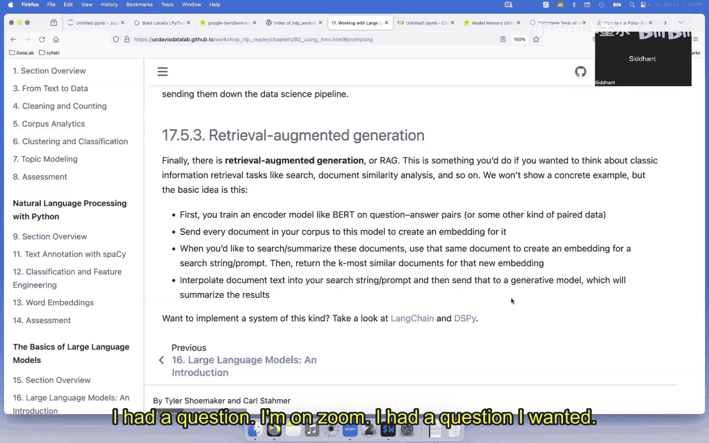

# 大语言模型入门：第5讲：大语言模型基础 🧠


在本节课中，我们将学习大语言模型的基础知识，包括它们是什么、如何工作，以及如何开始在自己的研究中使用它们。我们将从核心概念入手，然后进行实际操作，学习如何加载模型、理解分词过程以及提取文本的嵌入表示。

---

## 概述

大语言模型是建立在海量文本数据上的大型神经网络模型。它们不仅仅是生成式聊天机器人，更是能够为文本生成密集向量表示（即嵌入）的强大工具，这些嵌入可以用于各种研究目的。本节课将引导你了解这些模型的基本原理和实际应用。

---

## 模型架构与训练

上一节我们概述了大语言模型的能力。本节中，我们来看看这些模型是如何构建和训练的。

大语言模型通常指任何基于**Transformer架构**的大型神经网络模型。这些模型在**数十亿甚至数万亿的文本标记**上进行训练，计算成本极高。因此，常见的模式是使用一个**预训练模型**（即在海量通用数据上训练好的模型），然后针对特定任务对其进行**微调**。

训练目标通常是**下一个标记预测**（如GPT系列）或**掩码语言建模**（如BERT系列）。在掩码语言建模中，模型被训练来预测文本中被遮盖（`[MASK]`）的标记。

---

## 获取与加载模型

理解了模型的基本原理后，我们需要知道如何获取并使用它们。最常用的模型库是 **Hugging Face**。

以下是访问和加载模型的步骤：

1.  **访问Hugging Face**：前往 [Hugging Face 模型库](https://huggingface.co/models)，你可以找到成千上万个模型。
2.  **选择模型**：根据你的任务（如文本分类、特征提取、文本生成）进行筛选。我们将使用一个经典模型：Google的 **BERT**。
3.  **加载模型**：使用 `transformers` 库中的 `AutoTokenizer` 和 `AutoModel` 类来加载模型和分词器。

```python
from transformers import AutoTokenizer, AutoModel

model_name = "google-bert/bert-base-uncased"
tokenizer = AutoTokenizer.from_pretrained(model_name)
model = AutoModel.from_pretrained(model_name)
```

首次运行时会从网上下载模型文件，之后会存储在本地缓存中（通常在 `~/.cache/huggingface` 目录下）。

---

## 理解分词：子词标记化

在将文本输入模型之前，必须进行分词。与传统NLP不同，大语言模型使用**子词标记化**。

子词标记化不是简单按空格分割单词，而是将单词拆分成更小的、常见的子单元（子词）。例如，单词“tokenization”可能被拆分为 `["token", "##ization"]`。这样做的好处是：
*   **处理罕见词**：模型可以为未见过的单词组合子词来构建表示。
*   **压缩词汇表**：无需为每个可能的单词保留一个独立的标记，大大减少了词汇表大小。
*   **跨语言能力**：这种方法可以应用于任何字符序列，包括非拉丁文字。

分词器本身也是一个通过统计训练得到的模型。它从字符开始，逐步合并最常见的字符对，最终形成词汇表。

```python
# 示例：查看分词结果
phrase = "large language models use subword tokenization"
tokens = tokenizer(phrase)
print(tokenizer.decode(tokens['input_ids'])) # 查看解码后的文本（可能包含特殊标记）
print(tokens['input_ids']) # 查看标记ID
# 可以遍历查看每个标记对应的子词
for token_id in tokens['input_ids']:
    print(tokenizer.decode(token_id))
```

你会看到除了子词外，还有 `[CLS]` 和 `[SEP]` 等特殊标记，它们用于表示序列的开始、结束或分隔不同句子。

---

## 生成文本嵌入

分词完成后，我们就可以将文本输入模型，获取其**嵌入表示**。嵌入是一个高维度的密集向量，代表了文本的语义信息。

BERT等编码器模型能生成**上下文相关的动态嵌入**。这意味着同一个单词（如“bank”）在不同语境（“river bank” vs “bank teller”）中会有不同的向量表示。

以下是获取嵌入的步骤：

```python
# 1. 准备输入
sentence = "Then I tried to find some way of embracing my mother's ghost."
inputs = tokenizer(sentence, return_tensors="pt", padding=True, truncation=True) # 返回PyTorch张量

# 2. 将模型设置为评估模式（关闭Dropout等训练层）
model.eval()

# 3. 不计算梯度，进行前向传播以获取嵌入
import torch
with torch.no_grad():
    outputs = model(**inputs, output_hidden_states=True)

# 4. 提取嵌入
last_hidden_state = outputs.last_hidden_state # 最后隐藏层状态，形状为 (批大小, 序列长度, 隐藏层维度)
pooler_output = outputs.pooler_output # 通常对应 [CLS] 标记的池化输出，作为整个序列的摘要
all_hidden_states = outputs.hidden_states # 所有层的隐藏状态（元组）

print(f"序列长度: {last_hidden_state.shape[1]}")
print(f"每个标记的嵌入维度: {last_hidden_state.shape[2]}")
print(f"[CLS]标记的嵌入维度: {pooler_output.shape[1]}")
```

---

## 嵌入的使用策略

现在我们已经得到了多维的嵌入数据，接下来需要决定如何使用它们。以下是一些常见的策略：

*   **使用 `[CLS]` 标记**：对于分类任务，许多模型设计为使用 `[CLS]` 标记的嵌入作为整个序列的表示。
*   **池化操作**：
    *   **平均池化**：取序列中所有标记嵌入的平均值。
    *   **最大池化**：取每个特征维度上所有标记嵌入的最大值。
*   **组合多层**：研究表明，底层嵌入包含更多句法信息，高层嵌入包含更多语义信息。可以取最后几层的 `[CLS]` 嵌入进行平均、求和或拼接。

对于简单的句子级表示需求，推荐使用 **`sentence-transformers`** 库，它封装了这些池化策略。

---

## 微调模型用于特定任务

预训练模型很强大，但要让其在你的特定数据或任务上表现更好，需要进行**微调**。微调会更新模型的权重，使其适应新领域。

我们以使用BERT进行**文本分类**（图书简介分类）为例，展示微调的基本流程：

```python
# 以下代码概述流程，具体实现请参考完整教程
from transformers import AutoModelForSequenceClassification, Trainer, TrainingArguments
from datasets import Dataset
import pandas as pd

# 1. 加载并准备数据
df = pd.read_parquet('book_blurbs.parquet')
# ... 数据预处理，创建标签映射 ...
dataset = Dataset.from_pandas(df[['text', 'label']])

# 2. 分词
def tokenize_function(examples):
    return tokenizer(examples['text'], padding=True, truncation=True)
tokenized_datasets = dataset.map(tokenize_function, batched=True)

# 3. 加载用于序列分类的模型（在BERT基础上添加了一个分类头）
num_labels = len(df['genre'].unique())
model = AutoModelForSequenceClassification.from_pretrained(model_name, num_labels=num_labels)

# 4. 定义训练参数
training_args = TrainingArguments(
    output_dir='./results',
    num_train_epochs=3,
    per_device_train_batch_size=32,
    per_device_eval_batch_size=64,
    warmup_steps=500,
    weight_decay=0.01,
    logging_dir='./logs',
    evaluation_strategy="epoch", # 每个epoch后评估
)

# 5. 创建Trainer并开始训练（此处仅示意，实际运行需要时间）
trainer = Trainer(
    model=model,
    args=training_args,
    train_dataset=tokenized_datasets['train'],
    eval_dataset=tokenized_datasets['test'],
    tokenizer=tokenizer,
)
# trainer.train() # 开始训练
```

训练完成后，你可以保存模型，并使用 `pipeline` 轻松进行推理：

```python
from transformers import pipeline

classifier = pipeline("text-classification", model=my_fine_tuned_model, tokenizer=tokenizer)
result = classifier("A new text about science and discovery.")
print(result)
```

---

## 文本生成与解码策略

最后，我们简要看看如何用GPT等**解码器模型**进行文本生成。生成的核心是从模型预测的下一个标记的概率分布中进行采样。

```python
from transformers import AutoModelForCausalLM, GenerationConfig

# 1. 加载生成模型（如GPT-2）
gen_model_name = "openai-community/gpt2"
gen_tokenizer = AutoTokenizer.from_pretrained(gen_model_name)
gen_model = AutoModelForCausalLM.from_pretrained(gen_model_name)

# 2. 准备输入
prompt = "It was the best of times, it was"
inputs = gen_tokenizer(prompt, return_tensors="pt")

# 3. 生成文本
# 使用贪婪解码（每次选择概率最高的标记）
greedy_output = gen_model.generate(**inputs, max_new_tokens=20, do_sample=False)
print("Greedy:", gen_tokenizer.decode(greedy_output[0], skip_special_tokens=True))

# 使用采样解码（引入随机性）
sampled_output = gen_model.generate(**inputs, max_new_tokens=20, do_sample=True, top_k=50)
print("Sampled:", gen_tokenizer.decode(sampled_output[0], skip_special_tokens=True))
```

常见的解码策略包括：
*   **贪婪搜索**：始终选择概率最高的下一个标记。可能生成重复或单调的文本。
*   **束搜索**：保留多个候选序列，最终选择整体概率最高的序列。生成质量更高，但速度慢。
*   **Top-k 采样**：仅从概率最高的k个候选中采样。
*   **Top-p（核）采样**：从累积概率超过p的最小候选集中采样。
*   **温度调节**：调整softmax前的logits值。温度`T`高（>1）增加随机性，温度低（<1）使输出更确定。

你可以通过 `GenerationConfig` 来配置这些参数。

对于聊天或指令跟随任务，需要使用专门微调过的模型（如ChatGPT或指令微调模型），并按照特定的提示模板构建输入。

---

## 总结

本节课中我们一起学习了：
1.  **大语言模型基础**：了解了Transformer架构、预训练和微调的概念。
2.  **实战准备**：学会了从Hugging Face获取并加载模型。
3.  **核心处理**：理解了子词标记化的原理及其重要性。
4.  **获取表示**：掌握了如何从模型中提取文本的上下文嵌入向量。
5.  **应用策略**：探讨了使用`[CLS]`标记、池化操作等策略来处理嵌入。
6.  **任务适配**：概述了如何通过微调让模型适应文本分类等特定任务。
7.  **生成文本**：初步了解了使用生成模型及不同解码策略进行文本生成。



大语言模型是强大的工具，但其本质是处理**标记**而非直接理解语言。理解其内部运作机制，能帮助你在学术研究中更有效、更批判性地使用它们。