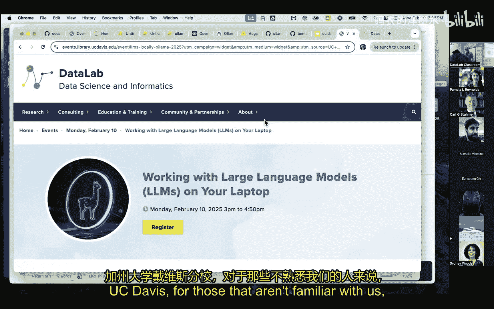
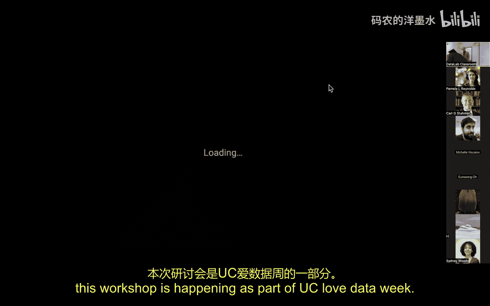
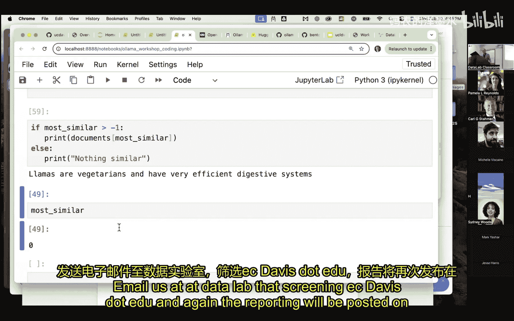

# 【全集】加州大学戴维斯分校 计算机科学 中英字幕 1080P p06 Lecture 6 - 构建本地大语言模型 -BV1cqFNzYEvp_p6-

我已经。😊，What's that that mean？Okay， welcome everybody An and my few in person people。嗯。All right。

 this is working with large language models on your laptop workshop。

 the workshop itself is being offered at UC Davis Data Lab。

 we are a research support and training unit here on campus UC Davis for those aren't familiar with us。

 we teach quite a number of workshops and there are spaces where I know we have a lot of people here from not UC Davis。

If you keep track of our schedule some of those things will happen virtually and people from other UCs can't attend so welcome you just check out the data labb website datalab。

ucdavis eu and you can get a run of the upcoming workshops that we have coming to see any and the rest of them are of interest to you my name is Carl Smer I am the director here in the data lab。

And just a brief reminder to everybody， this workshop is happening as part of UC Love Data Week。

And there is a code of conduct， both for data week and for all of our data lab workshops。

 I'm not going to read the whole code， it's basically be respectful to each other in time and will make the world a better place。

 not just in this workshop， but outside of it also。And see my second slide。

Just the continued ad for UC data Week。Whi I should have read before I did this but I can't get back to where to go so there's a whole bunch of activities this is the first week of it。

Does this have the URL where they can， yes on the schedule so you can see the full schedule if you're interested and check out the other workshops are happening as across all the UCs as part of Web Data Week。

And I'm going to try very hard to stay at my podium for the people that are here virtually。

 which is not my usual ways to。Grantants around the room so we'll see how that goes。

 I will try to stay on for。Okay， and I do have some people watching the chat。

 so if something important is up on chat， you guys will let me know right， perfect。Okay。

 so the first just a little bit of preliminary stuff。Before we get going and I even talk some more。

 I will point people to two URLs I put up on my screen here。The first one is a short link。

 a Bily link to a workshop reader， its reference and background material has in it。

 some narrative that surrounds the things we're going to do and also any code that I sling today with you is in that reader also so it's a good thing if you have that available and you can follow along and you can't see it on screen share or if you miss it and need to go back to it later that will be available the second one。

 I want everybody if you don't already have this and probably you don't if you're in this workshop the second link is Obamaama。

 co slash download if everyone could start downloading the Oama software while we do our preliminary stuff so that it's ready to go it will download when you get to the site it'll download a file that will be an installable binary file for your operating system。

 Windows， Linux or math。And you don't need to go ahead and start the whole install yet。

 but just get it downloaded that way everybody has it ready to go as we move forward so again that's oLmed。

com slash download。And you can start that downloading while I pontificate here for a little bit。

So the purpose of this workshop， again， it was officially what was our official name。

 working with large language models on your laptop and the today specifically we're going to be doing that using a package and a product called Oama。

 which is a particular model open source to open source large language model and Oama itself is a software package that surrounds that that allows you to download the models to your local computer and work with them locally。

Where we put as the sort of prerequisite for this workshop。

 the assumption is that if you're here you have some Python experience and a working python environment on your computer that can be command line you could be working in VS code you could be using as Jupyter notebook however you work with Python really doesn't matter any way will work with this but you need to have a working python environment for about I don't know half three quarters the class just depends on the pace that we go as we move into sort of coding land and how to work with these things if you don't have that and you're not a proficient python coder don't get hung up on what's going on the reader is a reference for you。

 you can go figure those things out later and make them work。

So you don't have to like follow along and then you'll just be totally lost if conceptually you're following what's going on。

 you'll be able to see things execute on my screen， you'll still be okay。

 so you're welcome to be here whether or not you're proficient coder。

 but if you are proficient in Python and you have a Python environment。

 you'll actually be able to s code along the way and make things work on your computer。

And I should say that's usually a running theme for almost all the workshops we do in day lot they're very handson like we really try to get so people come to a workshop and actually make things work on their computers that they can take with them and go back and do their work and with that in mind I'm going to ask like why would I want to run a large language model。

Locally on my computer， when I could just go to chat UBT or you one of the many gemmin I cloud based services that are out there。

And the answer is pretty simple， and it has to do with data privacy。

There any time you submit a prompt to a large language model， it is。

 first of all crossing the network， which isn't necessarily secure。

 so depending on what kind of PHI you have， if it's medical data， especially other types of PHI。

Just sending them out over the network can be a problem it might not be in your IRB so there's that then once it gets to them。

Unless you depending on which service you're on， some services won't let you turn this off at all。

 others will， but it is extremely difficult to go through their click through and figure out how to do it once you send a prompt that prompt becomes part of the model they now have that prompt。

So you just sent all your private data to open AI and they have saved a copy of it。

This is really an issue when we're doing research with any kind of data that has any type of privacy concern。

So there are really a lot of， you know， that's a very compelling reasoning why you would want to do it locally。

Also working on them locally， I will say for a lot of tasks。

The models are great things work awesome and it's actually easier than dealing with the API and that I have to pay for the API how much free access do I have so it can actually just make your life really simple you don't need a network connection all you need use your laptop or whatever computer you work on and one can make this work so that's why we are offering this workshop because there's a huge portion of research that goes on on campus that really would benefit from actually working with LLM locally rather than setting it across the cloud。

A few other notes before we start really digging in and working with the LLM。

The other question is why Obama？And for right or wrong。

 because I don't know a lot about the audience out there， where people are coming from。

 a decision you know， that was my decision was when thinking through this workshop is。

What do we really want to accomplish with this workshopship if it's just。

Install along and get it running， you could probably figure that out on your own。

So we want to provide some context with that and show a lot of different ways that it can be useful to you。

 which we will do and I'll go over the sort of learning objectives in a second here。

But also I wanted it to be very simple and especially with a hybrid workshop where we have lots of people the majority of people in the workshop are remote and it's virtually impossible to provide realtime help when people get stuck OLM as you'll see when we get to go to install and start using it is extremely simple and easy to use this is not a lot of technical knowledge overhead getting it up and running so you know I think of this as really an introduction it's an easy on ramp to working with LLMs if you're going to do a lot of work in this space and you're going to a lot of work locally I do want to mention there's another Python library and framework called open LLM and open LLM is。

The next complication iteration up because as much as I said OLM is really simple。

 like everything in life， simplicity leads to a lack of flexibility that's always the tradeoff and so whereas a limited number of models we can load an OA and we've also limited the flexibility with which we can work at those models if you jump up to openLLM with openLLM you can load any model that is on hugging face in the reader's a link to hugging face Huging face is a communities slash nonprofit company one of these hybridbri organizations that has standards for actually presenting to the world the libraries of open models and there are literally over a million machine learning models I think at last count when I checked there was you know several hundreds or several thousand。

 excuse me of language models that are there and every language imaginable that's not true。

 I can imagine。Me languages myself， but a lot of languages and a lot of specialized purposes for particular。

😊，Areas of research and that type of thing。 So your next step up would be open Llm and but it is much more complicated and you really can't use it unless you can code python pretty well So that's just your next move The next iteration after that。

woWould be just going to hug and face pulling down a model and working it with yourself directly in Python or Java whatever is your language and choice。

 which is then even more complicated for you to do so I'm thinking of this is again that easy on we're starting at the beginning with Oama it's very simple easy to use but it allows us to start playing with a lot of things we can do and a lot of the parameters around that so that's that's the reason for the choice of Oama for the workshop。

All right， let's go ahead and dig in， so what I want everyone to do is everybody hopefully by now has successfully downloaded。

This o on the link。If you're on a Mac， you just have a。

Thellma icon in your downloads folder that you need to drag into your applications folder。

 if you're on a Windows or Linux， you have to double click it and run it to actually launch the install。

And when you do that it just if everybody could start doing that and just follow the directions that it gives you along the way there's no secret sauce here it's a very easy install I have to move my screen around a little bit and。

The only thing that you want that might be a little confusing is at some point you might see a window pop up that looks something like this。

We're saying it's gonna install on the command line Oama， that's where you want to install it is yes。

 you want it on the command line， you will also you may or may not depending on your operating system and get another similar pop up that says you know install for that Oama will launch the startup my recommendation is you just click yes to that now it's very easy to go in your settings and change it later but it'll make your life a lot easier and it won't eat up tons of system resources or anything which I'll get to in just a second because you're really installing just a shell around the application So if everyone can get through that install process and what it will do is if some great people who are remote if people could just start when you have it install。

Just。Put a thumbs up or send something over chat so we can just keep track and know that the majority of people have it installed。

One thing I will note if you guys can see that when you get this installed。

It won't be like an application that you will see any application user interface。

 like if you launched a Microsoft Word or something like that。

 the indication that you will have is you can see it up here in my test bar。

 you look at the very top of my screen。There's a little lama that just shows up in my taskbar if you're on Windows it's going to show up down on the bottom taskbar。

 if it's a normal setup for Windows if you're on Linux I don't know where it is。

But that will be your indication that it worked and the only option that thing gives me is just to quit if I want to quit。

But that is success， when you get to there， then you'll know that you have it。And I see some people。

 thank you for letting me know that you're there， we'll wait a little bit。

Unable to install fall long yet you have to have admin privileges and be able to install software I thought we said that in the thing。

 but unfortunately' something I can do to help the person who can't install so sorry about that。

If you can't get installed and you follow along in the rear。

You should just follow along with a workshop and then have the reader at your disposal you will pretty much guarantee very easily be able to recreate everything that we did today without any problem all the code is there I'm going to talk about it。

 we should't be good。Okay， I see a lot of have enough thumbs up that I can continue on or okay。

 we'll wait just a little bit longer。While we do while it's going though。

 I will talk on technical stuff。And just sort of review what we're going to do today and some learning objectives that we have。

People have so what we're going to do today is we're you know we've installed Obamaama and we're going to engage in just a couple tasks of it primarily the workshop is going to be broken in three sort of three movements the first movement we're going to just be working it in it。

With a prompt just like you would chat EP via the command line interface and I'll get everybody set up there and you'll all be good don't worry if you don't know what that is。

 but it's going to be just like the word ChayP and your gemmini just prompting and it's telling you stuff so we're going to start there then we're going to move into our Python environment and we're going to duplicate that basic prompt response。

Path that we had in the chat so we can see that it works from there。

 then from there we're going to learn how to fine tune a model。

So that we can get different kinds of responses， I'll talk about what that means is when we get there。

 so we'll do a little playing with the model itself。Once we've done that。

Then we're going to actually break free of the prompts。

And we're going to do what I actually think is the most significant and important thing that you can do with LLMs which isn't we're also going to build a little chatbot just because that's fun so we're to build a little chatbot。

 then we're going to start actually interrogating the model itself。And Ill explain what that means。

 but we're no longer going to be interacting with it via prompt。

 we're going to be using the model to do some basic text categorization classification and also we're going to build a what's called retrieval augmented generation。

 a rag people prior that term， we're going to build a very simple ragG workflow。

By hitting the model in python that does not involve the prompt at all and is how a lot of work is happening today so that's kind of the movement of the course by the end of it they'll learning any goals you should be able to you know think about the data privacy issues I just talked about and how you control that and the benefits of working locally。

Install it on your machine， which most of you hopefully will be able to do。

 deploy a simple chat bot around that。Deploy a RAG application and also understand how text cluster and classification on a corpus works in the cellM environment we're talking straight to the model so that's our goal for today。

Okay， are we there， Pamelet and enough people， you think， have it installed and ready。

 I can move a bun？Yep， okay， so moving on， if you have your a installed and somewhere you see your little llma in your task bar。

 which will be your only indicator that it's there the other question now a people are saying I installed it。

 but it's not opening。It doesn't open which I said this isn't like a Windows application or anything if you see the little Lama in your taskbar it is there。

 there is no application to open which is really important thing to mention all the only thing that littlellma will let you do is just quit and stop it right from running。

So let me just do use that to jump really quickly and talk about the architecture of this application and how it works so I put up on my screen this is also in the reader a very simple diagram。

So let's ignore the client for now， does this follow me can people see me I knew that aroma， okay。

 so we have a client， we can ignore that for now。Because there's different clients you can use to talk to it。

 the key part that is on your computer right now is that Oama application。

 the Oama CPP app is the app that's running。What is doing is providing a framework。😡。

That allows you when you use some client and we're going to start with a command line interface to our client。

To pull down models， configure them， and then run a service that is an HTP based is going to launch a little server。

On your computer， none of which you will see， but it's there and you can hit that server and so the way we always communicate with Longline。

Is through a client that client can be again， a command line interface。

 which is where we're going start， which everybody has on their computer already。

 then we're gonna move the Python and the Python is going to become our client。

 whatever Python script we're running， it's going to be that they makes requests to the server the server is going to pass it to the la CPP app。

 it's going to do its thing and then send stuff back uphill。 So if you cannot get it to open。

 you are exactly where you need to be。 there is literally nothing to open。

So beginning with how we communicate now the first client we're going to use the most basic client is going to be a command line interface if you're on a Windows machine。

 if you just go to your little those four blue things。

 the Windows Explorer icon and get to the search bar and search for CMD or command prompt。

You will will come up with one of your little applications there that is your Windows command prompted either say command prompt or cD and you want to launch that if you're on Mac you want to go to applications。

I'll do it myself， I clicked on applications。Utilities。And in that utility folder。

 applications utilities。You have an application on your computer called terminal that's your command line interface i'm on a Mac so i'm going to launch that when me get a new。

W show。kill the other one and it will just look something like this if you're on Windows or depending on how your Mac configure it may be a black window。

 it'll say different stuff to mindset says is， let me zoom mine in。So that people can see it bigger。

There we go， that should be big enough。And you're just going to get a little blank box here。And。

If you're familiar with your command line this will all be very familiar with you if you do a lot of stuff that's command line on a Windows machine。

 you're probably using something else besides the windows。

Native command prompt window get bash something like that I believe that will probably work。

 but I have never done it， but I have used the command prompt I tested I know that you can use the Windows command prompt interface and it will work so everybody needs to get just something that looks like this whether it's the command prompt。

The terminal app， whatever bahell or whatever shell app you use on your Linux box。

 if you're a Linux user you already know what I'm talking about when I say commandline interfacebase。

And get this ready to go。Okay， and I just saw it works some Powershell perfect。嗯。第。嗯。Okay， so。

Hopefully everybody is there。And we are ready to go。So once we're here。

What we need to do first is let's just i'm going to introduce just a few things if we the way you interact with Oama initially is just using the Oama command so even if you're not great at command line stuff none of this command line stuff is very complicated you should be able to live all along so i'm just going to type Oama。

Telling it to invoke the Oama application and I'm going to do the very first simple thing。

 which is help， which is going to be the function I want to call from Oama when I hit return we get this very nice。

Thing from Oama that tells us all the things that we can do。

I'm not going to go through all of these right now。But I'll just mention some of them。

Like any help file， it gives us what the UCC is， which you always type Oama plus any flags and then a command。

And the commands that we have available are Ser， which is start that HTP server that I talked about。

So that we can be communicating it through other。Applications。

We can create a new model we're actually going to do that， we can show information about a model。

 we can run a model which we will do， we can stop a model pull。

 we're going to do some poll that's getting the models from the web itself。

That we're going to pull down open source models， we can push a model to a registry。

 we are not going to do that today， but if you created your own model。

 you can use the OM app to push that up to a hugging face or various places where you might want to make that model available to others list models which we will do PS。

 we can see which models we have running。We can copy models， we can remove models。

 and we can get help。And then we have a few flags down here H for helpV for Persion if we needed any more help on any of these。

 you can do Oama the command space dash dash help and it will give you more detailed help on that particular command so that's how you're going to get there。

Okay， hopefully everybody is with me， it's hard to see you on zoom but。I see some people saying yes。

 we're good， so I will continue on。Okay， so the first thing that we need to do because right now Oama is just a blank shell。

 we have no model actually available to us， so the very first thing that we need to do and just clear that out a little bit。

Is run a command and everybody should do this unless you've already used Oama。

 we're going to do Oama because remember that's how our commands always start。Space， pull。Poull。

 space， llama。3。2。And then you're going to hit。Enter。

I'm not going to hit enter because I already had it on my computer and it won't work。嗯。

So it's Oama polellama 3。2 When you do that you'll see a bunch of stuff coming down your screen。

 it's going to take it a little while to pull this model down and what's happening now is this is the moment that we were actually going out into the world and bringing that large language model onto our local computers where we can work with it。

So I will， if people， as they start getting it down。

 if you know some people who are willing can just throw stuff in chat so we know people are successfully getting that。

 then I will move on， but I'll give it a second for it to catch up because it can take a little bit for it to process that model and bring it down。

嗯。I see some downloadings。 Yes， all great。 I'm just curious。

 how rapidly are the loan models being updated。That's a very good question and I only have an anecdotal answer to that。

 which is every couple months， it seems that something comes out， I haven't really tracked it。

Exactly， but yeah， that would be my anecdote answer sir。There are， if this is in the reader。

 let me find the link since now I' put this link in chat I see one success。In terms of the models。

That we can get。No I have that you're somewhere。Where is that link？That's the online one。

If you go to， I'll just go there because I know where it is Oama for those that are available letter it doesn't have to do this。

com search。Oama。com/search， you can actually get a list of all of the models that are available that you can pull down。

Into a。They have various。Specialties and things that they're developed for so that it can be fun to play with these look at different models I can tell you from experience all models are not created equally for the same task certain tasks certain models work really well and then that same task will fail miserably on another model so finding the right model to begin with can actually be a part of the workflow and the challenge usually you can find some help on stack Overflow or Reddit or various communities in the documentation for the area you're working in and the descriptions of the model to give you a sense of whether that model is going to be good for you Today we're just going to use the Lama model which is the general very general large model across and not be domain specific。

All right， so we have a model there that once it's pulled down， hopefully people have it。

Does somebody can jump ahead of me and already run it or does someone just ask about run？

One person okay， yeah overhe。Okay， once we have run Obamamapo。And you have your thing。

 the next command we're going to run because now we have it saved to our disk。But we haven't。

Told the Oama system。To spin up a server so that we can talk to it right it's just stored locally we're not ready to use it yet。

 so we have to launch one more command。Which is。O Lama run Lama 32。

So we're going to run the model that we just did and when you do that I'm going to do this one too。

 you'll see that our screens will change。And notice that my prompt。

 everything for me before has been a standard unixing prompt for my command line in the base。

 suddenly I have these three carrots。And the little grayed out， which is send a message。

I'm going to say， how are you feeling today for my message you guys can start and this is just your in chat EptT La。

It's going to take it a little while to think。And then it's going to give me back my answer。

 I'm just a language model， I don't have emotions。Let's try this one what foods are good to eat are good and nutritious I'm purposely putting in over your both crs。

Not because it makes them work better。But because it actually makes it harder so it's you this is your basic just as if you were in Chay PT mode right or whichever one you use and it will send it back to you。

So hopefully everybody who is able to install software has this running on their computers at this point you now are used running an LLM load。

And。This will do all the ways that you can interact online right there you have the full model。

 we have proof that it's working。One thing I want to point out there is this is shown to us in the gray out area of our terminal window。

There is a special character which is a forward slash， not a backslash， it's a forward slash。

Is the escape character？Whenever we're in a problem。

We can use that forward slash to send commands directly to law。

Now most commands aren useful once you're already in they're like I did。

running out the model its going to cause a problem like you don't。

 but so most of the stuff you would get out for， but the one that is particularly helpful is the one that's showing us。

Which is the health， and it reminds me of the health。Right of the things that I can do。

 so that's very useful。The other thing that is crucial to know is'm done。

 let's say I'm done using my prompt now and I need to get out of here， how do you get out of here？

And the answer is in our help list slash by。And now I'm out of my command prompt or out of my chat prompt and back into my basic command prompt。

So this nerve is no longer running， if I wanted to interact with it again。

 I have to restart it along the start。And I did something longer there。

I'm not going to work out that now because we're not going to do it anyway。I have to read。

 I didn't anything wrong， doesn't matter。So buy is how you get out that's crucial to know Okay。

 so I'm not going to spend a lot of time here sending infinite prompts to it as fun as that might be we all know how to prompt。

An AI and we and this isn't the prompt engineering workshop。

 it's just to demonstrate that we have that there。What I want to do now though。

 I'm going to stay in our command line world， but I want to talk about tuning a model of our own and if people haven't seen that before。

 you know， it's an interesting demonstration because you'll see how this really changes the nature of what。

What you get back from a model。And。So what we're going to do is we're going to just very quickly。

Tun a model of our own。And the way we're going to do that is。

I need everybody to open some text editor， you can do it in VI or Vim， Nano。

 you can do it in whatever text editor is your text editor of choice， that's GI， BV editit。

 whatever it is， notepad++， and that works。And you're going to create a file and I'm going to talk about this file。

 let me pull mine up as as an example there it is where。Strange rather。We a second to pull it out。

Open nation。I they just disappeared。Oh， there it is。Okay。It's because my screen is super huge。

 I can't see all my taps。给。You're going to create a text file。

 you can save it anywhere on your system that you know the file path to， a Uni style file path。

That's the that's the one thing that can mess you up here if you just put it in your wherever your home director is home directory it'll be easy for us to direct you there let me i'm going to do rea mine there and that way I can。

And see Stemer， and I'll be able to show people what that looks like。Carl Sta Stslo text Okay。

 so if you just save it in your normal home directory for now or if you know if you're good with Uni filepas。

 you can do that。And I want everyone to actually create a file that looks exactly like this Okay there this is in the reader if you're in the course reader。

 you could just copy and paste this。Let me see exactly where it is in the reader。No， that's not it。

I was in here there we go so it's in chapter three of the reader if you click there it's about a quarter of the way down you can just copy and paste that all over so I'm going to walk us through the contents this file and then we're going to talk about how to use it how to deploy it to build our own special model。

The very first line of the file should be from space， and we're going to use our Lama 3。

2 model because that's the model we're going to find to we're going to start with the base Lama model and we're going to put some tuning on top of it。

I put a comment in here for those that don't code a lot that hashtag just is going to ignore that line。

ButKeep in here that one parameter we're going to set is parameter。Stace temperature， space one。

Now for those that don't know anything about tuning large language models and I guess I should say this is not an in-depth large language models course so I'm not going to dive really deeply into the math behind the stains or even into every parameter that you can tune or like the full depth of LLMs the intent here again is to get you up and running and started so that you can then explore and learn more and continue to grow on your own in the reader there is a link this Oama mod file documentation is very good documentation for every parameter that you can set in this file and descriptions of what they do I will talk about temperature because it's the one people set the most。

It's a number from one to x as it says， and what this does is on the generative side when it's starting to answer create what it's going to answer your prompt back with。

 the higher my temperature。The more creative。The answer is going to be meaning it's not going to just follow the statistically most likely next word or next phrase that comes it's going to allow itself more variation in that so as you turn that temperature up you get more variation you get more interesting results you get different results with the same prompt。

Because things you can move words， able choose different words to put in place， I'm using one here。

Specifically because I want you to see how much affect just a single one shot。

Prompt of our next thing we're going to set， which is the system prompt。Which we enter。

 as you can see， as if I were prompting the system itself。And my prompt。

 you can play with another one if you have another favorite movie character or something like that。

 it doesn't matter， I happen to just by accident choose this because I just rewatch this movie for those don not know it Dr。

 Strange love， the famous movie from 1963， I think sometime in the early 60s about the nuclear Holocaust。

 slimin Pickens， hilarious， you've seen pictures of it in your life and mean if you didn't know the movie。

 but it's basically a bunch of insane people who just are like excited about the nuclear Holocaust and so the prompt that I've given for my system prompt is to say you are Dr。

 Strange love。Answer as the doctor。Only and give guidance about how questions relate to nuclear war。

So I'm basically telling it I want no matter what the person's asked you。

 I want you as my new tuned model to always come back to nuclear warrior。

Right and that's my simple tuning of this that I'm going to do Okay， so I have that file。

 I have it saved。Once everybody has made a similar file and again， just the caveat。

 if I wasn't clear， don't use Microsoft Word， it needs to be a text editor。

 this needs to be a text file or the system would get confused。

I'm going to use this is in the reader， but I'll move over to my。没。

I'm going to hang on me make sure I don't have this already。Oh on my list。

I'll get to that in a second， no Irie oh it is there。I'm going to go ahead and remove it RN。

Strange love you guys don' have to do this i'm just I already built this on the ticket out of my system so that I can build again。

Oma this， yes， that's there okay。I'm going to use this command here。I make this a little bigger。

 so it doesn't roll over and get the highlighting off of bit。Olaama create strange love。

It's in my home directory so this is my Uni file path on Mac slash user slash parl SA slashrange love if you're on Windows it is helping me I can't remember what is the Windows path to your home directory。

Do members， What is it？users I think we think it's also users hopefully somebody if somebody out there is on Windows system knows what it be what it is going to can be an RTF file no it cannot be an RTF file it must be a text spot or it will not be read correctly。

You should be able to force when you go save as， just save it as ASII or TxT for a tour。

When you run that。It's going to do something like this。It's gathering the components。

 it's using the existing layers， boom boom boom， creating new layers。

So new layers on the neural net right that are building a model that are creating it it's right on a manifest and it's successfully that we created my new model now you guys should pay attention to this command on your system you should be able to go o laama。

List。And O on the list will give you a list of all the models that you currently have living on your computer。

And。You guys won't have this one yet we're going to do that in a little bit。

 but you you should have lot of3 two because we all loaded that together and now you should all have。

A strange love or whatever you named your model if you did a different movie or named it something different and you will have that and we should be good to go are some people able to get this done successfully？

Let's see some thumbs up or some happy chats。I don't want to move past until we have some people I figure as a couple thumbs up happening。

If're ready give one thumbs up， perfect。Okay， so I see people coming on now with a lot of thumbs up so things like people are there。

And I'm just going to copy and paste so I don't have to。Do it。Now， just as we did before。

Once we have。A model。We have to run the model， we can't just。

Use it right away we have to tell the aM application to expose it via that htP server so our clients can talk to it in this case our client being the command line interface。

That is is being set up and we're going to use that same command that we last time only now I've changed the name of the model instead of running。

Lma 3。2， I'm going to run my new model。Strange level。When I run that？I get my same command prompted。

But now I'm going to ask it， what are the most？Nuttritious foods to eat。

And I'm going to get this great response。😊，嗯哼。😊，It'sLike why do you care about foods。

 nuclear war is the thing to worry about， man。😊，Okay。

 so this this is a silly but it's a very real example of how just one just a single shot train like that one thing in there dramatically affects the outcome of what you get out of your model right so I could do that same thing and constrain it to only medical research or you know whatever my topic was to try to make my model produce results that I care about more。

Right and that is the key to this kind of training so yeah it's a lot of and there's an art to what does that prompt look like you you can send it like do it things like this and give it some give it a whole chunk of text from a journal article right and then it will train to that。

And it will give responses that look all like medical journal articles or whatever the journaling you're coming from is so it's you can see that this is actually really easy to do and sometimes really fun because you get creative with your prompts and figure out so at this point everybody here who was successfully able to pull this out like you now have an LLM running on your laptops and you know how to find start fine tuning that model right it's pretty pretty simple and pretty powerful is there a way to end the response early and go back to the command。

That's a good question， I don't know a way to end the response early。

 what I usually do is just let it run out you know or quit the whole thing and then start in if I get really if it becomes ridiculous。

There may be a way I'll invite someone else to figure that out。And the reason I don't know。

 I'll be honest about that is actually because I don't use this this way that often it's the things that we're moving to next that are the things that I use it for most。

 which is where we're interacting with it programmatically where I have a lot more control over what's happening。

Was there another question that I miss？有。No okay all right hopefully everybody was able to do that i've seen really cool like Harry Potter prompts fine tuning things like that you search the internet you'll find all kinds of crazy prompts and ways that people have tuned these models to get bizarre and fun results out of them。

O。We're all good。Good， okay， let's move on to our next。Let's see what's our next activity here？なんのもも。

Okay， now what we're going to do is we're going to move on， I'm going to just say goodbye here。

I'm going to kill this， so I'm out of my model。But we're going to actually switch over now and we're going to start working more directly in Python so here I will invite people。

To choose the Python environment of your choice if you're not a open a newmi question we have we'll talk for that Okay。

 how do we know what path the model thought yeah， you can answer that yeah。This is。

The file path question， don't feel bad if you don't know。

It is the game stopper for almost all the workshops and the classes that I teach because nowadays everyone just searches for files so no one knows like what their directory file path is for things。

 the Pamela answer you on chat can help you get it figured out。Okay。

 so what we're going to do now is we're going to stop using the command line interface as the client to our world。

 and what we're going to do is start using Python。And working within a Python shell。

 I am going to for the purpose of this class。Just work in a notebook environment so I can do light ahead of time for some stuff if you work in BS code。

Which I will use for another thing later on because I won't run a to ofco。

 you're free to do that if you work in EmAC orVm。Nano。

 any text editor and you just run your Python from the command line that' school too。

 so any Python space will work for this part of the workshop。Just long as you can do some pythonic。

Type of Sc。So what we're going to do is first， we're going to。

Duplicate what we just did just to simple get a response。

 send a prompt to get a response and then from there we're going to start upping the complexity of how we engage with the model。

So the first thing in order to do that。Is we're going to use a。Python Library called Olaama。

So I lie a little that you shouldn't have put your command line away quite yet。

What you want to do here is run in your command line。If you're using your command line interface。

 you're just going to run P install Oma。And that should install Obamaama into your environment。

 so you have it if you already if you work in notebooks， you can accomplish the same thing。With。

Just adding a little exclamation point in front from within your notebook。

And the notebook will interpret that with the exclamation point。To go ahead and run in the。

Python terminal that you don't see but it is there in the background so your're two if your command line interface。

 just p install Oama。If you're in a notebook， you can do the exclamation point that install along。

Once you do that， hopefully you're able to get that installed without a lot of difficulty。

We're going to use that library， we're going to use NPI， I think a little bit later。

 I don't think people have any problems with that other than that we're not going to be polluting your environment here to do for the source shot。

Okay， so once we have OL installed。Oh wait， gorgeous there's I think this is a good question about dependency complex right now having read into those some of the users are。

Yes， well I have no reason that's the dependency Council thing is a really hard one to answer from a distance my answer there would be to use Pixie or condoda or something to install it in a separate environment。

 So if you do like condoda install Conda forge。Oomba。

And then you can sort of create a new environment that this will run in。

If you just quickly Google kind of install thellama， you'll get the command you can throw in chat。

 that would be your best move if you're having dependency issues or just set up a new environment for this。

Okay， so I'm going to get rid of that because I don't mean it here。Once we have coal on。

Then the first thing that we have to do is we when we're in Python is we have to tell。

We have to import。Oma。So that we have it there。嗯。And we're also going to import。Specifically。

 clients， I think that's it。From Oan。I think it's like upper tasting if not。

 I'll fix it many you guys know on that note that didn't work let me verify the syntax on that。Oh，对。

My whole synax is wrong and I spelled it wrong from Oama。Encourage。Plant。There we go。

That'll work better。And then I'm going to run it at my notebook and that is bringing a again for those that aren't this with Python when we do this in Python when we use PIipP and install it it's putting it on our computer but it's not in our active memory to be used because that would eat up all of your system memory so what's happening here is we're telling it to specifically bring these in so that we can work with them you have that question panel I saw and then flash across the gate Okay so we have Lama in our arm now what we're going to do is we have to actually set up we have to make a client。

To interact with the Oma HTP server that is running on our computer。

I'm going to seize this moment talk about one thing。If this is over your head。

 don't panic about it anymore about it， like if you're working on a team of researchers you could use this like I can set up that。

Oh， I' on a server。And everybody on your team that everyone on your team has access to and you can all talk to the same model using Python。

 everybody wouldn't have to load it remotely that may or may not still meet your privacy needs depending on what kind of data you have because you will still be setting stuff across the network。

 but if you're BPPM in you have to check your IRB and look at it。

 but it is possible to share a local instance of it。

 I just want to mention that and we'll see in a second about how that plays out。

So what we're going to do here is now we have to create that client。嗯。And when we create that client。

I went ahead and put some comment in there and again this is in the reader that people just wanted to follow。

 it's in the fourth chapter I think。We're going to make an object Python object。

 we're just going to call client。We're going to use the client function。

From the O onma client library。And all we have to do is tell it what the host is。By default， when。

Oama sets up a server and you should use this， you can configure these differently but since we're all working on our local laptop just using local host will actually save you a lot of headache because you can always get to your local host even if you're behind you know on firewalls and things like that if we're setting them up for a team to work on somewhere else I would need to be running this code on the computer。

The server that I'm going to run it on， but I would use an IP address for that server instead of local hosts so that other people on my network can get to it and then the port that we're going to assign it to is one1434 and again if you're not a networking person it really doesn't matter there's a ton of cords that's actually。

Technologically completely arbitrary what a port number is it's just what's important is you don't grab a report that's being used by something else and gives a sign So this is the syntax and just the post and the report we're going to all just use this because it will work and be easy。

And when I run that。We don't see any output， but we have created a client object， I can do a type。

Of client。And I can see that that object is now an Oama client of the type client。

 which doesn't mean a lot， but we know that it exists and that our code worked。

The next thing we want to do and our basic setup for our app and so this is like a common set of code that I should say too like here we're coding by the numbers。

 like in the world I would probably just still to function， take some arguments。

 just does this because you're going to do it over and over and over again if you're communicating with a lot and you don't want to have to type it every time。

What I'm going to do is designate the model and here I'll use my 3。

2 model instead of my strange love model just because we'll get more readable results。

I'm going to run that。So now I've just set a variable to what the model I'm going to use is now。

Now we have to actually set up our engagement with the model and here we're just going to do。

The simple thing here first that we did before， which is I'm just going to in my code define my prompt。

And I'm just going to copy and paste it over and I'll fingerprint， get any typos。

 I'm going to define a prompt variable， I'm just going call it prompts。

 and this time I'm going to ask it what is Harry Poter about。It's going to be my simple prompt。

 so I'm going to ask， so that's the same prompt I would just be typing in if I were in the command line in interface。

Just set the variable， we haven't done anything with it。And then here is the magic line coming here。

Which is I'm going to call in the client。Library that we loaded the function chat。

 I'm going to send it the model variable that I created， which is Lama 3。2。

And I'm going to send it a series of messages。Be the API， the first one is。

The role of whatever is making this request that's communicating with it in this case we are a user。

We are a user that is communicating with the API and then I'm going to send it the content。

And in this case， the content is my prompt。RightAgain。

 the Oama documentation has really solid a documentation about there are other messages you could send if you want to affect the behavior of the app。

 but we're not going to worry about that now it's very straightforward to just add another comma and then it's key value pairs of things that go in there right so that and it's going to run this using the chat function of the client module of the Oma library。

And it's going to put the results into a variable that I have called response。When I run that code。

 now let's check response， let's go type。Of response。

If you get my Zoom stuff out of the way here so I can actually see my screen。Type response。And。

Run it。And we can see that what this is now is an object that is an oama object of the type chat response I'm going to just look at that really quickly。

In the most brute force way possible。So this is what's in that response its a list。

Of lists but really I think it's just a one layer deep list in this case it tells the staff this is the model it was run。

 this is when it was created that it actually completed successfully it didn't stop halfway through in which case I'd get false false the reason it was done is it stopped everything was fine the duration。

I long it took to load the model the pre prompt evaluation count。

 there's two things here that are evaluation counts and they mean different things and this is you really don't need to worry too much about this。

 but。One thing people don't realize is these models don't actually work on whole words。

They get broken up into parts of words in different ways， yeah up a little bit。I want to see Mar。嗯嗯。

And Port a womanman， good。And again， this exact code is also in the reader in chapter 4。嗯。Okay。

 is that good？Okay， then so this is the actual number。Of tokens from the prompt that were used。

To hit the model with。The prompt eval duration， how long it took， the eval count is 409。

 so this count is different than that count。It's a measure of cycles that it took。

When it was doing to get a prompt back a duration， and then the key thing for us is the message。

 what message is it sending back to us？And it equals message， and we get a whole bunch of stuff。

The assistant， which is just simply the the。The AI that that is the application withinllma。

 the llama application that actually handles the transaction trying step off that depending on what you do and this could become a different role and it could matter to you like how did you communicate with the model we're going to get more into how we communicate with the model later today。

 and then this is actually we need the content so this is what when you're a command line interface or on chat EptT this is what actually prints to your screen。

And we can see Harry Potter is a fantasy series I'm not going to read the whole thing。

 but so we can see here that we've done everything that we did there。

 I'm going to go ahead and just extract this so we get just the imprinted the screen。And。

there I can see printed the screen just the same as if I went to me， was working with the CLI。

 or if I was in a cloud based system and I was just putting in my prompt and chat ET。

 this is what it gives back to me。OkayAll of those other things in that message though are useful programmatically if you were going work with this programmatically because you can start to do some calculation federal if I threw 30。

000 of these at it how long is it going to take well my average duration for a prompts time back is etca etc you can error check that I actually get a response or did something go wrong all of that so here we just recreated what we were already easily to do in the command line and so the question is why would we do that and the answer is we would if I were just in a world were all I was doing was submitting single prompts。

To。10 to five right that's when we finished panel is at the time yeah you know I would why would I wouldn't bother with this right。

 but this is just an example we're starting where we left off before。

Of working our IN to doing more complicated programmatic things if I had thousands of prompts that I wanted to send and look at those responses now I would do this and put it in a loop right and run it through it and I would want to air check those messages and see where it goes so we're just starting to move towards complexity here so but we can see that we are able in Python for those that are able to make a work at home to interact directly with the model or with the interface and then through the API to get back a prompt response。

Okay， now what I'm going to do here is we are going to build a very simple。

 just as a next iteration of a very simple chat。And I'm going to go ahead and do it in my notebook because I'm already there even though it。

W't make a lot of sense again， I'll just put all the code in。And I'll talk everybody through it。

 we already have clients imported in the environment but won't hurt to do it again because I'm in the city notebook this should all look familiar。

All I have to do is my client。Importantport the library， say what my client is， define the model。

 and here what I've done is I've defined a little function。Which takes a prompt。

And it gets a response， we've seen this keyboard。Same exact code we had before and it returns just the message content so it's ignoring all the other stuff and it's just giving back the content。

Then why truth。So we're going to be in a wide loop， a potentially infinite loop。

It's going to receive some user input， it's going to give me the problem to you。

And then it's going to wait for an input。As long as that if that input is exit。

 that's how I get out of my loop， it's going to stop if that input isn't exit。

Then what it's going to do is it's going to call my generate response function， sending it my input。

 which is the prompt that I gave it， and it's going to print that the bot tells me this is my response。

So it's very simple， not a lot of lines of code that this tapes if I run this。

It's giving me my little window it's asking me。And I'm going to say again。

 I'll just do that how are you today？And。The bot is telling me， I'm just a language model。

 I don't have emotionsions on。But I really care that you are good。

Thank you for your kind words and this will work just like any chat bot I need help configuring。

My computer。Oh ask it， Im find you found that how to find what Oh let's see。😀Yeah。

How do I find the file pad， what operating system are we？On the。No let's got to think on that one。

There there we go。Here's an answer。Right clicking on file。I can show you the map。😊。

You could open the files for it。So I think these are right， actually。😊，Okay， so。

Now that actually did pretty good。I'm actually kind of impressed I'm going to go ahead and exit it out。

Remembering that on our code， what we told it was if my input is exit。

 then it should break and that's going to open out of my loop。Okay。

 so now we're done I'm what my chatbo is set， Okay， so you can see it does not take a lot of work。

At all to make this happen right if I wanted to deliver this via the web。

 I'd have to do it during using JavaScriptscript buts but the everything else is essentially the same because this is being an API that JavaScript can just hit。

That URL and that port send it the proper message in the same format， it will get back a response。

 you can use curl， you can use HTP to hit your thing so you can do this very easily create this kind of thing and again this is just sort of designed to show like I couldn't do this from my command line interface。

So it's just one example of why we would want to move out to a more scripting codecentric environment to start to interact with that is to set something like this up。

 okay， hopefully some people were able to make this work of the people that are own。

Do I have any specific questions about that before I move on i'll just pause it ask There was a general question that I think is's good to our remind folks is that you can within the same session you can actually call many different models Yes right so it's skipable worry that you know you might get stuck in one model and yeah one way to check with just to you know to switch models right you can have multiple the models and that's a common。

Practice for people that do a lot of interacting with these is actually running the same prompt off of different models。

And then comparing the results and in a little bit we're going to talk about how we compare those results。

And seeing which ones are most similar and look like what we you know what we're looking for to do that so yeah。

 you can have multiple models in actively running， that's why when we set up the response when we ask for a response when the client we're telling it is specifically for this request use this model and and all will be good。

Okay。Any other questions where I move on， hopefully people were able to get that work in and follow。

All right， let's see。Now we're going to take a little bit of a diversion， even though this is not a。

Like in that。LLM course。As we move further down the road of the ways we would interact with these models。

Having some deeper understanding， conceptual understanding of what is actually going on with these models is really helpful。

And so I am going to stop coding for a little bit and more just lecture。

At a medium level about how large language models work。

So there's if we remember this the message that we've had。

 it told us like what that it was the assistant function that was managing， giving us the response。

Large language models as we think of them and talk about them， like when people say AI or chatt TT。

 there's really， it's really more than one thing， there's the model itself。

And then there's all the code that interacts with that model。So when you submit a prompt。To any LLM。

It's not that prompt is not talking directly to the model。

 there's code in between that is taking your prompt。😔。

And processing it and doing stuff with it so that it can then query a model。Of choice。

 get a result back， and then it's processing that result and doing stuff with it and then delivering。

That response to me right so there's the application the LLM application and then and that application in BarV has a lot of subpacks and libraries。

 but then there's the model itself。And。Conceptually in terms of how they function。In today's world。

 it is， I feel confident making this statement as a true fact。All of these models are the same。

The model itself， the code surrounding them and all this other stuff can be very different depending where you're going。

 and the content of the model can be very different depending on what it was trained on。

But how the model itself is put together in functions。

 whether it's a transformer em vetddings doesn't matter at the end of the day they。

 these are all vector models， text vector models of some type。

And so they share a common sense of how they how they work now in the I did put in the reader a link to the seminal article on text spaces that kind of ultimately led to all of this stuff。

 of course has always deeper deeper prehistory， but if you it's a good place to start。

For looking at this， and I'm going to do just to try to do a very intuitive non mathematical explanation of what's going on at the model level。

So at the model level， each token and for now you can assume I already said that whole words aren't really what tokens are in these models。

 those words get parsed and cut up into subun， linguistic units within the words and punctuation space。

 and then there's grams they get put together and looked each direction so there's a lot of complexity you can add。

 but effectively conceptually if to make sense this we can think that every single token is a word。

And every word in the model is defined by this is an output here。Of the vectors space。

Of a single word。So each of these is a parameter or feature。It's one long vector。

Right of words and the math of you know， so well how do we create this and everybody knows the story of that you look at you know。

 the words that it's most likely to appear next to and all of that。

 which really is not actually that informative for how these things get built actually。

 what it really comes down to is if we stack if we had a bunch of words and we stack a bunch of these on top of each other。

RightSo we have our matrix now and we have word one， word two， word three， word four word five there。

Conceptually the way to think about it is this。This number。

I want to leave wordland and think of geography。If we think of the word as a place on the planet。

 an unknown place on the planet。This。Describes the how far it is from some arbitrary locations。

Out in the middle of the galaxy。This describes how far it is from a different arbitrary location。

 this one describes yet another arbitrary location and we've from 30。

000 of these arbitrary locations and that allows like the most insane form of triangulation you could ever compute it allows us to say that this place is here right that's conceptually how I want you to think about that right and if you have that idea in your head。

And we take another one next to it。The closer that these are， the more similar the vector space。

 as we say is。That means。The closer those two things are in the real world right so we can all understand this on a geographic level right but if all of the measurements。

Are similar， the more similar those measurements are， the closer in the geographic world。

 if this is what it was calculating， the closer those things would be to each other so we can conceptualize that with words it's the same thing。

What's happening is the neural network that is crawling these and again。

 the mat is very complex and there's different algorithms that get used to calculate the different parameters。

The different features here。What's important is that each column， like each slice of the vector。

The same is measuring the same thing for each word and here's the really important thing。

 if you add even one word into the vocabulary or one curse award somewhere。

 all of the numbers will change。So these numbers only have meaning in relation to the numbers of other words。

One way to put that， another way that we talk about that is that actually the definition of every other word in the vocabulary is contained in the definition of every single one because they are not independent at each other。

But what that allows and what that data model allows us to do is we take any two， three， five。

 seven vectors that have been created with the net。And if we map those into space。

 if we put them on a artesian plane of end dimensions， it can be a lot of dimensions。

 the ones that are closer to each other。Have similar meanings。So it looks something like this。

 like if we have motion on this access and vehicle and color。

 what we will find is that the vectors per car and auto are almost identical and very similar to vehicle they're much more similar to aircraft than they are to wave or waving and w waving is close to motion because it is in motion right it happens and this is what's at the core this vector space idea is what is at the core of the most useful features of LOMs it's how the model itself exists if you were to look at literally look at the model you would just see a giant collection of vectors。

For every word that is in the model right， added space， but this ability to calculate similarity。

 it turns out， is extremely useful。Because we can tell which words share more similar meanings because their vectors are more similar to each other。

By extension， we can take all the words in text one。

Average their vectors to get a single average vector and we can take all the words in text2 and average those vectors and now we have a vector that represents。

😊，The text and about represents the text and we could take a bunch of texts and say which texts are most similar to each other as full text and we could keep going up this chain we could say all the texts that are in this corpus or that are you know metalabeled this way versus all the text that are there are they more similar or dissimilar do these does the subject tagging makes any sense at all because they're tagged subjectwise is totally different this is kind of like that every movie is a comedy now you know。

 and yet they are nothing similar about them at all right So that simple premise。

Is the core of everything interesting that anybody has ever done and ever will do with a large language one it's just building applications on top of that idea that leverage that in interesting ways right so we might take an entire corpus of texts。

😊，Generate text vectors for every single text based on the model。

Run cosine similarity and then some distance cosine distance metric on that and we could draw a hierarchical cluster of all of the text of how similar they are and how they relate to each other right it allows us to say is this text like that text right so it is the core of everything we're going to do what we're going to do。

Here is we're going to investigate how to do this computationally。

 and then we're going to build a little app that leverages that to do a thing called ragG because it's a very common way of using these it's very useful。

 but the core principles that we're doing apply to。

Just you know really every kind of text classification that we do but we don't we don't have time to do so much today so that's where we're going to focus so that is the vector space idea。

So now， with that in mind， when we get rid of this。And。

Let's actually create some vectors and load of them independently。So to do this。

We actually need to load a new model。We don't the model that we loaded is a abstracted representation of the embedded of the vectors themselves I will。

Frequently， I'll just tell people I'll try not to do this。

 but I will frequently use the word embeddings instead of vectors because the very first。

Models of this time before we had transformers and stuff and when we first started thinking about this process。

 that was the word we used was embeddings but I'll try to stick with the vectors but if you hear me saying embedding just don't get confused I basically mean the text vector for that so we'll need to go back to our command line interface。

And what we need to run here。Is。We're going to just again do O along a poll， we've seen this before。

But this time we're going to do the MXBAI。Dash embed which is short for em beddingies I'm not the only one that does this dash large we're going to get the full set it's not that large it should fit on everybody's loud cop no problem and did you put that chatter shape of it okay so were going to run that。

When we run that I already have it so I'm not going to run it again it'll take it a little bit to come down you'll see a bunch of black lines and timing things rollinging by your screen to get to that。

And let me I'm trying to get to the chat。Okay， is there anything I need to present to in the chat。

's very good。You got it okay。Okay， so once you've done running that and it gives you a success whichever makes sure get a success I've never actually seen Oama fail this looks short of Eddie Ro dying in the middle of it again if you do Oama。

List。It should show up in your list。There it is in mind。M。😊。

So that you have it on your computer available to be used。All right， once we're there。

 hopefully everybody is on it。嗯。We're going to。a couple things we're going to we already have overwhelming and important vectors。

 but i'm just going to leave it here's where we need some stuff from Ny。Because we need to do some。

 we're going to calculate some similarity all on our own。Another caveat that I'll mention here。

 if you're going to do a lot of this and you are going to do it in this environment。

 there's a Python library called Langcha LAN G C AIN that will just give you functions to do exactly what we're going to do in one line of code I'm purposefully not doing it that way because I want to be explicating the process itself to reinforce what is actually going on and that's one of the issues when you just download the libraries don't you think you know what's going on but you actually don't so this is I didn't give my standard caveat whenever we're teaching a workshop。

 this is workshop code not production level code like if we were writing stuff we're going to put in production on a lot of the stuff I would put in functions and it would be much more efficient but it's drawn out into a lot of multiple lines so that you can follow it and learn better and it will run just fine but eventually if you' were gonna to put some of the stuff into production you're going want to make it a little more efficient to So O a couple nuy we're going get nuy。

And then some of the modules in lump， the linear algebra module in particular。

 the normative norming one because of some of the math that we're going to have to do don't worry the math is not complicated and you will conceptually understand it you don't have to be a math wh to make the sorting I'm going to run that。

Now to make our lives easy here。And you guys can copy this from the reader。

 I'm in chapter five of the reader。I am just going to。Paste a bunch of documents in here。

I will say too this mirrors what I'm doing here mirrors and the reason I chose these documents if you go to the Obamaama health documentation。

 this mirrors a thing that they do in the Obamaama health documentation but using a bunch of libraries so they only takes like two lines of code but i'm duplicating the same thing as you could actually compare that if you were so inclined to go out and run it using these other libraries and get the same result so I'm feeding it。

Some tests here right and the process that we're going to do here I should talk about a little bit more。

 so we've set everything up to do this comparison。In this code。

 we're going to do this by implementing a thing called retrieval augmented generation。

What retrieval augmented generation is the get back so a camera can see me that people care。

 maybe it's better if I stand up there。It's a system that works like this。By。I run， you know。

I's do a more research example。I want to set up an LLM。

That gives back responses that are where instead of returning a generated prompt response where it goes to the LLN。

 which was trained on billions of things across thousands of domains。

What I want to do is deliver my library of journal articles and custom curated library of known to be super accurate。

Publications and responses to this or I'm a software company and that's all my health desk items right So what I want to do is I want to return the best。

Item from my library to the user， I don't want。The system to just generate a generalized response I want to basically direct them to expert help that we spent a lot of time in this documentation and here's your thing right in the past we did that by just searching that library but nowadays with Ra what we do is we use the LLM in order to take a person's prompt what them interact with the chat bot as a human。

Understand what what they're actually asking and then find the best documents to delivered to them and we're going to do that by using the vector space to calculate a lot of different similarities right so in this case all of my expert documents my training documents if you will all they're not technical training documents because they're not affecting the model but we can think of them that way all my retrieval documents。

That I'm going to augment with are about different things about lives。

RightThat are happening and I'm just going to feed this in as a list of text documents， very simple。

In the real world if I would implement this what I would do is I would point this to a directory that has thousands and thousands of documents that I think are reputable and let's say my research I'm going to give medical advice area right and I would programmatically load all those in the contents into a list right so that's how we could make this more useful but for now I'm just going to assign。

It to my list of documents。And have them ready to go。没有。

Here's where the match is going to happen and I'm going to paste a bunch of code in and I'm going to talk about what is happening with it。

Again， keeping in mind there are more code efficient ways to do this， but then。

Doesn't draw it out in a loop nicely when we talk about what's happening。

I'm creating what's called a variable called embed list， which is just an empty list to start with。

What I'm going to do is for DN documents， for each of the items in my document list。

I'm going to set up a response which is Oma embed， I'm going to use the embed function from the Oma library。

 I'm going to use my large embedding model and the input that I'm going to send it。

 which is the same as that sort of the prompt。Is going to be whichever item I'm loop through in my list。

 So hopefully that flow is。The people， I'm going to loop through this list with each loop。

 whatever the text is in that list element， zero to4。

 I think there are five total is going to become the content that I'm going to send to the even embedded。

I'm going get back。When I get that back， I'm going to look at just。

The embedding themselves because it is going we're going to look at the results this and you'll see like everything that we do through the API it's going to come back with a bunch of messages too I don't just get back my embeddings I get back my embeddings plus a bunch of status messages that I don't care about right now all I want are the em bedding themselves and I'm going to add。

Those embeddings。To my lists。I'm going to go ahead and run this and we're going to look at some stuff so I ran it。

 I'm going to look at embed list。Let's just look at the length of embed list。You can see okay。

 there's six items that should be yep that's correct okay， and if I let's just look at one。

Look at the first one to zero and Python land。嗯。This is the text vector。Or my first test。Okay。

 now the O La the library。Got that。By parsing the text in individual words。

Getting the text vector for every individual word and then combining it into a single text vector for the text averageaging it。

To do that combination， so now I have each of my elements of the list contains a vector space representation。

 a vectorized representation of each of my training texts。Of my argumentation text。

 hopefully everybody can follow that。Okay， so so far so good， I've got that now。

The next thing we want to do。Is let's define a。Imagine here I'm going to do it programmatically。

 but in the real world I could do this again through a chatbot。

 which is the code we just saw right or I could have some giant loop because I want to do this myself for classification purposes over and over and over again find the most similar texts。

 but here I'm just going to define put in a prompt。Prot is what animals are llamas related to。

 I'm going to define that as my prompt。I'm just going to fill that variable。And then。Let's see。

The first thing we have to do is we have to get the embedded space for the prompt itself， right。

 which could be in this case it's a prompt it could be a whole text that I send it could be anything。

And this is also code is in the reader。We're going to get the embedded space to prompt and it's going to look very much the same as the other one our response we're going to just embed the model is going to be our law the same embedding model it's very important you use the same embedded model here if you use a different model the whole thing falls apart because the vector space is different and I'm going to send it might prompt。

嗯。And let me actually just put that one in there， let's stick with just that I'll put this into a different cell。

So now if I look at response。I get back you know my messages again and I get back the embedded space the text the vector space for that text so i've got two things now I've got one on one hand。

 I've got a list that contains vectors for every one of my augmentation texts or my testing texts。

The library that I want to check against and then I've got the vector space of the text that I care about I want to know what's most similar。

 what are the texts over in that collection that are most similar to the text that I have over here。

 which in this case we came through a pro。The first thing I'm just going to do the simple thing。

 which is I have to abstract。Just the text vector from the prompt thing that we ran about。

So that's again I just take from the embeddings element and the first one from the list。

 which is the only thing on the list right now once I run that I have just the vector。

Now here's kind of I， let's do another big chunk of text code here， I'll walk through。

So now that we have these two。We have a library we want to check against。

We have the text that we care about our target text what we want to do is say of those library of those texts that are over here in my test set。

 which one is most similar。To the text that I submitted now I could also ask which one's the least submit。

I could also plot the similarity right there's a lot of ways that I could deal with that similarity but for now I'm just going to ask what's the most similar what I've done is just written a simple little loop where I preset a couple things I said that math I preset mathimity to zero to negative one and I did that because there is no similarity less than zero the way the math works。

So if a negative one value remains after this whole thing， something went wrong。

Same thing with the most similar the most similar has to be a number in our list of zero to six zero to five with six elements。

 so if it's a number less than zero I know something didn't go right so I'm presttting those to values that cannot exist if my calculation works correctly。

Then I'm going to loop through。My embedded list of the tests again just for n in the range of the length of all of the text that I want to check the texts that I want to test I'm going to do something very simple I'm just going to calculate using nu the cosine similarity between。

The vectors， the vector for the test text and the vector for my Chrome text。

 and I'm going to get back a number from that。Then because I'm looking for the most similar。

 I'm going to say is that similarity value， is that number。Greater than。

What I already had is my max similarity。If it isn't then I don't care about it because it's not that other one it's more similar to my prompt than the one I'm currently checking。

 but if the one I'm currently checking is more similar than before I want to grab that one if it is what I'm going to do is I'm going to say that the max similarity equals whatever the cosine similarity was I'm going to save my weight for that so I have so I know how similar they are even though i'm not going to use it today and then I'm going to put。

The element number from the list。As my most similar say I was element two was the most similar so we're you know that's the one right so it's a pretty simple loop and i'm just going to check these one at a time again I want to emphasize there's a much more efficient coding way to accomplish this。

 but it doesn't allow us to explain and see what's actually happening yet。

I'm going to go ahead and run that。Now that I have run that。

I'm just going to put this in I'll just use this and copy it out of the。

Reader and put it in my move is going to be。 I just did you put the wrong thing。

 I'm going to paste that in from the reader。I'm just going to ask a simple thing if the most similar is greater than negative one then I know my thing worked。

Because it puts something in there， otherwise it's going to say it's not similar。I print that。

And when if since it passed it， it's actually going to print。

The element number are most similar from documents， so my initial prompt。Was。

I find it what animals are llamas related to？And it successfully picked out return to the text that happens to be from element zero。

 I think if we did it。Let's just look at most similar。Yes， it's the first item in the list。

It returns to me long as they're members of the Cameled family， meaning they're pretty。

 so it gets that right of all of the things in our list。But you look at it。

That is the most similar one， right？Now important thing to do。

 because what we've done is we have done tech similarity。Like。😊。

The Oama is not using the model to generate a novel response。

 it's telling me which of the texts that I was checking my prompt was most similar to。😡。

If I just replace that with a whole other text I'll get back here's the other text theyre most similar so if I'm studying you know whatever and I'm looking at journal articles I can start with one journal article and say find all the other journal articles that are most similar to this right and it will tell me these are the other ones that are the most similar right so it's extremely useful for text classification and query now let's just just for kids I'm going to go ahead and just rerun。

嗯。I only have to go for my prompt on， let's just say just to make sure that this wasn't just accidental working because it happened to return the very first one。

What do llamas eat？I'm going to rerun that and I'm just going to keep rerunning everything I don't care to look at the response we can skip that。

Laterter response， we'll set some base values and get our loop。YouFind the most similar。

And you can see it gets it right it finds the text out of my examples that is actually talking about what they do as the most similar so this works it's my point it's very similar this is a very simple example I mean we only mine six text and we took a single prompt but。

You know I'm going to just say I am confident that everybody on this zoom and everybody attending this workshop can start to extrapolate and easily see how you could apply this at scale over thousands and thousands and thousands of documents to do real work so again my hope here and I'm going end there and just take some questions last couple minutes but I will end with just saying my hope here was to leave you with enough again not super wellfactored and most efficient code but code examples of the various ways that are the most common ways that we engage with these things you shouldnt be able to take the base code that is in the reader。

And solve most of the tasks that you typically want to solve with these language models。

 but do so actually right there on your laptop， not have to rely on some service that you pay for and most importantly keep everything you're doing private for the benefit of you and your research subjects。

You know or your copyright right or whatever your concern is So with that I'm going to go ahead and call it a day here in terms of the official content。

 but I will hang around if there are questions。there it's broadcast only people aren't able to you yeah I'm going to welcome South party thank you so much Carl for pulling us together for us today and hopefully we will keep playing if you do have comments about this reader you can。

Email us with datalabgatrainingucdas。edu and again the reporting will be posted on the UC lab website great to talk。

