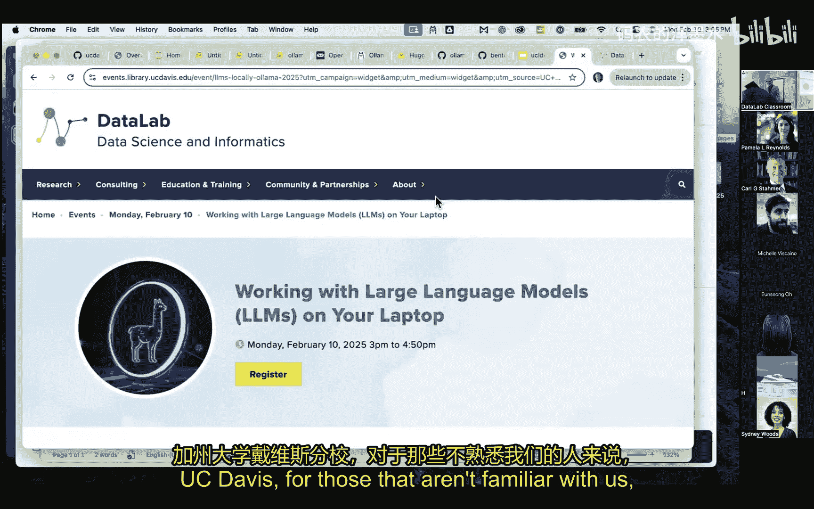
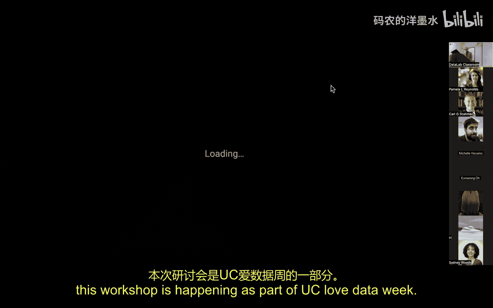
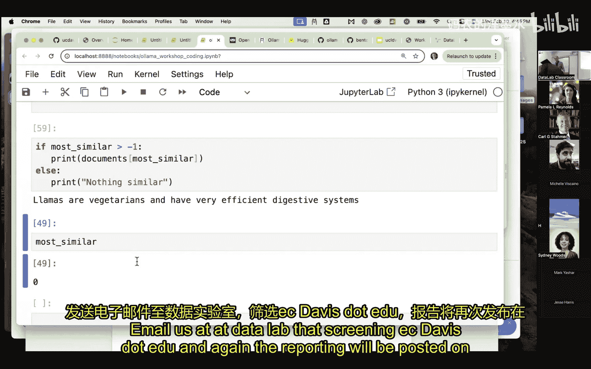

# 在笔记本电脑上运行大语言模型：第6讲：构建本地大语言模型 🦙







在本节课中，我们将学习如何在本地计算机上安装和运行开源大语言模型，特别是使用 Ollama 框架。我们将从基础安装开始，逐步学习如何通过命令行和 Python 与模型交互，并探索文本向量化、相似度计算以及检索增强生成等核心概念。

## 概述

本教程旨在提供一个简单直接的入门指南，帮助初学者在自己的笔记本电脑上部署和操作大语言模型。我们将重点关注数据隐私、本地运行的优势以及如何通过编程方式利用模型进行文本分析。

---

## 安装与基础设置

上一节我们介绍了课程目标，本节中我们来看看如何安装 Ollama 并运行第一个模型。

首先，访问 Ollama 官方网站下载安装程序。

```
https://ollama.com/download
```

下载完成后，根据您的操作系统（Windows、macOS 或 Linux）运行安装程序。安装过程非常简单，只需按照提示操作即可。安装成功后，您会在系统任务栏（Windows/macOS）或系统托盘（Linux）看到一个羊驼图标，这表明 Ollama 服务已在后台运行。

接下来，我们需要通过命令行界面与 Ollama 交互。请打开您系统的终端（Terminal、Command Prompt 或 PowerShell）。

在终端中，输入以下命令来验证 Ollama 是否安装成功并查看可用命令：

```bash
ollama help
```

这个命令会列出所有可用的 Ollama 命令，例如 `serve`、`run`、`pull` 等。

---

## 下载并运行第一个模型

现在，我们将从云端拉取一个预训练的大语言模型到本地。我们将使用 Meta 发布的 Llama 3.2 模型。

在终端中输入以下命令：

```bash
ollama pull llama3.2
```

这个命令会从 Ollama 的模型库中下载 Llama 3.2 模型。下载时间取决于您的网络速度。下载完成后，您就可以在本地运行这个模型了。

使用以下命令启动模型并进入交互式聊天模式：

```bash
ollama run llama3.2
```

启动后，终端提示符会改变，您可以像使用 ChatGPT 一样直接输入问题。例如，输入“今天天气怎么样？”，模型会生成回答。

要退出交互模式，请输入 `/bye` 命令。

---

## 通过 Python 与模型交互

上一节我们通过命令行与模型对话，本节中我们来看看如何用 Python 程序化地调用模型，这为自动化处理打开了大门。

首先，确保您的 Python 环境已安装 `ollama` 库。在终端中运行：

```bash
pip install ollama
```

或者，如果您在 Jupyter Notebook 中，可以使用：

```python
!pip install ollama
```

安装完成后，我们可以在 Python 脚本中与 Ollama 服务通信。以下是基本步骤的代码示例：

```python
# 导入必要的库
from ollama import Client

# 创建客户端，连接到本地运行的 Ollama 服务
client = Client(host='http://localhost:11434')

# 指定要使用的模型
model = 'llama3.2'

# 定义要发送的提示词
prompt = "请用简单的话解释什么是人工智能。"

# 发送请求并获取响应
response = client.chat(model=model, messages=[
    {
        'role': 'user',
        'content': prompt,
    }
])

# 打印模型的回复
print(response['message']['content'])
```

这段代码创建了一个客户端，向本地 Ollama 服务发送一个提示，并打印出模型的响应。`role: 'user'` 表明消息来自用户。

---

## 理解模型核心：文本向量空间

在深入更复杂的应用之前，我们需要理解大语言模型的一个核心概念：**文本向量空间**。这并非生成式回答，而是模型“理解”文本的基础。

简单来说，模型中的每个词（或更准确地说，每个“词元”或 token）都被表示为一个高维空间中的向量（一组数字）。这个向量定义了该词在语义空间中的“位置”。

**核心思想**：
*   语义相似的词，其向量在空间中的位置也相近。
*   通过计算向量之间的**余弦相似度**，我们可以量化两个词或两段文本的语义相似性。

我们可以用一个地理类比来理解：假设每个词是地球上的一个位置。它的向量就像是从多个不同观测站（例如，北极点、赤道某点、太空中的卫星）测量到该位置的距离集合。如果两个地点的所有距离测量值都相似，那么这两个地点在地理上就非常接近。

在代码中，我们可以使用专门的“嵌入模型”来获取文本的向量表示。首先，下载一个嵌入模型：

```bash
ollama pull mxbai-embed-large
```

然后，在 Python 中获取文本的向量：

```python
from ollama import Client
import numpy as np

client = Client(host='http://localhost:11434')
embed_model = 'mxbai-embed-large'

# 获取一段文本的向量表示
text = "大语言模型很有趣。"
response = client.embed(model=embed_model, input=text)
text_vector = response['embeddings'][0] # 这是一个数值列表（向量）

print(f"文本向量的维度：{len(text_vector)}")
print(f"向量前10个值：{text_vector[:10]}")
```

这个 `text_vector` 就是文本“大语言模型很有趣。”在模型语义空间中的数学表示。

---

## 应用实践：文本分类与检索增强生成

上一节我们了解了文本向量的概念，本节中我们来看看如何利用它进行实际的文本分析，例如查找相似文档或构建一个智能检索系统。

### 1. 文本相似度计算与分类

假设我们有一个小型文档库，我们想找出与用户查询最相关的文档。以下是实现步骤：

```python
from ollama import Client
import numpy as np
from numpy.linalg import norm

client = Client(host='http://localhost:11434')
embed_model = 'mxbai-embed-large'

# 假设的文档库
documents = [
    "羊驼是骆驼科的动物，原产于南美洲。",
    "Python是一种流行的编程语言，适用于数据科学和人工智能。",
    "巴黎是法国的首都，以埃菲尔铁塔和卢浮宫闻名。",
    "深度学习是机器学习的一个分支，使用神经网络模型。",
    "健康饮食包括多吃水果、蔬菜和全谷物。"
]

# 1. 为所有文档生成向量
doc_vectors = []
for doc in documents:
    response = client.embed(model=embed_model, input=doc)
    doc_vectors.append(response['embeddings'][0])

# 2. 为用户查询生成向量
user_query = "哪些动物和羊驼有亲缘关系？"
response = client.embed(model=embed_model, input=user_query)
query_vector = response['embeddings'][0]

# 3. 计算查询与每个文档的余弦相似度，并找出最相似的
def cosine_similarity(vec_a, vec_b):
    """计算两个向量的余弦相似度"""
    return np.dot(vec_a, vec_b) / (norm(vec_a) * norm(vec_b))

most_similar_index = -1
highest_similarity = -1 # 相似度范围是[-1, 1]，-1为初始化值

for i, doc_vec in enumerate(doc_vectors):
    similarity = cosine_similarity(query_vector, doc_vec)
    if similarity > highest_similarity:
        highest_similarity = similarity
        most_similar_index = i

# 4. 输出结果
if most_similar_index >= 0:
    print(f"最相关的文档是（索引 {most_similar_index}）：")
    print(documents[most_similar_index])
    print(f"相似度分数：{highest_similarity:.4f}")
```

这个程序模拟了一个简单的文档检索系统。它没有让模型“编造”答案，而是从我们提供的可靠文档库中找出语义上最匹配的内容。

### 2. 构建检索增强生成流水线

检索增强生成（RAG）结合了信息检索和文本生成。系统先从一个知识库中检索出相关文档片段，然后让大语言模型基于这些片段生成答案，从而提升答案的准确性和可靠性。

以下是 RAG 工作流的简化概念代码：

```python
# 接续上面的代码，假设已有 doc_vectors 和 documents

def simple_rag(query, knowledge_base_docs, knowledge_base_vectors, top_k=1):
    """
    简单的RAG函数。
    query: 用户问题
    knowledge_base_docs: 知识库文档列表
    knowledge_base_vectors: 对应的向量列表
    top_k: 返回最相关的K个文档
    """
    # 1. 检索：获取查询的向量，并找到最相关的文档
    response = client.embed(model=embed_model, input=query)
    query_vector = response['embeddings'][0]

    similarities = []
    for i, doc_vec in enumerate(knowledge_base_vectors):
        sim = cosine_similarity(query_vector, doc_vec)
        similarities.append((sim, i))

    # 按相似度排序，取前 top_k 个
    similarities.sort(reverse=True, key=lambda x: x[0])
    top_indices = [idx for _, idx in similarities[:top_k]]
    retrieved_docs = [knowledge_base_docs[i] for i in top_indices]

    # 2. 增强生成：将检索到的文档作为上下文，与问题一起提交给生成模型
    context = "\n\n".join(retrieved_docs)
    enhanced_prompt = f"""请基于以下上下文信息回答问题。
    如果上下文包含答案，请主要依据上下文回答。
    如果上下文不包含答案，你可以根据已知知识回答。

    上下文：
    {context}

    问题：{query}

    答案："""

    # 使用生成模型（如llama3.2）来回答
    gen_response = client.chat(model='llama3.2', messages=[
        {'role': 'user', 'content': enhanced_prompt}
    ])
    return gen_response['message']['content']

# 使用示例
answer = simple_rag("羊驼吃什么？", documents, doc_vectors, top_k=1)
print("RAG系统回答：", answer)
```

这个 `simple_rag` 函数展示了 RAG 的核心两步：**检索**相关证据，然后**增强**提示词，让生成模型基于证据作答。

---

## 总结

本节课中我们一起学习了在个人电脑上运行大语言模型的完整流程。

1.  **安装与运行**：我们成功安装了 Ollama，并拉取、运行了 Llama 3.2 模型，实现了本地化的对话AI。
2.  **编程交互**：我们学会了通过 Python `ollama` 库与本地模型进行程序化交互，为自动化任务奠定了基础。
3.  **核心概念**：我们深入了解了**文本向量空间**这一核心思想，明白了模型如何将语义转化为可计算的数学形式。
4.  **实际应用**：我们动手实践了**文本相似度计算**和**检索增强生成**两个关键应用。通过计算余弦相似度，我们可以对文档进行分类、聚类或检索。通过构建简单的 RAG 流水线，我们能够创建更准确、基于可信知识源的问答系统。



最重要的是，所有这一切都在您的笔记本电脑上完成，确保了数据的完全隐私和安全。您可以将这些技术应用于研究数据分析、文档管理、智能客服等多种场景，而无需依赖外部云服务或担心数据泄露。希望本教程为您打开了本地大语言模型应用的大门。