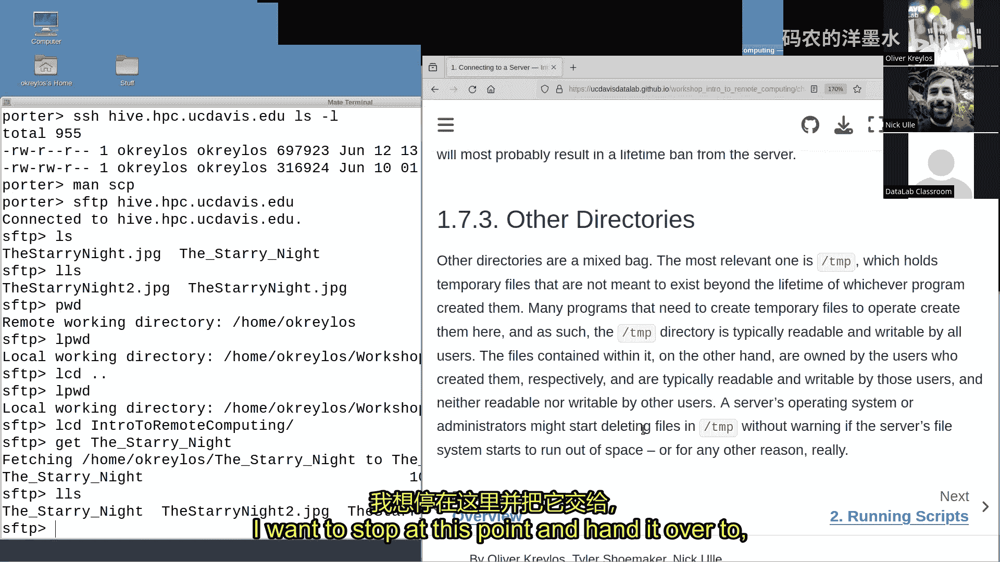

# 【全集】加州大学戴维斯分校 计算机科学 中英字幕 1080P p07 Lecture 7 - 远程计算与高性能计算：概念、架构与首次登录 -BV1cqFNzYEvp_p7-

Don't worry， you're not。

Its pushed but but probably will be a few people coming late my name is Ta Ads for the media development me I'm the associate director and a A lab and I' with my colleague singer Oliver Ks and Nuel in the bat。

😊，AndWes， yeah and so El and W are going to be primary instructors today Wes and I will be helpers。

 I'm gonna be in and out we've got some great proposals I've got to work on but we will be able to help you so if you have a good today lab before we are in data science program here thats supported by the purposevo and the libraries can help with training education and otherwise elevating research at the university so we work with research from all the purpose we could it on grants we have a recharge service so if you ever get to the quite reading for dedicated support come chat with us we also have during the academic year office hours to help people get our girls if they're stuck with those are on pause for the summer but they'll resume back in the fall and we have a remote option for those two where we do have folks from the HPC join us so you can always come in and ask your HPC questions and we can try to work on them but a lot of what we do is re data。

Analying data， id data， and otherwise trying to make analyses work。

And so that's the motivation for today's workshop is when you finally are doing a process。

 whether working with really large data or really complicated algorithms that are too big to runline your machine and too big maybe that it just takes too long right or too big means it crashes your computer so we have。

We're very fortunate here to have I perform a computing facility and we'll talk more details about that in a moment but we do before we get into any more content。

 I'm gonna to mention just a couple additional things and then we need you to sign up your account This is really important if you don't we have them because it does took a while for it to work its way through the system but just a little quick background about today I in the scene for today this is a two day workshop so the expectation that you'll leave all day and tomorrow there will be plenty of time ask questions for water out here。

 if you need a break go't forget water， the ACs been really unpredictable I don't know if they turn things off during5 holds week but I'm constantly on public facilities so it might be a little warm and I'm on it but please help yourself to some bathrooms are straight back that way。

We will break for lunch。 You are on your own for lunch。 The menu you is still open today。

 but just note tomorrow because finals will have happened there's not a lot of options on campus。

 So tomorrow is a really good day to bring a bag lunch。

Are wanting to eat lunch we can also get to downtown pretty quickly from here that it's graduation again that it's going be nuts just just then to if you're driving also tomorrow might be a better。

Graduation events happening and we do have a requirement for our workshops is on our website。

 but the short of it is this is place for collaborative learning you are all smart。

And you are all starting in different things， and so we are going to learn from each other were respond from another。

 this is not a database。That would that would just like to say so keep that in mind I as animate reporter。

 please please do come to me if you have any issues so is Oliver making less and we have a whole workflow help address any issues then I arise we don't they don't give your eyes but we're proactive in space okay today you will have a raor we will have some notes but you'll also have those stickies put a sticky up if you ever get stuck like a little flag above your above your laptop go ahead everybody put the yellow sticky up right now for me that helps us know that you are ready to go not stuck so go ahead and stick it on the like actually have a stick it on the back yeah we say we have some models here on on your laptop and if you don't have one I'll come running with some so if you make it go up its help bag we can see you from anywhere in the room on perfect。

Thats your way of telling us that you are ready to go everything's working on energy if you can suck something's wrong。

 switch it out with the pink one that lets us know that you're stuck and that you need some individualized help also don't be afraid to talk to your neighbor throughout this process and again research doesn't happen in a vacuum work doesn't happen in a vacuum get to know each other you're going through this together we're all here at UC Davis you might into collaborating or working together in the future so it's a great idea to meet folks next year and you're kind of sitting together for two days so you might as well make a friend okay that thank you try to see these if you can just as we like to be5y around here and bring back tomorrow。

With that， Oliver， do you want to show them how to get the accounts set up and then once we have you on this process。

 then we'll start the actual curriculum。Yeah， all right。 welcome everybody。 I'm Oliver。

 Thank you Pamea for the introduction。 The first thing I would like you to do is that he have a reader。

 which I will be following。 I'm going to be jumping around just a we little bit。

 It's a really good reader was mostly prepared by my colleague Nickbe in the back This is the URL to get to the reader you see is data Github workshop underscoretro underscore to underscore remote underscore but you'll be able to manage it and that will bring up this webage over here that I'm going to be using to just to just follow wrong a little bit of administrative stuff still at the beginning。

 So the requirement which one on the terminal or the website。All right， let's do that。Over that。

 yeah， okay， okay， then let's do that see as well。Yeah， I check them all the way back to it。

 you know， but how get it。All right so we have the reader hopefully and you should be in section one connecting to a server Okay one more bit of administrative background one of the requirements for this workshop and it's the really important one that is posted on the webage as well is that you are familiar with the Uni command line because we're going to be doing a lot of command line stuff here you should have a version of a command line installed on your computers if you're using Windows you probably should have Gitbsh installed if you have MacOS or Linux like I do then command line comes with a package so you don't have to worry about。

But we will be using quite a few Uni commands so you I'm expecting that everybody can follow along I'm gonna go slowly you can always ask questions but it's good if everybody is to know Okay so what are you going to talk about in this first section today and the whole workshop is intotro to a remote computer and so today we' are going to talking about the very basics。

 what is a remote computer， what is remote computing and how do you connect to a remote computer and so we are going through all of the steps there and we're also going to talk about how to talk to a remote computer once you've connected to it and how to behave on a remote computer when you're on there without really annoying everybody else iss on there。

Okay， so in more detail， the learning goes here， they are in the reader。

 I just want to go over them very， very briefly。And already mentioned we are going to learn how to connect to a remote server specifically using the SSH protocol I'm going to talk a lot about that later。

We are going to learn how to peacefully coexist with other users on the same server that is really important。

We're going to learn about passwords and SSH keys and we're actually going to learn about SSH keys way earlier than we had planned for technical reasons。

 we're going to learn more data between your global PPVC meaning whatever computer you're sitting at right now。

 the internet， meaning you the cloud and the server using these commands that listed them。

And you're going to learn a little bit about the structure of directories and permissions and other things that are sort of you know low level technical things that you need to know about at least you don't need to know them。

 but you need to know about them in order to be able to work effectively on the soil so。Very quickly。

 what even is a server？In a very big sense， a server is just a computer and specifically a server is a computer that offers services。

And in specifically here in this context of remote computing， when we say server。

 we don't mean something like a web server， we mean a computing server。

And the computing server is essentially a computer that sits somewhere。

 usually in some air conditioned basement that lets users connect to them from their own computers in order to run processes to run programs to run applications that for whatever reason cannot meaningfully be run on their own computers either because they need too much memory。

 they you need too much data they need too much time you wouldn't want to keep your laptop running for a week while you do some number crunching that's just not good and so。

That's what the idea is that you have of a machine that is sitting somewhere that is basically always on。

 that you can connect to let to do big work。So。The thing that is common with I mean server come in all shapes and sizes。

 but the thing that like 99。5% of them have in common is that they are running some version of a Unix operating system typically Linux these days and so what that also means that they're primarily controlled through the command line so we are going to be doing quite a lot of command line stuff today。

And the other important thing is that because they are centralized resources， there's only。

 well there are fewer like two or three big shared high performance computers on UC Davis's campus。

 they are used by multiple people。And most importantly。

 this doesn't mean that there are multiple people using them one after the other。

 but there are multiple people using them at the same time。Shared systems essentially。

 so that is why you have to， you know be aware of how to behave on them so that you don't interfere with other people's work and make them really angry。

And the other distinguishing feature is that unlike your own computers。

 high performance computers or remote computers， most typically。

 I would say in all cases really have dedicated support staff。

Who install and maintain and keep them running help with issues and whatnot and those are either called system administrators or system operators and we will be talking a little bit about how to effectively interact with them in in this workshop so that's the basis we also have adjust some computer you can connect to that stuff and it's going to be much faster typically than doing it on your own computers。

Now the question of course is how do you connect to a remote computer and when I talk remote computers again。

 when I say local computer， I mean the one that you're currently sitting at be at your laptop or a computer on your desk or whatever。

Potentially even your phone it could theoretically work。Or your tablet。

 and then the remote computers， whatever that other thing is that you're connecting to that is sitting somewhere in a basement somewhere。

So you need to have some way of connecting your computer to that computer and like everything else these days that works over the internet。

嗯。And so there is a protocol and the protocol is just a technical term for a language that computers need to talk to each other。

 It's not a language like a programming language that you use to talk to a computer。

 a protocol is two computers talking to each other and so specifically when you're connecting to a remote computer in I would say all cases very few exceptions you're going to be talking to them through the so-called SSH protocol where SSH stands for secure shell。

 meaning a shell is the way how you talk to a computer and if you have gone through our interest with a command and workshop。

 you are very familiar with that， it's the thing right here where you type in commands to your computer and secure shell in this case means that it' well it's secure meaning that all the stuff you send from your computer to the remote computer and that the remote computer sends back to you is encrypted so that only you and the remote computer can read it and no one else can inter can intercept your connection and can see what's going on can read what you're doing。

And it's her secure， as it turns out， the idea being that this is just the way of making sure that the computer knows who you are and vice versa and that nothing gets stolen on the way。

Now， the thing that I want to talk about first year for practical reasons we're going to see in a moment is that in order to connect to a server over this secure share protocol over SS age。

That server needs to know who you are， in other words， you need to have an account on that server。

And accounts and computing servers in many ways are exactly the same kinds of accounts that you would have online or Facebook or Redit or whatever。

 it's just a way where you have essentially a username and some way to authenticate yourself to that server to say。

 yes， it's really me whos opening this connection。And SSH。

Ids and SSH accounts are just a tiny little bit different on a technical level。

 but conceptually that's the same idea， you get some username and you get some credentials。

 a password or as we' going to talk about in a moment key。So。

The way how to get an account on a computing server depends completely on the computing server there is really no standard way of doing it。

 but the way it's done at UC Davis is that the HPC high performanceform computing group on campus as this centralized onboarding system that is the highper person onboarding or HIpo they should have found some way of getting a column in there somehow like they didn't so this is the website where you have to go to in order to get your account and we are going to do this in a moment。

There's only one wrinkle， well there's two wrinkles。

One of the wrinkles is when you request an account here someone actually one of the system administrators has to look at it and approve it。

 which will take some time。 It takes about half an hour or so。

 which is why we are going to do this at the very beginning。

 the other wrinkle list that in order to create an account you have to already give that server and specifically this web page your SSH credentials because UC Davis does not use passwords to authenticate users they use SSH keys which are briefly alluded to before。

 and so the absolute first thing you have to do today is all of you have to create an SSH key。

 which is a credential that allows you to securely connect two remote computing store because when you go now unfortunately already have an account so I can't show you what it looks like when you don't have one which is why everybody all of you should go to this website when you sign up for this there's a field where you put in your username and all of that and then there's going to be a field where you have to put in your SSH key but I'm assuming none of you have one yet so they're to make one first。

All right， let's go back to the reader and this is the one time hopefully today where I'm going to get out of order and skip ahead。

So skip ahead， skip ahead， skip ahead。And and let's skip all of this， all of this， all of this。

 we're going to skip the password section because UC Davis doesn't use passwords I'm going to talk about why or why not in a moment。

And then let's， yeah， let's go and I'm going to talk in more detail about SSH key。

 so we're just going to run through the steps of making one and then come back and talk about what you just did。

All right。So if all of you would do me a favor， if you have the reader open go to a section 1。4。2。1。

 creating SSH key。And again， don't worry about it， I'm going to explain in detail what an SSHP actually is when we circle back to this and go to it。

So the idea here is that an SSH key。The very core of it is that an SSH key is just a very long string of characters。

 a very long bit of text that is split to two parts。

 one of those parts is going to live on your computer and nowhere else we're going talk about that and the other part can be freely shared and you can essentially paste that into the website for HIpo and only by combining those two parts of a key。

 UC Davis or any remote computer can authenticate you in a very secure fashion which means that to make one of those keys。

 we have to run a command on your local computer。And we are going to do webinar and this command is on your computer it should already all be installed。

No matter what command and system you have， this is called SSH dash keygen for key generator。

 as you can imagine so。I am going to do that and you guys just follow along with mem the' type SSH dash keygen all in one work like this。

And then let's type enter and see what happened。 Now we're going to get a little bit of status update here。

 and it tells us generating a public private R A key there。

 I'm going gonna to talk about R A just a very little bit and all of you should now be at the point where it says enter file in which to save the key。

Is everybody there if you're not there， just put up your pink sticky and we can help you out。

 but it looks like everybody is。Oh， we have a problem already， don't worry about it。

 this is completely normal， this always happens。While Nick is helping you out。

 I'm going to just make a suggestion here。In many cases SSHKs are great because everybody tells you when you have a password never reuse the same password for multiple servers that is not the case for SSHKs you can use the same SSH key for all your servers it doesn't make it less secure that's a beautiful thing about them。

But what I'm going to do， we are still going to make an SH P specific to the hippo to the hippo website。

 And so we are going to distinguish that from other SH P by giving it a different name。

 So what I would like to do you see that the suggested name。

 slash on slash that's my user name or kos slash dot S H for secure shell。

 And then it underscore R Now， on your computer， it will tell you something different。

Because you might be on different operations so what I'd like you to do is just copy all of the first part here until the final slash and then you just change the final name so I'm going to type in slash home slash Olo slash dot SH slash and then I'm going to call this。

Let's see。 should we call it hippo， Let's just call it hippo， It's worth it。Doesn't really matter。

Reminder， probably all of the parts from between here and the final slash home couple slash of age。

 and then after the slash call it hit。Yes。😊，Just make a file on that is correct Yes。

 and the reason why I say copy all of this is because SSH expects its keys to be in a particular location。

 which is this one。 and you can save them elsewhere。

 but then you always have to tell us to find your key。 just mess Let's not do that。 Yes。

 this will create a file on your computer。 actually two files。 were going to look at them in a Yes。

's E to51 Thank you for bringing that up depending on what version of SSH you have installed。

 it might by default creates different types of keys。 Now my version of SH creates an R or keypa。

 which we going to talk about that。 you might have another key type Don't worry about that。

 just when it comes to changing the name， just name it key。

 no matter what the suggested name is and then we don't have to worry about that。Okay。

 I'm going to hit enter so that the key actually gets made。

And then the next thing is it asks for a passph， but first I want to make sure that everybody is at the point where you are asked to enter a passwordph so if you're not there just you know put up your pink sticky and we're going to we're going to look into it and then help you out。

And I'm going to give it a second for everybody to get there make sure that you're all on the same page。

And I apologize that I have to take this a bit out of order that you'm kind of asking to do things without explaining what they are。

 the issue is that we have to figure out a way of making these accounts more quickly so we can make them at a proper time and start using them right away as opposed to having to wait for 45 minutes。

It's just the way how things are done。O。How we looking。

How are you doing So everything okay on your end。 I just follow up I saw this Ive been following you for this S HQ Oh okay on purpose no。

Let's see if we can get here on same。Okay， let me talk a little bit while you're solving that。

 let me talk a little bit about the pass when you generate an SSH key。

 it is just file on your computer and sorry two files on your computer and one file of those is kind of precious you have to hold on to that and never never ever ever ever give it to anybody else and if that were to get stolen if your computer gets stolen or someone hacks into your computer。

 that would be a bad thing because then people can use that so-called private key to log into server and a person which is bad you don't want them and so there's an additional layer of security here where SSH offers you to enter a password。

 which is basically just a password so that the key on your local computer gets encrypted so that people can't steal it from This is not a password like the normal ones This is not one that you send to the server this password is only on your computer It's used by SSH to talk to that local SSH。

It's like an added layer， which is why some even move it empty because， you know， you don't。

 then you don't have to type it in all the time and Im one of those people will leave it empty。

 but I cannot recommend that you do that。So let's put in a pass This is going to be just like a password Just pick one that you can remember if you forget this one you holds。

 so don't do that let's put in a pass I'm not going to tell you which one I' was just going put in one。

And as you type it in your notice， I have been typing it in there's going to be no feedback here that's a typical command line thing it will not reflect back anything when you type in a password for safety reason so I typed in my password I'm going to hit enter and then it asks me to enter the same one again for the user reason。

 make sure that it's actually correct。Okay， so I did it again， I hit enter again。

And then it tells me a bunch of stuff。Okay， so at this point。

 it generated a for me it generated an RA key for you， it might have generated different keys again。

 don't worry about that This used to take quite a lot of time and you to do it。

 but these days computers are so far it's instantous and then it tells your identification has been saved in home ors SSH people your public key has been saved in home or SS people do I mentioned earlier that when you that an SSH key is actually tune files。

 there's a private part there's a private component and there's a public component。

The private component， this one is precious you never ever。

 ever ever give that to anyone and the public one， you can graffit you on a bathroom wall。

 it doesn't matter。 it's like a phoneia， it is secure Okay so then it tells me what the key thing of print don't worry about that It's just a very long check some don't worry about that at all and then it gives you this pretty random argument which is a representation of the key it's just someone who made a little joke and a wrote program but now we' are good Okay So what I'm going to do is I'm going to show you what those keys look。

I'm going to can I do that yes I can do that I can show you the contents of my dot S directory home ors SH actually you know what let's do a different everybody follow along with me and type CD and then tell this will take you to your home directory and I'm going to scroll up Okay so now remember from the command and workshop your command and usage I'm now in my home directory and when you generate an SSH key it will by default and be confirmed that if I say that key in a directory called dot SH in your home director now the dot at the beginning means that the directory is kid if you remember that from the command so if I just do an S on a home directory it won't show up but if I do an LS on do SSH just like this。

 it's going to show the contents of that directory。

And I can show you that because this is just the names of the files its not it's not a problem Okay。

 so what do we have in here， we have a confit file in here which were going to talk about later that just configures how SSH works and then you have a whole bunch of key pairs and you notice I have quite a few of them。

I have one with a default name in underscore RSA， and then I have one farm underscore RSA。

 which I made for a previous workshop and then here's the one we just made hippo dot pub and hippo so these two hippo dot pub and hippo they belong together。

This is the private key， the one that you're not supposed to share。 and this is the public key。

 which you're free to share。 So I'm going to show you what the public key actually looks like。

 I'm not going show you what the private key looks like。

 You can look at your own if you want to that because this is recorded I don't want to it be not smart of Okay so yes I I only have key key files that is fine because you just made one this is because I have made many of these keys in the past so yes。

 thank you for saying that that's an important part。

 Yes when I10 C they showed up that is fine it will by itself not do anything if you do then if you follow it up by LS stay do SH it will show you the contents on SS and if you just made it。

 it will only have do files。Okay， time so I just did a cat on dot S H peoplepo dot。

 quick reminder cat is the unique command to show the contents of a filer called cat item。

This is what the public key looks like。 Now， this is an RA key。

 as you can tell by the fact that it says SSH dash R So this is what an RA key looks like。

 and then at the end， it just says that Oos at Port the library or user that's just my username and the name of this computer So you also will look different。

 if you made one of those whatever keys it will say SSH， whatever the key type was。

 and then what here will probably look quite different。 Don't worry about it's perfectly fine。

All right， so this is what we did。 and this is what you need in order to create an account on peoplepo Okay。

 so I would say is everybody at this point where we have a public and private keep。

 then let's let's wait for just moment because this is kind of essential that everybody is on the same page。

 otherwise we will not be able to if we here a little early did all these steps except for No。

 it's not a problem the only thing is I'm going to be referring back in the future So I'm going to say oh。

 an output in have the just insist on calling everybody has the same thing。

But it's not going to be a problem as long as have or whatever Yes， you for asking No。

 you can print it out and put it on actually， can you do that。 No。

 don't do that because right now I don't know the random the public key or the private key that's admire it then forgettable then was curious there key because know's like that is a great question and you know what I don't have a good answer for that this is the kind of thing that you would ask like on exchange for security。

 whether you should do that in general， I would say that the risk of losing your SHP is less than the risk of someone else finding it。

Because if you're signed up to a remote computer， you can always resign up。

 you can generate a new key and ask for the key to be updated。 But when someone else gets your key。

 you're in D12 so from my gut， I will tell you to not back it up but this is the kind of thing to ask an actual expert on security just means that they can sign any server or correct。

 unless your SHK is protected by a password then they would also need to know your password server is the potentially I mean someone let's say someone gets access to and to your password that means that they can log into the remote server where you have registered that SSHK。

And from the service point of view， they wills notice so they can do whatever you can So they could delete all your data on。

 they could run programs on the server， which might encourage cost the shoe then would get built they might upload data on the server that has legal issues would be on the hook So this is which is why you really want to be very protective of your log let's us say really bad things could potentially available mindset permission。

then add look this then。the thing， that is strange's not good pretend this might be an additional security lets just continue with the to and hope it's going to be。

 going an elevator for now pretend fine in terms of， actually。t or then's pretend。Oh。

 it must be it's a school you're going to be fun。I I dont know for sure right now。

 I'm assuming there's a way to change the password there's probably an extra flag when SH key hey。

 change the password you can just always generate。There probably is a way to change it for this。

 you would have to look at the documentation for SSH Jen There is most probably a way。

 but I don't know。Okay just check it yes， if you want to stop doing does。嗯。

You've done it beforeYeah's Marcus I creating a passcode I'm like this might not。

Maybe you can ask one of them。ご先けです。And。to have everybody on the same page。

 what I recommend you do is you copy exactly the first part of this it underscore RS then paste it in there and then it will slash and then it is HPPO and then it enter and then if you want to use a passwords。

 you would enter it now everybody want theI website the one you're signing up for is。

Any elseIf you're already signed up for one of the other ones that's fine but you still need to sign up for hive so if you go to hive yeah and so like it now you can show them what it looks like to perfect Thank you that's very useful I was a little right I wasn't be able to walk through the process because I already have no accounts but look at that。

Well we're going to move forward very， very slowly， Is say to make sure that we catch up all right。

 so first thing we need to do when we get to the。Oh， it looks like。Looks like you all good， perfect。

 right， so let me redo what I just did here。I'm going to go back to the main I'm going to go back to the main hipIpo page。

And then the first thing we want to do to sign up as Nick just pointed out， thank you。

 is that you want to specify which cluster we are going to sign up for I mentioned that UC data has multiple ones and。

It's a good thing that you reminded me because I'm a told difficult。

So we click on change cluster and then you're going to get a list of the clusters at HIO and it says HIpo support multiple clusters and then the one we select is the one at the very bottom。

 which is higher。Ive is some acronym， no idea what it stands for， let's just go with it。

So you click on hive and then you get to the actual sign up niche。

And so because you're logged into HIPAA with your UC Davis credentials。

 the webage already knows your name。And then you have to fill in this information。

And so you do need a sponsor。And oh， boy。No， I'm guessing this is where you put in your actual So the sponsor should be data lab training group lessons happen to know or you putting groups you。

 So if you're affiliated with something in that know they sponsor you， that's fine But if you're not。

 you can put data lab training group。 Okay， so I'm going to put in data that training group for now。

And then you need to put in your supervising principal investigators so for this put in your DI or your advisor or if you're an undergrad。

 you can put undergrad or data lab or something like that。嗯有。对啊。哦。No。What。Okay。

 I'm not getting any matches here， that's perfect。I don't know if that one automatically matches and it' just a pretty long Okay。

 great well that problem。呃。Oh， that's fortunate。嗯。不。好。啊，一。嗯，多点开始。

I just can if you're a staff or back to or your own， you know're supervisor， then put your own in。对。

嗯。Okay， and then it says the next field is excess type and just leave these things as they are。

 especially make sure that it says SSH key here Okay that's what you want。 and then here comes the。

The big thing， this is where we have to paste in our public SSHD。Emphasis on public all right。

 so there are a couple of ways how you can paste in your SSHP and if you go back to the reader。

Let's just scroll down a little bit because we have instructions for that。

 depending on your operations system so a little bit further down in section where will be 1。4。1。

6 No 1。4。2。1。There is a whole thing about copying your。Copying your SSH key。

So depending on where you are， Windows， Gitbsh or Macs or Linux。

There are different ways so lets us go with Windows as an example so it has this clip command and you can say clip and then the left facing angle bracket and then you give it the name of your key and because we changed the name of our key so have all the same one you would hear say。

Toyota slash dot S H H slash hip hop dot power unless you didn't use hipphone well then you know what to do Now I'm going to do it the old fashioned balance way I'm just going to highlight my key in the terminal because I already printed it out。

And then say。Copy。And then say paste。And you can， of course， do that as well。

If you're already printed on your key that is an easy way of doing， so I copied it。

 mine was going to paste it in and there it is。And you want to make sure that you copied the whole thing。

 so it should start with SSH something RSA or ED80526 or9， whatever。

 and it should end with typically your some kind of thing that looks like an email letters。

 but it's not really in email letters okay。Let's make sure that you're all on the same page。

 so you want to unless you already know who your sponsor is， your group and your P。

 you can put in data lab training group and then for the PI either yourPI I pick Pame here in this case and was going to push the responsibility onto her all the time being and then most importantly paste in your public SSH key reminder the public one。

 which means that the file name has a dot pub at the end， don't put in your private one。

And then hit submit。All right， do we have any questions at this point？Awesome， that's great。

I'm going to press submit and I have no idea what's going to happen now， let's see。

Okay request created， please wait for your sponsor to approve your request and this is why it takes like a little bit of time。

 which is why we just kind of disrupted the floor to pull this to the front。

These things always change and so it's really hard to plan for random ahead of time okay now we can go back to our regularly scheduled program I'm going to clear my window I don't want to see my key all the time i'm going to go back to the directory where I was don't worry about this you don't need to follow along with this and let's go all the way back to the beginning of the workshop and pick it up where we left off。

And took a little detail it。No， because you guys just。Apped for your account。

 You won't be able to follow along with what I'm doing here right away。 It's going to take a moment。

 but don't worry about that。 I'm just going to run through the very basic commands that get you connected to a server that show you what it's like to be connected to a server and that。

How'd you get around there？O。So the。I mentioned that the connection end we have been talking about SSH for a whole lot now for probably like 45 minutes。

 so SSH again is the language that a local computer speaks。With a remote server。

 it's a so called protocol。 and it's spell SH or uppercase。

 But then there's also a command on your computer that talks SSH， The protocol。

 And that program is also called SSH but SSH or lower case。 So that's all lower case， SSH。

 which is the program on your computer and all uppercase， SH， which is the language。

 Don't get confused。 It's just computer science， be weird。

So the way to make a connection is to use that command SSH。

 and then you specify an account name at personal。Looks like an email address。

 it's not really it's not an email address， it's just the same notation to denote a name at a computer。

 so I'm going to do that again， you won't be able to follow along right away because your requests are still pending and because my request to hive is also still pending I'm going to connect to a different server for the time being so don't worry about that I'm going to connect to the one I signed up with the last workshop which was far。

Oh hang on I need to say oh Carlos that's my username and farm at and then the name of the server is farm。

ucdavis。edu now later on， because all of us now signed up for hive。

 you would be saying something like Sh your name at hive。ucda。

 but not me not right now then you hit enter。And that's not very， oh， actually， no。

 that's a good thing， that's very about。So when you connect。To a server for the first time。

Then SS8 would be like， hey， you've never connected， why have I connected to that server。

 I've been to that before， never mind。SSH will be like， hey。

 it looks like you're connecting to the server for the first time。

Are you sure this is the server you want to connect to？

So the server also has like an SSH key pair that identifies with view and so the SSH program tells me now that the fingerprint of the key on the server is this one and this is supposed to make sense to me and I're supposed to say yeah。

 that's server I want to go to。嗯。So what do we do here at this point basically what you do is you say yes。

 I really do want to do that if you are very security conscious。

 you would now go to the website for the server and look for their public key and you would make sure that this matches what they have on the public key to make sure you're actually talking to the server you're talking to。

I always say that if you sign up for a server you should get an email from the server saying this is the server's public key so that there's never any confusion that I don't think happens at least but that's how it should be done anyway don't call me on that so if you're going to do here is you just have to type out YES and this is what you're going to have to do most probably the first time that you can actually connect to hive later on today。

So this is good that it happened， I don't know why it happens， but very convenient。Okay。

 so now it tells me all right， oops， I just scrolled way past that。

 let me z we screw up a little bit。み。So now it told me that。

It permanently added farm or UC Daviss of you to the list of known hosts。

 which means if I do connect to it again using SSH。

 it will just do it because it' already connect Now the other thing that just happened or rather didn't happen is that SSH at this point didn't ask me for my key password because I did mention that I'm the kind of guy who doesn't have one。

So for you guys who hopefully do have a pass because you're all very security conscious around here SH would have asked you now to please put in your password it's just like typing a password。

 but again that password that's important is only。On your local computer。

 it never gets sent to the server， unlike passwords for websites like。

Facebook or whatever you sign up for those are insecure because the password gets sent across the link here the password never leaves your computer just is used internally by assist it's like an encryption。

Okay， enough of that so after all of this。嗯。SSH actually connected me to the server， which starts。

Right。Here。So what does clean connecting to a server from a terminal web business。

 it's not a web server， it doesn't bring up a web page， what it means is。

That when you connect to a server， you're going to talk to that server through a command line interface through a command shell。

 the same type of command shell， probably exactly the same command shell that I' have been using this entire time to talk to my local reader。

What actually happens here is that SSH opens a connection to the server。

And then as long as that connection is established。

 everything you type into this terminal gets forwarded to the server over SSH and then sort of like virtually typed into the shell on the server。

And then everything the server prints in responses gets sent over SS to your local computer and then gets printed on your local computer。

 So it's like a forwarding shell。 Now the shell on my computer is just a shell。

 sorry around the shell on the remote computer So it's just like you're talking to the remote computer at this point exactly like I'm talking to my local computer before So all of this stuff is the server just essentially doing the thing that would happen when you open the shell it said。

 welcome to abutu 22。04。4 and then there's a whole bunch of status stuff that is typically when you connect to a server。

 you get all this information about the current state of the server you get information about that bidding shell they bidding schedule if you want a par you know it costs $3500 all of that don't worry about it will also tell you important stuff like how many computers they have how many GPU things they have and whatnot and then it will tell you。

Usually a lot of things about the current state。 It will tell you the last time you logged in。

 which was just today。 It will tell you where to find documentation。

 It will tell you how to contact the help desk。 this is very important。

 it will tell you where it can go for it is un down time also very important again。

 if you log into high if this is going to look slightly different。

 Don't worry about want to all right， yeah， let's do that。 you know what， I'm going finish this one。

 and then let's go All right， so at the very end of all of all this， you're going to get this。

 the very familiar command from O at farm and then across And so this is where you can now enter command。

 for example， we can enter the command and find out what's the local time that's and it turns out on farm。

 The local time is June 12，1057 and 28 seconds， specific datas saving time2025。 Now this is the time。

On the server， not the time of my local computer， So if this server were in， I don't know， Europe。

 then it would not be giving me PT， it would be giving me central European perspective。

 which means a time would be different。And the point being that you are now no longer talking to your local computer。

 you're talking to the server。You can do an LS command on the server。

 I am now in my home directory the same way how you have a home directory on your local computer and I can do LS。

To ahead find out what's on there。 and there's not very much on there。

 There's only a hello dot shell and there's a micromem directory。

 I can do an LsL to find out what's actually going on。

 So we have the usual stuff have hello will do very very small only 31 bytes and then it directly put micromem don't worry about that so this would be the point where you can talk to that server as if it's your local computer you can edit files。

 you can compile programs， you can install programs you can run things。

 we're gonna to talk about it later how to do that in a conscientious way and most importantly。

 you can disconnect from the server and how do you disconnect from it you just typically type exit which is the way to shut down the shell So by shutting down the shell on that remote computer S will then just load this you shut down the shell and it will disconnect you let's do that。

And it says connection to farm oruc data you close andvoa I'm back on my local computer you notice that here it said oh is at farm and now it just says Port so this is my local prompt again we are back on my local computer and the connection has been closed and that's really the most important bit you just type SSH and then account name at computer name and then the rest happens more or less automatic now。

If you look at the if you look at the reader。There's a reminder that when you type a password。

 you will not see anything， we have already gone through that。

And you see that there's a couple of alternative things that you can do don't worry about that this not here makes it a little bit easier to script this kind of thing。

 but this is just show up on a side note the important things are that we connected to the server ran a couple of commands I went through the steps in detail。

And and we then exited after we were done Now， this is kind of useful。

 There's a way if you just want to run a quick command on the circle。

 but you don't want to log in and then log out again。

 you can give that command directly on SHs command。

 Let's try that I'm good this is the last time I'm going to go file I promised。

I'm just going to use cursor up。To get my command back， and then I'm going to say date。And hit enter。

And now it wants me to enter a password to unlock the privately。Very line。Hang on a second。

 It just worked in minute ago why is it not workingAllright， let's not do that then。

This is really weird， I think my account potential was probably just changed a moment ago when my private account got accepted with you。

 so things did not work elsewhere from okay。有。Let's not do that Let's do the same thing again。

 but this time we go to hive and at this time you should hopefully be able to follow up please the server correct without right so much get good question so I would still be going into the server but I wouldn't be opening an interactive shell on the server so I don't have to enter commands once I'm logged in I can enter the command before I log in SSH will connect just run that single command and then come right back but that single command can be anything you want。

But it can only be one command So it's kind of like a shortcut if you just want to very quickly go in and check hey。

 how is my process do or hey， what does my directory look like， you can run N for example。

 it's like you know just to make it a bit simpler and especially to make it easier for scripting because you don't have to type in and you can put these commands into scripts and then run them automatically like have a script that every hour goes in and checks what's the status of my process and then you don't have to you know type it all the time So that's the kind of thing you would be doing All right so let's all go to hive and the command as we did before is and this directory is a it's fine SH and now your user name whatever that was minus or Carlos at hive douc Davis do Eu and I'm very curious to see what's going happen now。

Okay， so clearly it's not called high dotuc data or U it's dot h dot thank you all right。

 so hi dot HPC dotuc data or U， which actually does make a lot of sense。Okay， awesome。

 and now we have the same question as we had before， I have never connected to hive before。

 so it says， hey。Are you sure you want to connect with the guy and the fingerprint is that now you're supposed to verify this？

Let's assume everything is a kt give and then I'm going to just type yes。

 and here's where you have to actually type out Y ES， you can't just type Y。

 you can't just type enter。Are you sure you want to continue connecting us， yes？

And now it's asking me for my SSH passse because I actually did create one for this account so what just happened there with farm was that exact thing it changed all of my SSH credentials。

 so I need to type in my pass。And then say， unlock。And look at that that actually would。Okay， no。

Let's go through what just happened to。We have the same things as we had before。It says warning。

 permanently added hive， dog， whatever to your known host， we're going to talk about there later。

And then says welcome to the Z tool， which is the operating system running on hiive students。

There's a lot of stuff about Uuntu there's a little bit of SI art to tell you that you're actually on there's as always a link to documentation there's a link for more information and here is the email address for the helpline that's probably the most important thing that you can just find we're going to talk about how to get help a little bit please then there's more stuff about Uuntu。

And then it tells me that it could not change directory to the home directory that I was assigned because it doesn't exist yet now that。

Is not supposed to happen。And I'm assuming that they're still in the process of setting up my home directlyy and so the same thing might be true for you。

 I'm guessing if you'll just take another minute or two to get things going。

 which doesn't really make a huge difference， We can still connect obviously。

 and we can still run fors。To extend， but we won't be able to do very many things because I have no storage assigned on the cluster but I can't put any files up there。

 which is a bit of a problem。 But again， this should sort itself out and hopefully a few minutes we can still run things like date and make sure that that the hive is on the same time as we are and is that looks legit 11 or533 and I can run LS to see what the contents of this directory are where I'm landed which is not mine but it probably will not tell me anything because oh and actually in the room director wow。

 I'm not supposed to be there let's ignore that and let's essentially at this point。

 the only thing we can meaningfully do is no I'm not going that hang on I will do that SH don't do this now I just got the list of other users who have directories here and I'm just looking for my own name。

And I'm not here yet looking for Okay all right， so it probably just takes a little of time。

 oh We is here so We already has his own directory here。

 so he could log in and do things but I don't I know some of these names。

 but obviously not all of them。 So let's just ignore that and pretend that this is going to be fine in a few minutes。

 what I'm going to do right now is just get out of the server again exit and we are going to be back on the command line and again as you can tell from the portal here and all of this we are now back on my local control now would be a good time to very quickly let's try this run command by SH name。

 So I'm going to do cursor up to just get my command line SSH oros at hive and then I'm going to put a command and that I'm just going say hey' let's look at the date currently on that not a very useful thing to do but just So quicker。

the typical SSH command by SSH user name at server name， space， and then the command you want to run。

 which in this case is just date and I do it。And it tells me and you notice how it doesn't tell me all that other stuff it told me earlier。

 all this information because now it knows I'm not in an interactive shell and'm just going the command。

 So it doesn't give me all that at that point use this information it just gives me the error message here because that is relevant I still don't have a home directory and then it gives me the current data on the server。

 which is the output from the command I ran and again this could be any command and then it puts me right back to my local computer if you do that again and I'm just going to cursor up for the same command line and replace date by LS then you notice how it's now giving me the directory where I landed on that computer which is still not my home directory so I'mm getting the contents of the server's route directory。

 which is weird but okay。All right， so that is the very basic way。

How you can connect to a server and run commands either through an interactive shell assuming that you have a home directory that will be pretty useful or just run a single command and go right back。

 which is really useful if you kind of want to write scripts like checking in on a progress of one of your programs every like every day like a couple of hours and what Okay quick status check how many people have been able to log in hive excellent question Thank you excellent if you're still having problems logging in the hive and you've already got an email lets say you're approved for hive but you can't log in for some reason put up the Red and top you。

嗯。Because I want to make sure everybody is able to get logged into hive in this session Yeah because it would be crucial for the coming sessions that you will be actually doing things on ice。

This year is just a set face so this week while we are doing that。

Let's talk a little bit about basic server etique because the moment you are able to log into a server。

 you have the vast opportunity to behave in very bad ways and you don't want that。

So the most important thing that I already mentioned。

 but I want to reiterate that is that unlike most persons do this servers are shared resources you notice that when I did the LS on the home directory structure on hive a while ago they were approximately 100 accounts on the meaning that there are approximately 100 people who at any point could be logged into hive and could be running things on and again。

 they could all be logged in at the same time， like once we are in this workshop。

 all of new guys will be logged into hive at the same time so you're all sharing the computer so you're on plain nice so that no one gets you know kicked out and gets into any problems。

So the issue here is that a server is a powerful computer typically， but it's still a computer。

 it has a finite amount of resources and in order to interact with it you need to be conscientious of what those resources are and how your usage will affect。

So I want to talk a little bit about broadly the type of resources that not just servers。

 but this is true for any computers， the kind of resources that you have there and how they get affected by people using them so that you kind of get the idea for what's going on and the first resource that a server has or that any computer has is computing bandwidth which is just the technical term for number crunch right how much instructions how fast can run program So this depends obviously on whatever CPU is in your computer that determines what the computing bandwidth and computing bandwidth basically means how many instructions the computer can do for a second for time So servers are typically designed for heavy computation that means they will not have the same type of CPU I have in my laptop they will have like multiple CPUs CPUs that have a lot of cord but still they are limited and so that means that the total amount of。

Computation server can do has a fixed limit。 and if there are multiple people on the server。

 all I want to run programs， that computing bandwidth is going to get assigned to each person sort of on a fair basis。

 if there are four people on there， everybody gets a quarter of the computing default。

 if they all use it at the same time。 And the idea here is that this scales fairly nice if there is one person who completely hogs that computer。

 some process they are running might take an hour to run。

 if there's another person who's trying to do the same thing at the same time。

 then because both of them will get half the computer。

 each of their processes will not take one hour to run or it will take two hours to that kind of makes perfect sense right that's common sense。

 So that's why you want to kind of keep that in mind if you want to run something special。

 you want to make sure that the time the resource you want to use is allocate we're going to talk about that at length later on in the workshop But the nice thing is that if。

Computing bandwidth gets overtexed。 If there's too much demand。

 It will slow down proportionally for everyone。 That's actually the best， the best case scenario。

 Let's talk about the second most important resource。 And that is memory。

 all kind of computations require a memory for the computer to run them and memory obviously is a limited resource。

 Now server typically have a giant amount of memory they might have like half a tery or 80 of teryte。

 But still that's going to run out of something。 And it's the same reason。

's the same thing that memory gets shared by everybody。 So everybody has to play。

 But there's one important difference between memory and computing bandwidth。

 And that is what happens if memory runs up。 let's say your computer has one gig of memory just to keep the numbers small and then you are running a program that wants to use one GB of memory and someone else is running a program that wants to use one gig of memory。

 So there's now a total demand of two GB on the server。

Happ then is that the server will use virtual memory if you're familiar with the term if you're not doesn't matter。

 the idea being that essentially memory gets backed up onto the hard drive of a Google so。

The hard drive becomes an extension of the computer's memory， but there's a problem with that。

 and that is hard drives are several orders of magnitude slower than extra memory。

 meaning that if the memory on the computer gets overtex， it does not slow down proportionately。

 it will slow down， it will fall off a cliff。 things will come to a grinding out。

 the moment you run out of extra memory， So this is something you actually be very careful about。

 which is why those scheduling systems that we talking about later。

 are very careful to make sure that there's never an overded on the computer's memory because it would go the performance would go down to the basic So there's always a way you have to tell the system ahead of time。

 How much memory are you going to use so that the management system can fairly allocated。

 I just wanted to make this clear。Computing bandwidth scales nice memory does not if you run out of memory。

 everybody else will have a very， very， very bad time Okay。

 third one storage space by which I mean the amount of space you have on your hard drive it's going to be very big servers typically have very very large hard drives but again it's finite and here what happens that people want to use too much storage。

 there's no way to deal with that if there's not enough storage。

 somebody will get an error saying there's not enough storage I can't do your thing。

So that's another thing that server us are very concerned about because there's no way to make more stop。

 which is why all these management systems。Have a wave that you tell I will need this amount of storage and typically every user has a fixed maximum amount that they can use and if they get over that their programs will not continue to work so this is something to be keenly aware of how much memory do you have and how much do you have available yes so。

I think you ran this issue before saying that you had to login with password。

 it couldn't create your own directory and maybe your memory allocation you was like zero or something and then therefore did you that point not yet so what I'm thinking is because I just make my hi account it is still in the process of making my own direct I should go and check back once we under the section just to make sure but I think that was just a setup step that was still not quite done and it still work that would run stuff。

 but it just couldn't save anything because I didn't have a location sign exactly was Oh yeah starts So this is something to be aware of you need to kind of have an idea of how much disk space your process will need how much data do you have to make sure that you can actually fit that onto your computer if you need to run a very big process and you don't have enough space。

 you might have to contact someone and say， hey I need more space。

For this particular thing what can we do and you know they will try to help out but it's something that we have to then talk something it doesn't have multi actually and then the last major resource is storage bandwidth just how fast is it to write your data to。

To come the server hard drive and read it back from them。

And I mentioned already that hard drives are several orders of magnitude slower than computer's main memory。

 but this is the same on your local computer when you do things and they fit into memory。

 things are going to be fast if the data you're dealing with does not fit into memory anymore here to read very。

 very large files it's going to take amount it's going to take much more time。And on a server。

 that's exactly the same issue， the thing being that because everybody will share the storage bandwidth。

 they're already talking to the hard drive。 If everybodys trying to write or read gigantic files through the hard drive。

 it's going to slow down for everybody but the nice thing is that just like computing bandwidth。

 this is going to be a proportional drop off if two people try to use the hard drive at the same time。

 it's going to be half as fast for either one of them。

 So this is not going to be a thing where suddenly breaks。

 it's just going to be a little bit annoying when things are overtaxed So the point of all of this just to keep in mind that there are four primary resources two of them are space related memory and hard drive space or storage space and two of them are bandwidth with computing bandwidth and storage bandwidth and the bandwidth parts they scale kind of nicely if too many people are using it it' going to be okay but the space requirements are kind of if you run over really bad things are going to happen to you to just always be mindful of。

And we're going to talk a lot more about that in the later parts of the workshop。

 so to follow up on it already alluded to it， but there's a section here that essentially every computing server out there there's some way of managing these resources I just talked to him there's always some kind of managing scheme for jobs where people can say I want to run a job that is approximately going to run for one week it's going to need approximately two terabytes of database and Python a gigabytes of wind and so there's a way to manage and the one that is used on all the UC Davis high performance computing platforms are and high is called SLRm。

Which used to be an acronym， but not anymore and section three of the workshop， which is going to be。

Tomorrow morning I guess is going to be dedicated to dealing with that technology system so you know how it works and how to schedule your jobs on hi using that system Now when it comes to behaving on a computer there's one other node that I need to make and that is about cluster computer Now I mentioned that high performanceform computers come in all forms and shapes。

 but the most common shape that they come in is a so-called cluster where the server you're talking to is not actually a single computer but a whole bunch of them that are connected by some form of local network node So what that means is that there's usually one dedicated computer that is the one there's like the front door the one you talked to and then there's a whole bunch of computing nodes which are sort of behind that front door that do the actual work but the front door one which is technical the head node is the one。

That you talk to when you SS into the language so when I SSH into farm and hiive earlier。

 I was actually connecting to the head node of both farm and life。

 whereas the actual computing power is running behind it。

 is on separate computers that you normally don't talk to directly the access to those secondary computers is managed by if these job management systems like Si I just mentioned。

 you normally don't directly interact with。So that's all fine and good， but there's。

 of course a problem。And that is hive or farm are very big computers。

 they have massive amounts of CPUs and massive amounts of storage。

 but those are all on the computing nodes， the head note that you actually talk to is not that big。

But when you SS into it， you're talking to the headn and you can now see the problem if you were to log into it and say。

 run my job that uses terabyte of memory and uses two weeks， you would be running that on the headn。

Which is bad because that's what everybody else can to right so the issue here is that there's just this added layer that you have to be a little bit aware of that when you're logging into this computer。

 even though it looks to you like it's one computer that has massive amount of storage and computing bandwidth。

 it's actually not you're talking to just a tiny littlef of that。

So that is why it is very much frowned upon to run large computations directly on the headnpe and just SS in and say run my job。

 don't do that， you will get kicked out problem。Now there is a note we asked。

 we asked our local system administrators， what can you actually do on the head note and they said。

It's okay to compile and or install software on the headm。

 But that is pretty much the extent what you will want to do。

 You will never want to run actual jobs on the head。

That you want to do on the computing nodes using that management system sm I just mentioned。

 I just want to plant this idea firmly in the back of your heads to not just go SSH hi run my job。

 you would probably get yelled at or kicked up。Okay， so that's the first part of server etiquet。

 which is be aware that servers have limited resources and that you're sharing them with other users Yes sorry when you say like my system administrators email you or something afterwards tell you don' they might email you until you hey don't do that or they might just cancel your job and kick you out both of those can now I don't hope UC Davis a server administrator I thought never run into that problem。

 but definitely can be sometimes a live person would walk up to you and say， hey。

 and you don't want that。And you notice there's a whole section of administrators of people but we're going to get to the just a second。

 so the second part of it is user privacy。And the idea here is that not only are the resources shared。

 but there are many other users on the computer， and it is very much very。

 very frowned upon to interfere with what they are doing and interfere with what they are doing usually means looking at their stuff。

那。As I kind of already showed when I was looking for my home directory on Hyve just a moment ago。

Everybody has when you create an account on the server。

 everybody gets their own dedicated space where they can store their own fault。

And those are only for the person。That is assigned to them and so Uni and we're going to talk about this a little bit more。

 Uni has ways of kind of isolating these。Home directories from each other they are so-called permissions。

 which you're going to talk about， which means that I would not have permission to look into someone else's home directory if I tried to do that。

 I would get a permission denied like the one that you just got on your laptop moment go for other reasons。

 but sometimes people accidentally mess that up they might open up the permissions on your home directory and so you might be able to look into what they're doing in the home directory and it is just something that you don't do。

Even if there's no， you know， even someone messed up their settings or someone stores a file in some shared location because it's too big for the home directly and they forget to lock that file so no one else can read it。

 it is a massive social for part to look at their stuff， just don't do that。

I cannot stress that enough and it's even worse to actually change other people's stuff like in deleting their files or making edits in it that is just。

Oh， that's really bad。 Don't ever do that， okay。Do me favor never， ever do that。

I had that happen to me and it was not fun。Um because someone messed something up that I had and introduced the bug。

 which I had a very hard time finding because I had no idea that this file had been changed because I hadn't changed it long story short。

 it was nastyed。Okay， next section administrators people。

 I mentioned already that basically all high performance computing servers have dedicated supports of people that are paid to work there and keep that thing running。

And I just want to make sure that you guys remember that those are real people you might run into them at the coffee house。

 you might stand in line behind them， they are they actually are alive so the idea is when you want to tweet them like they are actual people it's very easy to forget that when you have an email Corcom exchange with someone or you exchange something on a chat to forget that there's an actual person there。

And then you have a problem right something isn't working。

 just keep in mind that you're talking to an actual person who's trying to help that's really all that is is in this section。

Just keep that in the back of your head， it is easy to forget as it turned out I have been on the other side of this。

嗯。So there are a couple of rules that kind of have evolved over time that just you should generally follow besides basic you know courtesy and that is essentially three things and that is users should know and follow。

Any policies associated with each server， there are always policies。

 this is what you're supposed to do， this is where you're supposed to store your files。

 don't do this。If you log into a server， you are expected to know those。

 which is why every time you log in it tells you here's a documentation for the server go and actually go to that URL and look it up and read that because youre expected to note it if you have some problem and the administrator realize that you' didn't read that and don't know what the policies are。

It's just going to make everything a lot harder for， so you want to be aware of what the rules are。

 what job scheduleched system to use， what stuff are you allowed to do on the headn。

 all of those stuff。The second thing is that if you do run into a problem。

 you should make your best effort to try to figure out a problem for yourself。

which might involve reading documentation which might involve googling it which might involve going to like a forum to find out if other people ran into it which these days might involve asking a chatbot to help you out which yeah there are issues with that but let's pretend it isn't it is much much more you will get a much better interaction with the actual person you can help you and they say oh I ran into this problem and already looked into this and this thing and I still can't figure out how it works but this is what I know can you help me there will be much more able to help you then if we just say I have a problem and it's not working I don't know what it's gonna to take a long time to figure it out and again I have been on the other side of that also it is very frustrating someone sends you an email says it's not working。

你现在。ok 嗯。So， you know， make an effort is my point here。And then the last thing is again。

 just courtesy they are generally overworked the people who run UC Davis clusters manage not just one cluster but they manage like five of them they are dealing with hundreds of people all the time so what will happen is that even if you did all of the other things I was mentioned it might still take some time to sort out your issue don't expect that you get an immediate response because they might have a queue of 100 other people having issues so the advice there is that you should plan ahead。

If you have to run a very important job that will process some data that will have to go into the paper that you're currently writing or that will go into your PhD thesis。

Don't run that job five minutes before the deadline。

Because you might not get support in the time planner ahead do it with plenty of times that if there is an issue there's a reasonable amount of time left where someone can work with you and fix it where you can potentially come to our office hours there are happy to help you as either Pamela or Nick already mentioned on Mondays we have office hours where some of the HPC system administrators are on the office or so you can talk to them directly just make sure that you don't run the issue where it's like。

Either right now or the paper won't get and that's no one's going to have a go to。

one thing I'll add here， another part of this the administrators being people is that they understand that you all will make mistakes。

 especially at beginners， so like that first point about knowing the like rules of theictte for using the server。

 they know that people make mistakes sometimes and so if they like send you an email or something and say hey you're not supposed to do this if you're polite and interacting with them and you're not going to get like take off the server forever or something so you don't need to be terrified with the administrators they。

Yes， thank you， Anique， that's a very good point。It's okay to make a mistake。

It's going to be fine as long as you make an honest effort to clean up the website。

So don't be terrified said no that's actually a really important thing。

 and we should probably put it in the readers right for。All right。

 so so now we are honest at the point where we were when we created our SSHQs。

And I think I'm going to skip through this section a little bit because even though it is really really super interesting。

 my background is in cryptology so I love this stuff。

 but I don't want to go and start rambling about this just go to the media it's really good I just want to very briefly say we already talked about most of this just a refresh on。

But we talked about SSH and what it is， and we have already generated SSH keys but I just want to mention that SSH has two main ways to authenticate yourself。

 one of them is the SSH keys that we have already generated and used to sign up for hive and the other one is SSH passwords。

Where essentially the process is very simple， you sign up somewhere with a password just like you would for Gmail or Facebook。

I should change my reference， no one is using Facebook these days anymore and doesn't matter。

Where was it， right， so you just have your password。And so in the。

 if you were to use passwords for SSH， if you were to。

 I'm going to try again to go into hiive to see my home director then just give me a second year。Yes。

 no。我。No， no I' mean， okay， awesome。 my home director is here。 Well you saw that before。

 can you create like much file in there。thanks Wes good suggestion I'm going to remove it again So it was just a matter of time obviously they gave me a login before they created my storage space。

 which and you know just took a few minutes at this point all right， so if I had。Set up。

My account on the server to use an SSH password， then the first thing I would have to do when I SSH in is to enter my password。

Totally normal stuff just a quick reminder if that happens and if you enter your password on the command line。

 you will not get anything back for the journey you'll not even get a starb， just type your password。

 believe it's going to go in there， hit enter and it's going to work out。嗯。

The reason why UC Davis doesn't use SSH passwords is because they are not nearly as secure as SSHQs。

Because eight people generally make bad passwords。But then the other reason is that the passwords。

For SSH or whatever else would have to be stored on the sub。

Which means that now it becomes the server operator's problem to keep those passwords secure because people also tend to use their passwords between different servers which you should never do but people do it anyway。

 and so if a server gets hacked and the passwords get stolen that means that a lot of people will be in a lot of pain because now suddenly their Gmail gets hacked right and so now the responsibility would fall on the server operator which they really don't like which is why most server。

Poss， but some still do。So the reason why everybody is moving towards SSH keys is because they don't get stored on the server。

 only half of the SSH key， the public part gets stored on the server。

 and that one is explicitly public， meaning if it gets stolen， it doesn't help anymore。

 they still can't use it to imperson on another server。

 which is also why it is generally considered safe to reuse the same SSH key for multiple servers。

Can I say this， yeah I basically have one that I use everywhere except the ones that just make up for workshop topics。

Maybe you don't tell people that， but， you know， that's， that's a reality。So yeah。

 if you use passwords， never share them between servers because when they get stolen you only want that one server to be affected。

 not everything else， it's made out headache and also generate good passwords and there as always there has a very on topic XKCD comic about that if you guys are not familiar with XKCD it's yeah quite something and the idea is that this used to be considered a safe password and this is total nonsense。

Because they are very easy to crack and very hard to remember what you should be using are passwords that are easy to remember and hard to crack and so one example of that is correct false battery statement let's take a couple of random words put them together it's easy to remember or much easier than that junk and it turns out from a computational perspective it is much much harder to crack than this it has a lot point entropy don't worry about entropy look at the super thumb so again most people have been trained to generate poor passwords which is a major which is a major issue do it properly make good passwords。

All right， so we don't have to do any of these things I'm not even going to talk about how to log into a server and change your password because none of that applies to UC Davis and if you need to do that anywhere else。

 you can always go back to the reader we already did the SSH keys yada yada yada。

Pick reminder we can never say this often enough private keys must be kept private if someone gets access to your private key。

 youll totally host。So。Store them on your computer， use a passphse。I had a question earlier。

 should you back up your SSH keys and I don't know what the correct answer is， I would say no don't。

But you might actually want to look this up and ask someone who is an expert on this， I am not。

 but most importantly never ever at no time ever give anybody your private SSHD。

And I put there twice because it's really it's really important， okay？

Don't accidentally host your private key or something。

 always make sure that when you interact with your key。

 you have the dot pub at the end the indicator for the public part of the key I was very careful earlier to not print my private key onto the terminal。

Only my public key because this is recorded and this would be bare me， so let's not do that。Never。

 ever， ever give away your private is is interesting。In order to keep it safe。All right。

 we did all this already。Uploading SSH keys， let's not talk about this。

 but do let's talk about configuring SSH because there are a couple of things。That are。

In autumn God thiss interesting why did it actually in this section specifically help you if you were one of the people that talked to you Westward can give us about having a few of different the default long the dash。

Right， thank you， yes。So when you have to。When you log into a remote server。

 there's sometimes quite a lot of stuff you have to type in， for example。

You have to type SSH user name at server name， but then as Nick just mentioned。

 depending on what you named your key and I'm just wondering why that worked out with me having to do it。

 let's not talk about that， you might also have to specify oh and this is the name of the key file that we have to use。

W did not have to do that。It can get a little bit wrong。

And so I want to briefly talk about a way to sort of automate those things。

And let's go back to my SSH directory。 I'm going to say Cd Tayloror。

 and then I'm going to C D into my dot SSH director， and I'm going to show you what's in there。

And again， I can show you what's in there， that's not a problem。

 I can just show you not really the contents of those cardss。

And one file I pointed out earlier but didn't talk about is this file called config right here。

 and in Uniix config is always the name of files to configure the workings of a certain subsystem。

 like in this case SSH and I can show you the contents of that file， it's not protected in any。

The idea here is that you can sort of preconfigure certain things about certain host you notice that I have a section here that starts with host and then the name of a remote server in this case farm or HPC or username or E and then after that it has a line that says user and then my user name and then a line that says identity file and then the name of the key that is used to connect to a server and by doing that I don't have to specify any of those things when I log in so。

What we can do and maybe you guys should follow along is that we can change this configuration file so you don't have to type all those things when you log into your hive。

So Nick just informed me that。The default text editor that is installed on hive is no longer VI。

It's now nano， so I don't have to teach you about how to use VI。

 so let's just use nano and edit that file。 So type nano actually you know what I'm going to go back to my home directory。

 I don't want to be hanging out in my S directory， type nano oops。Space dot。

Lets let's do it to forward Tor slash。sshh slash。Come seekers， okay。Nannospace server/。

ssh that's the directory build this up is stored and then config is a name of the file if you don't have the file yet don't worry about it it will get created as we use nano to edit it。

Okay， so this is what manual looks like。It just shows me the current content of my file and Nna is just a relatively normal。

 relatively friendly text editor。Which means that I should have a curse or somewhere。don't。 Oh。

 there it is。 Okay， that was very confusing。 So you can just， you know。

 use your cur that is to go to the bottom and let's make a new entry。

 And if you don't have this file yet， yours is going to be empty， don't worry about it。 just ignore。

 ignore this file。 You don't have to copy it。Let's just make a new entry and start by calling it host。

啊。And then a space and then the name of the host and the host name here would be hived。

Dot h c dotuc Davis。t eu。Okay， and then hit enter and then you're going to put in the information we need to log into hi。

 And so we use a tab and then say first user。 And this is where you put in the username that was assigned to you。

 And that should be the UC Davis system right user。 Min is O。Okay。

 and then another line and in the line， we now put the identity file tag。

 and then we put the name of the key file that we created earlier。

Which would be Tilda slash dot SH slash， and then I call it Hipo Now if you use a different name。

 of course you're going to put in the different name now。But this is what it should look like。 Okay。

 so just to make sure we have first， we start by a line that says host and then the name of the host And then the idea is in this file。

 it has the sections of host and everything that comes after a host line applies to that host。

 So these two settings apply to that host and these two settings apply to that host。

 It's like in know common sense okay。So once we have that。

 we can now save this file and exit and I don't usually use an nano so I have to look at this down here and figure out。

How do you save the file Now there is no option to save file。

 but it says right out let's see we can just Okay， let me just go to thank。

 were just going to exit by hitting control X or command X if you Mac and then it will hopefully ask us to save the buffer Okay。

 that means it's now asking for confirmation， Hey you make changes to a file Do you want to save that and so we just type why for yes。

 and then it ask us for the file name and it already has the correct file name so we just have to make sure or dot con and you can just get enter。

And the goods。So now what I'm going to do is I'm going to run nano again just to make sure that it actually took and then we see that now as the two sections。

 one for farm， one for hi so again， don't worry about this on top you just want to have a section like this。

 of course with your actual data in there in order to be able to connect to hive more easily。

So I'm going to just hit control X again because I didn't change the file。

 it doesn't ask me if I want to save obviously。And now what we can do in order to connect to hive。

I am not saving that much typing right now。Because I didn't。

 for some reason that I still don't understand I didn't have to specify the key file。

 it just founded magically。I kind of know how it works， but still I'm impressed to say。

 so now I don't have to say the Olo at part anymore because I specified that as the default user name follow that particular service so I can just say SSH。

hqcuc Davisvis。 and I'm going to use the form of the command where we just execute the command right away。

 so I'm going to say LS for list content of my home directory in long format and hit enter and。

There's a file called S。Okay， whatever let's don't follow along here。

I'm just going to log into the server and say RMS， don't follow along。

And then I'm going to log into the survey again and look at that Okay perfect So it's working Now let's make sure that everybody is at the point where they have a configuration file and can just can log into hive by just verbat and writing SSH hi on HC or UC Davis or。

And I'm going to clear my screen and bring that command up to the top so this is the command that you should run and it should just drop you right into hive。

So the of that nano file just to show an example of of that nano oh yeah。

 nano is justs just a text editor so the purpose was we had to create a file to tell SSH what to do and you could use any other text editor but nano is just the one that's installed on hive it's the one you're going to be using and we edit files on hive because you're going to be a little bit limited there since it's only a text connection you can't use like like a graphical editor if I wanted to edit file on my computer I could have I could have used Xed which would have looked like this if I could type would be really useful I don't have exit。

Well， in that case， it's blue monitor。There we go and I would get you know like a typical graphical editor。

 but the reason why I didn't do that is because that one will not be available on the server because we have a text only connection and so we'll be dealing with nanono no matter what so I figured out this would be the perfect time to engineer that。

Now， if you have taken our intertro to command line workshop。

I'm going to be with you in a second if you have taken our intro to command line workshop we talked about the difference between a text editor and the word processing program。

 so this is not the kind of thing you want to do with Microsoft Word because that will not create a configuration file it will create a text document which is something totally different in the it seems like it's the same that is really not。

 I'm going to just print out the configuration files just to make sure that you are all on the same page。

 So I'm going to take the same command line， but instead of Pma， I'm going to use cast。

 So it just gets printed out straight to the terminal。

 and then the section that you should have should look like this， of course， instead of using nos。

 you will use your actions the name different names or your key files you will change the name of or Pma is just the graphical text editor for for limits or one of them So it's like notad on Windows。

 Oh right， I think notad is still wrong。 So if you have Windows。

 you could have been using notad to edit them， that one doesn't exist on the cell。呃，我可班。

If you're in Nno， let me do that again。好。If you're in N。

 the way you get out of N is assessed on index is control X and then when you have made changes to your file and you hit control X。

 Nno will ask you， do you want to save the changes and you say yes， and then if the double ask here。

 let me do it you're going to make a change。I'm going to make change and then hit control X and notice ask me save the modified buffer yes。

 no， so I'm going to hit yes， and then it asks me finally into light and because I already have the correct file name I just hit enter。

And benefits。questionYes you yes， good question that is okay in this case。

Because this configuration file is internal to SSH how it works on your local computer so it actually needs to know the name of the private key file and then it will extrapolate from that and if you give it the name people it will just assume that the matching public file there people dot puff that is a great question thank you for that Yes I have always talked about don't use a private file but this is the one instance where you have to give it the name of the private file。

But it is completely safe because it's only for the communication between SSH and that file on your computer that never needs your computer no should in I wonder if it' yes。

 it still I didnt mention。I while we are here I am going to very slowly start talking about the next section。

 which is more like Beck， this is not something that you need to do。

 it's just something that you should know， because it might come up at sameWhen we initially connected to when I connected to both farm and hive。

It told me that it's an unknown server what do you want to do and then I had to say yes。

 and then it said warning added blah， blah， blah to the known host so the point there is that SSH。

 the program keeps track of what servers you have connected to in the past by putting them into this file called known hosts。

And don't look at it too closely I'm still going to cat it here just to show you what it looks like it's not secret information it's just it might show you all the kind of whole stuff in connecting to recent and there's a lot of and so for example here you see GithHub。

com。Because I'm also using my SSH key to talk to GiHub。

 which is the repository for open source software and so what it does it is for Github。com。

 it just lists the public h of Github。And then down here it has hi do HTC and here has the public key for hi so this is a list of all servers that I have connected to on this computer and all of the public keys so when I connect to a computer that computer will send its key so the speaker is not exactly how it works you can read all the background and then my computer will compare to the public key it has already on fire and if they match it assumes that the computer really is who I want to talk to and we just go through with it and if it doesn't match it will assume that there's some foul play going on there and itll give you an error message。

And I want to talk about that just a little bit。Weear this because you are not supposed to know what server eventually connected。

U。So what is the issue and the issue here as I do want to mention it is a so-cal man in a middle attack what does it mean I one of the the main point of using SSH is that you have an encrypted and secure connection between your computer and another computer and that encryption is practically unbreakken meaning that no one can listen into that traffic between your computer and the other computer you can send。

Protect data across that connection bike if you were to work in a medical context。

 you exempt patient data over that connection because it is secure。

 but there is an issue and that is the only thing that's secure is the connection from A to B。

And so what can happen is that there's a so called man in the middle attack where you through some form of hackery instead of connecting to the server。

 you actually want to connect to like hive to HpC or user with you。

 someone impersonates that server by stealing the ideas essentially。

 and so you now connect to that server and that server does forward your connection to the actual server like instead of talking directly。

 you're talking with an intermediate and because they are just forward everything to you。

 it will look exactly as if you're talking to the actual server but you're not。

And now because SSH only encrypts connection between point A and point B。

 the server in the middle will read every single thing that you send across because it is the end point of that connection。

 which would be bad so that server could be stealing all of the stuff you're sending across like patient data。

 for example， which is very， very bad and so you have to protect against that and this is where the for server key things comes in because that way you can authenticate that the server you're talking to is actually the server you want to talk to。

So that's why this is known host file and that is why SSH is very very concerned about making sure that those host keys magic will give you all kinds of error messages if they don't So what are the two practical issues with that well one of them is more like a policy thing when you connect to a server for the first time how do you know that it's actually a server you want to connect it and this is my pet peeve when you sign up to a server they should send you an email and saying this is our server publicly key and I don't think they but should and the second part is sometimes for whatever reason the key on the server might change because they rebuild the server or something else happened and so then suddenly SSH will complain about it and then you will have to look into it。

That is a very rare circumstance， but it can help。So the reason why it's in here is just to bring it up that this a can happen and be how to fix it what you do in that case is you should not just say oh。

 it's a new key let me just accept it， you should actually look into what happens。

 you should contact whoever' is running the server and say hey I get an error about a mismatching server key what about and then they'll tell you oh we had to change it here's the new public key and then what you need to do is you need to manually put that public key into your known host and I'm going to show you very briefly how you could do that don't follow along with this it's just something that extremely rarely happens but if it happens you kind of need to know how to deal with your。

You don't even have to remember it right now because you can always go back to the reader that's why we have it so I loaded up this key file N and at the very end here there are two entries for hive and so what I would do when SSH complains about a mismatch it can tell me what line in this file as the mismatch Yes oh no no question and then what you do is you just go and you replace that line with the new with the new line that you get from the server ministry again don't just replace it blindly if the key suddenly doest match it's a big deal you want to index the data but then you would in other words fix your normal host file you would save it and from that point on it's going work so just wanted to mention that again super rare but it can potentially happen don't get completely flustered should that happen to you。

All right。The last thing I want to talk to that is directly related to SSH。

 and I just want to go over it very， very briefly is that SSH deals with a lot of security relevant data。

Your private key for example it should not be readable to anybody else now on your local computer you are typically the only person using that computer so you can get away with being somewhat lax with your security but as I already mentioned on a server other people are there as well so you want to protect me that this is a good moment to talk about that I'm going to show you the permissions of my SSH director。

And when I do this command， which lists the file in long format， you're noticing there is this weird。

Seeing in the beginning that I don't know if you've ever wondered what those are。

And I think Nick was kind enough to add a graphic here。

And so what this tells you are the permissions of that file or directory that is listed permissions means what can people do to and I don't want to go into the who much detail there the point here is that if you read is from left to right and again the reader has all the details its going to tell you that this thing the SSH is actually a directory the D and then I as the owner of directory have the permission to read and to write and to execute execute meaning I can go into that and nobody else has any permission is that point so that means that only I can go into that directory and see what's in and then if I do go into that directory and list the files in them。

You're going to see that they oftentimes also very restricted on permission emissions， for example。

 the con file。Has the permissions where only I， the owner can read and write it。

 no one else can read or write it。All of the private key files you notice only have read and write permission by myself。

 nobody else， the public key file。Piled because they are public。

Only readable and writeable by myself， but other people can read that because they're public。

 there's no danger of other people reading them。And then there's a couple of other things。

 there's the unknown posts file， which also is only readable and riceable by myself they're hidden to everybody else The reason why I'm haping on this are twofold one。

If you're on a different if you're on a remote server。

 you kind of need to know what file permissions are and how to deal with them so that you can secure your files so that other people can' accidentally on purpose。

 read them on message so you want to know what this stuff means and how to deal with it I'm not going to go into the details look at the reader the other reason why I'm bringing this up is that SS age again is very an about this if these permissions are wrong meaning different from what I have here SSH will refuse to operate it will say your permissions are wrong。

 I can't do it so you need to set this up exactly as this。It is set up like that by default。

 but if you make any changes or there's something weird it happens and the permissions are wrong and SSH gives you error messages then you'll have to fix it and then refer back to the reader。

 there instructions there exactly what the permissions for the individual files need to be for SSH to work and more importantly what the command is to fix them and here's the error message。

If you run SSH and they are wrong， it will give you something like bad owner or permissions on whatever the file is that is wrong。

OK。That is all we want to talk about regarding SSH today I think we're going to stop and give everyone a chance to take a break and get lunch and we will start back up at1 o'clock I will be in this room so if you want to leave stuff here that's okay if you want to ask questions I'll be here and ask questions i'm not sure if wesson allll over will within meeting and but then yeah come back at are there any questions before we have a break。

因最。Okay， so then we will see you all back here and one pricing。这边O if。All right。

 welcome back to part two of part one of the Intro remote computing workshop。嗯。

Since we ran a little bit over in the first section that is partially due to just signing up on hive takes a while。

 but also because I tend to be slow， we are going to finish up with the most important parts on the first part and then we are going to get into the second part which is actually running things on the server before we move on just as in right now learn something really good and that is to log into hive when we set up the SSH contact file we didn't have to use our username and the key identity so we had to we could get away by just saying hive。

hpc。ucdavis。edu like this and we would get into hive I going to run on hive just to show how it works and yeah there's nothing behind home so nothing happened but as it turns out。

And you don't have to do that right now， I just want to show you if we look at the SSH config file。

 it turns out we can actually assign nicknames to servers。

And so instead of up here as host and then found out HC or UC Davis or view。

 which is the actual name of the server， so then I can use that log in bar to do it I can name the host section just by some nickname like hi and then here can say host name and then the actual name of the server。

So if I were to say this file and again， you can do this later at your convenience。

 I can now say SSH hi LSL Evoa。So this will save a lot of typing in the long line and I just found out by reading the main page for SSH Config。

 which I hadn't done a one so it's very useful that Linux has all these and Uni has all this built and documentation and sometimes shows you something that is actually really useful to them。

Anyway， tangent， let's get back to the actual topic。

So what we've talked about so far is how to use SSH to log into a remote server and then talk to the remote server in the sense of having a shell connection and running commands via the command line and then exit from the server and I already mentioned that the only thing that SSH really does is send keystrokes from your local computer to the remote。

 then enter the keystrokes into that shell， the server will do whatever it does and respond to those keystrokes and then it will send the output from whatever command you're running back to you。

 but other than that， SSH doesn't exchange anything it doesn't exchange any data。

 it doesn't exchange any programs。So when you want to run jobs on the server。

 obviously you will have to get some data onto the server because to now your jobs will usually require some data to run them。

 so we have to talk about how do you get data。From the internet to your computer。

 from your computer to the server or directly from the internet to the server。

And there are four major commands that we have to talk about。

 but I'm only going to cover like two and a half of them。First。

 let's talk about how to download data from the internet to any computer but specifically to a server where you can't open a web browser because you have a text on the connection so you can't just go open a web page and then download stuff because there is no web browser so there are two command line utilities that lets you download files from the internet the first one is called W get。

 which is short for web get and the second one is called cur which is short for copy your or copy uniform resource cable usually both of these are installed on your computers both of those will be installed on almost every server you connect to and sometimes you want to use one sometimes the other but for the purpose of gravityity I'm only going to talk about W get right now which in most cases is going to be a little bit easier to use I' would say。

And the idea here is very simple in order to download any URL from the web。

 you just use the command W you get。And then you give the URL you want to download and so for example。

 we can say https/。google。com and it will download the entirety of Google that's a really lame joke because what it will actually do is it will only download the web page that you'll see when you go to Google not the entire internet。

So we can now look in the local directory here。And it turns out you now have a file that's called index dot HTML。

 That's the one we stumble because it said here， you see that W you get us a bunch of status information and it says index dot HTML。

17。22 kiloBt in 0。007 seconds， and that is the front page of Google。

In the form of the HTML file that actually does all the web searching and back in the day Google was very famous for having a super stripped down front page to link it super fast they didn way beyond that now。

 but still it's a pretty short it's a pretty short HT H document that you can look at and they're funded。

 but that's not the point the point is really that you can download anything so practically speaking。

How would you get data from the internet that is actually meaningful to you onto your computer or onto the server？

And the way that I usually do it is I use a web browser to find the data that I want to download。

 So unfortunately， now， because Zoom is covering up all my control。 It's to do it this way。

 So let's say we're going to do just a Google search on。What was I using earlier。The starry night。

Okay， then here we have the star night and there's a Wikipedia page and I can just click on that and then here we have the Wikipedia page and here is the actual image and so what I can do now。

I can just download whatever URL I'm seeing here in this browser and if I look at it。

 I can see that this is actually a JpeEC file in the URL so I can just copy this entire URL。

Just by highlighting it whoops and getting control C for copy and then I can use W guess to get it。

 And now the beauty is I can actually you would think， okay。

 now we're going download this onto my local computer and then copy it to the server。

 but that is kind of two steps And if the is really really big。

 first have to download it and wait a long time to get to your laptop by a wireless or whatnot and then you upload it again by a wireless to the server。

 So why not just do the download directly on the server So I can go in and say SHve And remember。

 I can say SH hive because I just set up the shortcut。 actually， you know what。

 let me give it the full name because you guys probably don't have it UC Davis I'm so very proud I just learned that little So I say Sve Hcuc Davis eu。

And then I'm logged in so now tells me my account name and log in one here is the name of the computer let me check out which directory I'm currently in I can always use PwD for print work directory you guys remember that from the other workshop。

And then it tells me， okay， I'm in home ks。And now I can just use the W get command to download this image we just found on the internet directly to the so I can say W get and then a space and then I just use controlt V to copy in the URL that I copyied from my web browser H Wi sorry blah。

 blah blah and then I hit enter。Andvoa and there it is。 And this well， this was super fast。

 if this was a really， really big file， you would see that that would also have been super fast because this server has an extremely good connection to the internet as you can imagine。

 it's not over wireless it's over fiber optics So this is the recommended way if you have to access some large data file that you need from somewhere that's under web to get it onto the server。

 if I now do an Ls dashL we're going to see that the file is here and yeah， okay。

 actually this file is pretty small， it's only 300 something kilobys but again。

 the point is I didn't have to first download it to my computer and then upload it from my computer to the server So as I mentioned as I showed you when I logged into the server。

 it dropped me into my home directory and so when I download this file。

 it also downloaded it to the current directory where。

Wwhich was my home directory on the hive server Okay。

 so what I did here is I where is it here is where I logged into the server。So just that SSH。

haif not H using data B you and then the server replied with all this welcome messages here let is boiler plate。

 just to call back， if you want to find out the policy on the server， you go to this URL。

 that's where the documentation is if its a temporary failure。Oh。

Does that mean that is good question。was that right Sos we can have a look for example。

 what this image is now。 we can't really display the image as it is on the server， because know。

 that's a graphical operation to display we don' have a graphical connection to the server we could probably convert into S let's not go there but I should be able to run your identify。

 Don't worry about this and just give the name of the file is this。

 All right so it turns out that this command I as part of the image magic package。

 which is not there， but it can be installed with these ways。 We are going talk about it later。

 let's not about's pretend is never。I was hoping it would already be installed。

 but the basic message here is you can use double you get or curve whichever you prefer again。

 go to the reader to the details on both of those programs to download files directly from the internet to either your computer or the remote site at this point。

 there's really not much further to do。 so I'm just going to go and exit from hive and go back to my local computer。

Okay， I letll be close to age and go down a little bit and talk a little bit more details of what you get actually does So you notice well it flew by really really quickly but you notice that it was giving me the saddest information as it was downloading it was giving you a progress far。

 it was giving me an estimate how long it will take to download certain things and all of that。

 And when youre downloading very large data， that's obviously something you want to know it might tell you it is going to take an hour or two to get it。

But the default W gets does all these things。If you think about it in a nutshell。

That's really all there is to W get It's a program to download or get a web file and there are a whole lot of options that you can use on it。

 if you go to the menu page， the documentation for W gett it like incredible the most important one it just want to reation sometimes you don't want to by the default when you did this the name of the file that gets created on the computer where you download is the same name as the file on the soap and in many cases when you download something from a database。

 they are using automatically generated names， which are like super long as they have some kind of weird strings in there。

 which is something that is really hard to deal with so you might want to download the file to a different name that is a very common thing and there's command right options for W get to set the name of the output file。

 which is dash。And then a capital O for output name。

 and then just the name of the file And the important thing is if you do that。

 this dash O option has to has to appear before the URL of the file to be download because otherwise because that name applies to everything you download after。

So here's an example where I'm showing the command line to download an image from NASA and this is a very long command line。

 which is why I have to scroll here， you can see that the original name of the file is this very long。

Very long thing all the way back here， but I really don't want to deal with that。

 so I'm using W you get with O to just name the result Blue Marvel in 1972 do and then it gets downloaded as a file under that。

This is the very common option。Another common option you can also see here is dashQ and dashQ stands for Qui。

 which means that W get will not print all of that information。

 it will not print the status updates it will just do the thing in the true form of a unit tool unless something goes wrong it will give you absolutely zero output it will just go away do its thing and then you get that thrown into the command line and then you have to you know assume that whatever you wanted it to do actually did get done。

As I mentioned， there are a ton of options to W get and I don't really want to go into all of I just want to mention briefly that the output name that you give it can also include full like directories and what have you so that you can download files。

 not just into your current directory where you are but also into other directories。

 which comes in very handy if you have a dedicated data directory for example。

 on a different hard drive where you have a lot more storage space and the last actually kind of the last thing I want to mention about W get is that you cannot only use it to download a single file。

 but you can also download multiple files at the same time。

 but using placeholders also called wildcard the main wildcardt we have is the star which will mean that the name that you give will mesh everything that starts out all of this in it。

Has anything at all when you have the star here and ends with the dotchaping so in this command line here I'm using W you get to download everything from the NASA website in this order from 2023 March that has a dotchaping extended so I'm going to be downloading all the images that NASA uploaded in March of 2023 maybe not the greatest idea。

But you can do it。And again， if you have a directly full of images， you need to analyze。

 this is the easiest way to get them onto your computer。对。And there's a way to make it even worse。

Which is， if you don't use a Wordcard， but you just give the name of a directory on the server like Hi does NAle。

gov wP program uploads， then WG will automatically download everything in that directory。

And then you can make it even worse by saying dashR， which means recursive。

 which means that it will not only download the contents of this directory。

 but also download the contents of all the directories contained within this directory which means that if you give it this command。

 it will download every single image that NASA ever uploaded to the webage， which again。

 pretty bad idea， don't do that。啊。But again， if you actually do this， there will be the odd case。

 well this is something useful， just don't copy this command right。

 I'm going to run that because you're going to regret it。

So the way how these results are stored and that is a little bit more complicated and I don't want to go into this。

 but there's a whole section in the reader where tells you exactly what W get does in response to all of these commands。

 where those files and what they're going to be named。

 and also it's going to explain how you can change that behavior to get the most reasonable。

 to get the most reasonable results。I want to reiterate that W gett has more options than legs on the millipe。

And if you really want to end up using it repeatedly。

 you will want to read the documentation to learn about all the things that it does。

 it's like one of those Swiss army knowledge utilities where people just keep adding on and adding on because it's so useful。

I already mentioned the other program that does basically the same thing is called curl。And it yeah。

 it does the same thing， but it has a different way of doing the same thing。Because。

Two independent people invented it at more or less the same time it' just how things work and it turns out that especially when it comes to automating downloads scripting then some things are easier to do in w get and some things are easier to do incur and it's a whole thing of preferences。

Yeah， don't get into arguments with people about W get those discovery。

I just want to mention it here because again。You will see it all over the place where people will say。

 oh use curve you know somebody else will say oh use w you get and don't get hung up on that。

 you can use either one， both of them are perfectly fine and they do essentially the same thing。

So what do they have in common， and that is that I already mentioned。

 both of them grab things from the internet specifically from the World web。不。

And download them to either your local computer or the server that you're running。

 but there are also circumstances where you already have some data on your local computer and you need to get it onto your server or vice versa where you have data that's on your server because it got created by some process you ran like a simulation program and now you have to get it onto your local computer so you can run it through some visualization software。

 let's say because visualization is not something that works well on a server because it's a text only connection it's kind of like you know。

 doesn't me very well。And there are two utilities that allow you to do that。

 and both of them are part of the SSH suite of programmers。

 meaning that they under the hood use the SSH protocol to manage the transmission of data between the server and your open computer。

 which also means that because it's tunneled sorry because it's done over SSH that all the data you send or receive is encrypted。

 no one can kind of listen to what you're sending into the server from the server and again it's pretty damn well secure so what are those two programs and why are there two in the first place。

And the simpler one of the two is called SCP， which stands for C copy and it is essentially how can I say it mimics the copy command that already works on your computer if you've ever used the command line you're familiar with the copy command is just CP and you give it the name of the file and you give it the name of the another file and it would copy the first file to the same if I now show the directory contents。

 I now have two copies of the same image， one of them with a different name of it and the idea behind SCP was to almost exactly mimic the behavior of the CP command because everybody knows it already。

 but to augment it so that you can to enhance it so you can send data between different computers and the way it works is really quite straightforward。

So。The fundamental idea is the same you use the copy command with the source file and the destination file。

 the only difference with SP is that。The source file and or the destination file can be on different computers and the way you indicate that。

Is by doing it this way let's say I want to upload this this image file to server and then I'm going to use the SCP command for secure copy。

 So SCP， and then I'm getting it the name of a file on my computer。Was this stary night？

And then I'm giving it。The name of a so。😡，So in this case， I would say hive。hpc。uc Davisvis。

eu and then this is the important part to separate the name of the server from the name of the fly by having a colon so we put a colon in there。

Like this。 and then you can give it the name that you want this file to have on the server。

 Now I can either type out the name again， I can say the star the night do JPg or if I don't give the name it could just keep the same name that it has on the local computer so reminder name of the source file the name of the destination file And in this case。

 the destination file is on a different computer So you can already imagine how the opposite would work How do I get a file from a remote computer to my computer and the answer is very simple you do S and the name of the source file but you put the server name in front of this and then you just give it some name on your local computer as a second part so you just。

Slip that essentially， and it will go with the other。

You can even go and copy a file between two remote computers you can say， for example。

 SP farm do Hpc oruc call on name hive do Hc， and they will copy the file from farm to hive。

 that is a very rare occurrence Partly anybody ever does that， but it is technically possible Okay。

 let's try that let's just make sure everything is fine So I have the file name on my computer and then hive call on file on the other computer hit enter。

And this is what happened and that was it so I even couple。

SCP in terms of its verity is sitting somewhere between W get and regular CP regular CP doesn't give me any feedback at all it's a true units utility。

 but SCP gives me by default a progress part because it assumes that copying files over SSA is going to take a long time so it kind of wants to keep you informed of what it's doing you can turn that off by telling it to be quiet but by default youll get a little bit of information which I always find very useful because generally you're using this to copy very large files which can take life you know。

Well， a long time， okay， let's make sure that this actually worked， let's SSH back into hive。

And just see what's in the directory on highm。S is aging in and then I'm going to tell it to instead of giving me a shareware and type commands just to run this LSL command which means list all the files in long format hit enter and now we have these two files and we have two versions of the star right this is the one I just copied from my local computer and this is the one we downloaded using W you get directly from Wikipedia they are actually the same image but I think I download the different resolutions so don't worry double。

O。Theres a lot more to SCP， as you can imagine， like every time people kept adding to it because it's a very useful utility。

 there are ways to copy entire directories， there are ways to copy the entire directory structures。

 there are ways to rename files on the fly， all of those things there's ways to compress the files as you copy them to make copy them very large files faster。

 all of those things I don't want to talk about any of them。

 I'm just going to refer you to the reader and to the actual documentation for SCP which if youre on Linux or I guess MeOS。

 you can get by just saying man SCP and then here's the full documentation， it's a lot。啊。

You can always also go to Google， of course。All right， I can type Q to get out of this。

And I do want to mention again， fairly briefly， the other program。That you can use to copy files。

And you will see why there are two different commands to do that besides just the user。

 not inventedventity as single。And the second program is called SFTP and SFTP stands for the Q Fire transfer protocol。

 and there's a lot of quite interesting history behind this and there is I'm not going to go into that too much that FTP is an ancient program FTP without the S it used to be the way how you would copy data between different computers in the old days like the the 70s。

It was the standard way of doing it， but FTP was notoriously insecure。

And so people don't use it anymore know it's you won't find it installed anywhere because it's very insecure and so in the same way how SCP is a secure version of copy。

 SFTP is a secure version of FTP。The fundamental difference between SP and SFTP is that the former is just one command that doesn't take any further input you run the command。

 it does its sting， it drops you back to the shell done in one one done SFTP on the other hand。

 is an interactive。Terminal application， which means that when you open an SFTP connection to a server。

 you get dropped into something that looks kind of like a terminal like a shell。

 but it's not really so you're going to see how that works。

The way that you invoke as FTP is the same as SSH， you say the name of the command S FTP and feel free to follow along and then the name of the server that you want to connect to so in this case it would be hi dot。

HB， I'm very tempted to just use a nickname it just created and just say hi， but no。

 I will refrain from doing that。Okay， SFPhiive。htc。uc Davis。 let's see what happens。

Okay now this is very terse it just says connected to hiif hpc oruc Davisvis。

 Eu you'll also notice that this was a pretty fast connection。

 it took longer to do that before because when you log in via SSH you get dropped into an interactive shell there's all kinds of setup that happens on the server side to make that work all kinds of scripts get executed packages get managed and all that whereas SFTP is like a scripts down special purpose shell just to transfer files and so it doesn't go through all of that setup which means its faster。

You know that you are in an SFTP shell by the fact that the prompt is no longer porter whatever or ors at highest whatever。

 it's not just SFTP and the idea is now that you can use this shell to interactively run commands to manage and transfer files。

And so many of these commands mimic。The file management commands you have on your local computer。

 for example， LS。We'll just list the files not I want to I want to see if I type LS。

 what do you think is going to happen， is it going to list the files on my computer or is it going to list the files on hithe。

 who thinks it's going to list the files on my computer？

Who think is going to list the files on hiding？Thank you， thank you， thank you， thank you。

 because that's of course the purpose of it， right？

Now it turns out sometimes you are in SFTP and you want to know， oh， by the way。

 what files do I have on my computer and it turns out that almost all of the SFTP commands have like local counterparts where instead of listing on the remote you list on the local and typically these just have an additional L in the front for local so if I want to list the files on my computer I type LLS for local LS and then I'm going to get。

The files on my computer， which in this case， bad example because they pretty much the same files。

But again is there is the separation between the remote and the local and SFP gives you access to all what other commands do you have you have pretty much all the typical navigation commands there is a version of CD where you can change directories both on the local side LCD which has nothing to do with liquid crystal and on the remote side with CD now unfortunately when I did this I didn't set up any kind of directory structure on the remote so we can't really try that。

Yeah there's a way to print the current working directory。 I think it's just PWD again， Yes， it is。

 Thank you。 And there's a local word L PWD。And now we see that actually there's a difference on the remote on hive I'm in Homochidlo and on my local computer I'm in Homolos workshops In to remote computing so you get here I can now on my local computer。

 go one directory up for example， and then LPDW and now I'm just in Homochid workshops and then I can go back into In to remote computing and be vector variable。

So that must be kind of walking around navigating around part and don't worry if I'm going fast all of this is listed out in detail in the reader。

 I just want to mention all these things so that you know that you can look them up when you actually get to when you actually get to using them but now obviously we haven't really done anything yet so what are the commands you can use to now finally get programs so here's what I'm talking about PW all of that local landing remotes。

Here's the session using commands， blahla bla blah。

 and now we finally get to the past where we upload and download。

And this is where things are a little bit different instead of having a copy command or something like that。

 SFTP has two separate commands， one of them is called get and you can imagine what it does it downloads the file from the remote to your look。

And the easiest way to do it is to just save gap and then the name of the remote file。

And then you can also give it a local name if you want to change the name， but if you don't。

 it's just going to use the same name and download the file from the remote to the logo So let's see I'm going to try that now you're having two way too many copies of the star in life floating in around Yes。

 just a second。Okay。And here we go I just downloaded it it tells me the adventure 10 meWtes per second and now we have yet another copy of this beautiful file on our local computer yes your question I was just wondering if we could take a pause right quick to catch up to where you know if we have time。

Let me think about that。 So now the thing is that you guys currently don't really have any files to download or to try it。

嗯。I think that at this point is probably most useful if you just kind of talk about it and because this you're going to go to the point in the later parts of the workshop you're going to actually be doing some of this and so I think that would be the perfectly appropriate time to then make sure that everybody has the same so i'm just kind of giving you the flyover of these commands just so you know they're there and where to look for them later that is yeah。

I think that's the best approach for now。 But if there's any questions at this point， then。

 of course， I'm always happy to answer them if they do come up。 so don't hesitate to。

Raise a hand or if I'm not looking at you just not call it up。Yes。

 you just get in the and I did the gift command that worked， but I didn't get copy of it。

Oh okay well you have to have a file on the remote and you have to use the name of it and that should do the thing。

 You will get this feedback that says fetching blah， blah blah bh and then if you do LLS。

 you should see it on the name that it says two here see so copies it from the server so get goes from server to loop and then you can imagine what the opposite is if you want to upload something from the Lo to the server。

 you just put instead of get you and the put command works exactly the same as the get command just in reverse。

If you look at the reader， I hope I'm mentioning it there。And yes。

 there are many options for guests you can look at them in the reader and then the put does exactly the opposite you have to give put the name of a local file of obviously otherwise it won't know what to do and if you don't give a name of a remote file if you're just going to copy file to the server under the same name if you give a remote path it will copy it to a different name and potentially to a different direction so all of this once you kind of get into the mindset its relatively straight followed。

And just as with SCP， there are ways to copy multiple files by using wildcard like star。

 JPG or copy or JpeG files， you can imagine， there's ways to copy entire directories to recursively copy entire directories。

 all of that is listed in the reader， you notice here that there are these common options like D R。

 which copies entire directory structures。There's this a thing which sometimes comes up and maybe importantly there's this dashP where you can change or copy the permissions of the files so that you can already create the file with the correct permissions that you want so that other people can't mess with。

Again， always refer to the reader and then in the end to the main page or to Google to find out what those things actually are right now this is not that important。

 I just want to give you the idea that these things exist and that you can look into it。So。In a way。

 this is all you need right， you have ways to navigating the directory structure both on your local side and on the remote side with CD。

 PWD and the LS and the local counterparts， we have get to get files from the remote server to our local computer we have put to do the exact opposite。

And all of those things you could already have done with SCP。But unlike SCP。

 SFTP also gives you the option to do remote file management， which means， for example。

 remaininging files on the server or copying files locally on the server。

Or deleting files on the server， creating directories， removing directories， all of that。

 and the commands that SFTP uses for those again mimic the commands that you would use on a local Uni shell like Mder to make a directory or RMD to remove a directory。

RM to remove the file of that C mod to change the permissions on the file。

 and you can see all of these commands listed here。嗯。😊，No。The thing is that these things are very。

 very nice and they are useful。But on the other hand。

 you don't necessarily need SFTP to do them because you could just SSH into the server。

Using you know the usual login shell and then just run those commands on the shell on the server。

 So why would that also be an SFDP And the reason here is just convenient Because now you're in SFP already and you want to copy a bunch of fire and you're like oh。

 I have to make a new directory So instead of you know going out of SFDP and SS aging in making the directory exiting you can just do it directly in SFDP So this is just things that are born out of people actually using this stuff to get real work done and then realizing sometimes redundancy is a good thing because it saves you a lot of time and a lot of time。

So if you ever find yourself in the business。Of having to upload a whole bunch of big files to a server to run computation on them you absolutely want to get back to this part of the reader and find out how SFTP works now from my personal point of view。

 which one do I use。If I have to copy just a couple of files。

Then I use SCP the other reason for that is SCP because it is non interactive you type the command。

 you run it， it does its thing， it is very easily scriptable you can write a script that automates a lot of things S FTP is not scriptable because it's an interactive shell we have to type in the command so。

You know， you see the trade off， but on the other hand。

 if I have to do a whole lot of management if I have to upload a bunch of files to different directories and move them around and maybe delete need some stuff and oh。

 make sure that the permissions are correct， then I'm absolutely going to be using SFTP because it saves a lot of time in me。

The important thing is always to remember there are many， many different tools to do many。

 many different jobs and each tool has like the idea niche where you want to use it and once you start using these things you realize what those niches are and then you'll be using the correct tool for the job and then you'll know where to look for information if you if if you get stuck if there's something you want to do but you don't know how and the thing is that just to say the thing is that it's never never feel embarrassed to look for things or for reading documentation or for asking someone for help I literally only learn just like 10 minutes ago that you can assign nicknames to server us in the SSH configuration file to save you whole bunch of title so yeah did you have a question Yeah I just wondered where do you thoughts things like titles another programs that make is there reason not。

All right， that is purely a matter of preference so for example。

 file Zilla file Zeilla is a graphical client essentially a wrap around a variety of different ways of uploading files between computers specifically file Zilla is a wrapper around SFTP So whatever I do here with SFTP you could do with file Zeilla which allows you to drag and drop files between your computers there's absolutely nothing wrong with that it turns out that in many cases it is nice to have the ability of at least somewhat automated things and then I prefer doing it either via SFTP or a script that wraps around SP but no there's nothing there's nothing wrong with it if you have file Zeilla and prefer to do it it's not going to be slower because on the back end it's actually going to copy the files over SFTP So no thank you for bringing it up because I would have forgotten to mention it I don't usually use it but yeah it's just a wrap around SFTP if you have an SFTP account。

On some computer and in most computers， there is no separate SFTP and SSH account。

 It used to be the case that sometimes you only have FTP access to a server and you didn't have a login share。

 that's usually not the case downstairs then。Where was that going to？

No worries the point is that if you have a log into a server。

 you typically almost always have an SFDP account， which means you can use50 to copy your files。

And yeah， it's nice that it gives you the you know。It has the graphical interface。

 so it gives you a better status updates。 It allows you to just drag and drop things so totally if that's the way you'd like to do it。

 then absolutely go for it。 usually setting it up for SFP is just you say use a new account and then you put in your account credentials。

 which would be in this case the username and the server name file Zilla is going to be smart enough to use your SSH key so you don't have to specify that。

 you might have to under a certain circumstances， but you figure it out。

 but then you're going to be good to go。Yeah， it's a perfectly legitimate way of doing it。

 it's just that I'm kind of a commanding ho so I argue it this way。Now。

 there's a section here where we talk about the corsics directory structure and commissions。

I don't really want to go into that too much right now just in the end time。

 we already talked a little bit about permissions in the sense that you can use them to control how other people can see your files and the answer should be they can't unless you have special reasons for sharing your files with them。

嗯。And the other information is where system directories are this is not really that important at this point。

 it is kind of useful to know if you get lost in a server。

 like what happened to me the first time we logged into hi here when I didn't have my home directory yet and it dropped me into the root directory and at that point it might have been super confusing for someone who doesn't know their way around like where am I why does't nothing work whereas I looked at it and recognized oh。

 this is the route directory because I recognized all of these files that I listed here so this is just kind of background information that might get you。

Might get you out of a tough spot if youll find yourself certain weird circumstances。

The last thing I do want to mention and I already did mention in briefly is that when you get an account on a server。

 you also get a private place to store your data， your home directory。

 sometimes it takes a few minutes as we found out， but it is always going to be there and in almost all cases。

 those home directories will be。Under the slash home。Root directly on the service file system。

And then they will just be named by whatever your login means like OHs in my case on the using data servers and every user will have their own home directory。

 obviously as you noticed earlier when I did that there's really no prevention against you listing the contents of this particular directory。

 which will show you the names of all the other accounts that are on the server。It's okay。

You're not supposed to do that but Im。But the important thing here is。

That when you do have your home director， you want to ensure that the permissions of your home directory。

 and this should have been done by default， but it's still a good idea to check that the permissions of your home directory are so that you have full exercise rights。

 you as the owner can read， write and go into but that other users have with advice。

 So here's like this is you， you can read write and go in。

 The second set of things like your friends and they can go， they can read and go in。

 but they can't change and everybody who's not a friend can't even look in so you want to make sure you close off your home directory。

 The actual meaning of this intermediate thing is a little bit complicated。

 It does pretend it means your friends。So。Again， sometimes the user might accidentally misconfigure the home directory in that case it is very。

 very， very， very bad form to exploit that and peek into the home directory it's really not good if you get caught youll get kicked off and server。

Is there something else， yeah there's one more thing that I want to mention the last thing off for wheels I promise is that other directories are very much dependent on the server。

 the question is where do you store your really big data。

 sometimes your home directories do not have a lot of space because there's not supposed to be that much stuff in it。

 they might be on an extra fast hard drive or they might be backed up every night。

 and so depending on where you are servers might have very。

 very very large hard drives that are in a different place of the file system because they are not backed up or because they on a different physical medium this is the kind of thing you find out by going to the documentation at the server but one I do want to mention is that because it usually always exist is the TmpP directory where TmpP stands for temporary so oftentimes if you have a process that as it's running creates a bunch of data just as part of doing its thing that it then will delete at the end。

Because it's just sort of process data that you don't really want to keep this kind of stuff can be stored in the slash TmpP directory again。

 this depends on the server policies， but you do mention it here because it's a very common thing that you're supposed to store temporary data which is not supposed to be retained in this TmpP directory the reason why that is often recommended is because the TmpP directory will not be backed up so if someone dumps a terabyte of temporary data in there。

The server operators don't have to back up the terabyte of temporary data that no one cares about it's just a way of kind of playing nice with others okay。

And I want to stop at this point and hand it over to I think Nicks next。

 and Nick is going to walk you through how to actually run things on the server。

So thank you very much and I hope that you're going to get a lot out of the rest of this workshop。

