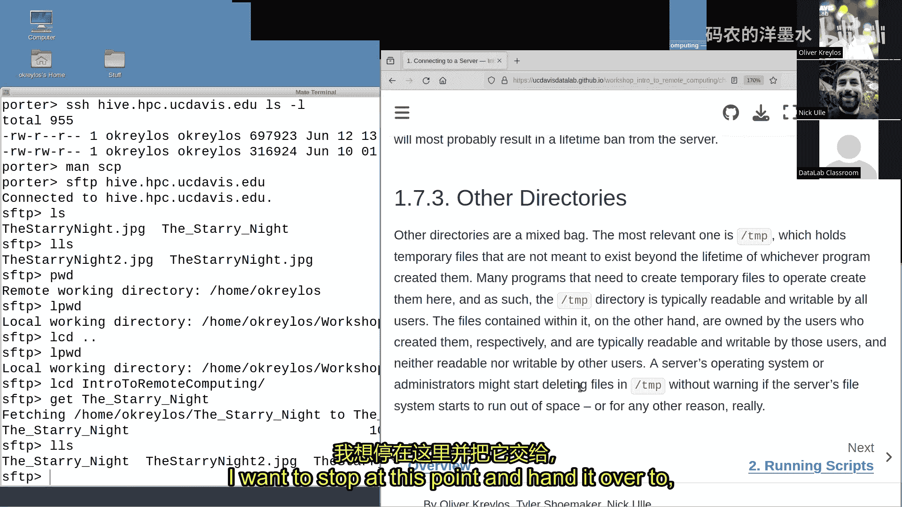

# 远程计算与高性能计算：课程1：概念、架构与首次登录 🚀


## 概述
在本节课中，我们将学习远程计算的基本概念，了解什么是服务器以及如何通过SSH协议安全地连接到远程服务器。我们还将学习如何创建和使用SSH密钥进行身份验证，并初步了解在共享服务器上应遵守的基本行为准则。

---

## 什么是服务器？💻
上一节我们介绍了课程概述，本节中我们来看看什么是服务器。

从广义上讲，服务器就是一台计算机。具体来说，服务器是一台提供服务的计算机。在远程计算的语境下，我们所说的服务器通常指计算服务器，而不是网页服务器。

计算服务器本质上是一台位于某处（通常在恒温的地下室）的计算机，它允许用户从自己的电脑连接上来，以运行那些因各种原因无法在自己电脑上运行的程序。这些原因可能包括：程序需要太多内存、处理的数据量过大、运行时间过长，或者程序会直接导致你的个人电脑崩溃。

因此，服务器的核心理念是：有一台始终开机的机器，你可以连接到它来完成繁重的工作。

---

## 服务器的共同特征
以下是计算服务器通常具备的共同特征：

*   **操作系统**：绝大多数服务器运行某种版本的Unix操作系统，如今通常是Linux。这意味着它们主要通过命令行进行控制。
*   **共享资源**：服务器是集中式资源，通常由多人同时使用。因此，你需要了解如何在服务器上与他人和平共处，避免干扰他人的工作。
*   **专业支持**：与个人电脑不同，高性能计算机通常有专门的支持人员（系统管理员）负责安装、维护、解决问题。
*   **高性能**：服务器的计算和存储能力通常远强于个人电脑，能更快地处理任务。

---

## 如何连接到远程服务器？🔗
上一节我们了解了服务器的概念，本节中我们来看看如何建立连接。

你需要一种方式将你的本地计算机连接到那台位于“地下室”的远程计算机。和当今大多数通信一样，这种连接通过互联网进行。

连接远程计算机需要使用一种协议。协议是计算机之间相互通信的语言。具体到远程连接，几乎在所有情况下，你都会使用**SSH协议**。

**SSH**代表“安全外壳”（Secure Shell）。其中，“外壳”（Shell）是你与计算机对话的方式（例如命令行界面）。“安全”意味着你从本地计算机发送到远程计算机的所有数据，以及远程计算机返回的数据都是加密的。只有你和远程计算机能读取这些数据，其他人无法拦截或窥探你的连接。

为了通过SSH连接到服务器，服务器需要知道你是谁。换句话说，你需要在服务器上拥有一个账户。

---

## 账户与身份验证：SSH密钥 🔑
上一节我们介绍了连接的基础——SSH协议，本节中我们来看看身份验证的具体方式。

服务器账户在概念上与你在线服务（如社交媒体）的账户类似：你有一个用户名和某种凭证（密码或密钥）来向服务器证明“真的是我”。

在UC Davis，高性能计算（HPC）系统不使用密码进行SSH身份验证，而是使用更安全的**SSH密钥**。因此，我们首先需要创建一对SSH密钥。

SSH密钥是一对非常长的字符串（一个公钥，一个私钥）。公钥可以自由分享，而私钥必须严格保密。服务器通过验证你是否拥有与公钥配对的私钥，来安全地确认你的身份。

以下是创建SSH密钥的步骤：

1.  在本地计算机的终端中，输入以下命令：
    ```bash
    ssh-keygen
    ```
2.  当提示“Enter file in which to save the key”时，建议为密钥指定一个描述性的名称（例如 `hippo`），而不是使用默认名称。这有助于管理多个密钥。命令格式参考如下：
    ```bash
    /home/your_username/.ssh/hippo
    ```
3.  接下来会提示输入密码短语（passphrase）。这是一个可选的额外安全层，用于加密你本地计算机上的私钥文件。即使不设置，直接按回车也可以，但出于安全考虑，建议设置一个。
4.  密钥生成后，你会在 `~/.ssh/` 目录下看到两个新文件：`hippo`（私钥）和 `hippo.pub`（公钥）。

**核心概念**：`ssh-keygen` 命令用于生成SSH密钥对。私钥（如 `hippo`）必须绝对保密，公钥（如 `hippo.pub`）可以安全地分享给服务器。

---

## 在UC Davis HPC系统注册账户
拥有SSH公钥后，你就可以在UC Davis的HPC系统（如Hive集群）上注册账户了。

1.  访问HPC账户注册页面（例如：HIPO系统）。
2.  选择你要注册的集群（例如：Hive）。
3.  填写注册信息，包括你的姓名、赞助人/小组等。
4.  在指定字段中，粘贴你刚才生成的**公钥**（`hippo.pub`文件的内容）。**切记不要粘贴私钥**。
5.  提交请求。账户创建需要系统管理员手动审批，这可能需要一些时间。

---

## 首次登录服务器
账户获批后，你就可以使用SSH命令登录服务器了。基本命令格式如下：

```bash
ssh your_username@server_address
```

例如，登录到Hive集群：
```bash
ssh oliver@hive.hpc.ucdavis.edu
```

如果是第一次连接某台服务器，SSH会显示该服务器的指纹并询问你是否信任。在确认服务器身份无误后，输入 `yes` 继续。

如果您的私钥设置了密码短语，此时会提示您输入。输入后（屏幕上无回显），即可成功登录。登录后，命令行提示符会发生变化，表示你现在操作的是远程服务器。

你可以像操作本地终端一样运行命令，例如 `ls`, `pwd`, `date`。

要断开连接，只需输入 `exit` 命令。

---

## 配置SSH以简化登录
为了简化登录过程，避免每次输入用户名和服务器地址，可以配置SSH客户端。

编辑本地计算机上的SSH配置文件 `~/.ssh/config`（如果不存在则创建）：
```bash
nano ~/.ssh/config
```

添加以下内容（根据你的信息修改）：
```
Host hive
    HostName hive.hpc.ucdavis.edu
    User your_username
    IdentityFile ~/.ssh/hippo
```

保存并退出后，你就可以使用简短命令登录了：
```bash
ssh hive
```

---

## 服务器行为准则与资源共享 🤝
上一节我们成功连接了服务器，本节中我们来看看在共享环境中应如何行事。

服务器是强大的共享资源。当你登录时，通常是连接到“登录节点”（或头节点）。实际的繁重计算任务应在后端的“计算节点”上通过作业调度系统（如Slurm，我们将在后续课程中学习）提交，**而不是直接在登录节点上运行长时间或高资源消耗的任务**，否则会影响其他用户并可能被管理员终止任务。

服务器上的主要资源包括：
1.  **计算带宽（CPU）**：多个用户共享时，每个人的任务会变慢，但通常是按比例公平分配的。
2.  **内存（RAM）**：内存耗尽会导致系统性能急剧下降（使用虚拟内存，速度极慢），因此需要谨慎管理。
3.  **存储空间（硬盘）**：空间是有限的，用尽后无法写入新数据。每个用户通常有配额限制。
4.  **存储带宽（I/O）**：多人同时读写大文件会降低每个人的速度，但也是按比例影响的。

**用户隐私**：尊重他人隐私至关重要。不要查看、修改或删除其他用户的文件和目录，即使权限设置错误允许你这样做。

**与管理员互动**：系统管理员是真实的人，他们工作繁忙。在寻求帮助前，请先阅读服务器文档并尝试自行解决问题。清晰地描述问题和你已尝试的步骤。对于重要任务，请提前规划，留出解决问题的时间。

---

## 在服务器与本地之间传输文件 📁
要在服务器上运行任务，经常需要将数据或代码上传到服务器，或者将结果下载到本地。以下是几种常用方法：

### 1. 从互联网直接下载到服务器
如果数据源在互联网上，可以直接在服务器上使用命令行工具下载，避免“先下到本地，再上传到服务器”的冗余步骤。

*   **使用 `wget`**：
    ```bash
    wget https://example.com/data/file.zip
    ```
*   **使用 `curl`**：
    ```bash
    curl -O https://example.com/data/file.zip
    ```
    `-O` 选项表示使用远程文件原名保存。

### 2. 在本地和服务器之间安全拷贝文件
SSH套件提供了安全的文件传输命令。

*   **使用 `scp`（安全拷贝）**：
    *   **上传到服务器**：
        ```bash
        scp local_file.txt your_username@hive.hpc.ucdavis.edu:~/remote_directory/
        ```
    *   **从服务器下载**：
        ```bash
        scp your_username@hive.hpc.ucdavis.edu:~/remote_file.txt ./
        ```
    *   **在服务器间拷贝**（不常用）：
        ```bash
        scp user1@server1:~/file.txt user2@server2:~/ 
        ```

*   **使用 `sftp`（安全文件传输协议）**：
    `sftp` 提供了一个交互式会话，类似于一个专门用于文件管理的命令行环境。
    ```bash
    sftp your_username@hive.hpc.ucdavis.edu
    ```
    登录后，可以使用类似FTP的命令：
    *   `ls`, `lls`: 列出远程/本地文件。
    *   `cd`, `lcd`: 切换远程/本地目录。
    *   `put local_file`: 上传文件。
    *   `get remote_file`: 下载文件。
    *   `mkdir`, `rmdir`, `rm` 等管理远程文件。
    输入 `exit` 或 `quit` 退出sftp会话。

**图形化工具**：你也可以使用FileZilla等图形化SFTP客户端，通过拖放操作传输文件，其底层原理与`sftp`相同。

---



## 总结
本节课中我们一起学习了远程计算的基础知识。我们了解了服务器的概念和架构，学会了如何生成SSH密钥并在UC Davis HPC系统上注册账户。我们掌握了使用SSH命令登录和退出服务器的方法，并通过配置简化了登录流程。我们还讨论了在共享服务器上必须遵守的行为准则，包括资源管理和用户隐私。最后，我们学习了使用 `wget`/`curl`、`scp` 和 `sftp` 在互联网、本地计算机和服务器之间传输文件的基本技能。这些是开始使用高性能计算环境的第一步。