# 【全集】加州大学戴维斯分校 计算机科学 中英字幕 1080P p08 Lecture 8 - 远程计算与高性能计算：从本地到服务器的顺畅协作 -BV1cqFNzYEvp_p8-

Large enough for everybody to read in the batch。This big enough。Can you increase the bill？另方同。Yeah。

So。这的对。W。团队分。嗯。After our work。そ咩。都备。Yeah。Okay， so we are going to talk about the next part。

 which is actually about setting up software and where the reader is。

Organized right now for some reason at the bottom of the。

Chapter it says the next one of running strips I think maybe this is an external link。

 but we're going to go to this this other reader for setting up software。Looks like this。Okay。

 so you should see environment enter theres again you can。In the main reader。

 you click on that setting up software link and then it should take you to a page that looks like this。

If you were in the Python workshops at the beginning of the week。

This is going to be almost the same as that first session we did on Monday so you are welcome to stay or not whatever your reference is for everyone else this is going to be all about how to install software on the server。

 but the things that we're learning you can also use on your local computer so if you find that this tool is convenient for you that we're about to learn you can also use it on your computer right it doesn't have to be on the server。

So this whole section， what we're trying to learn about here is how you deal with your computing environment by your computing environment。

 I mean your hardware， your software， how do you manage what you have so like what what hardware you have what software you have and we're really going to focus on the software because for most of us it's not so easy to just change our hardware right you have to like go buy new parts and most of us don't have the funds to do that and it also just takes a long time right。

And for the most part。Whatever computer you have is probably going be fine to do whatever computing you want to do if it's you know something you got within the last 10 years And if your computer doesn't have good enough hardware to do whatever it is you want to do。

 well， that's why you go to the HPC that's why we use the server So between the two of those you probably have a computer that you can use to run stuff on and you're probably not going to need to change your hardware all the time。

 So that's why we're gonna to focus on the software is that makes sense to everybody The software is where things can can get a little bit stickky。

 a little bit difficult because different code， different programs they require different versions of software。

 different pieces of software and different versions of software。

We need to learn about this stuff for a few reasons you might be using a computer that doesn't have the software you need right you log into the server and you want to use a particular program that you heard about and it's not there because the admins never installed it so you need to know how do I install something。

You might have two different projects that require different versions of software right so maybe you inherited some code from somebody that used to be in your lab and they wrote it five years ago and it uses an ancient version of some package or library and you need to use that but then you also are writing new code and you want to use the new version right like a the example of this is Python 2 and Python 3 are incompatible with each other。

But there's other examples of this for other programming languages and tools。嗯。😊。

It's also just really good to say when you're doing any kind of research work。

 what software you used， because then you can make sure that other people can reproduce your work。

If you're not saying how or what software you use then they kind of have to guess then they might be able to find the right software they might not and if they find software that seems like it works。

 it still might have subtle bugs if it's not actually the right software right so saying what kind of software you're using is really important for reproducibility and to be able to say what software you're using you need to be able to check and specify what software you're using okay。

And then also if you have a problem or a bug checking what kind of version of software you're using is the first thing you should be doing if you go like use a package for our Python and you run into a bug and you file a bug report on their their website or their Github page。

 the first thing they're going to ask you is what version are you using are you using the latest version。

because maybe they already fixed that book in the latest version and maybe you're like three versions back or something。

Okay。😊，So a whole bunch of different reasons why you need to be able to like figure out what your computing environment is。

Any questions about this， does this make sense to people who？Okay， now to do that。

We're going to use something called a package manager and a package manager is just tool that you use to install software。

And that's what it is， it can also remove software。Inverseive installing software。

 you can use it to update software， which is really just installing a newer version。

So that's what package managers do for you and if you've used R many people are our users。

 if you've used R that has a built-in package manager， a function called installed up packages。

 so you've used a package manager， if you've used R most likely if you haven't used R if you've used Python Python has a package manager called PIip for example。

 there's another one called Connda another one called Pixie there's a whole bunch of different ones for Python other tools and languages also have package manager。

 your phone has a package manager， if you've ever used the app store。

 whether you're on Android or iOS if you've used the app store that is a package manager it's installing packages on your phone we don't maybe think about it that way all the time。

 but it is it's just installing pieces of software for you right if you're on Windows and you're using the Windows store many people have heard of the Windows store。

Yeah， how many people hate the Windows store， well if you use the Windows store。😊。

That's another package manager if you are on a Mac and you've used homebrew that's a package manager okay so these things are all over the place if you're on Linux there's like five or 50 or 60 different package managers you can choose from。

There's lots and lots of different package managers you could use， but for what we're going to do。

 we really want a fact manager as one really important and special feature。

 which is that it can make something called a virtual environment。

And a virtual environment is basically going to solve that problem that I mentioned earlier where maybe I have one project that needs python2 and another project that needs python3 so we need two different environments for those two different projects does that make sense to everybody。

And so the way we're going to do that we're going to create something called a virtual environment that basically says here's this set of software that we're going to use with this project。

 that's one environment， and here's another set of software maybe different and may incompatible that we're going to use with this second one project。

Okay so we want a package manager that specifically can make these things called virtual environments and not every package manager can do that。

not every package manager will let you install two incompatible pieces of software side by side right like your the app store on your phone doesn't let you install two different versions of the same app。

 so the tool that actually do let us do that we kind of give them a different name we call it environment managers and usually an environment manager is also a package manager。

 but not necessarily the other way around， but package manager might not know anything about virtual environments。

哎。😊，Does that me Ab store doesn't know anything about virtual tool butter。

And there's a whole bunch of these as well that you can use for all sorts of different operating systems。

 the one that we're going to learn and use today is called Pixie and it runs on any operating system。

 Windows Mac Linux。They have a website with documentation and a little macot guy who's like a little ox。

 I guess， you're installing packages。嗯。So that's what we're going to use and we're going install it in just a moment how many people here have heard of Conda or used Conda okay almost everybody so if you heard of or used Conda Pixie is very similar but it has some nice features that make it even better to use the first one is that it's fast Conda is very very slow depending on how long you've used Connda you may have encountered this but sometimes installing a package with Conda can take up to an hour Pixie that doesn't happen or at least I've never experienced that and that no one I talked to has experienced that。

Pixie uses condoda packages， so if you're a Conda user。

 you can still use all of the same packages you know and hopefully love。

If you've never heard of Conda before， for anyone that hasn't what Connda and Conda4 are Conda for is a collection of a bunch of open source software that you can use the focus is mostly on research computing。

 so most of the stuff in Conda for is software that you would use for research computing。

 but there is other stuff in there it's gradually sort of accumulating more and more packages。嗯。

And this is all driven by the community so that's why there wasn't like a huge collection of packages right at the beginning it's slowly getting bigger and bigger because community members are helping get these packages on according to Po right it's all a community effort all the software income to forge is open source it's free。

So this is a great source for getting software and Pixy is going to help us in fall software from here。

Okay。嗯。Now if you're specifically if you're a Python user。

Pixie can also install Python packages from a place called PPI。So if you are using。Python。

 and you want to install P packages the packages that you install with PIP。

Then Pixie can also do that if you're an our user most of the art packages that you're familiar with from Crran are probably on CondaForge This has been happening a little bit slower than like Python packages making it to Condeforge but it's starting to pick up speed so it's getting better and better all the time or and more of a package that are on Crran are also showing up on Condeforge if you're not an our user or a Python user or you also use other software there's other things on there as well things like Julia's if it's an open source project it's probably on Condaforge if researchers are using it if there's like at least enough of a critical mass of researchers using it if it's very niche like two or three people in the world use it it might not be on there but you could be the person that puts it on there so。

So we're going to set up Pixie and we're all going to try to do that right now and the way you're going to install Pixie and we're going to do this on the server so let's before we actually go and look at how to install it let's just do a quick check so everybody everybody open a terminal just have a terminal open and something I want to point out here is if typically in your terminal。

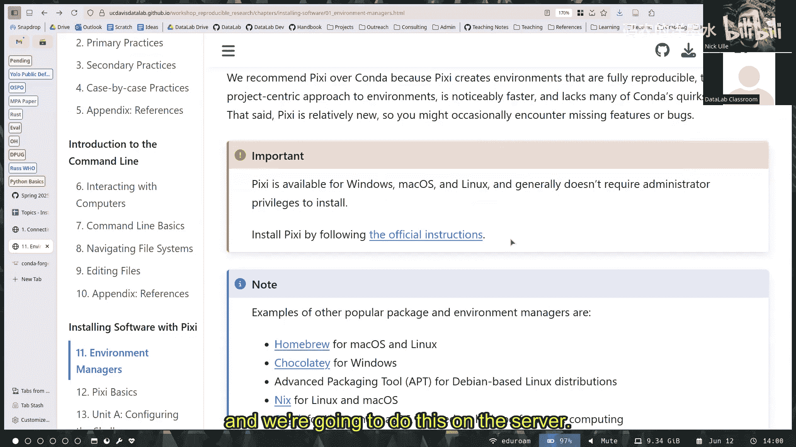

You're going to see a few different pieces of information， you're going to see your username。

And then you're going to see the directory that you're currently at。

And then you're also going to maybe see a dollar sign that just says like this is where you type。

 okay。Now， if I log into the server and。Just let me run this command。

 don't run this command yourselves yet。If I log into the server。

Here's my prompt again and notice that it has changed a little bit。Okay。

 before when we looked at my prompt before and let me just put another one on the screen。

 they said this is。The lower half is on my local computer， the upper half is on the server。

On the server when I'm on the server my username is different that might be true for you it might not and then it also has this app log in one okay so if you're looking at a prompt and you see this app log in one that's telling you that you're logged into the server right now。

Okay。So it's really important to keep track whether you're working on the server or locally。

 and this is how you tell you look at this。And when I look at my local terminal。

There's no app or it might say something like@ local host or something。

 but generally I think the default is that there is nothing is that what most people are saying seeing。

 I can't remember what the default is or if I've changed something。

No okay I see some nodding but when you're on hi you're going to see at log into one and depending on what server you log into it will say different things。

 so I kind of wish that hi said at hi but it doesn't I don't know why the admins configured it that way if I log into say form。

When I'm on farm， one of the other HCs at UC Davis， then it tells me at farm。

 but this is how you can tell whether or not you're on the server， okay？Any questions about that？Yes。

 the small sidetrack like log in one， could you also think let say you have one terminal we' going to delay？

Run something can you have to log in two and three in board to the server at the same time rate so if if I log in so if I log into the server twice。

 you can log into the server in several different terminals。Okay and that's often useful to do。

 but login one is just the name of the head but it's not it's not because it's my first login or it's just that this is what what hive calls itself for whatever reason I don't know why they didn't name it hi but yeah。

Okay。😊，嗯。But gives you if you open them book at it some time it gives do the same name so how did you。

Keep up with which one you and or can you only select want at a time both of these are logged into five at the same time Oh I mean when you did farm and then if I if I log out of five so to log out I type exit and then if I log into form。

OkayNo it'll say few seconds， it'll say I'm at。And so this is how you can keep track。

 like you look at what the prompt says and think about。

 are you on the server or are you on your local machine or。Something else。

 right because commands that you mean to run on the server might not work on your local machine and commands that you need to run on your local machine might not work on the server。

I also want to point out if you can customize the prompt that the server gives you。

 I do that oftentimes that I just， you know， have a custom form that tells me here on farm go I on the local to see sometimes I have several logins like Nila showed I might have。

Lolog in one， get to project one， log in two related the project you just so that and always remind where I am because it's very easy to make a mistake where you run a command in the wrong terminal and then you just massively screw things up。

With all that said。I think what I said everyone should just open a terminal right is everybody at this point where you're this is on your computer not logged into anything right if you're logged into the server please log out。

啊错。Okay so we're all going to get to this point， and then we are going to sshhihpc。ucdavis。edu。Okay。

 any press enter？right， I need to， I havent， I need to put my user again。Or ready to get。So for you。

 it should be sshhi。hpc。uccw。u for me， it's going to be SSshhi if because of's the way I' configured my SSH。

好的。But I will put that up there okay and everybody once you successfully log in and see this welcome message put up a yellow sticky。

If you're having trouble， put up a red sticking。so I want to make sure everybody can get to this point so we can all follow along。

Okay， I don't see any red stickies， so i'm going to assume that we're all good so now that we're all logged in now we're going to go and install this tool see。

Okay so we're going to go back to our web browser。

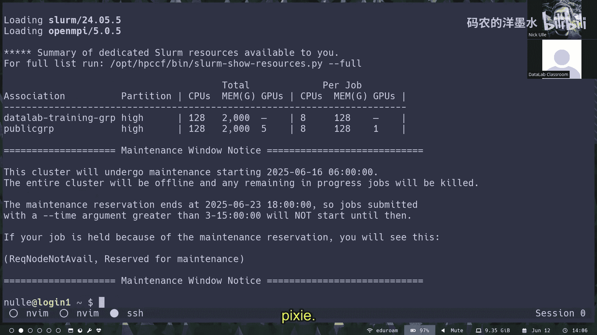

I'm going to install Pixie by following the official instructions， this is in the reader。

 you can also just go to Pixie。s that's the website。We go E。sh that will take you to this website。

A little bit bigger。对。Okay。😊，And you're going to scroll down this page。

Until you see the word installation。喂。Installation， right。

You're going to scroll down the page until you see the word installations and then you're going to see that it says to install Pixie run and then it'll have some options for operating systems。

Okay， and we're going to install this on the server， so we need to use the server's operating system。

 which is Linux。So we're going to choose Linux and Mac OS。

And then we're going to copy this command and this command。

 remember Oliver talked about that you get earlier and you also mentions curl or CU。

 we're going to use CU and we're just going to accept this command but this is going to download a file that's we're going to download this file then install an SA script it is just a shell script and then we're going to run it。

helello。

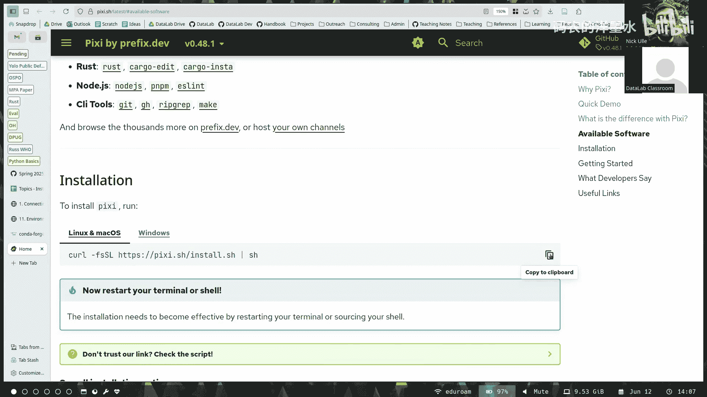

So we're going to copy that go back over to our。Logged in terminal pasted in here。

And then we're going to run it。Okay， by pressing Andrew。哎嗯。

And you should see something like this it will download some stuff that will say the Pixie binary is installed to some location。

 probably your username not my username and say updating something and then please restart。

Or source your shell Okay， everybody that's at that point put up a or a yellow sticky if you haven't already。

 if you're stuck and this is not working， put up a rent sticky。

I think there's one bread sticky solver there's one person in the room right。He's got red and yellow。

嗯那等。Trying to confuse us。So I want to make sure everybody is able to do this and while that person is troubleshooting。

 we're going to do one thing which it says please restart or source your shell in other words。

 we need to log out and log back in so if everybody that' it's okay and got to this point log out and log back in log in so to add the nickname to the con file show you that we're waiting a second on your local machine okay on your local machine you would open up your well let's do it this way go to dot SS the directory okay and then Na config。

Okay my file has got a bunch of stuff in it， but what you're looking for let's look at the one for hive so here's the one for hive so what you would do and if you wanted to add this shortcut you would make sure it says host five your user name just like we have the the host name is that the key thing this has to be what used to be up up there and then identity file forward agent does the same form。

Okay， so that's how you do't matter。The order is now， the lion here don't matter。系 so。那这是我一的不用。

You code nano So that was fit So you go to the SSH directory CDA and is there a way to add your passcode to the SSH not no。

 no， because that the whole point is the much have your password be in the file somewhere so they could get hold better。

You days Oh yeah， sorry。Thatfins square wellness。对哦。对。

And then our comment is pound is common pound is common yes。

 so if you just want to write a note to remind yourself。

 you can use the pound sign did we need forward agents？It won't hurt anything not to have it。

If you use Git later on， it won be helpful to otherss。嗯。If you don't use Git。

 that really won't affect。对。怎埋你。Few other things that could affect that。Most likely it's not。Okay。

 so this was kind of a diversion from what we were talking about。 So let's go back to。

So to what we were talking about， if people want to see this again at the end。

 let me know and I can show you。have questions about that but where we left off we had gotten to this point where where it said please restart or source your shell right and then I told everyone to log out by typing exit and then log back in。

对。So now I'm assuming everybody has gotten to that point so I don't see any more red stickies so now what we're going to do just to make sure everything is okay we're going to type Pixy P X I。

And then dash dash version。By the way， I forgot to ask。

 is this font size large enough for the people in the back？对。And you should see a number like this。

 probably the same number because we all just installed it at the same time。Thank。

If you don't see Pixie and then a number， put up a red sticky。

 someone will come out through anything them。The first thing you can do to chat。

 make sure you're logged in to the server Okay， make sure you see this cat log in one it seems that PixC doesn't show up in the path because I oh everybody else got from Okay。

 yeah that's that's kind of okay， so we'll try to figure this out together let's see let's do this so rather than having all the helpers go go help you here's what we're going to do what I want you to dos in your home directory。

Go ahead and type LS and then dash A。Okay so this is along the server but so' keep that command on the screen it's up there at the top LS dash A and。

If you have if you have a red stingy out。You have a dot pixie if you have a dot Pixie directory take your red sticky down just for a moment you have a directory called dotixie because that means it is there it's just not not being protected okay so everybody as far as I can tell if there's they' red sticky down so what we're going to do。

So you've got that directory， so now what we're going to do is we're going to look in that directory so we're going to look Ls。

 Pixie。嗯。And you should see this again， if you don't see this put up a red sticky environment maybe not that one we should see and there will be a too。

And then if you look in bin， you should see a bunch of stuff， but you might not see all of this。

 but you should see Pix Okay Okay so good so we have it installed if you can see that and it is installed we just need to tell the command line how to find it so we are going to jump around a little bit we're going jump around in the reader a little bit so if we go back to the reader because we all need to actually get the shell to recognize where this is we are going to jump to this section called unit a configuring the shell because we need to make the shell we need to tell it here's where I'm installing programs yes oh you're so we need to tell the shell where to find Pixie。

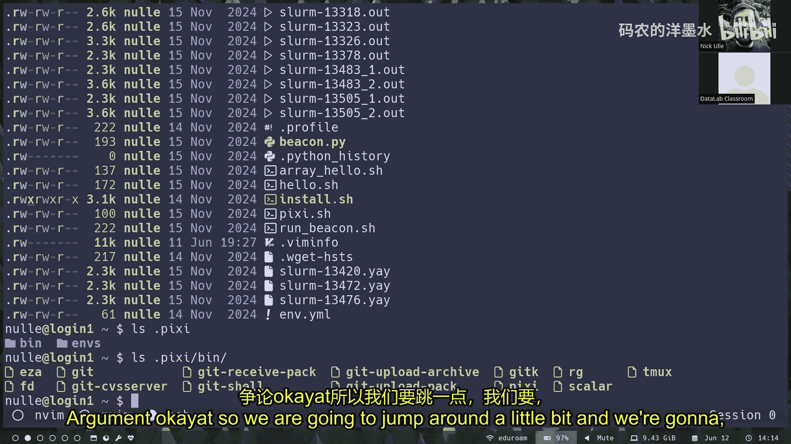

Because it's not finding it on several of your computers are on the server really。

 but several of you logged into the server Okay and so the way we're going to do that we're going to edit a configuration file we've already done some editing of configuration files right we edited the SSH configuration earlier today but now we're going to edit the configuration file for the shell itself and the shell that's running on high。

Yes， I found the problem go into if it doesn't Yes I know we're gonna fix it Okay。

 so when you log into hive， you're using a shell that's called bash bash stands for the B again shell was made by a person their last name was born and they were making a new version of a shell that already exists it was called SH so they call it the B again shell now it's just called bash this is the shell that is on most Linux computers if you're using a Mac。

 which is kind of like Linux， but it's not Linux you're probably using a slightly different shell called ZSH on your Mac but not on the server。

 the server is still using bash so we're all going be using bash on the server Okay and we're all going configure our bash shell on the server。

Okay and to configure bash， when we configure SSsation there was like one file we had to edit for bash。

 there's three actual well well， two， two and a half maybe so put it so there's something called a bash profile。

And these all have dots in front of them so they're hidden files that don't show up normally when you type LS。

The batch profile this runs every time you log into the server。

There's something called dot profile that also runs every time you log in。

 but only if dot batchsh profile doesn't exist。And then there's also something called do bashRC that runs every time you open the shell if you're already and if this seems complicated that's because it is and it's annoying and I hate it and we're going to make it a lot simpler Okay。

 so're we're going to configure these to be a little bit simpler for you to be able to actually make sense of what's going on。

嗯。Like it says here， these configuration files are called dot files that's because they all start with the dot。

 they're all hidden files and these are all just sitting in your home directory。

 some of them might not exist yet， okay but we're going to create them and we're going to start by creating the BH profile。

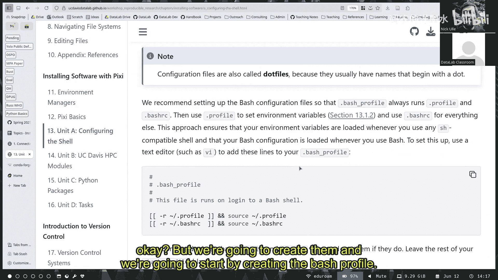

Okay， so what I'm going to do I'm going to go back over to my terminal make sure I'm still logged into the server you're going to do this on the server not on your local machine Okay and then we're going to we're going to type nano。

Or if you like VI， you can use VI， but nano and then dot Fsh underscore profile。

Watch out for titles here thought the ah underscore profile you need to also make sure you're logged in you're at your home director。

All of those things， check those three things， check me you're on the server。

 you're at your home directory， then you don't have any typos in dotash profile。Next， please。

Once you've done that， for enterer。Open the file your file will probably be empty right Okay。

 go over to the reader copy this this is in sections。

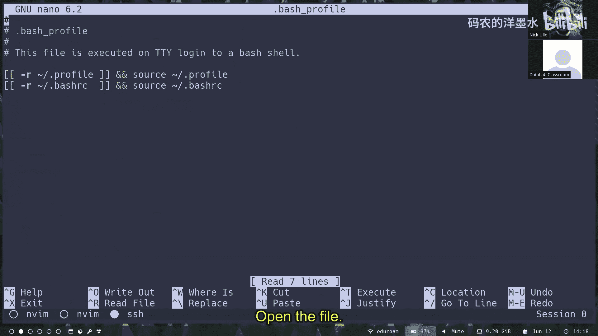

One point or 13。1， this is called unit A。You're going to copy that bash profile thing。

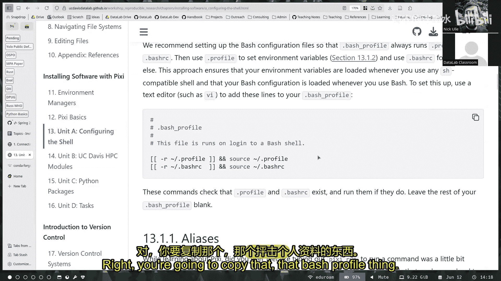

Okay， and you're going to paste it。What was the command to open that to open this profile and this is what you're pasting Well you can type it in if you want。

 but be very careful not to have type those So while people are doing that as far as what this is doing is doing there's only two lines of actual commands in two lines of code the stuff hashtags that's all just comments So there's two things that are happening The first thing is this square bracket are profile just checking to see if you have a file called do profile So it's saying is there a file do profile。

Okay and then and and means if that's true do the next thing and the next thing it says source do profile that's like our run command in the shell。

 so it's saying if you have a dot profile run your dot profile files。And then it says。

 if you have a baachearRC， run your dot baachearRC run your final position。

So I was just saying every time we run B profile we're also going to run those other two files in other words。

 every time we log in we're going to run those other two files and this is going to solve a lot of our problems because now we don't have to think about the complicated different set of cases where those different files run now we just know every time we log in all three are different。

Okay' reach back。嗯，好对对。And profile profile and yes， Okay， so once you've pasted that in there。

 you're going to control X and if you've pasted that in it will ask you if you want to save。

 say yes and。Save it。Okay。And then just to check after you've done that， after you saved it。

 you should open it up again with nano， make sure that that is still there。

 make sure it actually got saved。And if anybody is having trouble with this step。

' put up a rest ticket。有。我 youbri冇。嗯。你好。知道。So we've done that Im does。Now。

We're going to go look at another one of these files。

Okay so we are going to go and look at I think you bashRC。

 but I want to make sure I'm not skipping over anything at your Okay so we are going to go look at the bashRC now so nano do baashRC。

Again， make sure you're on the server， you're in your home directory。That you don't have typos。

And yours will potentially be blank， it might not， it probably won't have the same stuff as mine。

Again， the command was nanono， got ba RRC。对。Yes， how many people's baRC has stuff in it already？Okay。

 that's kind of what I thought。So。This is going to run。

Every time you log in because of what we just did to batch profile okay and generally the way you're going to want to use these files let's go back to the reader that has whole three so I can just talk about it for a moment the way that I recommend you can use these files in your baRC that's where you're going to put。

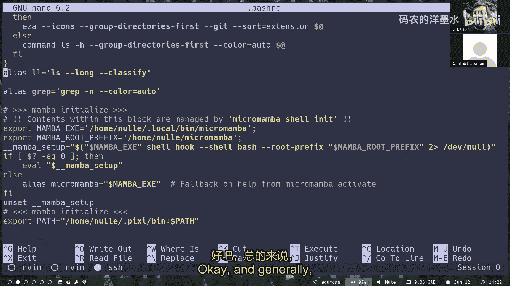

Any kind of like shell configuration that you want to do okay so if you want to do something that configures like what your prompt looks like like Oliver mentioned you could change your prompt if you Google that and learn how to change your prompt you would want to put the commands to do the change within your baRC and then it will get changed every time you log it right thats so this is the file where you're generally going to put all your configuration or your shell okay。

Bash profile， we're just going to ignore it from now on。

 we're never going to put anything else in there that like we're not even going to think about it anymore。

Dot profile。We're going to put one very specific kind of configuration in dot profile and that is generally going to be things that change what's called the path variable and in your shell。

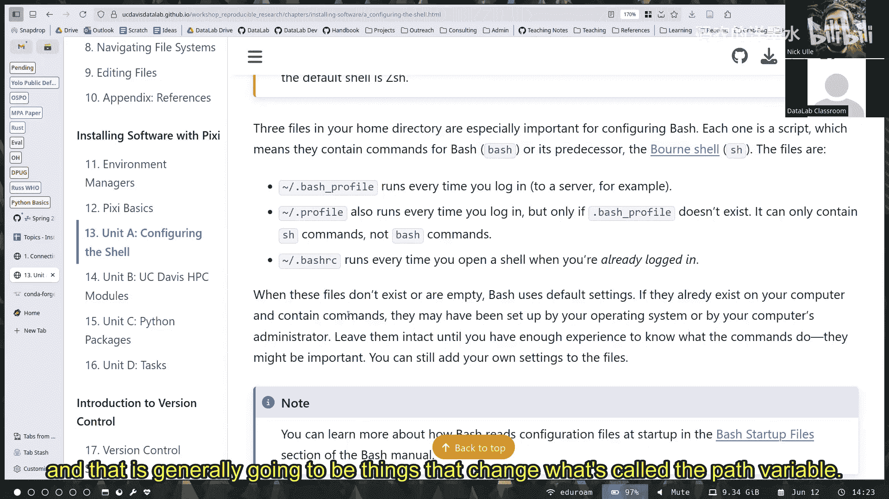

Okay let's let's exit out of this we didn't have change anything so let's just go back to the problem in your shell there are a whole bunch of variables that have been defined your shell is a programming language just like when you program in R or Python right you can define variables in R or Python or Julia or MATLb or whatever language programming language you've used it probably has some kind of variables you can define right in your shell it also defines variables you can define your own variables and it also defines some automatically and a really important one that it defines automatically is called path。

Papital P TH path okay and the path is telling the shell here's where to look for programs that we might want to run here's where to look for commands that we might want to run okay and we can actually take a look at that let's let's we're going to use a command called echo it's just print stuff out this is like the print command in the shell and then to refer to a variable in the shell the way we do that we put a dollar sign and then the name of the variable。

So we're going to look at path， we're going to print out the path。Okay。

 so I'm going to echo path and if I press enter， then it shows me my path and you can see if you look at it that it's got a bunch of file paths and they're all separated by polls。

This is like a list of different directories separated from courts。改。

These are all the places on the server that the shell is going to look for programs to run。

And your path will probably be a little bit different than mine。系。

One of the key things you can notice here is that at the beginning of myad。

 it's got that Pixie folder that we were just looking at a little while ago and that's why my shell is able to find Pixie and your shell is not if you're one of the people that unfortunately is not able to run the Pons。

So what we're going to is we're going to change this。OkayWe're going to add something to the map。

And we're going to do that in that dot profile file。you could also do this in the dump AshRC。

 but I tend to prefer to put these things in profile and there's some technical reasons for that that you can talk about at the end if you want to know。

 but it's not super important for what we're doing right now。So what we're going to do。

 we're going to open up our。Thatt profile。And again。

 make sure you're logged in in your home directory。

And you can see I'm already doing something with path and the way you're going to write this anytime you want to change the path。

Okay， you're going to write it kind of like what I've got here。Not used to this editor Okay。

 so what you're going to do， you're going to type export。Export。Palf。Okay， and then an equal sign。

 and this is just how you're going to change the path in any of these shell configurations。

You could change other variables too if you had some other variable you wanted to say you would just put the name of that variable here and spin of the path。

 but we're going to say export path and then we're going to put quotes， double quotes。Okay。

 and inside of the double quotes， you're going to put the directory that you want to add to the path here。

Okay， so in this case， we saw it was home slash， whatever your Kboose username is， minus N。对。

And then a slash dot Pixie。And then a slash dot bin because that's where the Pixies program actually is。

So again， make sure that this part is your username， not my username。肯定。

After we put that in it that's the directory we want to add to the path。

 but we also want to keep everything else that's already in the path because if we just got rid of those and we wipe those out。

 suddenly none of our commands are going to work because all the other directories where the shell should be looking for commands it's no longer going to be looking there so we're going to put a call in and then if we just want to sort of say put put the path variable as it was previously you can just put dollar sign path kind of like what we did when we use to。

Okay， so this just says stick this path in the front and then have a colon colon is the separator between the different directories and then。

Butut everything else that was already in there， okay？

And so you can see I already had that in this file。

 so I'm just going to delete this line because it's exactly the same as the next line。

 you only need it once。哎。Okay。Now I've actually got another line here where I'm adding something else to the path。

 you don't need this， but if you want to have a directory called B where you can just throw executable programs and have them be found automatically。

 you could do that。But you really only need the first one here to get fixed for you。哎。

Any questions about this？Okay， so now we get to look at the moment of truth。

 we're going to save this file。We're to going to exit out， save it。Okay。

 so somewhere where we copy that there's nowhere to copy it other than my screen dot profile this is dot profile yes should be in your home directory。

And for people copying you only need this first one， you don't have to have the comments。

 you don't have to have this second expert one， you just need。The first export line。佢。And again。

 make sure that you put your username， not my username。Thank。Will work if we do we' using it。

 probably not as long as I've got my permissions configured correctly。

 I think I do then then it will probably say something like permission denied or something。对。

So can I close this file now， is everybody able to write this？Okay。

So I'm going to go ahead and close this。Again， like double check after you save the file。

 open it back up， make sure that you actually save it correctly。

And then now that we've done that so we've done a couple of things we changed B profile so that it will run profile and BachelorRC and we changed profile to have that path so now we're going to log out。

The log back in。对。The reason we're doing this is so that our new updated configuration files will run。

They get run whenever we log in。Okay， and now， like I said， moment of truth。

 we're going to try Pixie dash dash version again。And if you're still seeing command not found put up a red sticker。

 if you see the numbers， some kind of version number。

 then you're good and to keep the yellow sticky up。去。は。嗯，喂。good so far。哦。

Give it give it just a moment for people to actually do this。

 but then we'll proceed once you once you have gotten this to work if you haven't put up your yellows keep put it up so I know of you're。

shapepe， okay， so yes a general question so you were mentioning in the beginning that。

Can do this in for things that weren't already on the server。

 but how can you tell what's already on there we're going to get it oh okay just give it a moment Okay I just want to make sure everybody's able to do this。

In fact we'll do that next Okay， I think everybody has a yellow sticky out as far as I can tell so we are going to keep going that we've got Pixie installed now we're going to come back to the command line and do some stuff in a minute。

 but before we do that I want to jump back to the reader we're going back back on trash。

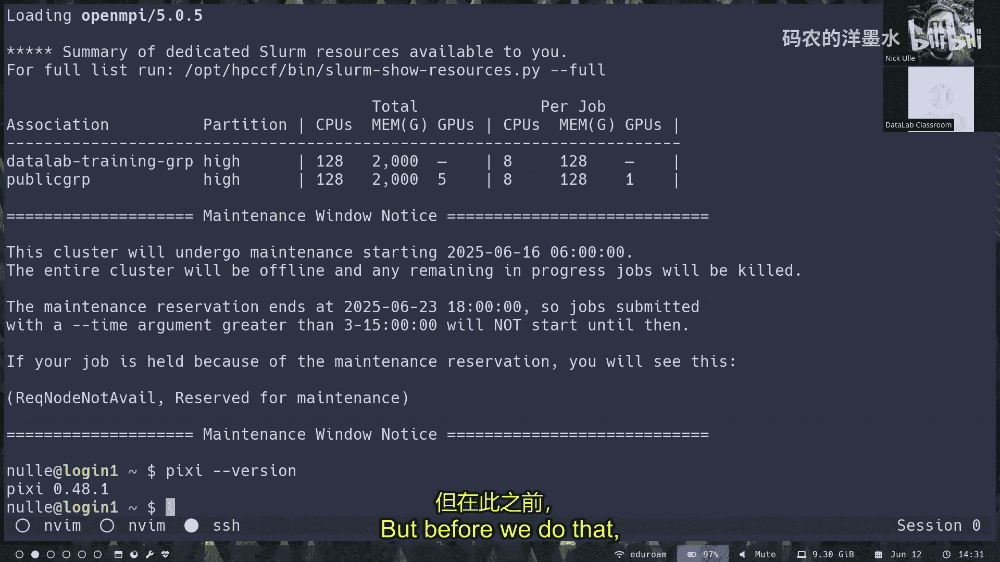

Sort of maybe we're going to go to unit B actually。

 so maybe maybe not back on not linear back on track。On track in terms of time Okay。

 so we're going to go to unit B we're going to talk about the built in software that's already installed on the server right。

😊，So there is some software that's already there that the HPC admins have set up for you to be able to use and。

For this particular software they call these these are like virtual environments right we talked about environments before the collections of software where you can do stuff and they call these modules that's what the HPC avenuemins call these things this is unique to UC Davis is HPC I don't know if you use another HPC they might not have a system like this or they might have a different system with different commands and different names the one here at UC Davis they call it modules。

嗯。And the way that modules work， you can use a few different commands to see what's available so first of all。

 if we go back to our terminal logged in the hive。

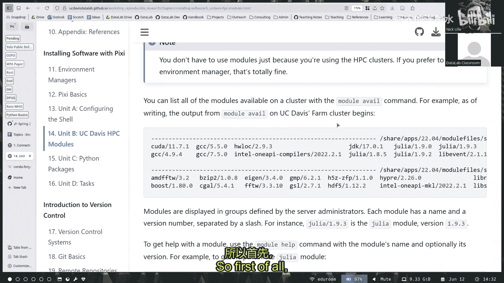

I type module， avail。All of the commands to do things with moduleular where we're going to start with module I type module avail。

 this gives me a printout of all the different stuff that's on there and let me keep that command on the screen。

Okayect。So it prints out a whole bunch of stuff， right？

And these are all different collections of software， different modules that you could use on the HC。

things that the admins have already set up for you to use okay and you might look at these names and say like well I don't really know exactly what some of these means right some of them maybe you recognize some software that you use but others you might be like well I don't really know what that is and so if there's there's one that sort of looks like it might be the thing you're interested in but you're not totally sure what you can do is you can ask for help and so let me find one that I think will be relevant to most of our audience hopefully there's probably some R python ones in here somewhere let's see。

See some some maybe python ones。There are one。There's an our studio one okay。

So let's look at the R studio once there's one R studio of 20249 and so what you can do。

 if we want to know more about that module， we can type module help and then the name of the module。

 I think you I don't know if you have to type the whole name。

 I think you can just start typing part of it。对。Type our studio and that gives us that gives us some help。

 and then it tells us a little bit about the module and this is depending on。What module it is。

 the description might be more or less helpful。This kind of gives us some sense of what is in this module right it's that R studio is an integrated development environment for R and as you don't know what that means you can go and Google it and start trying to figure out what is an integrated development。

 what is R right？But this is where you can get a little bit of help as to what these modules happen in。

对。嗯。There's other modules as well， so like there's a modules。For the Julia language。

're interestedterested in that。Let's see， is there a module for Python？There's probably several。

 so there there's a modules for Python， you want that？

And when you actually want to use one of these modules， what you're going to do， well， first of all。

 just to show that you have to do this if I let's try Python。

If I try to run Python says command and all found right haven't loaded any modules yet so there's no Python available to me yet if I want to load a module module load Python。

it says loading iPhone 311。And now if I take Python。Get a Python prompt。诶。Likewise。

 there's modules for R in our studio if you want to be able to run those things。嗯。Ju。

 are there other languages and tools as well， other programming languages。

So I'm going to exit out of this Python prompt because it's just we're just here to see that we can do this。

 And then so that's how you load a module and you can load multiple modules at once。

 So if you have several different things you need， you can load。More than one module。嗯。

You can also see which modules you've loaded， so if you want to know what are the modules I've already loaded if you say module list。

That will show you all the modules that are loaded and there's two that get loaded by default whenever you log in and these have to do with how you run jobs on the server SLRM is the tool that we're going to use to run jobs and open APIpi is another tool that you could use to run parallel jobs on the server。

嗯。So these two got loaded automatically when we walkedgged in。

 Python is the one we just loaded a moment ago。开。This is how you can see what you've got and if you're done with a module。

 you decide you don't want to use it anymore， you could also do module unload。

Python and this mainly is useful if you're using two different modules for different things and they have incompatible versions of software so like maybe you're using a module Python 3 then you want to switch to a project where you need Python 2 you would unload the Python 3 module and load the Python2 module which I don't know if there is or Python 2 module's let's see my guess is that it would be called Python2。

对，没你们完。嗯。But for other versions of software， you can't do things like that。Any questions about this？

So this is the module system on。Yes， so if months you know animal。

justYes so it's loading it's loading all of the the different pieces of software i'm not sure what it does if you load two modules that have some kind of a conflictf。

嗯。Like if they both have a version of Python， I'm not sure if it's like the most recent module wins or how that works。

嗯。In general， if you if you need some flexibility about。

Like what versions of things you want this is not going to be the way to go we're going to use Pixie see a better way to do that and if you're using。

If you have two modules that have conflicting versions of software。

 my advice is just don't do that right like don't load two different modules that both have Python at the same time because like why are you doing that is because what I would ask？

Yes， so I guess kind of the question that I feel it is bigger than。

I think to al so what if I want to install a piece of software like how we' installed PC but it has dependencies on things that are in the module is there like some kind of prospect or I just need to set the paths if you want to install software what I would suggest you do is use Pixie rather than the module system this module system doesn't really give you a way to install software you can't make your own modules these are things that are made by the admins。

You could ask the admins that they'll make a module for you and they might say yes。

 depending on what you're asking for， usually it depends on if it's the software you're asking for。

 if you can convince them that there's lots of people that would want to use that software on the server they'll usually do it also it has to generally be open source and free if you see Davis doesn't have a license for it and its proprietary software they're not going to put it on the server so and the other thing about that is like to make one of these module things HPC it takes them like a few weeks at best and a few months at worst so if you don't mind waiting for that amount of time you can have HPC potentially set up a module for you you all those conditions but most of the time if the software you need is not in the module system。

You're going to have to install it yourself that's the fastest and easiest way to get it and we're going to see how to do that in just a second。

Any other questions about this basic questions of this just。

If you're loading the module it just sets you up to use that software within the system yeah and if you know that you're going to end up using two different things like Python and are like back and forth you can you can load both and yeah like in general two different pieces of software that don't have any dependencies on each other they won't cause a problem if you load to the same type but this isn't the same as like running the programs right this is not like just by loading the module we're not running python have to do that as a separate command Okay runyon yeah。

Any other questions？Yes， I might be getting ahead of you but I in our studio and asks me to use on demand yes so if the program you want to run is a graphical program you're going to need to use a different thing called on demand which opens up a window in your web browser we data Lab does a workshop about that it's a separate workshop we're not going to talk about that here any other questions。

Okay， so we've seen this module system and right away I want to point something out。

 which is that you can see the version of Python that they have in the module system it's 311 okay。

And if you're a Python user， you might already know this， if you're not， then probably don't。

 but the latest version of Python we're at 313 right now。

Okay so if I wanted to use the absolute latest version of Python， the most recent version of Python。

 the module system can't help me with that right it's out of date and this is。

Normal like it's not extremely out of date it's maybe a month or two out of date and so you can expect there's going to be a little bit of delay for updates to the module system that part of this is like for security reasons they want to make sure that there's not some horrible security error problem in the new version versions of software some of it is for compatibility reasons some of it is just that it takes time to update these modules and the HPC staff or stretch very thin。

Put it lightly。Yes， E does a new piece of software break what you're doing it depends on the software generally speaking。

If the software is using this slate。Three number versioning systems， it's called semantic versioning。

When the first number changes， something's going to break， if the second number changes。

 maybe something's going to break， if the third number changes probably not anything is kind thats that's how semantic versioning is meant to be used not everyone uses it that way there are packages that misuse the versioning。

 but that's how it's meant to be used。Okay， so let's try we're going to try and get a newer version of Python and we're going to use Pixie to do that okay so we're all logged in we're all at our home directory okay for reference where we are in the reader we are now going to Pixie basics or 12 okay。

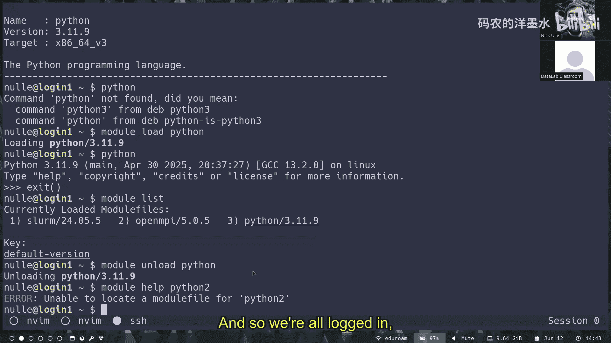

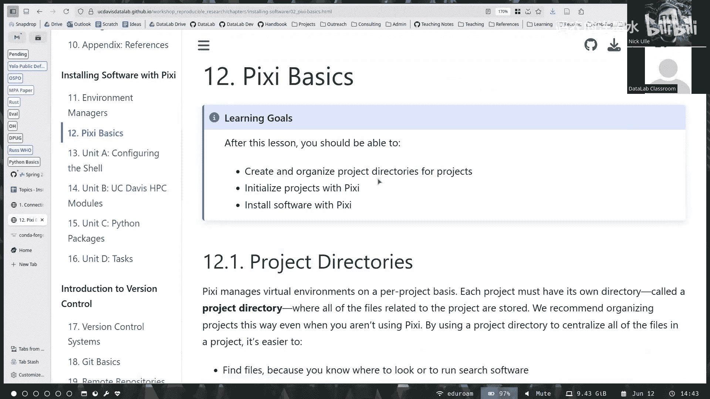

And the way that Pixie works， it has this idea that whenever you work on a project。

 you're gonna to make a directory for that project， this is a good practice。

 even if you're not using Pixie like anytime you start working on a project just make a directory for that project put everything for that project in that director。

 you can have subdirecties to organize it right but keep it all in one place so that you don't have files from your research project spread all across your computer right this makes it really easy if you need to say back up your research so like you want to make sure that if something happens to your computer。

 you don't lose your entire dissertation it's also really good if you want to collaborate with somebody if you're working on a collaborative project and you can just like zip up the folder and send it to them。

 that's great rather than having to track down a bunch of files on your computer so like make project directories whether or not you're using Pixie。

And Pixie assumes you're going to do this because it's such a good practice and so the way that you would make a project directory with Pixie instead of just the usual like make directory command so you could just make a directory with NDIR。

 but with Pixie what we're to do is we're going to say Pixie in it。Iize。

And then we're going to say the name of the directory we want to create and this should be something descriptive that has to do with whatever project you're going to work on and I'm just going to call it for today I'm going to call it my first Pixie project。

You don't have to call it back like can if you want。

Generally good idea not to have spaces in the names of directories when you're working on Linux or in the command line in general。

 because that'll make your life miserable。Because the command line uses spacesis to tell what the different pieces of the command off。

对。So we use underscores instead and we're going to be fixing in it and then it should say something like created and then your home directory and then。

The director。So now if you look in your home directory， LS。

You should see that in there somewhere and you might not have fancy icons and stuff。

 but you should see。That you have。嗯。My first Pixie project directory and we're going to go into that directory。

对。CD to that directory。All right。If anyone is having trouble with this step put up a to eat。

Otherwise， I would not assume everyone is able to follow along。谢须。So in this directory。

 let's take a look。LS。There's just one file least that we can see so called Pixie。tmal。

this is something that Pixie made for us automatically this is like a description of your project and it's going to have like metadata like who the author is。

 what the name of the project is， maybe a short description of the project。

 you can edit all of that and see how to do that in a moment and it's also going to have information about the computing environment。

 the software right it's going to list all of the packages that you're going to use for this project so that if you wanted to say set this project up on another computer or share it with a collaborator then they can also set up the exact same computing environment。

Okay。😊，AndThat's the idea of this file， it's like documentation for your project and part of it is generated automatically。

改紧。So let's look in the file right now and we're going to do that you can use nano or VI we're just going to use a text editor nano or VI to open up this file right so nanopixie。

com。And it should look something like this。系。It might be slightly different。

Depending on what you chose to call your project。If you have already set up Git on the server if you logged into hide before then you might see your name in here as well but this is the description of the project and you can see up at the top it's got this section called workspace and that's like metadata about the project so it tells us something called channels which we' come back to a little bit later tells us the name of the project it tell us platforms that's like the different operating systems you might want to run this project on and right now it just has Linux because the server is Linux if you wanted to run your project on other platforms like maybe you have a Windows laptop and you want to be able to run your code on your Windows laptop and on the server you can add in other platforms in here just by putting comms and then the name of the platform inputs and so Windows is called I believe win 64。

In 64。Right。And if you wanted Mac OS， you could put what are they called。OSX 64 and。

I'm not just pulling these out of nowhere these are all in the Pixie documentation so you could go and look like what what platforms are available to me if you have one of the new Mac the M1 or M2 max that's called OSX arm 64。

对。If yes if mine is empty if it's completely empty， that's a little bit odd。

 but what you're going to probably want to put in there is Linux 64 because the summary is Linux 64 at the least you're going to want to have that in there。

All of this information well the platforms it oh， so if you open Pixie automal。

 it's completely empty， make sure that you ran Pixie in it。

And make sure that you can actually see that file with LS because that if it's completely empty that file just isn't there so you don't have a Pixy do tunnel so check and maybe one of the helpers could come and help see what's going on。

Because you should see a little bit of stuff in the Pixie doal。Right。me seeOkay。

We've got our platforms it also has a version number。

 this is something you can control if you want to have different versions of your project or you can just ignore it if you' just want to work and so like if you're going to release your code to the public you might want to think about versioning if you're just using it for yourself you can just ignore that right。

There's a thing called tasks which we're not going to talk about today。

 but there's a way you can use Bixie to help you automate some of your workflows if you have really long commands you have to type all the time you can make shortcuts for them in this task section there's a thing in the reader about that but i'm not going to talk about it and then it has a section called dependencies this is where we're going to get our list of different packages that we installed and we haven't installed anything yet so it's empty here right。

哎。You can also put your name in here， like the name of who is developing this project。

 and I believe that the key for that is just author。

But let me actually peek at the Pixie documentation to make sure。

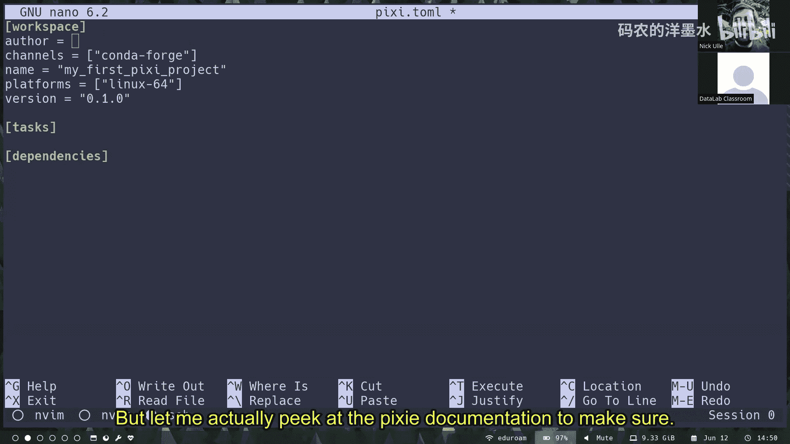

I'm getting this right。Not not telling you nonsense sense， so we'll go to。Getting started。Yeah。

Maybe they don't put an in thereator。

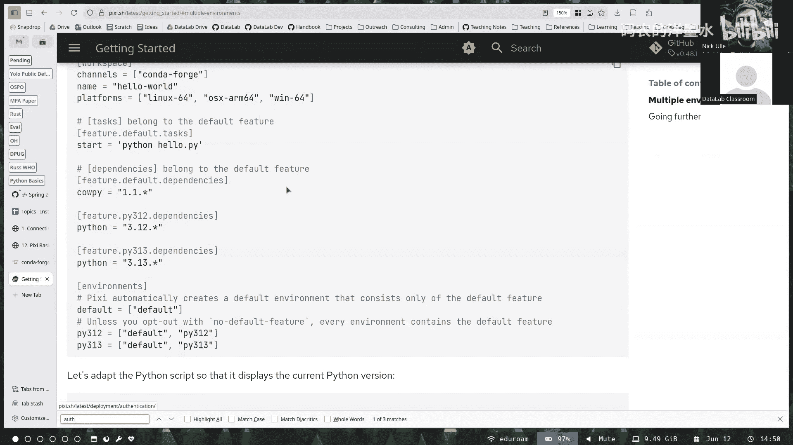

对。hellello。不可。嗯。Stす。

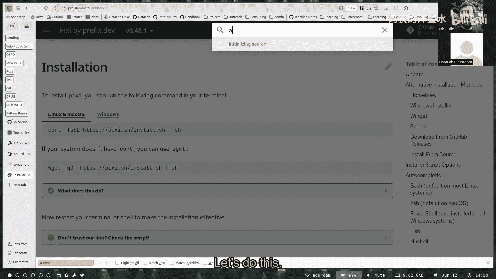

对。O okay。Such search for so you can put an author's line in areas that look something like this or you've got your name and then optionally email address if you want you don't have to do that。

 but if you want to say who developed this project you can。

So there's other things you can put in there too as you can see like a description license。

 all of this is optional you can add as you want， it's good to add if you're going to distribute the project to other people。

And you can find this all in the documentation for Pixpe。

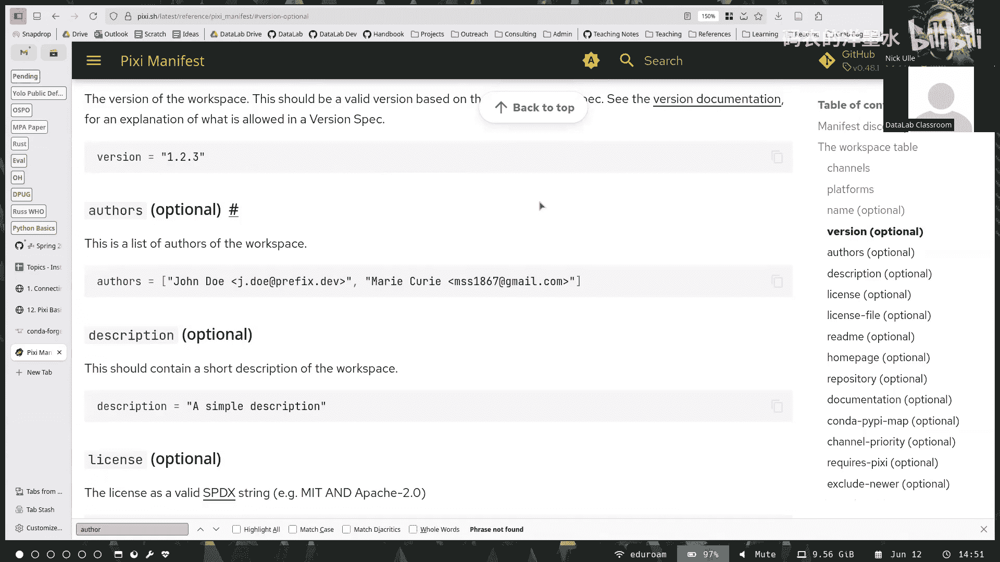

So we've seen this Pixie。 tunnel， we know they've learned all about this。

 we'll come back to it a little bit， but let's actually install some software。Before we do that。

 are there any questions？谢谢。😊，Okay， so we're going to close this。

And I'm actually not going to save it because I don't have any changes that I want to keep the next。

反对不行。Okay， and to install software command we're going to use。

 we need to make sure we're in the project directory because if we're not in the project directory。

 this won't work。We're going to say Pixie a。and then the name of the package on Conda Fors that we want to install and for most software it's probably whatever the name of the software is like Python the package for Python is just Python the package for ours R it's lowercase R generally these names are all lowercase so that is one thing to keep in mind。

If the name of whatever you're trying to install has multiple words。

sit learn is a popular pythlon package two words， then usually the words are separated by dashes。

 but not always and you have to kind of look at their documentation and see what do they call the package on the website for whatever it is you're trying to install okay if you're trying to install our packages likeggplot2 for example。

 you generally are going to put an R dash in front of it。

Okay so if you're an R user to install Jpl2 this way you could do this。

 you can also just use install packages after installing all， that's another way to do this。Okay。

 but we're going to install Python because we want to get the newest version of Python it the default is to get the newest version。

 so if I just say Pixie ad Python。well think about approval bid。

Has to figure out what it needs to install。This installing python there might be dependencies that python has and it needs to install those dependencies as well so we had the question earlier like what if what if the thing I want to install has other dependencies Pixie is going to take care of that for you automatically。

90% of the time， I think my question from earlier was what if the dependencies from the software I want to use are in modules？

When we're working with Pixie， we can just do more the module system entirely。So like to be frank。

 I don't use the module system at all ever， the only time I run the module command is when I'm teaching this workshop okay I do everything with Pixie I also use Pixie on my laptop to manage all of my software so it's all the same everywhere I go。

嗯。And so you can see it's actually telling us a little bit about what's going on。

 it tells us that it actually is having to install 22 packages to be able to install this one Python package。

And there's the one package that we're actually installing。So。I' surprise it's taking this long。

Time to download problem rather than a Pixie being slow problem。

 I'm not sure why the internet connection is slow on high。And it surprises me。Okay。

 so it tells us it added Python and then instead of giving us an exact version number。

 it gives us this like constraint on the version， it says it's installed some version of Python between 3。

1，3。5 and 3。14 Okay and this is。How Pixie will choose the version automatically if you don't specify a version it will always。

Get the latest major number。And then the latest minor number。

 and then it'll say it'll make the constraint any other。Revision number in that minor number。

Exent this is saying anything that's 313。5 or up but don't go past 314 and that might break stuff right if if we got upgraded to that or if somebody else installed our environment and they got 3。

14 or our code might not work with 314 okay。So we've got Python now。

 we can also look and see what is installed if we say Pixie list and I'll put that command back on the screen Pixie list that lists all of the packages that are installed right now。

And you can see we've got a whole bunch of printout because we installed 22 packages for that one package we actually want for Python right and this gives us a whole bunch of detail about the the name of the package。

 the exact version build numbers like the unique identifier from what we've installed the size of the package where we got the package from that。

And you can scroll through this and if you scroll down far enough。

 you can see Pon is in here and it's highlighted in green and that's to tell us that this is one that we explicitly installed the others the ones in gray。

 those are ones that got installed as dependencies of something okay so we didn't we didn't specifically say to install end curses and lives you with and stuff like that those got installed because we installed Pyon。

sorry makes sense to everybody in question so far all right。

 so now that we've installed it it would be nice to be able to run it Okay。

 so if we want to run Python in the way we're going to do this or run any kind of command that we've installed in our Pixie environment。

 we're going to type Pixie run。And then the name of the command。So Pixie run Python， for example。

And if we do that。都是。We get Python 3。13。5。So we have a new version of Python now that we've installed ourselves。

then we could do whatever computing we want to do， of course。

 really you should if you're going to do some computing， you should do it on the compute note。

 not on the headn or we're doing everything on the head note right now。

 that's okay because we're not going to actually compute anything。嗯。

And tomorrow we'll learn how to actually log into the compute node so we can run our code。

 but for now we're just going to install software。So we've got Python， we were able to install that。

 Okay， so I'm going to exit this again。Okay， now that've we've seen that we can actually。

Run the thing that we installed， okay？And now what I'm going to do。

In addition to adding packages that we want to use， if we decide we don't need a package anymore。

 we can remove it， right？Add remove hopefully that makes sense。

 so we're going to pixie remove Python because maybe we don't need Python anymore。喂。

We realize actually for this project， I'm not going to use Python to right for go for this project。

 I'm going to use R okay， so let's Pixie add R。我着我啊。

And once again you have to wait for it to download this this will go a little bit faster if you're installing something that you've already installed in some other folder so Pixie keeps track of if you've already downloaded that software so like if I already installed Python for one project and I make a new project and installed Python there again and it gets the same version this will go a lot faster because you don't have to wait for the files to download but this is the first time I've installed these so it's。

Having to download everything， that's why it's taking a little bit of time。嗯。

Yep so while we wait for that， I want to make sure there's lump anything on。嘅嗯。嗯。嗯。Okay。

 so let's just let that finish the show up any questions roller waiting for that？嗯。Yeah。Yes。

 so could you use I guess could you use to set similar environment as you could in yes。

 so if if you are already using Connda if you have a Conda environment that you've been using。

 you can export the Conda file with Connda。Look in the documentation if you don't know how to do that as's a commda thing export it to a YML file and then Pixie can import that actually so it can understand Conda exporting environments and I believe it can also go the other way and have there's some kind of commands to have Pixie export a Conda environment if you want so you can move between these two things fairly easily if you're a Conda user you might also be wondering why would I want to use this instead of Conda I told you it's faster already right that's one reason but the other thing is that when you use Conda it keeps track of the names of the packages you've installed but not necessarily the versions。

Okay， it sort of has two options if I recall correctly it's been a while since I've used Po of it。

 the two options are you can either just have the name。Which。There's a lot of trouble。

There's new versions of the package that are incompatible with the old versions you develop your project with or you can have the exact version number。

Okay and those are your two options with conduct and the problem with specifying the exact version number is that exact versions aren't always available on every platform。

 so if you're sharing your code with somebody else or trying to run your code on the HPC that's Linux the exact versions might not be compatible with the hardware on that person's computer so you have to have a little bit of flexibility。

 which is like what these constraints are doing for us。

But not too much because you don't want you don't want them to go to another a different major version and then get something that's totally incompelle does that make sense to everybody。

So that's one of the things that Pixie is doing for you that Connda。

 last time I checked there was no easy way to do this。对。啊。Okay， so now we've added an R。

 you can see again， put constraints on R if we wanted to run R again， like Pixie run。

 then the actual R program is called capital R， so we have to type capital R。

You can see there's our R prompt。Look back。And again， I'm going to quit。No， I do not want to save。

 okay。Well了。So that's how you can install different things you could have R and Python both installed at the same time。

 that would be okay too。Question， so it this is not based sensitive right which part lower R just so that is so that I believe the R needs to be lowercase I don't know did you did you use an uppercase and it worked。

啊。I used to little Yeah， I think it has to be lowercase package names in general。

 they're always lowercase and then the R program， this is to a choice that the R developers made it's called capital R。

Okay so。别看。Yes， just to clarify when you log off the server and like log back in how much of this do you have to redo any time you log that it's a good question so like anything that you've installed it stays there right so I can I can exit the server Okay and then log back in。

Okay the now。Diectctorory let's actually do something pixie with this Okay。

 it says can't find Pixie domal right because i'm not in a project directory i'm in my home directory but if I go back to my project directory。

And now I do Pixie list。you can see there's a bunch of stuff in there if I do Pixie run。Capital art。

Then you can see I guess I our pop back so once you've installed something it's there stays there it doesn't go away Okay unless you explicitly remove it yes the question of the。

When you're once you've installed， it's say iPhone， you want to do like batchsh a completion of the。

Right， oh so like a hear is know the yes， that might be true so。

So you're asking basically if you wanted to do Pixie run and then my pipe pie at a tab， yes。So so on。

On some machines。You can use another command called Pixie Shell。

And what this does is it opens a new shell where every command is going to run in fixie。

And so now you'll have auto completion。But last time I checked this doesn't work on the compute nodes on the HPC server unfortunately。

 but also another place I know it doesn't work is if you're running it locally in Gitbash it does not work。

嗯。They're trying to fix that the Pixie developers are trying to fix that。On the compute nodes。

I've been trying to figure out how to fix。Fix whatevers going wrong。

 but I haven't had a lot of luck so far so。For now on the HPC。

 the safest way to run things is with Pixie run， one thing you can do like。

If's potentially helpful is if you start typing your commands that you want to use and you can maybe use auto completion that way and then just stick pixie run in front of them after the fact that could help you at least with things like pass。

And actually， I don't know if let's see if I do a Pixie run， Python。

So this will auto complete on paths even if you've got the Pixie run in front of it。

 so it's just command names that you're going to have to type out yourself sos。

Maybe a little bit more manageable。And if you find you're having to type a command name all the time and you are suffering because it's so long or something。

 you can also use that tasks feature that I mentioned in the if I open up to Pixie optimalal。

You can use this tasks thing and there's some notes in the reader about how you could do that。

So that that can give you a way to have like a shortcut so you don't have to type such a long Yes do you want to install a python package that only use p Yes Okay。

 so if you want to install a Python package that uses PIP you're going to use Pixie a and then one thing is going to be different you're going to add a dash dash5。

And then the name of the package。If you take away the PI， you get the column version。

Yeah and in general， what seems to be the recommendation from Pixie developers and ConA folks is that if there's a Connda package。

 you should use that then if there's not， then used by PI。对。还不会。

Any other questions about install packages， how to run things Yes do I need to worry about where I'm installing it。

 I know that you're talking about running jobs on the in the other known on processing note is there an equivalent for install so so the short answer not really like it needs to be in your directory like directories that you own so don't try to put stuff in somebody else's user directory right but as far as your home directory you can organize that in whatever way you would like you do have a file limit like how many how many gigabytes of data you can use which is 20 gigabytes unless you're in a lab that is bought more space on the server。

 the default is 20 gigabytes and you can see how much you're using if you go to your home directory so you type CD without anything so you're in your home directory and then if you just type Df and a dot。

F and actually。对。 let me check something。我个。As far as you get theF do。Yeah。

 and it will probably look something like this。If you actually add a dash H that will make it a little bit easier to read when it get human readable。

 you can make this the default and I might show how to do that and that。

But this shows you how much space you have， like you can see I've got 20 gigabytes I've used about  four gigabytes already and've got 60。

は。So if you're ever wondering how much space am I using it if you need。

To have like really large files on the server or something reach out to the HPC admins they can work with you to figure out how you can do that usually the answer is you need to be able to pay for more storage。

 but there are ways that that can be done。对。I don。Yeah。

 so let's see where airline line what Blue want to do。Okay， so let's go back to the project。

 so my project。Occasionally you might want to。Like if our python gets updated。

 maybe you want to keep up with the latest version。

And the way that you can do this there's two things you can do。

 one is you can run the Pixie update command， okay。

 and you can either run this by itself or you can put the name of a specific package。

Depending on whether do you want to update everything or do you want to update just one package and maybe it's the penencies。

诶。So if I just wanted to update everything I could say Pixie update and then it will think for a moment and in this case it says everything's already up to date because we just installed this a few minutes ago so there's not a new version yet Okay when we do this update this way where it's going to respect the constraints that we saw earlier remember those version constraints it's not going to go outside of those so it won't update past the maximum version that we saw it print out if you ever wonder what those constraints are。

We open up Pixie。mo again。Okay，It's recording all of those in the fixixie。ommal file。Okay。

 so like you can see when we install R。Wn't follow anything。2。So when we do Pixy update。

 it will still respect these constraints。And。😊，So so this is a fairly safe thing to do to run Pixie update because what you're getting a new like the new version you're getting it's that third number in the versioning scheme。

 that one that generally doesn't break stuff。usually the kinds of things that you get in these revisions are like bug fixes。

 security fixes， and so usually you want those okay。

So Pixie update it's a good way to update your packages good to run it once in a while to make sure that you're staying up to date there's also another command called Pixie upgrade。

There is。It also updates packages， but it ignores the version constraints。So it says。

 don't worry about the version constraintsstrain， just get the newest version。

OkaySo if you want to do this， this is how you can do it and like update you can specify this particular package if you want right you can put the name of a package or you can just upgrade everything this is the one to be a little more careful about it can be useful you're doing it deliberately if you really like want to make sure that your code works with the newest version of everything you can run this and try to go through that process of fixing any incompatibilities but this isn't like the thing you want to run in in your project like a few days before your paper deadline when you need to like just run all your results and get your figures into the paper or something right this is potentially going to cause some breakage and so this isn't something you should run without being mindful about it。

That's what I' was saying update is generally safe， upgrade is not。Yes。Yes。

 so if there's breakage will py like point out the ones that there's breakage or where the breakage happen when you're the breakage will happen when you run the coach So yeah you just you learn about it as you run the So unfortunately。

 Pixie doesn't have any way to know like what your vote is doing and whether it's going to be compatibleable。

嗯ello。Now， if you're a Git user。If you know what that is or if you use version control of any kind。

 a good thing to do is put your pixie。com in version control and that way anytime you run an update or an upgrade。

 you've still got the old version of version control in case you want to downgrade a Pixy doesn't have an automatic way to downgrade back to where you were but if you're using Git together with Pixy you can do that very easily。

Okay and if you are want to learn about Git data lab does Git workshops every year or next one I think is going to be sometime in fall。

 I think maybe September Yes copy your Friday file you could also do that Yes so so and even that's a good very good suggestion So if you don't use Git and you just want to be safe before you update or upgrade just make a copy of the Pixie up tunnel put it somewhere safe and then outside the project directory and then。

Okay， any other questions about upgrading？Okay， so we've seen how it upgrade。

 let's see what else do I want to cover so I think I want to talk about one or two more things and we'll probably get out of here a little bit early before before four o'clock on the board I'll stay here and you can ask questions if you want。

So the first thing。This is really great for installing stuff for a particular project。

 but once in a while you might have a tool that you just want to use everywhere right like there's a search tool that I really like that lets me search for text within files and it's called R GrP。

If you've ever heard of the search tool it's kind of like that。

 it's a tool that just let me search all the text files in a directory for some particular order。

This is really useful if you have a lot of files because I remember the name of that function。

 but I don't remember where I defined it right so you can use tools like G or RipC to find that and this is a tool that I use all over the place but it's not really part of a project。

It's just a tool I like to have I don't really have a project where you have to have that tool to be able to use the project if that makes sense so it's something I want to use globally it's not part of a project。

 so I just want to install it globally and you can do that with Pixy2 okay so that you can use it anywhere regardless of whether you're in a project director or not。

And the way that you would do that。Pixie install。It's a global install， sorry， global install。Aect。

And then whatever package you want to install and you could install stuff like Python this way。

 but I don't recommend that because now you've got a global version of Python and if you have projects that have specific version requirements that going to cause trouble I recommend this just for tools that you know your project doesn't really depend on but maybe it's a tool that helps you out somehow so like Rip rep is an example of this there's another tool called FD for finding files by name that I really like unzip programs are like unziip stuff I often installed globally。

So let's install R rep。It's this search tool。The Pixie Global installed brick gravity。

I think we'll try to figure out how to install that。And when you're installing globally。

 each package that you install gets its own environment。

So you don't have to worry about conflicts between two different packages you've been stolen globally。

And so this tells me it installed R Gr， that's the name of the package and then it says exposes this is the new command that's now available to me。

so when you install things globally， it tells you what are the commands you've gotten from doing this Okay。

 so now I have a command RG that I can run。OkayIt says Ripgraph requires at least one pattern to execute a search。

 right so we have to tell it what we're1 searching。

And it also helps if there's actually something to search for and we've got Pixie dotal。

 so maybe that's something we could search for。So let's like peek inside that file。嗯。

We can type the name， right， X out tall。Okay， and there's like。The word pixies in there。

 so let's search for that。So RG Pixie。翻阵诶。And it searches in subdirecties and you can tell it specific files you want to look for if you know regular expressions。

 you can use regular expressions with this is a really convenient tool to have so。

That's how you would install it if you wanted to uninstall it。

The command is Pixie Global uninstall so do would Pixie global uninstall ripPf if you don't want it I'm not actually going to run that because I actually want it to be here before me on hi but you can if you don't want to yes and it doesn't matter that you're running all this under my first Pixie project it does not so that's a good question so if we if we go back to the home directory。

And I just do RG Pixie in here。That still works and I could have run the global install here too as well that really worked。

喂。Actually it's still searching so I've got a lot of files in the home directory so I'm going to cancel that by the way。

 if you ever need to cancel a command that's running for a long time control seat。And for Mac users。

 it really is control seat。对。All，Any questions about installing things globally？Okay。

Then I think the last thing I want to talk about today。

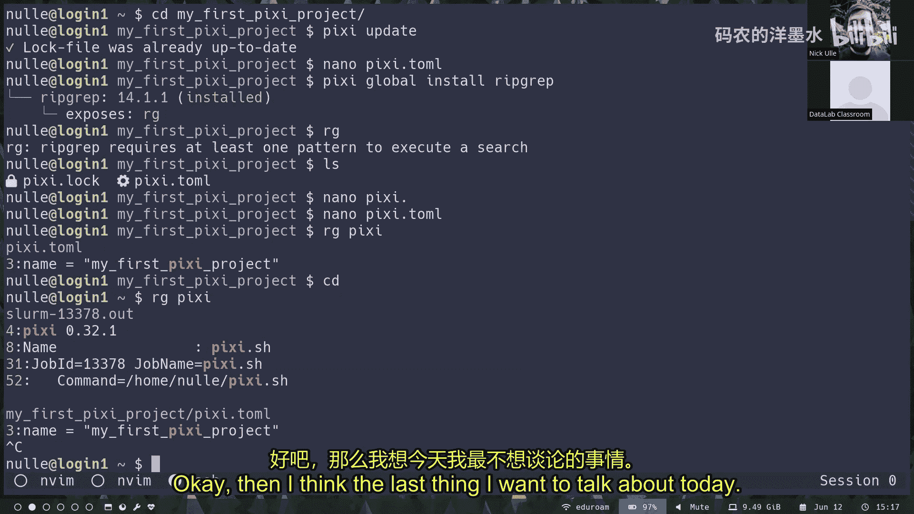

And then we will wrap up and there's one more thing I want to want to say about shelf configuration。

 so we started talking about this to fix everybody's path but there's one other thing I want to say about question yes。

Good question for there's like run of cautions。 It's like fixixie ad versus Pix me stall。 Yes， man。

 could just review。 Yes， yes， yes， very good question。 Okay， so we've got yes。

 let me go back to the project director。

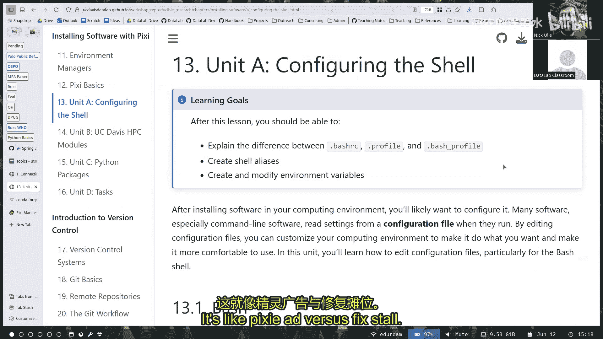

So we've got we've seen now Pixie ad to add packages to a project right and then we've also seen Pixie Global install to add packages that we can use globally right？

You go why why isn' it like this and I wish it wasn't like this I wish this would called Pixie horrible a it would be a lot happier that would be easier for me to remember but there's also another command Pixie install without the global I'd say okay this is getting really confusing right。

What you want to remember， Pixy a is what you're actually going to use to add a package to your project that you're adding a package to your project。

What Pixie installst is saying is install the whole environment。Okay， so when we have a project。

 it's got some kind of computing environment。So let's look and Pix it up home again。

Go some kind of computing environment right are in this case and if we。

Gave somebody else our Pixie doom file and said， here you go， you can recreate the environment。

 how do they do that？How do they like they don't need to add R because R's already in there。

What they need to do is they run Pixie install。And that just installs whatever's listed in the tom of file Okay so that' that's what Pixie install does and installs the whole environment。

Yes， does it take that argument of the tunnel file or is it just assume that whatever just you're in it's going to pull that it just assumes if there's a tunnelm file in the directory or in a directory above that directory then yeah。

对。And actually， let' let's look at one other thing。

 so if we do LS dash A so that we can get a list that shows all the hidden files。

 the A shows all the hidden files， the L gives a list。We've got。

Pixie dotomel like we saw before we already talked about that then we've got a few other files here and a director so let's just go through these real quick Pixie dot lock this is a file that gives a much more specific description of the computing environment so if we if we look at this file。

Call a lock file because of that lock and extension。

 this has actually got the URL for every package you've installed。Okay。

 so we downloaded all these packages from the internet， this has all those URLs。Okay， and if you're。

Using a multi platform environment， so if you've set up your platforms to include like Linux and Windows and OSX。

 it has URLs for all of them。In here okay， so even if you're only installing on Linux right now。

 it's going to figure out what the URL should be for any operating system that you said you might want to run this project on。

That way can give you like warnings if you try to use a package that's not compatible with one of your operating systems that you're saying that you want to use。

OkaySo this is a very explicit description， this is kind of like what Honda does where it gives an exact version of things。

This file is giving the exact snapshot of the environment。Okay， and if this file is in。

Whatever directory you running a Pixie install， then Pixie is actually going to look at the Pixie dot log file first and it's going to try to use that and create exactly the same thing。

And occasionallyccasionally， I said before， like if you have exact versions occasionally that doesn't work for people because their computer hardware is just a little bit different。

 some of the packages， the minor versions are not available for their hardware， if that doesn't work。

 the trick is you delete Pixie。 lock because this is generated automatically。And you use just Pixie。

tommil， so when you delete Pixie。lock you run Pixie installed and it will go to the Tmil file。

Most of the time you just want to leave it in place。系。Any questions with that？That makes sense。

With these two files look for， so this is your flexible description of your environment and then your like very precise description of your environment。

And if you're using version control， both of these things in a version control。

 if you're backing things up， back up both of these things。

AndThen we've got two files get ignore andgit attributes these have to do with Gi version control system if you're using Git Pixie sets these up to help get ignore some of the files that Pixie makes like the saw Pixie that we're going to talk about in a second and do other nice things and work well with Pixy so Git and Pixy work well together if you're not a Git user it's okay to have these files here and you can just ignore them。

You don' they're very small， they're not not taking up a lot of space and not hurt anything okay。

Dot Pixie， this is where the packages are actually going when you install packages。Okay， sort of。ます。

So that's how you should think about it。You think about this as like this is where the packages are going。

If you ever run into a situation where like you're done with a project and you're not going to work on it or at least not going to work on it for a long time and you want to recover some of the like storage space that it's using from all those packages。

 you can delete this folder。Don't delete the dot lock and docomm will keep those because those are your description of your environment。

But as long as you have those descriptions， like deleting the package to themselves is fine because you can just run Pixie install if you want to get them back。

Okay。So like you can safely delete this dot Pixie and I say it's where the packages go。

 but then I also said like sort of not exactly because Pixie is actually smart enough that if you install the same package in two different projects。

 it puts that in a centralized place and then it links both of those projects so that you don't have two copies of the same thing to save you some sort of space but like for intuition you can think of this as being like this is where the packages are。

Yes， I think this is a little one you mentioned earlier about zip up this workshop director and giving it to someone。

 Now， the Pixy directory， the dogt pixy director can be huge。

 The one that I just have on my file from just installing approximately gigabte and it's redundant。

 you don't have to give that to someone so if you zip this up to give the project。

 exclude theixy director zip otherwise you're to send them a gigabt so yes， exactly that。

 But you don't when you want to send the product to someone else。

 you don't need to send them because you're sending them and Okay and likewise。

 if you're using get with your project， don't put this file in And that's this Pie alreadysie in the Gi so you have to deliberately。

Do some extra stuff to add it， but you don't want to version the dot pixels and folder just the walk by on the file。

Yes， if you have a different project that's going to use the same environment。

 it is it okay to copy dumplitixing over or should you just do a Pixie installer a di and folder Yeah。

 I wouldn't copy over the doomal file and made even the walk file and then I went to Pixie install。

Because sometimes if you're moving this folder around。

 it can actually break things because of the way it's linking to like shared versions of stuff。

So that's the other thing if you ever。If you move the folder。

 your project folder and you find that suddenly it can't find Python or can't find R。

 the first thing you should try is like delete the dot Pixie reinstall the environment and you see if that was the problem because of the way it makes links and this is like a limitation of operating systems like the way that you make links between files shortcuts between files they are relative to wherever the directory is and so if you move the directory they break。

系。All right so I said there's one more thing I want to talk about and then we will be done so're I think i'm done with everything I want to say about Tixie at least。

In terms of installing packages， are there any more questions about Pixie right now while we're still？

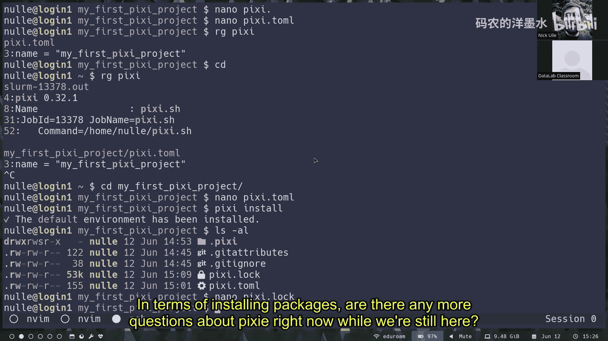

Okay， so the last thing I want to talk about has to do with shell configuration again。

We learned about BshRC profile， baH profile， one of the really nice things you can do besides setting your path is you can make aliases。

Okay so this is another way to solve that problem of you have a command that's really long and you don't want to have to type it all out all the time I use these a lot for commands that I use once in a while because if it's a command that I only use once in a while I often forget what the command is especially if it's got a bunch of arguments and so the way you're going to do this。

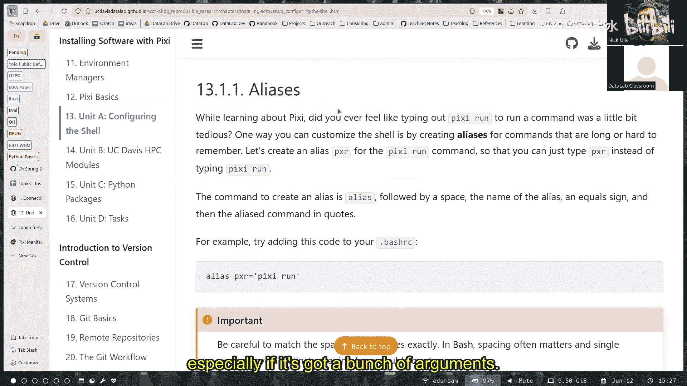

You're going to go to your home directory。Hong server。系。

And we're going to open up dotashrc and like I was saying。

 you're generally going to want to put any kind of shell configuration in your dot baash Rrc。Its。嗯。

And if you want to make an alias for something， sort' have a shortcut。way you can do this。

 you can just type alias。And then whatever you want the alias to be。

 so like let's make an alias for Pixie run because that's something we might have to type a lot right and I'd rather have it be shorter so I'm going to call the alias PXR。

When you choose the name for the alias， you do want to be a little bit careful that you're not choosing something that's an actual command that's already on the server。

So you might want to go and check， is there actually a PXR command if I type PxR does something happened or doesn't say command on them？

对嗯。I'm going to use PxR for my Pixie run and then I'm just going to put in single quotes。

 make sure it's single quotes Pixie run。No spaces between peoples and format needs to be exactly like this。

 the shell is really like persononicating。About。About how you take things out。

So now that I put that in there and you can see my in my batchsh I see I've got a bunch of other shell convinced。

 like it bothers me to。R is capital R so I have a lowercase R that I can run。

 it also does some other stuff。Another one that you can do another one that's kind of nice if you find you want to be able to use that DF command。

You can do and have like default settings so this is another thing you can do with these alias is if you remember the DF command was the one we use to see how much space we have。

 if you find that you want to use that and you want it to be human readable all the time so that you always get pronouncing gigabytes instead of bytes。

You can actually just create an alias with the same name as the command。

And then just add in the things that you want to do so like dash a or the long form of that is dash human readable。

And that says now anytime I run Df， it's always going to run with that dash H， okay。

And you can see I actually have that in also have some other stuff。嗯。

So that's how you can make aliases。嗯。And now that we've got that in there。

 so we've got this this PR alias and maybe the DF alias， let's save this file so control X。

Why did Kris been heard？And then as always， when you're getting started， go back and check。

 make sure it's actually in there。对。And now to be able to use the AS。

 we need to log out and log back it so exit。So they tried。And then if I type PxR by itself。喂。

Doing something with Dixie it says could not find Pixie。 by project。

ll so let's see if this works if we go to our project directory。PXR。

 I think we have R installed right， so PxRR， and there we go。嗯。

So you can use this to make all kinds of shortcuts that that make your life easier。

 I think one of the things that。A lot of。Like workshops and forces and books about the shell myth is that this seems like a very difficult and frustrating environment to work in if you're used to working in a graphical environment。

And the people that evangelize the shell like me and probably Oliver and maybe We like part of the reason we do this is because we've learned tricks like this that can make our life so much easier when we're working in the shell so that's why I'm showing you this it's like not critical to you being able to do computing in the shell but it will make your life comfortable right that if working in the shell is not comfortable for you then you probably won't want to do it。

系。Yes， one evil hack along those lines to run Python for Pixie to say Pixy run Python。

 So here's what I do。 I areas Pythonons for Pixy run Python。对。

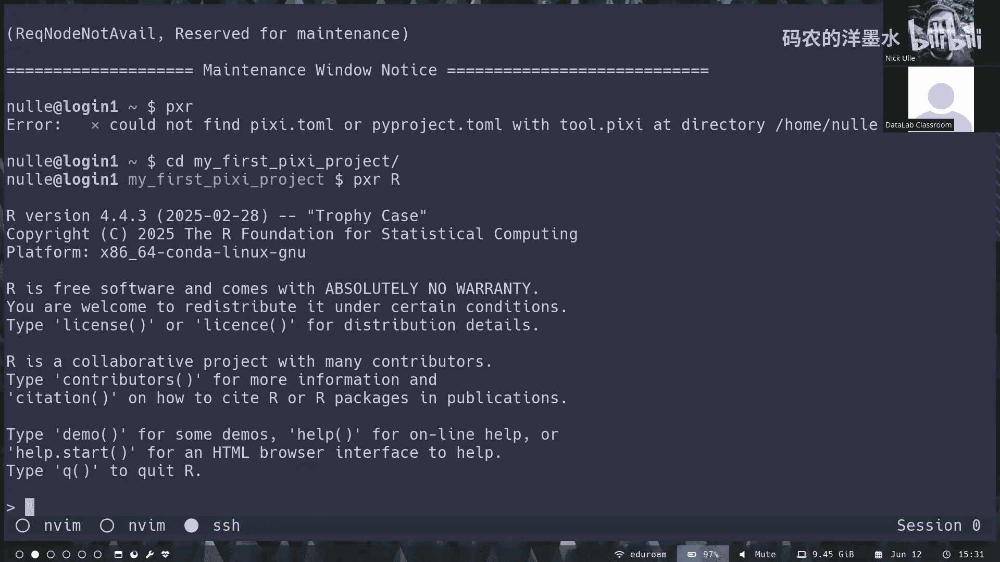

No。So that's aliases no there's notes about this in the reader there's I think there's a few suggested aliases in the reader for like things you might want to do like a different alias for LS that makes it a little bit nicer。

The last thing I want to say。There is a section in the reader。About tasks。

 this is kind of like a more flexible， more powerful version bas。

And these are through Pixie rather than through bash。

 but you can use these to create dependencies between steps so if you have like two different things that you need to do in your project and sometimes you just run the first one。

 but sometimes you want to run the second one and the first one has to run before the second one。

 you can make a command that says run this， but first you have to run this other command。

So you can set up the dependencies if you've used a system like NAC or a build system。

 it's kind of like that。A little bit simpler than that。

 make is doing even more sophisticated stuff or snake make is another one to do even more sophisticated stuff。

 but you can use this to create simple commands that are sort of connected to each other in some kind of dependency relationship。

So that's something you do and also when you use CA you can say this is the environment this is supposed to run in。

These are nice things to be able to do。I'm not going to go into the details of that today because I'm going to stop here so that we can all sort of absorb what we've seen today I know it's been a ton of material we will be back here tomorrow tomorrow we are going to talk about some of the stuff in the main reader we're going to West is going to talk about in the morning how you actually run jobs on compute nodes and then in the afternoon I am going to talk about how you would run a parallel job so if you want to run on a multiple compute nodes at once or you want to run several jobs in parallel on one compute node。

We will talk about how you would do that。Okay。😊，So I think that's it for today。

 anything Wes or Oliver you want to add？Any questions from anybody before we？Okay。

 and thank you for coming hopefully you will be back tomorrow， we're going to be same time and place。

嗯。这平时。喂。

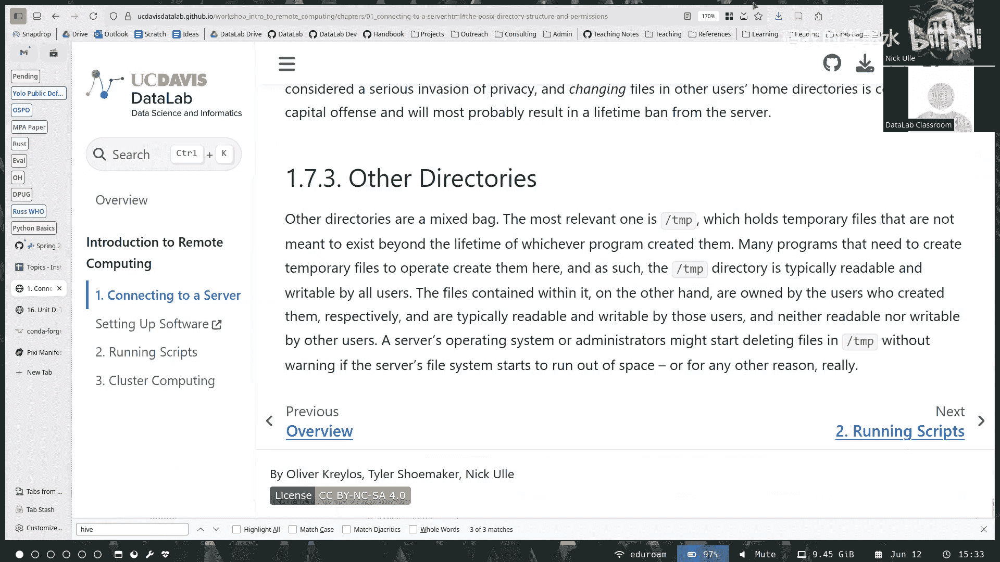

没接。

