# 远程计算与高性能计算：8：软件环境管理与Pixie入门 🚀

在本节课中，我们将学习如何管理计算环境中的软件，特别是如何在服务器上安装和管理不同版本的软件。我们将重点介绍一个名为Pixie的环境管理器，它可以帮助我们创建独立的虚拟环境，从而解决不同项目间软件版本冲突的问题。

---

## 理解软件环境管理的重要性

上一节我们介绍了远程计算的基本概念，本节中我们来看看为什么需要管理软件环境。

管理计算环境意味着管理你的硬件和软件。对于大多数人来说，频繁更换硬件并不现实，因此我们将重点放在软件管理上。软件管理之所以重要，有以下几个原因：

*   **软件缺失**：你登录服务器后，可能发现需要的程序没有安装，你需要知道如何自行安装。
*   **版本冲突**：不同的项目可能需要不同版本的软件。例如，一个旧代码库可能依赖Python 2，而你的新项目需要使用Python 3。
*   **可重复性研究**：为了确保他人能够复现你的研究成果，必须明确记录所使用的软件及其版本。
*   **问题诊断**：当遇到程序错误时，检查软件版本通常是排查问题的第一步。

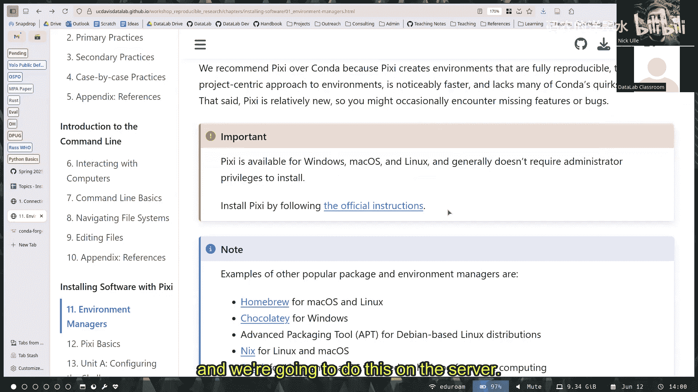

为了有效管理软件，我们需要使用**包管理器**。

---

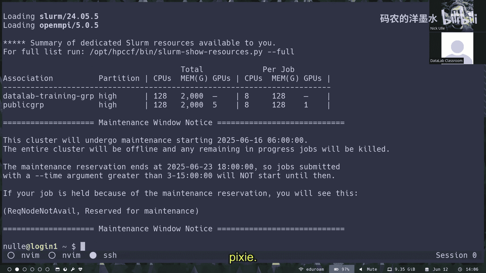

## 什么是包管理器与环境管理器？

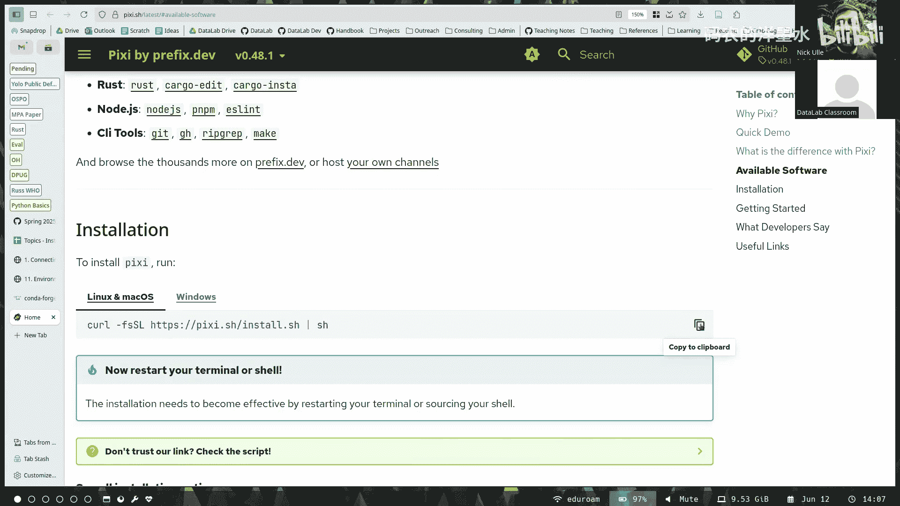

包管理器是用于安装、移除和更新软件的工具。例如，R语言中的 `install.packages`、Python中的 `pip` 或手机上的应用商店都是包管理器。

然而，并非所有包管理器都能创建**虚拟环境**。虚拟环境可以让你为不同的项目安装相互独立、甚至互不兼容的软件集合。例如，一个环境使用Python 2，另一个环境使用Python 3。

我们将要学习的Pixie，就是一个既能管理包又能创建虚拟环境的**环境管理器**。

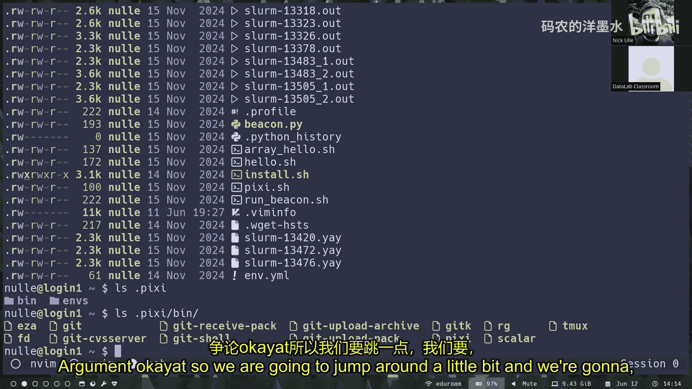

---

## 安装Pixie环境管理器

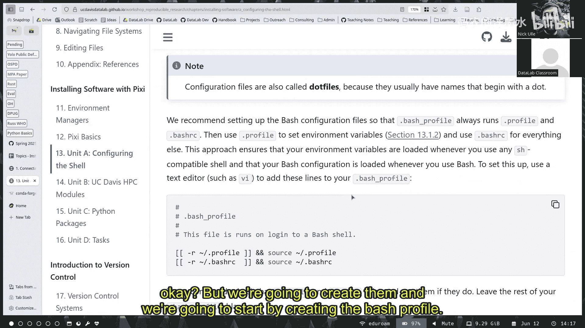

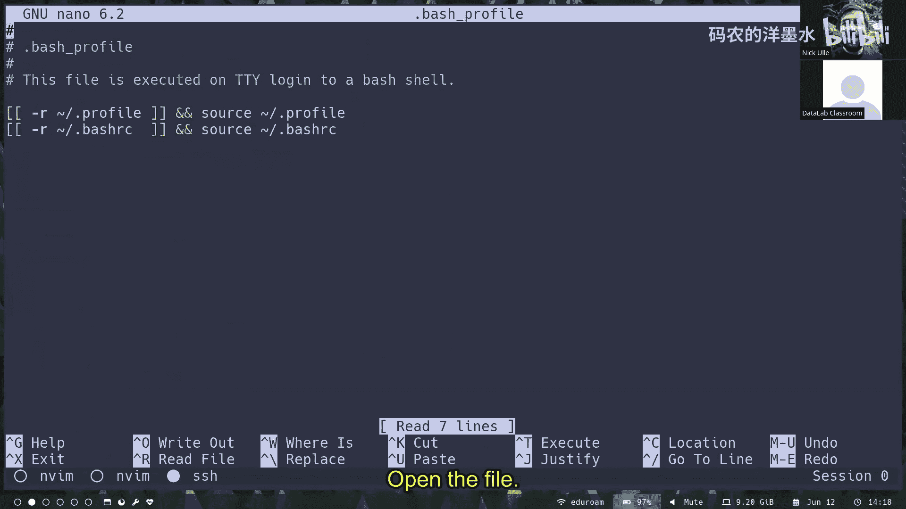

我们将使用Pixie，因为它跨平台（支持Windows、Mac、Linux），速度快，并且可以安装来自Conda Forge和PyPI的软件包。

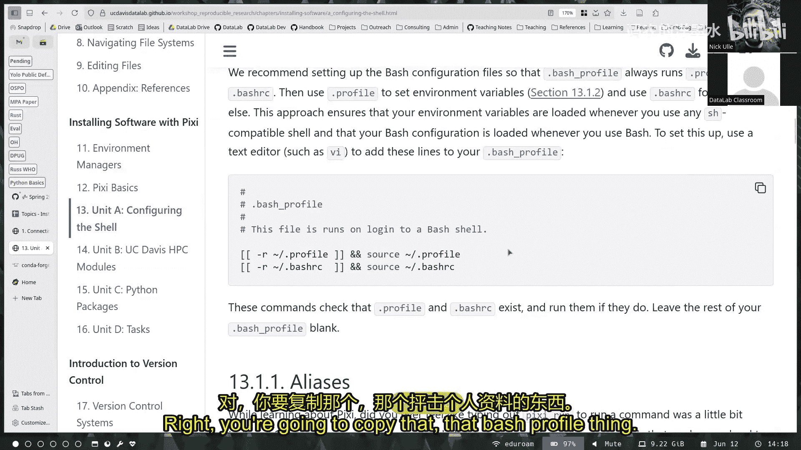

首先，我们需要登录到服务器。请注意终端提示符的区别，这能帮助你区分是在本地电脑还是在服务器上操作。

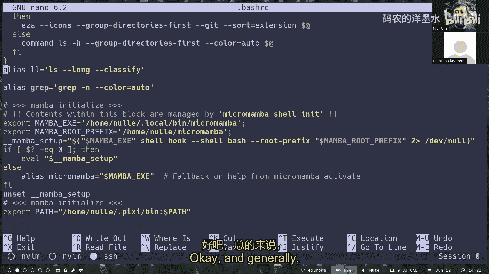

*   **本地终端提示符示例**：`username@localhost:~$`
*   **服务器终端提示符示例**：`username@login-01:~$`

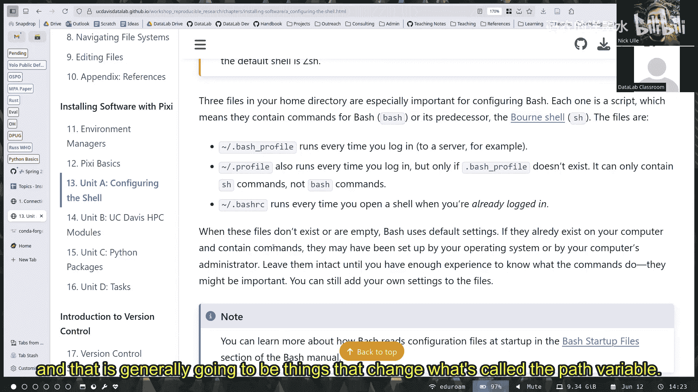

确认登录服务器后，按照Pixie官网的Linux安装说明执行安装命令。安装完成后，需要退出并重新登录服务器，或者重新加载shell配置，以使Pixie命令生效。

你可以通过运行以下命令来验证Pixie是否安装成功：
```bash
pixi --version
```

---

## 配置Shell以正确使用Pixie

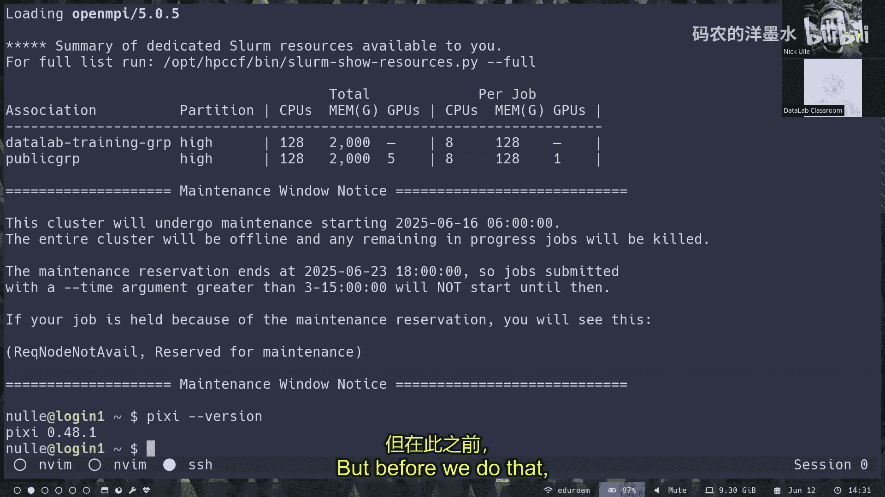

如果Pixie命令未找到，可能是因为shell不知道去哪里寻找它。我们需要配置shell的 `PATH` 变量。

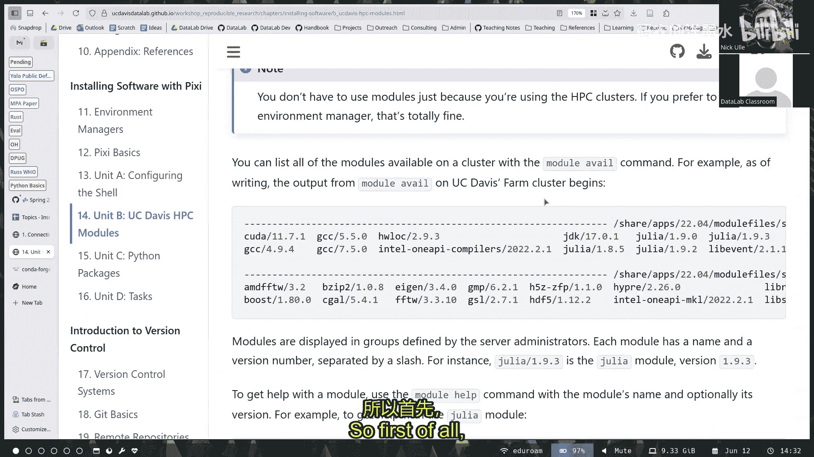

`PATH` 变量是一个由冒号分隔的目录列表，shell会按照顺序在这些目录中查找可执行命令。我们需要将Pixie的安装目录添加到 `PATH` 中。

以下是配置步骤：

1.  编辑 `~/.bash_profile` 文件，确保每次登录时都会加载其他配置文件。
2.  编辑 `~/.profile` 文件，在其中添加一行，将Pixie的 `bin` 目录路径添加到 `PATH` 变量的最前面。**请务必将路径中的 `your_username` 替换为你自己的用户名**。
    ```bash
    export PATH="/home/your_username/.pixi/bin:$PATH"
    ```
3.  保存文件，退出并重新登录服务器。

完成这些步骤后，再次运行 `pixi --version` 应该就能看到版本号了。

---

## 了解服务器预装软件（模块系统）

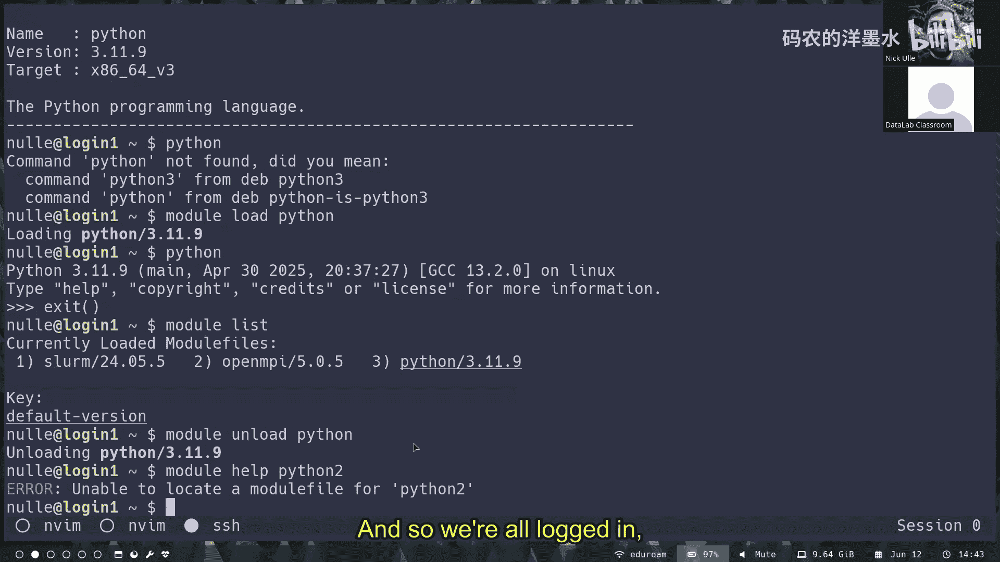

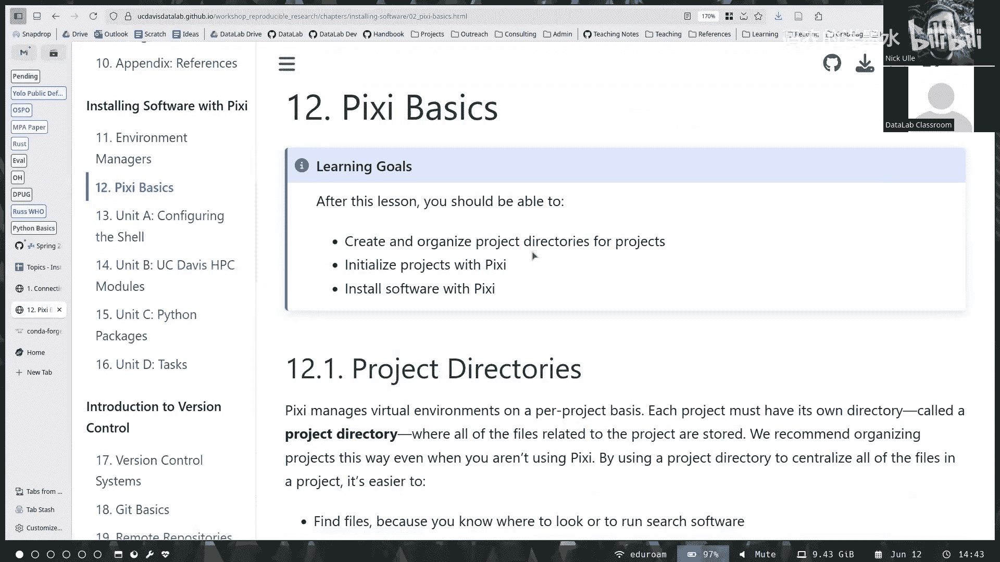

服务器管理员已经预装了一些常用的软件集合，它们被称为**模块**。你可以使用以下命令来查看和管理这些模块：

*   `module avail`：查看所有可用模块。
*   `module load <模块名>`：加载并使用某个模块（例如 `module load python`）。
*   `module list`：查看当前已加载的模块。
*   `module unload <模块名>`：卸载某个模块。

模块系统使用方便，但更新可能不够及时，且灵活性有限。对于更定制化的需求，我们使用Pixie。

---

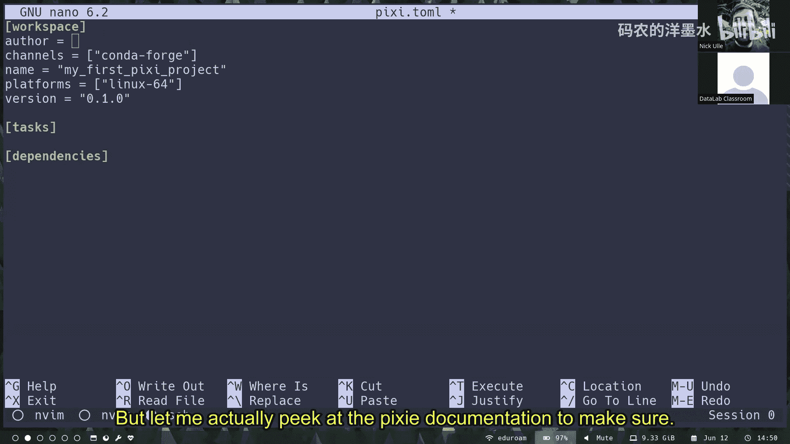

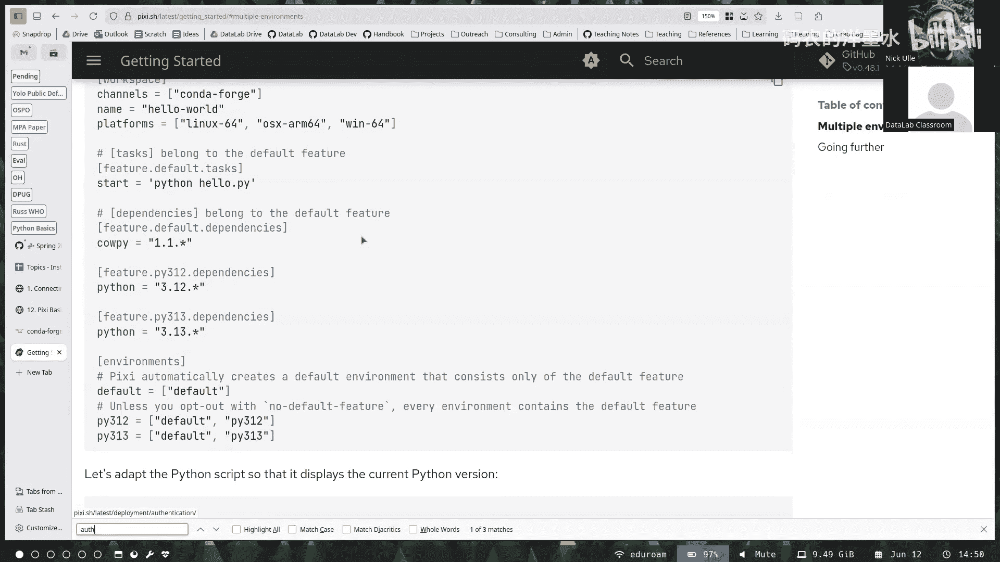

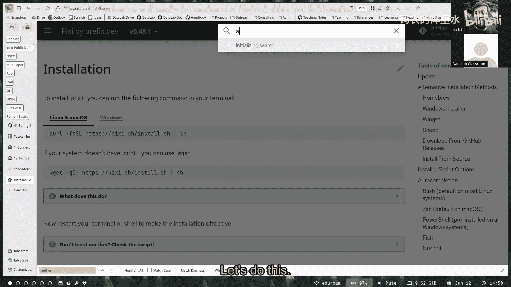

## 使用Pixie创建和管理项目环境

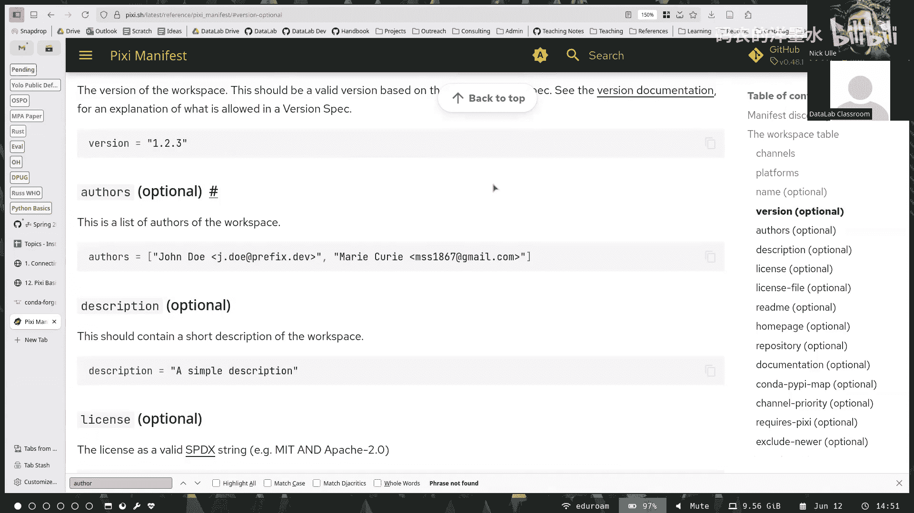

现在，让我们开始使用Pixie的核心功能。Pixie围绕“项目”来组织环境。最佳实践是为每个项目创建一个独立的目录。

### 初始化Pixie项目

使用以下命令创建一个新的项目目录并初始化Pixie环境：
```bash
pixi init my_first_pixi_project
cd my_first_pixi_project
```
初始化后，目录中会生成一个 `pixi.toml` 文件。这个文件记录了项目的元信息（如名称、作者）和**软件依赖列表**，是项目环境的核心描述文件。

### 安装软件包

在项目目录中，使用 `pixi add` 命令安装软件包。Pixie会自动处理依赖关系。
```bash
pixi add python  # 安装Python（默认最新版本）
pixi add r       # 安装R语言
```
安装时，Pixie会使用“语义化版本约束”（例如 `python >=3.13.5, <3.14`），这既能保证获取安全更新，又能防止不兼容的大版本升级。

### 运行项目中的软件

要运行安装在当前Pixie环境中的命令，需要使用 `pixi run` 前缀：
```bash
pixi run python
pixi run R
```

### 更新与升级软件包

*   `pixi update`：安全地更新所有包，但遵守 `pixi.toml` 中的版本约束。
*   `pixi upgrade`：升级所有包，**忽略版本约束**，可能引入不兼容更改，需谨慎使用。

### 理解Pixie项目文件

在项目目录中执行 `ls -la`，你会看到几个关键文件：

*   `pixi.toml`：主要的项目和环境描述文件（应纳入版本控制）。
*   `pixi.lock`：精确锁定所有依赖包版本的文件（应纳入版本控制）。
*   `.pixi/` 目录：实际存储软件包的目录（**不应**纳入版本控制，可删除以节省空间，之后可通过 `pixi install` 重建）。

### 全局安装工具

有些工具（如代码搜索工具 `ripgrep`）你希望在任何地方都能使用，而不是绑定到特定项目。可以使用全局安装：
```bash
pixi global install ripgrep
```
安装后，你就可以直接在命令行使用 `rg` 命令了。

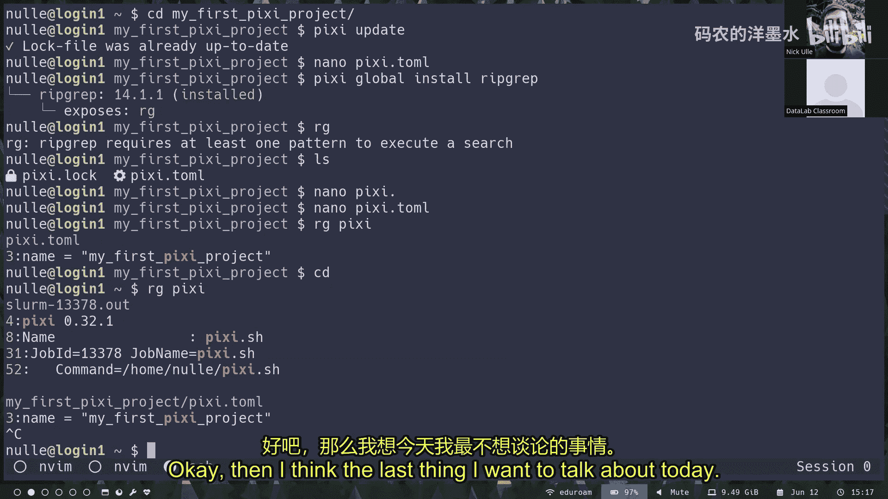

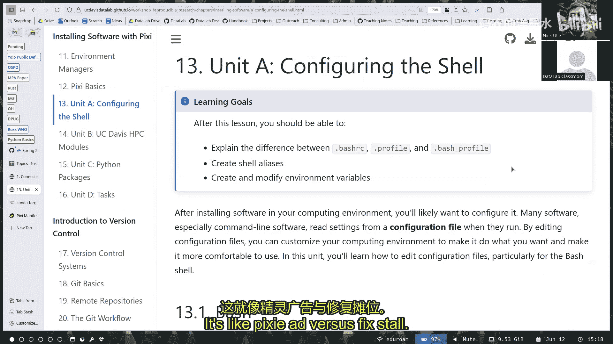

---

## 使用Shell别名提升效率

为了减少输入长命令的麻烦，可以在 `~/.bashrc` 文件中设置**别名**。

例如，为 `pixi run` 创建一个简短别名：
```bash
alias pxr='pixi run'
```
保存文件并重新登录后，你就可以用 `pxr python` 来代替 `pixi run python` 了。

你还可以为常用命令添加默认选项，例如让 `df` 命令总是以人类可读的格式输出：
```bash
alias df='df -h'
```

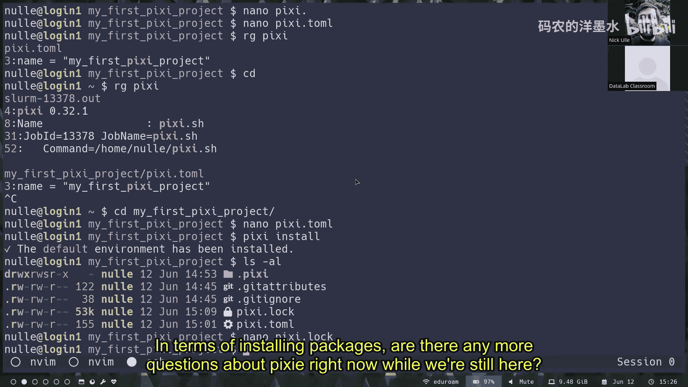

---

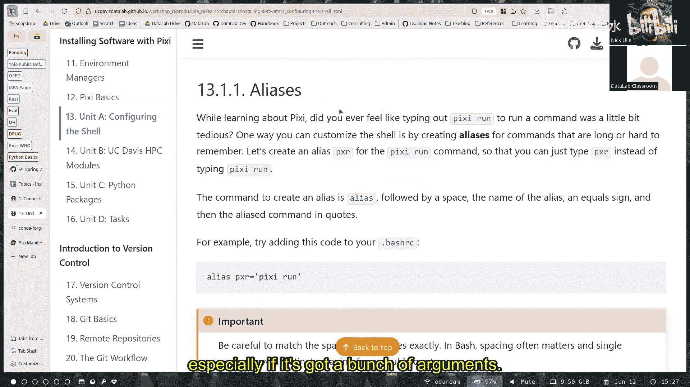

## 课程总结

本节课中我们一起学习了如何在高性能计算环境中管理软件。

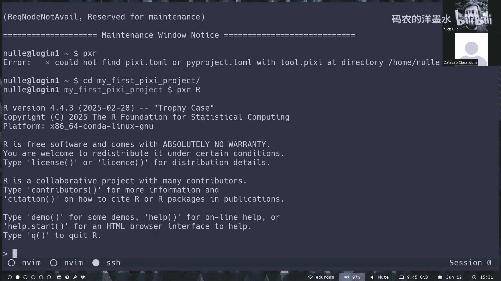

1.  **核心概念**：我们理解了软件环境管理对于项目隔离、版本控制和科研可重复性的重要性。
2.  **工具引入**：我们介绍了Pixie这一强大的环境管理器，它能够创建独立的虚拟环境并管理软件包。
3.  **实践操作**：我们成功在服务器上安装了Pixie，并学会了如何创建项目、使用 `pixi.toml` 文件、安装/运行/更新软件包。
4.  **效率技巧**：我们了解了如何配置Shell的 `PATH` 和使用别名来让命令行操作更加流畅高效。

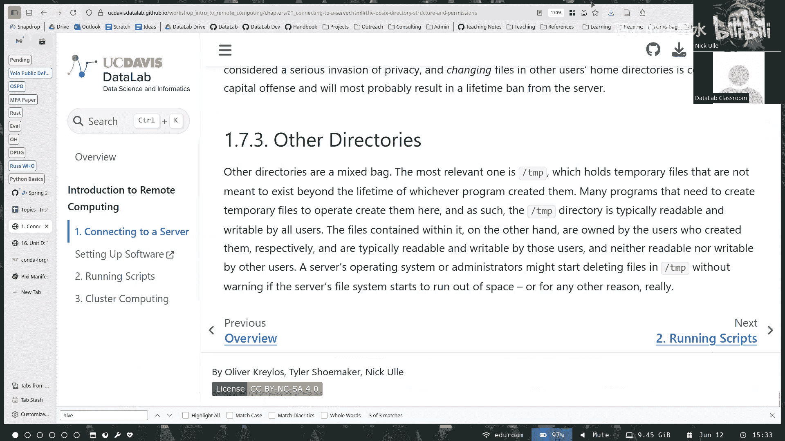


通过掌握这些技能，你将能够为不同的计算项目构建稳定、可复现的软件环境，无论是在本地还是远程服务器上。