# 【全集】加州大学戴维斯分校 计算机科学 中英字幕 1080P p09 Lecture 9 - 远程计算与高性能计算：使用Miniconda打造个性化计算空间 -BV1cqFNzYEvp_p9-

一て。

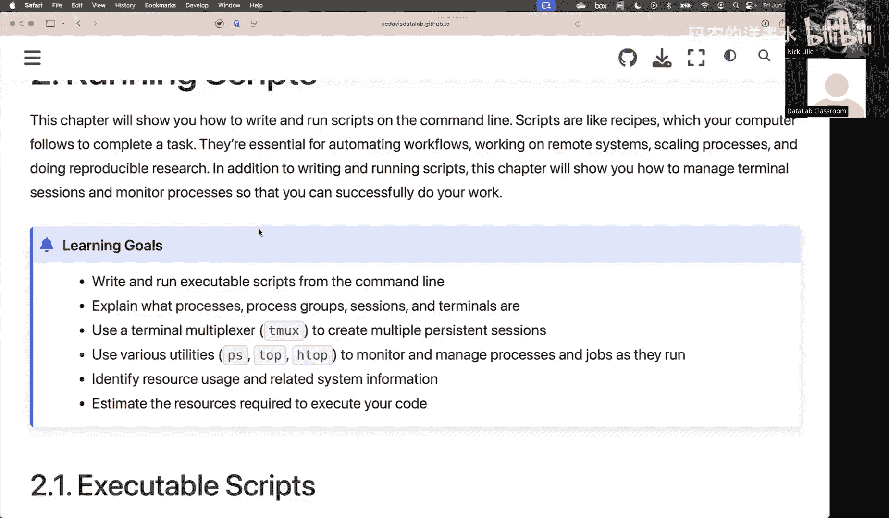

So。That should be going through the。Okay， Nick is indicating that the sound is working。Okay， so。

To begin with， we're going to make some executable scripts。

What we've done so far has all been interactive at the command line， which is great， very powerful。

 it's you know how I do a lot of my work。But when the time comes that you want to run you know a complete analysis and especially if you want to run something that is going to be reproducible for other people to follow in your footsteps。

 it's really helpful if it is all written down in a script。

 you can follow the script sort of like a recipe， and basically every time somebody runs the same script with the same tools they should get the same results and it makes your life a lot easier to have a script as opposed to something where you have to type out every step along the way。

Because basically what a script is is a pre recorded series of instructions that you're going to type out one at a time。

And that you know holds true whether we're talking about a Python script an R script or a shell script and we're going to mainly work with shell scripts here。

 so that is taking the commands that you type into your shell， you know this command prompt here。

 all shell take these commands that you would type into that shell and write them into a text file instead and then run that text file and it will execute those commands one after the other。

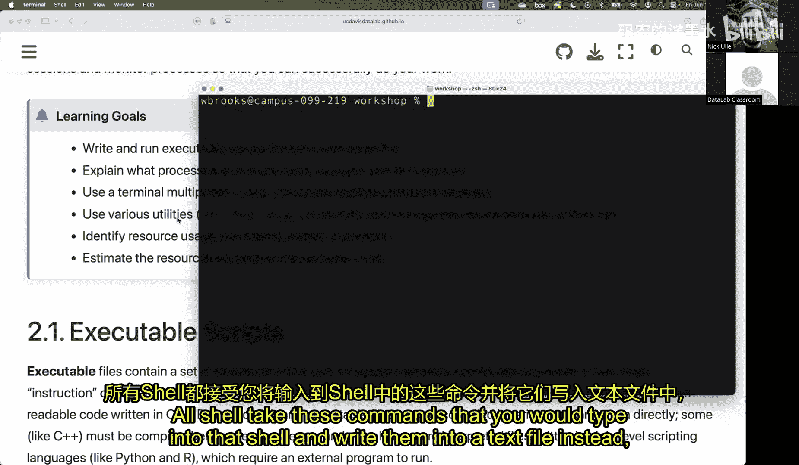

Okay， so。嗯。Yeah， the way。Most scripting works at your command line is that the way that you will run most scripts at your command line is through an interpreter。

Which is。know like python and R can be considered interpreters here the shell program itself is an interpreter yesterday Nick talked about bash being a program that it's sort of like a complete it provides。

Access to a whole operating system， but it is also itself a program that is。

You knowRning the commands you type in， so that could also be one of the interpreters。

And so a lot of these， a lot of our calls to run a script are going to look something like this。

 wherever we name the interpreter， we tell it what script to run。

 and then we provide some arguments that can control how that execution proceeds。

And as usual each step in the way these are separated by spaces。

 so that's how the command line recognizes that you've got one complete you know unit of one complete name is that it's separated by spaces。

Okay， so here would be an example for a script that we don't actually have。

 but if we had a script Python script called script。pi。

 you would call it by naming the interpreter Python。

Then saying to run script do Pi and then providing an input and an output file as arguments。但。

Now this pattern is super common and you will probably always as long as you use the command line continue to do stuff like this。

 but there's actually another way， which is a little。呃。

Cleaer to look at and can make your life a little bit simpler。And that is to makeop。

That is to make executable scripts and run them。Where。Without having to name the interpreter first。

 so if you look at。You's see the difference between this line， this abstract line。

 which you know everything within the the angle brackets is meant to be replaced by an actual name。

 but then this abstract line differs from。This very abstract line only in that the interpreter is no longer named。

And also the script is prefaced by this dot slash。And。

For those of you who don't recognize it immediately。

 dot/ is a way to indicate that the file should be found right here where my prompt current videos。嗯。

The reason we have to do that is because unless。The first place。

The first place your shell will look for。An unknown。

Like an unknown function or command that you enter is on your path。

 but typically when you create an executable script。

 you don't also put it onto your path instead you would just call it from wherever it is。Anyway。

 we're going to get into more detail there， but since this pops up right here。

 I just wanted to explain that's what the dot slash is all about。And in order to do this。

 we need to put something in the script。That tells the script that it can be or tells the interpreter that what to do with this script when it is called as if it were a function or as if it were a program。

So。The process we're going through here is to take what would have been a script that we call like with the function Python and turn it into a program that we can run just by invoking its name。

But then we're doing this。In our command prompts。

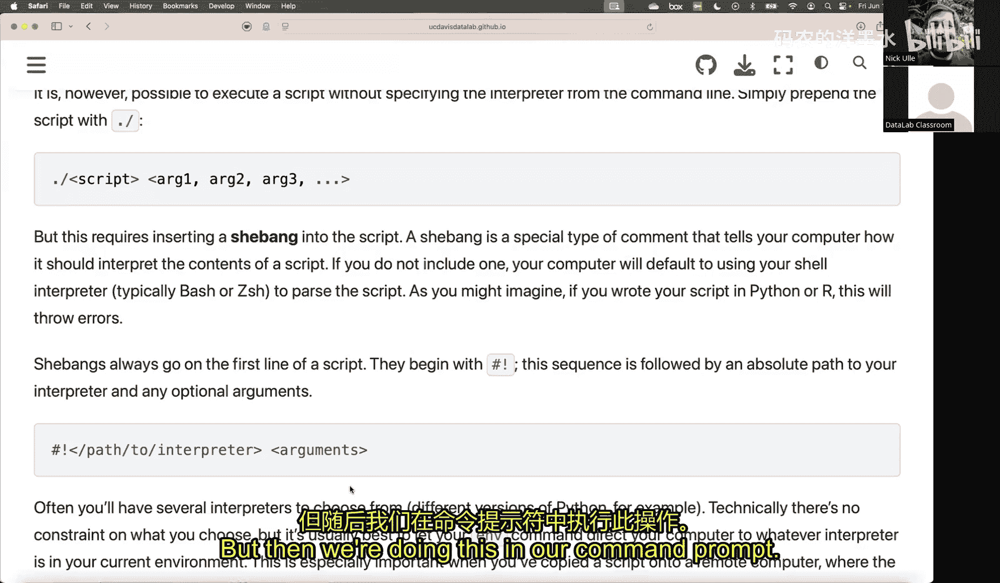

So， you know， it's right here， I would be typing my script if this existed， I would be typing。

 you know script。To run dot pi。呃。As worse， it's not found for me because I don't have anything there called script torun。

5。

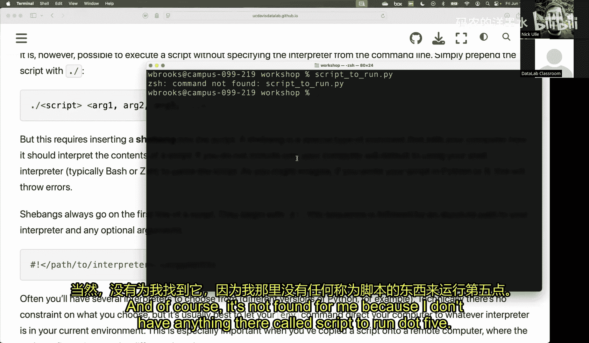

But even if I did。The command line would not know what to do with that just the fact that I recognized that this would be a python file based on the dot Py at the end doesn't mean that the computer would recognize that。

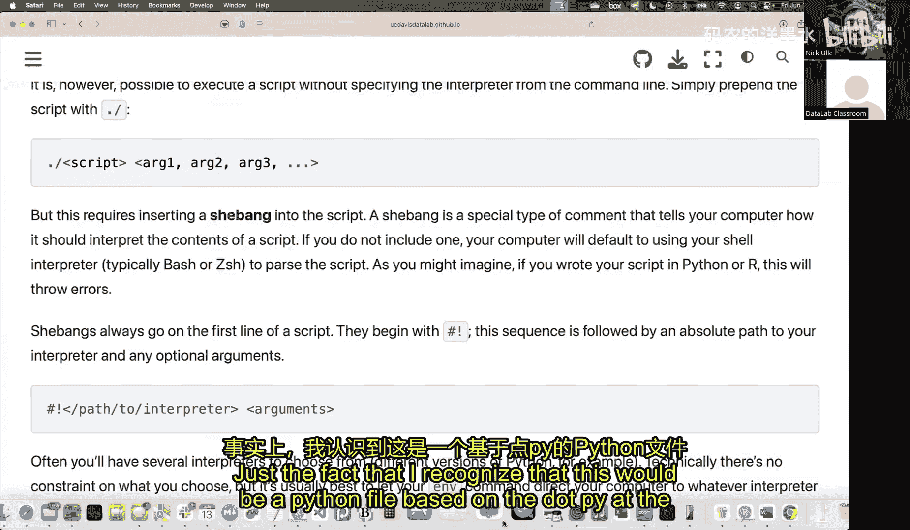

And so the computer actually has a very special way of knowing what to do when it encounters scripts。

That you're trying to run without naming the interpreter。

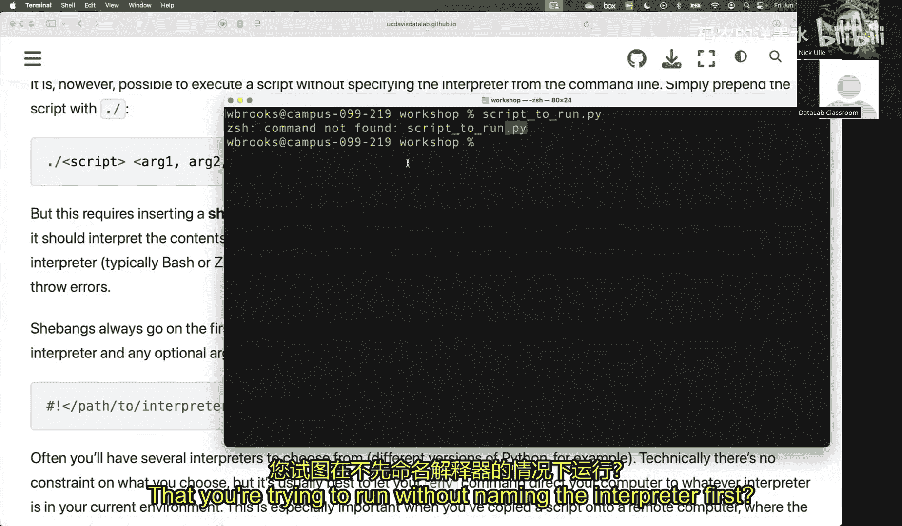

And the way that works is to put what's called a sbang at the first line of the script and it has to be the first line of the script。

And sbang is called that because we have a hash and then an exclamation point。

 which some people like to refer to as like in computer terms。

 people refer to the exclamation point as a bang point。Yes。

 it's just more it's just a quicker to say than exclamation， so here are syllables。

So Ashsh fanang or Shibang。So。Let us make this a little less abstract by creating an actual example oh yes so so okay I said you create a shang but what you do in the shang is then you have to immediately identify the path to the interpreter that's going to be used to interpret this file。

Then you can also provide some arguments which are optional。

So this takes the place of having to write the interpreter as the first part of the command and make it part of the script itself。

 and then the script can be run as if it were a program on your computer。Okay。

So here are some examples for a Shaang to run ba。Might look like this one， hashb， and then a pat。

Beginning with a slash means that it starts looking at the root of your computer。

And we look in the USR directories and the binaries and then lose the environment function Now this is very special we're going to start seeing this a lot。

 but it's also a little more。A little subtle why we're calling。If you look back here。

 the way I said this would work is the first thing you provide is the path to the interpreter。

And right here， that would mean that the path to the interpreter is slash USR/In/M。

And that would be like， okay， this function ends as the interpreter， but oh no， no。

 the interpreter here is actually bash。And so why would I say that the Shaang should look like this where you put the interpreter first and then immediately provide an example where you don't put the interpreter first？

The answer to that is kind of subtle。But essentially the takeaway message is that by putting this specific function first。

And basically all the time putting this first， you will call this next function or this interpreter in the environment from which you call the script。

And we talked yesterday about using Pixie to create your execution environment。

 this is how you' preserved that execution environment when you're using a Shabang to run the script。

So that the correct version of bash or Python or R is the one that's actually used by your command prompt。

So we can see as I click through these different options for our。For Python。

The flashlash USR slash bin slash and remains there in the first position yes well about what interpreter means is that like the program that you would use typically to execute this is that itself versus yeah it's a great question i've been tossing around this term interpreter and I never explained what that means。

The way I would think about it is that what we have here is just some text。

And we need some program that knows what to do with it， in other words。

 we need something that knows how to interpret this this code as factual commands to run。

And that can be any number of programs， but yeah like Python and R are the ones I use most often。

 although like BS itself is an interpreter， it is interpreting your like the text that you type at the command line and doing something with it。

 so interpreter is yeah the term for the program that knows what to do with the commands you give it。

So。Let's yeah， so we've got three different possible ways to do the same thing here。

And what the thing we're doing is making a basic script that。Creates a file。Oh sorryrry。

 let me just make sure I get this right。So the script is called Beaacon。

And it's going to accept a name as an argument at the command line。

 and then it's going to print out hello。诶。In a while loop。

 and so it's going to wait one second after each time。So we have three options for what we could do。

 we could do this same thing in R in Python or in Bsh。I'm going to start with bash。

It's just a lot less typing than the Python version and。

Less confusing than the commands here in the R version。I'm going to write this in bash。

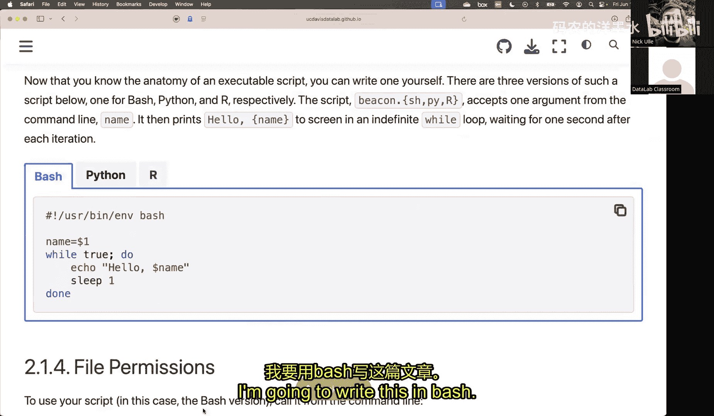

Okay， so please follow along with me at your command prompt。

 we're going to create a new file called becon。sh。SH to identify a shell script。

And I'm going to use Nano as the editor to create this new text file。

OkaySo this file doesn't exist but yeah， sorry before I even do that。

 I should clarify that I'm currently in an empty folder I can list the contents。

And there's nothing here except dot， which is a special thing meaning current location and dot dot。

 which is a special name， meaning the location one level up in the file hierarchy。

Neither none of that is relevant right now I just wanted to point out that there's nothing here called beacon so I'm creating it when I say nanobeacon。

sh this will allow me to start writing a new file。And as I just said。

 the thing we want to do first is a chaang， which has to be on the first line。

And here the place to find， yeah， so we're going to run USR。Slash bin slash。

And which should work on my Mac。Although Mac and Linux tend to organize these files a little bit differently。

 so if we get into if we have problems， I will fix it then。嗯。Okay， so first grand is going to be set。

嗯嗯。😊，A variable called name， equal to。The first argument that's at the command line。

So Do sign one is a special bath。The variable batch variables when you'd use them are prefaced by a dollar sign。

 when you create them， they are not， it's weird。When I'm creating a new variable called name。

 I'm setting it equal to this special variable called one。And one is a special variable。

 meaning the first argument at the command line。Okay。Now I'm going to use a while loop。

But the while loop has a very basic。Thing to check each generation saying while true and true to is always true so this is going to continue forever until I stop it。

Ordinarily you would put some sort of check here to say like while time is prior to 11 a。m， continue。

 I don't know flashing the lights on once per second， on and off once per second。

 and then it would stop after 11 am but。Today， I'm just going to write an infinite loop。Okay。

 now within I'm creating a string so I have to quote it and i'm going to use this variable called native remember when you create a variable in bash you just name it when you want to use that variable you have to preface it with a dollar sign so dollar sign name。

And now I will tell the computer to sleep for one second。

And the end of a loop in bash is indicated by word the word done while the beginning of the loop is indicated by the word do。

Okay， so we're learning a little bash scripting here。And对。

Baaccing does matter I think Nick is yeah Nick knows better than B yes it matters I used two spaces on these as long as it's consistent I think that's fine。

Ws has been both facing in other places okay， when you're sign okay。Right， oh yes so。

Mick is answering that no the indentations here don't matter I should have invented these a different amount or an inconsistent amount because anything。

After do and before done is considered part of that loop， but。

Where spacing does matter is I can't put space around this equal sign。

 which is supernatural for me to do， I always want to put those spaces there because I ordinarily write in languages that are more forgiving about that and it makes the code easier to read。

But with Bsh， if you put spaces around that equal sign， the program will not work。Okay。

 so we've written a really simple program now I wish to save this file as we saw yesterday。

 the way to save a file in nano is to hold down the control key and hit the O。Key for out。

And then it'll ask me if I'm sure about the name that I am， so I'm just going to hit return。

And it confirms that it wrote eight lines， which you know this looks like about eight lines。

And now so to exit， I'm going to this one， which is hold down control and site X。And now。

You can see that when I list the contents of my folder。

 it's no longer this empty thing here and said I now have three items I have。

Those same special locations and a third one， which is my。ANew script called Beaacon。sh。

And I think that's probably still too small。Want that text up a bit， okay。Okay。

 so let's do the thing I just said we could do， which is to run this script with。

Dot slash at the front and then the name Beaacon。ThatS H。And then I want to put in my name。

 so I'll put in West。 it didn't work。So there's one last thing that needs to be done before we can run a script as if it were a program。

 make it executable so that we can run it with the Shabang。

And that is to tell the operating system that this should be made executable。

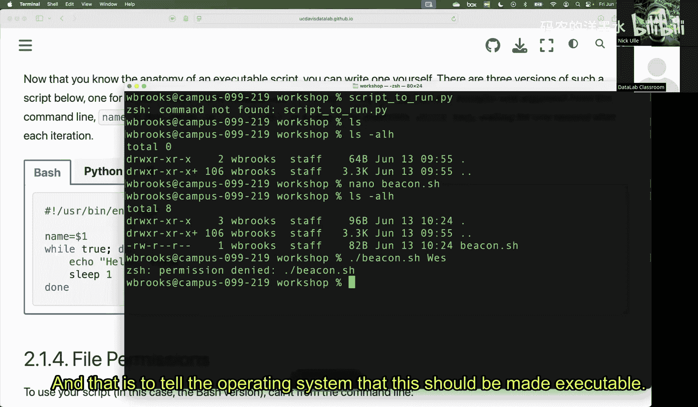

We have to set the file permissions。I。We'll see this is exactly what was expected to happen。

And the reader is telling you to use LSL to look at the permissions tags on this file and I've already done that so I'm just going to go back。

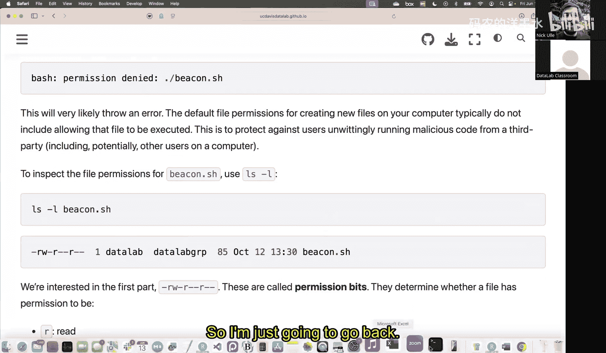

And show you。So we have these weird characters at the beginning of each line。

 and if this is your first time thinking about them here's what they do。

These are permissions for the file that is listed。Ignoring these first two because they're directories and therefore they get treated a little bit differently。

We have。3910 entries。The first of which is to indicate whether this is a directory or not。

 so the first you have a D there for directory the the third one to stop。

And then we have three groups of three。And those three groups of three are relevant to the user。

The users group and then finally to all users on the machine。

And what each of these mean is you have an R， a w node length， an R of length of length。

 an R of length of length。The R means that this file is rereadable by whoever like whatever is written。

By this group。The W means that this file is bridable by people with these permissions。

 and the third is an indicator of whether this file is executable people with these permission。Okay。

 so that's all a lot of jargon。This file is not executable by anyone。

 all of these third entries are blank， so this would be an X or an X or an x。And remember。

 this is indicating for me， the first group of three is indicating for me personally。My user account。

 this next group of three is indicating the group in which my account is placed。

 which is not relevant on my computer， but may be relevant on the HPC where you will be placed in a user group that has certain permissions and then the third one is for all users on the machine。

But almost always the things that are most important are the ones for you personally。

I'm going to set this file so that it is executable by me personally and the way to change permissions is to use the command CH mod。

So I don't remember why it's the C but the mob is for Mo。

I wish to modify the permissions and what I wish to do is add executable。

 so I use a plus and an X to add an X。And the file on which I wish to make this change is called beacon。

sh。But。Now I will once again。Look at the contents of this folder。H on。

 I'll make this a little easier， I'm going to clear my screen and then put that up at the top。呃。Yeah。

And sorry， I'm also going to make this a little easier to read by not printing out those special locations either so。

SoThat was the a flag that printed all files， including hidden files。

 but I don't want to show the hidden files now。I'll just use L and H。

So now we see that an X has been added to every each one of these three sections of the permission select。

And that is going to be enough to allow us to run our。Shell script so again。

 I put the dot slash to indicate that I wish to run something that I find right here where my where my prompt is currently located。

The thing the file I wish to run is called Beacon。shh。

And I'm going to specify a argument to go with that， which is my name， Wess。Okay。

 and now the function is running as we expected it would。We have an infinite loop。

That loops once per second and every time it loops， it prints out hellello West。

So if you followed along， then hopefully your screen is also greeting you。Okay， so。

I think this is a point where if folks are stalled， you could put up a right of sticky and。

But I'm mostly seeing people nodding and some thumbs up so okay。One issue here。Okay。

 so this is an infinite loop like I said， so you know I'm free to like。

Keep doing something at my keyboard but it's not going to stop the program so there is we're going to see today several things that are special key special key combinations。

And the one of the great things about scripting is like it's written out here in text， every command。

 I type it in， you can see it as I do it。嗯。That's also what makes the files really easy to reuse because they just list every command one after another。

 but when there are special keystrokes they don't show up and if I don't remember to tell you what it is I'm doing。

 it might seem like magic。But to make this stop， I'm going to cancel it and the way I cancel it is by holding down the control key and hitting C for cancel。

嗯。So。You wish to cancel the execution of your script while it's runninging。

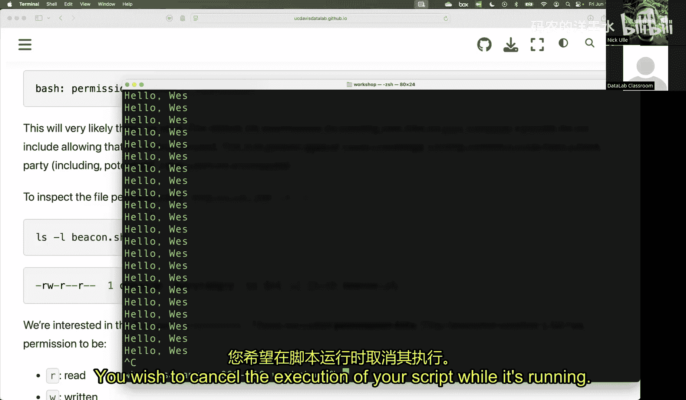

Then just follow along with that。All right。Okay， and yes， I was doing this on my computer。

 so there's something in here about being in the data lab group。

 which would have been the case if I ran if I did all of that on hive。Yes I oh yeah。

Maybe I should go to hive， but okay。😔，Yeah， okay， so from this point forward。

 I guess I will move my command line on to Hve and be doing stuff there。诶。That way。

 everything will be in the same execution environment as what you all have set up。

But we're getting now to the good stuff， which is how to， oh yes， question。Why don't you made the。

The they found the that stage is values in the C mark。诶。For me。

 I didn't get to to find this in particular before I just think they the say。And it ran， yes。

 so okay， that's。嗯。So yeah， like different computers will have different settings for you know default and how the system runs。

 I'm a little surprised that you created a file and it defaulted to executable but。

Stranger things have happened as Oliver was pointing out yesterday the like get on DC doesn't really know about okay select。

That that makes sense yeah， yeah， so that is。So that is a good point about like why it would have been better for me to do that on hive。

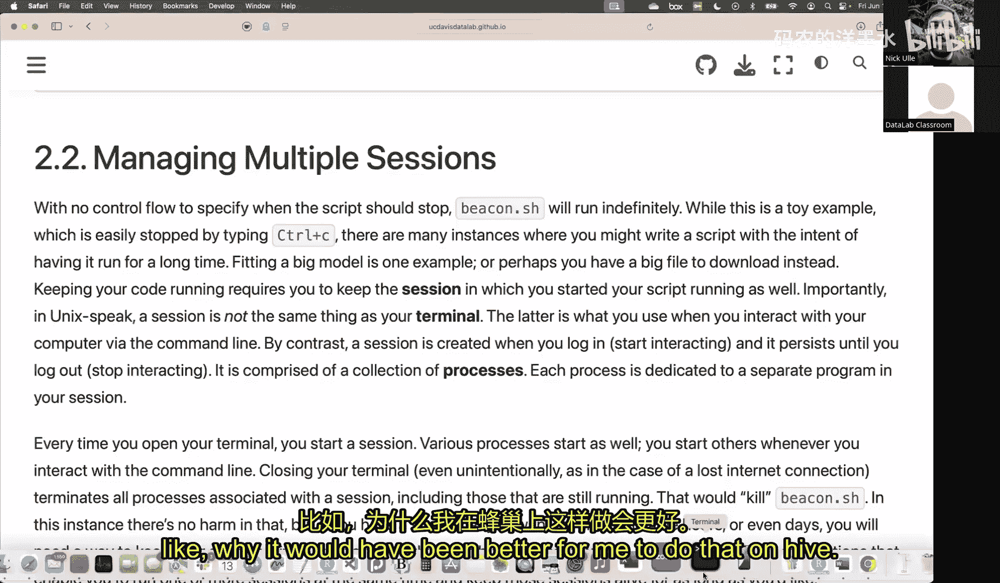

And it would also have resolved any ambiguity I had about。你。Appropriate。

The appropriate chabang to use like whether it would be slashUSR/ bin/lashend for something different because I'm doing this on a Mac if this was on hive then I would have known for sure that the Linux ordering was correct。

But it worked out for me anyway， but that's all just to say that I should have been doing that on hive and since I wasn't I now I've created this beaconH on my computer。

 I wish to send it to my hive account so I'm going to revisit a command we learned yesterday。

 which is called SCP。I'm going to move this on to hive。And。First， we need to specify the origin。

OrYeah， so I'm going to send from decon。sh or coffee from beakcon。sh to my account on hive。

Just W Brooks。At5。hpc。ucdavis。edu。Now I need to say where in my account that should go。

 it should go to my underscore garage。啊。m， it worked。Okay。

 so now I can log into hive and I should be able to find that。

Beacon shell scripts in the Myprodge folder。Okay， so I'm once again logging into hive via SSH we went through this yesterday。

 hopefully we got everyone working with you know like we got this working for everyone and you're now able to SSH to hive so if that didn't work for you that's another point to put up a red sticky and somebody will help you out with any connection issues that are still remaining。

I'm also now going to move into my underscore Pro。And list the contents。hoops。And。

We have those pixie environment we created yesterday as well as this new vegancon script that I just sent。

And the executable bids are still set there。I'm now ready to continue。

With running multiple processes。This is where things get really important。

Because when you are running on one of the HPC computers。

 you typically are doing that because you have a job， know。

 like some analysis you want to run that requires a lot of memory or computational power。

And often those are things that take a long time to run。

And generally you don't want to sit there babysitting you know。

 your computer while this code is running on HPC， you know。

 there's typically not much to do with that particular code until it's complete。

But if you close your window， you also will close any code that is running， so for instance。

If I start beacon running。Again， by running dot/beacon。sh and tell it my name is Wess。你看。

Hoad starts running。And now， I want to。Close that window。I never closed that。

 I never stopped that program from executing。So now IF I SH to hi。不起。Okay。

 I'm going to SSH to hive again。

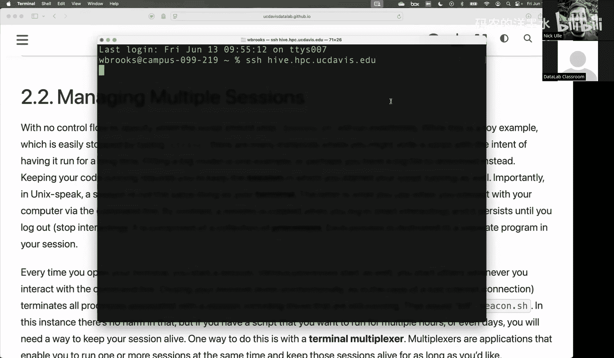

And we're not seeing。That output that we would have gotten if that code was running in this shelf so。

If that was important work， I would have just lost all the progress that had been made while the code was running we don't want that we want code to persist running even when we close our connection。

 even if it takes multiple weeks as I currently have some code that is running。So。

In order to make that work， we need to be able to。Create a session on the HPC that will be persistent even after we close our connection。

And that is why we have to learn about managing multiple sessions。And so。

There's a lot of jargon here about the terminal sessionss and processes。嗯。

So you create when I start code running， that creates a process。呃 when I。

That process is the thing that keeps that is you know running the for loop and printing out hello West。

 hello West， hellello West。嗯。The terminal is just the program that is running here。

 it doesn't have anything to do with the actual content or with executing the code。

 it is simply a window into hive right now。And then the session is the thing that is that I'm interacting with。

 so I've opened a session by connectinging to Hive I can close I can disconnect from hiive。

 which will close that session。The process。Runs within a session。

 so when the session closes the process closes and that's why we are no longer seeing the output after I closed one connection and reopened。

嗯。So now we are in a fresh new session。The way to keep code running is to create a session that will be persistent when we are not interacting with it。

And the one yeah so so the way we're recommending to do that is with a terminal multiplexer and specifically the one called Tma there's also one that's popular called Sc if you are a screen user that's fine。

But most people in dataalad prefer teamms and since we。

We really only need to teach one of them in the workshop， so we're going to choose TOs。And again。

 it stands for terminal multiplex， so within the same terminal， I can have multiple sessions。

 that's what multiplex means。Okay。So。

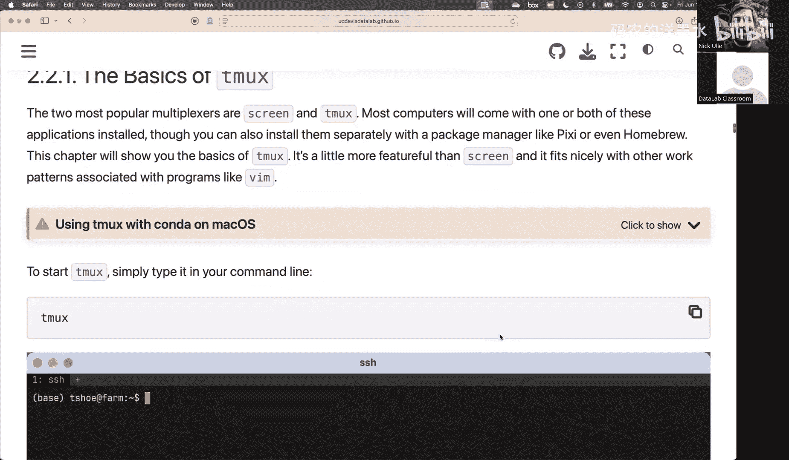

呃。If you are connected to your Pve account， you will have access to TOs and it is a program so run you can run it by just invoking its name TMs。

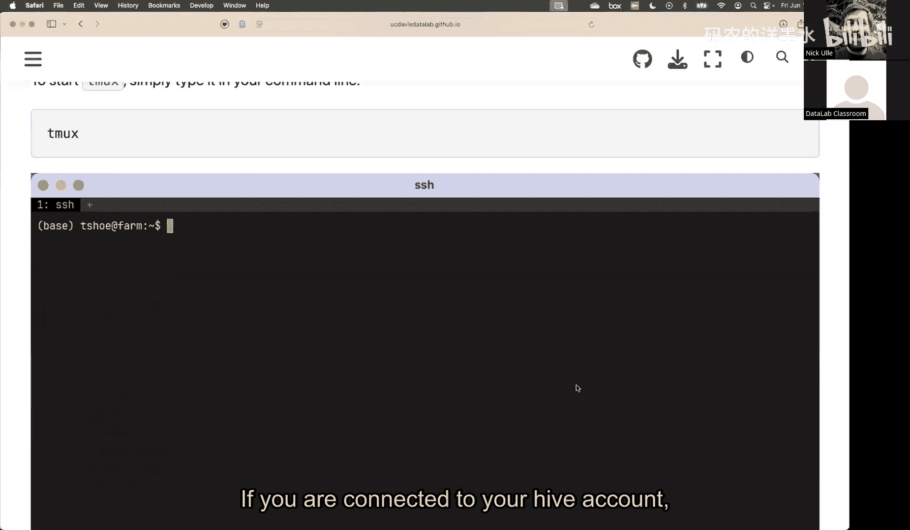

嗯。Okay。😊，And so。Something just happened。It might have happened too quickly for you all to notice it。

 so I'm going to do it again。I'm going to type the function name TmX。And then when I hit return。

We're going to see all of this text pop back up as if I had just initiated a connection to Hve。

 but I was already on hive。嗯。So this is the same sort of maintenance notice that I got when I first connected。

We get this because we are creating a new session on hiiveve and Hive has this warning that comes up on every session saying that in three days they're going to do maintenanceements。

 which they do during summer break because it is less disruptive than during the academic year。Okay。

So。I have here created a new session and。I can interact with it。呃。Yeah。

 in all the ways I could interact with my original session。

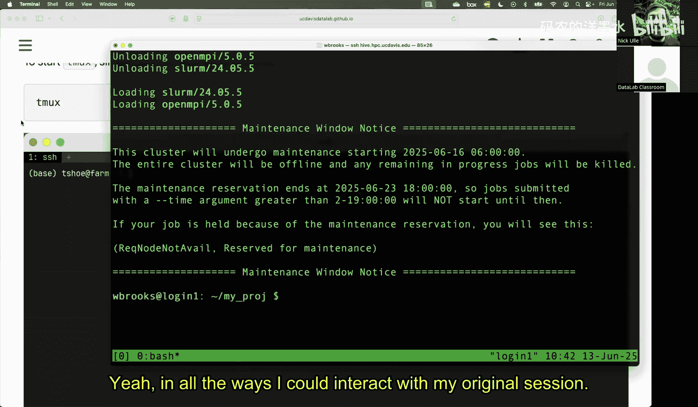

嗯。

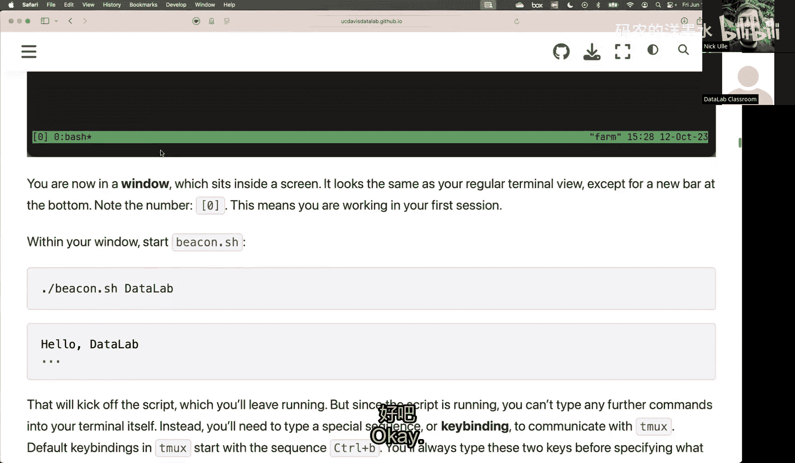

So。In particular， what I want to do here is start up my beacon。

 which is going to greet me over and over again until the end of time。Okay。😊。

And now here we get back to the thing I was saying a few minutes ago about there are some things I need to do today that involve special key combinations that they don't show up on the screen and if you don't know what I'm doing。

 then you won't be able to follow along so this is important。The the way to。Interact with TMuck。

As opposed to interacting with。The shell that is running inside of Tms。

Is by starting with a special key combination， which is by default and there's I would really caution against ever changing this default。

The default is to hold down control and type B。Then you get into a place where you can start interacting with the program Tmas as opposed to interacting with the shell that it is running。

And the special command， once you've done that to disconnect from your current TM session is D for disconnect。

 so I have held down control and touched B。Then I lift up both hands and just hit the D key。

And I come back to my original session。Right so。Is everybody able to do that？Get some thumbs up。

 some nods。嗯。It's easy to forget and then you'll feel like you're trapped inside TMX because it doesn't give you any like it doesn't provide any information like wait how do I get out of this session so？

It's important to remember that special command。

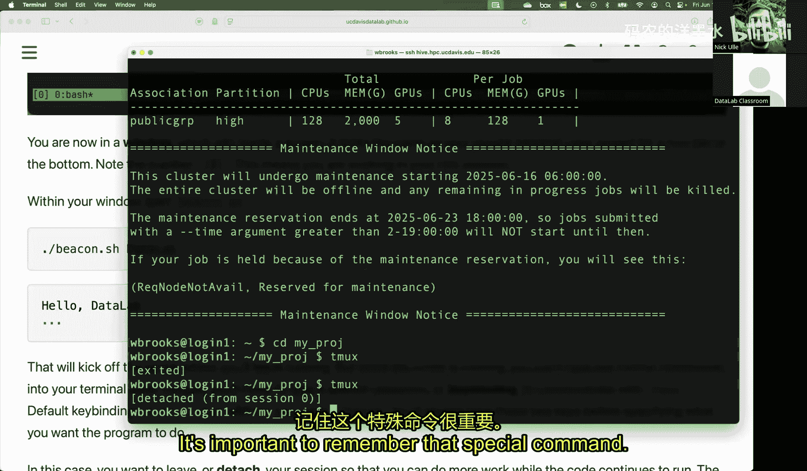

Hold down control， type B。That's how you initiate interacting with TOs itself。

And then for disconnect， the command is D。好的。So I'm back here in my original session and we can see nothing is happening here with the printing。

And yet it。Is still running in that session that I just created？sessionession is running。

 which heres being called session zero， but I have detached from。

And the way to get back to that session， again， assuming it was doing some important work。

 I would eventually need to get back to it so I could look at the results。

The way to get back to it is to attach we detach with D now we need to attach。有可。

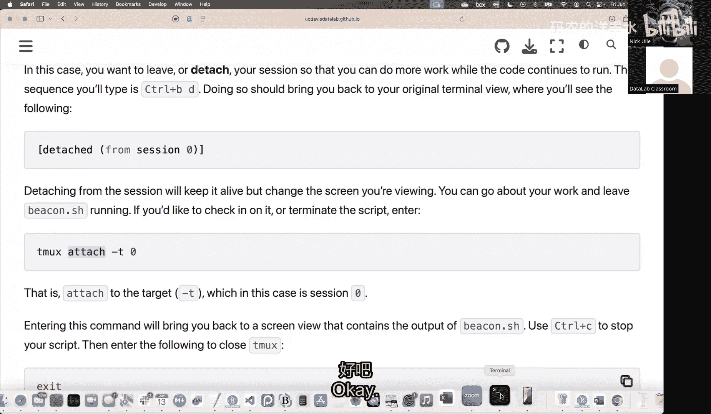

So。At my command prompt， I again use the Tmux command。But if I just enter it。

 then this will invoke an entirely new session。Okay， that's not helpful for me。

So I need to hold down control type B。And then I hit D to detach from that new session。No， no no。

 I need to attach to a specific session， which if I didn't give a name is it got the number zero。

听 much。Attach。And then this is a pretty common pattern with Tms， I use the flag dash T for target。

So the target of whatever action， and in this case that target is the session zero。Right。

 and I'm back into this session， which is running the Beaacon code。

Were folks able to replicate that work， I see some folks reaching for their red。about African ground。

Okay， so I'm going to go back out of that and that requires invoking the special。Mmand B command D。

And then I hit the D key， here's what I type。Yeah， I just needed to type the name of the session。

 which is zero。Now， if you don't remember what the session is called。You can。

Actually find everything that's currently running by running teamms。And then the。Action list。Oops。

I'm sorry you can't do that， you have to write2 mus。List dash sessions。Okay。

And you can see that there are two things running， one of them is called zeros。

And it tells me that I created in 1042， one of them is called one tells me I created it three minutes later。

 four minutes later。

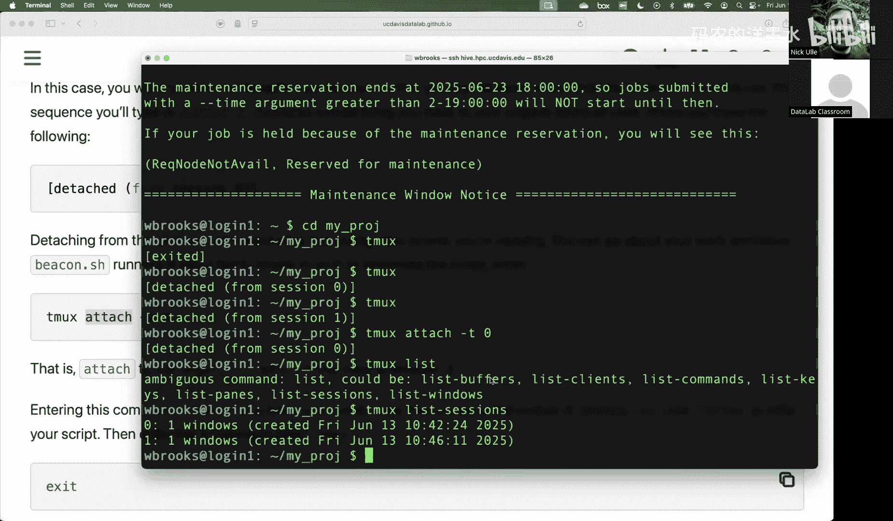

And so this would tell me the name that I would need to enter。我全吃。

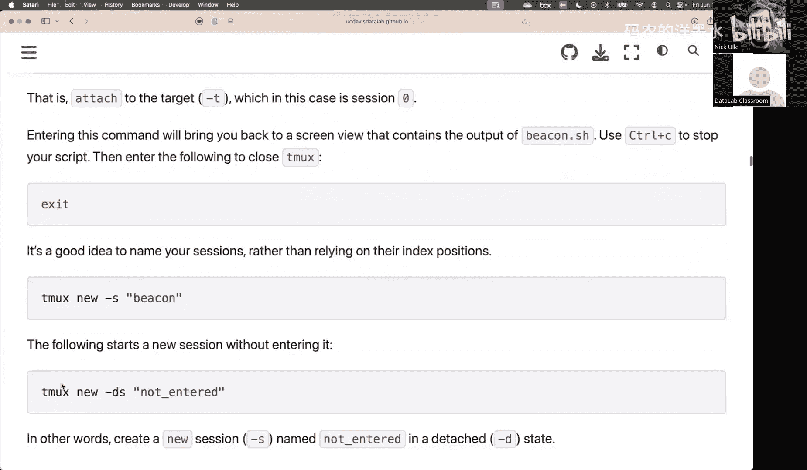

Yeah，O好。So。I'm going to go back into session zero， and this time I'm going to show you not how to detach from a running session。

 but how to actually end a session。Okay， so again， in order to reattach myself to that session。

 I use the attach。Man， teamms attach。And I need to specify my target hence dash teeth or target。

My target is zero。Okay。😊，Now。We are interacting with by default with the shell inside TOux so that when I hold down control and type C for cancel。

 what it cancels is the code that is running inside of TO。

And I can continue typing control C control speed and it's not going to cancel TOs so this isn't the way we can end a TO session。

Instead， we need to。Do the same thing we would do if we were wishing to disconnect from hives。

And that is to type exit。嗯。Now we see we get a different message here instead of detaching because it's just what I've done before。

I've now exited from that session。And so if I now list sessions。没有了。We've gone from two down to one。

SoThe session zero is no more。That agree everything that happens it does well。

Everything at the everything in the window is gone if I created files there or from that session。

 those files are on the file system and they don't disappear。

It's not it's not creating like a whole virtual machine that would vanish when that that ends。

 it is instead creating a new login， a new session。But on the same machine and so yeah。

 creating files is a great way to store the output from some code that you ran and be able to use it later on。

But yeah， that whole window full of the computer greeting me so nicely， it's yeah，'s gone。

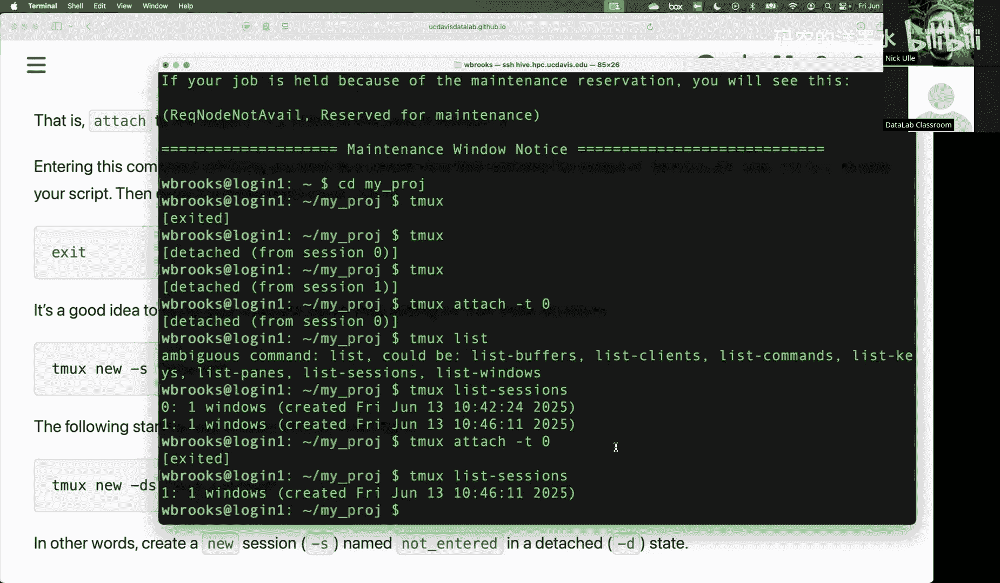

Can't prove that it ever happened。Okay。So。Yeah， the next thing we want to do is sometimes these numeric sessions are not informative enough。

 especially if you're going to be running more than two or three。

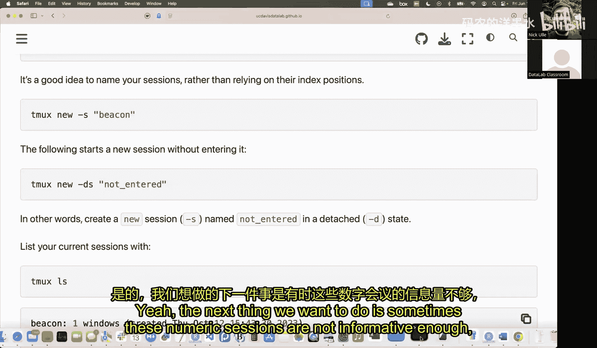

So it's good to give names。Instead of just yeah instead of having them numbered sequentially。

 so I'm going to create a new session。And previously。

 the way I've done it is just by typing the command TMs and letting it do everything by default。

But this time I want to make a new session， so I will say new dash session。And。呃。

As is a very common pattern with chma， when I want to specify a name of something。

 I need to specify that it is the target of my action。

 so new session dash T and I will call it beacon。Okay。😊，嗯。One thing you might notice， okay。

 so we created in a session， that part looked exactly the same as the past few times we did it。

But now we have a name down here at the bottom left which previously this had been a number。

 you probably didn't notice it when it was a number because it didn't have any special meaning。

 but now it does have meaning， it'll tell you what session you are currently working in。

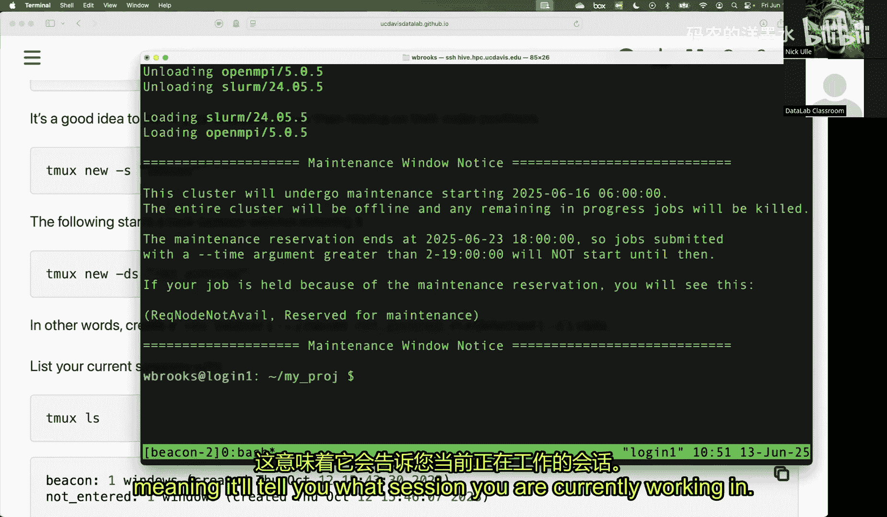

Okay。嗯。

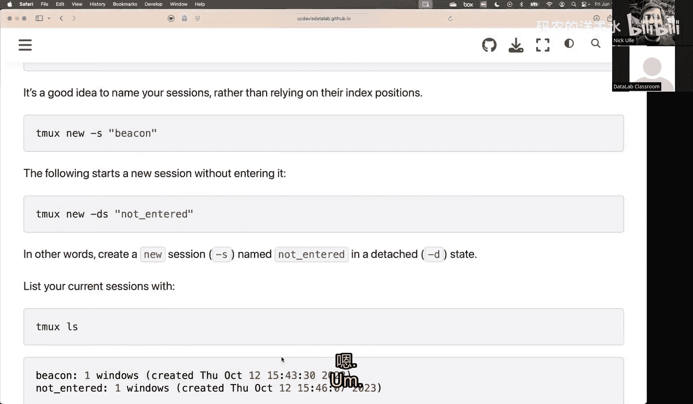

And。So here okay， so I'm going to exit from this session and again。

 the special way to do that is I invoke this this command mode。

And I do that by holding down control and typing beat。And once I'm in command mode。

 I then just hit the D key。哎。Unfortunately， you can't see that， so I have to tell you every time。

Now here's something I never do， but it is possible you can create a session without actually going into it so I can say teamOs。

I want a new session。And。I'm going to say it is detached。That's the dash tea。

And then I'll say the target is not entered。Okay， so it doesn't look like anything happened。

But if I now list the sessions。You can see that there are three running。

There's that numeric one that I created。There is the one that I named Beaacon。

And then there is this third one called Not En， which I just created。

 but we never actually saw inside of it。And I'm actually not interested in this one not entered。

 so I think I will try to get rid of it and for whatever reason the way Tmx thinks about getting rid of a session is killing it。

 so I will say T Mus。Till a session。

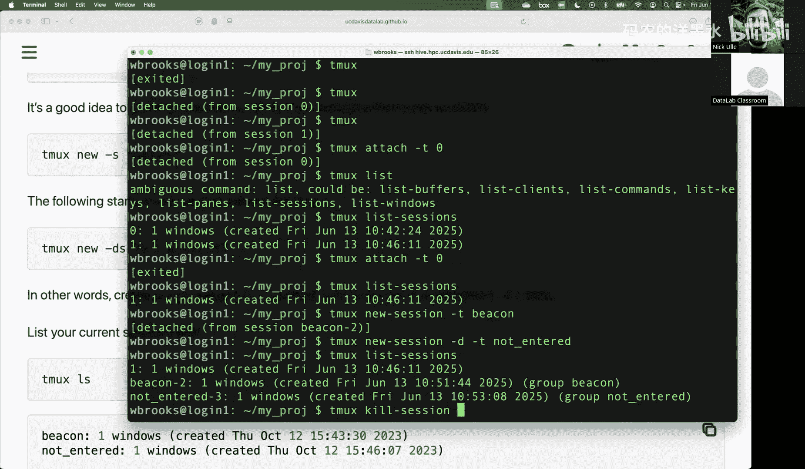

Again， the target for my action is not entered， so I'm going to kill the target。FT， not a third。

Now I can list my sessions again。And we've gone from three down two。

They are the two that we would expect。Okay。Yeah， so yeah。

 and so if for some reason you wanted to kill all of the sessions that TeamX is running instead of kill session and specifying a target。

 I could just say kill server and then I don't need a special target because that that's all of this。

O。Now。嗯。

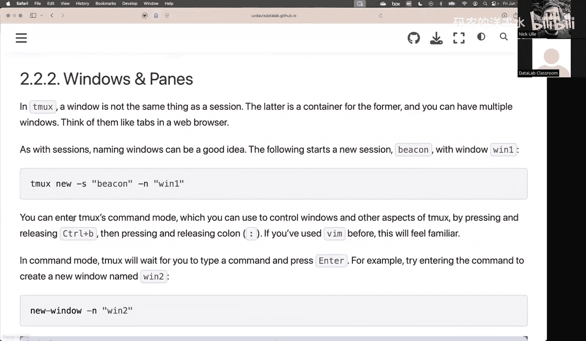

We've already like， okay， so knowing about teamworks， knowing how to create a session。

That is already going to accomplish something huge for us， which is that I can。Exhipt from hive。

 so I'm typing the exit command。My connection to hive is closed Okay。

 so now I'm going to open that connection again SSH。5ive。hpc。ucdavis。edu。

And now if I Tms list dash sessions。Those sessions are persistent they lasted across that disconnect reconnect cycle I don't think I actually started doing anything in either of these so。

You're going to have to sort of take my word for it that any process running in them is also persistent。

So if I wish to attach the beacon， I created this， but I didn't actually start the beacon。

 so here I'll just start the beacon。And now again， to get out of here。

 I'm going to hold down B to enter command mode and type D for disconnect。Now I will exit from hive。

Now I will hit the up arrow。Getive back the SSH。Command SSH back into hi。Tamocks attach。

Target is Beaacon。We'll see that while I logged off and logged back on。

 that same code continued to run。的。This is a huge step。

 this covers you know 80% of my use cases for two months。

 just being able to create a session that is persistent even when I disconnect from the circle。到。

That's the that's the really important stuff， but there's teams is so much more powerful than that and you can。

Do a ton of things。The ones that we're going to talk about are basically how to run multiple programs in the same window by splitting this into panes or I wanted to say panels but no they're panes。

 theyre window panes， okay。So。

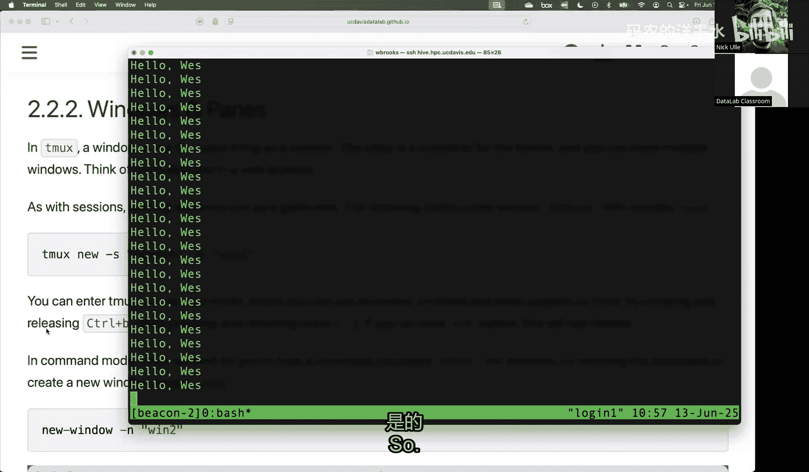

嗯。Right。Okay， so the first thing here is about naming naming panes， sorry naming windows， I guess， y。

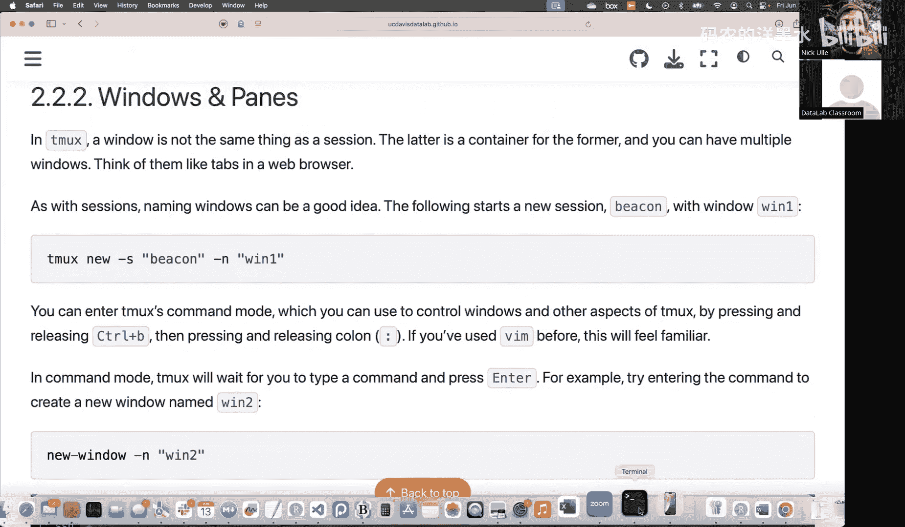

Okay，7。I'm going to disconnect。By entering command mode and then typing D。

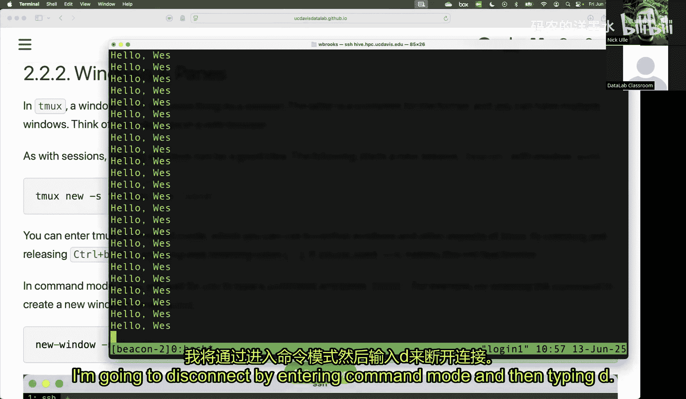

And now I will create a new session。I'm going to to do let's see， let's see。

So I already have a session called Beacon。Okay so you what i'll just follow this follow the process that's laid down for me and in order to do that I need to kill the current beacon session so teamms。

Kill dash session。And target is Beaacon， okay？Now I'm going to create a new session called Beacon。

 but with a named window。So new dash session。Or it's also possible so new dash session is how I always write it。

 but the。The text for the workshop says you can also do this team what and new and then use the flag dash S to say it's a session that's new。

I'm naming it Beacon， okay now I'm going to continue the English session。And then。Yeah， so N win one。

对。

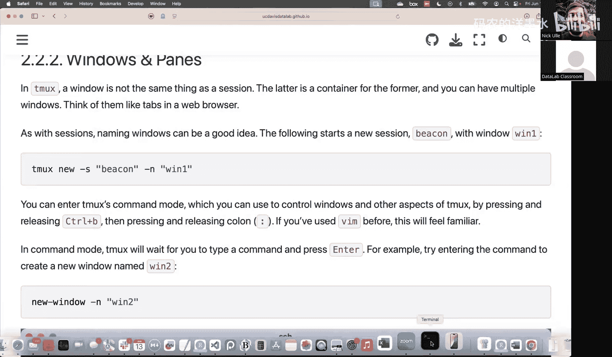

呃，O。Yeah， so the way the pattern that I typically use doesn't work to create a named window at the same time Okay。

 so I need to follow the way that it's laid out。I can't use the target。And also a name。

 I have to just choose one of them， so instead I can use this other pattern。O。好。

So we are in a session named Beacon and we can see that。The zero window is called win one。

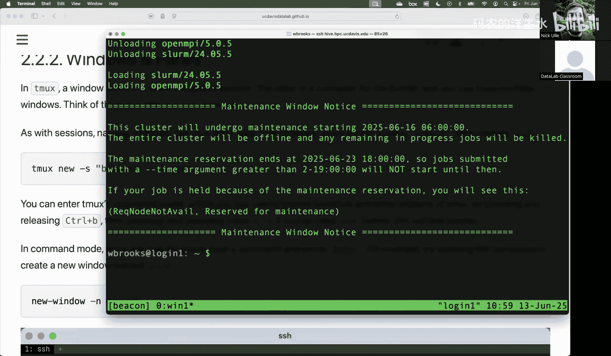

嗯，Okay。Now。Everything we've done with command mode so far has been disconnect。

That's the only TMX command that I've used。So we'll go into command mode by holding down control and typing B and then after that I just always hit D to disconnect。

 but there are lots of other commands that you can use to interact with TOs。

Some of them are hot keys like D for disconnect， you just have to hit the key。

Some of them are longer and they have a name to them。If you want to find out about them。

 there's actually a way to do that from within TOs， and that is to enter command mode。

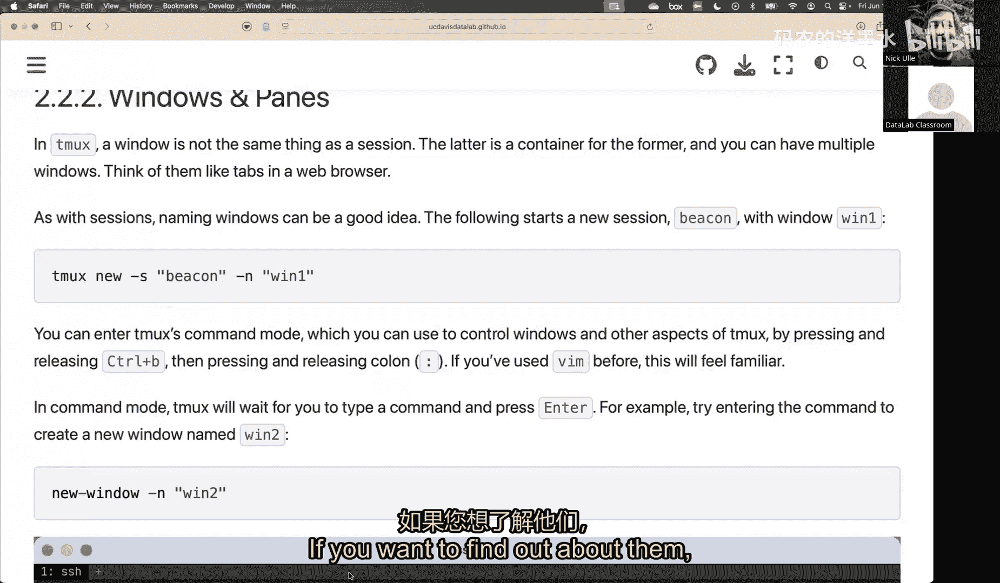

And then type a question mark。O对。These are the commands that TM makes available and this C dashB that is indicating。

The control B for Android grandpa。喂。And then I can scroll these using the arrow keys。

The one that comes up next in the reader is to create a new window。

And that's probably going to give you way down。Yeah， it's not okay。

 so the ones with the ones with text names are not even appearing in here。P。

So here's the window stuff。😔，Well， okay， so since the the names the actual like the full text names don't appear in here。

 i'm not going to linger there too long instead i'm going to sorry about。

Oh oh sorry yeah good point I just did the thing I said not I shouldn't do。

 which is I used the special key， the escape key took me out of that menu or out of that listing of commands。

Yeah， okay， so the other other than hot keys you can also type command names so I enter command mode by holding control and hitting B and now in order to say that I'm going to type a full command name I'm going to type a colon。

诶。And you can see that the bottom bar has not changed to command entry。And here I'm going to say。

 let's create a new window。With the name， dash N。Will be wind two。ok。So now this same teamms。

Session has two windows， each of which is running its own session。呃呃不。应该证据。

The windows are listed in the bottom panel， so at least you're able to see windows。

 what options are available to you。

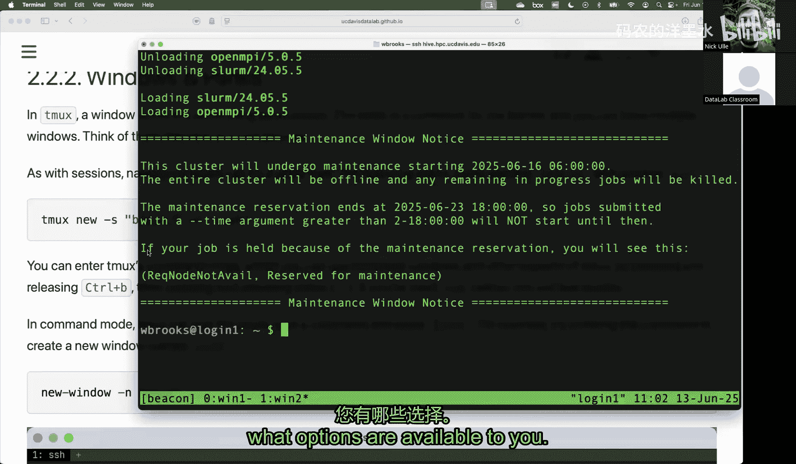

And so if I wish to navigate between the windows。呃。Yeah。

 so there's a long way of navigating between the windows， which is to type out the full name。

 select window dash T for target so。

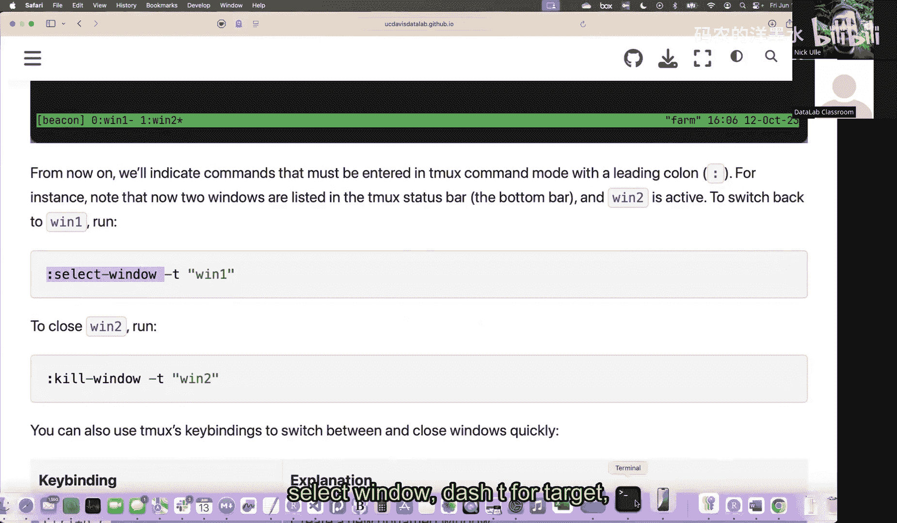

Again， I have to go into command mode before I can do that because this is interacting with TMs as opposed to interacting with the shell that is running。

So I go into command mode and then I type a colon to get into the long command mode。

And then I want to select window。Select dash window。And the one I want to select is win2。Sorry。

 no I'm already in win two， I want to select win ones。Okay， and it's very subtle。But the。

As here indicates the window that I'm currently meeting。

So previously that had been on win two now it's on win one。

 but just to show you again enter command mode with the control B I hit a colon to and the full name and now I want to select dash window。

Target is win two the asterisk should move to win two and it does。All right。

Now I am tired of when two， so I want to get rid of it， Nick or Oliver。啊。

So I'm going to kill win two。Again， that's a command。

 so control B and then a colon so I can write out the whole name till dash window。

And the target will be wind2。Okay。The window list is now reduced by one the asterisk is on win one to indicate where I am currently。

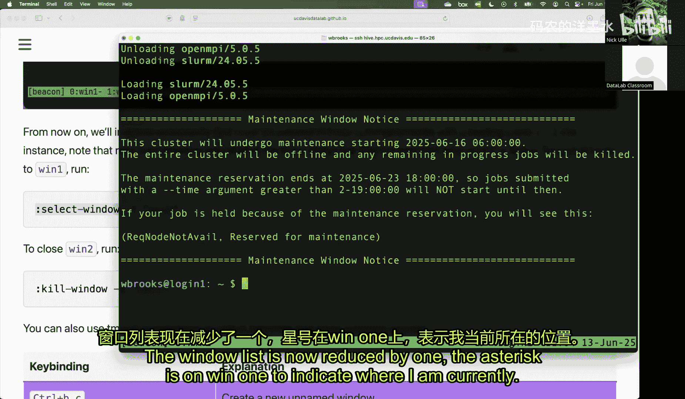

Okay。So。Those those full command names are kind of long to type out so it's nice when they have a shortcut key and these shortcuts listed here are the same this is a small subset of the ones that you can see by looking at。

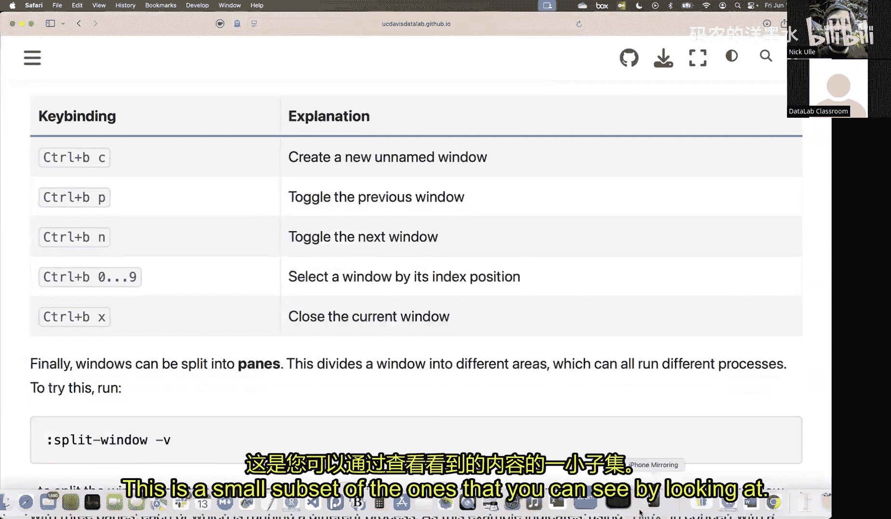

Command mode， control B。And then I hit a question mark。

Here are all of the shortcut people Here we have a small subset Here we have the full list。

Once I'm looking at the list and I'm done with it， I want to get out of here， I use the escape key。

Oh。Sorry， Zoom， what I was saying。Something but no， okay， hit the escape key and I'm back at my。

Michelle prompt。Okay， so now me personally， I rarely am using multiple windows， in fact almost never。

 but this next thing is something that I do all the time。

 which is I want multiple panes within the same window so that I can view code that I'm writing as well as the results of running it。

Okay， and so that to do to make multiple panes in this window， I want to split it。

And let's split it vertically to begin with。So this is a command to TM。

 so again I need to hold down control type B to get into command mode and then I use colon to enter a name which is in this case split window because what I wish to do is split the window。

And I want to split vertically， so I will use a dash V。And this is always confusing to me。

A couple things to notice， we created a new pan here which started a new session。

 we know it started a new session because we got the whole maintenance warning that Hyive puts into the show when you started a new session。

I said I wanted to split vertically and so the result is two windows that are stacked vertically。

 even though the actual split my mind as far as long there's like that the line between them。嗯。

But you know， trial and error can is always good enough anyway to like if I get it wrong。

 I just go back and。Do it with the。The other which is to split horizontally and as you might guess。

 the big difference is that instead of using the dash V flag I would use the dash H flag with split window so to demonstrate I would。

Go into command mode。Use Colin to indicate that I'm going to type the full name。

The full name is split window。And I will use dash H for horizontal split。

And see what got split is not the whole window， full screen。

 but it that it was just the one that I was currently in。

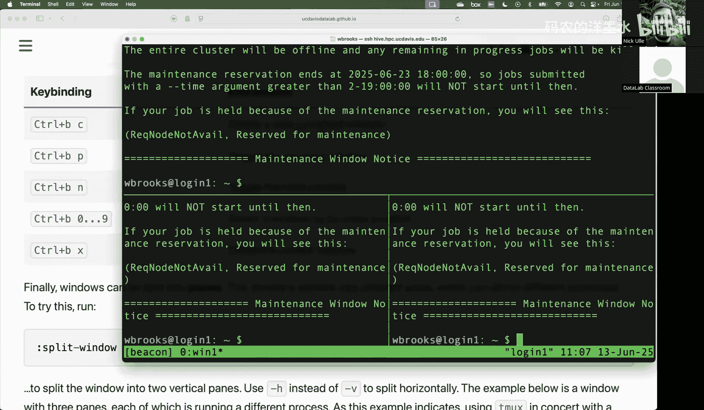

O。So。Oh。Now we've got multiple windows showing。Or multiple panes showing。

 excuse me in the same window。That's nice， but it's kind of useless unless we can navigate between them。

And the way to do that is by entering command mode and just using the arrow keys。

 so Android command mode had hit up and that took me to the next window up。

If I enter command mode and hit right。There's nowhere to go， so I get a blank instead。

But if I hit down。It takes me back down to where I was。And now I can hit left。呃。

To go back to G windowo that was just to the left of that。

 so enter command mode and then type an arrow and you will navigate between the panes。哎。😮。

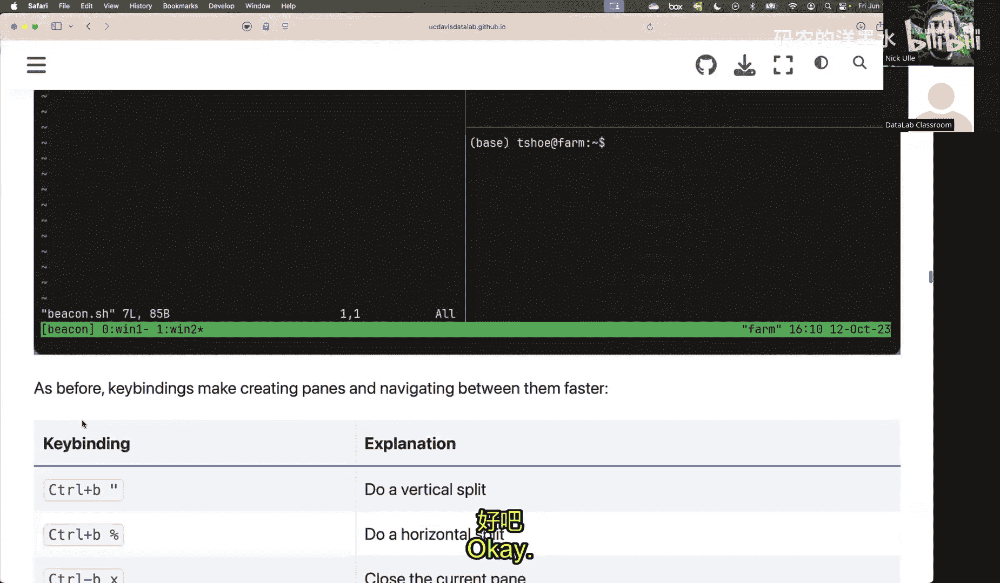

Yeah， and so。Here's a use case for why you might want to do that， you can type code in one window。

RFor type code in one pane， run engine in another and then obviously this is a very simple case but you can be watching to confirm that what comes out when you're on the code is what you would expect based on what you wrote。

U and that can be especially useful if this code is you know。

 more complex and you're trying to trap you know process as it runs through something。

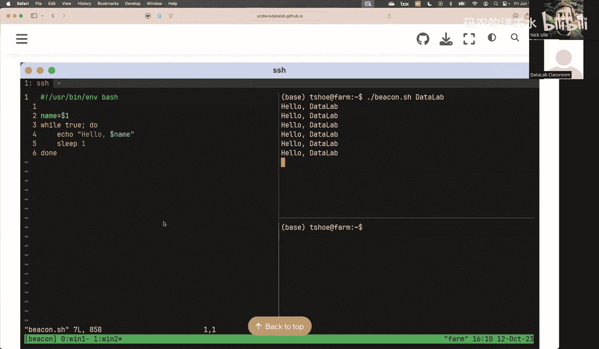

Okay。So then。We just have some。Examples of the key bindings。

 the shortcuts that are used to create and navigate between paines。嗯。

So you don't actually have to type out out split window instead you have these shortcuts the quotation mark and then percent sign but for me I never I can't remember these but I can't remember split window so I just always use split window but oh yeah so the important one is like what if we're done with a pan we want to go back to what we had previously。

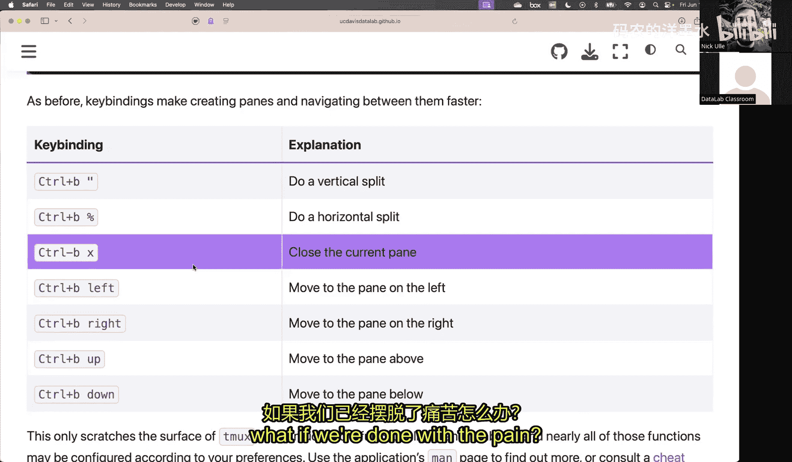

That is the X command。Say I have just split this lower pan into tube that are stacked horizontal horizontal。

And I realized， oh no， wait， I meant to do those vertically。

I need to undo that stuff I had just done， so I go in command vote and then I type X。ok。😊。

And when I type X， it knows that that means to kill a pain but。

That can be destructive because something important could be running there。

 so team Mus will ask me to confirm you know that might have been it might have hit the wrong key so。

I will confirm that yes， I want to close that window and now we're back to these being stacked vertically and if I wish to close the pain that I'm in。

Now， whoops。😮，Just sorry， my fingers were thinking for me instead of my brain。

 I just disconnect I just detached from that session， but because I just detached。

 I can reattach to it。嗯。😊，And back in the session that was just running。Now。

I want to close this painting。No， do I wish to kill pain one， yes？And now I'm back to just a single。

Pain running in this window。All right。So。TMs， extremely powerful and the best way that I know of to keep a session persistent so that you can disconnect from hive or whatever high performance computing you're using。

 go about your day and be confident that your code will continue to run。Um。Now。There are。

The next section in the workshop is about monitoring your code。

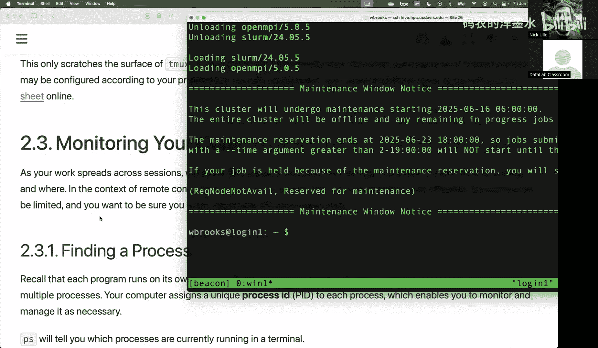

And there are a few reasons that we need to do this。

But some important ones are to know how much memory and CPU and time and disk space our code uses。

And the reason we want to know things like that is because this afternoon。

 when we learn about requesting resources from the high performance computing cluster。

We have to know how much resources， how many resources to request。嗯。

And the fewer resources we request， the faster it is we're going to find a node that's able to do our job。

 so our resource has to be sufficient for our needs， but the smaller we make that request。

 the more likely we are to have it filled。So it's helpful to have a pretty good estimate of what it takes to run your code and part of that is monitoring a process and learning about its memory compute and CPU usage。

 okay。So。I am going to create a new teamO session。And then start running some code in that session and we're going to see how a Linux operating system tracks those processes。

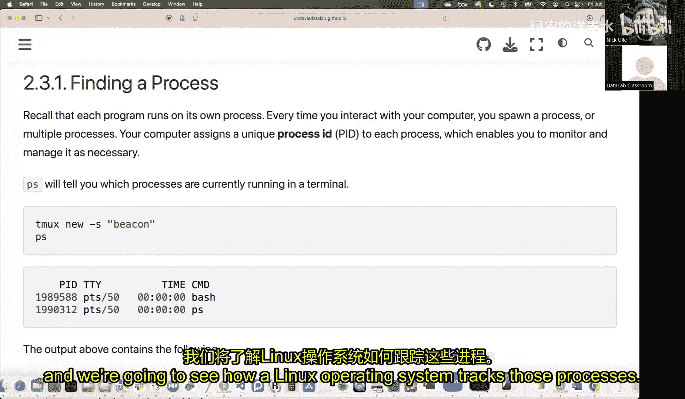

So I'm already in this session called Beacon。嗯。And I am now what actually， I can type。

PS here P is to。to indicate what processes are running， what are the processes？And I have two。

And it's tracking， oh yeah， what processes are running in a terminal， Okay。

 so this tells me that in the terminal right now I have。

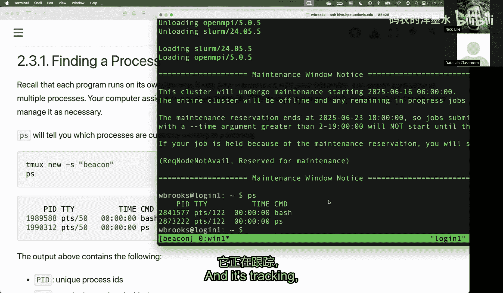

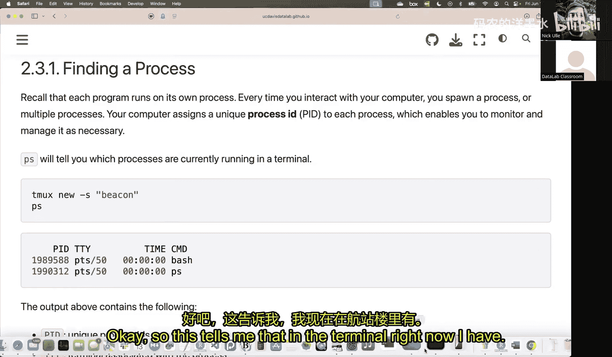

At the time that this output was printed。The processes that were running were bad。

 which is what provided this prompt。And then PS， which is what is actually generating the output itself。

Those would the only two process units that are running inside of this term them off。For this show。嗯。

Now I'm going to start the beacon running oh sorry before I do that should actually explain what these columns are PID is a number that is assigned by the operating system that identifies each process that is running。

嗯。TTY is indicating what shell it is running in， I believe， let me get that right or the yeah。

 what terminal is associated with the process。Time says how long that process has been running。

And then what CMd is like what is the actual command？嗯。

Was the actual command that is being run or was the actual command that was invoked to generate this process？

The time is the， the CPU time that has been used by the process。

 so even though bash has been running as long as Ive been connected to this show。

Bash doesn't actually like actively require any。Resources。

 at least not right now while i'm just waiting at the prompt。

 so that's why the time used by bash is zero。Right， so if I。Right。

 I'm now going to start the beacon running。Oops， and to do that。

 I have to go into the correct folder， which is my pro， I think。W。嗯，对。Oh， right。

Not just called Beacon， it is called beacon。sh。Okay， so now I start this peak and running。And again。

 I will exit from Tm by entering command mode。So control B and then type D for detach。

Now I'm going back to the session that owns that T Mons session。HPS。Okay。😊，Once again。

 the output of PS is just telling me that。The only processes running were bash itself， and then yes。

 which was the thing that actually did the printing。我们嗯。

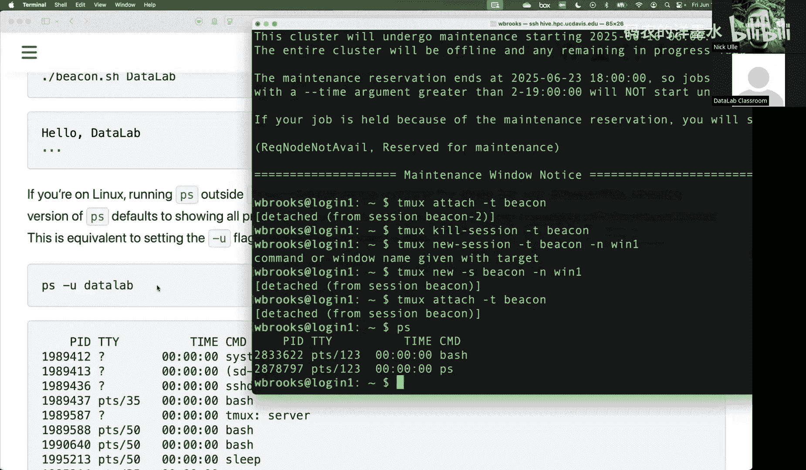

Right。But now if I want to look at everything my， but by default without any extra content。

 yes we'll tell you what is currently running in the shell where you call。

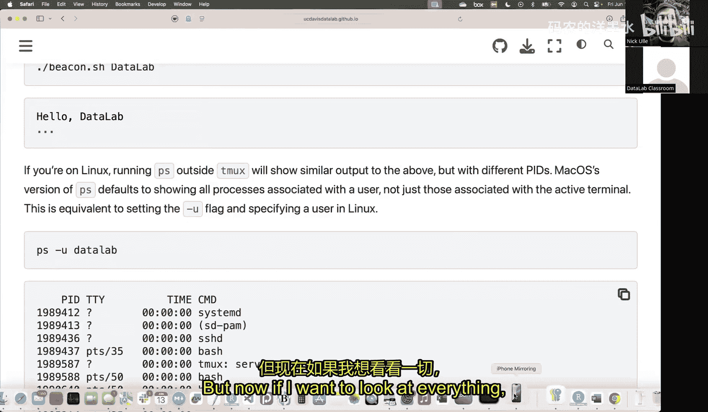

If I want to know everything that my user account is running even in separate sessions。

Then I write PS dashU for user and then user name in my case that's W Brooks in your case it will be whatever is to the left of the at sign here in your shell prompt。

哎。😊，So we get a longer at this now because we have more things running than just the。

Just the single session where I'm currently。But we're going to still have these same。

We're the ones that related to this session， so PS。

We're still going to I think have the same process for batchsh which is ending in 62 okay so here's the same process for batchsh it still does not use any resources because all it's been doing is sitting there waiting for input。

But we also have a couple of other versions of batch running。These are from sessions。

 other than the one that I'm currently sitting looking at。It found that sleep was running。

 and that's because part of the。Part of the Beacon program is to sleep for one second most of the time that that program is spent sleeping。

诶。And then we have some things here， a keyock server。With the process。Oh， yeah， sorry， we're not。

Okay， so we can identify which sessions are running each of these based on the T10 and so you can see that this one ending in 622。

 that's on session this version of bash。This instance of batchsh that is running with process ID ending 622 is running in session number 1。

23 the same number as what we had up here in this previous case。And also this version of PS。

 that this instance of PS is running in that same session， which makes sense because we。

Called it from within the sta。Those are unchanged， but we also have another session 122。

And those are the ones that are currently within TOX。

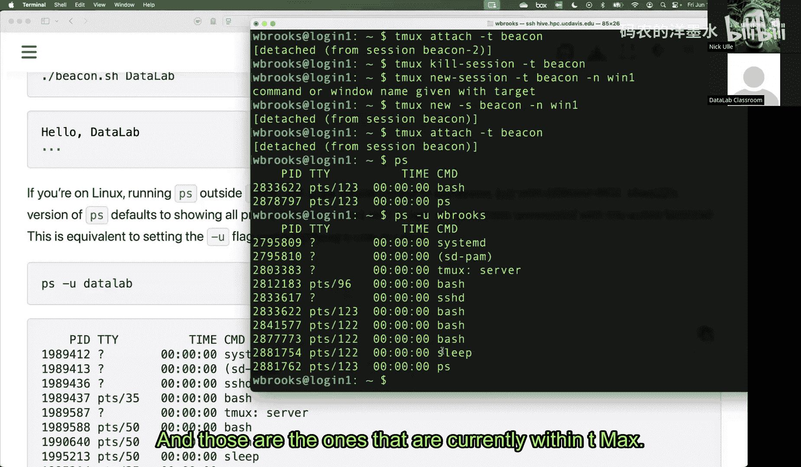

哎。And。Yeah， so。This is kind of interesting， but it is more helpful if we can know if we have a。

An explicit description of what session is going through each process。

So we can get that by using the F and J flags for PS。SoPSs。FJ。

 and then you still for user will be W Brooks。Now we get a bunch more content。

So we have the user ID that is associated with this process。We have the process ID。

 these should all be unique and they're going to be the same ones as we saw before。

We have the parent process ID。And this is where we can start telling which。Version of。Yeah。

 like which environment or CMMs shall some code is running in so for instance sleep I know that's part of the vegan program。

 which is running within CMM。就诶。And look for what is if it's a parent process。

It is this one ending in four sevens and then three。And then we can look for what session is or yeah。

 what process is that， so theory four seven and then three。

All that over and that is the process beacon。sh so this is the process that was created when I started at Sheki。

系你个自得几会。Who owns that process and it's go under the parent process ID， you can find， okay。

 the parent ends in 577。What engine 577 is this process， which is there。In that bad。

Its parents ends in three and three。And where is the process ending and creating pretty this one right here。

 Chima。SoTma is running bad。Whi is finding Beaacon， which is running this command to s。

This can be useful for finding out like if you do a lot of shell scripting and something goes wrong or program stalls。

 you are going to have some help tracking down what。Part of your program installed by using OPS。

However。It。喂。So。It's not a command I use all that often。But when I do。

 usually the things I'm most interested in are what is the。

The amount of CPU time that has been used by through the process and then also you know when was this started that that can help the S time is the start time and that can help identify something that has been running for a long time。

嗯。BecauseSometimes I'm trying to identify， yeah， anyway。呃。

Sometimes I'm trying to identify like which version of a program is the one that I started you know a week ago because I want to like I've decided it's not going to work and I want to kill that process and you can kill the process based on its process ID so if you're not able to if for some reason you're not able to quit a program。

 you can sometimes kill it with a process ID。Let's see yeah so that is what's listed here we can kill a process and i'm going to kill the one that I'm going to kill the process for beacon。

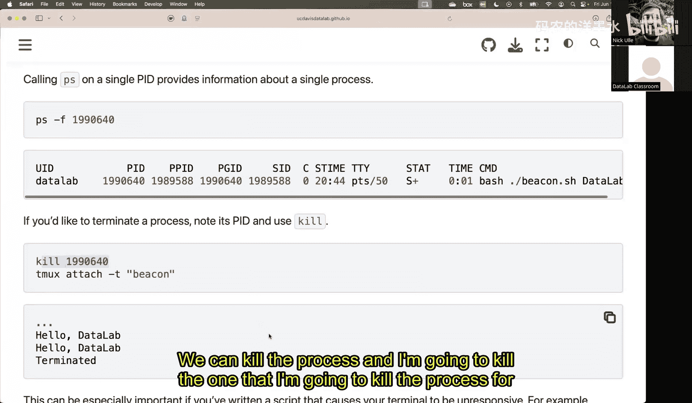

So remember。We look here at what is the command that is being run of this process and this is one for veganin。

sh。If I want to stop that for running， I can take this process ID and kill it。就。Two， eight。

 then four， sevens， then a three。H。So let's just look at the immediate result of that。

The list is a little bit smaller and this process is no longer anywhere to be found。

 nor is the sleep process because sleep was invoked by the process that I just killed。

 so it's also no longer present。And I can also just go back into my team session， reattach it。

So I attach to the target beacon。And I can see that。The process was from England。啊。Okay。

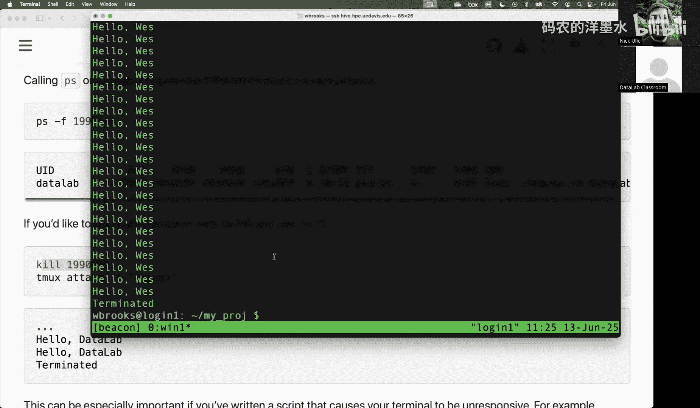

So as the workshop text points out that like this is often the only way to kill a process that has become unresponsive。

 it doesn't come up that often， but when it does， it's quite useful。 but so。

Other important things are knowing how much memory and CPU is being used。

So that is done with the top command。

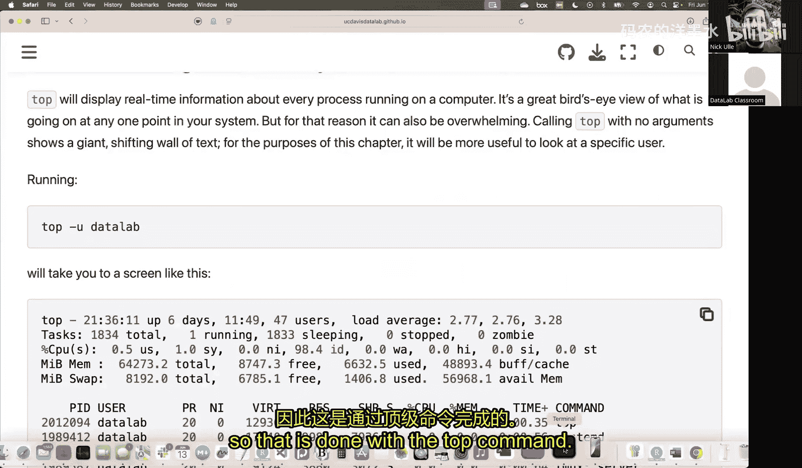

I'm going to exit from Tms， go back to just the regular shell or go back to my my you know overall primary shell。

嗯。And now I will use top。And okay， so if I just write top， I get。你。

Processses that are running by all users on the login node of Hs。So we have username here。

 you might recognize your name occasionally popping up this updates every a few seconds and they are sorted by percent of CPUs being used。

 I believe。So if somebody is running a he's type it as a web server， anyway。や没有的。呃。But。Okay。

 so now we're in a program that requires a special key in order to leave。

 which in this case I believe is the letter Q for quit。Yeah， okay， get out of top。

You hit the letter Q。I really only have control over my own processes。

 so I'm really only interested in optimizing my own processes therefore I don't want to look at all the processes that are running on the server instead I will just look at the ones related to my user so top。

And then just like with PS， we can specify the you flag to say， what user？Should be W Brooks。Okay。到。

In fact， the only one of these that is taking up any resources currently is the top function in the south。

Using 1% of a CPU， but we see some other interesting things we look at how much。

Virtual memory is used， how much memory is reserved and how much of the share。呃。

I forget exactly what the share piece is about。But we also see like。

How much memory in total does the computer have， how much is free antigens used？

As well as swap space。Which is another form of memory。

But these numbers are really kind of useless because they don't have any units to them and also they're really big numbers that makes them hard to compare。

So if you want to see them in a more human readable format。

 I'm trying to remember if it is just the letter E。Okay， letter E is controlling the。

The size of the scale for these memory measurements。And if you just keep hitting E。

 it cycles through all of them， so terabytes， heabytes。Okay。

 and then this is just byte by default how many bytes of memory are being used virtual memory and preserved memory for each of these programs usually megaytes or gigabytes are most useful。

 so if I hit e once it will show me megabytes。The top is currently using 21 megabytes memory。

 plus's this one using 200 SE land。For good。And I don't think I need to worry about it。Anyway。

 so did I have a program that was requiring much memory。You， I'd be focused on that currently。

 I don't have anything running that requires much memory so。There's very little here。

In the table that is interesting， but the point is just that we need to know how much memory to request when we want to run a program on the HPC right now this is all happening on the login node which is not very powerful the real power comes from requesting the compute node and again that's coming up this afternoon we'll learn about how to request access to a compute node and to do that we need to know how much time to request and how much memory to request。

对。If I run a program here on the login mode in track how much memory it requires。

 then I can shut it down once I know that and request that amount of memory from the compute mode。拜拜。

So the letter E cycles through the different scales of memory here in the table。

TheIf you want to cycle through the different scales of memory that is being printed out in the ladder。

 then you hold down shift and hit E。And so that goes， yeah， from7 gigabytes。

 how many gigabytes of memory 63 total 2。73 2。4 used， if I again hold down shift and type E。

 it will terabytes up there。In the header then petabytes。And then editte。And then finally。

 cycle back to kilobytes where these numbers are all too big to understand。

So gigabytes is probably the appropriate scale for this current session。Okay。But。嗯。你看。

What I'm able to do here is identify a specific process that I am running。

And look at how much memory is being used by that process。

 which is important because I need to know how much memory to request from the compute nodes of the HPC yeah so yesterday we said never the program on the head that is exception just do it for second you' yeah I mean that's a good question like how do you do this practically。

Yes。If something is relatively modest in requirements。

 I have no problem running it on the login node to figure out how much resources it requires。

If it is truly a massive computational load， then this probably won't work for me like there would be cases where I simply can't run it on the login node and I'd never get never be able to answer the question this way so it is。

It's sort of something you。Figure out as you go， I don't know no one's perfect。

 I don't have a great answer。はいはいあ。But if not using almost any resources to run。

So and install stuff that's also like you have a script that he written that shouldn not be really quiet。

Yeah， so the question is basically then how to use。嗯。How do use。

Something like top to tell how much memory a process requires if you either need to request the resources in advance by do it on a compute node。

 but that requires requesting those resources in advance or run it。

Somewhere other than the compute node， but then you get into the issue of like we may not have。

Yeah figure outYeah， so there's that as well。Or running off your herhe， see how much you need。Yeah。

 also really as we'll talk about more in the next session。

 its the cater over us and make promotion much meaningful。Uually there's a problem。Yeah。嗯。So yeah。

 like the compute modes have access to really huge amounts of memory。

So。You can overestimate in that original request and then do this test run where you monitor how much memory it actually uses and then reduce that request accordingly for a future run。

嗯。And I think that is probably the textbook way to do it， yeah。

The only problem is that that original request might take a while to go through because。

If you make a large memory request， you may have to wait for other jobs to finish first。Okay。

 so we looked through how to change the scale of the output for top。嗯。Yeah， oh， and then there is。

If you are using a GPU。This， yeah。嗯。This does come up for me occasionally。

You request GPU resources separately from how you request CPUU resources in the HPC。Cluster。

So there is you also need to know how much GPU memory to request and the way to do that is not through top but instead is through this utility called NVIDdia dash SMI I don't think I'm going to be able to run it from the login node because there is no GPU on the login node。

ButLet's see what happens if I around this。Yeah， okay， so。

Because I'm want to login node and there's no GPU there， I can't run that。

I can't run that utility to look at the memory use on the nonexistent GPU。If I could。

 I would get this table。嗯。And I don't know， maybe it's possible to。

嗯，Trying to remember whether I have an alias for requesting GPU space， I do okay yes。各。No。

 that's CPU， okay。Yeah， okay， so I'm not going to like try and sort out how to start a process on the GP right now。

But rather just point out that the process of measuring how much memory is being used on the GPU is a little bit different and it uses instead of top this utility called NVIDdia SI。

And then you would see。And I believe this。嗯。Oh no sorry， this is power。

 so that'll tell you how hard it's working， but here we see how much memory is being used out of how much is available。

Okay。Okay， so we've looked at how how to see how much memory like RAM is being used by some process that you're running。

 but you often might be interested in how much disk spaces being used in certain folders or how much disk space is available。

So we can look at how much how much disk space is being used by the or with the function D so for me I will look at D disk usage D and。

Then we can specify well oh sorry let's just look at the default what do we get if we okay yeah it's going to print out every single file that I have in my user account and tell me how much just space uses which it' not super helpful to me because。

I can't read those quickly and I don't really care about individual files I sort of care about an aggregate like how much is used within an entire directory okay so to cancel this while it's running I use that familiar command hold down control type C for cancel。

Okay。So rather than look at every single file I will say only go to a depth of one deeper than where I am now and so that will say how much disk space is used by each folder in my current working director which just to remind you my current working directory is my home folder so what do I have in here I have about eight folders。

嗯。There's one for a project there's a couple from specific projects then there are a couple like there's a scratch folder that。

And a handful of things in here and let's see how much disk space thing is do you to go to a depth of one。

 I use the dash D flag and I say depth is one。And it does take a while because it has to calculate。

Sizes of all of those and I don't want to wait for that。

 So instead I'll cancel and I'll just look within。We're going to look within this 2025 well I get to bats folder。

That should be quicker， however， there's still going to be a lot of files because I have a pretty big pixie environment in there that adds a lot of things installed so。

 but okay， it only takes a few seconds。Now。This tells me how much disk space I've used in each folder within that each subfold within that one folder。

 because I would ask for a depth of one。If I ask for a depth of two。

 then it will tell me about the disk space used in each subfolder under each one of these。

And so on as I keep increasing the depth of that sort。

 but this is a nice depth for being able to see how much disk space is used by the entire contents of a folder。

 however these numbers are big and therefore hard to read like is that 3 million or 300。

000 or 3 billion or guess not 3 billion but anyway it's hard hard to read numbers that have that many digits so it can be nice to make them human readable so I can look at D dash H for human readable the H flag。

And then I want to look also at the depth of one， and I will use that same looking at that same for。

So again， it's going to take about 20 seconds to run through that but。When the result returns。

 these numbers will no longer be in this unit list format instead it will put them into whatever seems most natural for the specific number and then an indication of what units were used。

Three gigabys in that p environment。5。6 megabytes in this get folder。

And then just 145 kilobytes in the actual source code for that。

Project so that's what the the dash H flag does it makes those numbers human readable。

啊了。Very nice。All right。And then yeah so disk space available or disk space used is nice。

 but sometimes we're curious how much space is available and so instead of looking at the disk usage we look at how much disk is free so Df。

And again， I want it to be human readable， so I will use dash H。武啊。And we are looking at。Okay。

 so we're looking at the entire file system here， which。Not super helpful。

 so I want to look specifically for one user。

对呀。😔，嗯。E investigation and thought。Yeah， so instead of looking at the entire file system。

 I'll just look at my current location and see how much。Disk space is available here， so I had 4。

2 gigabytes of disk space available so that tells me about how much data I could move into this folder into my user folder if I wanted to。

Okay。谢啊。그。Okay， so the next section in the workshop is about like we have a brief section here about optimizing your code。

So in this estimating resource requirements。The first subsection is about computational complexity。

And。Optimizing your code。To make it faster can obviously make your code run faster。

But how to do that。There are。Times when complexity is unavoidable。For instance。

 when trying to sort a large list of numbers， there's a limit on how fast that can be done。嗯。

And computer scientists have a notation that is used to indicate the。

The proportion of like how proportional the time usage。

Of a process will be relative to the size of the data that it needs to work on。

 and that's called big O notation。对。嗯。There are some common versions of big O notation big O1 means that the the time taken for that code is roughly constant it' it's unrelated to the unit of data we call on and yeah so the example here is like if you look up。

If you look up a piece of data out of anRA， that doesn't depend on how big the array is。

 you just go to that piece of data and you look at it。Whereas。If something depends。

 if something is linear in the size of data， for instance， adding a bunch of numbers together。

 it like the time it takes to do that is just proportional to the number of numbers to add together that's referred to as Big O and。

Big O and squared quadratic yeah， so that would be like if you have two nested four loops every time。

You have to look at you have to run some code for every intersection， every possible combination of。

I have two numbers from a vector。Then you might be in big O and squared and in that case the code is very sensitive to。

How big the data is or yeah， like how much data you're trying to run on。And。

It can get even worse though instead of n to the two you could have two to the end and in that case your code is going to be very sensitive to the size of data that you run it on so you want to avoid the more complex cases。

Yeah。So anyway， like when you create your code， you want to avoid the most complex cases of Big O notation。

The simplest way to do that is to use tools that were created by professionals for the jobs where they are available。

嗯。That means like not trying to reimplement algorithms that are already available from a function or package。

嗯。嗯。Yeah， okay， so。Alver， did you have a comment on that， I just wanted to say in addition to this。

 So this section is not really about optimizing code。

 it's about estimating the amount of resources for code needs。

 which was a question that came in earlier。And the idea there。

 how can you figure out how much memory I would need to do a certain task。

 How can I figure out how long a certain task is going to run and the idea of。

One could approach that because it over look at how long does it take to run a tiny example let's say your extra problem need to sort a billion long so what you can do can start by sorting a long and then you can extrapo knowing what is the long doings you yes that makes that is a much more intelligent way of saying things than what I was saying so I appreciate that。

Okay， so in order to provide an example of exactly what Oliver just said。

 I'm going to create a new script。I'm going to create that in my Myprodge folder。

 so first I need to go there。And now this new script， what do we call it in the example？

I am going to call it nested， okay。

And。This is the bash version， I will run the bash version。

 so I'm going to use nano to create a new script。

And this will be called nested。sh。Um。

And so what goes into that， we have once again our Shaang saying that this will be a bash script。

And then we have this nested for loop。三。I think this is short enough that I can type it out。

 This will help， I think just see a little bit of the。

To see a little bit of。What actually goes on in this code so USR。In and。I want to ra bash。

So I'm defining a function called nested。And the contents of that function are。To do a for loop。So。嗯。

Starting at I equals one。Counting up or continuing as long as I is less than。This variable。

 which I'm indicating by dollar side one， remember that means that I have to provide an argument to say how high do we count？

Sorry， and this should be less than or equals to other sign 1。

And I now want to and I want to increment after each loop。对。

So Echo is a bash command that just prints to the command line。Or print to standard out。

 which is generally the command line。And I wanted to tell me what is the current oops what is the current value of the I variable I variable is what is being taken from we're writing a loop bit takes I from one to whatever the input value is。

 so we also want to track how far we are along in that process。Then。

I'm going to have an inner for loop。And in this inner for loop。

 I'm going to take a new variable called J， I'm going to start it ats， start at one。

I'm going to keep going as long as it is less than or equals to。呃。Dollar to one。

 which again is that input argument that we will have to define when we call the code。

And I'm going to increment J after every iteration。Okay and I want to track the inner loop as well。

 so I will print out what is the current value of the J variable。Right。

Now I'm done with the inner loop。And I am done with the outer loop。And I can close the function。

And then finally， this has defined a function called nested， and now I need to actually call it。

And what I'm going to call is。Yes， okay。so I use command O to tell nano to save。

 I use command X to quit nanono and now I have to add the executable flag so again that's C mod to create an executable script。

And I want to add for my user only， so you for user， I want to add the executable bit。

And I want to add that on the file nested dohell。不看。

Now I can run the nested script and say it count up to three Okay， so that went really fast。嗯。

And it went too fast for us to really have any sense of how long it took。

So instead of us trying to time that with our watches or just mental you know， mentally noting like。

 oh that felt fast or oh that felt slow， instead I will use this Linux utility called time。And。Yeah。

 so I'm going to time how long it takes to run nested。That S。嗯。

And I'm going to say run that three times， so exactly many times as before。

It generates the same output。但是他不出来往一边走。But these numbers are really small， it's 0。009 second。

Real time。Real time means how long from when the time when I started this code with running the time when this code stopped running。

And that can be split into two parts， there's the user time。

 which is how much of that was me interacting with the system， and then there's the system part。

 which is how much of that was spent by the computer running the code that I sent。为什。嗯。O。But。

When I want to run this with a larger。With a larger level of the input。

Like this is too small for us to really be able to tell detect trends like we only have a single digit so there's not much detail here。

 so we need to make this number bigger before we can even form a baseline。

Which is to say this number is rounded more significantly than moon right。

I don't want to generate all this output on my shelf。So this can be useful for you as well。

 not just in time and code， but in running code that you create if the output that that code puts on the screen is something you wish to store then we have a better way of doing that than storing it on the screen we can just out direct that output to a file and then we'll be able to read that file later save it you know pass it around that's much more。

Useful if the important results of the code are would have been printed to the screen。

The way to do that， redirect is with the right carrot。呃。Okay。

 so I'll just demonstrate time how long it takes to run nested。Dotsh。With an input of， say， 100。

And I will redirect the output to。Output a text file which doesn't have to exist。

 I just define a name and if it doesn't exist it will be created。喂。And so I use this。

This right carrot or greater than or right arrow， however， right angle bracket。

 that is the symbol for a redirect of standard out to a file。对。😊，So now even that took about 0。

1 seconds of which okay， right， right so what。Here's the breakdown between user and system。

The real time was about 0。1 seconds of that about 。6 seconds was user time。

 which is the time taken by running my code。And about 0。3 seconds of that was system time。

 which is how long was taken for the system to do its background processes。

But counted for the real time like that is in the time that my code took。

But it's not related to my code， so we actually willll usually ignore that if we're trying to calculate how long the user code takes to run。

Okay， so with an input of 100， it took about 0。6 seconds。嗯。And I can also。Show you the。

The contents of the output。txt。Now， I don't want to cap that because that will then overwrite the screen。

 so instead I'll use less。Those less can be undone。Okay， this is what the context of that file again。

 it's not useful in our case because we this is meaningless just tells us about what loop we're executing。

 but if your code，Writes important results to the shell output。

 then this is a way to capture that for later reuse。Okay， and because this is less。

 the way I get out of less is by typing Q。And Nick or Oliver， we got a red flag。好的。

So this is how longington run my code with 100 iterations。Let's look at a thousand iterations。

We'll change the 100 to 1000 and again redirect the output to output。txt。Okay。Now we wait。Okay。

 so I increased the size of the data by factor group1。

And the time taken increased by nearly a factor of 100。That is quadratic complexity。

嗯。Qudratic complexity because。1en squared is 100。So。When。N was multiplied by 10。

 but result the time it took was multiplied by n squared。

So our code here is an example of quadratic complexity。

 and that makes sense because the example here for quadratic complexity was two nested for loops and I just wrote two nested for loops。

嗯。And this now allows us to make a really solid estimate of what the time taken would be if I were to。

 let's say I were to。

Go from 1000 iterations to 500 iterations。Does anyone have a guess as to what the user time required for that would be？

は。Yeah， so I heard I heard somebody point out that it would be a quarter of this which this is just over four seconds。

 so I'm going to guess about one second。Although I guess if we should look at real time because that's the actual time that we spend waiting。

Okay， so nine， what's a quarter of nine， it'll be just over two seconds， two and a half seconds。

 maybe。So this will help confirm our guests that this is quadratic complexity。And yeah。

 so a little over two seconds of real time taken a little over one second of user time。

This is now going to allow us to have a pretty solid estimate of how long it would take us to run any particular number of iterations and we can plan our resources accordingly。

Okay。嗯， timing明啊。Yeah， okay， and then there's a version that。

Yeah， so so we're done for the morning oh yeah and we are basically at the end there's。

Not anything significant still here。Except I guess I can show you top with the sea flag or no we we already we already went through top so yeah。

We're going to call it there that's the end of the morning session this afternoon we will be。

Actually running code on the powerful compute nodes of hive so Nick is going to be leading that session and we look forward to like putting all the pieces together and allowing you to really run your complex analyses Thank you so much and yeah we're going to have an hour for lunch at you one o'clock。

