# 【全集】加州大学戴维斯分校 计算机科学 中英字幕 1080P p10 Lecture 10 - 远程计算与高性能计算：SLURM实战与服务器最佳实践 -BV1cqFNzYEvp_p10-

嗯。没好。Okay， so I think that should work， we should have audio。Okay， so we are going to jump back in。

 we're going to learn how to actually run things on the compute node because so far we've only used the head note。

And before we do that， I just want to go through some vocabulary so that what I'm saying will make sense。

The first thing we've talked about parallel computation a little bit in terms of like using the words。

 but I haven't really said what I mean by that exactly maybe you have some kind of idea but I want to make that concrete so most of the computing you've probably done up until now has been sequential where you can or sometimes called single threadit where you basically write a line of code and it runs and then you have another line of code and that runs and then you have another line of code and that runs is just one after the other after the other。

And this is the way that most people think about writing code。

 this is the way you probably learned how to write code probably still for a lot of things this is the easiest way to do it but you can also set up your code or your programs so that they run side by side so that maybe the first step starts running and then the second step starts running and then maybe the second step finishes and then maybe the first step finishes right so you can have have multiple steps running at the same time and that's really what we need by parallel computing。

That could mean that you're using multiple CPUs， like now all of our laptops。

 if you have a laptop from the last 15 or 20 years has multiple CPUs inside of it and because it has multiple CPUs inside of it。

 you could potentially even use something like your laptop to run multiple things at once。

Okay on the servers on the HPC you have even more options because each of the the HPC compute nodes and the head node they have multiple CPUs on them and then there's multiple nodes right so in fact I think if we go to the HPC website they give some information about what the actual。

Cluster hardware is so like just to share this。They do have hive on there。

So for hi they talk about how much trouble RA it has with memory and how much memory per node。

 how many nodes there are， so you can see there's11 nodes for five。

 and then it tells us about things like GPU red can。You can do a lot of。

 you can have a lot of things running in parallel on this side of hardware。

Okay your laptop might be able to run like four or maybe eight things in parallel depending on what CT you have。

On high even out like tens of things or hundreds of things running in parallel。

If you need it no usually。If you can solve whatever computing problem you're trying to solve with single-threaded program and it runs fast enough for you。

 then you should just do that because that's going to be the easiest thing to do using parallelism makes everything a lot more complicated and so you shouldn't go to parallelism unless you actually have seen like trying to do this with the single-threaded program or a sequential program isn't going to work for like whatever you're doing takes so long that you can't do it that way。

 you need to do it in parallel so that you can actually get it done in the amount of time that you have to do it。

Does that make sense to everybody， This is this is not not something you should do just。

 just for kicks， unless maybe if you're trying to learn， but like。When we actually do parallels。

 there's a few different ways to think about it。Or different flavors of parables and I guess so with it so you can do what's called multi threading。

And this is where you have one program that launches a bunch of what are called the threads。

And these are like different processes that run， but they all share the same memory。

Okay most programming languages have some amount of support for this like an R there's packages that support this so that you can run things from one r session and start multiple threads python is also starting to add support for this there have been some technical reasons why it was harder to do this in python that are now。

Improving I guess I would say so Python is starting to work on this model as well the idea here is that you've got all these different threads that are running and when you have multiple things running usually they're going need to communicate with each other somehow not always if they don't have to communicate with each other we call that an embarrassingly parallel problem because then it's like very simple to parallelize because you just say okay start the first one start the second one start the third one then just wait until they're all done and they don't have to talk to each other there's no complicated like communication between between the threads so that kind of situation that's the easiest case for parallelism but most of the time we need to actually have our threads communicate with each other and in multithreading the way we do that is through the shared memory they all have the same access to the same part of the computer's memory so this is typically running on just one computer or one node this doesn't work if you're using multiple nodes right。

And this is like one of the ways you could do this on your computer right you have one computer。

 it has maybe multiple CPUs and could you could have threads that share memory。Okay， so in general。

 multithreading is the easiest way to do parallelism if you can if you need to go really big right。

 like one computer， even even a really like I end computer like the stuff on the HPC if one computer isn't enough to do whatever you're doing maybe you need more memory than that you have more things you need to do than that。

 then you can go into what's called distributed computing and this is where you're having multiple computers。

Do something sort of in concert right they're all all working together to compute something now instead of having shared memory you have a bunch of separate processes that are running on potentially different machines different nodes so now communication becomes a lot harder between these things because there has to be some kind of external communication the processes maybe have to write data to a file and then read it back from a file to communicate with each other or use some kind of like communication protocol and there are different communication protocols for doing this but this is like maybe the harder form of。

And terrible computing。so again， like multithreading is everything's sharing memory running on one machine。

 distributed computing， we're not sharing memory and usually not running on one machine you could do this on one machine。

 but the main thing is you're not sharing memory anymore so much of independent processes。对。

Any questions about that？Any of the vocabulary so far？Okay。

When we talk about these things I've kind of been using some of these words already。

 generally we're going to think about a parallel program that you've got a single program it's doing the computations and then that program might start one or more processes these are separate things running potentially on separate machines and then each of those processes could start one or more threads。

So in the multi threadreaded model， we usually we have one program。

 we have one process and we have maybe 20 threads in the distributed computing model。

 we have a program that maybe it has like 10 process even they run on different。

They be used right and then they could also have threads or not， they could just be what one thread。

嗯。ok。So thats that's the model for parallel computing that's the terminology we're going to use and then the other thing to think about is the hardware itself so we've been sort of talking about the high performance computing cluster the HPC quite a bit without really saying what we mean by a cluster but just to make it really explicit like the cluster is a bunch of computers that are connected together high speed networking cables networking equipment。

And each computer in that cluster is called a node we've seen but we can log into the head node log in that's where we end up and then there's also these compute nodes where we're going to do our computations okay。

嗯。Now to actually start our computations we're going to use something called a workload manager or a job scheduler we're going to use one specifically called sLR that i'll get to in a minute and the。

Programs that you start using in these workload managers or job schedulettlers that are called jobs。

Okay。No。All right。SLRm is one of these workload managers。

 not not every like server or computing cluster uses the same workload manager。

 all of the ones at UC Davis use SLm， but if you go to a different institution they might use something else okay so SLR is not not the only one that exists。

But it is popular there are a lot of universities that use it and a lot of like other institutions as well businesses and things like that。

 and it stands for simpleple Linux utility for resource management that's what the SLR name is about it's also a reference to Fu Alma。

So。Slarm has its own very particular vocabulary for things。

So it calls the task a process that runs on a single compute node， okay。

 so if you've got something running on one compute node， that's a task。Okay we're sort of going。

 we're going to go from like the smallest the largest here so。

After a task a step is a single command in a computationation we're going to make this really concrete in a minute when we actually start writing batch scripts。

 but a step is like a command that you've entered at the terminal right and a command could start multiple tasks or maybe just one task it just depends on what command you ran。

嗯。And then again， the job is your entire computation that you ask the work code manager to let you do and that could have multiple steps in that job or not。

 it could just be one step。Okay。And we need to know all this vocabulary because there's SLm has parameters that ask about these things like how many steps are there going to be。

 how many jobs are there going to be， how many tasks。嗯。嗯。One more piece of terminology。

When you submit your jobs to SLRm， you submit it to something some kind of queue right the part of what SLRm is doing for us is making sure that everybody that has access to this shared server gets fair use right so we can't we don't just have one person that like uses all of the CPU time all the time right SLRm is making sure that it's balanced。

In some way， and so when you're submitting a job you get put in a queue right you have to wait until it's your turn to use the CPU and whatever other resources and then when it's your turn your job runs and then when your job is done then the next person goes right。

And when you get added to the queue， there's several different cues available depending on what hardware you're going to use and SLRm calls them partitions。

so partition is kind of an overloaded term， it has a lot of other meanings and other contexts in computing and maybe outside of computing too。

 but in the context of SLRM， a partition is talking about like what queue are we waiting in for resources。

对。All right。Any questions about any other the vocabulary， yes？

Some likeThe operator is straightforward forward。Here says。

It's going to run at midnight so you'll get results so it won't so what'll happen is the when you submit the job it will say。

 okay we've added you to the queue and it doesn't tell you when it's going to run because it doesn't know it's whenever it becomes available right which depends on what other how long other people's jobs take。

So it will just be okay it's in the queue now and then you can go away。

 you don't have to like sit there and wait for it， it remembers that you're in the queue and it will start whenever it can。

嗯。Any other questions？Yes。There are Sm is automated yeah it's all just it's a computer program。Yeah。

Anything else？Any questions， yes。So the vocabulary for jobs I this will maybe me make a lot more sense once we actually start running jobs。

 but if it doesn't then let me know when we get to that point it's still not making sense。

 I think all of this will make more sense when we actually start doing this stuff。对rry。Okay。

 so let's let's let's start looking into some of this stuff The first thing we're going to do we're just going to try to get some information about what we can do on the server and then we'll actually launch some jobs so i'm going to go over to my terminal and i'm going to go to my home directories i'm not logged in yet so i'm going to go ahead and do that。

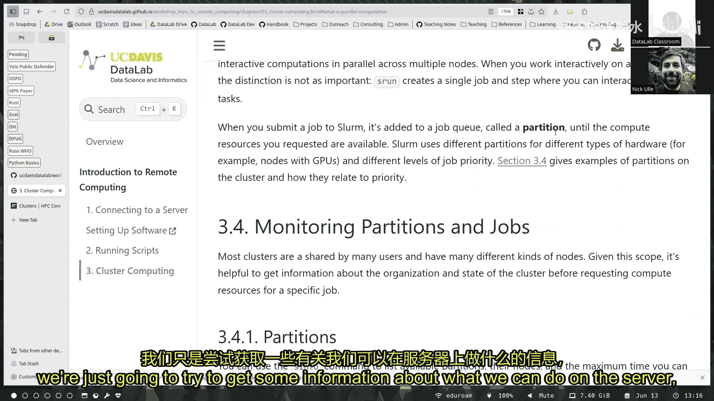

I'm going to log into hive if you're following along， you should log into hive as well。嗯。Okay， so。

One of the first things we can do。Trying to figure out。

What we can do with this server is just ask what partitions are there on the server。Okay。

So to do that。Command we can use as S info。And then dash， dash， summarize。And this is in the reader。

没。And so the way this prints out what this is telling us。

 you can see it's a table it's got a few different columns。

 first of all it tells us different partitions and because I've got the font so large and it sort of wraps but you can kind of see there's a high partition a low partition and then a GPU H100 GPU A6 cells。

嗯。And you I think we'll be able to see the same thing if you're logging in and following along it tells you about the availability of that partition so is that actually up or down like is it working or not and right now you can see they're all up it tells you the time limit this is the longest amount of time you can request if you wanted to request a job on that partition and so this is days hours and minute seconds so so me I can request 30 days online you might have a different limit。

Then it tells us about the actual nodes so what's going on with the nodes， and I believe。

That these letters， the AIOT， if I remember， right。

A is available or A is the the nodes that are actually doing something。 I is the nodes that are idle。

 I can't remember what O is。And then T is the total number of nodes。Okay。

 so you can kind of see like this one 25 or hearing something neat or not really anything。3ty4 total。

and then also it gives you a list of the actual names of the nodes which。

Isn't particularly useful for anything we're going to do， but it's there。Because in general。

 we don't care about the name of the nodes because we're just going to ask for a node and then we get what we get。

 we don't ask for a particular node by name。Okay， so that's that's how we can kind of see what's going on with the server。

 what partitions it has available you can use this command on any of the UC Davis HPCs if we're doing it on hive。

 but if you're using farm or something else later on， you can also do that there。

Anything that has SLRm in fact， because all the SLRm commands or then use a few of them they all sort with S like this。

 so S info is our first first sLurm command that we're learning about。嗯。

All right so that's good we know about what partitions are available and what's on them this doesn't this isn't actually telling us what partitions were allowed to use okay it's just telling us like the overall information for the server or for the cluster so if we want to know what what can we like our own account actually do。

Then you use a different command Okay， and this is S account manager and it's abbreviated。

 So it's S TT or CCT， MGR like that and then show。Associations。Where？

User equal to whatever your username is， this is your your cur user thing you should be seeing over here。

对。你。This is a really long command I personally can never remember the whole thing and I was have to look it up if I need to use it so this is the kind of thing you can set an alias for if you're if you find you're using this a lot setting an alias is really useful for the setting command and so if you run that。

Then you can see that in my case， I've got access to a few different partitions and actually let's just maybe break this down a little bit。

And let me also， I think should I。YeahYeah， good。Yeah。Okay， yeah。

 it's a little hard to read because of the font like staring at it trying to figure out what's going on why not in the order I'm expecting it I think it's because the font size is so large。

 but basically the key the really important column that we're looking for here is the one partition and you can see it kind ended up underneath where it's supposed to be the wrapping is making this all a little weird but so you can see I've got access to the high partition and also the low partition。

Okay you might see something different， I think the default for free users of the hive is that they can only access low。

Okay， so you might see how I'm not sure。But this is showing you what partitions you can actually access。

And that's that's the main thing I want you to take away from this there's there is other information here you could if you read the manual page for the S account manager。

 you can learn more about what these other things mean。

 but I don't think they're particularly important for anything we're going to do。Okay。All right。

 so that's how you can get a sense of what resources are available to you。

 are there any questions about that？OkayU so the next thing。

 you might want to know what what's actually like what jobs are running on the server。

You might want to check if you have jobs running on the server。

 you might want to check how many jobs other people are running on the server to see if it's relatively busy or not。

Um。So the way you can check jobs on the server is with the SU function or command but on SU command。

Again， another slm command。Readrey to learn and this will print out if you run it by itself。

 it prints out a huge amount。Of information because there's lots of people running jobs on the server so if you want to if you want to sort of truncate that a little bit。

 you can use a vertical bar and then head dash n10 and this will just print out the first 10 lines but but that's the command I'm running let's just prints out the first 10 lines sounds like maybe the first 10 or nine jobs。

Butner runnings。Okay。And for each of these jobs， this is telling you a few pieces of information。

 so it's giving you a unique number for the job 2157503。

 that's a unique ID for a job every job that someone submits gets a unique ID number okay ands that's how you can keep track of which job is which okay and which job is yours。

嗯。It also has information about the partition so we can see 2157503 is running on high it tells you a little bit about what's actually running。

In in that job， so like in this case， it looks like that person's job they're running on demand。

 that open on demand thing that is a way to do a graphical interface when you use the server tells you the username tells you a little bit more about their account。

 tells you the status， the status PE means pending， it means the job hasn't actually started yet。

Let's see if we can find one that is not pendings Okay， so if I just run SQ again。W has an R？

That means it to wrong。嗯。So that job is actually going。Excuse me。Okay。

So you can see if the job is running or not， it also tells you。How long it it really？

this person's job has been running for 19 hour already。

And then it tells you how much time they have left。But it looks like they were in maybe three days。

Good。It tells you a little bit about how many nodes are being used， so one node， okay。

Here tells you a little bit。About the number of CPUs， so eight， the memory 20 gigabytes。

 and then it actually has the name of as well。Okay。So we can get all this information out of SQ。

Any questions about any of these pieces of information？Which one's with the name of node this？当时一。

So you might see that there are multiple jobs running on the same node that's because the nodes all have multiple CPUs。

And so if the job only needed like eight CPUUs， then I think the nodes have。

 I can't remember how many Ps they have per a node， but it's more than eight。

 so you can run multiple jobs on one node at the same time。对。Yes。啊，我。Yeah。So the CG status。

You might have that in the reader， I actually don't remember or know。But let's look。

So if you're ever unsure you can look at the manual pages for these things。

 so that to that I use man SQ。The manual pages for SLm。

 I would say are a little bit dense and cryptic。At least there is documentation。Okay。

 so it says Cg means it's completing right now college that's probably why I don't know this one because this is probably only there for like a comm amount of time。

So you can actually see here some of the other ones though you can see if there's like one for failed completed as one you might see sometimes canceled as one you'll run into if you ever cancel a job。

 but a lot of these are like very fleeting so if you run SU at just the right moment you can see them。

 but otherwise you probably won't the ones you're mainly going to see in SQ are pending and running。

没。Okay。Any there was another question yeah that could be what's happeningm not exactly sure why it。

I think that might be an array array job， which we'll talk about later on。Yeah。So yeah。

 that's the right intuition I think or it's not necessarily threads， it could be multiple processes。

 but yes， it's the right intuition。Any other questions？Yes。

What so like what' somebody sitting in there know that people having。One thing you can do。

 you can go and look at the actual HPC website， they tell you a little bit about this。

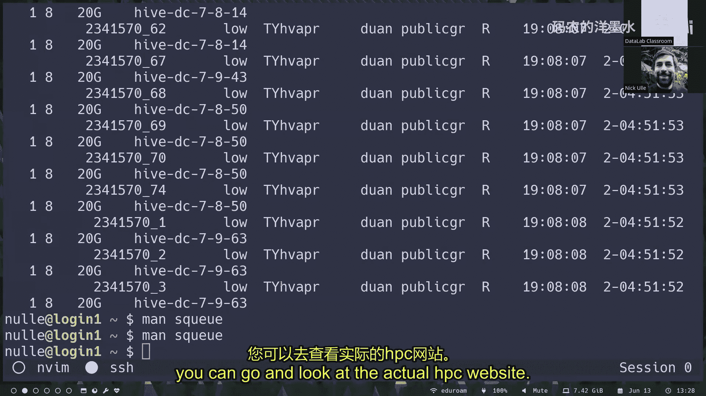

On their website you can also there's Linux tools you can use to check this and some of the these were the things that Wes was talking about in the previous session like you can use things like top to figure out how much memory is available。

 things like DU and DF to figure out storage available although。For your storage。

 something I should mention， the storage is shared across all the nodes。

 so your home directory is like those files are shared across any node you use。

 you'll still be able to see all your files and you'll still have the same amount of storage。No。

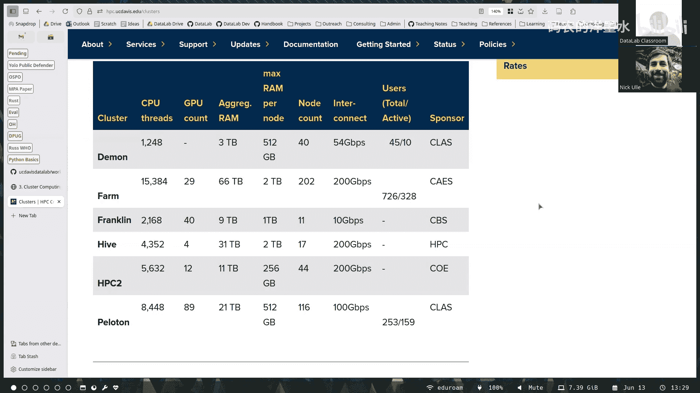

AndThere's other Linux tools too that you can use to get information about an individual node and when once we run something。

 we're going to start a job on a node in a minute， and then they you can sort of see that you can just run commands on the node and see what you've got。

Okay， so。Let me make sure I'm not skipping anything。

Something else you can do if you just want to know about one partition。

 there's lots of options that you can use with this SQ command so you can say SQ partition。

 maybe we want to know about the high partition。so if you want。

 you can check on a specific partition what what's going on there。I mean。

 this is just giving me back the jobs on the high partition。I think。Okay。

 we're I guess we'll do that later Okay， so yeah， I think that's all I'm going to say about SQ for the moment。

Ohello。Yeah。Okay you can do the same thing with S info。

 I guess I could also add that so you can also add this partition command with S info and this will tell you a little bit about。

呃我 different。嗯。Nos on that br shame what their status is。

And kind of like the printout we saw earlier。Okay。咁。So let's actually run a job。

we've got some information about what partitions are here we're going to start by running our job interactively there's you can also run jobs that are not interactive and we're going to see how to do that in a little bit。

 but I think for getting started the interactive job is a little bit easier to understand。Okay。

 so in terms of where we are in the reader， we are at 3。5。

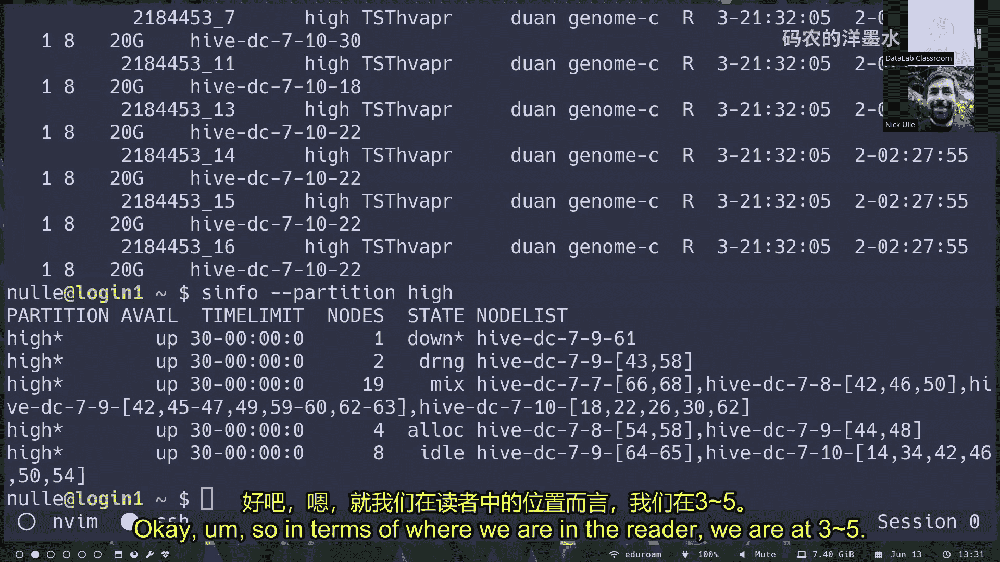

If you're following along， because we're going to run some code。

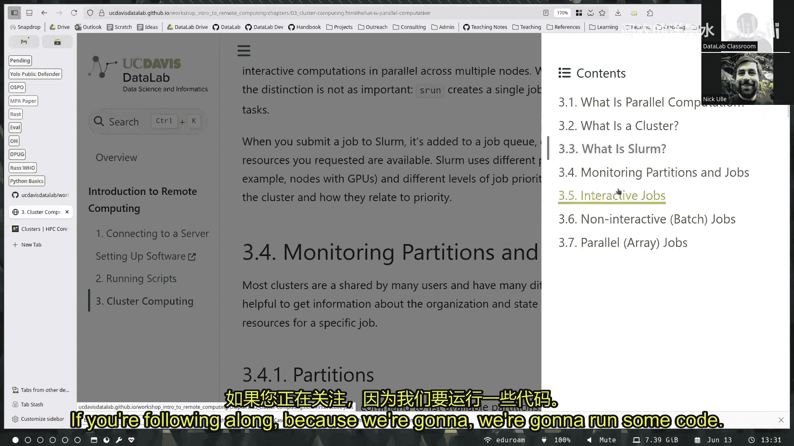

嗯。And when we want to launch a job interactively， the first thing we need do。

 we need to tell SLRm somehow that we want to start a job and when we do that。

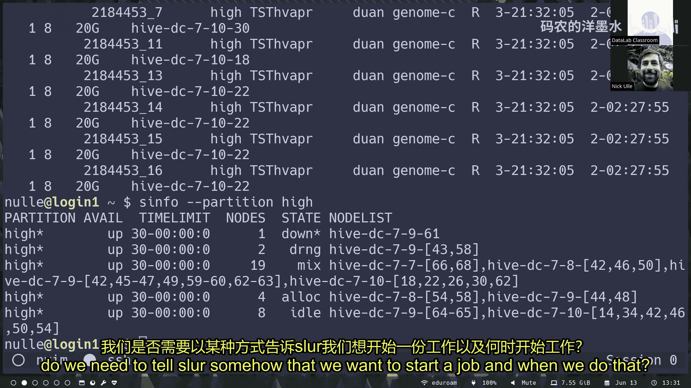

We're going to use a command called S run， and we need to give it some parameters。Okay。

 in particular。These are the really important parameter takes a lot more than you could set and if you look in the manual for SRN。

 you can find out what all of those are， but these are the ones that are really crucial to specify and so you have to tell us learn how much time you want。

Okay， you have to。We'll come back to this we'll come back to p you have to tell it which partition you want to use you have to tell it how much memory you want and you have to this one is more optional but you should really say what is the name of the job okay and this can be just like a text strength okay。

So。If we were going to request some time on the server， I'm going to start syping this out。

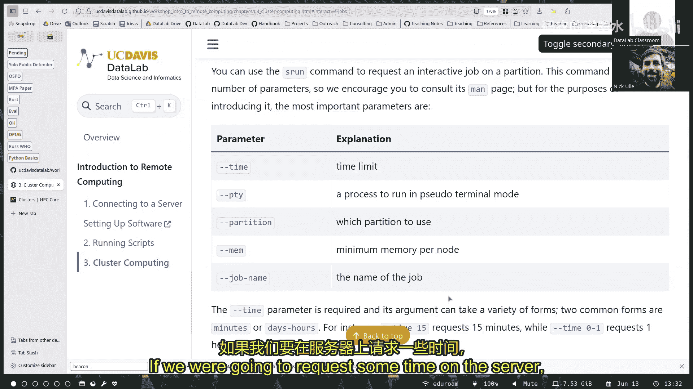

And type esterone。RightAnd then we need to tell it the amount of time so we'll say dash dash time and there's different formats you can use to specify the time so these are documented in the reader the two I think easiest one to work with or if you just give it a number then that will be treated as minutes or if you give it a number with dash and then another number that saves in colors。

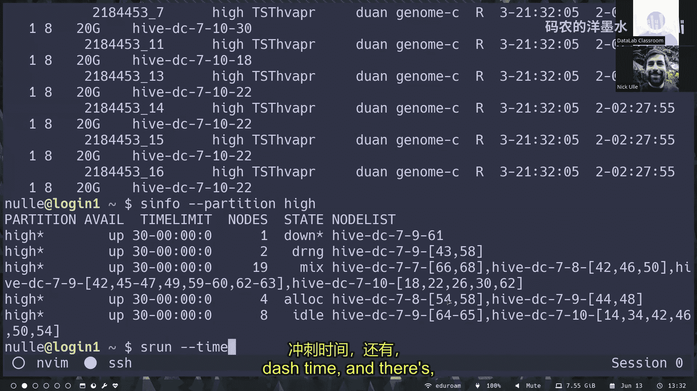

There are more formats that you can find in the manual。

 but these I find are useful enough to cover most cases。

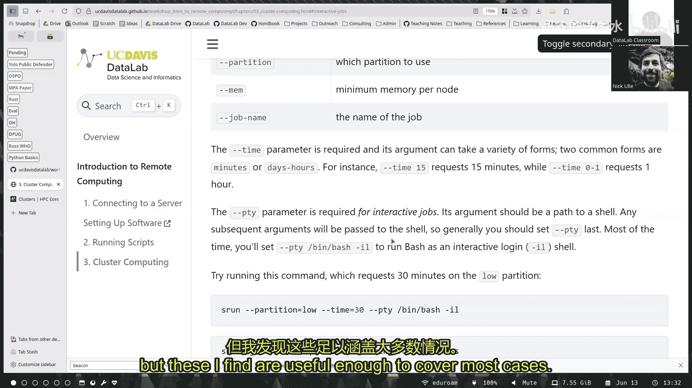

So if we go ahead and say time。Let's just do 10， you know。So let's do 20。Okay。

 so we'll say time 20 something else you might see and I think the reader has some of this too you can there's two different ways you can write this。

 you can you can either write dash dash time and a space or you can write time equal 20 without any spaces。

 whatever you prefer okay。So I'm just going to write it like that。

 and then we need to write some more stuff here， So we need to say the partition。

 so I'm going to say partition。L。Okay and the difference between these things。

 the low partition is generally supposed to be the partition where pre users are running stuff and it has lower priority than the high partition so if people are putting in jobs on the high partition and there's not enough compute resources available to also run the low partition jobs the low partition jobs will get paused and the high partition jobs will run okay sos that's generally how this works there's some subtleties to it which I don't know all the details of that's the kind of thing you could ask the HC admins and they'd be happy to have explain it to you。

Okay， so we did that and then we also need to see how much memory。And in this case， for memory。

 you can write this in a way that I think is fairly intuitive。

 which is like if we want eight gigabytes， we write 8 G。Okay。For what we're going to do。

 we probably don't need a gigabte， but that's okay。

And this can go up to the whatever maximum amount there is per node。And end job name。

 so let's put the job name。嗯。So I'm going to call this。This my first。诶啊。Job。

So one of the things to look out board is making sure we'll be done with don't too much regularly on it。

Not really if you allocate more than than is like exists on the node。

 Slom will tell you that like it's not possible to allocate that much， but otherwise。Generally。

 you're asking for this much memory， but you're not actually going to get it right away if I remember it correctly until you start using it。

So。So you can request more memory than you need I would still try to be conservative like don't ask for。

100 gigabytes of memory every time， if you know that all you're going to do is run a simple script right。

 you don't need that if it's something that could run on your laptop。

 don't ask for 100 gigabytes of memory okay。But in the past when I talked to the admins about like。

Should we be really worried about this have said no that it's not usually a big problem， yes。嗯。啊。

And it is interesting for us， I think can go over the beginning that quite a great few。系佢醒我噶度。呢四紧。

You mean that your people are having to wait a long time to run jobs because。嗯。Right。

 but what I'm asking like， how is that impacting？Yeah。

 so I would I think that's a culture problem rather than something you can solve with technology like you need to。

People in the group need to talk about like what is a respectful way to share these resources？嗯。Time。

😡，hii。Yes。It doesn't really do that for memory because it's not clear how you would do that。Like。Oh。

对。Yes， now when the understand understand if you remember at the very beginning I talked about the thought after results that memory is one of those。

 so you can't really go over the memory has but because taking you possible performance fall so the way that I am understand understand and I might be around that I feel use because is that when you say I'm using a gigabytes that means if your process then will be more than a gigabytes it's going to good tune not right。

But what we was 16 using before is let's say your server has 16 gigabers of per。

And there's already a job running on that says I everybody。

Even though that job gigab has 1 that job is there's some incentive for you to not overestimate too much because'll probably be in the queue for less time have a lower number。

Okay， any other questions？Okay， so we've got all of that one other thing I wanted to note when you said the job name。

 make sure you don't put any spaces in the job name that you never underscores no dashes。

 but no spaces。And then we need one more thing， we need that argument or parameter that I skipped over the PTY thing and this is basically saying were we're going for an interactive job。

 we're going to run some kind of shell program right we're used to working with a shell when we log in。

 we want to have a shell when we start the compute node as well otherwise we'll just be sitting there and we won't be able to run our anything really。

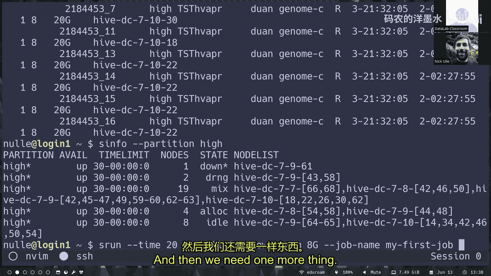

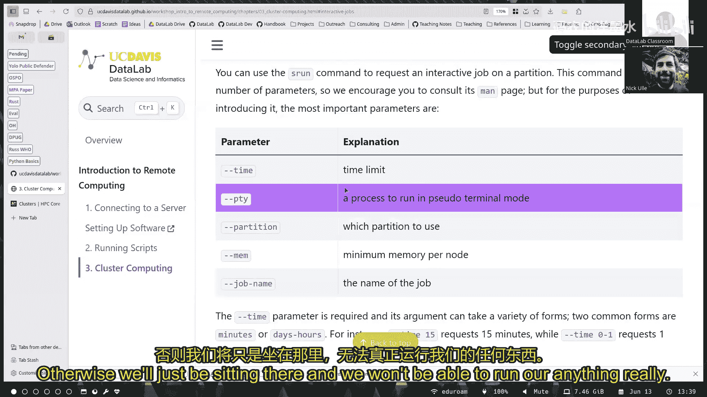

So we're going to say PY， and then we have to tell it what shell we actually want to use Okay and so in this case we're going say slash bin slash bash and that's that's generally the shell you're going want to use unless you really know what you're doing and know you want a different shell this is the same as what we're getting when we're on the head node right it's just bash shell and we're going to give some arguments to the bash shell as well when we started up we're going to do dash high dash shell is an interactive login shell so that's going make sure that all of our configuration files like our dot bash profile and our do ba or C this is making sure that those want。

对。If we left those off， then bash would start up and it wouldn't necessarily run those。Okay。

So we should have something like this again， all of these things。

 I believe are mandatory accept dog name。And as we'll see we when we do non interactive jobs。

 you won't need the dash BTY for non interactive stuff， but okay。

 so we've got our command crafted so I'm going to go ahead and run that。Okay。

 and you can see it tells me it's in the queue。itGive me a job number you'll see a different job number it's in the queue it's waiting for resources and then in this case pretty quickly I was allocated resources okay and then it's saying some stuff this is about that module system that we saw yesterday so it's unloading some modules and then it loads them again on the compute node that's what's going on here remember we learned module load module unload so these are the sLm itself and that other open APIpi module for doing parallel computing。

And then you can see that my prompt has changed。And now instead of at login one。

 which was the head note， I'm@ hi DCc 710， which is one of the compute notes。

And you might be on a different computer。Or you might't be on the same one。

It just depends on what was available。嗯。There's a red sticky up here also okay。

We've now managed to get onto the compute node and I see a few more red stickies going up。Okay。

 so I'm actually going to pause here because a bunch of people have going have read sickies now so。

We're to try and sort out whatever problem。So from。Yeah。

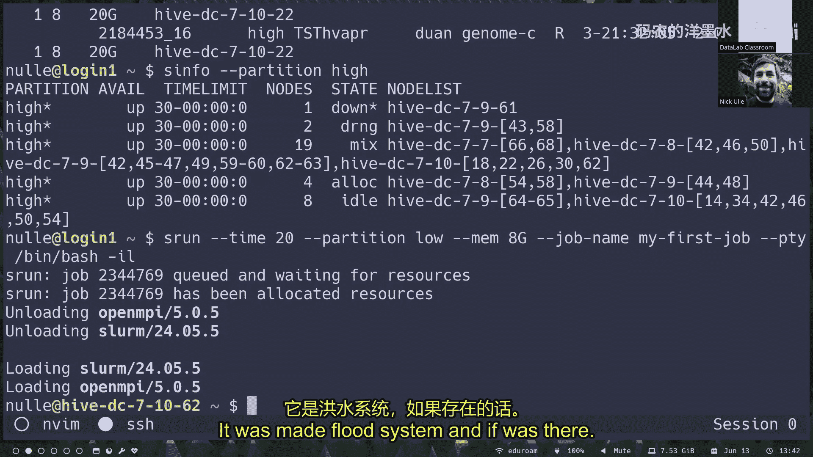

Yeah。Oh yes many。ThereYeah if you're getting that error， try changing the partition to high。

 inherently that works。Really understand why Okay， so try it with high so let me let me。

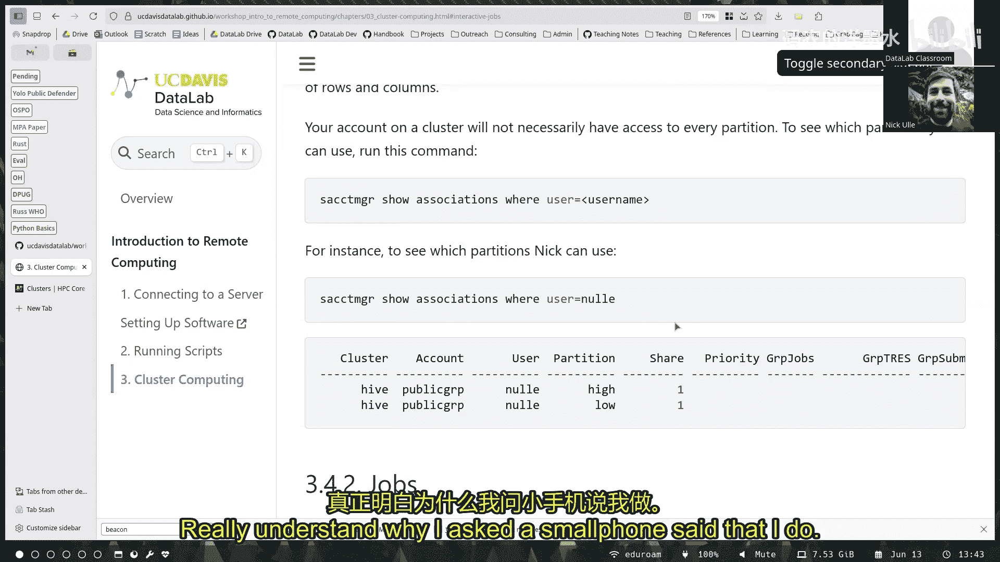

By this again， but we're going to change the command to high partition high。

Everything else is going to stay the same。Okay， and then try running that。

And if you're still having a problem， keep your red sticky up and if that worked for you。

 then take it down。对。We still have。Okay。嗯。All right， so that。

I don't really understand why it's doing that because that's the opposite of how it's supposed to work。

嗯。So that's a question for the HPC admins， I guess。嗯。

But now hopefully all of us have been able to get logged into a few know right so now you're at a prompt and。

Just like the prompt that we saw on the login node， you can do stuff。

 but now it's okay to also run your like scripts， run your code that you want to compute something with。

Okay。So I think。Just to make sure one of the things you can do while you're here。

 if you want to know what node you're on in case it's not in your prompt if you run the hostmate command that will also tell you what node you're on another thing we can do while we're here or even if we logged in with a separate terminal just onto the head node。

 we can look at SQ and if you pass it dash dash me that will tell you all about your jobs。

So it only lists your jobs and you can see now it shows that I've got a job running and it's this job work life that I'm currently。

 I think commands into。Okay。So this is mainly useful if you set up a non interactive job。

Where you start the job and then just go away and it runs without you interacting with it at all for an interactive job。

 you probably don't need to check this because you know you're like sitting here interacting with it。

嗯。Okay。One other thing you can do when you're when you're。Long do to one of these compute nodes。

 there's a shell variable that gets set to tell you what the job number is Okay and so you can print out that shell variable or you can access it with dollar sign sLm。

Job Id。Okay so the variables false slurn job ID you can use this in shell scripts you can print it out with echo and this is just telling you what the job ID in case you ever need to know the job ID for some reason from within the job and there are situations where that's useful。

Right that work it doesn't work from outside the job right so when we're so when we're done with the job like let's。

Let's go back to the head node。 So to get to end the interactive job。

 you just type exit and press enter， and that should take you back to the head node。

And now if I try echo。Slum。Job IDd again， no， you can see it's just nothing。嗯。So on the head note。

 there's no job ID because they're not in the job。You can also look after you exit like that。

 if you look at SQ me， you should see that you don't have any jobs running。Okay。

 because when you exit， that job is done， if you want to go back to another compute node。

 you have to start a new job。Okay。All right。So we've all hopefully been able to run our first job on one of the compute nodes。

 are there any questions about this， this is how you can do things interactively。

We'll see how to do non interactive stuff next。Okay so the interactive mode is really useful if you're trying to figure something out like sometimes if I'm trying to figure a piece of code out I can work with like a small sample of the data and just do it locally on my computer but sometimes that's not true and I need to be able to work interactively and like debug and stuff but I also need the hardware of HPC to work with whatever my sample data is and so interactive mode gives you a way to do that you can start an interactive session you can request more time like maybe you need a couple of hours to figure out what it is you're doing and then you can just sit there and compute try to figure out your code get it working。

And figure out whatever problems it has。Interactively okay。

 you can use stuff like TOux when you do this and this is one place where TeamOx is really useful because like Oliver was saying one thing you can do is you can log in with multiple terminals。

 but the problem with that and I don't think there's a workaround with that is that if you're working on one particular node。

 you can't get into that node with another terminal easily。Okay。

 so instead what you can do is you can use TeamUs to make multiple splits， multiple panes。

 and then you can have multiple terminals where you're working in that or multiple shells where you're working in that particular node if you need to。

对。So that's that's what these are for but now let's let's learn how to do some non interactiveactive stuff because that's that's more useful if you just have a job that you need to you know it works。

 but you need it to run and it's maybe going to run for a few hours or a few days even。Yes。

Is it possible to have a favorite in the sense of？not really。

 I mean maybe just by coincidence you might always get the same node but no I don't think I don't know if you can even specify what node you get there might be some kind of commands to do that with eron but or some kind of parameter to do that but in general node and you just get the node you get because otherwise people would be waiting forever and for most purposes the nodes or。

Like all the same to everybody so。Yeah。Yes， I was just going to there is a way of in you attach to the node that runs your job on the head on the secondation okay you use SR and then we say on the。

Okay to learn something new。Okay。Yes。5开。哦，好的。嗯哼。😊，嗯。嗯。你点熟是你是我。Right。And that's。哎。可以。You have to。Yes。

Yes。Yes， and in fact， let me show that a little bit， so let's go back。

 we'll run the same job as we ran before。对。And then once it gets allocated or once it actually brings me back to a prompt what we're going to do。

 first of all， if we if we look around with LS，You see I've got I' at my home directory。

 I've got all the same files as I did before I switched to the compute node and I can I've even got that Pixie project from yesterday and so if I go over there see my Pixie project。

Let's just go to that directories and then I can't remember what I had in here so let's just pixy list。

And it's a lot of stuff， but I think I had R， see there's R。So。I've had R in here。

 so now if I wanted to do some stuff with R， I could say Pixie run R capital R。

And then it starts up it's starting up the environment and then it starts up our okay。

 so this is how you like all all the same commands we were using yesterday。

 they will work on the compute node and all the files that you set up on on the login they're on the compute node to right that you don't have to worry about different storage on different machines or anything like that。

And yeah。Okay， So， is it this？I exit the job， so I don't need that running anymore。So everybody。

 make sure you're back on the that node for what we're going to do next。嗯。Okay， so。

 so we learned the S run command。 that's how we start interactive jobs。

 We're also going to see another use for it in a little bit。

 But if we want to start a non interactive job。 So we're going to section。

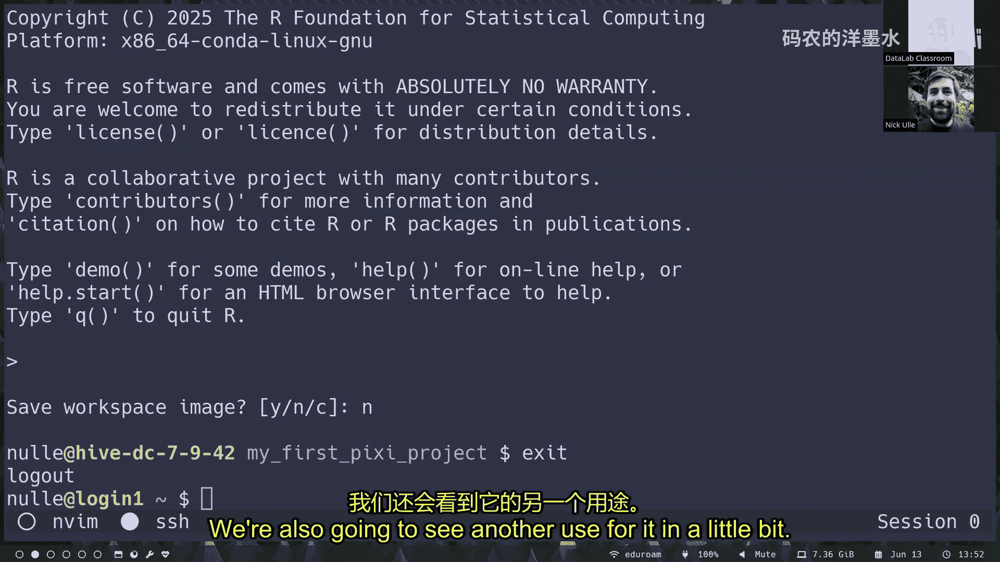

3。6 of the reader。If we want to start a non interactive valve。

 then we're going to use a different command， we're going to use the Spat command okay。

This is generally going to be the way that we start our non interactiveactive jobs and to start a non-interactive job instead of doing it from the command line。

 which I think you could do it that way but most of the time if I'm going to submit a non- interactiveactive job。

 I'm going to do it with a script。Right， I want to write down all of the parameters I'm going to。

Set for the job so like how much memory it's going to use how much what partition it's going to use and so on we're going to put that in a script Okay and so we are going to go back over to the。

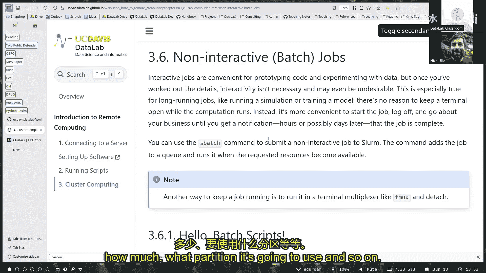

， I'm going to go to。Then my first Pixie project directory is we'll just do everything in here so we don't dump a bunch of files in your home directory so we're going to work in here and what we're going to do we're going to use nano and we are going to open up a file that we are going to call try to match the reader remember what the reader calls it。

Hello， well， wait， yeah， hello。sh。What I think。对。And you can also you can use whatever text editor you like so if you prefer VI。

 you can use VI。But what we're going to put in here。嗯。

We are going to first put a chabang like We talked about in the last session。

 but this time we're just making a shell script so we're going to put a slash bin slash bash。

 that's our program to run shell scripts。Okay。And then we're going to put a command to run and in this case the command we're going to run is that host name command that we saw before。

Okay it just prints out the name of the compute node so we're not really doing anything very exciting here but that's what our job is going to be and then any step in the job what you actually should do is put sone in front of it and this just lets SLRm know that this is a step so if we had multiple commands and we want to treat each one as a step and we can put sR in front and SLR will give you nice information about what step you're on with some of those those commands that we use to query information。

第。So it'll also put things in the log so whenever we run a job noninactively sl will output a log file that has information about how the job went and it will tell you as each step completes so generally you're going to want to put S run and run in each command that you run so that you can say what step is what。

嗯。Then we need to supply some parameters for our job and so the way we're going to do that we're going to put a pound sign and then S batch all caps。

Okay and make sure there's no space， no spaces in there just pound sign Spat。Okay。

 and then you can have a space。对。And then we're just going to write one of those parameters and arguments like we used for esra right so if I want to set the time I can put dash dash time and then maybe we'll say 20 minutes okay and then S batchch for another one I can say dash dash partition and we'll say hi。

Okay and so on right， so you can write you can write your all of your parameters like this。

 maybe job name。My job。Right Spatch， what else do we need in memory？So we'll just ask for。

A gigabytes this time。Okay， when we're submitting a batch job， a non interactive job like this。

 you don't need to use that PTTY parameter because we're not going to start an interactive shell。

Okay so you don't need the PTY。For this kind of job。And I'll give everybody a moment to type this in。

Are there any questions while people are typing？嗯。Yeah。嗯。that mean。looking arch。为什么。Arch running。

Hearts of mint。So you're not not totally wrong to think it's innocent yeah， it like。Yes。😊，那我已经了。啊。没。

Great。嗯。拜拜。在啥工。No， star。No if you want to manually run it or interactively run it then start an interactive session for some amount of time and run it。

 or likewise you can submit a batch job for some amount of time that you think is right and run it and see if that's enough you probably want to err on the site of overestimating rather than underestimating because as soon as your program finishes。

 the job will end so if you overestimated， you're not like wasting a bunch of other people's time whereas if you underestimateimate as soon as you run out。

 you hit that time limit， your job will be killed so if you are computing something and unless you're like saving it along the way if that's possible and for some jobs maybe it's not but then you'll lose everything that you were computing right and so if you spent like three days computing then your job needed another hour well sorry you lost three days of work right and that's worse in general then like if you just overest and say I need five days right。

So。Yeah， I mean I think like Wes was talking about the way you probably want to do this is start small so if you can scale down your problem run a timing on that and so then generally you're like even if you lose even if you underestimate you maybe only lose like an hour of work instead of days of work right and so smart start small figure out what the timing is for a few points of like small size and then you can figure out is it linear as I increase the size is it quadratic and then use that to estimate how much time you're going to need。

喂。Yes， in the back。不能。So this this S run is really just to tell SLRm that this is going be one of the steps in the job that it's doing it we could have more commands in here that are different doing different things and so if we want SLRm to have nice outputs in its log file that says like step one complete step two complete then we need to put this Srun in here this will also matter more when we start doing stuff in parallel because we're going to use that sR to control some of the things about parallelism so it's good to just get into the habit of doing this I will also say like if it's something that you're just kind of doing to set up the job。

 but it's not actually part of the job like maybe maybe first I want to change directories so like I want to go to my home directory that kind of stuff I usually wouldn't make a step because it's like I'm just setting stuff up I'm not actually running the job thing I'm here for。

嗯。Was there another question yeah？But。The same way。Okay so well the same way。

 but also there's some things you can do to try and get a sense of this before you even run the program so it depends on what kinds of data you're working with。

 but like if you're working with a file that has data in it，At the very least。

 probably you're going to use as much memory as the size of that file unless you're only reading part of the file if you are working with like matrices。

 very like whatever size matrices or vectors， you can estimate the size of those things in terms of memory you can figure out how many elements are there in that matrix or in my array and then usually unless you've specified otherwise you're probably using about 64 bits for each element if they're numbers so can you can sort of do the math like I've got this many elements times 64 bits。

 how much memory is that going to be there will be a little bit of overhead so like if you estimate that way it's not going be exact because there's overhead just from having data structures in a programming language but the overhead is really small compared to them that you're going to be using if you have a large like the amount that's actually holding the numbers。

So。That's what I would suggest is like trying to do like back of napkin calculations for like how much memory am I actually going to be using？

And again， like try small samples and profile it， figure out like how much memory is it using with P or with other tools that you can use to check the memory。

There another question， but we don't set words and they seems like sort of and on they too seem like it and we high seeking usage。

So if we don't put a thread one in there is just a bolt to one， I believe so， yes。

So if I'm just doing single thread， this would be slow tell。

Because like I'm assuming that was single third。Laptop will be faster than what see but。HBC。

It it depends probably no most of the time your laptop is probably going to be slower because the the CPUs are faster on the Hc so like one one thing you have to account for is that these are like。

Server grade high performance CPUs， and so they're generally going to outperform whatever laptop or desktop you have unless you have a really high end desktop。

Your job， if you have a very long job that's going to run for many days then it could get paused at some point to let someone else's job run and then start running again and so yeah that could slow things down a little bit。

 but I've only seen that happen for jobs that run for like over a day it just doesn't happen that much at least at the way that the current utilization of hive it doesn't seem to be happening all that much。

If you'd have shorter jobs。没有。Any other questions？Okay， so we've got， we've got this。

Type in now so I'm going to go ahead and save this。

And I'm going to open it back up just to make sure it's there， right？Okay。

And now that we've got our script set up。To actually run this。

 all we have to do is type Spat and then the name of the script。

Because we put all the parameters in the script so we don't need to specify them at the command line。

And then we should see something like submitted batch job。And if we look at SQ me。

 depending on how fast you are， you might be able to see the job。But you can see like even here。

 I've got this Cg status， which means it's already not。

And by now it's been gone because it's not right， so it's not even not so not even keeping track of it anymore。

And after doing that， if you look in the directory where you ran the S command。

There should be a new file of sLm dash and whatever your job number was。喂。Not out。Okay。

 and this is the output from your job。Okay so we can take a look at this。

 you can open it up with nano or VI or you can use CA if we take a look at this thing。

You'll see something like this and it starts with a summary from Slom about the job so you can see it tells me the name of the node that the job ran on the job number the name that we gave the job my username the petition how many cores and so on right all sorts of details about the job it tells me how long the job took so you can see how much CPU time did we use well basically nothing because the command that we ran just print something out how much how much like time did we use like how long did it take for the job to complete three seconds okay so it was a very fast job and then it tells us like how much memory did we use 380 kilobuts because again we did something very simple。

And so on。 And then you can keep scrolling and it tells you even more stuff about the job This is all just from Salm if we keep scrolling far enough。

 I think did we。Where did we put it？Okay。Why am I not seeing the actual host name because we should also get the host name in here somewhere oh。

 you know what I think I skipped over right？Yes。It's it's the it's the prologue right yeah so this is the actual output it' this maybe maybe we should have printed something else because it's because this appears in multiple places and they it clear。

I。Thanks。So then we get。Arere our result from the job right there。嗯。

So this is how you can run a noninteractive job No there's lots lots of things you can do to make this process a little more helpful for you so for example。

 you can and this has in 3。6。2 there's more parameters you can set and for example you can set in email address。

 the email when the job is done or when something happens with the job so that way if you submit one of these jobs and you know it's gonna run for a few days。

 you don't know exactly how long you'll get an email when the job is done or if it fails or something like that okay so you can set up email you get this can if you don't want the output to go to a file like this。

 if you don't want it to go to a file that's called SLm and then the job number got out you can actually specify where the output should go but you can set dash dash output and if you put percent J somewhere in the file name or then that will be replaced with the job name。

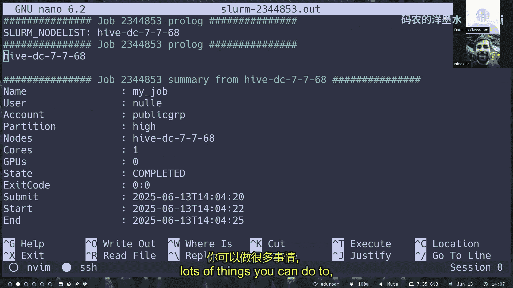

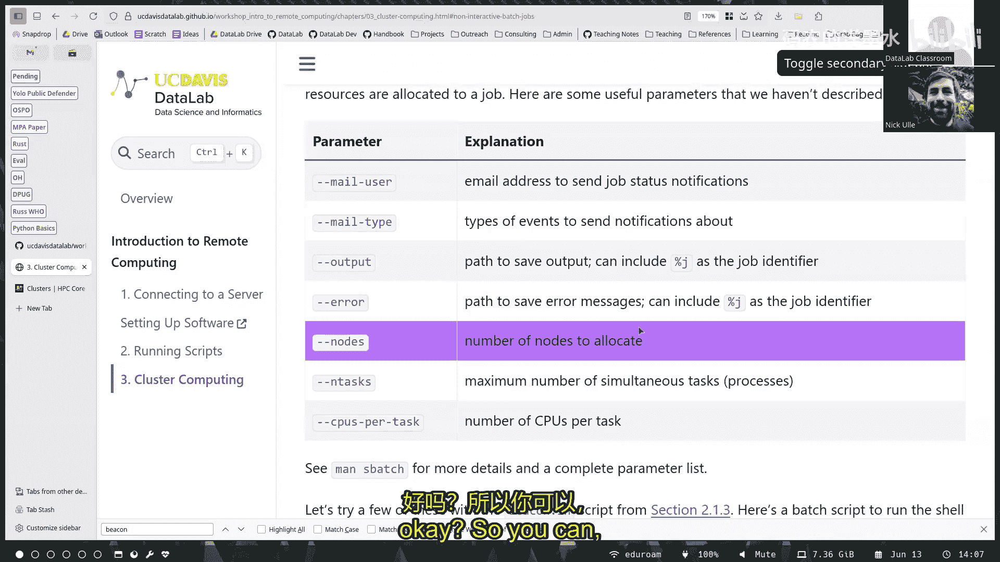

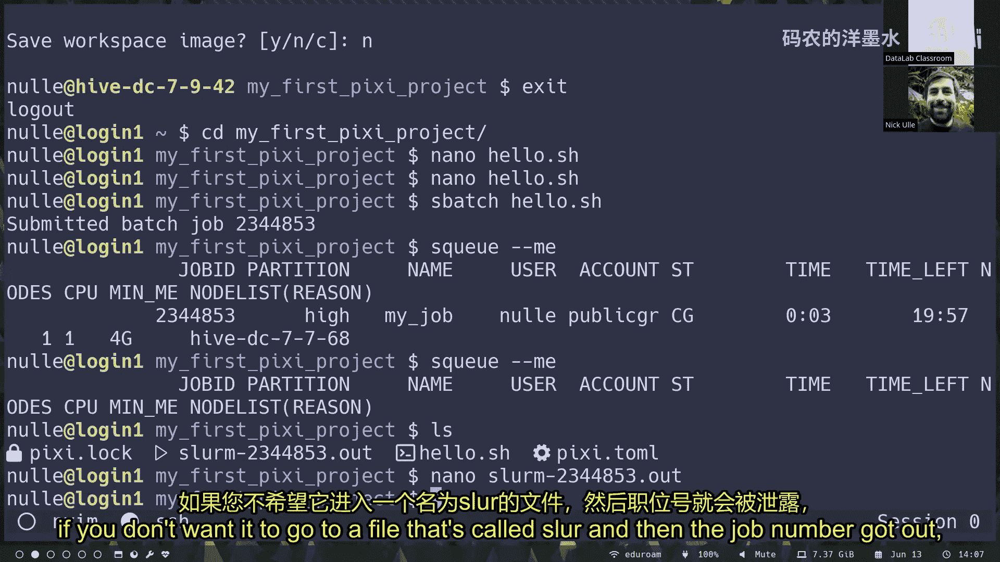

So if you need a keep pre a job number you can put for J in there likewise。

 if there's any error output there you'll get another file called SLurm job number but ER error right we didn't get in here because there was no error but if you had an error message we'd get a file like that as well and again you can control what that file is called with dash。

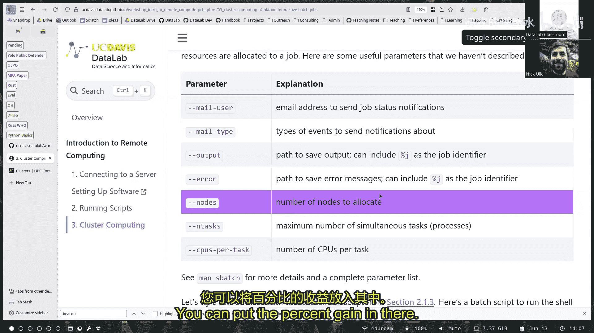

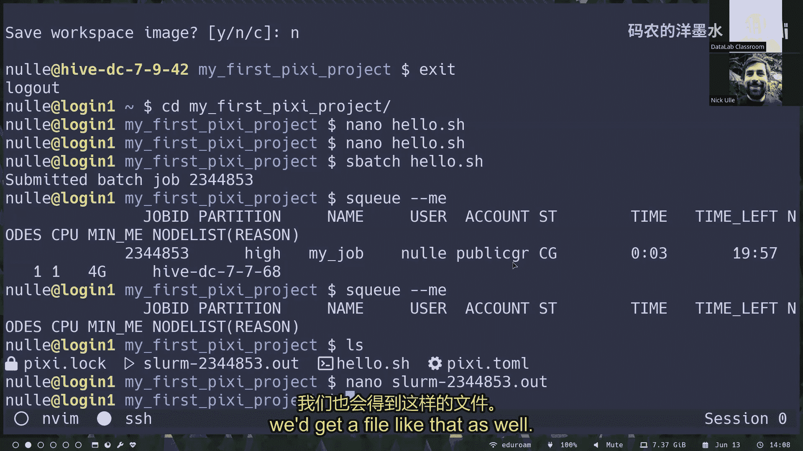

If you want your output and your error messages to go a a different place， you can specify that。

Other things we can do we can say how many nodes we want so the default is one but we could ask for more compute nodes you can say how many different tasks we're going to run it like things we're going to do simultaneously and we'll play around this a little bit more in minute you can also say how many CPUs each fast needs so if you're running a task that's multithreaded you might want multiple CPUs for that task。

There's a whole bunch more， these are the ones that Ive found useful and I think in general and in data lab we found these useful。

 but you can look in the manual for Spatch if you wanted to learn about a lot more of these。关。

We'll go ahead and try some of these with our beacon script that we were running earlier。

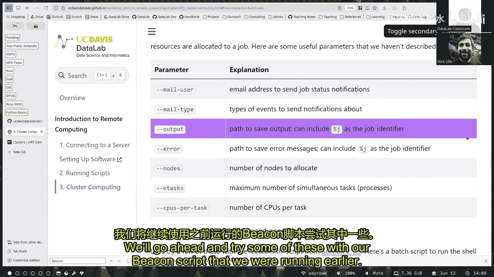

So first of all， let's get that script I think。I don't think I have it on the server。

 so I'm just going to paste it in I'm going to Im going to put this in the my first Pixie project directory。

 you can copy the one that we were using earlier if you already have it on them。The server。

 you can use CP and the path。They get it from them and the path will put it out。

But I'm just going to type this in or paste it in， so I'm going to do nano beacon S。

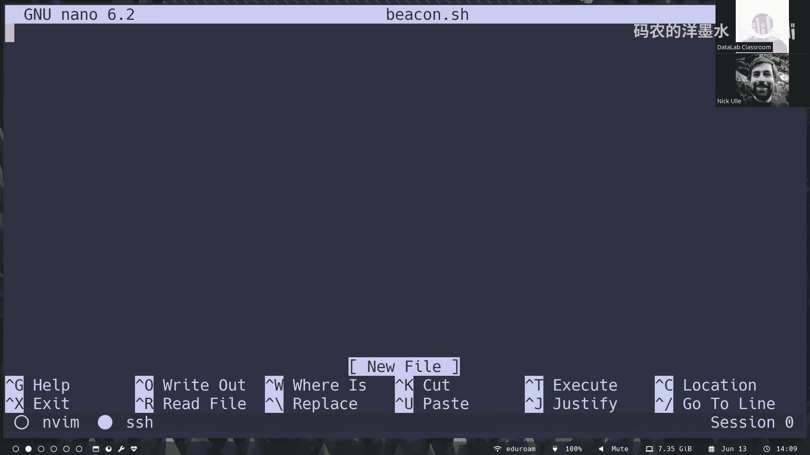

Okay， and then I'm going to go back to the reader。And I'm going to go back to section as that script。

 and I'm just going to grab this。

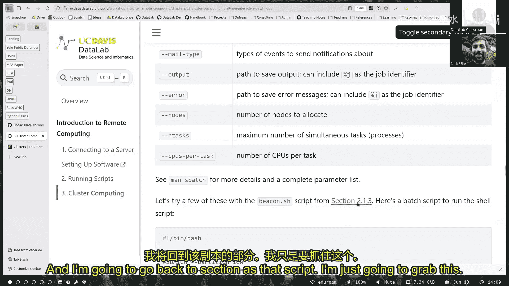

Excus me。关。And I will save that。

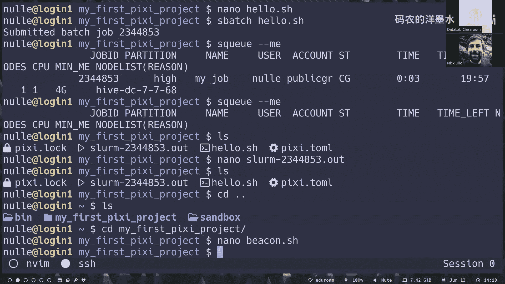

All right。So we're going to use this just so that we have have something more more interestinging to work with and then once you've got your beacon do S stripped in place。

 we're going to edit this and put in all the S batch。

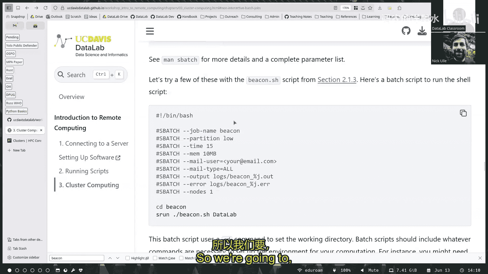

Stuff。对。So。What are we going to do this time， let's let's put in， first of all。

 we'll put the job name。We'll just call this beacon。And then we will put the partition。And the time。

We'll just ask for 15 minutes。And then we will also put in the memory。

you can ask for really low amounts of memory。Just do 10 animals。Exect。

And then we'll also say we'll set a few of the optional parameters as well。

 so this time let's have it email us so i'm going to say dash dash mail user just to show how you do this and then i'm going to put in my email。

@ucdavis。edduu。对。And then we'll also say what type of mail we want to get。

And's there's a few different options for this if you set it to all。

 it will send you messages about anything that happens with the job so if it fails if it finishes。

So that's usually what I do， but if you need something more specific you can look in the manual and there's different different keywords you can use here to specify different kinds of things to get a message about。

嗯。And then we'll also set the output to go somewhere else。Okay。

 so we'll say just beacon percent J that we get the job number in there thought out。And。There。已经。

Percent J。Out of there。that's how will set up this job。Now in this case。

 because this is a shell script， we can just use this script itself as the script that starts the job。

 if you were using something like R Python， you would probably have a shell script that has your Snach info in it and then it just says something like R or R script and then whatever dot R file you have or Python and whatever dot pyfil you have and then your actual code that does stuff will be in those files。

So you're always going to set up a shell script to use help to launch the job and then that could either have some shell code in it or it can start our Python or some other。

Software that you want to use。嗯。Technically， in any programming language that uses Harstein。

As a element character， you could just put these Sched things right in the script so you could have a dot R script and is your starting point。

 but people usually don't do that from what I have seen。

Just just to separate out where the stuff is happening and make sure nothing strange happens。

Can you go back to？I'll do that or I'll do an example right after this。好。

Any other questions before we try to run this or does anybody still need a minute？Okay， nobody's。

 nobody's yes。Do we know this sense。No款视频发。Okay， so I'm going to save this as always。

 I'm going to check， but it got safe thanks。嗯。So now submit this Spatch， becon do S。

And then we can see it in the queue。Wait for it to。The finish running。

 if we wait for it to finish running all the way through。 remember。

 this is a script that we had set up to just print print things forever。

 And so this would just keep running until our time limit right So I'm not going let it do that I don't actually want it to run for 15 minutes。

 So instead we're gonna to learn another command that's useful to know。

 which is if you have a job that you've started non interactively and you want to stop it Okay。

 you can use S cancel。And then the job number， so in this case， my job is2，3， four，4，89。

2 and you're going to have to look and S on any。Initial submission to find your job number。

 and I'm just going to cancel that。对。If I look again， now you can see the job is completing。

That has been canceled。And then it gone。喂。State it's S cancel and then other the rivers。

What are the problem first？And you can only cancel your jobs。

 it won't let you cancel somebody else's jobs。Yes。I'll give everybody a chance to do that and then we'll then we should see in our directory now you should have a beacon。

喂。😊，And if we take a look at that beacon do out file。okay， if I open that file。

 well does anybody still need to look at what's on the screen here？

Okay and if we take a look at that dot out file you can see it printed hello a bunch of times I forgot to set the name when we ran Zcon dot out so it just prints hello but now you can see there's our output so this is a better example of seeing the output as well because now it's very clear what the output is of where the output is in。

And so you see all this and then you get some information from SloRm about what happened to the job and you can see it at any。

不。Do you have a job that you don't need anymore， you should cancel it。

 it's the polite thing to do so that you're not wasting resources on the server okay。

Any questions about that？Okay， so I said I would give an example of how you would start python thing so let's let's look at that we're going to do this again in the Pixie directory because we're going to use python I'm going to I need I need to actually have python to do this so I'm going to Pixie add python。

That way we can actually run something in Python。And if you are not a Python programmer， don't worry。

 we're going to run something very simple。You're not not going to need to know how to。Right。

 Pythons code million。For examples。While we wait for that， are there any questions？Any？Yes。

 I'll just ask point so if you wanted to say link exactly Atlas， yeah。

 so I would I would go back to my my deacon。sh。And I would， I would put。Well。

 I could just set name in this space because it's because we're running it directly in this script。

 I could just set name or whatever I want it to be life。If you' want to have any interact。都。

And that one to be。有没有1。我你觉得。The is from you join。So Spatch doesn't really give us a way to do it from the command line。

 like whatever we're running， it has to already sort of be freepackd up。

 we can't pass arguments on the command line as far as I know。So。

But what we could do if we wanted to keep our strip like this。

 we could put this in a separate script and then we could have a line that's like bash Beaacon thought S niv。

kind of like when we were running it before， I think when we ran it before。

 we actually ran it this way， not slash， right？And this is also sort of maybe showing part of why you would want to have a separate script for the batch script that because then you can set parameters like this。

 but also then you can easily put esterone in front of the steps when when I ran this I didn't put esterone in front of anything and that's because it's kind of unclear like what is the steper。

The step is really the whole thing。Yeah， okay， so let's do the Python example。Let's think that will。

Be instructive okay so we we added python with Pixie ad python now we need to have some python code that we're actually going to run so I am in a nano hello dot pi。

Okay。This is going to be a very simple Python script All we're going to do is we're going to print。

Hello。佢你可以 bring我题方。All right。And then we're going to save this。

We've got our hellello do Pi and then what we're going to do is we're going to set up a batch script to run this so I'm going to nano run hellello Pi。

That S。That's what I'm going to call this thing。You know this one has to be set up like we would typically set up a batch script so I'm going to put lush bins lu bash。

And then I'm going to put my Spat command and I'll come back to that in a second。

 but our actual our actual way of running this we're going to put S run Python and then the name of the script so hello Pi。

And then because our Python。We don't have python by default it's in our Pixie environment so we need to actually start our pixie environment or run our Pixie environment somehow and so to do that we can add in a Pixie run in front of us right remember that's how we run things in our Pixie environment。

Right。Okay， so then now we set up our Spat parameters like usual， so dash dash time。

 we'll give it five minutes。Epatch dash mem， we'll give it whileyon Python is a little bit。

Maybe you wantt memory hungry， so I'll give it a gigabyte at least。嗯。Despatch。Partition。Byi。

I least should give it a job name， we'll say job。I think G will also work， I can't remember。

 let's try it and see if it complains。嗯。I see a question， yes。好。Yeah。

 you need to be in the right place like in general， regardless of whether you're using P。

 you need to be in the right place for all the paths that you have in your manuscript。

And then you can use Pixie dot or Pixie run to actually run things in the environment。嗯Yeah。Yeah。

And then am I forgetting anything if there another one that I should have in here。

 I think we're okay。Yeah， okay， so what did I do？对。That was not what I was expecting。Let's fix that。

Okay。All right， so now that we've got this all in here， I'm going to save this。AllAnd again。

 check but that it got saved。And then Spatch run， hello， hie。Okay。These are still running。

 it's still running。This job will probably take slightly longer than us to start python。No it's done。

So now our job is done and this job was called 2，3，4，4，9，2，3。 So if I look at。Slem， two， three， four。

 four，9， three。See there's my hello。嗯。And also， since we weren't sure about whether we could write G or Gb。

You see it doesn't care still allocated one gigabytes， you can put the be or not。可以。😊，And likewise。

 if you wanted to run something with R， you'd set up your R script。And in your run hello sides。

Probably call it run Hill R， but instead of Pixie run Python， you'd have Pixie run R script， right？

So嗯。At script。A lot of that are。Good。Ifve never run an R script from the command line。

 this is the command to new just capital R command。

R uses a different command depending on whether you're running at the command line or not。Yes。来。

What do you mean by at least the amount in？From your competition heads。Soe seconds。

No not necessarily because if it depends how you're creating that file because it could be that you write that file line by line by line and you only actually have one line in memory at a time and so then the file could be like。

500 gigabytes， but if you only have one line at a time in memory。

 then you might only be using a few megabytes。So it just depends on how you're doing things。Yeah。

 if you are creating that entire file in memory before you write it， then yeah。

 it would be the whatever size the file is that's the amount of memory you need at least yeah。

And the same for reading data， like if you have a big file that you need to work through。

 maybe it's like two terabytes of data， if you can work through that file line by line by line or item by item by item and those items are smaller。

 then you won't necessarily need two terabytes of memory to do whatever you're doing。

And that's one of the tricks to use if you're working with really large data is like。

 can I process it in pieces？Okay， other questions。こ。See a few people have red stickies up。

 so maybe this is a good spot to pause for a second and we can all try to hell it folks。嗯。对，没有意思。嗯。

你好。So。Okay doesn not very。系有你钟意食。你为这是对。still。不再说。问。そ。Okay， so。即系个时直呢到。That's easy for the。嗯。

In same about still isnt there that's。嗯。嗯。Okay so we've seen how to do interactive jobs we've seen how to do non interactive jobs。

 so now the last thing we're going to learn how to do is how do we actually do something in parallel。

Because so far we're still everything we've been doing they're all sequential right we're just running sequential jobs where we've got one one CPU that we're working with。

So how do we do more than that， how do we use more than that？

And so in terms of where we are in the reader， I want to make sure people can kind of keep track。

 we are jumping to 3。7。

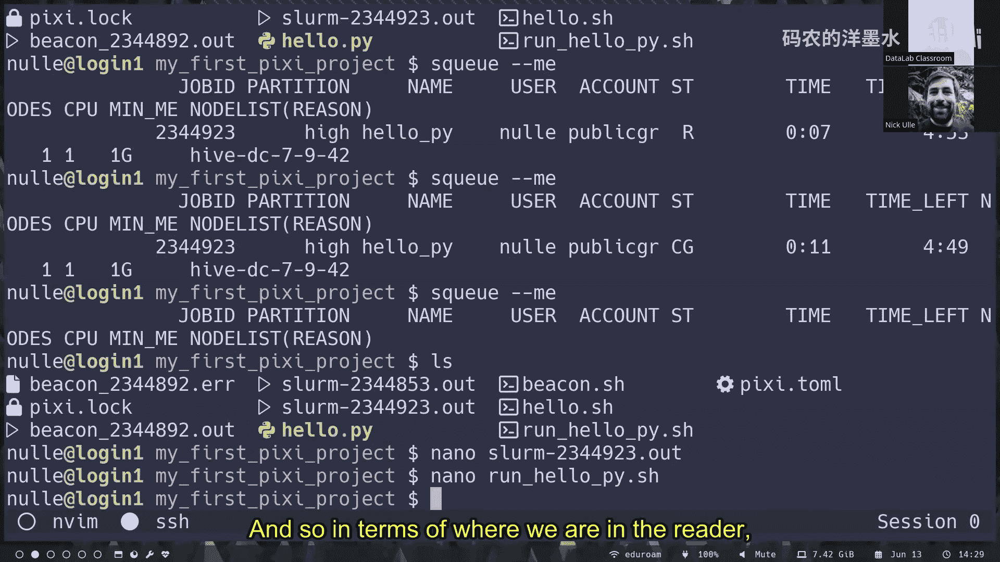

嗯。And then I want to make sure I didn't skip anything， yeah， okay。So we're going to 3。

7 and we're going to learn how to run parallel jobs and there's two different ways to run parallel jobs when you're using SLR。

You can do what I'm calling a parallel steps approach。

They where we have multiple s run commands in our batch script and they all run at the same time Okay that's the parallel steps model Okay and I maybe should back up a little bit and say that in general。

 if we're going to do parallelism， we're going to do it non interactively because it。

There's not really a way to do this interactively where you're going to be able to keep track of all the different。

Noodes you're launching right the way you figure out how to get your code working you do it sequentially and then once it's working sequentially。

 then you can run multiple instances of it in parallel。

Okay so we're going to be working non interactively if we're doing a parallel steps approach we're going to have multiple s run lines in our our file in our batch script and they're all going to run at the same time Okay that's the idea of parallel steps and then there's another thing you can do with s called array jobs and what this says instead instead of having all of the steps written into your into your batchsh script you write a batchsh script for one。

Example of the things you're running in parallel and this has really meant this array of thing is really meant for the embarrassingly parallel base where your your parallel processes。

 they don't need to talk to each other。Okay so they don't need to talk to each other so they're basically all doing something similar that's generally the case for a array job if you're going to do the same thing a bunch of times and you want to do it in parallel you use an array array job and you write the case for one of them and a little bit。

Aameterization that we'll talk about in a minute and then the sm will automatically launch a bunch of instances of that。

 okay。So if you're doing a bunch of things that are going to run in parallel and they're all basically the same。

 maybe slightly different starting parameters， but the same process user age jobs。

 if you need to do very different things and run them in parallel， like run different commands。

 then you probably want the parallel S approach。That。

BecauseWith the parallel steps approach you have more flexibility。

They array job have less flexibility but it's a little bit easier to set up。Generally。Okay。

 does that make sense to everybody the difference between these two things we're going to do both in just a moment。

Okay， so we're going to try to do this。And we are going to start out with the parallel steps approach。

 okay， because it's going to build on stuff that we've already kind of seen。

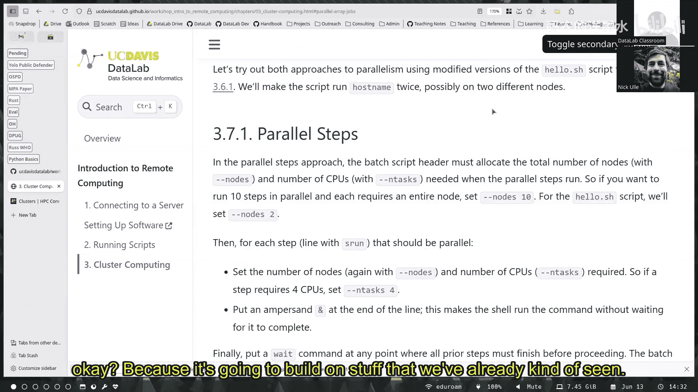

So I'm going to jump back to here and I want't just look at what we've got。 So remember we had this。

Is hellello dot S H script。That we were running before， I want to tweak this a little bit， okay。

So what we're going to do。Instead。It。嗯。嗯。We are going to see if I can dip this right， echo。

Hi from and Oliver yelllow at me。Not that。Wting crazy stuff。I can interpolate like this， right？

Thought what yeah， right。Oh， you mean it's a variable as well， like I know I could do this。对对。O。

And actually， I could put that in the string too， right？As long as they use。Yeah， so we can do this。

 we'll do this。let's check this so I'll come back to this in a second。

 but I want to make sure that I'm。Remembering my because I can never remember。Yeah， okay。So。

So what we're doing here， this is going to be our command and just to explain what this is。

 we've got a message high from it's just a strength and then anytime you put dollar sign for emphasisses。

In of a string with double quotes in the shelf。It will run whatever you've written inside the parenttices as a separate command and then it'll put the output。

Right there where maybe you both the dollar break this is so I say say hi from and then run host name and put the output right there。

Okay。That makes sense to everybody， we're doing some string interpolation。嗯。You've used our Python。

 they both have things where you can do something like this too the syntax is a little bit different。

So this job， it should it should print out the host name and the reason I'm doing it like this is because I want to make it clear what。

What our output is versus from the output from SLRm。Okay。

 and so that that's going to be one of the things we're going to do。

 but we're going to do something in parallel here and we're using the parallel steps approach so we want we want this to be different for the other step right so。

I'm going to go ahead and。Put another line in here where I say S run echo。Hello from。

Dollar sign post name and these are going to run。In parallel， possibly on different nodes。

 depending on whether we're lucky or not。第。And we should see both of these outputs possibly in a different order。

To make this parallel， we're going to do two things Okay。

 because right now it's still sequential right now we've still got a sequential bash script and if we submitted this。

Then we run the first one and then the second one， okay on one one node。

 but if we want to make this parallel， the first thing we're going to do。

 we're going to put an ampersand， the and symbol at the end of each line。Okay。嗯。

This is basically saying。Rugun this， but then continue on， don't wait for it to finish。

The default when we run commands in the shells， we wait for them to finish by putting that amperserson in there。

 we're saying don't wait for it to finish。Okay。And then we need to add one more thing， okay。

 which is we need to say that to s run that this is going to use a node。

 so we're going to say nodes ones right here。And nodes one right here。

OkaySo we're saying this step requires a single node， this step requires a single node。喂。

And if we're going to request。A node for each of those， and we don't want them to have to wait。

 We need to also say that we want two nodes， so S batch。Nodes， tooth。

And we say we want two nodes and then we say that each of these steps is going to require one node。

Okay。You could have something more complicated here like maybe you have a one step that's really easy to compute and you can run it on one node and then you have another step that uses five nodes at once or something you can do that you have that flexibility。

Likewise， you can actually put any of the other S run like parameters that we've seen as parameters to these steps。

 so like if you know that you only need a certain amount of memory for the first step。

 you could put a dash dash me here。Otherwise， otherwise。

 it just defaults to the whatever we put in the Spat。

YesWell node each node will have four gigabytes the way that we're doing this here。

 we're saying we need two nodes， each one has to have four gigabytes available。Right。

 and and to be a little bit less resource hungry for a very simple thing I'm going to change into one。

 okay don' we don't need4 device to this。Okay。Now the last thing we have to do because we put that ampersand there on each of these that' that's saying don't wait for these to finish and so if we just run this like like as it is now。

This script will finish running running without waiting for these to be done okay so we need to say like wait for everything to finish eventually right so to do that we put in a weight。

Okay。And you can put this anywhere in the script where you need to need everything to sort of finish before you continue on so you could potentially have a bunch of things that you do in parallel and then you wait for them to finish and then you do some like one thing with all of the results from those and then you do a bunch of things in parallel again and then you wait again right so you can use this however many times you need to but in our case we need one at the end just so that this we wait for our actual commands to be finished。

Okay。😊，And so now we've turned this into a parallel script， a parallel steps script and if we。

Close this out， so save it。Close it。Make a peek again to make sure it got saved。Okay。😊。

Now we can submit it， so Spatch。Hello S。And we see that。Our batchtub has been submitted on SQ。

cuse me。And you can see if you look at my job says I'm using two CPUs now。Third。

It looks like the way that Slom decided to do this is it gave me two CPs on the same node。

 but we'll see you when we look at the output。嗯。Okay， so now should be done。Yeah， okay。

 so if we look in the output for this job， so this was sLm。Two four4980。哪个。

So you can see there's our output and you can see that。Both of these were running on the same node。

 so each node has multiple CPUs， so SLm just decided to use the same node for both。Okay。

 but you can also see if you remember from what we typed in。

 it actually printed them in the opposite order。Of what we had put in the file right it's got hello from hive and then hi from hive and in my original bash strip I had the high line first yes。

If you look at the node you see that this brand from20 notes， but because the dollar note。

 the dollar hosting was evaluated in the script， it was available then one of the different。Okay。

 let's try this again then。嗯。I dont I want to do this I'm going to okay， I'm going to move。Hello。s。

To run。Hello， by S age。I like to like to prefix my batch scripts with run and then I'm going to open up。

A new file for pillow dosh， which is empty。Thanks， in here。But thin much bash we got too clever。

 So now I'm going to put。Echo。呃。Hello from Dollar sign。

Most name so this time maybe we will actually be able to see the nodes。Okay。

This is maybe going to illustrate an important distinction， so we'll put this here。

I'm going to save this。Almost the same as what we had before。And then I'm going to go over to run Ho。

Runfo that S。对。And instead of my echo commands here。I' I'm going to put the script itself。

 so I'm going to say。Dot slash hello dots。lashHo N SH。Okay， so now they're both going to say hello。

 but hopefully we'll be able to see the two different nodes this time。Okay， so we will save this。

And again， let's a good it。While that's running， I'll put that back on the screen in case other people wanted to be it。

嗯。嗯。Can I close this one？我晒。对。Did anybody need to see the other one hello on S still？Okay。

So we look at SQ District me。Looks like the job is done。 So now let's look at SLm。2， three， four，5，0。

 zero， three out。嗯嗯。😊，Sure。Okay， oh yeah， yeahep， that would do it， okay so。Thank you。

 So we need to plus U plus X。OfHello。sh。Or we could run it with bash directly， but this will work。

Okay， so make it executable with EH process。S H， you know it'secutable。And try again。

Now should be done again， you know，234 or sloan 234。50，0，8。Okay， there we go。

So now we get our few hells from two different servers。嗯。two different machines。

All right so this is how you would set up your parallel steps approach to con again this is really good for when the steps are very different so in our example the steps are exactly the same and you can use it for that that's fine but we'll look at a array jobs in a moment you'll see maybe why that would be more helpful for this kind of thing but especially if the steps are different this is a really good way to do it because then you can have your and they might even be steps that require different resources right you might have one step that requires a lot of memory or a lot of nodes and another that only requires one or less。

Okay， so。This is good for when you need a lot of flexibility in how you run things in fair law。

Are there any questions about this approach before we move on to the array job approach？

Or do folks need a minute to just absorb before we move on， that's okay too。Okay。

 can one of the helpers come help if anybody is having？Trouble， can you put up a red sticky。

 I see at least one more class if you could。嗯。我可。所以你跟买。

I you're doing it so we want to again so yes so so so here's the so yes。

 so what happened before when we had commands like my sir so when we had before we had stuff like S run dash dash nodes one echo。

Hello from。Dollar sign。Most named。Right like this and so what Oliver pointed out to the this is actually kind of an important point is that anything we put in this script。

 this batch script we're submitting it's going to run on one of those like the command in this script like。

Or or。Sorry。Oh， it's like if you if you're not running it with S run， it's going to run。

When we run the Sch。嗯。Right wasn't getting yeah it it was it was asking for two nodes and it was starting two nodes but then this this was getting computed before it even goes to the nodes right so it was computing the host name right away and then it was echoing that on each node。

So we ended up seeing the same host name for both， even though they were different nodes that were doing the echoing。

Okay， so I changed it around like this because now what's happening is the script itself with hello。

s is running on each node and it's it's running the hosting command on that node Okay。

 does that make sense。Yeah。So this is another reason why you might want to set it up so that' you're just running a script rather than you have a bunch of commands in the batch thing itself。

 yes。出先分 yeah yeah。呃。Hello Sch。Yeah， so it it's basically the same as what we had in the other file just without the SR。

Yeah嗯。Yes， I'm doing multiple jobs。I'It's for him。Requirements you creating the list。EspeciallyYeah。

 that's that's we got to know that you mean that my yeah， I like yeah。

 and you can submit multiple jobs at the same time too like we haven't been doing that one mean say one eat one job finish。

Well， then you would you would probably either want to run one and then wait until it's done and then run the next one。

 or you could try to set up the script to do that automatically like you could have it。

You could could either have it like the simplest thing would be if if it's sequential。

 you could just like have the first step with SR and then have the next step with Srun and then the next step with SR if it's parallel you'd need to insert a weight like it maybe the first step is parallel and so you stick a weight in there and then you have an S run after that that does something with the result from all those parallel jobs yeah。

Okay。Okay， so the last thing we're going to talk about is how to do these array jobs。

And the way we're going to do this。The way this works。

The idea again is that you have something you want to do that's very similar。

 but you're going to do it a bunch of times Okay， and and when I say very similar I mean like maybe you've got a script that that。

Does something and you want to run 10 copies of the script for some reason Okay for example。

 maybe you have input parameters to the script or different data sets that are inputs to the script and so you want to do the same thing but on 10 different inputs Okay that's kind of what I mean when I say very similar versus running completely different scripts that do different things okay。

嗯。So one way you could think about that if you've got 10 of something that you need to do is is there like an array right you want to do the first one maybe you use this input file and you want to do the second one and use a different input file and third one you use a different input file。

 but you're running the same code。Okay。So when you're running an array job in SLRm that's exactly how SLRm is thinking about it it thinks about it is okay you've got job one job two job three for however many you want okay and I think the upper limit on most of the time I think it depends on the server you're using I mean I don't know what it is for UC Davis but it's typically around like a thousand if you need to do more than a thousand things at the same time then。

You're going to have to do them in batches or something right like separate groups。Okay。嗯。

On some clusters， it's 5，000 instead of 1000。Like by the time you're doing that many things。

 you probably want to think about bas， okay。Or bundling a few of them together at the same time。

And the way we're going to do this， the way we're going to set up our job。

Let's make a new batch script it will nano。Batch hello or array hello。 let's call it array hello。

 since that's what we're。Right hello S，And what we're going to do， we're going to put as usual。

 we're going to put the shaang bin slash batch， and then we're going to have some S batch parameters。

And I'll fill those in in a second。For what we're actually going to run， I'm going to do echo。

Hello from。Well。I don't want to do this。 let's， let's do echo dot slash。Hello， that SH。

And that one that prints the host name。对。Yes， sorry， yeah， you're right， thank you。Yes， there we go。

Okay， we don't want to echo it， we just want we want to run that script。And as usual。

 when we're running something， we're going to put S run in front of it。Okay。

 and so normally if for a normal batch job this would just run at once right like we've seen this we've done this but but we're going to add a parameter in our S batch parameters that's going to make it run more than once so first we're going to we're going to start with our usual stuff so we're going to put in partitions。

Hi and hi will'll tell it how much time。I willll give it 10 minutes and we'll tell it。Epatch。

Memory will tell it's one gigabyte again。And then。We're going to set a new parameter that we haven't used before。

 which is。S D array。Right。And we'll say one through three。对。And so what this is saying， it's saying。

 I want to run this batch script three times。There。One， two， three， right？Okay。

 and so now if we go ahead and save and close this。Back put it's there。And an Spat， array， hello。嗯。

Let's see if it's still running。I， it looks like it's done already。All right。

 so let's see what we got。嗯。So the job for this one was2345044 and you can actually see in my directory I've got three output files this time。

Thank for哥。The job number and then under one job member under two， job number。

It's this go back to the question somebody asked way back at the beginning when we looked at the different jobs people were running why is there an underscore represent the job then those are array jobs right and you can see here for our array job you got one two and so if we look at the outputs for these let's let's I'm going to use CA to print these out so we can look at them all at the same time。

By four， four， one。Or actually， let's use head， not cap。As。没事。Head of the first one。

Add of the second one。Okay， and you can see that it's it looks like it's running on the same。Noode。

 which is not necessarily surprising because we only needed one CPU for this。H不。

But we get three outputs right and so we could be be computing slightly different things and in fact we'll look at an example of that。

嗯。Right now。Okay， so any questions about this so far we rim our job。

 we've got three outputs right it's not very useful like this because you probably don't want to do exactly the same thing right you want to be able to do something where you have a different input。

OkayAnd we're going to sees how here's how you would get a different input so。

Let's go back to our hello。Scrip。Or our Ray Ho script。是。And instead of running Ho on S。

 what we're going to do。对。We're going to act out something。We are going to echo hello from。Aray。Job。

Okay， and then we're going to use a variable that gets set only when we do array jobs。

 And this this variable， this is a shell variable， and it's called sLm array task。Iデ。是。

and I'm adding an exclamation point at the end， that exclamation point is not part of the name。哎。

 just。Just for emphasis。Yes。And what this variable is going to be， it's going to be the job them。

Okay。So for the for the first job job one in the array。

 it's going to be a one for the second job it's going to be a two and the see Oliver kind of are you thinking that I don't think we are。

Let's let's try it I think I think this one's going to be a little bit different because of the way array jobs run。

Okay， so。Let's this is what we're going to do I'll give everybody a second to type that in。

y make sure you don't have any typos。Because here， unlike the case where we were doing parallel steps。

 this script is going to run separately on each of the array your array nodes。对。

So let's go ahead and。Save this。And check that it's still there。Okay。And then Spat。Aray， hello。

And then a little bit SQ。And now actually we caught it while it was running。

 you can see it's actually we've got three entries because we're running three jobs。

And now it's done。And if we go and look at our output。 So this one was called 2，3，45，1，1，8。

 So if I look at head of slurm，2，3，4，5，1，1，8，1。There is to。you can see a array job one。

 a array job two， and then three， right array job three。Okay。

 so this is how you can tell which job number you're on。

And you can use that variable if we go and look at our。Array， hello。

RightYou can use this sm array task I to figure out which job number you're running and then based on that job number you can load a different file or use a different set of input parameters or whatever it is you want them to right so you can set this up as an input to your script for example。

 if I would going run a Python program instead of this I might have something like S run。

About the comment comment best run， Pixie run， Python， my script。Thought pie。

 and then the argument to it would be slm。Aray task Id right and so now my script will get a number when it runs right and then you can use that number to decide what file to load or what parameters to use or whatever else right and you can do the same thing with R if you wanted to do this with R you could say pixie run。

R script， my script R。Yes doesn't need to be capitalized and then the Surm array task ID again。

So either one， there's a way you can get command line arguments。So Surrum。Aray ask。

ISo you could do it this way， there's also both R and Python have functions that you can use to just get an environment variable directly without having to pass it as a command line argument you could also do that if you want whatever is easier for you but this is how you can basically say here's the job number we're running and you can use that to decide what input to use。

Okay， does that make sense？Everybody。Right。同才放的。I will show that。

 but I will do it at the end because I don't want to force everybody to sit here and hear that unless they want to。

Are there any other questions？About this。So we've seen parallel steps， we've seen array jobs。

 two different ways to run things in parallel if you want。嗯。Great。Any questions？能。O。

So that is the end of our official notes there is a so there's a few things that we can do now and we have another hour if you would like that I will be here and you do not have to stay here for another hour you're welcome to leave if you want。

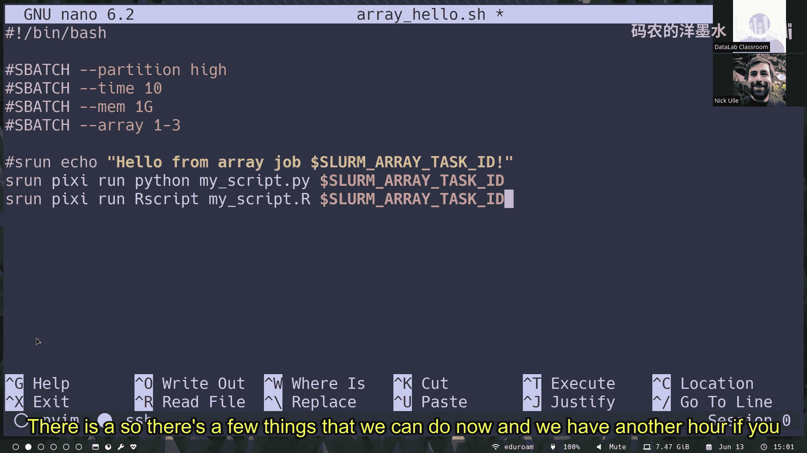

I will do the example of how you actually get this parameter into python python is what we want right okay so Python I can also do it for R you want to see that also there's a case study of running an array job if you would like to see that we could be bad。

So。Doesbody have any really strong preferences about what we do first？Any questions about England？对。

And I will show for Python， how do we get this into Python？Yeah。

 that when they didn file on nano that automatically executed go。that I can think of not with nano。

 possibly with a different text editor。But nano is very simple。

You might be able to you could probably do something like that with ViIm or EMAC， but yeah， not now。

Okay， and then I guess we will look at how how do we pass this into a Python program？

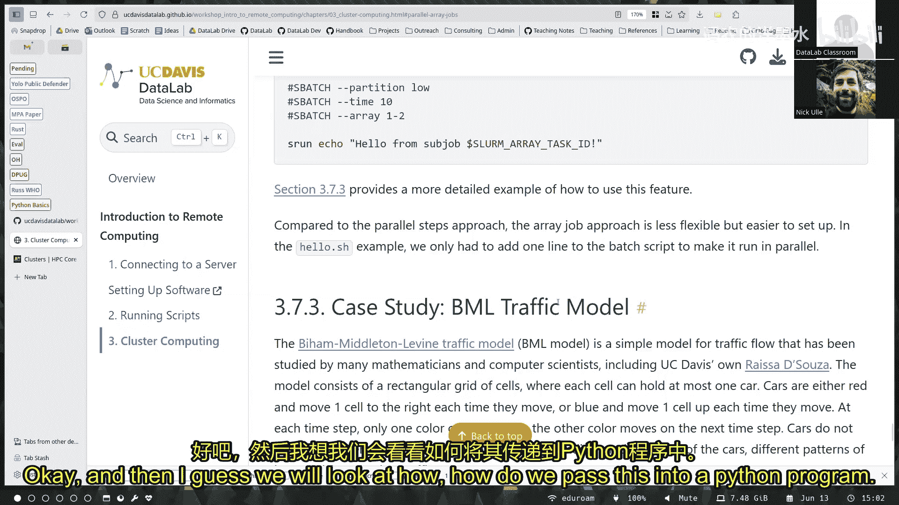

Okay， so。Let's。Let's just save that for a minute so we're going to need to go write some python code so。

I'm going to do this the way that I can kind of know how to do this。

 so we're going to see we're going to call this。Well。A rate up high， why not？对。嗯。

And what we're going to put in here。What do I want to do this？So we're going to import。Ss。Yes。Sist。

org。B is where we get the arguments in Python， okay？嗯。And then if I remember right。

 let's let's actually do some interactive stuff before we write this， so I'm going to exit。

 I'm not going to say this。Pixie run， Python。Bt cis cis dot orv remind me what's in here。 Okay。

 so it's I think it's just going to be。Arguments that we actually passed so。Was this out？

Go back to our Python file array。up好。Great， and then we'll say import cis。Assist。orv0。

 so we'll get the first argument through this。And我 say我这个。Dob number。嗯。

We're going to have to test this to make sure it's actually the first arguments it's one okay yeah that's that's what I was wondering is if it's if it's going to that's why I was doing the interactive thing too yeah okay so we're going to grab this the second argument because the first argument is going to be the python command itself。

Back， so then we're going to。Do something depending on the job number。So let's。

 let's make the job number and integer。We'll say turn this thing into an integer。Okay。

 and then what we will do is if job number。one。Waiint。Hello， this is job one。Else。Pinnt。

This is not job one。不快。对。😊，And I want to be able to test this before we actually。Right。

 so I'm going to。嗯。With us should being up here user in。And。So let's save this。

Do people need a minute to see this or can I close it？

So what the end is really doing it's in case Python is located somewhere different than you might expect and like when we run Python and Pixie it's not going to be a like user bin Python it's going to be somewhere else。

And so this EV command is just figuring out where is the first python that we can find on the path。

And ENV should always be at user bin end on any Linux or Ma computer。

It's part of a standard the the Poss standard for what computers are supposed to do Windows computers do not follow the Psic standard because Windows computers Microsoft can't doesn't follow any standards except their own so。

But Mac and Linux generally do okay。This end of command should always be where at that path and then it will find whatever command you put after it we could be sort of tricky here and do something like Dick Pixie run in here。

I'm pretty sure you could do this and it would work。And it would run it in Pixie for you。

 but then then if someone wants to run this without a Pixie environment。

 then they're going to have problems， so I'm not going to do that。No。All right。

 so I'm going to save this and close it。And then I'm going to make it executable。U plus x。

 let's do U plus x。Aray dot pie。对。And then if I dot slash array pi， this should give me an error。

Oh right， I need to。Ne to呃。Pixing me run slash arrayray five。Yeah。

 that gives me an error like I expected and then if I give it some kind of actual number。Okay。

 and so this is not childable， right？Okay， so it seems to be working。Testing stuff on the head node。

 you really shouldn't do that， but this is a very。Simple program and just print stuff out。Okay。

 so now that we know that it seems to be working， let's let's make a thing to run this so。Nanno1。

Well， let's just， let's use our array hello， because weve already got that set up。

We're just going to change the command so we're going to comment out that we're going to comment out this one okay we're just going to do this。

Great。My script is going to be instead array up high。啊，不是是嗯。And now we exit out of this。Save it。

 make sure it's still there。And then Spatch， array， hello。That is H。Running。Almost done。对。

Now it is done so if we look in here， we have some more sLm output files and if we go ahead and look at those so this is。

Two， three， four。F one。嗯，我。And I'm just I'm going to print out all of them by putting a star there。

WaiSo you can see hello， this is job one， this is not job one。

job more right so you can you can make your your script to do different things depending on。

Of what that input number is。嗯。😊，Any questions？But this part or anything you want to see again。Okay。

Do you also want to see an example of doing this for R or we？Happy with this。

Does anybody want to see an example for Arc？Okay， I'll do the example for R if we want if we want to do this with R。

 I will make an array on R。ok呃。This time thecheet user been and。Our script。Okay。

 and then for our actual code。Comman does anybody remember is it command。orgs？It was。T out。是。

And ran arms。Okay， yeah， and it also has the path at the first as the first argument so。

Let's go back to our array on our ran。Abs。对。This's gonna to be my。As。And grab the。Second one。

R starts from from one instead of zero and then if。I guess we could make this a。In futureature。Dger。

And then。We will say ifard。Our earth is one。Pnt。Not print message。This is job one。Btly brace else。

That是就是。This is not job。I think that should work。Save this。Make it executable。对。We run it。

We're missing value。嗯。嗯。H。We know。Hey， hey what？ItYeah， it's giving us a。嗯嗯。I。看开多。Yeah。

 I think that should be the path but。LetLet me see what this is before we。Try that。Oh。Okay， it's。

Yeah， let's do this。His ours。Annoying。For this we want trailing only equals true。

And then I think if we do trailing， well make it's true and we should get。垂微。Yeah。so let's fix that。

嗯。Reiling only。2 should be a one still the away。Okay， so we're going to do that。It's dead。And then。

Save it。Right again。There we go。没。All right， so now if we go back to our。See， what was it called。

Ray hello。With this age。And instead of the Python line， we'd run the R line。bitit of my script R。

Aray about us。可。Save that。patch。Aay， hello again。W for it to finish。She。Looks like it's done。

 So now if we had。We learn two， three， four，5， two， three，1。Star。

those are these are outputs and what personal one。找不完那是早找不完。对。So。

You do it that way in Python there's also a module you can use to get environment variables directly so you could just do that I think you can also do something like good in R。

Yeah。Any questions about any of this like things you want to see？Okay。Well。😮。

And I think that is where I will end the workshop。I will hang around for a little while in case folks have questions。

But thank you all for coming。And we will have a feedback form that will get sent out by email whatever email you registered with so please do fill in that feedback form we actually look at the feedback it helps us figure out how we can adjust the workshop we especially appreciate specific constructive feedback so if you tell us that we were too fast if you feel like parts of the workshop were too fast tell us which parts not just too fast because we always get a few people say too fast a few people say too slow that we don't know what to do with that so if you tell us like it was too fast in this section then we can think about how we might。

You with that。诶。

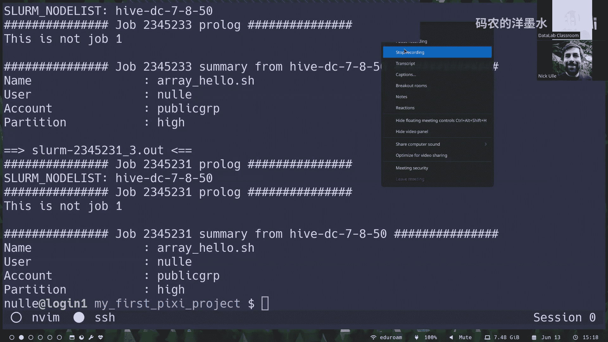

他就什么。