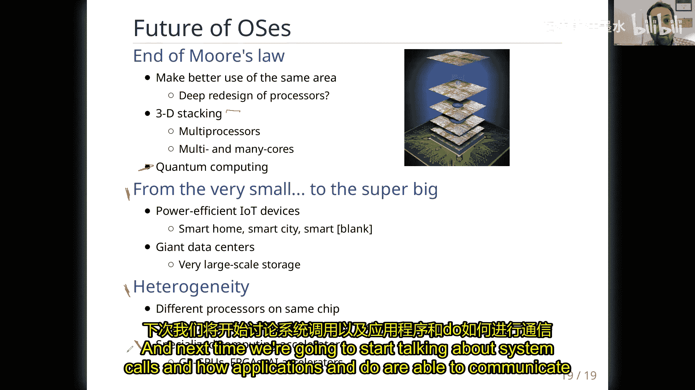

# 001：操作系统简介 🖥️

在本节课中，我们将要学习操作系统的基础概念。我们将从定义操作系统开始，了解它是什么，以及它在计算机系统中扮演的核心角色。接着，我们会探讨计算机硬件的基本构成，并深入分析操作系统需要管理的核心资源。最后，我们将回顾操作系统的历史演变，并展望其未来面临的挑战。

## 什么是操作系统？

操作系统是一种软件层，它位于应用程序和计算机硬件之间。这层软件负责为应用程序和用户管理计算机的资源。这个定义虽然目前看起来有些宽泛，但我们将通过本课程逐步探索其具体含义，例如这个软件层具体是什么，以及它需要管理哪些资源。

## 计算机硬件基础

为了理解操作系统需要管理什么，我们首先需要明确计算机硬件的基本构成。无论计算机是台式机、服务器还是嵌入式设备，其基本结构都包含以下核心组件：

*   **中央处理器**：负责从内存读取指令并执行。它包含一个**指令集**（如 x86、ARM）和一组**寄存器**（用于临时存储数据），以及**程序计数器**和**状态寄存器**。
*   **内存**：一个巨大的字节数组，每个字节都有一个地址。CPU通过提供地址来读写内存中的数据。内存层次结构包括**CPU寄存器**、**主内存**、**CPU缓存**（对CPU透明）和**二级存储**（如硬盘、SSD）。
*   **输入/输出设备**：通常由**设备控制器**（CPU可直接交互的部分）和**实际设备**（执行具体功能的部分，如Wi-Fi天线）组成。CPU可以通过**内存映射访问**（主流方式）或**端口映射访问**（旧方式）与设备控制器通信。
*   **互连总线**：连接CPU、内存和设备的通信通道，使它们能够相互通信。通常分为高速的CPU-内存总线和速度稍慢的CPU-设备总线。

## 操作系统的核心角色

上一节我们介绍了计算机硬件的基本构成，本节中我们来看看操作系统在管理这些资源时需要扮演的三个核心角色。

1.  **裁判员**：操作系统需要管理计算机资源在不同应用程序间的共享。这包括资源的**分配**（如CPU时间、内存空间）和应用程序间的**隔离**（防止一个程序影响另一个）。同时，操作系统也需要在保证隔离的前提下，允许应用程序之间进行**协作与通信**。
2.  **幻术师**：操作系统需要向应用程序**隐藏硬件的复杂性**，并提供更简单、统一的抽象接口。例如，应用程序无需关心数据是存储在SSD还是硬盘上，也无需处理网络数据包丢失等底层细节，这些都由操作系统负责。
3.  **粘合剂**：操作系统应为应用程序提供尽可能多的**通用服务**（如文件操作、网络通信），避免每个应用程序都去“重新发明轮子”，从而简化编程。

## 操作系统的设计原则

了解了操作系统的角色后，如果我们想要设计一个操作系统，应该遵循哪些核心原则呢？以下是关键的设计考量指标：

*   **可靠性**：操作系统必须能够始终如一地按照其规格说明执行功能。任何微小的错误都可能在长期运行中累积，导致灾难性后果。
*   **可用性**：系统应尽可能（理想情况下是始终）处于可用状态。可靠性和可用性紧密相关，但并非同一概念。一个系统可能可靠（不丢失数据）但不可用（频繁崩溃），也可能可用（从不崩溃）但不可靠（经常丢失数据）。
*   **安全性与隐私性**：
    *   **安全性**：防止外部攻击者未经授权进入系统。
    *   **隐私性**：确保系统内的数据只能被授权用户访问。这涉及到**安全机制**（如高墙、铁门）和**安全策略**（规定谁可以进出）的区别。
*   **可移植性**：包含两个方面。一是操作系统应向应用程序提供易于使用的抽象，使应用程序不受硬件差异的影响。二是操作系统本身应尽可能易于移植到不同的硬件平台，避免为每种新处理器重写整个系统。
*   **性能**：包含多个指标：
    *   **开销**：操作系统自身运行所消耗的资源，应尽可能小。
    *   **公平性**：资源分配应公平，但公平不等于绝对平均，高优先级任务理应获得更多资源。
    *   **延迟**：完成一个操作所需的时间（如移动鼠标后光标响应的速度）。
    *   **吞吐量**：单位时间内能完成的操作数量。通常与延迟存在矛盾（例如，卡车吞吐量大但延迟高，跑车延迟低但吞吐量小）。
    *   **可预测性**：性能随时间保持一致的特性。有时可预测性比平均高性能更重要（例如，稳定的微小延迟优于偶尔出现的严重卡顿）。

## 操作系统的历史与未来

我们已经从概念上了解了操作系统是什么、做什么以及如何设计。现在，让我们回顾一下操作系统的演变历程，并展望其未来的发展方向。操作系统和计算系统的发展大致可分为三个阶段：

1.  **第一阶段（1950年代中期-1960年代中期）**：计算机极其昂贵，人类劳动力相对廉价。此时没有真正的操作系统，所谓的“OS”更像是一个**公共函数库**，因为计算机一次只能运行一个程序，无需管理资源共享。
2.  **第二阶段（1960年代中期-1990年代）**：随着集成电路发展，计算机成本下降。出现了能运行多道程序的**大型机**，催生了真正的操作系统，如IBM OS/360（具备内存保护）和具有开创性的**Multics**系统（引入了动态链接、文件系统等现代OS核心概念）。同时，**个人计算机**兴起，**Unix**操作系统被发明，并衍生出BSD、System V等变体，后来通过**POSIX**标准实现了统一。
3.  **第三阶段（1990年代至今）**：计算机变得非常廉价且无处不在，处理、存储成本急剧下降。未来操作系统面临三大挑战：
    *   **摩尔定律的终结**：需要通过**架构革新**、**3D堆叠**或**量子计算**等新范式来持续提升性能。
    *   **计算设备的两极分化**：操作系统需要同时适应**极小型、低功耗的物联网设备**和**超大规模的数据中心**。
    *   **异构计算**：同一系统内集成多种不同类型的处理器（如大小核CPU、GPU、AI加速器），操作系统需要学会高效管理和调度这些异构资源。

## 总结

本节课中我们一起学习了操作系统的基础知识。我们首先将操作系统定义为介于应用程序与硬件之间的资源管理软件层。接着，我们剖析了计算机硬件的核心组件：CPU、内存、I/O设备和总线。然后，我们探讨了操作系统扮演的三大角色：资源分配的裁判员、隐藏复杂性的幻术师以及提供通用服务的粘合剂。在此基础上，我们分析了设计操作系统时应遵循的关键原则，包括可靠性、可用性、安全性、可移植性和各项性能指标。最后，我们回顾了操作系统的历史演变，并展望了其在后摩尔定律时代、设备两极分化和异构计算背景下面临的挑战。下一节课，我们将开始学习系统调用，探讨应用程序与操作系统之间是如何进行通信的。