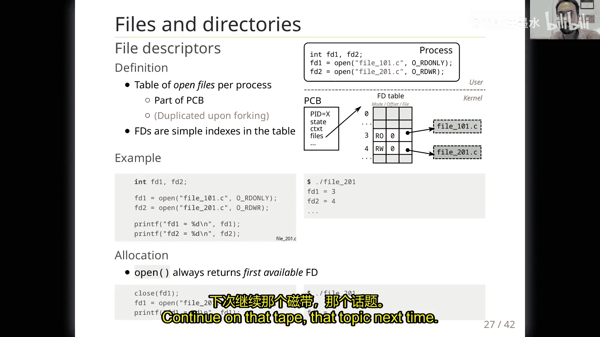

# 003：系统调用（第二部分）


## 概述

在本节课中，我们将继续学习系统调用。我们将深入探讨进程管理相关的系统调用，包括 `exec`、`exit` 和 `wait`，并了解它们如何与 `fork` 协同工作。随后，我们将转向文件与目录相关的系统调用，学习如何打开、读取、写入文件，并理解文件描述符的概念。

上一节我们介绍了 `fork` 系统调用，它用于创建一个当前进程的副本。本节中我们来看看其他几个关键的进程管理调用。

## 进程管理：`exec` 系列调用

`exec` 是一个极其重要的系统调用，它通常与 `fork` 配合使用。其核心思想是：一个正在运行某个程序的进程，可以通过调用 `exec` 来**替换**当前正在执行的程序，转而开始执行另一个全新的程序。进程本身（其PID）保持不变，但执行的代码完全改变了。

以下是 `exec` 的一个基本示例。注意，我们使用的是 `execv` 变体，它需要提供可执行文件的完整路径和参数数组。

```c
#include <unistd.h>
#include <stdio.h>

int main() {
    printf("Before exec...\n");
    char *args[] = {"/bin/echo", "ECS 150", NULL};
    execv("/bin/echo", args);
    printf("This line will NOT be printed if exec succeeds.\n");
    return 0;
}
```

当程序运行到 `execv` 时，如果调用成功，进程将停止执行原程序，并开始执行 `/bin/echo` 程序，输出 “ECS 150”。原程序中 `execv` 调用之后的 `printf` 语句将永远不会执行，因为进程已经“变身”了。只有当 `execv` 调用失败（例如指定的命令不存在），程序才会返回到原代码继续执行。

## 进程管理：`exit` 调用

`exit` 系统调用用于终止一个进程。进程可以在代码的任何地方显式调用 `exit` 来结束自己，这常用于处理错误。

```c
#include <stdlib.h>
if (file_open_failed) {
    exit(1); // 以状态码 1 退出，表示错误
}
```

此外，当 `main` 函数执行 `return` 语句时，C 标准库会隐式地调用 `exit`。进程退出时会返回一个整数值，称为退出状态码。按照惯例，返回 `0` 表示成功，非零值表示某种错误。

在 Shell 中，可以通过 `$?` 变量获取上一个命令的退出状态码。

```bash
$ ls /
bin boot dev ... # 列出根目录内容
$ echo $?
0                # ls 命令成功，返回 0

$ ls /nonexistent_directory
ls: cannot access '/nonexistent_directory': No such file or directory
$ echo $?
2                # ls 命令失败，返回非零值 2
```

退出状态码对于脚本编程非常重要，它允许脚本根据前一个命令的成功与否来决定后续执行不同的逻辑。

## 进程管理：`wait` 调用

既然子进程可以通过 `exit` 返回状态码，父进程如何获取这个值呢？这就要用到 `wait`（或更精确的 `waitpid`）系统调用。它们允许父进程等待其子进程结束，并收集子进程的退出状态。

以下是 `wait` 的一个简单示例：

```c
#include <sys/wait.h>
#include <unistd.h>
#include <stdio.h>
#include <stdlib.h>

int main() {
    pid_t pid = fork();

    if (pid == 0) {
        // 子进程
        printf("Hello from the child!\n");
        exit(42); // 子进程退出，返回 42
    } else {
        // 父进程
        int status;
        wait(&status); // 等待子进程结束，status 将包含退出信息
        printf("Child exited with status: %d\n", WEXITSTATUS(status));
    }
    return 0;
}
```

运行此程序，输出顺序是确定的：
1.  `Hello from the child!`
2.  `Child exited with status: 42`

`wait` 是一个阻塞调用。父进程调用 `wait` 后，会被操作系统挂起，直到它的一个子进程结束。子进程的退出状态信息被包装在 `status` 整型变量中，需要使用 `WEXITSTATUS` 等宏来提取具体的退出码。这种机制在父进程和子进程之间建立了同步关系。

## 综合示例：`fork`、`exec` 和 `wait`

将 `fork`、`exec` 和 `wait` 组合起来，就构成了在程序中运行另一个程序的基础模式。这实际上是 Shell 运行命令的核心原理。

```c
#include <sys/wait.h>
#include <unistd.h>
#include <stdio.h>
#include <stdlib.h>

int main() {
    pid_t pid = fork();

    if (pid == 0) {
        // 子进程：变身去执行 echo 命令
        char *args[] = {"/bin/echo", "ECS 150", NULL};
        execv("/bin/echo", args);
        // 如果 execv 失败，才会执行下面这行
        perror("execv failed");
        exit(1);
    } else {
        // 父进程：等待子进程结束
        int status;
        wait(&status);
        if (WIFEXITED(status)) {
            printf("Child exited with status: %d\n", WEXITSTATUS(status));
        }
    }
    return 0;
}
```

这个模式可以扩展成一个简单的 Shell 原型：
1.  显示提示符，等待用户输入命令。
2.  调用 `fork` 创建子进程。
3.  在子进程中，调用 `exec` 执行用户输入的命令。
4.  在父进程（Shell本身）中，调用 `wait` 等待子进程结束。
5.  子进程结束后，父进程循环回到第1步。

## 进程关系：`getpid` 与 `getppid`

在进程树中，每个进程都有唯一的进程ID（PID）和父进程ID（PPID）。系统调用 `getpid` 用于获取当前进程的PID，`getppid` 用于获取其父进程的PID。

```c
#include <unistd.h>
#include <stdio.h>
#include <sys/wait.h>

int main() {
    pid_t pid = fork();

    if (pid == 0) {
        // 子进程
        printf("Child: My PID is %d\n", getpid());
        printf("Child: My parent's PID is %d\n", getppid());
        exit(0);
    } else {
        // 父进程
        wait(NULL); // 等待子进程
        printf("Parent: My PID is %d\n", getpid());
        printf("Parent: My parent's PID (shell's PID) is %d\n", getppid());
    }
    return 0;
}
```

运行此程序，可以清晰地看到父子进程间的PID关系。父进程的父进程PID，通常就是启动它的Shell的PID。

---

上一节我们探讨了进程管理的核心系统调用。本节中我们来看看另一个重要类别：文件与目录操作。

## 文件与目录操作概述

在类Unix系统中，文件和目录被组织成树形结构，通过虚拟文件系统（VFS）进行管理。系统提供了丰富的系统调用来与文件和目录交互，包括打开、读写文件，以及遍历目录等。

## 基础文件操作：`open`、`read`、`lseek`、`close`

以下是一个使用基础文件系统调用来读取文件内容的例子：

```c
#include <fcntl.h>
#include <unistd.h>
#include <stdio.h>

int main() {
    int fd = open("file_io.c", O_RDONLY); // 以只读方式打开文件
    if (fd < 0) {
        perror("open failed");
        return 1;
    }

    char c;
    read(fd, &c, 1); // 读取第一个字符
    printf("First char: %c\n", c);

    read(fd, &c, 1); // 读取下一个字符
    printf("Second char: %c\n", c);

    lseek(fd, -2, SEEK_END); // 将文件偏移量移动到末尾前2个字节
    read(fd, &c, 1); // 读取倒数第二个字符
    printf("Char before the last: %c\n", c);

    close(fd); // 关闭文件描述符
    return 0;
}
```

**关键点**：
*   `open` 返回一个**文件描述符**，它是一个整数，是后续所有文件操作的句柄。
*   `read` 是顺序读取的。每次读取后，文件内部的“当前位置”指针会自动后移。
*   `lseek` 可以改变这个“当前位置”指针，实现随机访问（如例子中跳转到文件末尾）。
*   操作完成后，必须使用 `close` 释放文件描述符。

## 理解文件描述符

文件描述符本质上是一个整数索引。每个进程都有一个**打开文件表**，文件描述符就是这个表的索引。当进程打开一个文件时，内核会在该表中找到一个空闲条目，将文件信息填入，并返回该条目的索引号给进程。

考虑以下代码：
```c
int fd1 = open("file1.c", O_RDONLY);
int fd2 = open("file2.c", O_RDWR);
printf("fd1=%d, fd2=%d\n", fd1, fd2); // 可能输出 fd1=3, fd2=4

close(fd1); // 关闭文件描述符 3，释放该表条目

fd1 = open("another.c", O_RDONLY);
printf("New fd1=%d\n", fd1); // 很可能输出 New fd1=3
```

**解释**：
1.  前两个 `open` 调用可能返回 3 和 4，因为 0、1、2 通常被标准输入、输出、错误流占用。
2.  关闭 `fd1`（值为3）后，索引3的条目变为空闲。
3.  再次调用 `open` 时，内核会寻找最小的空闲索引，因此很可能再次使用3。

## 总结



本节课中我们一起学习了系统调用的第二部分。我们首先深入了解了进程管理相关的 `exec`、`exit` 和 `wait` 调用，看到了它们如何与 `fork` 结合，构成了运行新程序（包括Shell工作原理）的基础。随后，我们转向了文件操作，学习了如何使用 `open`、`read`、`write`、`lseek` 和 `close` 等系统调用来操作文件，并理解了文件描述符作为内核中打开文件表索引的核心概念。这些是操作系统为应用程序提供的基础且强大的服务。