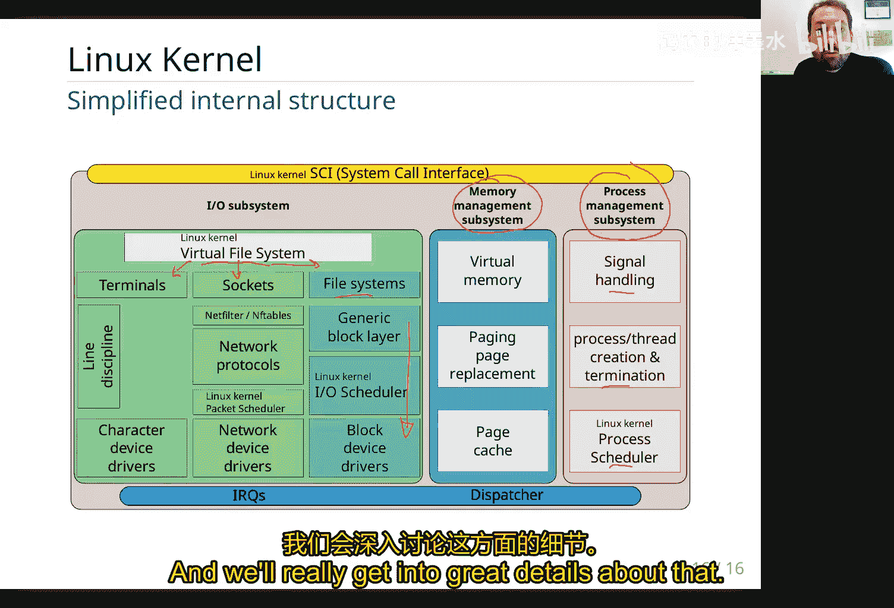

# 005：操作系统结构 🏗️

在本节课中，我们将要学习操作系统的软件架构，即其层次化结构。我们将从用户最熟悉的应用程序层开始，逐步深入到内核的核心部分，并探讨不同的内核设计模式。

## 概述

一个典型的计算系统由多个软件层次构成。最上层是用户直接交互的应用程序。应用程序通常依赖于各种库（如C标准库）。所有这些都运行在用户模式下。另一侧是操作系统的特权部分，称为内核。内核本身通常也分为至少两层：可移植层和机器依赖层。所有这些代码最终都运行在由CPU和各种设备组成的硬件之上。今天，我们将逐一审视这些层次。

## 应用程序层

应用程序通常是你编写的代码，例如C语言中的`main`函数，它执行多条语句并调用多个函数。应用程序就是你编译生成的可执行文件。

大多数情况下，编写应用程序时需要使用库。例如在C语言中，如果你想打印内容或进行数学计算，就需要使用库，因为你不会自己去重新实现`printf`这样的函数。使用`printf`需要包含`stdio.h`，使用`malloc`需要包含`stdlib.h`，进行数学计算则需要包含`math.h`。

这些库和头文件只提供了库的API，即库所提供函数的列表。你可以像调用自己编写的函数一样调用它们。

这些库的代码通常以对象文件的形式直接提供，你通常不会直接处理其C源代码，而是使用已经编译好的版本。这个编译好的版本以对象文件的形式安装在计算机中，由编译器负责在你的代码（例如调用`printf`）和包含`printf`编译代码的库之间建立连接。这就是GCC所做的工作。

例如，当你在代码中包含`math.h`并使用一些数学函数时，你需要将你的代码与`libm.so`库链接。你必须告诉GCC你使用了数学库，以便建立链接。实际上，当你使用C标准库（如`printf`）时，从技术上讲也应该告诉GCC需要链接C库。但由于几乎所有应用程序都这样做，所以它是默认隐含的，你通常不需要特别指定。不过，如果你愿意，也可以在命令行中指定。

编译器提供了两种主要的工作方式。你可以告诉编译器将`printf`的代码真正包含在你的可执行文件中，这称为**静态编译**。或者，你可以进行**动态编译**，即告诉GCC你使用了C库，但不要把代码放进你的可执行文件，只需注明运行此代码需要该库。这意味着当应用程序最终被加载运行为进程时，我们也需要加载`libc`，这样应用程序才能完全工作。

## 编译工具链与库

让我们更深入地了解编译过程和库（静态库与动态库）。

编译工具链的工作流程如下：在一个C项目中，你通常从一个或多个C文件开始。你调用GCC，而GCC实际上由多个内部工具组成，它们几乎是相互独立的。这些工具包括：
*   **CPP**：预处理器。
*   **CC**：实际的编译器。
*   **AS**：汇编器。
*   **LD**：链接器。

这个过程最终会生成一个二进制目标文件（`.o`文件），最后阶段是将所有目标文件与你可能使用的库组合起来，由链接器将所有内容整合成一个最终的可执行文件。

如果我们放大这个过程：
1.  从C文件（`.c`）开始，交给预处理器CPP。
2.  CPP解析所有的`#include`指令（包含头文件）和`#define`宏定义，生成一个自包含的文件。GCC内部会生成一个扩展的C代码文件（`.i`），这个文件包含了所有必需的代码。
3.  这个`.i`文件（仍然是C代码）被交给实际的编译器CC。
4.  CC将C代码编译成人类可读的汇编代码（`.s`文件）。
5.  汇编器AS接收这个`.s`文件，将人类可读的汇编指令转换成处理器可以理解的二进制等价物，输出目标文件（`.o`）。
6.  所有`.o`文件的组合由链接器LD处理，生成最终的可执行文件。

如果你好奇，可以在运行GCC时使用`-save-temps`选项来访问这些中间文件。你应该尝试自己写一个简单的`printf("Hello World")`程序，用这个选项编译，然后在同一目录下查看生成的`.i`和`.s`文件，观察编译的不同阶段，这非常有趣。

## 可执行文件与进程内存

最终，我们得到了一个可执行文件（这里通用地称为`a.out`）。那么，如果你想实际执行这个可执行文件并将其变为一个进程，会发生什么？

可执行文件本身只包含两样东西：
1.  **代码段**：程序的指令序列。
2.  **数据段**：全局变量。

这是可执行文件包含的全部内容。当你运行一个可执行文件并将其变为进程时，数据段和代码段直接从可执行文件中加载。

另外两个内存段——**栈**和**堆**——并不由可执行文件提供。这些内存段是在运行时，进程启动的时刻动态创建的。它们开始时完全是空的，并随着进程的执行而逐渐填充。堆会随着进程调用`malloc`等函数放入数据而增大；栈也是类似的，它从空开始，随着进程运行、创建栈帧、放入局部变量、调用函数等而增长。这两个是仅在运行时创建的动态段，不存在于可执行文件中。

你可能会问，为什么要把代码和数据分成两个不同的段？为什么不合并成一个段？另一个问题是，为什么堆和栈要分置两端，一个向高地址增长，一个向低地址增长？

对于第一个问题，我们稍后在讨论实际内存管理时会详细说明。目前的理解是，将它们分开是因为我们可能希望对它们进行不同的处理，例如赋予不同的权限。代码通常没有理由被应用程序自身修改，因此我们可能希望保护代码段，将其设置为只读，防止应用程序在运行时改变自己的代码。这可以防止潜在的攻击者控制应用程序并使其执行其他操作。而数据段显然因为包含变量，需要可读可写。

对于第二个问题，堆和栈分置两端并相向增长的原因是为了最大化空间利用率。如果你有一个房间，有两个可以增长的实体，最大化空间使用的最佳方式是将它们放在房间的两端，这样它们可以向中间增长。只有当它们最终相遇时，才意味着房间满了。如果我们把栈放在某个中间位置，并让它也向高地址增长，那么堆在增长到栈下方时就会被阻塞，即使栈很小，没有使用所有空间，也会造成空间浪费。通过让它们相向增长，可以确保只有当它们相遇时，才意味着内存真的用完了，从而实现了内存的良好利用。

## 加载器与动态依赖

在一个简单的世界里，一个可执行文件可以直接加载到内存中：加载代码、加载数据、创建堆、创建栈，然后跳转到代码段的第一条指令开始执行，应用程序就运行起来了。

然而，我们之前提到，应用程序可能需要一些库才能运行，这带来了一些复杂性。为了确保内核的工作保持相对简单（因为内核负责将应用程序加载到内存并运行为进程），工程师们发明了一种非常巧妙的方法，即使用**加载器**。

设想我们有一个应用程序`a.out`，它使用了`libm`库。`a.out`被编译为动态应用程序，因此它实际上不包含`libm`的代码。我们可以使用`ldd`工具来检查一个可执行文件，它会列出该应用程序所依赖的库。应用程序本身不包含这些代码，只是声明：“为了工作，我需要这个库。”

因此，我们不能仅仅加载`a.out`就跳转执行，因为那还不够。我们需要加载`a.out`，还需要加载`libm`，并将它们连接起来，然后才能运行进程。我们需要加载应用程序及其使用的库。

问题是，让内核来处理这些依赖关系可能过于复杂或繁重，因为如果计算机有不同版本的库等情况，可能会变得相当复杂。因此，内核决定将这项工作交给其他程序，这个“其他程序”就是**加载器**。

通常，我们看到`a.out`可执行文件也依赖于一个名为`ld-linux-...`的加载器。当你调用`exec`时（例如在shell中运行`a.out`，shell会`fork`自身并`exec a.out`，`exec`是一个系统调用），最终内核会收到运行`a.out`的请求。内核会打开`a.out`，发现它实际上依赖于一个加载器。于是，内核不会直接加载`a.out`，而是加载这个加载器。加载器是一个非常简单的、完全自包含的程序，它本身不依赖其他库，因此极其容易加载。然后，内核将这个加载器作为用户进程加载到内存中，并跳转到该加载器。

接下来，就由加载器负责从`a.out`加载应用程序，并加载所有列为依赖项的其他库。这个过程可能相当复杂，但这没关系，因为加载器是一个用户进程。这样，所有的复杂性都被封装在这个应用程序中，而不是在内核里，从而避免了可能难以处理的大问题。

## 静态库、动态库与动态加载

让我再举一些关于库的例子，以及静态库和动态库的区别。

假设我们有一个非常简单的例子，只有一行代码的`main`函数，我们调用了`printf`（这意味着需要访问`libc`），并且还通过调用`cosine`函数使用了数学库。

编译这个应用程序的典型方式是使用GCC编译`main.c`文件。因为你使用了数学库，而数学库默认不包含，你必须明确指定链接数学库。GCC会完成编译，但只会将你的代码编译进`a.out`，并写下依赖项：为了这个应用程序工作，需要加载`libm`（数学库）和`libc`。为了做到这一点，还需要加载加载器。当我们运行这个程序时，就会发生前面描述的过程：内核只加载加载器，然后由加载器负责加载实际的可执行文件、`libm`、`libc`，并连接所有人，最后应用程序才能完全运行，执行`printf`和`cosine`等操作。这是**动态链接**的方式，也是当今默认的工作方式。

还有另一种方式，称为**静态链接**。唯一的区别是，我们调用GCC时，告诉它使用数学库的静态版本。在这里，GCC不会说“我们需要`libm`才能工作”，而是会进入这个存档文件（静态库），真正获取与`cosine`对应的代码，并将其放入可执行文件本身。现在，可执行文件不再依赖`libm`，因为它已经从包含所有代码的存档中取出了所需的代码并放入了自身。运行`ldd`查看这个可执行文件时，`libm`不会出现，因为我们不再依赖它。代码运行效果是一样的。

最后一种处理库的方式称为**动态加载库**。我知道这有很多“动态”的概念（动态链接、动态加载库），听起来可能有点混淆，但它们实际上是不同的概念，请确保回到幻灯片理解每个“动态”指的是什么。

这里的想法很有趣：**应用程序本身将通过执行代码来打开它需要的库**。不是通过包含`math.h`然后直接使用`cosine`函数，而是通过代码打开库本身，获取与`cosine`函数对应的符号，然后运行代码。为了做到这一点，我们需要使用另一个名为`dl`的库，它也有头文件和API函数，也是一个需要应用程序连接的库。但在这里，你会看到应用程序在技术上使用了`libm`数学库，但它没有作为依赖项出现。应用程序没有说“我需要这个东西存在，我需要在我加载时加载这个东西”。因为这将在运行时由应用程序自身完成。

这实际上是应用程序实现插件的方式。插件的特点是，即使某些插件没有安装，应用程序也应该能够工作。只有当你安装它们后，应用程序才能说“我看到那个目录里有一个插件，你想让我加载它吗？”，如果你同意，插件就会被动态加载。突然间，你的应用程序就获得了以前没有的新功能。其工作原理就是应用程序自身能够动态地打开代码片段。如果库没有安装或找不到，`dlopen`会返回`NULL`，应用程序可以处理这个事件而不会崩溃。

回到前面的例子，在常规的动态链接方式中，如果你编译并链接了数学库，但数学库在计算机上不可访问，那么应用程序将无法被加载。

## 内核的可移植层与机器依赖层

现在，让我们回到不同的层次。我们已经讨论了应用程序层和库层，现在跳到内核侧，讨论那两个层次。

让我先给你一个小例子。我面前有一台运行Linux的笔记本电脑。我这里还有一部Android手机。正如你所知，Android也运行Linux。这意味着我的笔记本电脑和手机运行着相同的内核。尽管它们是相当不同的硬件设备，比如笔记本电脑和手机，它们有屏幕，可以交互，都是计算机，但它们有根本的不同。

在Linux中，有趣的是，Linux是一个庞大的代码体，但有些代码块没有理由在我的笔记本和手机之间不同，而有些代码块则完全有理由不同，因为它们是两种非常不同的设备。这就是为什么我们在内核内部有这两个不同的层。

**可移植操作系统层** 是那些在不同设备之间几乎不会改变的代码层。例如，虚拟文件系统——我的笔记本电脑看待文件的方式与我的手机看待手机上文件的方式是相同的。进程间通信（IPC）——一个进程通过发送信号或管道与另一个进程通信的方式，在笔记本和手机上完全相同。运行多个进程并进行调度的方式、虚拟内存、网络、声音处理方式等等，都是完全相同的。因此，即使设备不同，也没有理由拥有两套不同的代码。

显然，我们必须承认设备是不同的，它们有不同的硬件。因此，也有很多代码必须**非常特定于设备**。例如，我的笔记本电脑有一个x86处理器，所以它需要能在该处理器上运行的特定代码。而我的手机有一个ARM处理器（几乎地球上所有手机都是），所以我们需要知道如何处理ARM处理器的代码。这就是**机器依赖层**的内容，它是所有必须与硬件完全匹配的代码。这意味着计算机的启动方式、初始化方式、围绕异常的所有逻辑、设备驱动程序（显然，驱动程序必须匹配硬件上的实际设备）、内存管理的底层等等，以及一切与处理器相关的内容。

## 层间接口

这些层之间的接口实际上有各自的名称。让我们快速了解一下：

*   **API**：我相信你听说过它，这个名称在很多不同情境下常被滥用。在我看来，最贴切的应用方式是，API描述了一个库向应用程序提供什么。你有一个应用程序，想使用C库，C库有一个API，即它提供的函数集合。应用程序使用库提供的API。
*   内核也有自己的API供进程使用，即内核可以代表进程执行的系统调用列表。虽然没有约定俗成的名称，但在Linux世界中，它通常被称为**UAPI**（用户API），我认为这是一个很好的名字。
*   内核中可移植层和机器依赖层之间的接口通常称为**HAL**。这里的想法是，可移植层（如前所述，在我的笔记本和手机上是相同的）经常需要调用由机器依赖层提供的函数。这些函数的实现在手机和笔记本上会不同，但函数必须具有相同的签名（原型），只是实现因设备而异。因此，机器独立层向可移植层提供了一种API，这就是所谓的硬件抽象层。
*   软件和硬件之间也有一种接口，实际上分为两部分：**ISA**。你在ECS 50或150B课程中肯定听说过，ISA是处理器理解的指令列表，有点像处理器的字典。因此，ISA在x86和ARM上是不同的。
*   最后，还有另一个接口称为**ABI**。这是处理器告诉应用程序的一种方式：“这是你应该定义栈帧的方式。这是函数调用另一个函数时传递参数的约定。”这实际上是汇编级别的约定。

## 内核结构

现在我们已经理解了典型层次是如何架构的，让我们谈谈内核结构，因为正如你将看到的，内核并不总是这两层的叠加，它可以有其他结构。

实际上，第一种结构类型就是我们刚刚介绍的，称为**单体内核**。单体内核的想法是，内核显然由大量代码组成，并且全部编译在一起，形成一个单一的可执行文件。这就是加载到内存中的代码块，负责响应用户进程（应用程序）的所有系统调用。Linux、传统的Unix或BSD系统等通常就是这种类型。

是单体内核并不一定意味着它全是静态的。例如，在Linux中，可以有动态模块，这样你可以只将一个微小的内核加载到内存中，然后在计算机运行时根据需要添加功能（例如，如果需要尚未加载的驱动程序）。当一个新模块被加载时，它被加载到内核内部，并建立连接，几乎就像代码一直都在那里一样。

这种方法的最大优点是**性能**。因为所有这些内核代码都在一个可执行文件中，当一个函数调用另一个函数时，就像在应用程序中一样，只是跳转到内存中的另一个位置，执行指令，然后返回调用者。所以性能很好，因为没有开销。然而，这也意味着如果一个函数失败，整个内核都会失败，就像你写一个应用程序时，如果其中一个函数有bug导致段错误，整个应用程序就会崩溃一样。因此，它有点容易因故障而崩溃，因为任何故障都会导致整个系统宕机。

另一种根本不同的结构类型称为**微内核**。这里的想法是，内核部分、内核可执行文件只包含**最小必要**的内容。最小必要内容包括：
1.  **IPC**：应用程序通信的方式（如管道、共享内存、信号等）。
2.  **调度器**：微内核可以调度不同的应用程序。
3.  **内存管理**。

其他东西，比如文件系统、设备驱动程序、网络等等，**不需要**成为内核的一部分。它们可以作为外部服务在内核之外运行，实际上是在用户进程级别。这样做的最大原因是**故障隔离**。如果现在这些服务中的一个出现故障（例如，一个设备驱动程序有bug并导致段错误），整个计算机不会宕机，因为内核仍在工作，而且刚刚崩溃的服务实际上是一个用户应用程序，它可以被重启。通过将这些服务导出到用户级别，提供了很好的故障隔离。

当然，这并非全是优点。问题是，现在当应用程序想要打开一个文件时，应用程序会调用`open`系统调用进入微内核，微内核会说：“哦，这是文件系统服务的事情。”于是微内核将请求转发给FS服务，FS服务处理它并创建文件描述符等，然后返回给微内核，微内核再返回给应用程序。现在你会看到，我们需要在用户和内核之间跨越边界四次，并在不同的用户进程之间传递消息，这需要一些时间。而在单体内核中，因为所有服务都在内核级别实现，应用程序可以进行系统调用，内核处理，然后返回，所以我们只有两次用户和内核之间的切换，这显然快得多。

这种微内核结构最早由非常流行的学术操作系统**Minix**实现之一，它实际上对Linus Torvalds创建Linux时产生了启发。另一个使用微内核结构的流行内核是**Mach**，它是现代Mac OS所用内核的灵感来源。一个非常流行的、当前使用微内核结构的操作系统实现是**L4**。你可能从未听说过这个名字，但事实证明L4非常流行，例如，它运行在所有高通的无线芯片中（用于Wi-Fi等）。截至2013年左右（甚至更早），高通已经售出了15亿颗这样的芯片，这意味着实际上有大量的L4实例运行在笔记本电脑和手机中。这不是用户必须直接交互的软件部分，它隐藏在机器深处，但仍然存在，并在许多设备上运行。

最后一种结构实际上相当有趣，因为它试图结合单体内核和微内核的优点，称为**混合内核**。这里的想法是，所有我们信任的、并且确实需要高性能的服务，都是内核本身的一部分（这里我们借鉴了单体内核，试图获得最佳性能）。而所有我们不信任的服务，都作为用户进程运行。因此，如果它们失败、有bug并崩溃，不会导致整个系统停止。这基本上是现代Windows和Mac所使用的方式。这样，当你有一台计算机并下载第三方设备驱动程序（例如，未经任何人严格验证的驱动程序）时，它们作为用户进程运行不会使你的计算机崩溃。

## 总结

本节课中，我们一起学习了操作系统的层次化结构。我们从用户空间的应用程序和库开始，了解了编译过程、静态与动态链接的区别，以及加载器的作用。然后，我们深入内核，探讨了可移植层与机器依赖层的划分，以及它们之间的接口（API、UAPI、HAL、ISA、ABI）。最后，我们分析了三种主要的内核结构：单体内核、微内核和混合内核，了解了它们各自的优缺点和设计哲学。通过理解这些架构概念，我们为后续深入学习内核的具体抽象和机制打下了坚实的基础。