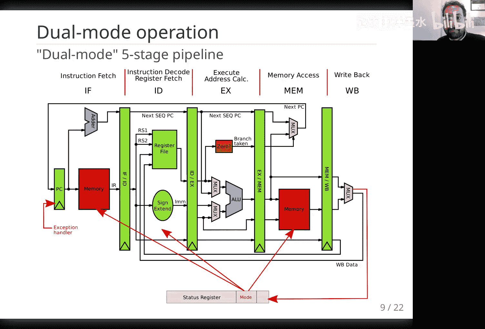

操作系统与系统编程：6：内核抽象（第一部分）

在本节课中，我们将开始深入探讨内核接口，即进程与内核之间的交互是如何在硬件层面实际工作和实现的。我们将从进程的定义开始，逐步引入保护机制的概念，并解释硬件如何支持这种机制，特别是通过双模式操作来实现。

---

### 进程与程序的关系

上一节我们介绍了进程与内核交互的API。本节中，我们来看看进程的确切定义。

一个进程是一个正在执行的程序，或者说，是程序的一个实例。这意味着，从程序员的角度看，你开发的源代码和编译后的可执行文件都是存储在磁盘上的文件，我们称之为程序。它就像一本食谱，记录了步骤但尚未开始烹饪。

当你运行这个可执行文件时，程序就被实例化，成为了一个进程。此时，它被加载到内存中，由处理器执行，变得“活跃”起来。

从可执行文件中，我们得到两个部分：
*   **文本段**：指令序列。
*   **数据段**：已初始化的全局变量。

这两个部分在进程执行时被加载到内存。此外，进程执行还需要另外两个内存段：
*   **堆**：用于动态内存分配。
*   **栈**：用于局部变量和函数调用机制。

堆和栈并非来自可执行文件，而是在进程首次加载和运行时由内核创建的。

加载完成后，内核会设置处理器的栈指针指向栈的起始位置（假设栈向下增长），并将程序计数器设置为代码段的第一条指令。至此，处理器才开始真正执行该进程。

需要注意的是，操作系统内核本身也是一种特殊的进程。它同样拥有指令、全局变量、堆和栈。内核很可能用C语言编写，因此也需要栈来支持函数调用和局部变量。从这个角度看，内核与你已知的应用程序非常相似。

进程与程序之间并非简单的一一对应关系。在某些方面，进程比程序“大”，因为它包含了程序本身（指令和全局变量）以及运行时环境（堆、栈、寄存器状态）。这就像开始烹饪后，你拥有的东西（食材、厨具、进行中的步骤）比食谱本身更多。

此外，同一个程序可以对应多个进程。例如，你可以同时运行多个Chrome浏览器窗口，每个窗口都是一个独立的进程，但都执行着相同的“Chrome程序”。

程序也可能比进程“大”。例如，一个程序中如果包含 `fork()` 系统调用，就可以从同一个程序派生出多个进程。

理解进程与程序之间的这种抽象关系非常重要。

---

### 保护机制的必要性

现在我们来讨论一个非常重要的概念：保护。

想象一个场景，内存中同时加载了多个进程以及操作系统内核。这样做的目的是让CPU总有任务可执行，以最大化CPU利用率。CPU可以执行一点这个进程，再执行一点那个进程，偶尔运行内核以确保一切正常。

问题是，如果这些不同的进程（包括内核）只是简单地同时加载在内存中，就可能出现问题。假设这里有一个有缺陷的C程序（比如你为P1编写的、充满bug的shell）。如果没有任何保护措施，这个程序的一条错误指令可能会访问不属于它自己的内存，例如修改了内核数据段的一个值，这可能导致内核崩溃。

它也可能修改其他进程（比如防病毒软件）的栈值，导致其崩溃。更糟糕的是，如果程序陷入一个无限循环，永远不交还CPU，那么这个有缺陷的程序就会一直占用CPU，导致你的电脑完全卡死。

如果这个进程来自一个你从网上下载的、并非有缺陷而是故意恶意的程序，情况会更糟。它可能试图尽其所能地破坏你的计算机。

总而言之，我们需要一种系统来为进程设定边界或限制。这样，一个有缺陷的C程序就会被限制在自己的“车道”内，无法越界去破坏操作系统或其他进程。因此，我们需要重新审视对进程的理解，并加入边界、限制和保护的概念。

那么，我们如何做到这一点呢？

---

### 受限制的进程

让我们回到进程的定义：进程是正在执行的程序。现在，我们需要添加一个非常重要的点：**当一个进程运行时，它是在有限权限下运行的**。

这意味着，我们本质上希望在进程周围放置一个“盒子”。在这个盒子内部，进程可以自由地做任何它想做的事情。但这个盒子非常坚固，使得进程无法越界去干扰另一个进程，也无法去干扰内核。

这主要意味着我们需要保护进程可以访问的内存。这也意味着进程不能直接访问硬盘或执行某些特权操作。例如，关于硬盘访问，内核会根据进程所属的用户（通过用户ID）或组（通过组ID）来授予其访问文件系统中特定文件的权限，而不是其他文件。

这里的难点在于，我们仍然希望保持高效。我们希望在进程周围放置这个盒子以限制其权限，但如果盒子过于坚固，我们很可能会在灵活性、功能性和性能方面损失很多。我们不希望这样，因为我们希望计算机尽可能快，希望进程能充分利用硬件。

我们还必须确保这个盒子，尽管很安全，但不会阻止进程之间以某种方式通信，也不会阻止进程与内核通信以请求操作。

那么，我们如何在技术上实现这种灵活的保护呢？

---

### 实现保护的两种方法

有两种方法可以实现这种灵活的保护。

第一种方法有点天真，但效果很好：**不允许应用程序（进程）直接在硬件上运行**。这就像你不让孩子开车，而是由你来驾驶。在这种模型下，你充当了一个解释器。

应用程序（孩子）仍然通过给出指令（方向）来参与，但每一个指令（在计算机中就是每一条指令）都需要由解释器（你）来审查、验证并执行或模拟。如果应用程序试图做任何未经授权的事情，解释器可以在这里阻止并终止它。

这种模型的问题在于，由于应用程序不能直接在硬件上运行，它所做的每一件事都必须由解释器模拟，因此速度非常慢。这就是解释型语言（如JavaScript或Python）所采用的模型。

我们将要详细讨论的是第二种方法。这里的想法是：应用程序应该能够直接在硬件上运行，因为这样才能达到真正的速度。应用程序和硬件之间没有翻译层，应用程序可以以原生速度运行。

然而，我们如何防止应用程序做未经授权的事情（比如“撞车”）呢？为了实现这一点，我们需要硬件的帮助。

---

### 双模式操作

本质上，如果你不是自己开车并审查孩子的指令，而是想把车交给孩子，理想情况下你希望车本身具有一些自我保护功能。这样，如果你的孩子试图在高速公路上掉头，汽车自己会说：“我不会那样做，因为你是孩子，我知道那不行。”

这在技术上是如何实现的呢？支持非特权应用程序直接在硬件上运行的概念被称为**双模式操作**。

其核心思想是：**硬件直接支持具有不同特权级别的执行模式**。在内部，这可以很简单，例如处理器中的一个状态位，可以是0或1。如果它是0，处理器运行在所谓的**内核模式**。在这种模式下，处理器执行所有指令，没有任何保护。内核模式显然是内核执行的地方，内核是可信的，确切地知道该做什么。

当处理器运行在**用户模式**时（假设该状态位为1），处理器知道：“好的，我现在正在执行非特权代码。只要应用程序做的事情保持在它的‘车道’内，就没问题。但如果应用程序试图做危险的事情，我就会拒绝执行并停止。”

在大多数实际的处理器中，通常不止两种模式。例如，在MIPS处理器上，有两个比特位，这意味着有四种不同的模式（尽管只定义和使用了其中三种）：内核模式、监管者模式和用户模式。在x86架构上，有四个特权级别，称为保护环（ring）。内核通常运行在ring 0（最高特权），用户进程运行在ring 3（最低特权）。ring 1和ring 2的意图是供设备驱动程序使用，但在实践中（如Linux和Windows），它们很少被使用。

无论如何，核心概念是处理器可以在两种不同的模式下运行：内核模式和用户模式。一种模式对硬件拥有完全权限，可以访问任何内存位置和设备；另一种模式则受到硬件限制，确保代码在定义的边界内运行。

---

### 硬件支持的四个方面

这种双模式操作需要硬件支持。仅仅有一个状态位告诉处理器当前处于用户模式还是内核模式是不够的，还需要更全面的硬件支持。具体体现在以下四个方面：

1.  **特权指令**：处理器可以执行的所有指令中，有些指令可能比较“危险”。你不希望用户进程能够执行这些指令。例如，让处理器进入睡眠状态的指令。这个指令应该是一个特权指令，只有计算机上可信的软件层（内核）才能执行。
2.  **内存保护**：我们之前已经提到过。本质上，当用户进程执行时，它应该只能访问属于它的内存段（代码、数据、堆和栈），而不能访问其他任何内存。这也需要硬件支持来确保。
3.  **定时器中断**：当一个进程在CPU上运行时，它控制着CPU。一个进程可能有缺陷，或者有大量计算要做，可能会长时间甚至无限期地占用CPU。在这种情况下，内核需要一种方法，即使进程不愿意主动释放CPU控制权，也能重新获得CPU控制权。定时器中断将帮助实现这一点。
4.  **模式切换**：如果我们有两种执行模式（内核模式和用户模式），就需要一种安全高效的方式在这两种模式之间切换。我们将讨论如何实现这一点。

在深入探讨这四个方面之前，我们先看看双模式操作在一个典型的五级流水线处理器中是如何实现的。

---

### 双模式操作在流水线中的实现

对于上过150B课程的同学，这可能是一张熟悉的图。如果没上过也不用担心，不要求完全理解，但快速了解其工作原理有助于理解双模式操作是如何在这种典型的五级流水线上实现的。

处理器通过流水线执行指令，就像汽车在装配线上制造一样。指令执行分为五个阶段：
1.  **取指**：根据程序计数器的地址从内存中获取下一条要执行的指令。
2.  **译码**：解析获取到的指令，确定其操作类型（如加法、减法、加载、存储等），并读取所需的寄存器值。
3.  **执行**：执行指令的核心操作（如ALU运算、计算内存地址等）。
4.  **内存访问**：仅对内存指令有效，执行实际的内存读取或写入操作。
5.  **写回**：将指令执行的结果写回目标寄存器。

现在，考虑如何在这个流水线中实现双模式操作，即如何让相同的硬件能够区分当前是在执行内核代码还是用户模式（进程）代码。

这实际上并不太复杂。处理器中有一个状态寄存器，其中包含一个**模式位**（例如，0表示内核模式，1表示用户模式）。这个位在各个阶段都是已知的，以便我们可以相应地限制或允许执行。

*   **在取指阶段**，模式位确保在用户模式下，程序计数器指向的地址必须属于进程被允许访问的代码段。
*   **在译码阶段**，模式位确保从内存获取的指令是合法的，即用户进程有权执行该指令。如果用户进程包含特权指令（如让CPU睡眠的指令），处理器会在这里捕获并阻止。
*   **在执行和内存访问阶段**，对于内存指令，模式位确保进程访问的内存地址属于它自己。
*   **在写回阶段**，必须提供一种方式来改变这个模式位，以便进行模式切换。
*   **在任何阶段**，如果用户进程试图执行它无权执行的操作，处理器必须停止执行该进程，并转而执行属于内核的**异常处理程序**，以便内核能够接管处理器并处理错误。

---

### 总结

本节课中，我们一起学习了内核抽象的第一部分。我们从进程与程序的关系入手，探讨了为何需要保护机制来隔离进程和内核。我们介绍了实现保护的两种思路，并重点讲解了现代操作系统依赖的**双模式操作**概念，即硬件提供内核模式和用户模式两种特权级别。我们还简要概述了支持双模式操作所需的四个关键硬件机制：特权指令、内存保护、定时器中断和模式切换。最后，我们了解了这些概念如何在处理器流水线中实现。下一节课，我们将更深入地探讨这四个方面的具体细节。