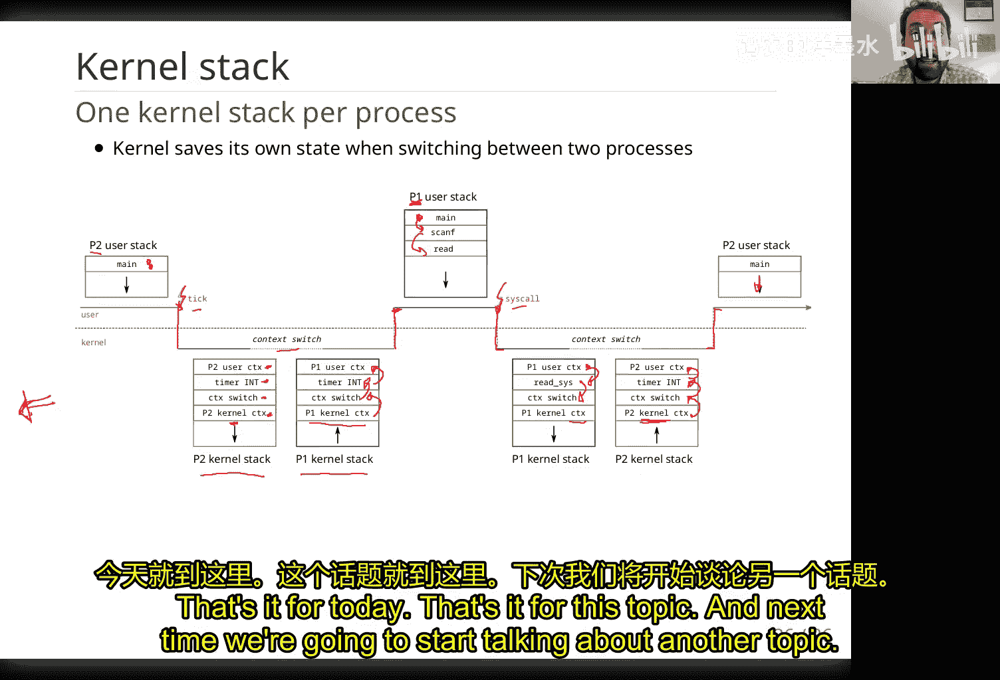

# 008：内核抽象（第三部分） 🧠


在本节课中，我们将要学习内核抽象的最后一个核心部分：模式切换的详细机制。我们将探讨处理器如何在用户模式和内核模式之间安全、高效地切换，并理解其背后的关键概念。

上一讲我们介绍了模式切换的几种原因。本节中，我们来看看如何实现这种切换。

## 原子控制权转移 ⚛️

当处理器需要从用户模式切换到内核模式时，必须确保这个切换过程是原子的。这意味着，从切换开始到结束，整个过程必须作为一个不可分割的步骤完成，不能被中断。

以下是切换过程中需要完成的关键步骤：

*   **保存原因**：处理器需要记录切换的原因（例如，是异常、中断还是系统调用）。
*   **保存程序计数器**：保存当前正在执行的用户进程指令地址，以便后续恢复。
*   **更新程序计数器**：将程序计数器指向内核的入口点。
*   **切换处理器模式**：将处理器内部状态从用户模式改为内核模式，这通常会改变内存保护设置。
*   **禁用中断**：进入内核后，处理器会自动禁用中断，防止内核自身被中断，确保内核执行的稳定性。

当从内核模式切换回用户模式时，过程则相反：

*   **恢复程序计数器**：将其恢复到进程被中断时的指令地址。
*   **切换处理器模式**：从内核模式切换回用户模式，恢复进程的内存保护。
*   **恢复中断**：重新启用中断，使进程在运行时可以再次接收中断信号。

## 异常向量表 🚪

为了安全地进入内核，我们需要限制入口点的数量。这通过“异常向量表”来实现。异常向量表是一个函数指针表，每个指针指向一个能处理特定事件（如中断、系统调用或特定异常）的内核函数。

处理器处理异常向量表的方式主要有两种：

1.  **软件管理**：处理器只有一个固定的内核入口地址。无论何种原因触发切换，都跳转到该地址。然后由该地址的软件代码读取系统寄存器，判断具体原因，再跳转到相应的处理函数。
    ```c
    // 示例：MIPS处理器上的软件判断代码
    mfc0 k0, CP0_CAUSE      // 读取记录原因的系统寄存器
    andi k0, k0, 0x7C       // 提取原因码
    lw k0, exception_handlers(k0) // 根据原因码查找处理函数
    jr k0                    // 跳转到对应的处理函数
    ```
2.  **硬件管理**：处理器硬件直接维护异常向量表。根据不同的触发原因，硬件会自动跳转到表中对应的处理函数地址，无需软件进行判断。

## 透明的、可恢复的执行 🔄

进程被中断时，应该对此毫无感知。为了实现这种透明性，内核需要在切换时保存和恢复进程的“上下文”。

进程的上下文主要指其使用的所有**通用处理器寄存器**的值。保存和恢复上下文的过程可以比喻为整理书桌：

*   **保存上下文**：当进程被中断时，内核将其所有寄存器值保存到内核栈上（就像把桌上所有文件整齐收进文件夹，放到书架上）。
*   **内核执行**：内核开始处理中断或系统调用。
*   **恢复上下文**：处理完毕后，内核从栈上恢复之前保存的所有寄存器值（就像从书架上取回文件夹，把文件按原样放回桌面）。
*   **进程恢复**：进程从被中断的指令处继续执行，所有寄存器状态与中断前完全一致，仿佛从未被中断过。

大多数现代操作系统（如Linux、Windows）采用软件管理上下文的方式，因为这提供了更大的灵活性。

## 内核栈的重要性 🗂️

内核拥有自己独立的栈空间，而不是复用用户进程的栈。这主要基于两个原因：

1.  **安全性**：用户进程的栈指针可能被恶意或错误地设置。如果内核使用不可信的栈指针，可能导致崩溃。
2.  **数据隔离**：内核的数据可能包含敏感信息。如果将其留在用户进程可访问的内存中，会造成信息泄露风险。

因此，每个进程通常都关联一个专属于它的内核栈，用于在内核模式下执行时使用。

## 多进程场景下的完整切换流程 🔀

最后，我们通过一个多进程场景来串联整个切换流程。假设初始时进程P2正在运行：

1.  **中断触发切换**：定时器中断发生，P2从用户模式切换到内核模式。内核保存P2的上下文到P2的内核栈，然后处理定时器中断。
2.  **进程调度**：定时器处理函数决定进行进程调度，选择运行进程P1。它调用`context_switch`函数。
3.  **上下文切换**：
    *   将当前内核执行状态（代表P2）保存到P2的内核栈。
    *   从P1的内核栈中恢复P1之前被切换出去时的内核执行状态。
4.  **返回用户模式**：内核恢复P1的用户态上下文，处理器切换回用户模式，P1开始执行。
5.  **系统调用与等待**：P1执行`read`系统调用读取键盘输入，但输入尚未就绪。内核保存P1上下文后，发现P1需要等待，于是再次调用`context_switch`切换回P2执行。
6.  **恢复执行**：内核恢复P2的上下文，P2从之前被中断的地方继续执行。

这个流程涉及多次用户态/内核态切换以及进程间的上下文切换，是操作系统并发执行能力的核心体现。理解它可能需要时间，通过实践（例如实现上下文切换）会加深认识。

---



本节课中我们一起学习了模式切换的三大支柱：**原子控制权转移**、通过**异常向量表**的安全入口管理，以及实现透明性的**上下文保存与恢复**。我们还了解了**内核独立栈**的必要性，并梳理了**多进程环境下完整的切换流程**。这些机制共同保障了操作系统内核的安全性、稳定性和高效性。