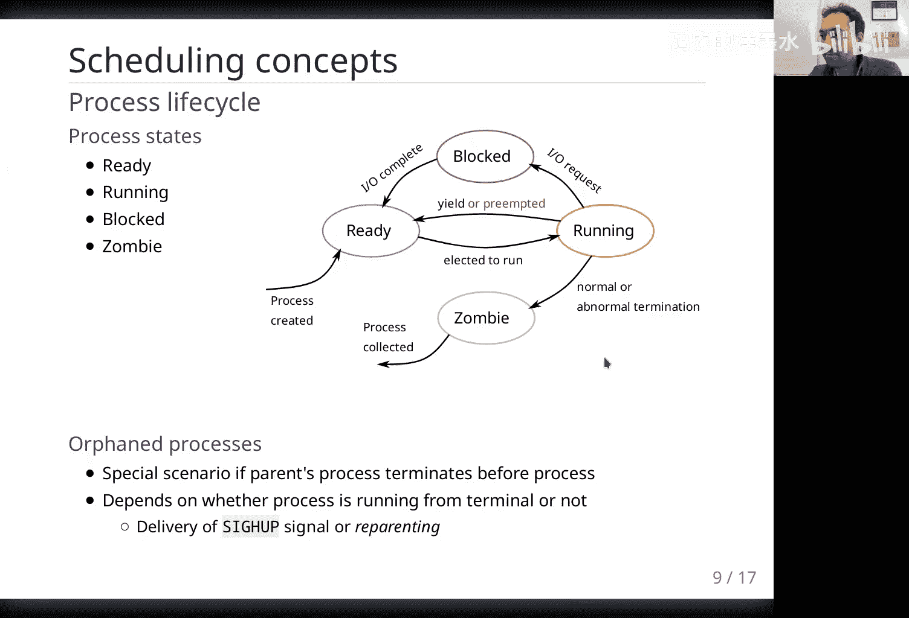
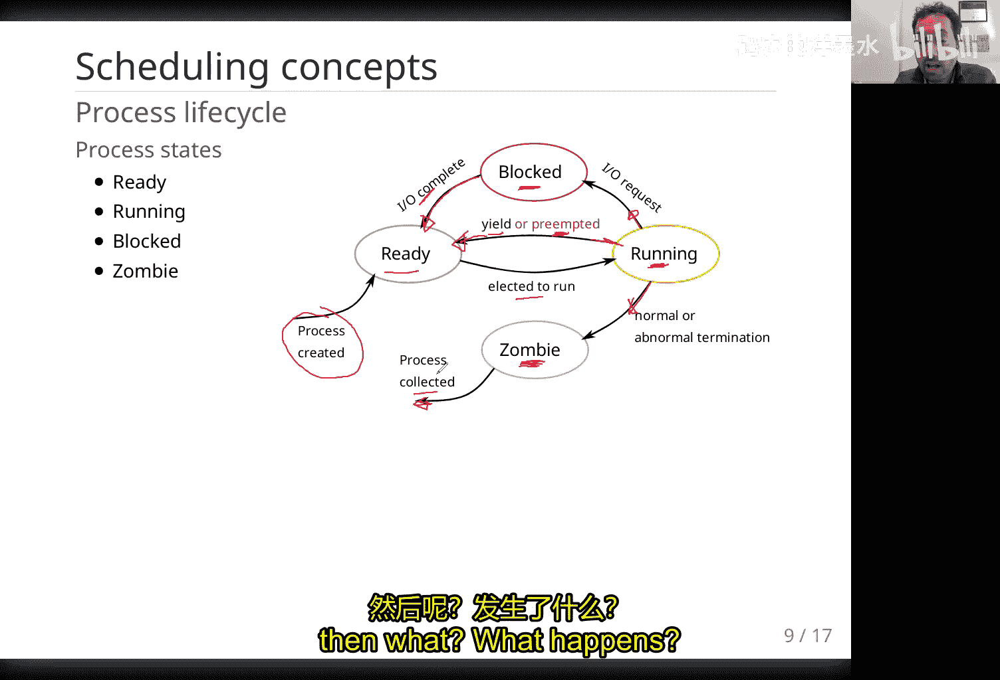

# 009：进程调度（第一部分）


在本节课中，我们将深入学习进程的概念，并开始探讨一个核心的OS功能：如何调度多个进程在CPU上运行，以实现多任务处理。

## 进程概念回顾

上一节我们介绍了进程间通信，本节中我们来看看进程本身的几个核心方面。进程是程序的一个实例，是程序在有限执行权限下的执行过程。操作系统通过进程这个抽象来运行应用程序，它提供了保护、隔离等特性。

进程的抽象可以从三个重要方面来理解：地址空间、环境和执行流。

### 地址空间

每个进程都拥有自己独立的地址空间。这意味着一个进程无法直接访问另一个进程的内存。当进程通过 `fork()` 系统调用创建子进程时，子进程会获得父进程地址空间的一个完整副本。

以下是一个C语言程序示例，用于演示地址空间的独立性：

```c
#include <stdio.h>
#include <stdlib.h>
#include <unistd.h>

int i = 1; // 全局变量，位于数据段

int main() {
    int j = 10; // 局部变量，位于栈
    int *k = malloc(sizeof(int)); // k在栈上，指向堆中分配的内存
    *k = 4;

    pid_t pid = fork();

    if (pid != 0) { // 父进程
        i = i + 1;
        j = j - 1;
        *k = *k * 1;
        printf("Parent: i=%d, j=%d, *k=%d\n", i, j, *k);
    } else { // 子进程
        i = i + 2;
        j = j - 2;
        *k = *k * 2;
        printf("Child: i=%d, j=%d, *k=%d\n", i, j, *k);
    }
    return 0;
}
```

运行此程序，父进程和子进程会输出不同的变量值，但相同变量名（如 `i`, `j`）的地址是相同的。这是因为每个进程都有自己的虚拟地址空间，相同的虚拟地址映射到了不同的物理内存位置。

### 环境

进程的环境是指描述其运行状态的所有信息。这些信息由内核维护在进程控制块中。

以下是构成进程环境的主要元素列表：
*   **进程标识符**：如进程ID、用户ID。
*   **进程关系**：指向父进程的链接。
*   **内存管理**：代码、栈、堆、数据段等内存段的列表。
*   **文件管理**：打开文件的文件描述符表。
*   **上下文信息**：当前工作目录等。

### 执行流

进程的执行是顺序的。CPU按顺序执行进程的指令（代码段中的语句）。虽然存在循环和条件分支可以改变执行路径，但整体上指令是串行执行的。信号处理是唯一可能暂时打断这种顺序流的情况，但信号处理函数本身也是顺序执行完毕后，进程再从中断点恢复。

## 调度简介

现在让我们进入今天的核心主题：调度。进程只有获得CPU时间才能执行指令、取得进展。调度就是决定在多个就绪进程中，哪一个接下来使用CPU的策略。

### CPU爆发与I/O爆发

进程的执行行为通常呈现出一种模式，即在两种状态间交替。

以下是进程执行的两种主要爆发类型：
*   **CPU爆发**：进程密集执行计算指令，几乎不与I/O设备交互。例如进行科学计算。
*   **I/O爆发**：进程主要等待输入/输出操作完成，CPU执行量很少。例如从网络下载文件或等待用户键盘输入。

根据行为倾向，进程可分为：
*   **CPU密集型**：大部分时间处于CPU爆发状态。瓶颈在于CPU速度。
*   **I/O密集型**：大部分时间处于I/O爆发状态。瓶颈在于I/O设备速度。
*   **混合型**：均衡地混合了两种爆发类型。例如编译器（读取文件是I/O，编译优化是CPU计算）。

### 调度目标与模型

调度的核心目标是实现**多任务处理**，即让单个CPU能够高效地服务于多个进程，最大化CPU利用率。当某个进程因I/O操作而阻塞时，调度器应迅速将CPU分配给其他就绪进程。

有两种主要的调度模型：

**协作式调度**
进程在执行过程中不会被强制打断。只有当进程主动调用 `yield()` 放弃CPU，或执行I/O操作进入阻塞状态时，CPU才会被让出。早期操作系统（如MS-DOS，经典Mac OS）采用此模型，缺点是如果一个进程不主动让出CPU，整个系统可能被“卡住”。

**抢占式调度**
这是现代操作系统的标准模型。操作系统通过一个硬件定时器进行干预。即使进程正在执行一个长的CPU爆发且未主动让出，定时器中断也会周期性地触发，将控制权交还给内核。内核的调度器可以据此决定暂停当前进程，将CPU分配给其他进程。这保证了CPU时间能在所有进程间更公平地共享。

### 进程生命周期与状态

理解调度需要清楚进程可能处于的各种状态及其转换。下图描绘了进程的典型生命周期：






以下是进程状态转换的说明：
1.  **创建**：进程通过 `fork()` 创建，初始状态为**就绪**。
2.  **就绪 -> 运行**：调度器选择该进程，将其分配到CPU上执行。
3.  **运行 -> 就绪**：在抢占式系统中，进程可能因时间片用完被定时器中断**抢占**；或在协作式系统中主动**让出**CPU。
4.  **运行 -> 阻塞**：进程发起一个I/O请求（进入I/O爆发），并等待结果，从而进入**阻塞**状态。
5.  **阻塞 -> 就绪**：等待的I/O操作完成，进程被移回就绪队列。
6.  **运行 -> 僵尸**：进程通过 `exit()` 或信号**终止**。它释放大部分资源，但为了保留退出状态供父进程查询，会进入**僵尸**状态。
7.  **僵尸 -> 终止**：父进程调用 `wait()` 收集了子进程的退出状态后，僵尸进程被系统彻底销毁。

**孤儿进程与僵尸进程处理**
如果父进程先于子进程终止，子进程会成为“孤儿进程”。在Unix-like系统中，孤儿进程会被PID为1的 `init`（或 `systemd`）进程收养。`init` 会负责等待这些收养的子进程，确保它们终止后能被正确清理，避免僵尸进程永久残留。

一个常见的现象是：从终端启动的程序，在关闭终端窗口时会随之结束。这是因为终端关闭时，会向从它启动的所有进程发送 `SIGHUP`（挂起）信号，默认行为是终止进程。而从图形界面（如文件浏览器）启动的程序，其父进程终止后，它会被 `init` 收养并继续运行。

## 总结


本节课中我们一起学习了进程的深入概念，包括其独立的地址空间、运行环境和顺序执行流。我们重点引入了CPU调度的核心思想，探讨了进程的CPU爆发与I/O爆发行为模式，以及协作式与抢占式两种调度模型。最后，我们详细分析了进程的生命周期状态图，理解了进程如何在不同状态间转换，以及孤儿进程和僵尸进程的处理机制。下一节课，我们将具体分析几种经典的CPU调度算法。