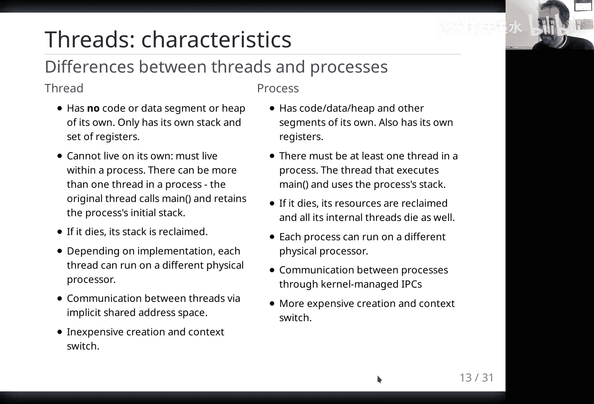

# 011：并发与线程（第一部分）


在本节课中，我们将开始学习一个与之前“进程与进程调度”主题紧密相关的新概念：**并发**与**线程**。我们将探讨什么是并发，它与并行有何区别，以及为什么线程是实现并发的一种更高效的方式。

## 概述：什么是并发？

上一节我们介绍了进程调度，本节中我们来看看**并发**。并发是指多个任务或进程能够以重叠的方式独立运行。这意味着在同一段时间内，我们可以执行一点任务A，然后切换到任务B执行一点，再切换回任务A，如此交替进行。

并发与**顺序**执行直接对立。顺序执行意味着必须完整执行完第一个任务后，才能开始执行第二个任务。并发则允许任务执行过程存在重叠。

一个简单的类比是烹饪一顿三道菜的晚餐：
*   **顺序执行**：先完整地做完开胃菜，然后完整地做主食，最后完整地做甜点。
*   **并发执行**：可以先开始处理一点开胃菜，然后去预热烤箱（为主食准备），接着搅拌一下甜点的材料，再回来继续处理开胃菜。你在所有三道菜上交替推进，直到全部完成。

**核心概念**：并发 ≠ 并行。并行是并发的一种特殊类型。
*   **并发**：指有多个任务需要处理，你通过交替执行的方式在所有任务上同时取得进展。
*   **并行**：指你确实在**同一时刻**执行多个任务（例如，在厨房里，一只手处理开胃菜，另一只手处理主食）。并行需要多个物理处理单元（如多核CPU）。

## 进程并发

那么，并发如何应用于进程呢？进程是计算机上执行的程序。一个复杂的程序可能包含多个阶段。使用并发的一个思路是，将这个进程的不同阶段分离成多个独立的进程，每个进程只负责一个单一任务。这些进程需要通过**进程间通信**（IPC）来协作，例如通过文件、管道或信号。

实际上，你已经接触过进程并发：**GCC编译器**的工作方式就是一个例子。当你运行GCC编译源代码时，它默认会顺序执行四个独立的程序（进程）：预处理器（CPP）、编译器（CC）、汇编器（AS）和链接器（LD）。但是，你可以使用 `-pipe` 选项让GCC并发地运行这四个进程，它们通过管道进行通信，由操作系统调度器决定何时执行哪个进程的一小部分。

```bash
# 顺序执行（默认）
gcc source.c -o program
# 并发执行（使用管道）
gcc -pipe source.c -o program
```

### 实现并发的几种方式

回到任务执行模型，一个进程的执行包含**CPU突发**（进行计算）和**I/O突发**（等待输入/输出）。以下是利用硬件实现并发的几种方式：

1.  **CPU虚拟化**：这是最常见的并发形式。单个CPU通过快速切换，交替执行多个任务的一小部分。虽然总执行时间没有减少，但它提高了系统的**交互性**和**响应能力**，让用户感觉多个程序在同时运行。
    *   **图示**：`[T1片段] -> [T2片段] -> [T1片段] -> [T2片段]...`

2.  **利用I/O重叠**：当一个任务进入I/O等待（不占用CPU）时，CPU可以立即切换到另一个需要CPU的任务去执行。这种方式可以**减少总执行时间**。
    *   **图示**：`T1: [CPU] -> [I/O等待]`；与此同时，`T2: [CPU] -> [I/O等待]`。

3.  **并行**：这是并发的一种特例，需要**多个CPU核心**。不同的任务真正在同一时刻于不同的CPU上执行。
    *   **图示**：`CPU1: [执行T1]`；同时，`CPU2: [执行T2]`。

## 为什么需要线程？进程并发的局限性

进程并发虽然可行（如GCC的例子），但存在一些缺点：
*   **创建开销大**：`fork()` 一个进程需要复制父进程的地址空间、创建新的PCB等，消耗大量时间和资源。
*   **切换开销大**：进程切换需要保存和恢复整个地址空间等大量上下文。
*   **通信复杂且慢**：进程间必须通过IPC（如管道、文件）通信，这些操作涉及系统调用，速度较慢。

这就引出了**线程**的概念。线程的核心思想是：**在同一个进程内部实现并发**。

**大思路转变**：
*   **进程并发**：将问题分解为子问题，每个子问题由一个独立的进程处理，进程间通过IPC通信（慢）。
*   **线程并发**：将问题分解为子问题，但所有子问题都在**同一个进程内**，由该进程内的多个**线程**处理。

## 线程详解

### 什么是线程？

一个进程开始时，通常只有一个执行流，即主线程，它顺序执行代码。线程允许这个主线程创建额外的**执行流**。这些新线程运行在**同一个进程的地址空间内**，拥有自己的代码执行序列，但共享进程的大部分资源。

**关键特性**：
*   **共享地址空间**：所有线程访问相同的内存（全局变量、堆数据）。
*   **独立执行上下文**：每个线程有自己的栈、程序计数器（PC）和寄存器状态。
*   **由内核调度**：线程和进程一样，是CPU调度的基本单位。内核会在它们之间进行上下文切换。

### 线程的优势

1.  **提高响应性**：对于图形界面程序，可以将耗时操作（如视频编码）放在后台线程，保持UI线程的响应。
2.  **充分利用多核**：在多处理器系统上，多线程能实现真正的并行，大幅提升计算速度。
3.  **高效资源共享**：线程间共享内存，通信和数据交换远比进程间IPC高效。
4.  **创建与切换开销小**：线程比进程轻量得多。

### 线程应用示例

以下是两个利用线程提升性能的经典场景：

**1. Web服务器**
*   **问题**：Web服务器需要处理大量并发请求。每个请求可能涉及CPU计算、磁盘I/O和网络I/O。
*   **单线程方案**：顺序处理请求，当前请求完成前无法处理下一个，效率低下。
*   **多线程方案**：创建一组工作线程。当一个线程因等待磁盘I/O而阻塞时，CPU可以调度另一个线程处理新请求。这样充分利用了I/O重叠和CPU虚拟化，显著提高了吞吐量。

**2. 并行数组计算**
*   **问题**：计算 `C[i] = A[i] + B[i]`，其中 `i` 从0到N-1。
*   **单线程方案**：顺序循环N次。
*   **多线程方案（假设双核CPU）**：创建两个线程。线程1计算数组的前半部分（`i=0` 到 `N/2-1`），线程2计算后半部分（`i=N/2` 到 `N-1`）。两个线程在各自CPU核心上**并行**执行，理想情况下速度可提升近一倍。
    *   **注意**：此方案在单核CPU上不会更快，因为仍然是交替执行。同时，这种**数据并行**模式使用进程很难实现，因为进程间不共享数组内存。

### 线程与进程的数据结构

操作系统需要管理线程和进程：
*   **进程控制块**：包含进程级信息，如进程ID、地址空间、文件描述符表、信号处理等。这是**所有线程共享的环境**。
*   **线程控制块**：每个线程独有，包含线程级信息，如线程ID、栈指针、程序计数器、寄存器状态、线程状态（运行、就绪、阻塞）等。

**关系**：一个PCB对应一个进程，一个进程包含一个或多个TCB（线程）。

### 线程与进程的关键区别

以下是线程与进程的核心区别总结：

| 特性 | 线程 | 进程 |
| :--- | :--- | :--- |
| **基本单位** | CPU调度的基本单位 | 资源分配的基本单位 |
| **资源** | 共享所属进程的全部资源（内存、文件等） | 拥有独立的地址空间和资源 |
| **通信** | 可直接读写共享内存，非常高效 | 必须通过IPC（管道、信号、共享内存等），相对较慢 |
| **创建开销** | 小，只需分配栈和TCB | 大，需要复制地址空间、创建PCB等 |
| **切换开销** | 小，只需切换执行上下文（寄存器、栈） | 大，需要切换地址空间等 |
| **独立性** | 一个线程崩溃可能导致整个进程崩溃 | 进程间相互隔离，一个崩溃通常不影响其他进程 |
| **比喻** | 一个车间（进程）里的多条流水线（线程） | 多个独立的车间（进程） |

## 总结



本节课中我们一起学习了**并发**与**线程**的核心概念。我们首先明确了并发（任务重叠执行）与并行（任务同时执行）的区别。然后，我们探讨了基于进程实现并发的局限性，如创建和通信开销大。这自然引出了**线程**这一更轻量级的解决方案。线程在同一个进程内部提供多个执行流，共享内存空间，使得并发编程更高效、更直观。我们还分析了线程的优势、应用场景，以及它与进程在数据结构和特性上的关键区别。下一节，我们将继续深入线程，探讨线程的不同实现模型。