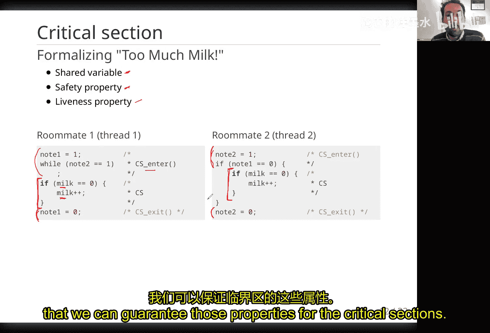

# 013：进程同步（第一部分）


在本节课中，我们将要学习进程同步的基础知识。上一节我们介绍了线程和并发，本节中我们来看看并发可能引发的问题，以及用于缓解这些问题的解决方案。这一切都围绕着“同步”展开。

## 线程与共享数据回顾

首先，让我们快速回顾一下线程。线程是同一进程内的执行流。它们运行时各自拥有CPU的控制权，拥有自己的CPU寄存器和私有栈，但共享相同的地址空间和全局变量。

关于数据共享，有两种类型：
*   **独立共享**：线程访问共享数据，但各自修改不同的部分，互不冲突。
*   **协作共享**：线程在共享数据的相同位置上进行协作和修改，这会使情况变得复杂。

## 并发问题：竞态条件

为了理解协作共享为何会出问题，我们来看一个简单的例子。

假设有一个全局变量 `x`，初始值为0。我们创建两个线程A和B，分别执行 `x = x + 1` 和 `x = x + 2`。

我们期望的最终结果是3。然而，在某些情况下，结果可能是2，甚至是1。这是如何发生的呢？

关键在于，像 `x = x + 1` 这样的C语言语句**不是原子操作**。它会被编译成多条汇编指令。例如，在MIPS汇编中，它可能被翻译为：
```assembly
lw $8, 0($gp)   # 将x从内存加载到寄存器$8
addi $8, $8, 1  # 将寄存器$8的值加1
sw $8, 0($gp)   # 将寄存器$8的值存回内存中的x
```
线程B的代码类似，但加的是2。

由于线程的调度是不确定的，可能出现以下交错执行序列：
1.  线程A执行 `lw` 指令，将 `x`（值为0）读入 `$8`。
2.  线程A被中断，切换到线程B。
3.  线程B执行 `lw` 指令，也将 `x`（值仍为0）读入自己的 `$8`。
4.  线程B执行 `addi`，将 `$8` 变为2。
5.  线程B被中断，切换回线程A。
6.  线程A从上次中断处继续，执行 `addi`，将 `$8` 从0变为1。
7.  线程A执行 `sw`，将1写回内存，`x` 变为1。
8.  线程A结束。线程B恢复执行。
9.  线程B执行 `sw`，将2写回内存，`x` 被覆盖为2。

最终，`x` 的结果是2，而不是3。这就是一个典型的**竞态条件**问题。

竞态条件产生的原因是，程序的输出依赖于线程间操作执行的顺序，就像线程在“赛跑”一样。这种问题难以调试，因为它可能极少发生，但一旦发生，后果可能很严重（例如，历史上曾有机床因竞态条件导致致命事故）。

除了调度，编译器优化和CPU硬件指令重排也可能加剧竞态条件的复杂性。

## 同步解决方案初探：买牛奶的例子

为了解决竞态条件，我们需要同步机制。让我们通过一个生活中的例子——“室友买牛奶”——来理解同步需要满足的性质，并尝试设计解决方案。

**问题描述**：两个室友共享牛奶。他们回家后都会检查冰箱。如果没牛奶了，就需要去商店购买。目标是：1) **安全性**：最多只有一个人去买牛奶（避免买多）；2) **活性**：如果需要牛奶，最终必须有人去买。

### 方案一：留纸条（单标志位）

以下是第一种解决方案的伪代码思路：
```
// 全局变量
int milk = 0; // 0表示没牛奶
int note = 0; // 0表示没留纸条

// 室友1的代码
if (note == 0) {          // 如果没看到纸条
    if (milk == 0) {      // 如果没牛奶
        note = 1;         // 留下纸条“我去买”
        // 去买牛奶...
        milk = 1;         // 放好牛奶
        note = 0;         // 拿走纸条
    }
}
// 室友2的代码相同
```

**分析**：这个方案不安全。考虑以下交错执行：
1.  室友1检查 `note` 为0，`milk` 为0，但在执行 `note = 1` 之前被中断。
2.  室友2开始执行，检查 `note` 仍为0，`milk` 为0，于是进入购买流程。
3.  随后，室友1恢复执行，也留下纸条并去购买。
结果导致两个人都买了牛奶，违反了安全性。

### 方案二：各留各的纸条（双标志位）

以下是第二种解决方案的伪代码思路：
```
// 全局变量
int milk = 0;
int note1 = 0; // 室友1的纸条
int note2 = 0; // 室友2的纸条

// 室友1的代码
note1 = 1;                 // 宣布“我到家了”
if (note2 == 0) {          // 如果室友2没宣布到家
    if (milk == 0) {       // 如果没牛奶
        // 去买牛奶...
        milk = 1;
    }
}
note1 = 0;                 // 宣布“我事情办完了”

// 室友2的代码（对称）
note2 = 1;
if (note1 == 0) {
    if (milk == 0) {
        // 去买牛奶...
        milk = 1;
    }
}
note2 = 0;
```

**分析**：这个方案安全（最多一人买奶），但可能不满足活性。考虑以下交错：
1.  室友1设置 `note1 = 1`，然后被中断。
2.  室友2设置 `note2 = 1`，然后被中断。
3.  室友1恢复，检查 `note2` 为1，认为室友2会处理，于是跳过购买环节，但在执行 `note1 = 0` 前又被中断。
4.  室友2恢复，检查 `note1` 仍为1，也认为室友1会处理，同样跳过购买。
结果两个人都没买牛奶，违反了活性。

### 方案三：非对称等待

以下是第三种解决方案的伪代码思路：
```
int milk = 0;
int note1 = 0, note2 = 0;

// 室友1的代码（“等待者”）
note1 = 1;
while (note2 == 1) { /* 忙等待 */ } // 如果室友2也在，就等他
if (milk == 0) {
    // 去买牛奶...
    milk = 1;
}
note1 = 0;

// 室友2的代码（“检查者”）
note2 = 1;
if (note1 == 0) {
    if (milk == 0) {
        // 去买牛奶...
        milk = 1;
    }
}
note2 = 0;
```

**分析**：这个方案既安全又活性。核心在于，无论调度顺序如何，通过 `while (note2 == 1)` 这个等待，可以保证在进入关键决策区（检查牛奶并购买）时，两个线程的执行状态是协调好的。但它的缺点是：
1.  **过于复杂**：难以理解和证明正确性。
2.  **不对称**：代码不统一，难以扩展到多于两个线程的情况。
3.  **忙等待**：线程可能在循环中空转，浪费CPU资源。

存在更优雅、对称且可扩展的算法（如Peterson算法），但它们通常也比较复杂。我们需要更通用的同步原语。

## 关键概念与术语

在深入更通用的解决方案之前，我们先明确几个核心概念：

*   **临界区**：一段访问共享资源（变量、设备等）的代码，必须被保护以防止多个线程同时进入。
*   **互斥**：保证最多只有一个线程可以执行临界区的属性。
*   **同步机制的正确性属性**：
    1.  **安全性（互斥）**：临界区内同时最多有一个线程。
    2.  **活性（进展）**：如果没有线程在临界区内，那么一个想要进入的线程最终应该能够进入。
    3.  **有限等待**：一个线程在提出进入请求后，等待进入的时间应该是有限的。
    4.  **容错性**：一个在临界区内失败的线程不应阻止其他线程进入。

在“买牛奶”的例子中，操作 `milk` 变量的代码就是临界区。我们之前设计的各种“进入区”和“退出区”代码，就是为了实现互斥访问这个临界区。

## 总结

本节课中我们一起学习了：
1.  **竞态条件**的产生原因：由于线程调度、编译器优化、硬件重排导致非原子操作的交错执行，使得程序结果依赖于不确定的执行时序。
2.  通过“**买牛奶**”的例子，我们探讨了实现同步的初步尝试，并理解了**安全性**和**活性**这两个核心属性。
3.  我们认识到，通过标志位和忙等待实现的同步方案虽然可能有效，但往往**复杂、低效且难以扩展**。
4.  最后，我们明确了**临界区**、**互斥**以及同步机制应满足的**正确性属性**，为后续学习更强大的同步原语（如锁、信号量等）打下了基础。



下一节课，我们将开始探讨能够提供互斥保证的真正解决方案。