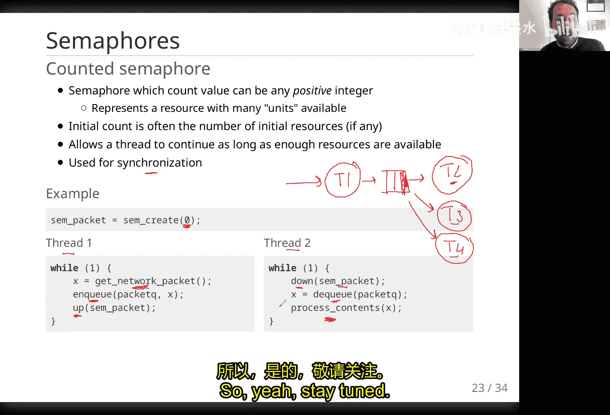

# 014：进程同步（第二部分）


## 概述

在本节课中，我们将继续学习进程同步。我们将重点介绍几种同步原语，它们是用于避免竞态条件的机制和实现。我们将从最简单的锁开始，逐步深入到更复杂的信号量，并探讨它们的工作原理、实现方式以及适用场景。

## 进程同步回顾

上一节我们介绍了竞态条件的概念。当两个或多个线程并发访问和操作同一个共享变量时，由于线程调度和指令交错执行的不确定性，可能导致最终结果不符合预期，这就是竞态条件。

我们通过“买牛奶”的例子，引出了临界区的概念——即需要被保护以防止并发访问的代码段。目标是确保**互斥**访问临界区，即同一时刻只有一个线程能执行临界区内的代码。我们之前看到的非对称解决方案虽然有效，但存在可扩展性差、代码复杂等问题。

本节中，我们来看看如何利用更通用和简洁的同步原语来解决这些问题。

## 锁：最简单的同步原语

锁是一种提供互斥访问的同步原语。它的思想类似于一个带锁的卫生间隔间：一次只允许一个人进入。锁有两种状态：
*   **锁定**：已被占用，其他线程无法获取。
*   **空闲**：未被占用，线程可以获取。

锁的API非常简单：
*   `lock()`: 尝试获取锁。如果锁空闲，则获取成功并进入临界区；如果锁已被占用，则调用线程必须等待。
*   `unlock()`: 释放锁。允许其他等待的线程获取它。

将锁应用于“买牛奶”问题，代码如下：
```c
lock_t milk_lock; // 定义一个锁

void roommate() {
    lock(&milk_lock);   // 进入临界区前加锁
    if (noMilk) {       // 临界区：检查并购买牛奶
        buyMilk();
    }
    unlock(&milk_lock); // 离开临界区后解锁
}
```
现在，两个室友线程执行完全相同的代码。`lock()` 操作保证了检查冰箱和购买牛奶的代码（临界区）不会被两个线程同时执行，从而避免了竞态条件。这个方案易于理解，并且可以轻松扩展到多个线程。

### 锁的朴素实现及其问题

如何实现锁呢？一个朴素的想法是：既然竞态条件源于线程在执行过程中可能被随时中断，那么如果在临界区内**禁用中断**，不就可以保证不被抢占，从而串行执行了吗？

对应的实现可能是：
```c
void lock() {
    disable_interrupts();
}
void unlock() {
    enable_interrupts();
}
```

然而，这个方法存在严重问题：
1.  **仅适用于单处理器系统**：禁用中断只对当前CPU有效。在多处理器系统上，其他CPU上的线程仍然可以并发访问共享数据。
2.  **危险性高**：禁用中断后，内核失去了通过时钟中断重新调度CPU的能力。如果临界区代码存在bug（如无限循环），整个系统可能失去响应。
3.  **用户态程序无法使用**：禁用中断是特权操作，通常只有操作系统内核才能执行。

因此，禁用中断的方法不适合作为通用的用户级同步原语。

### 基于硬件支持的锁实现：自旋锁

实现锁需要硬件的帮助。现代处理器提供了一些特殊的**原子指令**，例如 **Test-and-Set**、**Compare-and-Swap** 等。这些指令能保证“读取-修改-写入”内存这一系列操作作为一个不可分割的原子操作完成，期间不会被中断，也不会被其他处理器干扰。

以 Test-and-Set 指令为例（以下用C伪代码描述其逻辑，实际是一条CPU指令）：
```c
int TestAndSet(int *ptr, int new_value) {
    int old_value = *ptr; // 原子地读取旧值
    *ptr = new_value;     // 原子地写入新值
    return old_value;     // 返回旧值
}
```

我们可以利用这条指令实现一个**自旋锁**：
```c
typedef struct lock_t {
    int flag; // 0表示空闲，1表示占用
} lock_t;

void init(lock_t *lock) {
    lock->flag = 0;
}

void lock(lock_t *lock) {
    while (TestAndSet(&lock->flag, 1) == 1)
        ; // 自旋等待
}

void unlock(lock_t *lock) {
    lock->flag = 0;
}
```

**工作原理如下：**
*   初始时，`flag`为0（锁空闲）。
*   线程A调用`lock()`：`TestAndSet`原子地将`flag`设为1并返回旧值0。由于返回0，`while`循环条件不成立，线程A成功获取锁并进入临界区。
*   此时线程B调用`lock()`：`TestAndSet`原子地读取`flag`（当前为1），将其设为1（无变化），并返回旧值1。由于返回1，`while`循环条件成立，线程B进入**自旋**状态，不断重试`TestAndSet`，直到`flag`变为0。
*   线程A执行完临界区后调用`unlock()`，将`flag`设回0。
*   线程B的`TestAndSet`终于读到0，将其设为1，返回0，从而退出自旋，成功获取锁。

**自旋锁的优缺点：**
*   **优点**：在多处理器系统上，若锁被持有的时间很短，等待线程能在锁释放后立即获取，延迟极低。
*   **缺点**：在单处理器上或锁被长时间持有时，等待线程会持续占用CPU进行“忙等待”，浪费计算资源。

### 改进等待策略：让出CPU与睡眠

为了减少CPU浪费，我们可以改进等待策略：

1.  **让出CPU**：如果获取锁失败，线程主动调用`yield()`让出CPU，进入就绪队列末尾。希望当再次被调度时锁已可用。
    *   **问题**：仍然存在频繁的上下文切换开销，且可能发生“惊群效应”（很多线程让出后又同时被唤醒竞争锁）。

2.  **睡眠指定时间**：获取锁失败后，睡眠一段时间再重试。
    *   **问题**：难以确定合适的睡眠时长。太短则浪费CPU，太长则增加不必要的延迟。

更好的方法是让线程**阻塞**在锁上，并由锁在可用时主动唤醒等待线程。这引出了更强大的同步原语——**信号量**。

## 信号量：更通用的同步原语

信号量由Dijkstra提出，是一种功能更丰富的同步原语，常被称为“广义锁”。它内部维护一个整型计数器（`count`）和一个等待队列。

信号量的核心操作：
*   `sem_init(sem_t *s, int count)`: 初始化信号量，设置初始计数值。
*   `sem_wait(sem_t *s)` (或 `sem_down`, `P`操作): 尝试获取资源。如果 `count > 0`，则将其减1并立即返回；如果 `count == 0`，则调用线程阻塞并加入等待队列。
*   `sem_post(sem_t *s)` (或 `sem_up`, `V`操作): 释放资源。将 `count` 加1。如果等待队列不为空，则唤醒其中一个等待线程。

信号量本身的操作（修改`count`和队列）也必须保证原子性，因此其内部实现通常会使用自旋锁进行保护。

信号量主要有两种使用方式：

### 1. 用作二进制信号量（互斥锁）

将信号量初始值设为1，即可将其用作互斥锁（Mutex）。
*   `sem_wait()` 相当于 `lock()`。
*   `sem_post()` 相当于 `unlock()`。
当一个线程执行`sem_wait`将`count`从1减为0后，其他线程再调用`sem_wait`就会阻塞，直到第一个线程调用`sem_post`将`count`加回1并唤醒一个等待线程。

**注意**：互斥锁（Mutex）与二进制信号量类似，但通常有“所有权”概念（即哪个线程获得了锁），并且禁止非持有者释放锁，这能避免一些编程错误。

### 2. 用作计数信号量（协调线程）

这才是信号量威力的真正体现，它用于管理有限数量的同类资源或协调线程执行顺序。

**典型例子：生产者-消费者模型**
*   一个生产者线程从网络接收数据包，放入队列。
*   一个或多个消费者线程从队列取出数据包进行处理。
*   我们使用一个信号量来同步它们。
    ```c
    sem_t items; // 表示队列中可消费的数据包数量
    sem_init(&items, 0); // 初始队列为空，计数为0

    // 生产者线程
    void producer() {
        packet = receive_packet();
        enqueue(queue, packet);
        sem_post(&items); // 生产了一个数据包，计数加1，可能唤醒消费者
    }

    // 消费者线程
    void consumer() {
        sem_wait(&items); // 等待有数据包可消费（计数>0）
        packet = dequeue(queue);
        process(packet);
    }
    ```
    初始时`items=0`，消费者调用`sem_wait`会阻塞。当生产者放入一个数据包并调用`sem_post`后，`items`变为1，消费者被唤醒并消费。这完美地协调了生产者和消费者的步调。

## 总结

本节课我们一起学习了进程同步的核心原语。
*   我们首先介绍了**锁**的基本概念，并分析了基于禁用中断的朴素实现及其局限性。
*   接着，我们探讨了需要硬件支持的**自旋锁**实现，它利用原子指令（如Test-and-Set）保证了互斥，但存在忙等待的缺点。
*   为了更高效地管理等待线程，我们引入了**信号量**。信号量通过一个计数器和一个等待队列，不仅能实现互斥锁（二进制信号量），还能解决更复杂的线程同步问题，如生产者-消费者模型（计数信号量）。



这些同步原语是构建正确、高效并发程序的基石。下一节课，我们将通过更多实际例子，来学习如何灵活运用这些工具。