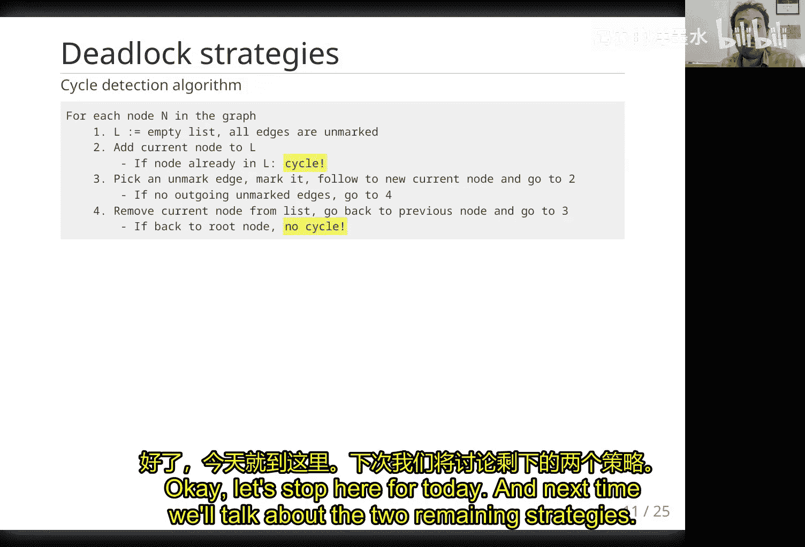

# 016：死锁（第一部分）


在本节课中，我们将要学习操作系统中的一个重要概念——死锁。死锁是当多个进程或线程因竞争资源而陷入相互等待、无法继续执行的状态。我们将通过生活中的例子和代码示例来理解死锁的成因、必要条件以及初步的应对策略。

---

## 什么是死锁？🚗

上一节我们介绍了死锁的基本概念，本节中我们来看看一个生活中的类比。

一个典型的死锁例子是交通堵塞。观察下图，我们可以看到多辆汽车在一个十字路口相互阻塞，无法前进。每辆车都在等待前方的车辆移动，而前方的车辆又在等待其他车辆移动，形成了一个循环等待的链条，导致所有车辆都无法动弹。


在计算领域，死锁的本质与此类似：多个任务（如线程）各自持有部分资源，同时又在等待对方释放资源，从而形成一个循环依赖，导致所有任务都无法继续执行。

---

## 代码中的死锁示例 💻

理解了生活中的例子后，我们来看看在编程中死锁是如何发生的。

考虑以下场景：有两个线程（Thread 1 和 Thread 2）和两把锁（Lock 1 和 Lock 2）。两个线程都需要获取这两把锁来完成各自的计算（例如，访问共享变量的临界区）。

以下是可能引发死锁的代码逻辑：
*   Thread 1 先尝试获取 Lock 1，然后获取 Lock 2。
*   Thread 2 先尝试获取 Lock 2，然后获取 Lock 1。

这段代码可能运行数十亿次都正常，但在某一次特定的调度顺序下就会发生死锁。例如：
1.  Thread 1 成功获取 Lock 1，然后被调度器中断。
2.  Thread 2 开始执行，成功获取 Lock 2。
3.  Thread 2 尝试获取 Lock 1，但 Lock 1 已被 Thread 1 持有，因此 Thread 2 被阻塞，等待 Lock 1。
4.  调度器切回 Thread 1，它继续执行，尝试获取 Lock 2。
5.  但 Lock 2 已被 Thread 2 持有，因此 Thread 1 也被阻塞，等待 Lock 2。

此时，我们陷入了一个循环：Thread 1 等待 Thread 2 释放 Lock 2，而 Thread 2 等待 Thread 1 释放 Lock 1。两个线程都无法继续，这就是死锁。

一个简单的预防方法是**规定一致的锁获取顺序**。如果两个线程都约定先获取 Lock 1，再获取 Lock 2，那么上述死锁场景就不可能发生。因为当 Thread 1 持有 Lock 1 时，Thread 2 在第一步尝试获取 Lock 1 时就会被立即阻塞，从而让 Thread 1 能够顺利获取 Lock 2 并执行完毕。

---

## 哲学家就餐问题 🍝

死锁问题有一个非常经典的模型，即由 Dijkstra 提出的“哲学家就餐问题”。

假设有五位哲学家围坐在一张圆桌旁，桌上有五盘意大利面和五把叉子。每位哲学家只能做两件事：思考，或者吃面。吃面时需要同时使用他左手边和右手边的两把叉子。

用代码表示，每位哲学家（索引 `i`）的执行逻辑如下：
```c
while (1) {
    think();
    pick_up_fork(i);       // 拿起右边的叉子
    pick_up_fork((i+1)%N); // 拿起左边的叉子
    eat();
    put_down_fork(i);      // 放下右边的叉子
    put_down_fork((i+1)%N);// 放下左边的叉子
}
```
这个模型可能在哪里发生死锁呢？考虑一种极端的调度情况：所有哲学家同时感到饥饿，并同时拿起了自己右边的叉子。此时，每位哲学家都持有一把叉子，并等待左边哲学家的叉子。由于叉子数量有限（资源有限），所有人都陷入等待，形成了循环依赖，导致死锁。

---

## 定义与形式化描述 📊

在深入解决方案之前，我们需要更精确地定义一些术语。

*   **饥饿**：指一个或多个任务因无法获得所需资源而无法取得进展。例如，在哲学家问题中，可能只有一位哲学家永远吃不到面。
*   **死锁**：是饥饿的一种特殊情况，指**系统中所有**涉及的任务都因相互等待资源而无法取得进展。

为了分析死锁，我们可以使用**资源分配图**。图中包含两种节点：
*   **圆形节点**：代表任务（如线程、进程）。
*   **方形节点**：代表资源（如锁、叉子）。

图中包含两种有向边：
*   **资源 -> 任务**：表示该资源已被此任务**持有**。
*   **任务 -> 资源**：表示此任务正在**请求**该资源。

当图中出现**有向环**时，就意味着可能存在死锁。例如，任务A持有资源R并请求资源S，而任务B持有资源S并请求资源R，这就形成了一个循环等待的环。

---

## 死锁发生的四个必要条件 🔑

死锁的发生必须同时满足以下四个条件。如果打破其中任何一个，死锁就无法形成。

以下是四个必要条件：
1.  **互斥与资源有限**：资源不能被共享，只能互斥访问，且资源数量有限。
2.  **持有并等待**：任务在持有至少一个资源的同时，还在等待获取其他任务持有的额外资源。
3.  **不可抢占**：任务已获得的资源在其使用完之前，不能被强制剥夺。
4.  **循环等待**：存在一个任务和资源的循环链，链中的每个任务都在等待下一个任务所持有的资源。

以交通堵塞为例：
1.  道路空间有限，一辆车占据一个位置后，其他车就不能同时占据该位置（互斥）。
2.  每辆车都占着当前位置（持有），并想开到前方的位置（等待）。
3.  你不能把一辆车凭空抬走以腾出空间（不可抢占）。
4.  所有车首尾相接，互相等待前方车辆移动（循环等待）。

---

## 应对死锁的策略概览 🛡️

既然我们了解了死锁的成因，那么如何应对它呢？主要有四大类策略。

以下是四种主要的死锁处理策略：
1.  **鸵鸟算法**：直接忽略死锁问题。就像鸵鸟把头埋进沙子里，假装问题不存在。在计算机中，这可能意味着系统死锁时直接重启。对于发生概率极低、修复成本过高的死锁，这不失为一种经济实用的策略。
2.  **检测与恢复**：允许死锁发生，但系统会定期运行算法（如基于资源分配图的环检测算法）来检测死锁。一旦检测到，就采取恢复措施，例如终止一个任务、将任务回滚到之前的状态，或强制剥夺资源（尽管这通常很难实现）。
3.  **动态避免**：在资源分配时进行动态决策，确保系统永远不会进入不安全状态（即可能导致死锁的状态）。这就像在十字路口安排一个交警，实时指挥交通，避免堵塞。
4.  **预防**：通过系统设计，从根本上破坏死锁四个必要条件中的一个或多个，使死锁不可能发生。这就像重新设计十字路口，建立立交桥，使车辆永远不会相互阻塞。

---

## 策略一：检测与恢复 🔍

让我们先详细看看“检测与恢复”策略。该策略分为两步：首先检测死锁是否发生，然后采取措施从中恢复。

**检测**：核心是维护系统的资源分配图，并定期运行**环检测算法**来判断图中是否存在循环等待。

一个简单的深度优先搜索（DFS）环检测算法步骤如下：
1.  维护一个当前访问路径的节点列表 `L`，初始为空。
2.  从任意未访问节点开始深度优先遍历。
3.  访问一个节点时，将其加入列表 `L`。
4.  沿着未标记的边访问下一个节点。
5.  如果某个节点的所有边都已探索完毕，则将其从列表 `L` 中移除并回溯。
6.  如果在尝试将一个节点加入列表 `L` 时，发现它已经在列表中，则说明发现了一个环，即检测到死锁。

**恢复**：检测到死锁后，需要打破循环等待。有以下几种方法：
*   **终止任务**：强制终止环中的一个或多个任务，释放其占用的资源。需要谨慎选择终止哪个任务以最小化影响。
*   **任务回滚**：将环中的一个任务回滚到之前的某个安全检查点，释放其新获取的资源，然后重新执行。
*   **资源抢占**：强制从一个任务手中剥夺资源给另一个任务使用。这非常复杂，可能破坏程序逻辑，实践中很少使用。

一个关键问题是：检测算法应该多久运行一次？运行太频繁会影响性能，运行太少则死锁可能长时间未被发现。这需要在开销和响应速度之间取得平衡。

---

本节课中我们一起学习了死锁的基本概念、其发生的四个必要条件，并初步探讨了“鸵鸟算法”和“检测与恢复”这两种应对策略。下一节课，我们将继续学习另外两种更积极的策略：死锁避免和死锁预防。



