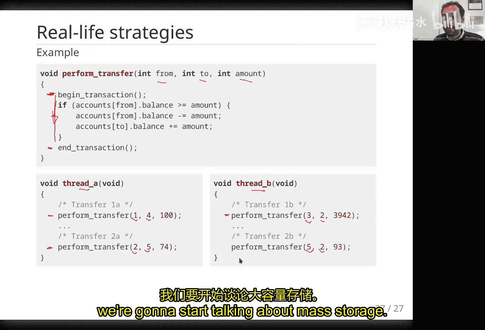

# 017：死锁（第二部分）


在本节课中，我们将继续并完成关于死锁的讨论。我们将深入探讨处理死锁的不同策略，包括动态避免、预防以及一些实际应用中的技术，如无锁数据结构和事务内存。

---

## 概述回顾

上一节我们介绍了死锁的基本概念和四个必要条件。本节中，我们将看看如何通过不同的策略来应对死锁问题。

死锁是指在一个协作系统中的所有任务都被阻塞，无法继续执行。与段错误等每次执行都可能出现的错误不同，死锁和竞态条件非常难以通过测试发现，因为它们可能只在极罕见的情况下发生。因此，处理死锁通常需要在设计阶段就加以考虑。

## 处理死锁的策略

处理死锁主要有四种策略：鸵鸟算法（忽略）、检测与恢复、动态避免以及预防。上一节我们介绍了前两种，本节我们将重点讨论后两种。

### 动态避免 🛡️

动态避免策略的核心思想是，系统在分配资源时，会预先判断此次分配是否会导致系统进入“不安全状态”。只有在能保证系统始终处于“安全状态”的前提下，才会批准资源的请求。

这里引入一个关键算法：**银行家算法**。该算法要求每个任务预先声明其在整个执行过程中可能需要的**最大资源数量**。系统在收到资源请求时，会模拟分配后的状态，并检查是否存在一个能让所有任务都顺利完成执行的资源分配序列。如果存在，则批准请求；否则，让请求任务等待。

以下是银行家算法的一个简化示例：

假设系统有10个相同的资源，以及三个任务A、B、C。它们声明的最大需求分别是：
*   任务A：最多需要9个。
*   任务B：最多需要4个。
*   任务C：最多需要7个。

当前分配情况是：A有3个，B有2个，C有2个，因此系统还剩3个可用资源。

现在，任务B请求2个资源。系统会模拟分配：
1.  假设批准请求：B拥有4个（达到其最大需求），系统剩余1个可用资源。
2.  考虑最坏情况：A和C同时请求其剩余的最大需求（A需要6个，C需要5个）。当前资源不足，A和C等待。
3.  由于B已拥有其所需全部资源，它可以运行完毕，然后释放其拥有的4个资源。
4.  系统现在有5个可用资源，可以满足C的请求（5个）。C运行完毕，释放7个资源。
5.  系统现在有7个可用资源，可以满足A的请求（6个）。A运行完毕。

由于存在这样一个让所有任务都能完成的序列，系统处于安全状态，因此可以批准B的请求。

然而，如果任务A此时请求1个资源，模拟分配后会进入一个可能导致死锁的状态，因此系统会拒绝A的请求，让其等待。

动态避免的缺点是，很难准确预知任务的最大资源需求，且算法本身开销较大。在实际系统中，它主要用于数据库、银行系统等对正确性要求极高的特定领域。

### 预防 🔧

预防策略旨在通过系统设计，从根本上破坏死锁四个必要条件中的至少一个，使死锁无法发生。这通常需要改变应用程序或同步机制的代码。

以下是针对每个条件的预防方法：

**1. 破坏“互斥与有限资源”条件**
*   **增加资源数量**：例如，在哲学家就餐问题中，增加一把餐叉即可预防死锁。
*   **虚拟化资源**：不让任务直接持有物理资源。例如，打印任务提交到打印队列，由队列调度，避免了进程直接锁定打印机。
*   **使用无锁数据结构**：设计无需加锁即可安全并发访问的数据结构，从根本上消除对互斥锁的需求。

**2. 破坏“持有并等待”条件**
*   **两阶段锁**：任务在第一阶段尝试获取所需的所有资源，如果成功则进入第二阶段执行操作，最后释放所有资源。如果获取任何资源失败，则释放所有已获资源并重试。这避免了“持有一个，等待另一个”的情况。但可能导致饥饿和代码复杂度增加。

**3. 破坏“不可抢占”条件**
*   让资源可以被系统强制收回。这通常很难实现，因为像锁这样的抽象概念无法被安全地“夺走”。仅适用于可以保存和恢复状态的特殊资源，如内存页（可被换出到磁盘）。

**4. 破坏“循环等待”条件**
*   **强制顺序获取资源**：为所有资源赋予一个全局顺序（编号），要求所有任务必须严格按照资源编号递增的顺序申请资源。例如，在哲学家就餐问题中，让大多数哲学家先拿右手叉，但让最后一位哲学家先拿左手叉，这样就破坏了循环等待链。

## 现实中的策略与高级概念

### 活锁 💃

活锁与死锁类似，任务都无法取得进展，但区别在于任务并未阻塞，而是在不断执行某种“避让”逻辑，结果却相互阻碍，无法前进。就像两个人在走廊迎面相遇，同时向同一侧避让，结果仍然面对面，持续重复这个过程。活锁很难检测，因为任务看起来仍在“忙碌”。

### 实际系统中的应用

*   **鸵鸟算法**：在许多普通应用程序中最为常见，即忽略死锁问题。
*   **动态避免实例**：在某些系统调用中可见，如`lockf`（文件锁）和`pthread_mutex_lock`（当线程试图重复锁定同一个已拥有的互斥锁时，会返回`EDEADLK`错误）。
*   **预防策略**：需要程序员精心设计代码，是编写高可靠性并发程序的关键。

### 无锁数据结构示例 🧱

无锁数据结构利用处理器的原子指令（如**比较并交换**）来实现并发安全，而无需使用互斥锁。

以无锁栈的`push`操作为例，其核心伪代码如下：
```c
void stack_push(Stack* s, Data data) {
    Node* n = new Node(data);
    do {
        n->next = s->top; // 读取当前栈顶
    } while (!compare_and_swap(&(s->top), n->next, n)); // 尝试将栈顶更新为新节点
}
```
`compare_and_swap`原子指令检查`s->top`是否仍等于我们之前读到的`n->next`，如果是，则将其更新为新节点`n`；否则失败重试。这样，即使多个线程同时执行`push`，最终栈的状态也是一致的。

### 事务内存 💾

事务内存是一种乐观并发控制机制。任务将一段临界区代码声明为一个“事务”。事务执行期间，所有修改先保存在本地缓冲区。提交时，系统原子性地检查事务涉及的内存区域在事务执行期间是否被其他任务修改过。如果没有冲突，则提交所有修改；如果有冲突，则事务中止并重试。这类似于数据库的事务，避免了使用锁，提高了并发性。

---

## 总结



本节课我们一起学习了处理死锁的后两种核心策略：动态避免和预防。动态避免（如银行家算法）试图在资源分配时做出安全决策，而预防则通过破坏死锁的必要条件来根治问题。我们还了解了活锁的概念，并探讨了在实际编程中应用预防思想的先进技术，如无锁数据结构和事务内存。理解这些策略有助于我们设计出更健壮、更高效的并发系统。