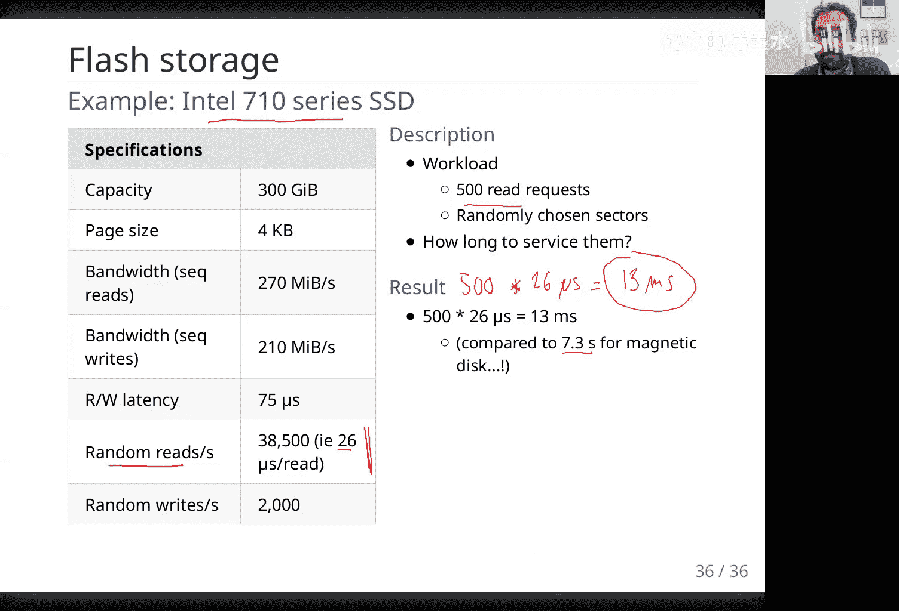

# 019：存储技术（第二部分）

在本节课中，我们将继续探讨存储技术。我们将完成关于机械硬盘的讨论，然后深入了解闪存的工作原理。我们将学习如何通过调度算法优化硬盘访问，并比较不同存储技术的性能差异。

## 回顾：存储技术概览

上一节我们介绍了不同的存储技术。SRAM（静态随机存取存储器）主要用于片上缓存，完全由晶体管构成。DRAM（动态随机存取存储器）用于主内存，由晶体管和电容器组成，需要定期刷新。我们还简要介绍了二级存储技术，如机械硬盘和闪存，本节课将对此进行深入探讨。

## 机械硬盘调度算法

上一节我们介绍了机械硬盘的访问时间由寻道时间、旋转延迟和传输时间三部分组成。其中，寻道时间和旋转延迟是主要开销。为了最小化这些开销，操作系统可以使用磁盘调度算法来重新排列I/O请求的顺序。

以下是几种常见的磁盘调度算法：

### 先来先服务（FCFS）

这是最简单的算法，按照请求到达的顺序进行处理。其优点是公平，但缺点也很明显：磁头可能会在盘片上来回大幅度移动（称为“摆动”），导致总寻道距离很长。

**示例**：假设磁头起始位置在53号磁道，请求队列为 `[98, 183, 37, 122, 14, 124, 65, 67]`。FCFS算法的磁头移动总距离为640个磁道。

### 最短寻道时间优先（SSTF）

此算法总是选择距离当前磁头位置最近的请求进行服务。这能显著减少磁头移动距离。

**示例**：使用相同的起始位置和请求队列，SSTF算法的磁头移动总距离降至236个磁道。然而，它存在“饥饿”问题：如果不断有新的请求到达磁头当前位置附近，那么远处的请求可能永远得不到服务。

### 电梯算法（SCAN）

为了解决饥饿问题，SCAN算法让磁头只朝一个方向移动，服务沿途的所有请求，直到到达该方向的尽头，然后调转方向继续服务。这类似于电梯的运行方式。

**示例**：SCAN算法进一步将总移动距离减少到208个磁道。但它对中间区域的请求服务更频繁，不够公平。

### 循环扫描算法（C-SCAN）

C-SCAN是SCAN的变体，旨在提高公平性。磁头只朝一个方向移动并服务请求，到达尽头后，立即快速返回起点（不服务请求），然后重新开始循环。

**示例**：C-SCAN算法的总移动距离为236个磁道（包括快速返回的行程）。一个优化版本称为C-LOOK，它只移动到最后一个请求的位置就返回，而不是移动到物理尽头，从而节省了时间。

### 其他算法变体

*   **R-C-SCAN**：考虑旋转延迟，可能选择先服务即将旋转到磁头下的请求，即使它不在最近磁道上。
*   **F-SCAN**：使用两个队列。磁头服务当前队列时，新到达的请求放入另一个队列，待当前队列清空后再交换。这防止了新请求“插队”影响旧请求。
*   **N-SCAN**：F-SCAN的多队列扩展版本。

### 算法选择策略

没有一种算法在所有情况下都是最优的。最佳选择取决于工作负载：
*   低负载时，使用简单的FCFS即可。
*   负载增加时，切换到SSTF以提高效率。
*   负载极高，可能出现饥饿时，应切换到SCAN或C-SCAN等电梯算法以保证公平性。

### 调度效果示例

让我们量化调度算法的收益。回顾上节课的例子：服务500个随机读请求。
*   使用FCFS（无调度）时，总时间超过7秒。
*   使用C-LOOK算法后，我们可以估算平均寻道距离。假设请求均匀分布，磁头从一端移动到另一端服务所有请求，平均寻道距离很短。计算后，总服务时间降至约3.3秒，性能提升了一倍以上。

## 闪存技术

现在，让我们转向另一种重要的存储技术：闪存。与机械硬盘不同，闪存没有活动部件，完全由晶体管构成。这使得它的随机访问性能更好、功耗更低、抗物理冲击能力更强，但成本也更高。

### 闪存的工作原理

闪存的核心是浮栅晶体管。在标准晶体管（控制栅、源极、漏极）中，浮栅被绝缘体包围，可以捕获或释放电子。

**存储原理**：
1.  **写入（编程）**：向控制栅施加高电压，使电子隧穿进入浮栅，改变晶体管的阈值电压。
2.  **读取**：向控制栅施加一个中间电压。根据浮栅是否带电（即阈值电压不同），电流能否流过晶体管，从而判断存储的是0还是1。
3.  **擦除**：施加反向高电压，将电子从浮栅中移除，使单元恢复初始状态。

现代闪存使用多级单元（MLC）技术，通过精确控制浮栅电荷量，在一个晶体管中存储多个比特（如2比特，表示00, 01, 10, 11）。

### 闪存的架构

闪存按层次组织：
*   **页**：读写的基本单位，通常为4KB。
*   **块**：由多个页组成（如128页），是擦除的基本单位。
*   **平面**：包含多个块。
*   **芯片**：包含多个平面，不同平面可以并行操作以提高吞吐量。

**重要特性**：
1.  读操作很快（约10微秒）。
2.  写操作较慢（约100微秒），且只能写入空页。
3.  擦除操作很慢（约1-3毫秒），且必须以块为单位进行。

### 闪存转换层与写入放大

由于不能覆盖写入，直接管理闪存效率很低。例如，要更新一个页，需要将整个块读入内存，擦除该块，再写回所有旧页和新页。这称为“写入放大”，性能极差。

解决方案是引入**闪存转换层**。FTL在逻辑地址（操作系统看到的）和物理地址（闪存实际的）之间建立动态映射。

**工作流程**：
1.  操作系统请求写入逻辑页A。
2.  FTL将数据写入一个空的物理页X。
3.  FTL更新映射表，将逻辑页A指向物理页X。原物理页A被标记为无效。
4.  当块中无效页积累到一定程度，FTL会启动垃圾回收：将有效页复制到新块，然后擦除旧块以供重用。

这种方法将昂贵的块擦除成本分摊到多次写入中，大大提升了性能。

### 闪存的挑战与优化

闪存面临磨损和读干扰等问题：
*   **磨损**：每个块有擦除次数限制（如1万次）。
*   **读干扰**：读取可能影响相邻单元的电荷。

**优化技术**：
*   **纠错码**：检测和纠正比特错误。
*   **磨损均衡**：FTL通过动态映射，确保所有块被均匀使用，避免部分块过早磨损。
*   **预留空间**：固态硬盘的实际物理容量大于标称容量，多出的部分用于替换坏块和进行磨损均衡操作。

### 性能对比

让我们再次使用500个随机读请求的例子来对比性能。使用一个典型的固态硬盘规格：
*   随机读取延迟：约25微秒
*   计算：`500 * 25 微秒 = 12.5 毫秒`

这与机械硬盘的7秒多形成了天壤之别，这也是固态硬盘速度远超机械硬盘的原因。由于没有机械运动，固态硬盘通常不需要复杂的I/O调度算法，FCFS顺序处理即可。

## 总结

本节课我们一起学习了存储技术的后半部分。我们深入探讨了机械硬盘的磁盘调度算法，如FCFS、SSTF和SCAN，了解了它们如何通过减少寻道时间来提升性能。接着，我们转向闪存技术，学习了其基于浮栅晶体管的工作原理、独特的“写前擦除”特性以及通过闪存转换层（FTL）管理写入和磨损均衡的关键机制。最后，我们通过性能对比，直观地看到了固态硬盘在随机访问上的巨大优势。下一节课，我们将探讨操作系统如何利用这些存储设备来组织和管理文件系统。