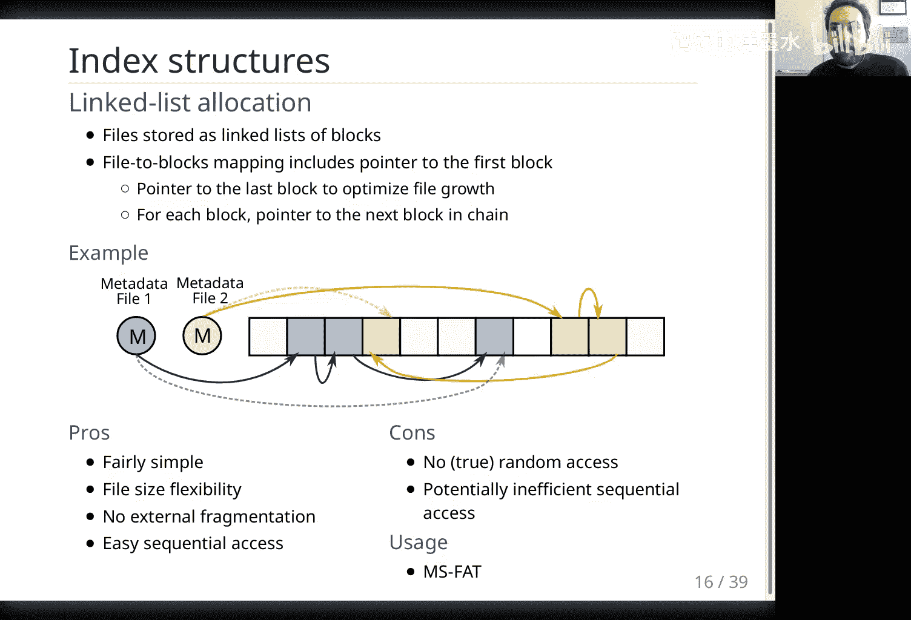

操作系统与系统编程：21：文件系统实现（第一部分）

在本节课中，我们将开始学习文件系统的具体实现。我们将探讨文件系统如何组织目录和文件，以及设计文件系统时需要考虑的各种目标和约束。

---

上一节我们回顾了文件系统的基本概念。本节中，我们来看看设计文件系统时希望达成的目标。

设计文件系统时，主要需要考虑以下几个目标：
*   **性能**：存储设备（如硬盘）存在物理限制。为了获得最佳性能，尤其是对于机械硬盘，我们需要利用**空间局部性**，即尽量将相关联的数据（如一个文件的所有数据块）连续地存放在存储设备上。
*   **灵活性**：文件系统需要支持各种类型、大小和访问模式的文件，包括小文件与大文件、顺序访问与随机访问的文件、频繁访问与极少访问的文件，以及存在时间极短或极长的文件。
*   **开销**：除了用户可见的目录和文件，文件系统自身还需要维护一些内部数据结构（元数据）来进行组织管理，这部分开销应尽可能小。
*   **可靠性**：文件系统应尽可能抵抗硬件故障或系统崩溃，确保数据的长期安全。

---

在深入实现细节之前，我们需要理解文件系统所面临的工作负载类型。以下是几个关键观察：

以下是几个典型的工作负载示例：
*   **文件大小分布**：在典型的计算机系统中，**大多数文件都很小**（例如，平均每个可执行文件约35KB）。然而，**少数大文件占据了绝大部分的存储空间**（例如，一个虚拟机磁盘文件可能占用20GB）。
*   **文件访问模式**：**大多数被访问的文件都很小**（例如，启动Chrome浏览器一秒钟内可能打开超过500个文件）。然而，**处理大文件时会产生最多的I/O传输**（例如，复制一个20GB的文件可能需要62秒）。
*   **访问顺序**：**大多数文件是顺序访问的**（从头到尾读取，如配置文件或加载程序代码）。**随机访问**（如数据库操作）相对较少。
*   **文件大小预知性**：有些文件在创建时就知道其大小（如下载文件）。而有些文件在创建时大小未知（如程序运行时的输出重定向文件）。

---

另一个重要的设计考虑是数据块的大小。存储设备（如硬盘）的基本读写单位是扇区（通常512字节）。操作系统通常会将多个连续的扇区组合成一个**逻辑块**进行管理。

选择块大小时需要权衡：
*   **大块**：管理开销小（需要跟踪的块数少），性能好（一次读取连续扇区效率高）。但可能导致**内部碎片**，即块未完全利用，浪费空间。
*   **小块**：空间利用率高，内部碎片少。但管理开销大（需要跟踪更多块），且文件数据可能分散在不连续的扇区上，性能较差。

一个常见的折中方案是将块大小设置为与内存页大小匹配（通常为4KB）。这样，从磁盘读取一个块时，可以方便地将其载入一个内存页。

---

综合以上讨论，我们对文件系统的需求有了更清晰的认识：

对于小文件：
*   较小的块更合适，能更好地匹配文件大小。
*   相关联的文件（如位于同一目录）的数据应尽量在物理存储上靠近存放，以利用空间局部性。

对于大文件：
*   较大的块更高效，因为表示整个文件所需的块数更少。
*   文件数据最好连续存放，以便快速顺序访问。
*   需要支持高效的随机访问。

核心挑战在于：**文件创建时，我们通常无法预知其最终大小、生命周期和访问模式**。

---

现在，让我们开始探讨文件系统的具体实现。文件系统的核心任务是：给定一个文件名和一个偏移量，能够定位到存储设备上对应的具体数据块。

为了实现这一目标，我们需要几种关键的数据结构：
1.  **目录结构**：用于管理文件名到文件编号（如inode号）的映射。
2.  **索引结构**：用于表示一个文件的数据块在物理磁盘上的位置。
3.  **空闲空间管理**：用于跟踪磁盘上哪些数据块是可用的，以便为新文件分配空间。

此外，实现这些结构时，需要运用**局部性启发式方法**来优化文件和目录的组织，以提升访问性能。

---

首先，我们来看目录的实现。本质上，**目录也是一个文件**，只不过其内容具有特殊含义：它是一个包含文件名到文件编号映射的列表。

目录文件受到操作系统保护，用户程序只能通过特定的系统调用来查询，而不能直接读写其原始字节，以防止破坏文件系统结构。

文件系统可以采用不同的层次结构组织文件：
*   **单层扁平结构**：只有一个根目录，所有文件都位于其中。简单但限制大，不适合多用户或多层次组织。
*   **每用户根目录**：每个用户有自己的根目录。解决了用户隔离问题，但每个用户内部仍缺乏层次。
*   **多层树状结构**：现代操作系统采用的通用结构。一个根目录下可以创建子目录，形成灵活的树状层次。

目录文件本身也有不同的组织方式：

**1. 线性列表**
目录文件是一个定长条目（如32字节）的数组。每个条目包含文件名和文件编号等信息。空闲条目有特殊标记。
*   **优点**：实现极其简单。
*   **缺点**：查找文件需要线性扫描整个目录，速度慢。

**2. 链表**
目录条目以链表形式组织。每个条目除了文件名和文件编号，还包含一个指向下一个有效条目的指针。
*   **优点**：可以跳过空闲条目，略微提升遍历效率。文件创建和删除（管理空闲空间）相对简单。
*   **缺点**：查找文件仍需遍历链表，时间复杂度仍是线性的。

**3. 树形结构（如B+树）**
将文件名哈希成一个键，然后用这个键在树（如B+树）中进行查找，最终在叶子节点找到文件名到文件编号的映射。
*   **优点**：对于包含成千上万个文件的目录，查找效率高（对数复杂度）。
*   **缺点**：实现和管理复杂。
*   **应用**：现代文件系统如Linux的XFS、Windows的NTFS使用此类方法。

---

解决了文件名到文件编号的映射后，接下来需要解决如何通过文件编号找到文件数据。这就是**索引结构**的任务。

设计索引结构的目标包括：
*   **数据局部性**：尽量让文件的数据块连续存储。
*   **支持随机访问**：能够快速跳转到文件任意位置。
*   **支持各种大小的文件**。
*   **高效管理元数据**。

以下是几种基本的索引（分配）策略：

**1. 连续分配**
文件的元数据只需记录两个信息：**起始块地址**和**文件长度（块数）**。文件的所有数据块在磁盘上连续存放。
*   **优点**：
    *   实现简单。
    *   **顺序访问和随机访问性能极佳**。要访问文件中间部分，可以轻松计算出对应块的位置：`目标块地址 = 起始块地址 + (偏移量 / 块大小)`。
*   **缺点**：
    *   **文件增长困难**：如果文件需要扩大，但其后没有连续空闲空间，可能需要对整个文件进行耗时的迁移。
    *   **外部碎片**：磁盘上可能存在许多小的空闲空间碎片，它们总和很大，但因为没有足够大的连续空间，导致无法创建新的大文件。
*   **应用**：CD-ROM、DVD等一次性写入的光学介质。

**关于碎片化的补充说明**：
*   **内部碎片**：分配给文件的块内部未使用的空间。与块大小选择有关。
*   **外部碎片**：磁盘上空闲空间的总量足够，但它们不是连续的，因此无法满足需要连续空间的请求。连续分配策略会受此影响。

**2. 链表分配**
文件的元数据包含一个指向**第一个数据块**的指针。每个数据块的末尾，存储着指向**下一个数据块**的指针。这些数据块在磁盘上可以是分散的。
*   **优点**：
    *   实现相对简单。
    *   **文件可以轻松增长**，只需在空闲空间找一个新块，并修改链表指针即可。
    *   **没有外部碎片**，任何空闲块都可以使用。
*   **缺点**：
    *   **顺序访问性能可能很差**：因为数据块物理上不连续，磁头可能需要大幅移动。
    *   **不支持高效的随机访问**：要访问文件第N块，必须从第一块开始，沿着指针依次读取，直到第N块。
    *   每个数据块需要额外空间存储指针。
*   **应用**：MS-DOS的FAT文件系统及本课程项目的基本思想与此类似。

---

本节课中，我们一起学习了文件系统实现的基础。我们首先明确了设计文件系统的目标（性能、灵活性等），并分析了典型的工作负载特征。然后，我们探讨了目录的几种实现方式（线性列表、链表、树）。最后，我们详细介绍了两种基本的数据块索引结构：**连续分配**（简单高效但易产生碎片）和**链表分配**（灵活但随机访问性能差）。

下一节课，我们将继续讨论更高级的索引结构，如FAT、inode等，它们旨在克服这些基本方法的局限性。